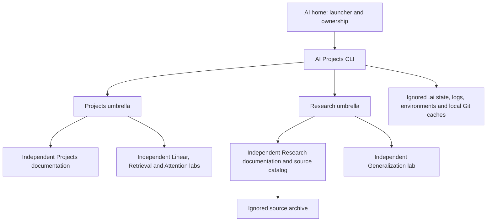

# Workspace architecture

Documentation builds read authored Markdown, local assets and the tracked catalog, never the raw archive. Child histories and parent pointers are separate. The master's area has no branch in this architecture.
