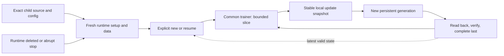

# Recovery flow — Colab Free training

COLAB.md is the canonical detailed contract. Completed markers require matching manifests/files. Failed copies preserve older verified state; runtime-local snapshots alone cannot recover a deleted VM. This is the required design, not an implemented training workflow.
