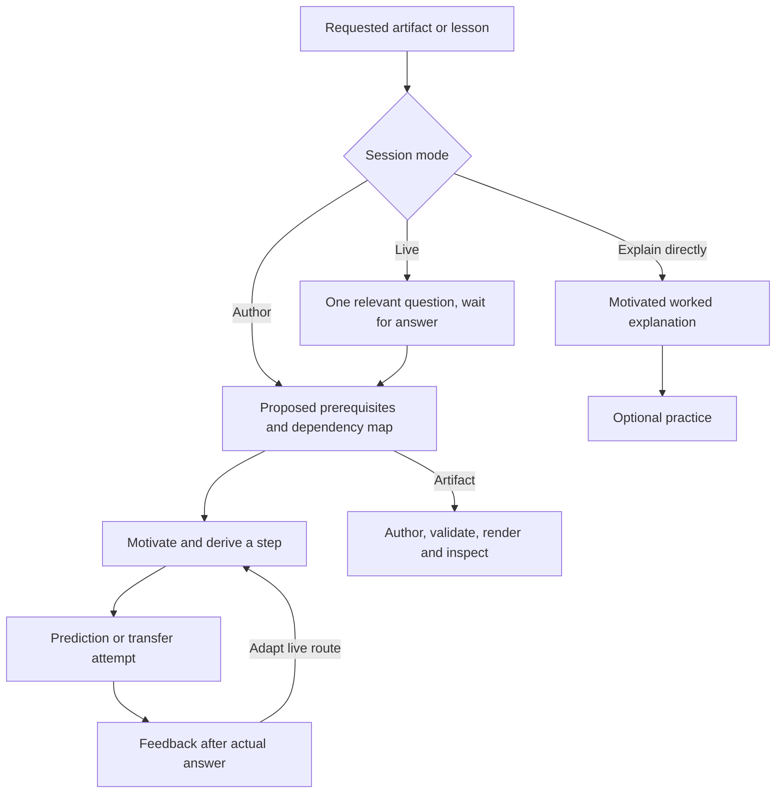

# Teaching and authoring route

These are authoring/session decisions, not model execution arrows. Artifact answers remain available behind reveals; live feedback requires an actual human reply. No learner replies or improved outcomes were observed here.
