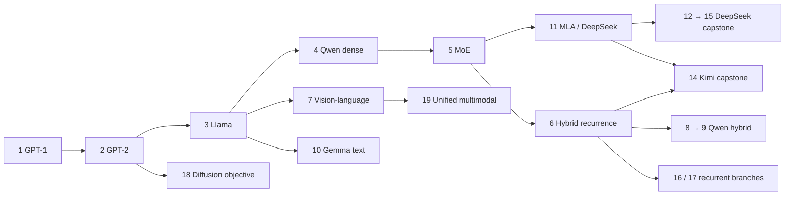
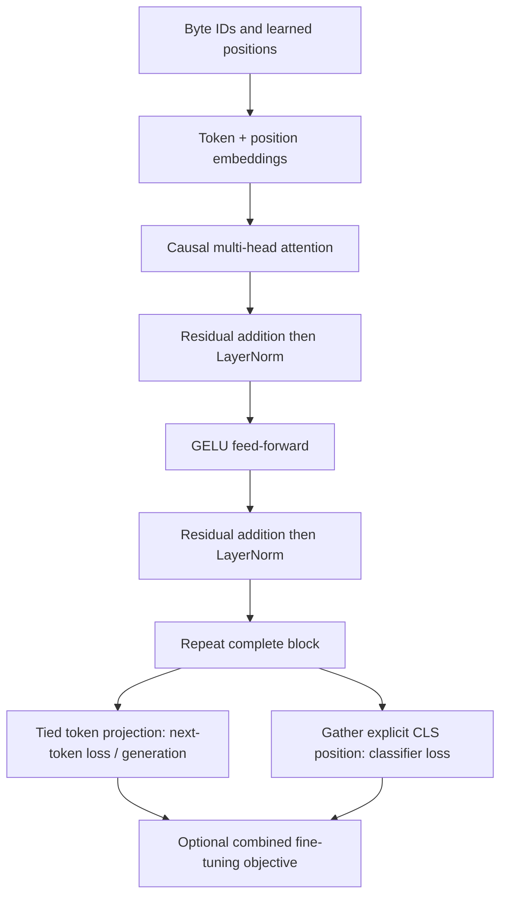
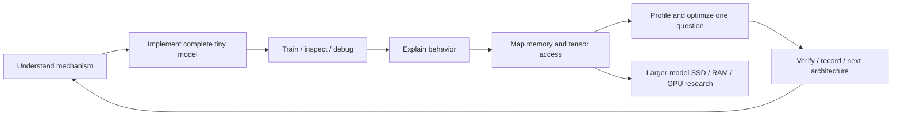

# Flows — proposed learning path and Project 1

These diagrams describe the plan, not implemented code.

Projects 1–5 establish the foundation; architecture learning continues through the remaining path. Branch arrows indicate learning prerequisites, not source-code dependencies between repositories.

The learning cycle is required. Real large-model experiments additionally require pretrained checkpoints, enforced memory budgets, measured I/O and quality/latency evidence.
