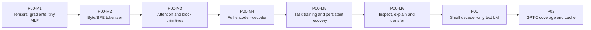

# Opening learning route

Updated: 2026-10-09
This diagram describes planned dependencies, not completed implementations.

P00 encoder states supply decoder cross-attention; P01 removes that path. P00 uses paper post-norm/sinusoidal/ReLU, P01 uses pre-norm/learned positions/GELU. Versioned tokenizer/trainer contracts transfer; model weights do not. Canonical architecture previews live under cli/docs/architecture/ and their existing owner package.
