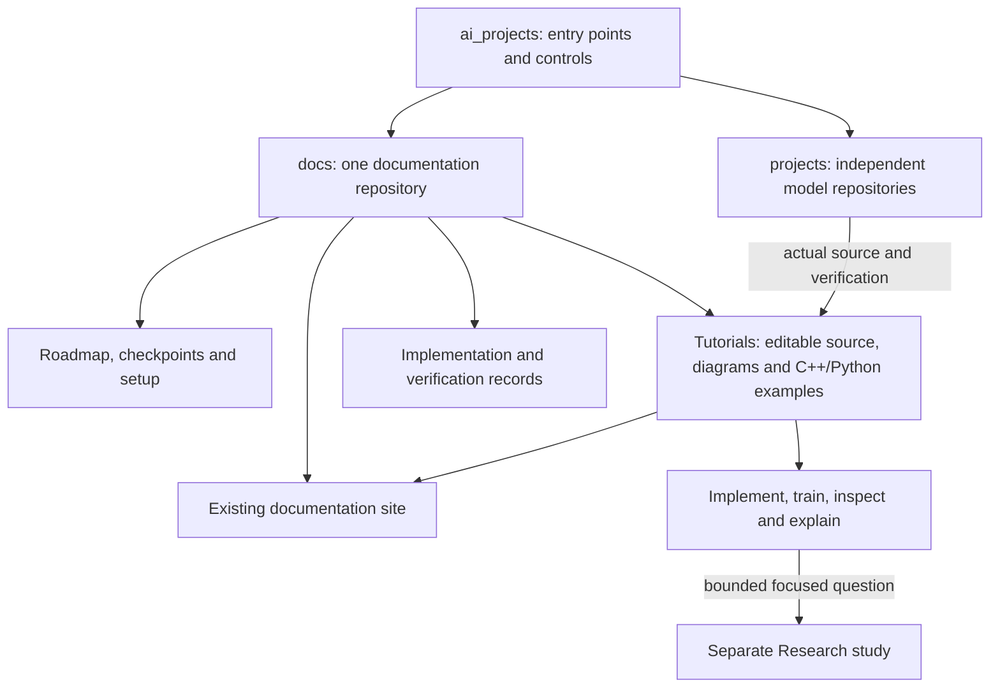

# Documentation ownership and learning flow

The source Diagram JSON for the lesson stays in its lesson.json; six compiled SVGs are beside it. Root architecture sources/images were refreshed using the existing renderer after the move.
