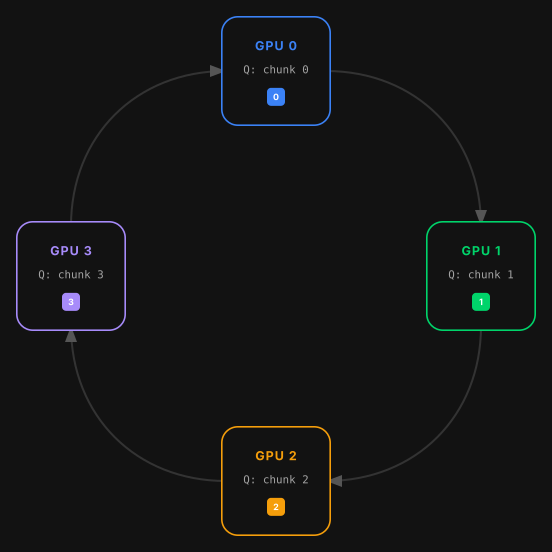
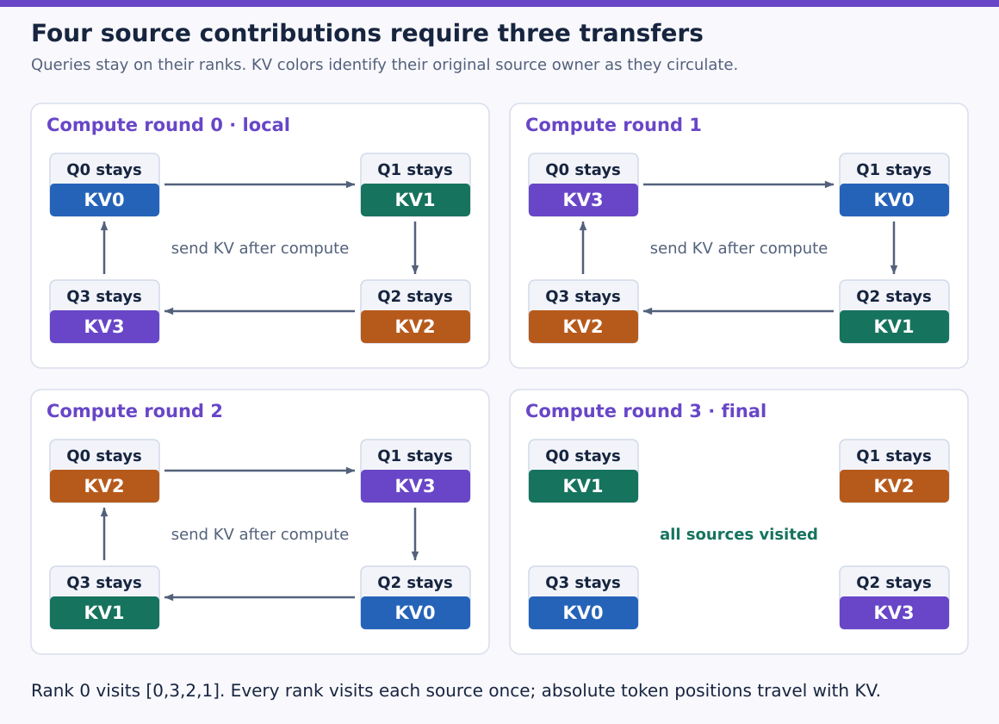
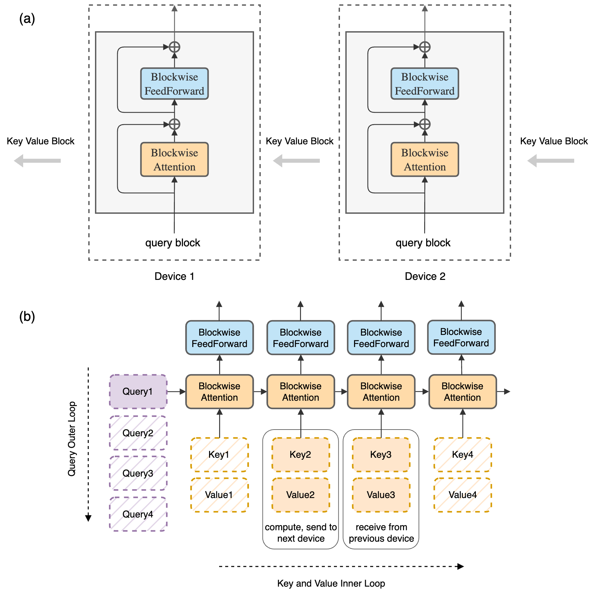
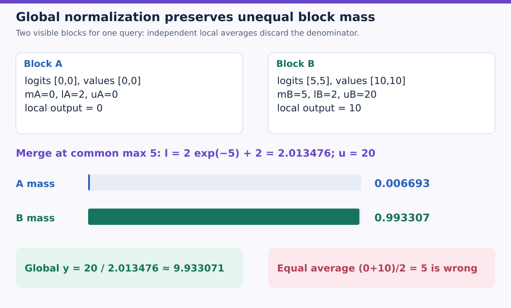
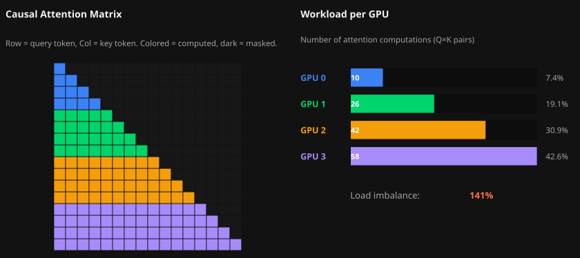
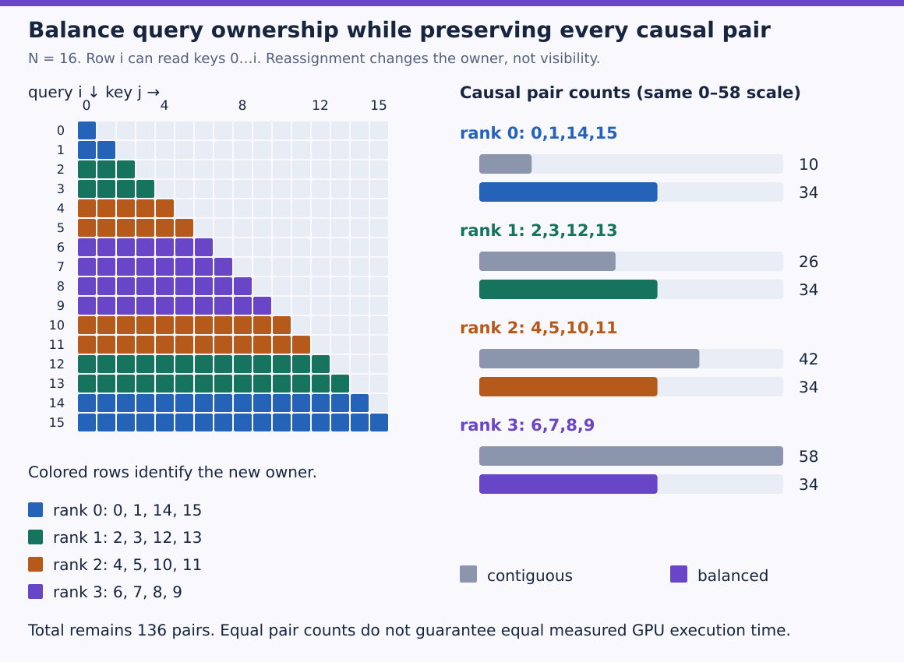
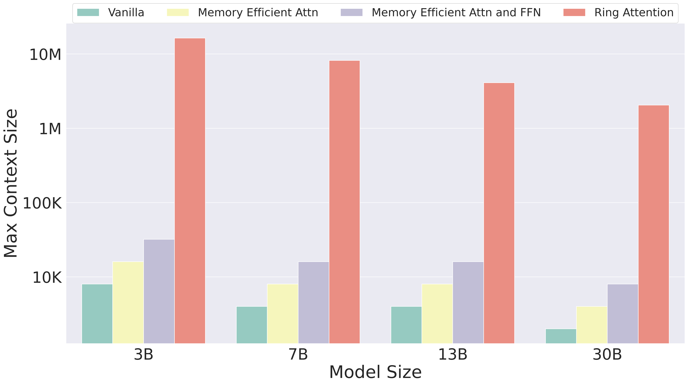

# Attention distribution: Ring Attention

How can distributed query blocks see every key without gathering all history on each device?

Learning material for attention-labs. Model implementation/training and learner mastery are separate states.

**Outcomes:** Trace every source-block round and merge global softmax mass correctly.; Preserve original causal coordinates and distinguish balance, bytes and physical execution..

## Ring Attention: keep queries local and circulate the sources

FlashAttention taught us that key/value tiles can contribute in any order if we merge their normalization statistics correctly. Now put those tiles on different devices. Each device owns some query positions and their outputs; key/value blocks travel around a ring until every query block has seen every source block. The mathematical target remains dense attention.

### Start with what stays and what moves



At the initial state, device0 holds Q0 and KV0, device1 Q1 and KV1, and so on. Q stays with its device. After each computation, send the current KV block to the next device and receive a block from the previous device. Incoming blocks carry their original source positions. A physical device number does not become a token's positional coordinate.

Splitting query rows alone is insufficient if every device still stores the entire historical K/V. The ring schedule keeps a local/current block and a receive buffer, visits sources incrementally and discards or forwards completed blocks. The fixed model parameters, outputs, normalization state, communication buffers and backward requirements still need memory accounting.

### Trace all four contributions, not just three transfers

For clockwise sends from rank r to $(r+1)\bmod4$, the source-block owner at rank r after round a is $(r-a)\bmod4$.

| Compute round | Rank0 sees | Rank1 sees | Rank2 sees | Rank3 sees |
| --- | --- | --- | --- | --- |
|0, local|KV0|KV1|KV2|KV3|
|1, after transfer1|KV3|KV0|KV1|KV2|
|2, after transfer2|KV2|KV3|KV0|KV1|
|3, after transfer3|KV1|KV2|KV3|KV0|

Every rank performs four source-block contributions and three transfers. Rank0's order is `[0,3,2,1]`. Stop after three computations and one source block is missing. Reverse the communication direction and the order changes, but the set of contributions must remain complete and unique.




Start at the upper left and follow the rounds across, then down. The upper label in each small box stays fixed because that rank keeps its queries. The colored lower label changes because its KV source travels. Arrows show the transfer after rounds 0, 1 and 2; there is no extra transfer needed after the final contribution. The owner color must never be used as the token’s positional coordinate.



In panel(a), each device retains responsibility for its local query output. In panel(b), the horizontal inner loop walks source blocks and carries partial attention state. The pointwise feed-forward network can operate locally once the relevant attention output is complete; its output does not require an all-device softmax. The diagram illustrates a full transformer scheduling context; our reference isolates attention rather than implementing every block operation.

### One global softmax requires more than local output averaging

For a query, source block b contributes a maximum $m_b$, exponential sum $l_b$ and unnormalized value numerator $u_b$. To merge two blocks, choose $m=\max(m_1,m_2)$ and compute

$$l=e^{m_1-m}l_1+e^{m_2-m}l_2,\quad u=e^{m_1-m}u_1+e^{m_2-m}u_2,\quad y=u/l.$$

The information being circulated is K/V; each local query retains its own normalization state as blocks arrive. A block's normalized output alone has discarded its mass. For logits `[0,0]` with values `[0,0]`, the local result is0. For logits `[5,5]` with values `[10,10]`, the local result is10. Their equal average is5, but the global result is

$$\frac{20e^5}{2+2e^5}=\frac{10e^5}{1+e^5}\approx9.933071.$$

The two blocks have very different partition masses. Correct merging preserves them. Floating-point summation order can still cause tiny differences, so equality is checked with a tolerance rather than a bit-for-bit assertion.




Both blocks contain two tokens, but token count does not determine their softmax mass. At common maximum 5, the first block’s denominator becomes 2 exp(−5), while the second keeps 2. The bars show each block’s fraction of the final denominator on one 0–1 scale. Almost all mass belongs to block B, so the global answer is about 9.933071. This is the same numerator/denominator merge invariant used in FlashAttention, applied to source blocks owned by different ranks.

### Predict or explain: Four ranks make three transfers; how many source-block contributions must each query group compute?

<details data-practice-id="ring-normalize"><summary>Reveal worked answer and rubric</summary>

Four: its initial local block plus three incoming blocks. Merge common-max numerators/denominators, not an equal average of local outputs.

**Rubric:** Account for the initial contribution and global normalization.

</details>


### Causality changes which cells of an incoming block contribute

Use original absolute query i and source j, permitting $j\le i$. An incoming block can be entirely future, entirely past or partially visible. Skip an entirely masked block; do not compute a softmax of all negative infinities. A partially visible block contributes only its permitted keys. This remains true after a noncontiguous token assignment.



For16 tokens split into four contiguous four-token query groups, permitted causal pair counts are `[10,26,42,58]`. Rank0's early queries have the **least** work and rank3's late queries the most. The guide's prose/table reverses this direction in places; its displayed numerical bars give the correct orientation for the usual lower-triangular convention.

A balanced assignment can pair early and late two-token chunks:

| Rank | Query positions | Causal pairs |
| --- | --- | --- |
|0|0,1,14,15|34|
|1|2,3,12,13|34|
|2|4,5,10,11|34|
|3|6,7,8,9|34|

All136 causal pairs still exist. Zigzag changes ownership, not the global attention graph. The reference compares both assignments with dense attention and reconstructs outputs in their original token order. Balanced mathematical pair counts do not guarantee equal measured kernel time: tile layout, masked work, sequence divisibility, network topology and scheduling matter.




Each row keeps exactly the same lower-triangular permitted cells. Color now says which rank owns that query: early rows pair with late rows. On the right, gray bars retain the old contiguous counts 10, 26, 42 and 58; colored bars become 34 each on the same scale. Add either set to obtain 136. The assignment changes work ownership without changing the attention function or creating a direct path to a future token.

### Count communication and identify the overlap condition

With P ranks and a local block of c tokens, each rank sends P-1 blocks. For one KV head of widths dk,dv and s bytes per element, sent payload is

$$ (P-1)c(d_k+d_v)s.$$

Our P=4,c=4,dk=3,dv=2,float64 case sends480 bytes per rank in the simulated schedule; aggregate sends are1920 bytes. This excludes protocol overhead, synchronization and backward gradient communication. It is a count, not a measurement from four physical GPUs.

Communication is not free because a topology is called a ring. It can be hidden when useful block computation overlaps transfer and lasts long enough, with sufficient buffers and actual asynchronous progress. Small blocks, slow interconnects or causal imbalance can expose transfer latency. Increasing the device count does not guarantee a linear speedup.

The guide's $S^2/P^2$ label describes a possible local pair tile if full local blocks are materialized. A fused blockwise implementation need not store that entire local score tile either. Count resident Q/output, current/received KV, normalization statistics and kernel workspace explicitly. Distributing sequence activations reduces each rank's retained sequence share; it does not remove the total quadratic dense comparison work.

### Execute a four-rank simulation and compare the complete result

Download [ring.py](examples/ring.py), run `python ring.py` with PyTorch, or upload it to Colab and run `!python ring.py`. CPU float64 is sufficient because ranks are simulated as groups of tensor indices. `ring` constructs every rank's visit order, processes its stationary queries with a running softmax triple and returns outputs in global order. It uses no distributed communication library.

```python
"""CPU simulation of four rank-owned Q blocks and circulating KV blocks."""
import json
import math
import torch


def dense(q,k,v,causal):
    scores=q@k.T/math.sqrt(q.shape[-1])
    if causal:scores=scores.masked_fill(torch.ones_like(scores,dtype=torch.bool).triu(1),-torch.inf)
    return scores.softmax(-1)@v


def ring(q,k,v,groups,causal=False,direction=1):
    ranks=len(groups);outputs=[None]*len(q);visits=[]
    for rank,query_ids in enumerate(groups):
        owners=[(rank-direction*round)%ranks for round in range(ranks)]
        assert sorted(owners)==list(range(ranks));visits.append(owners)
        for i in query_ids:
            m=None;l=None;u=None
            for owner in owners:
                ids=torch.tensor(groups[owner],dtype=torch.int64)
                if causal:ids=ids[ids<=i]
                if not len(ids):continue
                scores=q[i]@k[ids].T/math.sqrt(q.shape[-1])
                new_m=scores.max() if m is None else torch.maximum(m,scores.max())
                p=(scores-new_m).exp()
                if m is None:l=p.sum();u=p@v[ids]
                else:
                    correction=(m-new_m).exp()
                    l=correction*l+p.sum();u=correction*u+p@v[ids]
                m=new_m
            if m is None:raise ValueError('No visible sources')
            outputs[i]=u/l
    return torch.stack(outputs),visits


def run_checks():
    torch.manual_seed(131)
    q=torch.randn(16,3,dtype=torch.float64,requires_grad=True)
    k=torch.randn(16,3,dtype=torch.float64,requires_grad=True)
    v=torch.randn(16,2,dtype=torch.float64,requires_grad=True)
    contiguous=[list(range(4*r,4*r+4)) for r in range(4)]
    zigzag=[list(range(2*r,2*r+2))+list(range(2*(7-r),2*(7-r)+2)) for r in range(4)]
    for causal in [False,True]:
        expected=dense(q,k,v,causal)
        for groups in [contiguous,zigzag]:
            for direction in [1,-1]:
                actual,_=ring(q,k,v,groups,causal,direction)
                torch.testing.assert_close(actual,expected)
        actual,visits=ring(q,k,v,zigzag,causal)
        ga=torch.autograd.grad(actual.square().sum(),(q,k,v),retain_graph=True)
        gb=torch.autograd.grad(expected.square().sum(),(q,k,v),retain_graph=True)
        for a,b in zip(ga,gb):torch.testing.assert_close(a,b)
    counts=lambda groups:[sum(i+1 for i in group) for group in groups]
    assert counts(contiguous)==[10,26,42,58] and counts(zigzag)==[34]*4
    changed=v.detach().clone();changed[-1]+=100
    torch.testing.assert_close(ring(q,k,changed,zigzag,True)[0][:-1],dense(q,k,v,True)[:-1])
    scores=torch.tensor([0.,0.,5.,5.],dtype=torch.float64)
    values=torch.tensor([0.,0.,10.,10.],dtype=torch.float64)
    assert abs(float(scores.softmax(0)@values)-5)>4
    return {'rank0_kv_owner_rounds':visits[0],'causal_pairs_contiguous':counts(contiguous),
            'causal_pairs_zigzag':counts(zigzag),'sent_bytes_per_rank':3*4*(3+2)*8,
            'dense_outputs_gradients_both_directions_equal':True,'future_intervention_and_wrong_average_detected':True}


if __name__=='__main__':print(json.dumps(run_checks(),sort_keys=True))
```

Expected output includes rank0 rounds `[0,3,2,1]`, pair counts `[10,26,42,58]` and `[34,34,34,34]`, and480 sent bytes per rank. Both ring directions, both assignments, causal and bidirectional outputs agree with dense attention. Q/K/V gradients agree for the zigzag route. Changing the final value leaves earlier causal outputs unchanged. The unequal-mass example detects incorrect local-output averaging.

### Read the large-context bars within their experimental setting



The horizontal axis is model size, the logarithmic vertical axis maximum supported context in the authors' stated TPUv4-1024 training setting. Each group contains vanilla, memory-efficient attention, memory-efficient attention-plus-FFN and Ring Attention bars. These are reported capacity results for that configuration. They are not measurements made by the CPU simulation and do not show that any checkpoint can use arbitrarily long context with preserved quality.

Actual distributed validation must additionally exercise sends/receives, process failures, backward reductions, overlap, device memory, numerical dtype, masking and performance under the intended network. The written lesson and local math checks do not claim those results or a hosted Colab execution.

### Predict or explain: Does assigning early and late positions to one rank remove the causal mask?

<details data-practice-id="ring-causal"><summary>Reveal worked answer and rubric</summary>

No. Visibility still uses original absolute token positions. Zigzag changes ownership; a rank number or local order is not a positional coordinate.

**Rubric:** Preserve the global graph while changing distribution.

</details>


[Implementation and commands](project/implementation.md) · [Readiness and limits](project/readiness.md) · [Transfer review](practice/review.md)

### References

- [Vizuara context-parallelism visual guide](https://vizuaraai.github.io/5d-parallelism-visual-guide/context-parallelism.html), ring mechanism and causal zigzag sections. The initial ring and causal-workload panels are passive vector exports of the source's rendered geometry, labels and visual styles; the original interactive guide remains available here.
- [Ring Attention with Blockwise Transformers](https://arxiv.org/html/2310.01889v4), Sections2–3, Algorithm1 and both original capacity/architecture figures with every panel and bar.
- Additional worked SVG figures are original to this tutorial; their inputs and calculations follow the complete executable reference above.


## Evidence and proof limits

### Claim ledger

| Claim | Status | Proof limit |
| --- | --- | --- |
| Simulated ring traversal with common-maximum normalization reproduces dense outputs/gradients; absolute-position masks survive contiguous or balanced token ownership. | verified | Stated mathematical assumptions and executed tiny reference; no learner, hosted or full-model result. |

## Sources

- [Vizuara context parallelism](https://vizuaraai.github.io/5d-parallelism-visual-guide/context-parallelism.html) — Ring mechanism and zigzag sections; checked 2026-10-30
- [Ring Attention](https://arxiv.org/html/2310.01889v4) — Sections2–3; Algorithm1; Figures1–2; checked 2026-10-30
