# Attention foundations: from fixed summaries to causal retrieval

How do contextual mixtures arise, and what changes when we learn scores, projections and visibility?

Learning material for attention-labs. Model implementation/training and learner mastery are separate states.

**Outcomes:** 1. A map of the attention family; 2. Before attention: build the translation machine; 3. Additive attention: let the decoder look back; 4. Dot products, scale and the softmax bars; 5. Simplified self-attention: every word gets a context; 6. Learned self-attention: queries, keys and values; 7. Causal attention: hide the future, then apply dropout.

## 1. A map of the attention family

Open two language-model descriptions and you may find **GQA**, **RoPE**, **causal attention**, **MLA**, and **FlashAttention** in the same paragraph. Are these competing ways of doing one operation? Could a model use several together? Before calculating attention, we need a way to ask what each name changes.

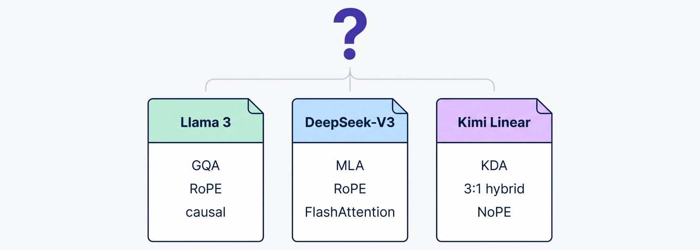

Read each card vertically. The Llama 3 card combines a head arrangement, a positional method and a visibility rule. DeepSeek-V3 adds a different way of representing keys and values. Kimi Linear combines recurrent attention layers with periodic full-attention layers. These lists describe several decisions inside a model. Learning a separate name without locating its job makes the list look much harder than it is.

This opening lesson builds the map. The next lesson starts the mechanism itself: a translation system reads a sentence, compresses it, and tries to produce another sentence. We will first understand why that fixed compression causes difficulty, then construct attention as a remedy.

### First see the operation the family grows around

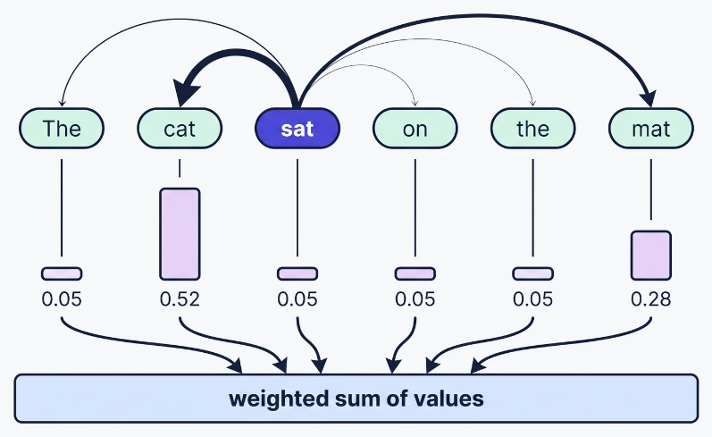

The highlighted word, **sat**, is the position asking for information. Follow its arrows toward the other words, then follow the bars down into the weighted sum. The larger bar for **cat** means more of that position's value is included; **mat** also contributes strongly. Smaller bars still contribute. Attention does not have to choose exactly one word.

These are illustrative weights over the six positions in “The cat sat on the mat”. They are rounded, so the displayed numbers add to 1.00. The returned object is a mixture of numerical value vectors, not the next predicted word. A later model component makes vocabulary predictions. We will open the scoring and normalization that produce these bars in the following lessons.

Now imagine changing one aspect: forbid looking at future words, use several independent mixtures, or compute the same mixture with less GPU memory traffic. All three changes concern attention, but they solve different problems. That is why the family needs a map.

### Seven questions organize the names

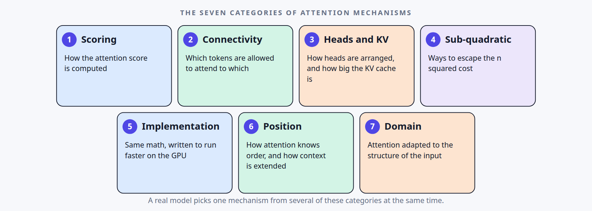

Read across the top row, then across the bottom. Each box asks a different design question.

**1. Scoring — how do we measure compatibility?** A position requesting information is represented by a query; available positions have keys. A scoring function compares a query with each key. Additive attention uses a small learned network. Dot-product attention multiplies corresponding coordinates and adds them. Scaled dot-product attention also controls the magnitude of that sum. We will derive those choices rather than treating their names as explanations.

**2. Connectivity — which information paths are available?** A causal rule permits the current and earlier positions while excluding future ones. Bidirectional visibility can permit both directions. Self-attention obtains queries and memory from one sequence; cross-attention retrieves from another sequence. Sequence origin and visibility are related questions, but they are not identical: self-attention may be causal or bidirectional.

**3. Heads and KV — how are retrieval channels arranged and stored?** Multiple heads perform separately parameterized comparisons. MHA, MQA, GQA and MLA arrange or represent these channels differently. During token-by-token generation, a key/value cache retains information from previous positions. Its size depends on these choices as well as sequence length. We will keep MHA and later head/KV techniques together in **Attention Heads**.

**4. Sub-quadratic methods — how do we avoid every possible pair?** For a sequence of length $n$, unrestricted pairwise attention compares $n$ queries with $n$ keys. This gives $n^2$ pairs. Sparse methods retain selected connections. Linear/recurrent methods change the mathematical organization so a state can summarize the past. Their outputs and tradeoffs need to be examined individually.

**5. Implementation — how do we execute the operation efficiently?** FlashAttention reorganizes exact dense attention around GPU memory and tiling. PagedAttention addresses key/value memory organization and sharing. Ring Attention distributes work and communication. These names do not, by themselves, mean that the score formula has changed.

**6. Position — how does order enter the computation?** The same word at the beginning and end of a sentence may play different roles. Sinusoidal encodings, RoPE, ALiBi and context-extension methods address aspects of position. Naming an ordering method does not specify the head arrangement or the visibility rule.

**7. Domain — what structure does an input position have?** Text is a sequence. An image has a spatial grid. A graph has nodes and edges. Image windows, deformable sampling, graph attention and cross-modal retrieval adapt information exchange to these structures.

Use the map as an organizing tool, not a claim that a research method can affect only one box. Sliding windows affect both connectivity and cost; position and caching can interact. A model combines choices across several boxes.

### Four reasons a new method might be useful

The seven questions can be grouped into four practical concerns:

| Concern | Questions to ask | Categories |
| --- | --- | --- |
| What is computed? | How are scores formed? Which query–key pairs are permitted? | Scoring and connectivity |
| What does it cost? | How much state must be stored? How does work grow with length? | Heads/KV and sub-quadratic methods |
| How is it executed? | How much data moves between slow and fast memory? Can work be tiled or distributed? | Implementation |
| What structure is represented? | How does the model know order? Is the input text, an image, a graph or several modalities? | Position and domain |

For example, suppose two implementations return the same attention output, but one moves fewer intermediate arrays through GPU memory. That is an implementation improvement. If another method removes most query–key connections, its mathematical information paths have changed too. Comparing only speed would miss that difference.

Likewise, reducing the number of stored key/value heads can reduce cache memory, but it does not automatically remove the quadratic pairwise work of a full-sequence dense attention layer. Memory size, arithmetic work and measured runtime are different quantities.

### Follow one combination: Llama 3

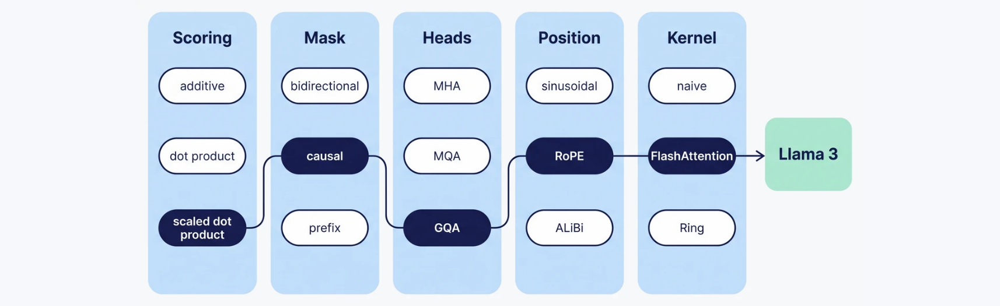

Follow the dark choices from left to right. The score is scaled dot-product. The mask is causal. The head arrangement is grouped-query attention. Position is represented with RoPE. The operation can run through FlashAttention kernels.

Nothing about choosing GQA requires replacing the causal rule. Changing the positional method does not automatically change the score into an additive neural network. This is the useful sense in which the choices can be considered separately. They still have to be integrated correctly in a real implementation.

Also, these choices do not specify a complete model. Layer count, hidden width, feed-forward blocks, normalization, vocabulary, training data and objective still matter. Two models can agree on the attention choices and have very different capabilities.

### Compare models by holding the questions fixed

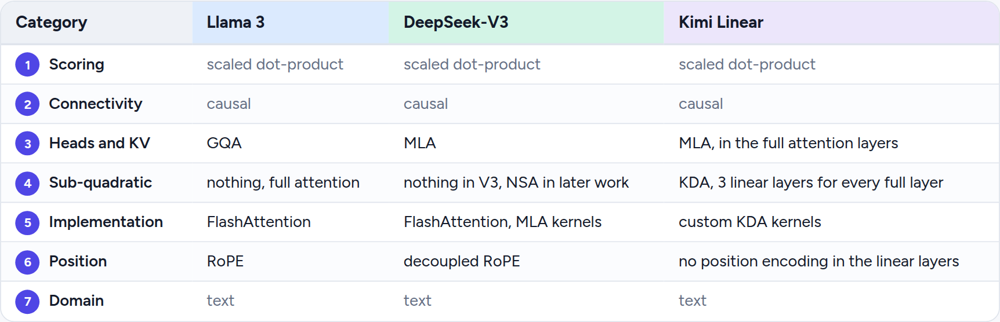

Read **across a row** before comparing whole columns. The causal row asks the same question for every model. The heads/KV row distinguishes GQA from MLA. The sub-quadratic row distinguishes an all-full-attention stack from a hybrid containing KDA layers. The domain row says all three examples are text models.

Hybrid models require particular care. Kimi Linear uses a 3:1 pattern of KDA layers and full MLA layers. The full-attention scoring entry does not describe the KDA recurrence. Its NoPE design applies to the MLA layers; the KDA dynamics carry order and recency information. Do not read the compact position entry as “the whole model has no way to represent order”.

The purpose of this comparison is to practice decomposing a specification. It is not a performance ranking, and methods introduced in later DeepSeek work should not be silently assigned to DeepSeek-V3. When you inspect a model, identify its exact version and layer type before filling in the rows.

### What you need before the calculations

You should recognize a vector, matrix multiplication, a neural-network parameter, an MLP, backpropagation, an embedding and softmax. You do not need to know the Transformer architecture already. We will explain each object's role and shape when it enters the mechanism.

If you already know the formula $\operatorname{softmax}(QK^\top/\sqrt{d_k})V$, check whether you can explain its axes, its normalization direction, the source of each matrix and the visibility rule. Being able to reproduce the notation is a weaker check than being able to calculate one row and predict a changed input.

### The full family has eight modules

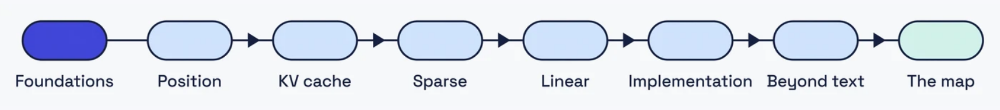

The module names are broader than individual lecture numbers. A module can need several lectures. The route is ordered so each problem becomes understandable before its remedy.

**Foundations.** Start with recurrent sequence-to-sequence translation, inspect its fixed-vector bottleneck, then develop additive, dot-product and scaled dot-product scoring. Continue into self-attention, learned projections, masks, cross-attention and multiple heads.

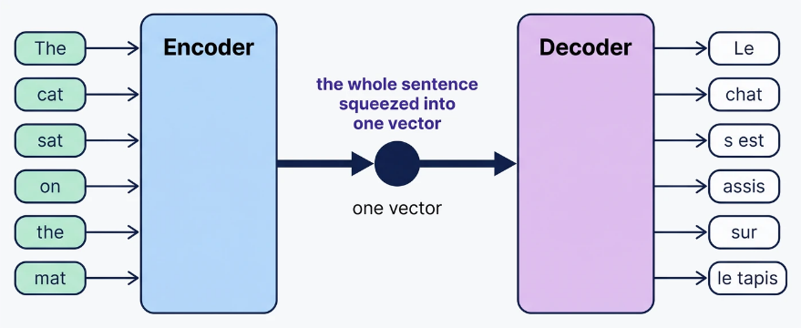

The important part is the single middle connection. No matter which target word is being produced, this baseline has to obtain source information through that one fixed summary. Attention will change this interface: retain source-position representations and retrieve a suitable mixture at each output step. Lecture 2 develops the problem; Lecture 3 builds the remedy.

**Position, then KV cache.** First ask how the operation distinguishes token order. Then follow generation one token at a time and ask what can be retained instead of recomputed.

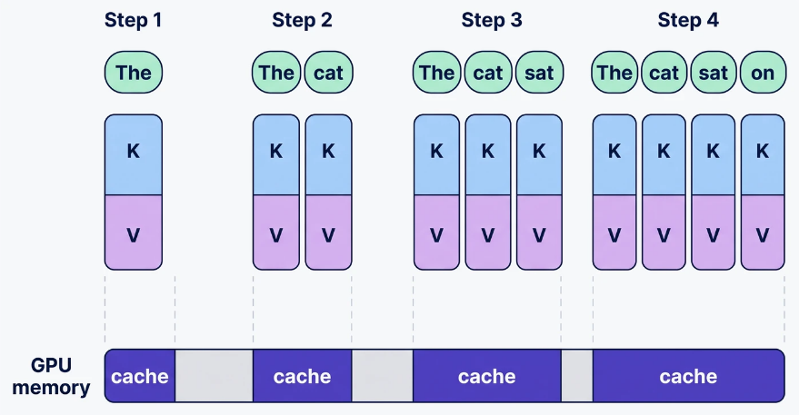

Read the four steps horizontally. The first stores one K/V pair; later steps retain old entries and append a new pair. The growing memory bar below represents that accumulation. Reuse saves recomputation, but retained memory grows with the prefix. That makes cache layout, head sharing and memory management meaningful topics rather than arbitrary extra names.

**Sparse, then linear.** Next study the cost of a long sequence.

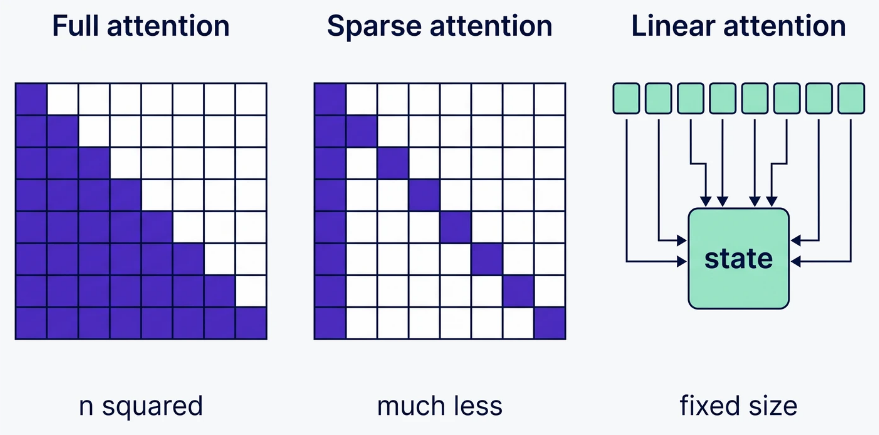

In the left panel, the allowed causal cells form a triangle: later queries can inspect more earlier keys. Its count is $n(n+1)/2$, which still grows quadratically. Doubling a long sequence roughly quadruples the number of allowed pairs. A 1,000-position sequence has 500,500 causal pairs; 2,000 positions have 2,001,000.

The middle panel drops many of those connections. The right panel routes history through a recurrent state. Sparse attention changes which explicit pairs remain. Recurrent linear methods change how past information is represented and updated. A fixed-size state also imposes capacity tradeoffs; it is not free unlimited memory. A hybrid with some full-attention layers still has those layers' costs.

**Implementation, beyond text, then synthesis.** Once the operation and its costs are clear, study hardware execution, structured inputs and how newer ideas fit the map.

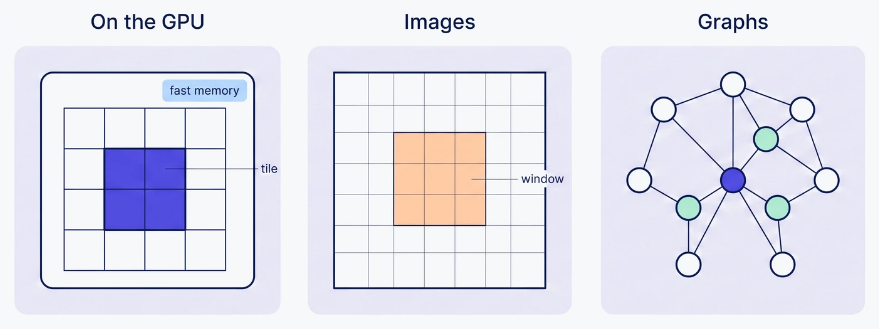

The left panel highlights a tile that can be processed using fast GPU memory. The middle highlights a neighborhood in a two-dimensional image grid. The right shows connections between graph nodes. The colored regions answer different questions: an execution block, a spatial information region and a graph neighborhood. Similar-looking boxes or links need their surrounding problem explained.

The final synthesis returns to the seven questions and places new methods using the problem they change. You do not have to memorize every name now.

### Put the full name list back into the map

The early name cloud becomes easier to read once its entries are organized by the problem they mainly address. Keep this list as a lookup map; you do not need to explain every future mechanism now.

| Main question | Names encountered in the family |
| --- | --- |
| Scoring and related changes to the attention computation | Bahdanau/additive, scaled dot-product, differential, gated, sigmoid |
| Sequence relationship and visibility | Self-attention, cross-attention, causal mask, bidirectional |
| Head and key/value organization | MHA, MQA, GQA, MLA |
| Reducing long-sequence costs | Sliding window, Longformer, BigBird, NSA, MoBA, linear attention, RetNet, GLA, DeltaNet, KDA |
| Execution and memory organization | FlashAttention, PagedAttention, Ring Attention |
| Position and context behavior | Sinusoidal encodings, RoPE, ALiBi, YaRN, attention sinks |
| Input structure and domain | SENet, CBAM, Swin, deformable attention, graph attention/GAT, cross-modal attention |

These placements are a study aid, not exclusive definitions. For example, attention sinks describe a behavior relevant to certain streaming/window strategies, and a sliding window is both a connectivity rule and a cost choice. When a new name appears, ask which mathematical operation, information path or execution constraint it changes before assuming it replaces the entire attention layer.

### Where this tutorial stops, and how to follow it

This **Attention Foundations** route covers Lectures 1–7 in order. The next six lessons explain the recurrent baseline, additive retrieval, alternative scoring and scaling, self-attention, learned projections, and causal masking with dropout. **Attention Heads** then covers Lecture 8, including the explicit-head and packed implementations. GQA and related arrangements belong there when added later. Lecture 9 is excluded.

The broader eight-module map is context for future study, not a claim that all those mechanisms are implemented in this project. The project goal is to build and independently test the basic mechanisms, including a Colab-compatible workflow.

The complete route is useful when your foundations are uneven. A shorter route for reading modern model specifications starts with self-attention, MHA and masks, then continues later into the KV cache, MQA/GQA/MLA, RoPE, FlashAttention and sliding windows with attention sinks. Those later topics are not all present in the current tutorial. Skipping is sensible only when you can explain the dependencies you skip.

### Predict or explain: A layer is causal, uses a dot-product score and has multiple heads. Is that contradictory?

<details data-practice-id="map-check"><summary>Reveal worked answer and rubric</summary>

No. Dot-product scoring measures compatibility, causality restricts available positions, and multiple heads arrange separately parameterized retrieval channels. These answer different questions and can coexist. Replacing an implementation kernel may preserve the same mathematical operation; changing connectivity changes its information paths.

**Rubric:** Explain the three jobs and distinguish changing the computation from changing its implementation.

</details>


Before continuing, take one attention name you have encountered and ask: **What problem does it change, and what other choices can coexist with it?** The next lesson turns the fixed-summary diagram into an encoder–decoder process you can trace.

### References

[Vizuara — The Attention Family, Lecture 1](https://www.youtube.com/watch?v=QgnOoQsPc0o) · [Presentation and diagrams](https://lecture1-attention-mechanisms.vercel.app/).

For the hybrid layer and position distinctions: [Kimi Linear technical report, architecture section](https://arxiv.org/html/2510.26692v1#S4).


## 2. Before attention: build the translation machine

The seven-category map tells us how attention methods differ. Now step back to a machine that has no attention at all. We will open it in three passes: how it reads and writes a sentence, what crosses between those two jobs, and why that handoff becomes difficult for long sentences.


We are at the first stop, **foundations**. Before deciding how to score a source position, we need to see why a decoder should be able to consult source positions in the first place.

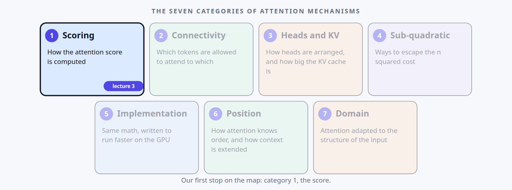

The highlighted scoring box is the next destination. This lesson establishes the problem that gives that score a purpose.

### A sentence goes in; another sentence comes out

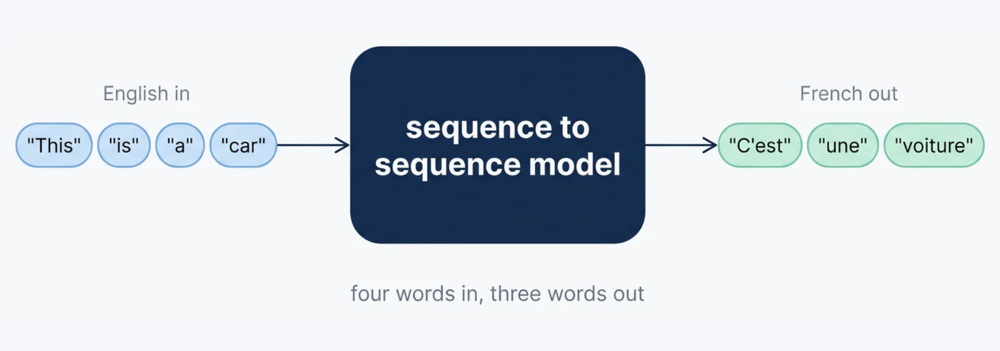

Treat each displayed word as one token for this small example. Four English tokens enter; three French tokens leave. Translation does not require equal lengths. Nor is it generally a position-by-position substitution: translating “European Economic Area” into French changes the adjective order. The machine must represent relationships and generate an appropriate output sequence.

Real tokenizers may split a word into several subword tokens. That changes the sequence positions, but not the need to read one sequence and produce another. We use word-sized tokens here to keep the diagrams readable.

### Words enter as numerical vectors

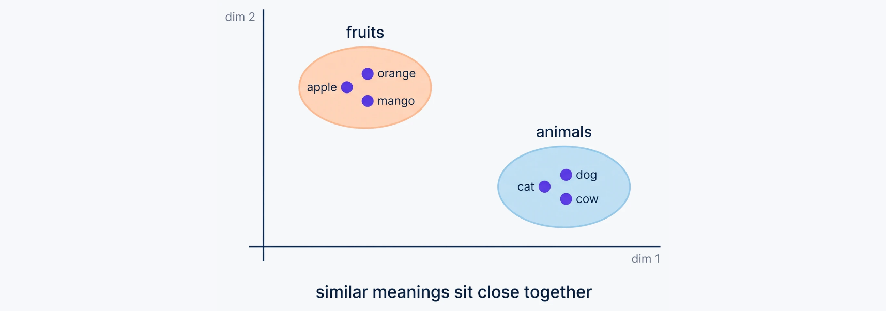

Each dot is the endpoint of a vector from the origin. The axes show two illustrative coordinates, not two named properties such as “fruitness” and “animalness”. Apple, orange and mango occupy one region; cat, dog and cow occupy another. The purpose is to visualize how learned representations can reflect useful similarities.

For nonzero vectors $u$ and $v$, cosine similarity is

$$\cos\theta=\frac{u\cdot v}{\lVert u\rVert\lVert v\rVert}.$$

A small angle gives a cosine near one. The geometry depends on how the vectors were trained; semantic similarity is not guaranteed merely by assigning token IDs. An embedding table $E\in\mathbb R^{V\times d_e}$ stores one row per vocabulary entry. If “car” has ID 4, its input vector is $x_4=E[4]$. Such a table can be learned with the translation system or initialized from pretrained embeddings.

The picture is two-dimensional so we can draw it. Real embeddings can have hundreds or thousands of coordinates. Their dimension is an architectural choice, not the sentence length.

### Open one encoder cell before repeating it

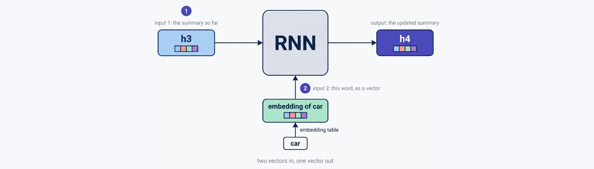

Follow the two inputs. The arrow from the left brings $h_3$, a state computed after reading “This is a”. The lower arrow brings the embedding of **car**. The cell combines them into $h_4$, the updated state after “This is a car”.

The embedding represents the current token; the hidden state represents the processed prefix. Both are vectors, but their jobs differ. Their widths can differ too. A simple recurrent update, using row vectors, is

$$h_t=\tanh(x_tW_x+h_{t-1}W_h+b_h).$$

If $x_t$ has width $d_e$ and $h_t$ has width $d_h$, then $W_x$ has shape $d_e\times d_h$, $W_h$ has shape $d_h\times d_h$, and $b_h$ has width $d_h$. The projected inputs have matching widths before addition. The elementwise $\tanh$ introduces a nonlinearity.

### Unroll the same cell through the sentence

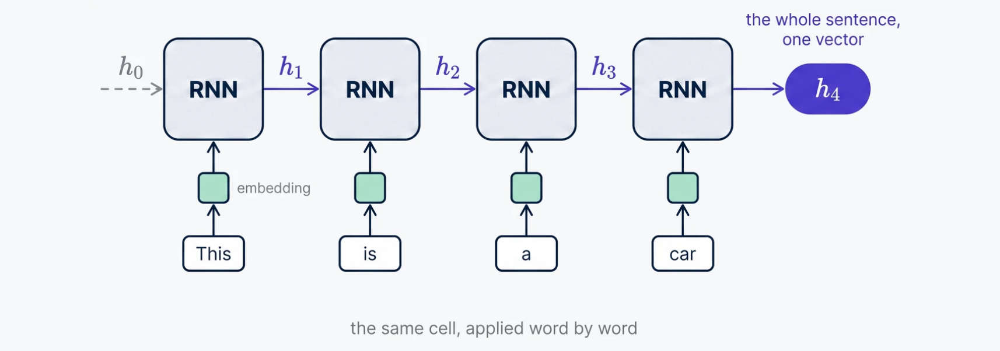

Start with $h_0$, chosen as zero in this example. Combine it with “This” to obtain $h_1$. Combine $h_1$ with “is” to obtain $h_2$. Continue through “a” and “car” to obtain $h_3$ and $h_4$.

The four boxes are four applications of **the same encoder cell**. Its matrices are reused; the states change. Drawing the time steps side by side makes the dependencies visible without drawing a looping arrow through one box. It does not create four independently trained RNNs.

Zero initialization is a convention, not the definition of an RNN. A model can use another specified initial state. Likewise, LSTM and GRU cells use more elaborate state updates. The important dependency here is that information from an early input reaches $h_4$ through successive state updates.

### Name the handoff: the context vector

In this baseline, the context is the final encoder state:

$$c=h_4.$$

If the source has fifty tokens, the context becomes $h_{50}$, but it still has width $d_h$. Sentence length changes the number of updates, not the number of coordinates in the final state.

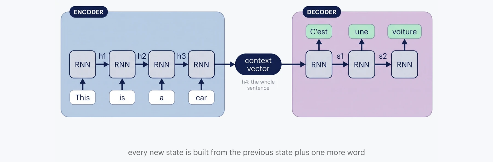

Trace the left chain, the single bridge, then the right chain. The decoder does not receive the original four token embeddings or the separate intermediate encoder states. All source information available through this interface crosses in $c$.

The encoder may retain intermediate activations internally for training. Saying they are “thrown away” means they are absent from this decoder's retrieval interface, not that automatic differentiation must erase them from memory.

### Open the decoder and follow the feedback arrows

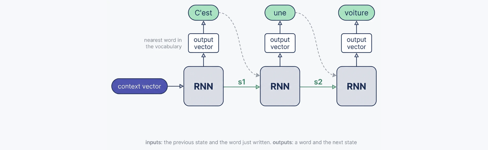

The context starts the decoder. Its recurrent states are called $s_1,s_2,s_3$ to distinguish them from encoder states $h_1,\ldots,h_4$. At each step it produces features for a vocabulary prediction and a state for the next step. The dashed feedback arrow supplies the previously generated token's embedding to the following update.

A practical implementation starts with a `<BOS>` token and initializes the decoder state from $c$, possibly through a learned projection. It may also condition every update on $c$. A vocabulary head then computes

$$\ell_t=s_tW_o+b_o,\qquad p(y_t\mid y_{<t},c)=\operatorname{softmax}(\ell_t).$$

There is one logit in $\ell_t$ for each output-vocabulary entry. The diagram's “nearest word” label is an intuitive shorthand; conventional translation decoders use learned vocabulary logits and a selection/search procedure, not a mandatory nearest-embedding lookup.

After producing “C'est”, feed its embedding into the next update to predict “une”; repeat to predict “voiture”. An `<EOS>` prediction ends the sequence, with a maximum-length safeguard. During teacher-forced training, the previous reference token is supplied instead of the model's last generated token. In either case, the output length is determined by the decoding process and need not equal the source length.

### Difficulty 1: a longer sentence gets the same-size handoff

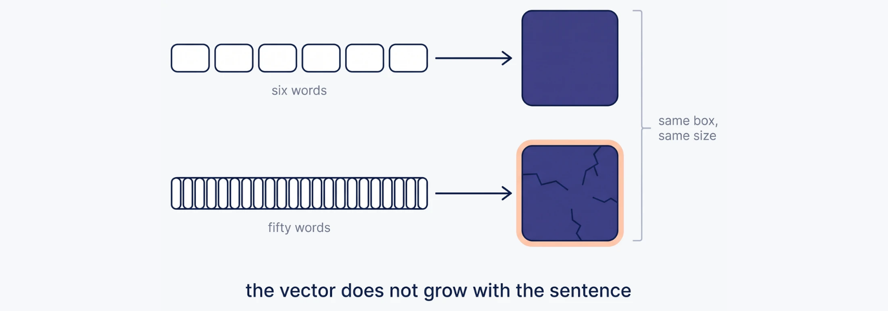

Compare the two input rows and the two boxes on the right. The second source has many more positions, yet its context has the same width. The problem is the burden placed on that shared representation: it must preserve whatever every later translation step will need, without allowing another direct consultation of the source.

For an 800-coordinate context, dividing 800 by eight words gives 100, while dividing by forty gives 20. This arithmetic is only a capacity analogy. Coordinates are not allocated to individual words, and the argument is not a theorem that a fixed-width real-valued vector cannot encode a longer sequence. The practical issue is learning a robust, useful summary through a finite computation and finite precision.

### Difficulty 2: repeated updates can weaken an early contribution

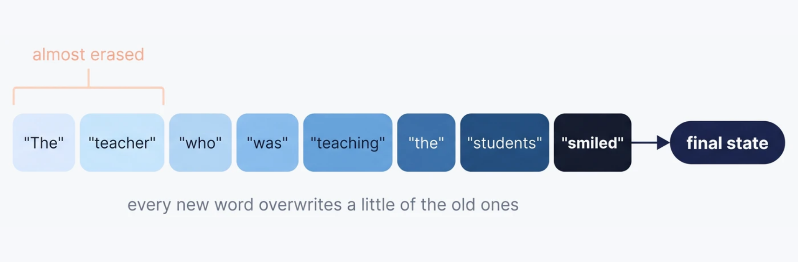

The color progression illustrates recency bias: repeatedly updating a summary can make earlier information harder to preserve or retrieve. It is not a measured activation trace, and every real RNN does not necessarily forget at the same rate. Gates and learned matrices can preserve information much better than a simple scalar recurrence.

We can measure one specific fading path by choosing

$$h_t=0.5h_{t-1}+x_t,\qquad h_0=0.$$

For inputs `[1,0,2]`, the successive states are $1$, $0.5$ and $2.25$. Expand the last update:

$$h_3=0.25x_1+0.5x_2+x_3.$$

An increase of one in the first input reaches the final summary as $0.25$ because it passes through two multiplications by $0.5$. With $T$ inputs its coefficient would be $0.5^{T-1}$. This isolates a dependency path; it is not a universal memory law.

<!-- example:02_fixed_summary.py:start -->

Complete file: [02_fixed_summary.py](examples/02_fixed_summary.py).

```python
import json


def encode(inputs, retention=0.5):
    state = 0.0
    states = []
    for value in inputs:
        state = retention * state + value
        states.append(state)
    return states


if __name__ == '__main__':
    original = encode([1.0, 0.0, 2.0])
    changed = encode([2.0, 0.0, 2.0])
    assert original == [1.0, 0.5, 2.25]
    assert changed[-1] - original[-1] == 0.25
    print(json.dumps({'states': original, 'changed_final': changed[-1],
                      'first_input_sensitivity': 0.5 ** 2}))
```

<!-- example:02_fixed_summary.py:end -->

Run from this lesson package, `ai_projects/docs/tutorials/projects/attention-labs/attention-foundations/v1/`:

```bash
python3 examples/02_fixed_summary.py
```

The output records states `[1.0,0.5,2.25]`, a changed final state `2.5`, and sensitivity `0.25`. These are computed properties of the declared recurrence. If the last two values differ by one rather than a quarter, the program is not applying the retention factor at both intervening updates.

### Difficulty 3: the relevant word may be far away


Read the sentence: “The teacher who was teaching a difficult concept to the students, smiled.” Who smiled? **The teacher**. The nearby noun “students” is part of the intervening clause. The long upper arrow marks the relation that matters; the short lower arrow marks the misleading proximity.

The decoder needs information about the early subject when translating the later verb. In the fixed-summary interface, that relation must survive the encoder's intervening updates and be usable from the same context used for every other output word. LSTMs and GRUs help with long dependencies, but the fixed source handoff remains a separate limitation. No universal rule says training can never overcome a particular dependency.

### Read the translation-quality graph carefully

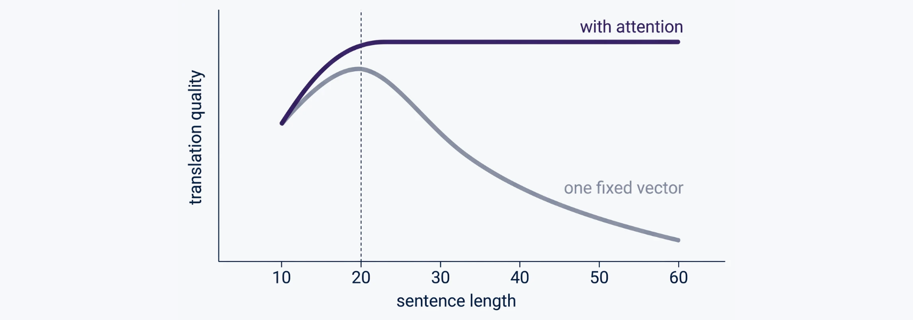

The horizontal axis is source sentence length. The vertical axis is translation quality. The gray line illustrates a fixed-summary system deteriorating as sentences get longer; the purple line illustrates why allowing source retrieval was valuable.

The dotted line near twenty words emphasizes the historical motivation. It is not a universal failure boundary. This drawing has no dataset, metric values or error bars from which to infer an exact threshold or constant quality on arbitrarily long inputs. Bahdanau and colleagues reported better behavior on longer sentences for their evaluated attention system; that result does not make every attention model immune to length problems.

The three difficulties share one interface: every decoder step depends on the same source summary. Context vectors themselves are useful. The next design changes **how the context is constructed**, not whether a decoder is allowed to use a vector.

### Keep the encoder states and let the decoder look back


The source is now “The cat sat today”. While producing the French word **chat**, the decoder places its largest illustrative weight, $0.75$, on **cat**. The other weights are $0.05$, $0.15$ and $0.05$; together they sum to one. At a different output step, the weights can change.

To make this possible, retain the source states $H=[h_1;\ldots;h_n]$. Instead of receiving only the final state, the decoder builds a context from these retained vectors according to its current need. The result at one step is still a finite-width vector. The difference is that it can be a **different vector at each output step**.

### Predict or explain: In the scalar encoder, double only the first input. Why does the last state change by 0.25, and must every real RNN behave that way?

<details data-practice-id="summary-check"><summary>Reveal worked answer and rubric</summary>

The effect passes through two multiplications by 0.5, giving 0.25. A real RNN can have different matrices, nonlinearities and gates, so this is an illustrative sensitivity calculation rather than a universal memory law. A decoder still uses a separate vocabulary head and can produce a different number of tokens.

**Rubric:** Trace both intervening updates and state the limitation of the scalar example.

</details>


You can now trace the input embeddings, encoder states, fixed context, decoder state and vocabulary prediction separately. The remaining question is precise: **How does the current decoder state produce those source-position weights?** The next lesson builds that calculation.

### References

[Vizuara — The Attention Family, Lecture 2](https://www.youtube.com/watch?v=IG2gl6sKj_c) · [Presentation and diagrams](https://lecture2-attention-mechanisms.vercel.app/).

[Bahdanau, Cho and Bengio — Neural Machine Translation by Jointly Learning to Align and Translate](https://arxiv.org/html/1409.0473v7), encoder–decoder background and length-dependent results.


## 3. Additive attention: let the decoder look back

The baseline translation machine passed one final encoder state to its decoder. Keep that machine in view while we change one interface.

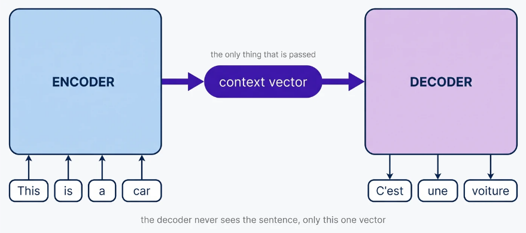

The source-side limitation is the single middle arrow. We already computed intermediate encoder states; now retain them and let each decoding step choose how to combine them.


This lesson introduces one scoring method: **additive attention**, associated with Bahdanau, Cho and Bengio's 2014 translation work. We first understand its retrieval behavior, then the full decoding step, and only then open the scoring network. This remains a recurrent encoder–decoder, not yet a Transformer.

### Start with what changes: a weighted look back

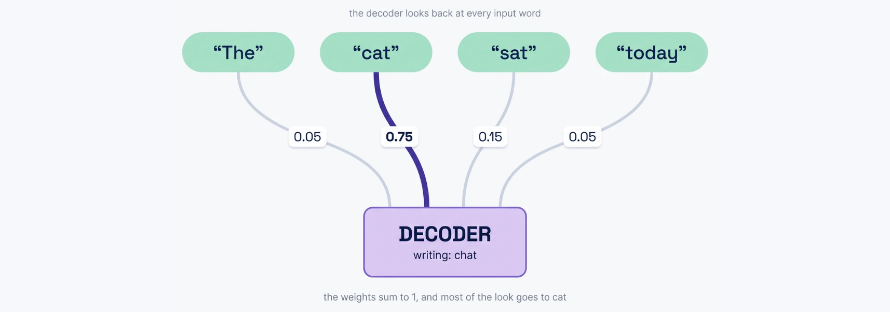

For “The cat sat today”, imagine a step that will produce **chat**. The illustrative retrieval weights are $[0.05,0.75,0.15,0.05]$. The strongest connection is to **cat**, while all four positions contribute. These numbers are **weights**, not raw scores: they are nonnegative and sum to one.

The model does not need to know the answer “chat” before computing those weights. It already has a decoder state summarizing its previous output. That state asks the retrieval question; the retrieved context then helps predict the next token. Describing a picture as “the step writing chat” names the result of the step, not an extra input that gives away its target.

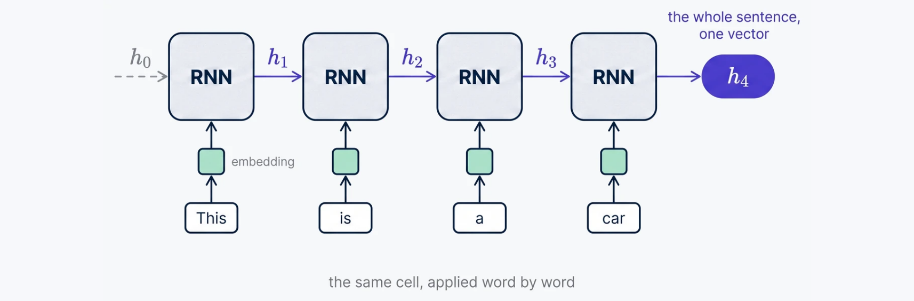

Follow the same encoder chain as before, but keep every $h_j$. Each is a contextual state, not necessarily the original token embedding. In a one-directional encoder, $h_j$ summarizes a prefix ending at position $j$. Bahdanau's full system uses a bidirectional encoder, combining forward and backward annotations so each source position can carry surrounding context from both directions.

### Multiply each whole vector, then add

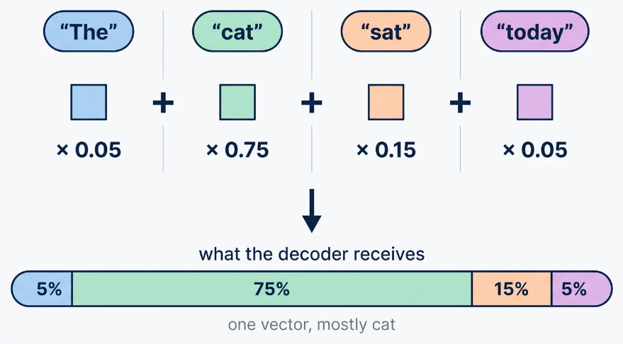

One scalar weight multiplies every coordinate of its source state. For the displayed four-position example,

$$c_2=0.05h_1+0.75h_2+0.15h_3+0.05h_4.$$

The answer has the same width as an $h$ vector. Saying the mixture is “75% cat” means the coefficient of the state at the cat position is $0.75$. It does not mean that 75% of the coordinates are reserved for cat, or that the probability of generating chat is $0.75$. Encoder states can already contain information from several words.

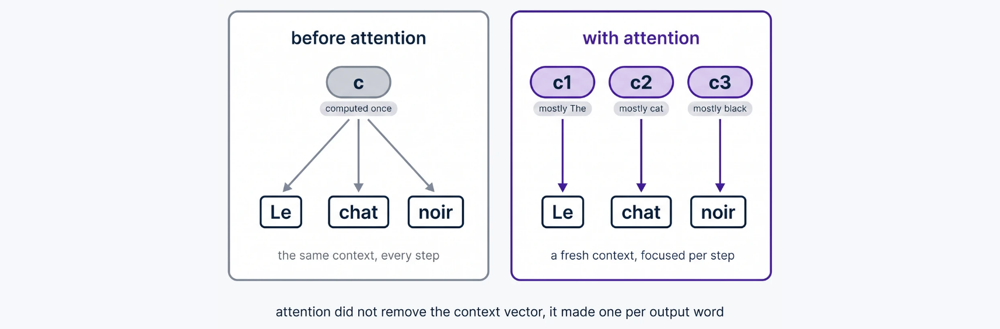

Compare the two sides. The old context was reused unchanged. The new contexts can differ because their weights differ, even though they retrieve from the same retained encoder states. Attention has preserved the useful idea of a context vector while making its construction depend on the current request.

For output step $t$, the general recipe is

$$e_{tj}=a(s_{t-1},h_j),\qquad
\alpha_{tj}=\frac{\exp(e_{tj})}{\sum_{r=1}^{N}\exp(e_{tr})},\qquad
c_t=\sum_{j=1}^{N}\alpha_{tj}h_j.$$

Here $N$ counts source positions, $s_{t-1}$ is the already available decoder state, $e_{tj}$ is a raw scalar compatibility score, and $\alpha_{tj}$ is a normalized source-position weight. The three operations are **score, normalize, combine**. They define the softmax retrieval we develop in this foundations route; later attention alternatives can change that recipe.

### Put retrieval into one complete decoding step

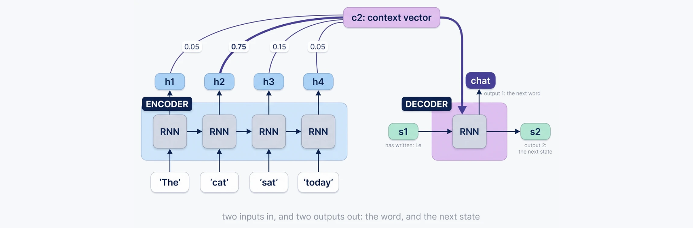

Suppose “Le” has been produced. The decoder state is $s_1$. The next context is $c_2$ because it supports the second output step. Source states and $s_1$ determine that context, and the decoder uses its available state, previous output token and retrieved information to produce a new state and vocabulary prediction.

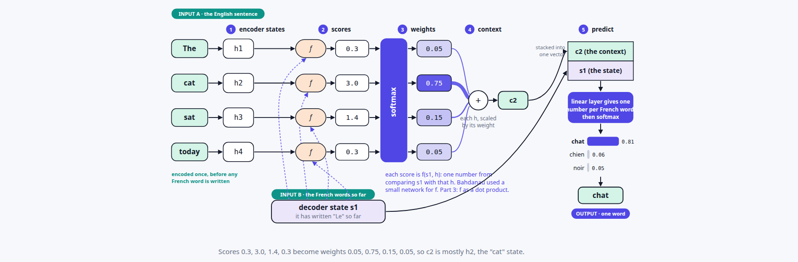

Open the middle path before following the output path:

1. Apply the same scorer $f$ to $(s_1,h_1)$, $(s_1,h_2)$, $(s_1,h_3)$ and $(s_1,h_4)$. These are repeated calls with shared parameters.
2. Normalize the four scores together. Scores $[0.3,3.0,1.4,0.3]$ give approximately $[0.05,0.75,0.15,0.05]$ after softmax.
3. Multiply the four source states by those weights and add them to obtain $c_2$.
4. Use the context and decoder features to compute vocabulary logits, normalize those logits over the French vocabulary, and choose a token according to the decoding rule.

There are **two different softmax operations**. The first distributes retrieval weight over source positions. The second distributes output probability over vocabulary entries. The diagram's $0.81$ for chat belongs to the second distribution and is an illustrative prediction, not another attention weight.

For a dimension check, a context of width 768 and a decoder feature vector of width 768 concatenate to width **1,536**. A row-vector output matrix of shape $1536\times50000$ would yield 50,000 vocabulary logits. The context does not itself need 50,000 coordinates.

The diagram gives a useful high-level output head. Exact decoder update order varies. In the original Bahdanau formulation, $s_{t-1}$ determines $c_t$, then the decoder update uses the previous state, previous target token and $c_t$; the output function consumes the required decoder/context features. Specify one order in code and avoid a circular dependency on an uncomputed state.

### The next state changes the next request

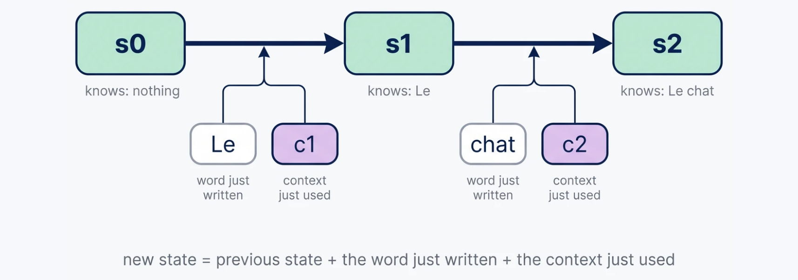

The $s$ chain carries output history forward. A state after “Le chat” differs from a state after “Le”. It therefore sends a different request to the same source memory. The source sentence does not have to be encoded again for every target token.

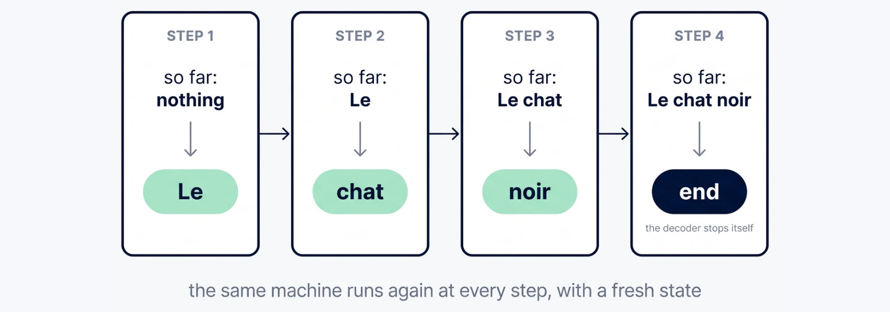

Follow the loop back to the scorer. It receives the new decoder state; it does not receive a newly translated source sentence or a new set of scoring parameters. During inference, the parameters stay fixed while activations, contexts and predictions change.

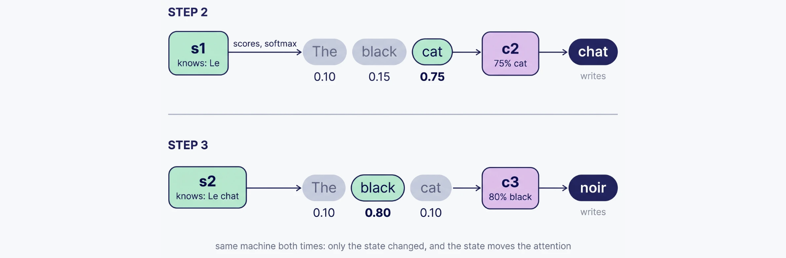

Now use the source **The black cat**. For the chat step, the weights are $[0.10,0.15,0.75]$, so

$$c_2=0.10h_{\rm The}+0.15h_{\rm black}+0.75h_{\rm cat}.$$

For the noir step, they change to $[0.10,0.80,0.10]$:

$$c_3=0.10h_{\rm The}+0.80h_{\rm black}+0.10h_{\rm cat}.$$

The large coefficients move from the third source position to the second. That is dynamic retrieval. These example weights illustrate desirable alignment; they are not outputs from a trained model in this project.

### Output length and order are free to differ

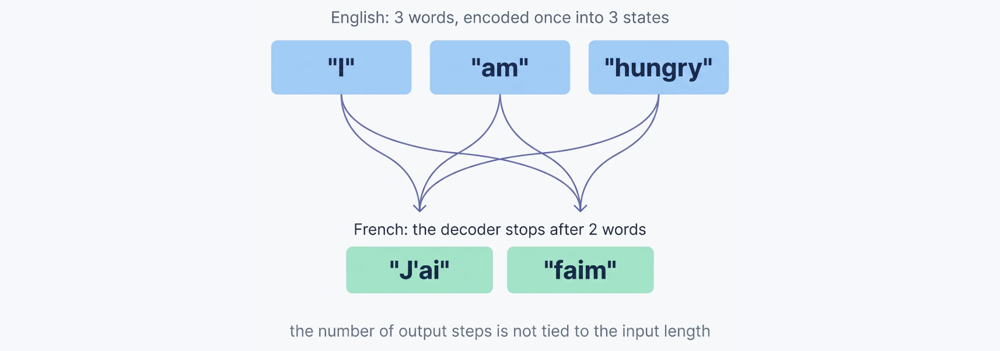

“I am hungry” and “J'ai faim” have different displayed word counts. At each output step, attention can still consult all three source positions. The decoder stops on its end token; it does not stop because it has visited each source position once. A maximum output length prevents an unending decode if the model fails to stop.

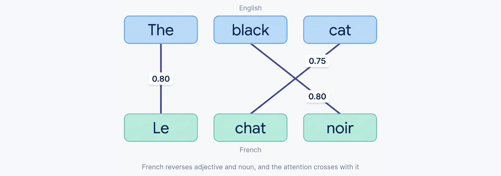

Read the French words in generation order. Le emphasizes The, chat emphasizes cat, and noir emphasizes black. The lines cross because the language changes noun/adjective order. A rule forcing output position $t$ to retrieve source position $t$ would prevent this behavior.

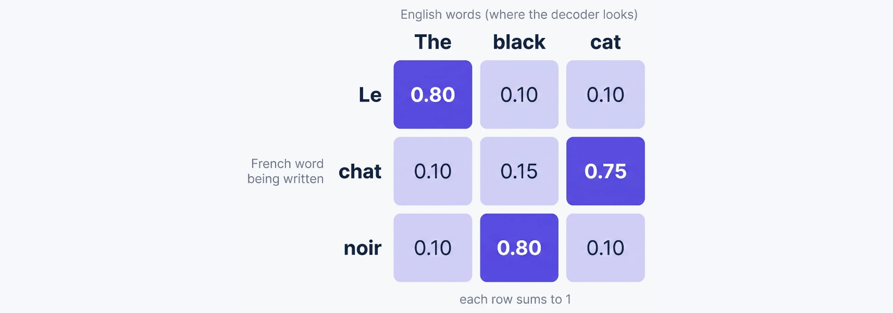

The rows are **Le, chat, noir**; the columns are **The, black, cat**. Each row sums to one. The bright cell in the second row is in the cat column, and the bright cell in the third row is in the black column. Nothing requires the columns to sum to one or the bright cells to follow the main diagonal.

The matrix is square here because these examples happen to have equal source and target lengths. Two decoding steps over three source positions would instead produce a $2\times3$ matrix. Multiplying that by a $3\times d_h$ memory returns two contexts of width $d_h$.

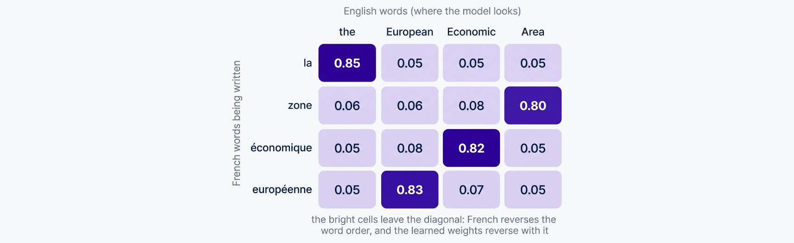

Follow **Area → zone**, **Economic → économique**, and **European → européenne**. The strong cells run away from the main diagonal because French places the modifiers differently. An alignment picture makes a learned retrieval pattern inspectable. This redrawn teaching example is not an independently reproduced training result. Attention weights also need not be perfect word alignments or a complete explanation of a model's prediction.

### Where the weights come from

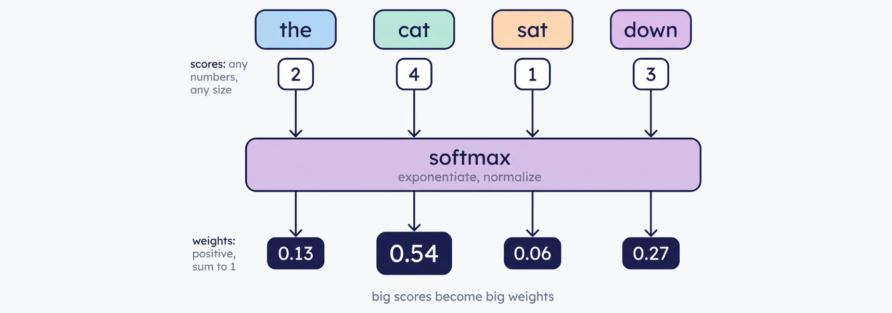

A score can be negative, positive, or larger than one; it need not sum to anything meaningful. Softmax exponentiates and normalizes the whole row. For $[2,4,1,3]$, the weights are approximately $[0.0871,0.6439,0.0321,0.2369]$. The printed lower row is schematic and does not equal the softmax of those four raw scores; use the recalculated values here for arithmetic. Their order follows the scores, all are positive, and their sum is one. A large weight can arise from a moderately sized score if the other scores are smaller: the comparisons are relative.

### Open the additive scorer

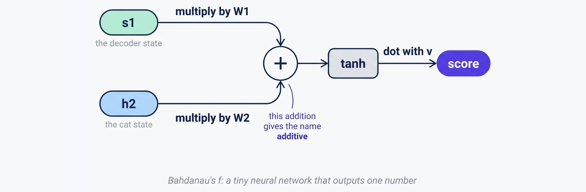

For this formula, write vectors as columns:

$$a(s,h)=u^\top\tanh(W_ss+W_hh+b).$$

If $s$ has width $d_s$, $h$ has width $d_h$, and the scoring network has hidden width $d_a$, then $W_s$ has shape $d_a\times d_s$, $W_h$ has shape $d_a\times d_h$, and $u,b$ have width $d_a$. The original vectors can have different widths; their projections must have the same width so they can be added.

Follow the network in order. Each projection puts its input in the shared scoring space. **Addition** combines them, giving additive attention its name. Elementwise $\tanh$ introduces a nonlinear interaction, with outputs between minus one and one. The dot product with learned $u$ reduces the hidden vector to one scalar score. This final scoring vector is a model parameter; it is not the stored value vector that is averaged to build the context.

Why keep the nonlinearity? Without it,

$$a(s,h)=u^\top W_ss+u^\top W_hh+u^\top b.$$

For one query, the query term is the same offset for every source position. Softmax cancels common offsets, so changing only $s$ would not change the relative weights in this separable scorer. The nonlinear interaction makes the request affect relative comparisons.

### A complete small calculation

We will reuse the hand-set memory

$$H=\begin{bmatrix}1&0\\0&1\\1&1\end{bmatrix}.$$

The rows will also serve as illustrative token features later. For now they are three available source states. Take scalar query $s=0$, query projection $[s,-s]$, identity source projection, scoring vector $u=[1,-1]$, and zero bias. The three hidden rows and scores are

| Source state | Hidden row before tanh | Score |
| --- | --- | --- |
| `[1,0]` | `[1,0]` | $\tanh(1)-\tanh(0)=0.761594$ |
| `[0,1]` | `[0,1]` | $\tanh(0)-\tanh(1)=-0.761594$ |
| `[1,1]` | `[1,1]` | $\tanh(1)-\tanh(1)=0$ |

Softmax gives approximately `[0.593494,0.129391,0.277115]`. The returned row is

$$c=0.593494[1,0]+0.129391[0,1]+0.277115[1,1]
\approx[0.870609,0.406506].$$

The first coordinate receives contributions from rows 1 and 3; the second receives contributions from rows 2 and 3. A negative score did not create a negative weight. Exponentiation makes all unmasked weights positive.

### Compute softmax without overflowing

For scores `[1000,1000]`, directly evaluating exponentials can overflow even though the answer is simply `[0.5,0.5]`. Subtract the maximum score $m$ before exponentiating:

$$\frac{e^{e_j-m}}{\sum_r e^{e_r-m}}=\frac{e^{-m}e^{e_j}}{e^{-m}\sum_r e^{e_r}}=\alpha_j.$$

The cancellation is exact in real arithmetic and makes numerical evaluation safer. This shared reference module supplies the row operations used from here onward. `dot` multiplies matching coordinates and sums them; `matmul` applies that dot product to every row/column pair. The shared input rows are the same hand-set memory used above; there are no trainable projection parameters in this helper module.

<!-- example:row_math.py:start -->

Complete file: [row_math.py](examples/row_math.py).

```python
"""Row-vector operations and the shared synthetic fixture; standard library only."""
import math


def dot(a, b):
    if len(a) != len(b):
        raise ValueError('Dot product widths must agree')
    return sum(x * y for x, y in zip(a, b))


def transpose(matrix):
    if not matrix or not matrix[0] or any(len(row) != len(matrix[0]) for row in matrix):
        raise ValueError('Expected a nonempty rectangular matrix')
    return [list(column) for column in zip(*matrix)]


def matmul(a, b):
    columns = transpose(b)
    return [[dot(row, column) for column in columns] for row in a]


def softmax(scores, allowed=None):
    if not scores:
        raise ValueError('Need at least one score')
    allowed = [True] * len(scores) if allowed is None else list(allowed)
    if len(allowed) != len(scores) or not any(allowed):
        raise ValueError('Every query needs at least one allowed key')
    if any(not math.isfinite(score) for score, use in zip(scores, allowed) if use):
        raise ValueError('Allowed scores must be finite')
    maximum = max(score for score, use in zip(scores, allowed) if use)
    numerators = [math.exp(score - maximum) if use else 0.0
                  for score, use in zip(scores, allowed)]
    denominator = sum(numerators)
    return [value / denominator for value in numerators]


def rounded(value):
    return [rounded(x) for x in value] if isinstance(value, list) else round(value, 6)


X = [[1.0, 0.0], [0.0, 1.0], [1.0, 1.0]]
```

<!-- example:row_math.py:end -->

The additive example then implements the particular scorer above. All imports refer to the displayed module in the same `examples/` folder.

<!-- example:03_additive.py:start -->

Complete file: [03_additive.py](examples/03_additive.py).

```python
import json
import math
from row_math import X, matmul, rounded, softmax


def additive(query, states):
    # Project a scalar query to [query, -query]; project each key identically.
    # The output scoring vector is [1, -1]. No biases in this fixture.
    scores = [math.tanh(query + h[0]) - math.tanh(-query + h[1]) for h in states]
    weights = softmax(scores)
    context = matmul([weights], states)[0]
    return scores, weights, context


if __name__ == '__main__':
    scores, weights, context = additive(0.0, X)
    other = additive(1.0, X)
    assert abs(sum(weights) - 1.0) < 1e-14
    assert other[1] != weights
    assert softmax([1000.0, 1000.0]) == [0.5, 0.5]
    print(json.dumps({'scores': rounded(scores), 'weights': rounded(weights),
                      'context': rounded(context), 'new_query_weights': rounded(other[1])}))
```

<!-- example:03_additive.py:end -->

Run `python3 examples/03_additive.py` from the package directory. The result includes the scores, weights and context above. It also changes the query to $s=1$, keeping the source states and parameters fixed, and obtains weights `[0.541045,0.206330,0.252626]`. The changed context comes from a new retrieval, not a new memory or a training step.

### Place the result back on the map

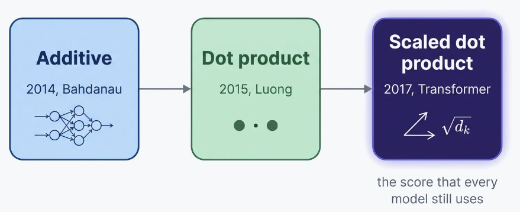

We have filled the additive-scoring entry: a learned projection of each input, an addition, a nonlinearity and a scalar projection. The complete surrounding operation now has a purpose: a decoder can retrieve a different source mixture at each output step.

### Predict or explain: If tanh is removed from uᵀ(Wₛs + Wₕh), can changing only s change the softmax weights?

<details data-practice-id="additive-check"><summary>Reveal worked answer and rubric</summary>

Not in this separable scorer: uᵀWₛs adds the same scalar to every source score for a fixed query. Softmax is invariant to that common offset, so the relative weights do not change. Nonlinear interaction makes the query contribution affect relative comparisons.

**Rubric:** Show the common-offset cancellation; distinguish a new query from updating model parameters.

</details>


Next we keep the retrieval pipeline and change the compatibility calculation. How cheaply can two compatible vectors produce a useful scalar score, and what happens when their feature width becomes large?

### References

[Vizuara — The Attention Family, Lecture 3](https://www.youtube.com/watch?v=6yIe4ekER14) · [Presentation and diagrams](https://lecture3-attention-mechanisms.vercel.app/).

[Bahdanau, Cho and Bengio — Neural Machine Translation by Jointly Learning to Align and Translate](https://arxiv.org/html/1409.0473v7), decoder/context equations and bidirectional annotations.


## 4. Dot products, scale and the softmax bars

We can preserve the source-position normalization and value mixture while replacing the additive network with a different compatibility function. A dot product is a particularly convenient choice when queries and keys have the same width: it scores a pair with coordinate multiplications and a sum, and many pairs fit naturally into a matrix product.

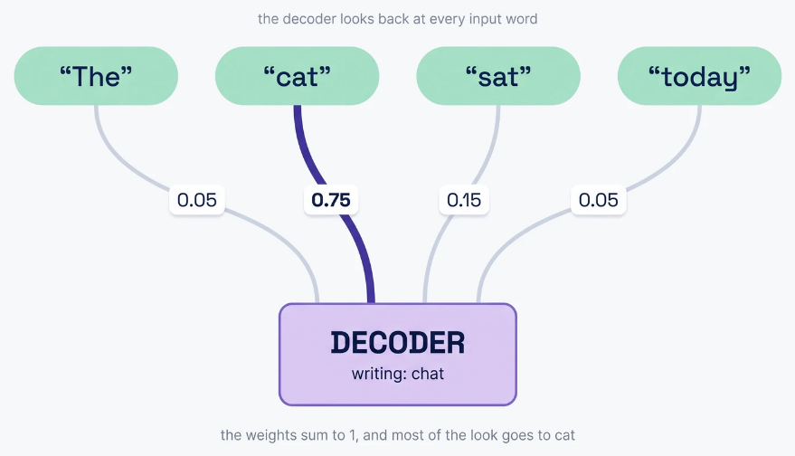

The weights and context still have the same jobs as in additive attention. We are replacing the **scorer**, not the source memory or the weighted-sum operation.

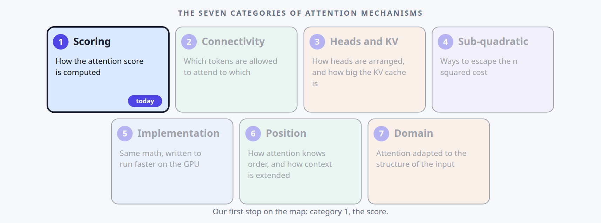

We will do this in the same three passes: understand the dot product, inspect its scale as feature width grows, then divide by a carefully chosen factor before softmax.

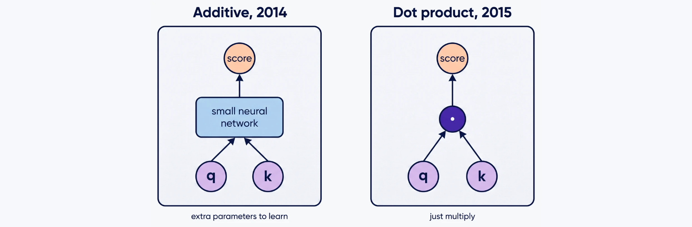

The left branch projects, adds, applies a nonlinearity and reduces to a scalar. The right branch multiplies matching coordinates and sums them. The dot operation itself introduces no learned parameters. Queries and keys may still come from trainable networks; removing a separate scoring network does not make the whole model parameter-free.

### Direction and magnitude both affect a dot product

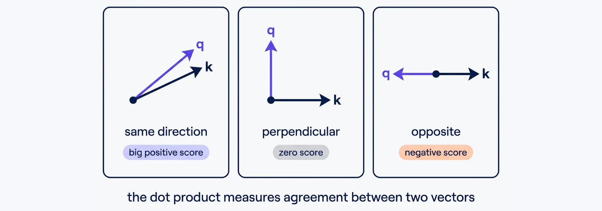


The three panels isolate the sign contributed by direction: aligned vectors can give a positive score, perpendicular vectors give zero, and opposite vectors can give a negative score. Length also matters through the product of the norms. Use the same-direction, different-length counterexample below to avoid reading this picture as a cosine-only comparison.

For rows $q,k\in\mathbb R^{d_k}$,

$$q\cdot k=\sum_{r=1}^{d_k}q_rk_r=\lVert q\rVert\lVert k\rVert\cos\theta.$$

The coordinate formula defines the computation. The geometric formula explains why a larger magnitude can increase a score even without changing direction. Query `[1,0]` scores key `[2,0]` as 2 and key `[1,0]` as 1. Both keys point in the same direction. A dot-product ranking is therefore not a cosine-similarity ranking unless magnitudes are controlled.

Using query `[1,1]` with the three rows retained from Lesson 3 gives scores `[1,1,2]`. Plain softmax returns approximately `[0.211942,0.211942,0.576117]`. The third source receives most weight. This follows from our chosen coordinates; it is not evidence that a model has learned which English word matters.

Luong and colleagues studied several alignment score forms, including dot, general/bilinear, and concat forms. Dot-product scoring is a useful case from that work, not its entire contribution. A bilinear score $qMk^\top$ can also bridge unequal query/key widths. See the [original paper](https://aclanthology.org/D15-1166/).

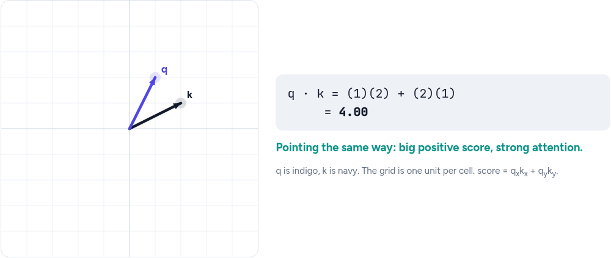

Use the vector plane to connect the geometry to arithmetic. For the displayed vectors, $q\cdot k=1\times2+2\times1=4$. Rotating one vector while keeping its length fixed changes the cosine term. Increasing its length without rotating also changes the dot product. A positive score is therefore compatibility in the model's learned comparison space, not a universal test of whether two words have the same meaning.

### Why divide by a square root?

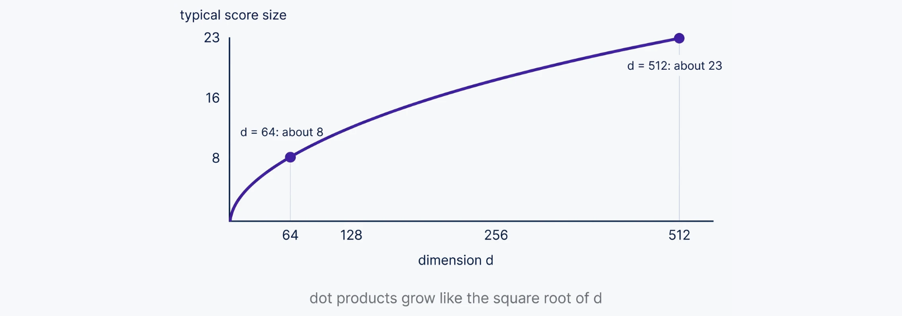


The plotted scale is a typical score magnitude, approximately the square root of the width under the stated random-coordinate assumptions. It is not a plot of variance: the variance calculation below gives d before scaling. Learned or correlated coordinates need not follow this sketch.

Assume, for this calculation, independent query and key coordinates with mean zero and variance one, with the coordinate-product terms mutually independent. For $r_i=q_ik_i$,

$$\mathbb E[r_i]=0,\qquad \operatorname{Var}(r_i)=\mathbb E[q_i^2]\mathbb E[k_i^2]=1.$$

There are $d_k$ such terms in the dot product, so

$$\operatorname{Var}(q\cdot k)=d_k,\qquad
\operatorname{Var}\left(\frac{q\cdot k}{\sqrt{d_k}}\right)=1.$$

This explains the conventional scaling factor. Actual learned coordinates can have different variances or correlations, so the division does not guarantee unit variance or a soft distribution in every layer. It is a scale-control choice motivated by those assumptions, not a theorem about all trained activations.

Softmax depends on **differences** between scores, since $a_i/a_j=\exp(e_i-e_j)$. Scores $[1000,1001]$ therefore have the same weights as $[0,1]$: approximately $[0.268941,0.731059]$. A large common offset alone does not make attention nearly one-hot. In contrast, increasing the difference from 1 to 20 does. Scaling divides those differences as well as the individual scores.

This distinction matters when experimenting with random vectors. Independent coordinates drawn uniformly from $[0,1]$ are not mean-zero, unit-variance coordinates: their products have mean $1/4$, so the expected raw dot product is $d_k/4$. That growing common mean is not itself the source of softmax concentration. Variation in score differences is what affects the normalized weights. State the sampling distribution when interpreting a dimension experiment, and compare many draws rather than treating one random sample as a universal trend.

For our width-two query, divide scores `[1,1,2]` by $\sqrt2$ before softmax. The weights become `[0.248255,0.248255,0.503490]`, less concentrated than the unscaled result. The key width is the scaling dimension; it is not the number of source positions or the value width.

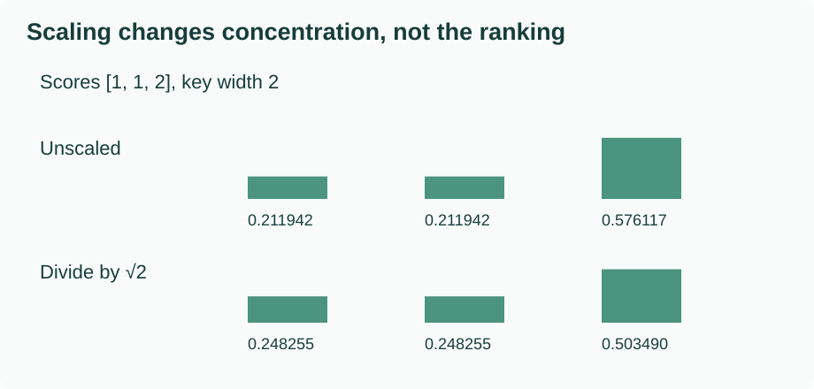

### Reproduce the one-query, two-key experiment

The experiment uses one query and **two keys**, so there are two scores at every feature width. For width one, $Q$ has shape $1\times1$ and $K$ has shape $2\times1$. At width 1,000, their shapes become $1\times1000$ and $2\times1000$, while the score row remains $1\times2$. Do not confuse the number of keys with their width.

At $d_k=1$, dividing by $\sqrt{d_k}$ changes nothing. At width four it divides each score by two. At width 1,000 it divides by about 31.62; at 4,096 it divides by 64. Compare scores and weights before and after that operation, keeping the same query and keys within each comparison.

Complete file: [dimension_probe.py](examples/dimension_probe.py). Place it beside the already displayed `row_math.py`; it uses only the standard library and also runs in Colab with those two files uploaded.

```python
"""One query, two keys: repeat the dimensionality experiment without packages."""
import math
import random
from row_math import dot, softmax


def inspect(width, rng, positive=False):
    draw = rng.random if positive else lambda: rng.gauss(0.0, 1.0)
    query = [draw() for _ in range(width)]
    keys = [[draw() for _ in range(width)] for _ in range(2)]
    scores = [dot(query, key) for key in keys]
    scaled = [score / math.sqrt(width) for score in scores]
    return scores, softmax(scores), scaled, softmax(scaled)


if __name__ == '__main__':
    for positive in [False, True]:
        print('Uniform [0,1]' if positive else 'Normal mean 0, variance 1')
        rng = random.Random(17)
        for width in [1, 4, 64, 1000, 4096]:
            raw, weights, scaled, scaled_weights = inspect(width, rng, positive)
            assert abs(sum(weights) - 1.0) < 1e-12
            assert abs(sum(scaled_weights) - 1.0) < 1e-12
            print(f'd={width:4} Q=(1,{width}) K=(2,{width}) '
                  f'scores={[round(x, 3) for x in raw]} '
                  f'weights={[round(x, 4) for x in weights]} '
                  f'scaled={[round(x, 3) for x in scaled]} '
                  f'new_weights={[round(x, 4) for x in scaled_weights]}')
```

Run `python3 examples/dimension_probe.py` from this tutorial package. The fixed-seed normal example at width 1,000 gives raw scores about `[4.074,12.764]`: the unscaled weights are `[0.0002,0.9998]`, while the scaled weights are `[0.4317,0.5683]`. With positive uniform coordinates at width 4,096, raw scores are about `[1011.228,1028.973]`; scaling changes the weights from effectively `[0,1]` to `[0.4311,0.5689]`.

One sample need not become more concentrated at every successive width. In the normal experiment, the unscaled width-64 row happens to be more concentrated than the width-4,096 row. The variance argument concerns a distribution of draws, not a monotonic law for five individual samples. Scaling controls a typical scale; it does not promise uniform attention or an automatic quality improvement.

### Follow every bar as the scores change

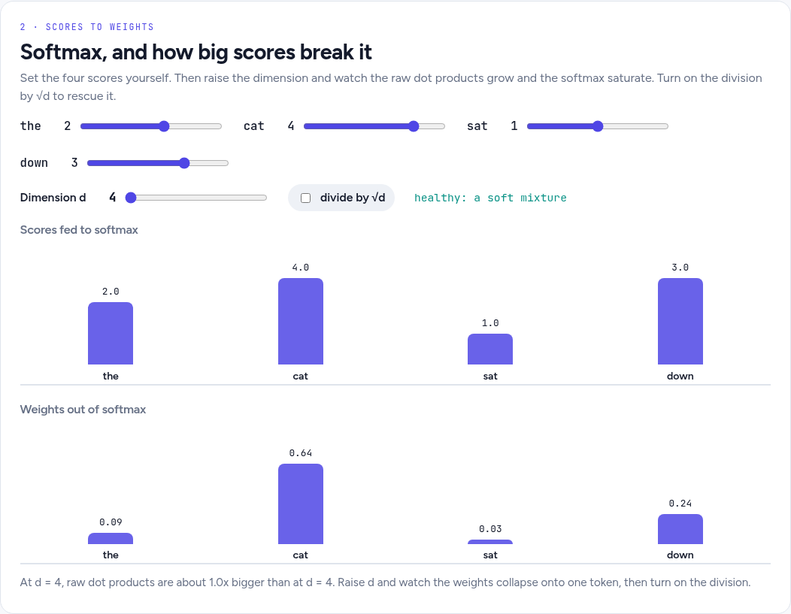

Read the upper bars as scores and the lower bars as weights, keeping their different units in mind. For `[2,4,1,3]`, the normalized row is approximately `[0.0871,0.6439,0.0321,0.2369]`. The second position has the largest score and largest weight, but other positions contribute too.

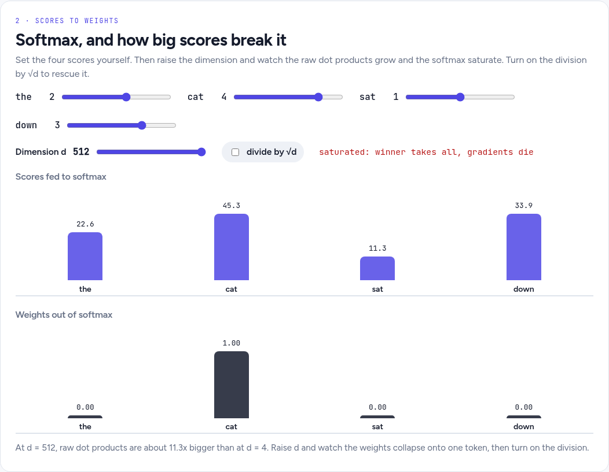

The interactive demonstration raises its dimension control to 512 and amplifies the four baseline numbers to about `[22.6,45.3,11.3,33.9]`. The second lower bar now takes almost all the mass. Every lower bar matters: the small ones show how little the other values can contribute to the returned context.

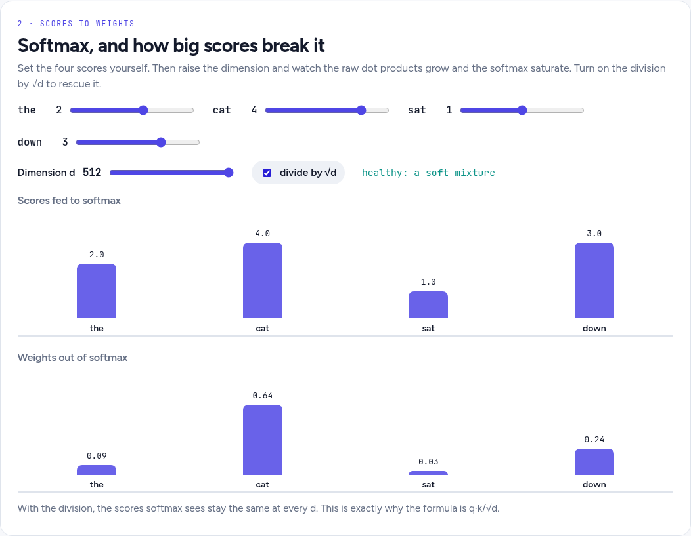

With scale control enabled, this demonstration returns the bars to its baseline `[2,4,1,3]` and the soft weight row. This is a controlled visualization of amplification and its removal; it does not redraw random vectors at each width. The executable experiment above applies the literal $1/\sqrt{d_k}$ division to explicitly generated vectors.

### Softmax derivatives explain the concern more precisely

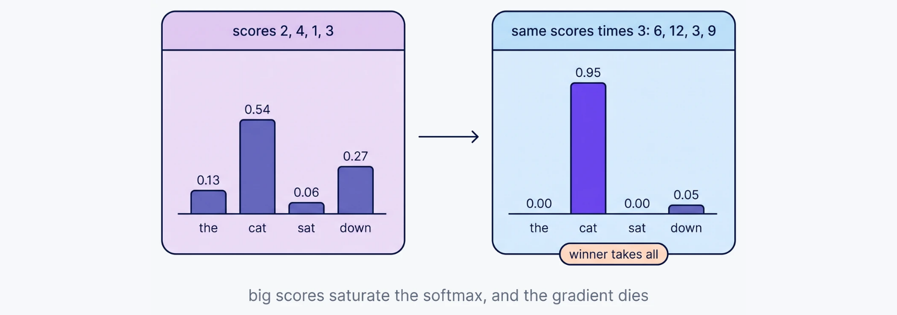


The second panel multiplies the scores, enlarging their differences and concentrating the weights. The left printed weights are schematic: softmax([2,4,1,3]) is the recalculated row above. For the right scores [6,12,3,9], the weights are approximately [0.00236,0.95022,0.00012,0.04731]. A common offset alone would leave the distribution unchanged. To state the gradient consequence precisely, the derivation below concerns the softmax Jacobian, and does not imply that every gradient in a model disappears.

Let $a_i=\operatorname{softmax}(e)_i$. Differentiating gives

$$\frac{\partial a_i}{\partial e_j}=a_i(\delta_{ij}-a_j).$$

Here $\delta_{ij}$ is 1 when the indices match and 0 otherwise. For a two-score vector `[0,2]`, the larger probability is about 0.880797, and its own derivative is about 0.104994. For `[0,20]`, that derivative is about $2.061\times10^{-9}$. Very concentrated softmax weights can make changes in the weights insensitive to small score changes.

This does **not** imply that every gradient in a model vanishes or that learning necessarily stops. For example, softmax followed by cross-entropy has logit gradient $p-y$; a confident wrong prediction can have a large gradient. The effect depends on the surrounding computation and objective.

### Temperature is a related operation, not the same setting

Writing $a=\operatorname{softmax}(e/\tau)$ with $\tau>0$, increasing $\tau$ makes score differences smaller and generally spreads probability more evenly. Decreasing it sharpens the distribution. Attention's $1/\sqrt{d_k}$ scales **query–key scores**; a generation temperature typically scales **vocabulary logits**. The algebra is related, but these are different distributions at different places in the model.

<!-- example:04_scoring.py:start -->

Complete file: [04_scoring.py](examples/04_scoring.py).

```python
import json
import math
from row_math import X, dot, rounded, softmax


if __name__ == '__main__':
    query = [1.0, 1.0]
    scores = [dot(query, key) for key in X]
    ordinary = softmax(scores)
    scaled = softmax([score / math.sqrt(2) for score in scores])
    sharp = softmax([0.0, 20.0])[-1]
    mild = softmax([0.0, 2.0])[-1]
    assert dot([1.0, 0.0], [2.0, 0.0]) > dot([1.0, 0.0], [1.0, 0.0])
    assert abs(sum(scaled) - 1.0) < 1e-14
    print(json.dumps({'scores': scores, 'unscaled': rounded(ordinary),
                      'scaled': rounded(scaled),
                      'mild_diagonal_derivative': round(mild * (1 - mild), 9),
                      'sharp_diagonal_derivative': round(sharp * (1 - sharp), 12)}))
```

<!-- example:04_scoring.py:end -->

Run `python3 examples/04_scoring.py`. It reproduces both weight rows and the two derivatives, and checks the magnitude counterexample. No parameters or embeddings are updated.

### Finish the scoring pass and change the next question

| Scorer | How the inputs meet | Main condition |
| --- | --- | --- |
| Additive | Separate projections are added inside a nonlinear scoring network | Projected widths must match |
| Dot product | Corresponding coordinates multiply, then sum | Query and key widths must match |
| Scaled dot product | The same sum is divided by $\sqrt{d_k}$ | $d_k$ is the comparison width |

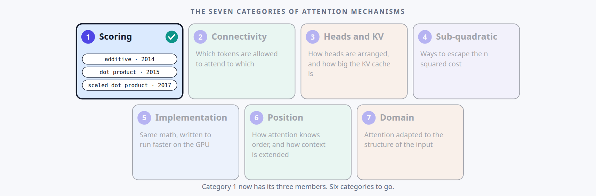

These are three classical choices in the scoring category. They do not exhaust attention research, and scaled dot-product attention is not a claim about every layer in every modern hybrid architecture.

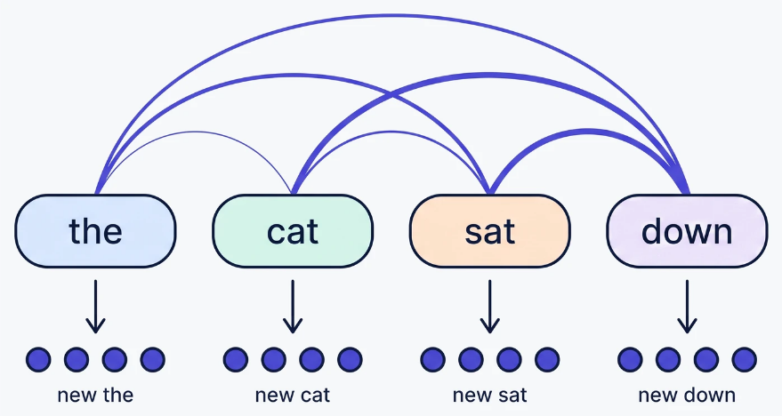

The next picture changes who asks, rather than how compatibility is scored. Instead of a decoder looking into an encoder, each position in a sentence will retrieve from its own sentence. The arrows are information paths; the small output dots are new feature coordinates, not predicted vocabulary tokens.

### Predict or explain: The number of keys doubles but their width stays two. Should the conventional scale change from √2 to √4?

<details data-practice-id="scale-check"><summary>Reveal worked answer and rubric</summary>

No. The scale uses the number of summed coordinate products in each dot product, d_k=2, rather than the number of keys. More keys changes the number of scores and the normalization denominator, not the coordinate count in a score.

**Rubric:** Identify the key-feature width and separate it from the source-position axis.

</details>


### References

[Vizuara — The Attention Family, Lecture 4](https://www.youtube.com/watch?v=DDxMVJnjgps) · [Presentation and diagrams](https://lecture4-attention-mechanisms.vercel.app/) · [Interactive vector and softmax lab](https://lecture4-attention-lab.vercel.app/).

[Luong et al. — Effective Approaches to Attention-based Neural Machine Translation](https://aclanthology.org/D15-1166/) · [Vaswani et al. — Attention Is All You Need, section 3.2.1](https://arxiv.org/abs/1706.03762).


## 5. Simplified self-attention: every word gets a context

We know how a decoder can retrieve a changing mixture from an encoder. Now change the relationship between the inputs: let a sentence retrieve from **itself**. Each position asks its own question and gets its own contextual vector.


The earlier picture had two different sides: decoder queries and source memory. The new operation will supply both from the same input sequence. We keep the three-step recipe: scores, row-wise softmax, weighted sum.


This is a change in **who retrieves from whom**. Self-attention does not, by itself, specify the score formula, a causal mask or the number of heads.


Work up the staircase one addition at a time. Today we use the input vectors directly. Next we introduce separate query, key and value projections. Then we restrict visibility. Multiple heads have their own Attention Heads route after that. With the input vectors fixed, today's isolated operation has no parameters to train.

### First change the axes of the attention matrix


In the left panel, two target queries consult three source positions, giving two rows and three columns. In the right panel, each position of a four-position sequence consults that same sequence, giving four rows and four columns. In both panels, normalization is across each query's source columns.

A square matrix does not by itself prove self-attention: two different sequences could have equal lengths. The defining property is input origin. Later, cached causal generation can also use a subset of query positions, so even a self-attention computation need not materialize a square matrix in every execution mode.

### Why a fixed token embedding needs context


Compare “The cat drank the milk because it was thirsty” with “…because it was sweet”. In the first, **it** naturally refers to the cat; in the second, to the milk. A vocabulary lookup gives the token the same starting embedding in both sentences. A contextual representation can incorporate the surrounding words and distinguish the uses.

The picture motivates what a learned model should represent. The small arithmetic pass below has no trained language understanding and does not demonstrate that it resolves pronouns correctly.


Our sentence is **Dream big and work for it**. Follow one position, **big**, from its input $x^{(2)}$ to its output $z^{(2)}$. Superscript $(2)$ means the second sequence position, not a square or a second feature coordinate. In Python it will be row index `1`.

### Write down all six input vectors

These are hand-chosen teaching coordinates, not vectors measured from a trained embedding model.

| Position | Token | Input vector |
| --- | --- | --- |
| 1 | Dream | $[0.72,0.45,0.31]$ |
| 2 | big | $[0.75,0.20,0.55]$ |
| 3 | and | $[0.30,0.80,0.40]$ |
| 4 | work | $[0.85,0.35,0.60]$ |
| 5 | for | $[0.55,0.15,0.75]$ |
| 6 | it | $[0.25,0.20,0.85]$ |

Stack them into $X\in\mathbb R^{6\times3}$. Six counts positions; three counts features at each position.


Each arrow starts at the origin and ends at one input vector. Before calculating, compare directions and lengths. The picture makes the numerical geometry visible. Labels such as “content words” and “connectors” do not turn these manually chosen numbers into evidence of learned semantic clusters.

### Step 1: big scores every position, including itself


Use $x^{(2)}=[0.75,0.20,0.55]$ as the query. For source position $j$, define $\omega_{2j}=x^{(2)}\cdot x^{(j)}$. The first subscript identifies who asks; the second identifies the available source.

For Dream,

$$\omega_{21}=0.75(0.72)+0.20(0.45)+0.55(0.31)=0.8005.$$

For big itself,

$$\omega_{22}=0.75^2+0.20^2+0.55^2=0.9050.$$

For work,

$$\omega_{24}=0.75(0.85)+0.20(0.35)+0.55(0.60)=1.0375.$$

The complete score row is

$$[0.8005,0.9050,0.6050,1.0375,0.8550,0.6950].$$
 There are six scores because there are six source positions. No masking excludes big from looking at itself.

### Why can work beat big's score with itself?


The quantities in this picture are **lengths**, not the previous six attention scores. In particular,

$$\lVert x^{(2)}\rVert=\sqrt{0.905}\approx0.951315,\qquad
\lVert x^{(4)}\rVert=\sqrt{1.205}\approx1.097725.$$

A self-comparison has angle zero, but another longer vector can still score more because $q\cdot k=\lVert q\rVert\lVert k\rVert\cos\theta$. Self-alignment does not guarantee the largest raw dot product when lengths vary.

The other lengths are about 0.903881 for Dream, 0.943398 for and, 0.942072 for for, and 0.908295 for it. None was constrained to be a unit vector.

### Step 2: normalize the six scores


Pause the six-word calculation and inspect the separate scores $[1,2,3,6]$. Dividing by their sum, 12, gives $[0.0833,0.1667,0.25,0.5]$. Softmax gives approximately

$$[0.006269,0.017040,0.046320,0.930370].$$

Here exponentiation makes the largest score much more dominant.

This is a separate four-item example, not a row with two missing words from our sentence. It exposes the difference more clearly than the gentle six-word scores.


Both rows add to one, but only softmax handles arbitrary finite signed scores while producing positive normalized weights. Change the first score to $-1$:


The direct sum is now ten, so its first normalized entry is $-0.1$. A signed coefficient is not a probability weight. Scores $[1,-1]$ would be worse: direct normalization divides by zero. Softmax avoids these failures by exponentiating first. This explains our choice; it is not a claim that every attention variant uses softmax.

Return to the six-word row. Using its **unscaled** scores,

$$\alpha_{2j}=\frac{\exp(\omega_{2j})}{\sum_{r=1}^{6}\exp(\omega_{2r})}.$$

| Source | Dream | big | and | work | for | it |
| --- | --- | --- | --- | --- | --- | --- |
| Score | 0.8005 | 0.9050 | 0.6050 | 1.0375 | 0.8550 | 0.6950 |
| Weight | 0.162446 | 0.180340 | 0.133599 | 0.205890 | 0.171545 | 0.146181 |

The exact computed weights sum to one. Rounded displayed entries may not. Work still receives the largest weight, about 0.20589; normalization preserves the row's ranking.

### Step 3: combine the complete input vectors


Compute $z^{(2)}=\sum_{j=1}^{6}\alpha_{2j}x^{(j)}$. For the first coordinate,

$$z^{(2)}_1\approx0.116961+0.135255+0.040080+0.175007+0.094350+0.036545
=0.598197.$$

Each contribution is one source's first coordinate multiplied by its weight. Do the same for coordinates two and three to obtain

$$z^{(2)}\approx[0.598197,0.343077,0.579431].$$

Use unrounded weights for the computation. Multiplying only the displayed two-decimal weights gives a slightly different answer. The context has three features; it is not the six-entry distribution of weights.


Follow the panels from top to bottom. Six comparison scores become six weights; those weights mix six three-coordinate vectors into **one three-coordinate result**. The number of weights and the number of output features answer different shape questions.

### Repeat the same calculation for every position


One big row is only one sixth of the pass. All positions at once use

$$S=XX^\top,\qquad A=\operatorname{softmax}_{\rm rows}(S),\qquad Z=AX.$$

The shapes are $(6\times3)(3\times6)=6\times6$ for scores and $(6\times6)(6\times3)=6\times3$ for output. There are 36 score entries and six returned vectors. Softmax runs along the source/key axis of each row, not over all 36 entries together.


The second row is exactly the big row above. Several rows put their largest weight on work, whose magnitude affects comparisons. The and and it rows place their largest weights on themselves. The matrix describes this chosen geometry; it is not a learned linguistic result.


Read a row horizontally to understand one retrieval. A dark column is not a separate vocabulary prediction. Even though $XX^\top$ is symmetric, row-wise softmax generally is not: different rows use different denominators. Here $A_{12}\approx0.173758$ while $A_{21}\approx0.162446$.


Now it is the querying position. Its weight row is approximately

$$[0.139594,0.164061,0.145509,0.180862,0.183137,0.186837],$$

and its context is $[0.568374,0.340176,0.596393]$. Nothing about the algorithm changed; we selected another input row to ask from.

### See the input-to-context movement in space


Plot $x^{(2)}=[0.75,0.20,0.55]$ and $z^{(2)}=[0.598197,0.343077,0.579431]$ from the same origin. The output lies at a weighted combination of all six endpoints, so it need not point in the original direction. Because the weights are nonnegative and sum to one, the output lies in the convex hull of the input endpoints in this parameter-free pass.

This is a weighted mixture, not a guaranteed rotation toward one semantically correct word. Changing the available vectors changes both what can be retrieved and how the comparisons are scored.

### Reproduce all numbers in Python and Colab

Complete file: [six_word_attention.py](examples/six_word_attention.py). Keep it beside `row_math.py`, which was displayed in Lesson 3. It prints every norm, score, weight and output, verifies row sums and symmetry conditions, then calculates the scaled variant separately. In Colab, upload those two files and run `!python six_word_attention.py`.

```python
"""The six-word, three-coordinate walkthrough, without trainable projections."""
import math
from row_math import dot, matmul, softmax, transpose

TOKENS = ['Dream', 'big', 'and', 'work', 'for', 'it']
INPUTS = [[0.72, 0.45, 0.31], [0.75, 0.20, 0.55],
          [0.30, 0.80, 0.40], [0.85, 0.35, 0.60],
          [0.55, 0.15, 0.75], [0.25, 0.20, 0.85]]


def attend(inputs, scale=False):
    scores = matmul(inputs, transpose(inputs))
    divisor = math.sqrt(len(inputs[0])) if scale else 1.0
    weights = [softmax([x / divisor for x in row]) for row in scores]
    return scores, weights, matmul(weights, inputs)


if __name__ == '__main__':
    scores, weights, contexts = attend(INPUTS)
    for label, vector in zip(TOKENS, INPUTS):
        print(label, 'norm', round(math.sqrt(dot(vector, vector)), 6))
    for label, matrix in [('scores', scores), ('weights', weights), ('contexts', contexts)]:
        print(label)
        for row in matrix:
            print(' '.join(f'{x:.6f}' for x in row))
    assert all(abs(sum(row) - 1.0) < 1e-12 for row in weights)
    assert all(abs(scores[i][j] - scores[j][i]) < 1e-12
               for i in range(6) for j in range(6))
    assert abs(weights[0][1] - weights[1][0]) > 1e-4
    assert abs(contexts[1][0] - 0.5981968369218149) < 1e-7
    scaled = attend(INPUTS, scale=True)
    print('scaled big weights', [round(x, 6) for x in scaled[1][1]])
    print('scaled big context', [round(x, 6) for x in scaled[2][1]])
    print('divide by sum toy', [x / 12 for x in [1, 2, 3, 6]])
    print('softmax toy', [round(x, 6) for x in softmax([1, 2, 3, 6])])
```

The same central operations in PyTorch are:

```python
import torch

X = torch.tensor([[0.72, 0.45, 0.31], [0.75, 0.20, 0.55],
                  [0.30, 0.80, 0.40], [0.85, 0.35, 0.60],
                  [0.55, 0.15, 0.75], [0.25, 0.20, 0.85]], dtype=torch.float64)
scores = X @ X.T
weights = torch.softmax(scores, dim=-1)
Z = weights @ X
print(weights[1])
print(Z[1])
```

`dim=-1` normalizes each row's source columns. It does not normalize each input feature row of $X$. This cell is a self-contained calculation you can paste into Colab.

### Keep unscaled and scaled arithmetic separate

The numerical route above uses plain dot products, so it reproduces the weight matrix and $[0.598197,0.343077,0.579431]$ context. To include the scale developed in Lesson 4, calculate instead

$$A_{\rm scaled}=\operatorname{softmax}_{\rm rows}(XX^\top/\sqrt3),\qquad Z_{\rm scaled}=A_{\rm scaled}X.$$

The big row becomes approximately

$$[0.164610,0.174847,0.147040,0.188748,0.169872,0.154883],$$

with context $[0.586353,0.349195,0.578314]$. Both are parameter-free self-attention; they are different numerical operations. Do not add $\sqrt3$ to a formula while retaining the unscaled expected outputs.

### Check additional properties with a smaller fixture

The following check preserves the compact fixture used by the earlier scoring examples and the later projection reference. It tests symmetry, zero queries and changed ordering without assigning semantic meanings to the binary coordinates.

For a compact transfer check, return to the three hand-set rows from the earlier scoring examples,

$$X=\begin{bmatrix}1&0\\0&1\\1&1\end{bmatrix}.$$

Associate them with the positions in “Quiet cats nap” only as an indexing aid. The coordinates are synthetic and have no measured linguistic interpretation. For this first pass, use each row directly for all three roles: query, key, and returned value. Also leave scores unscaled to expose the raw dot-product calculation; scaled scores can be substituted without changing the self-attention relationship.

All pairwise scores fit into

$$S=XX^\top=\begin{bmatrix}1&0&1\\0&1&1\\1&1&2\end{bmatrix}.$$

Row $i$ asks from position $i$; column $j$ identifies the potential source position. The first score is $[1,0]\cdot[1,0]=1$, the second is $[1,0]\cdot[0,1]=0$, and the bottom-right entry is $[1,1]\cdot[1,1]=2$.

Normalize independently across each row and multiply by the value rows:

Dividing raw scores by their sum is not a suitable general replacement for softmax. Scores $[1,-1]$ have a zero sum, while $[-1,2]$ would give a negative mixing weight. Exponentiation followed by normalization gives positive weights for finite unmasked scores and preserves their ranking. It is a particular useful choice of mixture, not the only normalization ever used in attention research.

$$A=\operatorname{softmax}_{\mathrm{keys}}(S),\qquad Z=AX.$$


The computed matrices, rounded only for display, are

$$A\approx\begin{bmatrix}
0.422319&0.155362&0.422319\\
0.155362&0.422319&0.422319\\
0.211942&0.211942&0.576117
\end{bmatrix},\qquad
Z\approx\begin{bmatrix}
0.844638&0.577681\\
0.577681&0.844638\\
0.788058&0.788058
\end{bmatrix}.$$

For example, the first output's first coordinate is $0.422319+0.422319$, because source rows 1 and 3 carry a one in that coordinate. Its second coordinate is $0.155362+0.422319$. Every input position gets an output row; there is no single pooled vector for the entire sentence unless another operation explicitly pools these rows.

#### Symmetry and shapes in the small check


$X$ is $3\times2$, $X^\top$ is $2\times3$, scores and weights are $3\times3$, and $Z$ is $3\times2$. Normalizing along the feature axis of $X$ would not produce distributions over source positions. Normalizing the columns of $S$ would answer a different question and would not ensure each query's weights sum to one.

Although $S$ is symmetric, $A$ need not be. The first and third score rows have different denominators, so $A_{13}=0.422319$ while $A_{31}=0.211942$. Softmax preserves a row's score ordering; it does not preserve arbitrary matrix symmetries.

#### Change the inputs and predict which outputs can move


Change one source row and it can affect its own query, its key in every other query's comparisons, and its value in every mixture. That is why contextualization is a collective computation. It is not a rule that only the modified token's output changes.

For a zero query `[0,0]` and three finite allowed keys, all dot products are zero and the weights are `[1/3,1/3,1/3]`. A genuine zero row is therefore meaningful input in this toy computation. Padding is a storage convention that requires an explicit mask; zeros alone do not declare a row invalid.

If we permute all input rows using the same permutation matrix $P$, then unmasked, position-free self-attention obeys

$$Z(PX)=PZ(X).$$

The score matrix becomes $PSP^\top$, row-wise softmax permutes with it, and multiplication by $PX$ produces the permuted output. This is **permutation equivariance**, not a statement that ordered output arrays are unchanged. A causal mask or positional information changes the conditions. We identify the limitation here without teaching Lecture 9's positional methods.

<!-- example:05_self_attention.py:start -->

Complete file: [05_self_attention.py](examples/05_self_attention.py).

```python
import json
from row_math import X, dot, matmul, rounded, softmax, transpose


def self_attention(inputs):
    scores = matmul(inputs, transpose(inputs))
    weights = [softmax(row) for row in scores]
    return scores, weights, matmul(weights, inputs)


if __name__ == '__main__':
    scores, weights, output = self_attention(X)
    permutation = [2, 0, 1]
    permuted = [X[i] for i in permutation]
    _, _, changed = self_attention(permuted)
    error = max(abs(changed[i][j] - output[old][j])
                for i, old in enumerate(permutation) for j in range(2))
    zero_weights = [softmax([dot([0.0, 0.0], key) for key in X])]
    assert error < 1e-14
    assert zero_weights[0] == [1 / 3] * 3
    assert weights[0][2] != weights[2][0]
    print(json.dumps({'scores': scores, 'weights': rounded(weights),
                      'output': rounded(output), 'permutation_equivariant': error < 1e-14,
                      'zero_query_weights': rounded(zero_weights[0])}))
```

<!-- example:05_self_attention.py:end -->

Run `python3 examples/05_self_attention.py`. It prints the full matrices, tests the zero query and verifies the permutation relation. The equality checks use unrounded values; displayed six-decimal row sums can differ slightly from one due to rounding.

### What is missing before the model can learn its retrieval?


Today each input row filled all three roles directly: $Q=K=V=X$. With the six input vectors fixed, there is no attention parameter that can learn a different preference. A larger system could still train the upstream embedding table; that is a different claim from training projections inside this operation.

Next, three learned matrices let a token ask for information, expose comparison features and deliver content through different representations. Learning can change the mixture; it does not guarantee that every useful mixture becomes sharper.

### Predict or explain: XXᵀ is symmetric. Must its row-softmax also be symmetric? What does a zero query do?

<details data-practice-id="self-check"><summary>Reveal worked answer and rubric</summary>

No: rows can have different normalization denominators. In this fixture A_13≈0.422319 while A_31≈0.211942. A real zero query gives equal finite scores, hence uniform weights over allowed keys; it does not declare padding.

**Rubric:** Use the unequal pair of entries and explain the explicit validity-mask requirement.

</details>


### References

[Vizuara — The Attention Family, Lecture 5](https://www.youtube.com/watch?v=vQPCjniSfNU) · [Presentation and diagrams](https://lecture5-attention-mechanisms.vercel.app/) · [Interactive six-word lab](https://lecture5-attention-lab.vercel.app/) · [Lecture Colab notebook](https://colab.research.google.com/drive/1yojm4UsLKyNvNPTmbY2qKZKMHPV0F4CZ?usp=sharing).


## 6. Learned self-attention: queries, keys and values

The six-word calculation returned one context vector per position. With those input vectors fixed, it had no parameter that could learn a more useful comparison or a different representation to deliver.


We still want $x^{(i)}\rightarrow z^{(i)}$. What changes is the numerical representation used for each job inside the operation.


Scaled dot products answer how to compare; self-attention answers where the compared inputs come from. Now add learned projections to those choices.


We will follow the same three passes: first a concrete failure of fixed comparisons, then every projection and one complete query, then the formula, variance experiment and reusable code.

### A tie that a parameter can change


“The dog chased the ball, but it couldn't catch it.” The first **it** refers to the dog; the second refers to the ball. This motivates two distinct questions. Can we learn to score **different source vectors** differently? And do the two occurrences of **it** have different information available to distinguish their requests?

Start with the first question. Choose illustrative embeddings

$$x_{\rm it}=[0.5,0.5,0.1],\quad x_{\rm dog}=[0.9,0.1,0.1],\quad
x_{\rm ball}=[0.1,0.9,0.1].$$

Raw dot products give $0.51$ for both dog and ball. With these embeddings held fixed, this isolated attention operation has no trainable comparison parameter to change the tie.


Keep the query fixed and choose

$$W_K=\operatorname{diag}(1,2,1).$$

The transformed keys are $k_{\rm dog}=[0.9,0.2,0.1]$ and $k_{\rm ball}=[0.1,1.8,0.1]$. Their query comparisons become

$$q_{\rm it}\cdot k_{\rm dog}=0.45+0.10+0.01=0.56,$$

$$q_{\rm it}\cdot k_{\rm ball}=0.05+0.90+0.01=0.96.$$

The same matrix changes both source vectors, but their different coordinates cause different effects. A model can learn such a transformation through a task loss; here we selected one manually to make its effect inspectable.


Read both levels of bars: the changed scores become unequal weights. The mouse control changes a parameter snapshot; it is not itself an optimization run.

This fixes a tie between **different keys**. It does not, by itself, distinguish the two identical it embeddings. If two positions have identical features, shared projections and the same allowed memory, they get identical queries and outputs. Context from earlier layers, position information or different allowed memory supplies additional distinctions. We will not claim the diagonal matrix alone solves the complete pronoun task.

### Give each input three separate jobs


A **query** represents what the requesting position is looking for. A **key** supplies the comparison features of an available position. A **value** supplies the content to mix after matching. The database-lookup analogy helps remember the roles, but these are learned numerical features, not guaranteed human-readable questions or dictionary records.


Follow the score path and content path separately. Query and key interact to determine routing weights; the value travels around that comparison and enters the final mixture. Changing only $W_V$ therefore changes content while leaving scores and weights fixed, provided $X,W_Q,W_K$ stay fixed.


For row-vector inputs,

$$Q=XW_Q,\qquad K=XW_K,\qquad V=XW_V.$$

For $X\in\mathbb R^{N\times d_{\rm in}}$, take $W_Q,W_K\in\mathbb R^{d_{\rm in}\times d_k}$ and $W_V\in\mathbb R^{d_{\rm in}\times d_v}$. Queries and keys need the same comparison width. Values may have a different width; our upcoming numerical example chooses both widths as two.

### Freeze a five-word example and calculate every projection

Use **The dog chased the ball**. This is a new five-word input, separate from the three-vector tie demonstration and the previous six-word example.

| Token | Input |
| --- | --- |
| The | $[0.5,1.2,0.8]$ |
| dog | $[1.1,0.3,0.7]$ |
| chased | $[0.6,1.5,0.9]$ |
| the | $[0.9,0.8,0.2]$ |
| ball | $[1.2,1.7,0.5]$ |

Choose one fixed snapshot of the trainable matrices:

$$W_Q=\begin{bmatrix}0.6&0.2\\0.1&0.7\\0.5&0.4\end{bmatrix},\quad
W_K=\begin{bmatrix}0.3&0.6\\0.4&0.2\\0.7&0.5\end{bmatrix},\quad
W_V=\begin{bmatrix}0.2&0.5\\0.8&0.1\\0.3&0.6\end{bmatrix}.$$

Each product has shape $(5\times3)(3\times2)=5\times2$.


Count five positions in each result, whatever the schematic grid's drawn subdivisions suggest. Projection changes feature width, not sequence length. For The,

$$q_{\rm The}=0.5[0.6,0.2]+1.2[0.1,0.7]+0.8[0.5,0.4]=[0.82,1.26].$$

The complete result is:

| Token | Query | Key | Value |
| --- | --- | --- | --- |
| The | $[0.82,1.26]$ | $[1.19,0.94]$ | $[1.30,0.85]$ |
| dog | $[1.04,0.71]$ | $[0.94,1.07]$ | $[0.67,1.00]$ |
| chased | $[0.96,1.53]$ | $[1.41,1.11]$ | $[1.59,0.99]$ |
| the | $[0.72,0.82]$ | $[0.73,0.80]$ | $[0.88,0.65]$ |
| ball | $[1.14,1.63]$ | $[1.39,1.31]$ | $[1.75,1.07]$ |

The table preserves the two The/the positions separately. Sequence position identifies each row; a token label is not a unique row identifier.

### Follow ball through score, scale and softmax


Use $q_{\rm ball}=[1.14,1.63]$. Against the first key, the score is $1.14(1.19)+1.63(0.94)=2.8888$. Repeat for all five keys:

| Source | Raw score | Scaled score | Weight |
| --- | ---: | ---: | ---: |
| The | 2.8888 | 2.042690 | 0.172734 |
| dog | 2.8157 | 1.991001 | 0.164032 |
| chased | 3.4167 | 2.415972 | 0.250895 |
| the | 2.1362 | 1.510522 | 0.101452 |
| ball | 3.7199 | 2.630367 | 0.310887 |

The divisor is $\sqrt2$ because each query/key has two coordinates. Five counts source positions; three was the original input width. Neither is the scaling dimension here.


Ball and chased have the largest two weights in this selected snapshot. That is a property of these specified matrices, not evidence that training has discovered a verb/object relation. Learning can change the distribution and its usefulness without necessarily making it sharper.

### Mix values, not the original input embeddings


Compute

$$z_{\rm ball}=\sum_{j=1}^{5}\alpha_{{\rm ball},j}v_j
\approx[1.366709,0.957835].$$

For its first coordinate, the contributions are the five weights multiplied by $1.30,0.67,1.59,0.88,1.75$, respectively. For its second, multiply by $0.85,1.00,0.99,0.65,1.07$. Keep unrounded weights until the final display. The two-decimal weights in the illustration sum to 0.99 due to rounding; do not renormalize or compute from them as if they were exact.

The output has width two because the values have width two. Mixing the three-coordinate $x_j$ instead would give another operation and discard the learned content projection.

### Check the scaling argument experimentally


The horizontal axis changes comparison width. The vertical quantity here is **variance**, whose unscaled theoretical value is $d_k$ under independent, zero-mean, unit-variance coordinates. This differs from the typical-magnitude graph in Lecture 4, which grows like $\sqrt{d_k}$.


Read both panels. They summarize the **same random dot products**, before and after division by $\sqrt{d_k}$. The interactive sample uses 500 pairs, so the reported estimates fluctuate when resampled. Our deterministic program below uses 20,000 pairs and measures about 5.02197 versus 1.00439 at width five, and 102.19674 versus 1.02197 at width one hundred.

Finite samples need not equal the theoretical values. Learned or correlated features need not satisfy the sampling assumptions. Scaling controls one source of score magnitude; it does not guarantee a particular attention distribution or successful training.

### Read the whole formula through its data flow

$$Z=\operatorname{softmax}_{\rm keys}\left(\frac{QK^\top}{\sqrt{d_k}}\right)V.$$


$QK^\top$ scores every query against every key. Dividing controls the comparison scale. Row-wise softmax creates a distribution over source positions. Multiplication by $V$ returns one value mixture per query. In this example, $X$ is $5\times3$, all three projections are $5\times2$, weights are $5\times5$, and output is $5\times2$. Use those labels to interpret the schematic; every projection and output still has five rows.

### Put the tensor steps into reusable classes

The complete file below has both explicit `nn.Parameter` matrices and `nn.Linear` projections. Parameters registered on an `nn.Module` are discoverable by an optimizer; random initialization alone does not train them. The forward call computes activations without updating the matrices.

`nn.Linear` stores its coefficient matrix as output-by-input and applies its transpose. That is why matching our row-vector $XW$ snapshot requires copying `W.T` into its `.weight`. Both classes transpose only the last two key axes so the same code supports `[positions,features]` and `[batch,positions,features]` inputs.

Complete file: [learned_attention.py](examples/learned_attention.py). Paste the full file into one Colab cell, or upload it and run `!python learned_attention.py`. It needs PyTorch and no other tutorial helper files.

```python
"""Five-word projection snapshot, two equivalent classes and a variance probe."""
import math
import torch
from torch import nn


class ParameterAttention(nn.Module):
    def __init__(self, d_in, d_key, d_value):
        super().__init__()
        self.WQ = nn.Parameter(torch.rand(d_in, d_key, dtype=torch.float64))
        self.WK = nn.Parameter(torch.rand(d_in, d_key, dtype=torch.float64))
        self.WV = nn.Parameter(torch.rand(d_in, d_value, dtype=torch.float64))

    def forward(self, x):
        q, k, v = x @ self.WQ, x @ self.WK, x @ self.WV
        weights = torch.softmax(q @ k.transpose(-2, -1) / math.sqrt(k.shape[-1]), dim=-1)
        return weights @ v, weights


class LinearLayerAttention(nn.Module):
    # This name means linear projection layers, not recurrent linear attention.
    def __init__(self, d_in, d_key, d_value):
        super().__init__()
        self.query = nn.Linear(d_in, d_key, bias=False, dtype=torch.float64)
        self.key = nn.Linear(d_in, d_key, bias=False, dtype=torch.float64)
        self.value = nn.Linear(d_in, d_value, bias=False, dtype=torch.float64)

    def forward(self, x):
        q, k, v = self.query(x), self.key(x), self.value(x)
        weights = torch.softmax(q @ k.transpose(-2, -1) / math.sqrt(k.shape[-1]), dim=-1)
        return weights @ v, weights


if __name__ == '__main__':
    torch.manual_seed(123)
    x = torch.tensor([[.5, 1.2, .8], [1.1, .3, .7], [.6, 1.5, .9],
                      [.9, .8, .2], [1.2, 1.7, .5]], dtype=torch.float64)
    wq = torch.tensor([[.6, .2], [.1, .7], [.5, .4]], dtype=torch.float64)
    wk = torch.tensor([[.3, .6], [.4, .2], [.7, .5]], dtype=torch.float64)
    wv = torch.tensor([[.2, .5], [.8, .1], [.3, .6]], dtype=torch.float64)
    q, k, v = x @ wq, x @ wk, x @ wv
    scores = q @ k.T
    weights = torch.softmax(scores / math.sqrt(2), dim=-1)
    contexts = weights @ v
    for name, matrix in [('Q', q), ('K', k), ('V', v), ('scores', scores),
                         ('weights', weights), ('contexts', contexts)]:
        print(name, matrix.tolist())
    manual = sum((weights[-1, j] * v[j] for j in range(5)), torch.zeros(2, dtype=x.dtype))
    torch.testing.assert_close(manual, contexts[-1], atol=1e-14, rtol=0)
    explicit = ParameterAttention(3, 2, 2)
    linear = LinearLayerAttention(3, 2, 2)
    with torch.no_grad():
        for dest, source in [(explicit.WQ, wq), (explicit.WK, wk), (explicit.WV, wv),
                             (linear.query.weight, wq.T), (linear.key.weight, wk.T),
                             (linear.value.weight, wv.T)]:
            dest.copy_(source)
    torch.testing.assert_close(explicit(x)[0], contexts, atol=1e-14, rtol=0)
    torch.testing.assert_close(linear(x)[0], contexts, atol=1e-14, rtol=0)
    batch = torch.stack([x, x + .1])
    torch.testing.assert_close(explicit(batch)[0], linear(batch)[0], atol=1e-14, rtol=0)
    torch.manual_seed(123)
    for width in [5, 100]:
        queries = torch.randn(20000, width, dtype=torch.float64)
        keys = torch.randn(20000, width, dtype=torch.float64)
        raw = (queries * keys).sum(dim=-1)
        print('width', width, 'raw variance', raw.var(unbiased=False).item(),
              'scaled variance', (raw / math.sqrt(width)).var(unbiased=False).item())
    print('Both classes match the fixed snapshot, including the batch path.')
```

The fixed five-word outputs must match before comparing classes. The program copies the same snapshot into both classes, checks the tensor result, and checks a two-item batch. Independently initialized classes need not give equal values merely because they have the same shapes. `LinearLayerAttention` here means a class using linear projection layers; it is still **softmax attention**, not the later recurrent technique called linear attention.

The lecture's notebook also follows a six-word input with seed 123. You can make that same structural comparison by supplying the six rows from Lesson 5 to either class: $Q,K,V,Z$ have six rows instead of five, but the learned comparison width stays two. Changing a random seed changes initial matrix entries and outputs, while preserving their declared shapes. It does not measure model quality.

### Follow one actual gradient update on the compact fixture

To connect “trainable” to a measured change, the next calculation uses our earlier three-row transfer fixture and one declared scalar loss. It isolates one parameter rather than claiming to train a translator.

Return to the smaller three-row transfer fixture from Lesson 5 and use this parameter snapshot

$$W_Q=\begin{bmatrix}1&0\\0&1\end{bmatrix},\quad
W_K=\begin{bmatrix}1&1\\0&1\end{bmatrix},\quad
W_V=\begin{bmatrix}2&0\\0&-1\end{bmatrix}.$$

This gives

$$Q=\begin{bmatrix}1&0\\0&1\\1&1\end{bmatrix},\quad
K=\begin{bmatrix}1&1\\0&1\\1&2\end{bmatrix},\quad
V=\begin{bmatrix}2&0\\0&-1\\2&-1\end{bmatrix}.$$

For source row 3, $[1,1]W_K=[1,2]$: its first output coordinate is $1\times1+1\times0$, and its second is $1\times1+1\times1$. The same row's value becomes `[2,-1]`, which shows explicitly that a negative value coordinate is allowed even though attention weights are nonnegative.

### Follow the last query all the way through


The last query `[1,1]` scores the three keys as `[2,1,3]`. Divide by $\sqrt2$ to get approximately `[1.414214,0.707107,2.121320]`. Stable softmax gives

$$a\approx[0.283995,0.140029,0.575975].$$

The output mixes **values**:

$$z_3=a_1[2,0]+a_2[0,-1]+a_3[2,-1]
\approx[1.719942,-0.716005].$$

Mixing $X$ instead of $V$ would return different numbers and discard the delivered-content projection. Using $\sqrt3$ would also be wrong: there are three source rows, but each query/key row has width two.

### One trainable entry, one actual update

Set $W_Q[0,0]=\theta$ and leave all other entries fixed. Because the last input row is `[1,1]`, its query becomes $[\theta,1]$. Use a deliberately small objective on that row alone:

$$L=\frac12(z_{3,1}-2)^2.$$

This target concerns one illustrative output feature, not a vocabulary token or translation score. At $\theta=1$, the loss is approximately `0.039216379`. Let $g_j=(z_{3,1}-2)V_{j,1}$ be the derivative with respect to weight $a_j$. Softmax backpropagates as

$$\frac{\partial L}{\partial e_j}=a_j\left(g_j-\sum_ra_rg_r\right).$$

Here the scaled score derivative is $\partial e_j/\partial\theta=K_{j,1}/\sqrt2$, so

$$\frac{\partial L}{\partial\theta}=\sum_j
a_j\left(g_j-\sum_ra_rg_r\right)\frac{K_{j,1}}{\sqrt2}
\approx-0.047694266.$$

A step with learning rate $\eta=0.2$ sets $\theta\leftarrow\theta-\eta\,\partial L/\partial\theta\approx1.009538853$. Re-evaluating reduces the loss to approximately `0.038763847`. The program checks the analytic derivative against a centered finite difference before applying that step.

The shared retrieval module below uses only the row operations already defined in Lesson 3. It introduces the projected single-head call and the parameter snapshot used in this lesson. Its optional causal path is opened in Lesson 7.

<!-- example:attention_math.py:start -->

Complete file: [attention_math.py](examples/attention_math.py).

```python
"""Projected single-head retrieval, using the earlier row operations."""
import math
from row_math import X, dot, matmul, rounded, softmax


def attention(q, k, v, causal=False, key_valid=None, scaled=True):
    if len(k) != len(v) or not k or not q:
        raise ValueError('Need queries and matching nonempty keys/values')
    if causal and len(q) != len(k):
        raise ValueError('This toy causal path assumes aligned self-attention')
    key_valid = [True] * len(k) if key_valid is None else list(key_valid)
    if len(key_valid) != len(k):
        raise ValueError('Key validity must match the key axis')
    scale = math.sqrt(len(k[0])) if scaled else 1.0
    scores = [[dot(query, key) / scale for key in k] for query in q]
    weights = [softmax(row, [valid and (not causal or j <= i)
                            for j, valid in enumerate(key_valid)])
               for i, row in enumerate(scores)]
    return scores, weights, matmul(weights, v)


WQ = [[1.0, 0.0], [0.0, 1.0]]
WK = [[1.0, 1.0], [0.0, 1.0]]
WV = [[2.0, 0.0], [0.0, -1.0]]
```

<!-- example:attention_math.py:end -->

<!-- example:06_projections.py:start -->

Complete file: [06_projections.py](examples/06_projections.py).

```python
import json
import math
from attention_math import X, WQ, WK, WV, attention, matmul, rounded


def forward(theta):
    wq = [[theta, 0.0], [0.0, 1.0]]
    q, k, v = matmul(X, wq), matmul(X, WK), matmul(X, WV)
    _, weights, output = attention(q, k, v)
    error = output[-1][0] - 2.0
    return error * error / 2, q, k, v, weights, output


if __name__ == '__main__':
    loss, q, k, v, weights, output = forward(1.0)
    a = weights[-1]
    d_output = output[-1][0] - 2.0
    d_weights = [d_output * value[0] for value in v]
    weighted_gradient = sum(p * g for p, g in zip(a, d_weights))
    d_scores = [p * (g - weighted_gradient) for p, g in zip(a, d_weights)]
    analytic = sum(g * key[0] / math.sqrt(2) for g, key in zip(d_scores, k))
    epsilon = 1e-5
    numeric = (forward(1 + epsilon)[0] - forward(1 - epsilon)[0]) / (2 * epsilon)
    assert abs(analytic - numeric) < 1e-9
    new_theta = 1 - 0.2 * analytic
    assert forward(new_theta)[0] < loss
    print(json.dumps({'q': q, 'k': k, 'v': v, 'last_weights': rounded(a),
                      'last_output': rounded(output[-1]), 'loss': round(loss, 9),
                      'gradient': round(analytic, 9), 'gradient_verified': True,
                      'updated_parameter': round(new_theta, 9),
                      'updated_loss': round(forward(new_theta)[0], 9)}))
```

<!-- example:06_projections.py:end -->

Run `python3 examples/06_projections.py`. The output contains every projection, the final weight row, output, loss, derivative and updated result. A finite-difference check tests this local derivative; it does not prove that a complete training system works or that every learning rate reduces every objective.

### The next restriction: information available during generation


Today every position can inspect the complete supplied sentence. Next-token generation requires a stricter contract: features used to predict the next token cannot depend on that answer or later tokens. The next lesson adds a visibility rule to the scores before normalization.

### Predict or explain: Change W_V while keeping X, W_Q and W_K fixed. What must stay fixed, and what can change?

<details data-practice-id="projection-check"><summary>Reveal worked answer and rubric</summary>

Q, K, scores and attention weights stay fixed. V and the returned contexts can change. With a task loss, downstream gradients can also change because the output being measured changed. Identical position-free queries with the same memory still cannot be distinguished by merely naming the roles differently.

**Rubric:** Separate the routing path from the content path; do not treat attention weights as vocabulary predictions.

</details>


### References

[Vizuara — The Attention Family, Lecture 6](https://www.youtube.com/watch?v=wshXBhGItkM) · [Presentation and diagrams](https://lecture6-attention-mechanisms.vercel.app/) · [Interactive projections and variance lab](https://lecture6-attention-lab.vercel.app/) · [Lecture Colab notebook](https://colab.research.google.com/drive/10DoLeN3FK9BqmCebRz3cdS5BrdEshbw2?usp=sharing).

[Vaswani et al. — Attention Is All You Need, section 3.2](https://arxiv.org/abs/1706.03762).


## 7. Causal attention: hide the future, then apply dropout

A model predicting the next token must operate with the prefix available at that moment. During training we can process many positions together, but an output at an earlier position must not acquire information from a later input token. A causal mask imposes that restriction without changing the learned projections or the score function.


The projections, score and mixture keep their jobs. In the six-word example there are six queries, six keys, six values and six outputs; schematic subdivisions do not change those counts.


We will follow three questions: why generation needs restricted visibility, where to impose that restriction, and how training-time dropout changes the resulting weights.

### Locate the target before drawing the triangle


During training, the complete sentence **Dream big and work for it** may be stored in one tensor. During generation, a model given “Dream big and” has not produced work, for or it yet. Its context for the next prediction must therefore mix only the values of the available prefix. Having the training labels in memory does not authorize using them as input features.


Use a row as the position making a prediction and a column as a possible source. The visible prefix grows one position at a time; entries strictly to the right are forbidden. The diagonal is allowed because that row predicts the following token from the current token and its prefix, as the shifted targets below make explicit.

For the six-word sentence followed by an end marker, the shifted prediction contract is

| Position | Input token | Prediction target | Allowed input positions |
| --- | --- | --- | --- |
| 1 | Dream | big | 1 |
| 2 | big | and | 1, 2 |
| 3 | and | work | 1, 2, 3 |
| 4 | work | for | 1, 2, 3, 4 |
| 5 | for | it | 1, 2, 3, 4, 5 |
| 6 | it | `<EOS>` | 1, 2, 3, 4, 5, 6 |

The diagonal is allowed because the current **input** token is known; its target is the next token. At row 1, allowing input position 2 would reveal “big”, the answer being predicted. A correct triangular mask does not repair incorrectly aligned inputs and labels, and a mask at only one layer does not prevent leakage through another path that has already mixed future information.


Compare the first row, second row and final row. First, only Dream is allowed, so its weight is one and $z_1=v_1$. Second, Dream and big share the mass, approximately 0.48 and 0.52 in this snapshot, so $z_2\approx0.48v_1+0.52v_2$. Third, the last query may see the whole supplied prefix, so its row agrees with the unmasked last row. The values themselves need not be deleted: exactly zero future weights remove their contribution.

### First attempt: zero weights and repair their row sums


Simply zeroing forbidden **weights** after ordinary softmax leaves the remaining weights with a sum below one. Renormalizing the remaining weights does recover the masked distribution in exact arithmetic:

$$\frac{e^{s_j}/D}{\sum_{r\in\mathcal A}e^{s_r}/D}
=\frac{e^{s_j}}{\sum_{r\in\mathcal A}e^{s_r}},\qquad j\in\mathcal A.$$

So it is incorrect to say that this renormalized version necessarily leaks future information mathematically. It is nevertheless less convenient and can underflow if a huge forbidden score makes every allowed probability numerically zero before renormalization. Masking before softmax directly normalizes over the permitted set.

The dense matrix product may still compute forbidden raw dot products. Causal masking is a rule about usable information and outputs; it is not a guarantee that a dense kernel never calculates a future pair internally.

### Standard method: apply visibility before normalization


The blocked entries contribute zero after exponentiation, so the denominator includes only allowed sources. The order is essential to the direct masked-softmax calculation. A row with no allowed finite score still needs explicit handling; the picture does not define a valid distribution for that case.

For a first-position example, scores `[2,3,5]` become `[2,-inf,-inf]`. Their exponential contributions are $[e^2,0,0]$; the denominator is only $e^2$, so weights are exactly `[1,0,0]`. Replacing forbidden raw scores by **zero** would fail because $e^0=1$.


Compare the lower bars across these two states. They stay fixed because both future entries are replaced by minus infinity. The upper bars show the ordinary, not-yet-repaired distribution. After zeroing and renormalizing it, the exact mathematical result would also be `[1,0,0]`; the cancellation above explains why.

In PyTorch, a concrete mask construction is:

```python
import torch

n = 6
future = torch.triu(torch.ones(n, n, dtype=torch.bool), diagonal=1)
scores = torch.zeros(n, n)  # Replace with your Q @ K.T in a real pass.
weights = torch.softmax(scores.masked_fill(future, -torch.inf), dim=-1)
print(weights)
```

`diagonal=1` starts strictly above the main diagonal. `True` marks positions to overwrite in this `masked_fill` call. This Boolean convention belongs to this operation; other APIs may define their masks differently.

With row $i$ as query and column $j$ as source, define

$$M_{ij}=\begin{cases}0&j\leq i,\\-\infty&j>i.\end{cases}\qquad
A=\operatorname{softmax}\left(QK^\top/\sqrt{d_k}+M\right).$$

Exponentials of forbidden entries are zero. Every row must retain at least one finite allowed score. If all entries are masked, subtracting the maximum is not defined in the usual way; do not silently present the result as a valid distribution. Our reference raises an error. A larger application must explicitly choose how to handle padded query positions and exclude them from the objective.


Using Lesson 6's smaller three-row transfer fixture gives

$$A\approx\begin{bmatrix}1&0&0\\0.5&0.5&0\\0.283995&0.140029&0.575975\end{bmatrix},\quad
Z\approx\begin{bmatrix}2&0\\1&-0.5\\1.719942&-0.716005\end{bmatrix}.$$

The second query has equal scores for its two allowed keys, so its weights are one half each. The last query can access the complete prefix, which here is the entire sequence, and therefore retains the same output as the unmasked last row.

### Combine a causal mask with padding validity

A source key is usable only if both conditions hold: it is in the allowed prefix, and it represents a real input token. The reference helper combines them as `valid_key[j] and j <= i`. Replacing a padded embedding with zeros does not impose this rule: a zero key can still receive a nonzero softmax weight and change the denominator.

Masking padded keys also does not automatically eliminate padded **query** outputs or their losses. An application normally tracks query validity separately and excludes those rows from the loss, or explicitly zeroes their outputs according to its contract. This tutorial's examples use three real queries and reject an empty attention support.

### Dropout changes a sample, not the intended mean


The causal zeros stay zero. A dropout coin flip acts on each attention entry independently; probability $p=0.5$ does not promise that exactly half of a particular row disappears. An entire row can be dropped. These weights are computed activations, not independent model parameters.


The two outcomes illustrate the expectation calculation: a contribution sometimes becomes zero, and the survivors are enlarged by the reciprocal keep probability. Each sampled attention row need not sum to one. Our example below enumerates every keep/drop pattern and checks the immediate weighted mixture rather than claiming equality for a whole nonlinear model.

For the illustrated work-to-big weight $0.27$ at $p=0.5$, the two outcomes are zero and $0.54$. Their average is $0.27$. With $p=1/3$, the keep probability is $2/3$ and survivors are multiplied by $3/2$ instead. This preserves an immediate expectation, not the exact value of each sample.


A first-row one may become zero or two. That is not a broken causal mask or a request to normalize the sampled row again. At inference, disable dropout and use the original causal weights. To inspect a particular random mask, generate it once and reuse that exact mask for printing and multiplication; making two dropout calls can generate different patterns. A fixed seed controls repeatability of a specified sequence of random calls.

The training motivation is regularization: randomly removing contributions makes the computation operate with varying subsets of its usual information paths. It can reduce reliance on particular contributions, but whether it improves held-out quality depends on the model, data and dropout probability. No generalization improvement is established by the arithmetic example alone.

During training, attention dropout can replace each normalized weight $a_j$ by

$$\widetilde a_j=\frac{m_j}{1-p}a_j,\qquad m_j\sim\operatorname{Bernoulli}(1-p),\quad0\leq p<1.$$

Taking the expectation gives $\mathbb E[\widetilde a_j]=a_j$. This rescales surviving weights; it does not renormalize each sampled row to sum to one. At $p=0.5$, keeping the first and third entries of our final weight row gives approximately `[0.567991,0,1.151951]`, with sum `1.719942`. A sampled weight can exceed one. In evaluation mode dropout is disabled.

The expectation claim is local to the dropped weights or their immediate linear mixture. It does not say that a whole nonlinear model's average training prediction equals its evaluation prediction. The example enumerates all eight independent keep/drop patterns for three weights, proving the immediate expectation without relying on a lucky random sample.

<!-- example:07_causal.py:start -->

Complete file: [07_causal.py](examples/07_causal.py).

```python
import itertools
import json
from attention_math import X, WQ, WK, WV, attention, matmul, rounded, softmax


def run(inputs):
    q, k, v = matmul(inputs, WQ), matmul(inputs, WK), matmul(inputs, WV)
    return attention(q, k, v, causal=True)


if __name__ == '__main__':
    scores, weights, output = run(X)
    changed = [X[0], X[1], [99.0, -37.0]]
    assert run(changed)[2][:2] == output[:2]
    assert all(weights[i][j] == 0 for i in range(3) for j in range(i + 1, 3))
    # Exact expectation over every independent dropout keep/drop choice, p=1/2.
    draws = [[2 * p * keep for p, keep in zip(weights[-1], mask)]
             for mask in itertools.product([0, 1], repeat=3)]
    average = [sum(row[j] for row in draws) / len(draws) for j in range(3)]
    assert max(abs(x - y) for x, y in zip(average, weights[-1])) < 1e-14
    chosen = [2 * p * keep for p, keep in zip(weights[-1], [1, 0, 1])]
    try:
        softmax([1.0, 2.0], [False, False])
    except ValueError:
        all_masked_rejected = True
    else:
        raise AssertionError('An empty attention support must not silently normalize')
    print(json.dumps({'weights': rounded(weights), 'output': rounded(output),
                      'future_invariant': True, 'dropout_sample': rounded(chosen),
                      'dropout_sample_sum': round(sum(chosen), 6),
                      'dropout_expectation': rounded(average),
                      'all_masked_rejected': all_masked_rejected}))
```

<!-- example:07_causal.py:end -->

Run `python3 examples/07_causal.py`. It checks exact zero future weights, changes the final input to `[99,-37]` and verifies that the first two outputs do not change. That intervention is stronger than checking only that a printed matrix looks triangular. It also tests the empty-support error and dropout expectation.

### Put the whole causal pipeline into one class


Follow the value branch all the way to the final multiplication. Normalized weights are not yet context vectors. Dropout, when active, occurs after softmax and before multiplying by $V$. Scaling before the minus-infinity overwrite or afterward gives the same result for a positive finite scale; the forbidden entries remain minus infinity either way.

The class below stores a strictly upper-triangular Boolean mask with `register_buffer`. It travels with the model's device and checkpoint state, but an optimizer does not train it. Slice it to the actual sequence length before applying it. This class handles aligned full-sequence self-attention; cached generation with separate query/key lengths needs a specified position-offset mask.

Complete file: [causal_attention.py](examples/causal_attention.py). It is self-contained PyTorch and can be pasted into Colab or uploaded and run with `!python causal_attention.py`. It declares its input vectors and random initialization explicitly; do not infer exact coefficients from rounded figure entries.

```python
"""Causal weights, mask-order equivalence, dropout and prefix invariance."""
import math
import torch
from torch import nn


class CausalAttention(nn.Module):
    def __init__(self, d_in, d_out, context_len, dropout=0.5):
        super().__init__()
        if not 0 <= dropout < 1:
            raise ValueError('Drop probability must be in [0, 1)')
        self.query = nn.Linear(d_in, d_out, bias=False, dtype=torch.float64)
        self.key = nn.Linear(d_in, d_out, bias=False, dtype=torch.float64)
        self.value = nn.Linear(d_in, d_out, bias=False, dtype=torch.float64)
        self.dropout = nn.Dropout(dropout)
        self.register_buffer('future', torch.triu(
            torch.ones(context_len, context_len, dtype=torch.bool), diagonal=1))

    def forward(self, x):
        length = x.shape[-2]
        if not 0 < length <= self.future.shape[0]:
            raise ValueError('Sequence length is outside the prepared context')
        q, k, v = self.query(x), self.key(x), self.value(x)
        scores = q @ k.transpose(-2, -1) / math.sqrt(k.shape[-1])
        scores = scores.masked_fill(self.future[:length, :length], -torch.inf)
        weights = torch.softmax(scores, dim=-1)
        dropped = self.dropout(weights)
        return dropped @ v, weights, dropped


if __name__ == '__main__':
    torch.manual_seed(789)
    x = torch.tensor([[.72, .45, .31], [.75, .20, .55], [.30, .80, .40],
                      [.85, .35, .60], [.55, .15, .75], [.25, .20, .85]],
                     dtype=torch.float64)
    layer = CausalAttention(3, 2, 6, dropout=.5)
    layer.eval()
    output, weights, dropped = layer(x)
    torch.testing.assert_close(weights.sum(-1), torch.ones(6, dtype=x.dtype))
    assert torch.equal(weights.triu(1), torch.zeros_like(weights))
    changed = x.clone()
    changed[3:] = torch.tensor([99., -37., 12.], dtype=x.dtype)
    torch.testing.assert_close(layer(changed)[0][:3], output[:3], atol=1e-14, rtol=0)
    torch.testing.assert_close(layer(x[:3])[0], output[:3], atol=1e-14, rtol=0)
    q, k = layer.query(x), layer.key(x)
    scores = q @ k.T / math.sqrt(2)
    full = torch.softmax(scores, dim=-1)
    zeroed = full.masked_fill(layer.future, 0.0)
    repaired = zeroed / zeroed.sum(-1, keepdim=True)
    torch.testing.assert_close(repaired, weights, atol=1e-14, rtol=0)
    torch.testing.assert_close(full[-1], weights[-1], atol=1e-14, rtol=0)
    extreme = torch.tensor([0., 1000.], dtype=x.dtype)
    lost = torch.softmax(extreme, dim=-1)[0]
    assert lost.item() == 0  # Too late to recover this allowed probability.
    safe = torch.softmax(extreme.masked_fill(torch.tensor([False, True]), -torch.inf), dim=-1)
    assert safe.tolist() == [1., 0.]
    print('evaluation weights', weights.tolist())
    layer.train()
    torch.manual_seed(123)
    _, original, after_dropout = layer(x)
    print('dropout weights', after_dropout.tolist())
    assert torch.all((after_dropout == 0) | (after_dropout == 2 * original))
    layer.eval()
    assert torch.equal(layer(x)[1], layer(x)[2])
    print('Prefix interventions, short contexts, both mask orders and mode checks pass.')
```

The executable checks change all future input rows while preserving the earlier prefix outputs. They also compare a short prefix run against the matching part of the full masked run, verify the last row against unmasked attention, and demonstrate why post-softmax repair is fragile when allowed weights have already underflowed. These interventions check information flow more strongly than looking at a triangular picture alone.

`layer.train()` enables dropout; `layer.eval()` disables it. Evaluation mode does not itself disable autograd or prove model quality. The single-head component still needs embeddings/positions, surrounding blocks, a vocabulary head, an objective and training to become a language model.

### The same causal calculation in C++

The following complete program iterates only through allowed source indices `j <= i`, so it never constructs a forbidden-score array. The reduction and returned context are the same as the Python reference. It deliberately fixes this example's shapes rather than claiming to be a general tensor library.

<!-- example:attention.cpp:start -->

Complete file: [attention.cpp](examples/attention.cpp).

```cpp
#include <algorithm>
#include <array>
#include <cmath>
#include <iomanip>
#include <iostream>

int main() {
    using Row = std::array<double, 2>;
    const std::array<Row, 3> q{{{1, 0}, {0, 1}, {1, 1}}};
    const std::array<Row, 3> k{{{1, 1}, {0, 1}, {1, 2}}};
    const std::array<Row, 3> v{{{2, 0}, {0, -1}, {2, -1}}};
    std::array<Row, 3> output{};
    for (std::size_t i = 0; i < 3; ++i) {
        std::array<double, 3> scores{};
        for (std::size_t j = 0; j <= i; ++j)
            scores[j] = (q[i][0] * k[j][0] + q[i][1] * k[j][1]) / std::sqrt(2.0);
        const double maximum = *std::max_element(scores.begin(), scores.begin() + i + 1);
        std::array<double, 3> weights{};
        double total = 0;
        for (std::size_t j = 0; j <= i; ++j) {
            weights[j] = std::exp(scores[j] - maximum);
            total += weights[j];
        }
        for (std::size_t j = 0; j <= i; ++j)
            for (std::size_t d = 0; d < 2; ++d)
                output[i][d] += (weights[j] / total) * v[j][d];
    }
    std::cout << std::fixed << std::setprecision(6) << "{\"output\":[";
    for (std::size_t i = 0; i < 3; ++i) {
        if (i) std::cout << ',';
        std::cout << '[' << output[i][0] << ',' << output[i][1] << ']';
    }
    std::cout << "]}\n";
}
```

<!-- example:attention.cpp:end -->

From the package directory:

```bash
c++ -std=c++20 -O2 -Wall -Wextra -Werror -pedantic examples/attention.cpp -o /tmp/attention-foundations
/tmp/attention-foundations
```

The output rows are `[2,0]`, `[1,-0.5]`, and `[1.719942,-0.716005]`. Python and C++ comparisons use a tolerance appropriate to the displayed precision; no claim of bitwise agreement across unrelated implementations is needed.


### Continue with multiple independently learned views


We now have one complete attention head with an explicit information contract. A head can mix many sources, but it produces one weight pattern per query. Multiple heads add separately learned comparison/content channels, then combine their outputs. They do not guarantee one human-interpretable grammatical job per head.

### Predict or explain: A dropout sample has a weight above one. Is it invalid? Also, does zeroing and renormalizing unmasked softmax necessarily leak future scores?

<details data-practice-id="causal-check"><summary>Reveal worked answer and rubric</summary>

A dropout sample need not sum to one, and surviving weights are scaled by 1/(1-p); values above one are possible. The local expectation matches the original weights. Zeroing forbidden weights and renormalizing is mathematically equivalent to masked softmax when the allowed denominator is nonzero, but it is numerically fragile if allowed probabilities have already underflowed. Simply zeroing without renormalizing is a different operation.

**Rubric:** State both the sample-versus-expectation distinction and the exact-arithmetic masking equivalence.

</details>


Continue in the separate **Attention Heads** tutorial for Lecture 8. GQA and other head/KV arrangements belong in that category when added later. Lecture 9 remains excluded.

For consolidation, use the [learning points](project/learning-points.md) and optional [transfer review](practice/transfer-review.md). The [readiness check](project/readiness.md), [implementation notes](project/implementation.md), [reference runs](project/reference-runs.md), and [lecture reference list](project/source-map.md) remain available from the course navigation.

### References

[Vizuara — The Attention Family, Lecture 7](https://www.youtube.com/watch?v=Dv8e0ayAikA) · [Presentation and diagrams](https://lecture7-attention-mechanisms.vercel.app/) · [Interactive masks and dropout lab](https://lecture7-attention-lab.vercel.app/) · [Lecture Colab notebook](https://colab.research.google.com/drive/1im86HwxSOUoF2fo93mpaUqRc7kfQRAJ4?usp=sharing).


## Evidence and proof limits

### Claim ledger

| Claim | Status | Proof limit |
| --- | --- | --- |
| Attention mechanisms can be compared using the problem and design choice they change. | illustrative | Original small worked example and stated mathematical assumptions. Source review and executed author checks do not establish a trained model or learner mastery. |
| 2. Why one fixed summary can be difficult to use | illustrative | Original small worked example and stated mathematical assumptions. Source review and executed author checks do not establish a trained model or learner mastery. |
| 3. Build a context that depends on the current query | illustrative | Original small worked example and stated mathematical assumptions. Source review and executed author checks do not establish a trained model or learner mastery. |
| 4. Change the score while keeping retrieval intact | illustrative | Original small worked example and stated mathematical assumptions. Source review and executed author checks do not establish a trained model or learner mastery. |
| 5. Give every position a context from its own sequence | illustrative | Original small worked example and stated mathematical assumptions. Source review and executed author checks do not establish a trained model or learner mastery. |
| 6. Separate comparison features from delivered content | illustrative | Original small worked example and stated mathematical assumptions. Source review and executed author checks do not establish a trained model or learner mastery. |
| 7. Make the training information match generation | illustrative | Original small worked example and stated mathematical assumptions. Source review and executed author checks do not establish a trained model or learner mastery. |

## Sources

- [Vizuara · The Attention Family · Lecture 1 · video](https://www.youtube.com/watch?v=QgnOoQsPc0o) — Video page/description and full English automatic caption text, 00:00:00.920–00:28:48.960; checked 2026-10-30
- [Vizuara · The Attention Family · Lecture 1 · slides](https://lecture1-attention-mechanisms.vercel.app/) — Complete original Slidev presentation, 21 slides; checked 2026-10-30
- [Vizuara · The Attention Family · Lecture 2 · video](https://www.youtube.com/watch?v=IG2gl6sKj_c) — Video page/description and full English automatic caption text, 00:00:00.800–00:26:48.720; checked 2026-10-30
- [Vizuara · The Attention Family · Lecture 2 · slides](https://lecture2-attention-mechanisms.vercel.app/) — Complete original Slidev presentation, 20 slides; checked 2026-10-30
- [Vizuara · The Attention Family · Lecture 3 · video](https://www.youtube.com/watch?v=6yIe4ekER14) — Video page/description and full English automatic caption text, 00:00:01.080–00:36:57.160; checked 2026-10-30
- [Vizuara · The Attention Family · Lecture 3 · slides](https://lecture3-attention-mechanisms.vercel.app/) — Complete original Slidev presentation, 28 slides; checked 2026-10-30
- [Vizuara · The Attention Family · Lecture 4 · video](https://www.youtube.com/watch?v=DDxMVJnjgps) — Video page/description and full English automatic caption text, 00:00:00.960–00:30:28.399; checked 2026-10-30
- [Vizuara · The Attention Family · Lecture 4 · slides](https://lecture4-attention-mechanisms.vercel.app/) — Complete original Slidev presentation, 17 slides; checked 2026-10-30
- [Vizuara · The Attention Family · Lecture 5 · video](https://www.youtube.com/watch?v=vQPCjniSfNU) — Video page/description and full English automatic caption text, 00:00:00.800–00:46:03.680; checked 2026-10-30
- [Vizuara · The Attention Family · Lecture 5 · slides](https://lecture5-attention-mechanisms.vercel.app/) — Complete original Slidev presentation, 27 slides; checked 2026-10-30
- [Vizuara · The Attention Family · Lecture 6 · video](https://www.youtube.com/watch?v=wshXBhGItkM) — Video page/description and full English automatic caption text, 00:00:00.760–00:49:22.200; checked 2026-10-30
- [Vizuara · The Attention Family · Lecture 6 · slides](https://lecture6-attention-mechanisms.vercel.app/) — Complete original Slidev presentation, 25 slides; checked 2026-10-30
- [Vizuara · The Attention Family · Lecture 7 · video](https://www.youtube.com/watch?v=Dv8e0ayAikA) — Video page/description and full English automatic caption text, 00:00:00.880–00:51:23.920; checked 2026-10-30
- [Vizuara · The Attention Family · Lecture 7 · slides](https://lecture7-attention-mechanisms.vercel.app/) — Complete original Slidev presentation, 21 slides; checked 2026-10-30
- [Bahdanau et al. · Neural Machine Translation by Jointly Learning to Align and Translate](https://arxiv.org/abs/1409.0473) — Alignment model and source-memory motivation; checked 2026-10-30
- [Luong et al. · Effective Approaches to Attention-based Neural Machine Translation](https://aclanthology.org/D15-1166/) — Global attention and score alternatives; checked 2026-10-30
- [Vaswani et al. · Attention Is All You Need](https://arxiv.org/html/1706.03762v7) — Sections 3.2.1–3.2.3 and the scaling assumptions; checked 2026-10-30
- [Dive into Deep Learning · Attention Scoring Functions](https://d2l.ai/chapter_attention-mechanisms-and-transformers/attention-scoring-functions.html) — Sections 11.3.2–11.3.4: masked normalization, scaled dot product, additive scoring; checked 2026-10-30
- [Ainslie et al. · GQA, version 3](https://arxiv.org/abs/2305.13245v3) — Abstract: MHA, intermediate grouped KV heads and MQA definitions only; model results not reproduced; checked 2026-10-30
