# Attention heads: MHA, MQA, GQA and MLA

How do independent, shared, grouped and latent key/value representations change retrieval and retained state?

Learning material for attention-labs. Model implementation/training and learner mastery are separate states.

**Outcomes:** 1. Several independent mixtures, then one output; 2. Pack independent heads without changing the operation; 3. Keep head arrangements separate from other attention choices; Explain why shared keys/values can yield different query-head distributions.; Derive MQA parameter/cache counts and distinguish sharing from an equivalent MHA conversion.; Construct and test the query-to-KV mapping and cache dimensions.; Separate equivalent grouped execution from checkpoint conversion and quality claims.; Trace a latent score/value factorization without changing logits.; Count decoupled positional state and preserve absolute positions..

## 8. Multi-head attention

The Attention Foundations route ended with one causal attention head: projected queries and keys select a weighted mixture of projected values, with future positions excluded. Here we change the arrangement of those projections. Several heads build separate mixtures, then an output projection combines their results.

This folder owns head and key/value layouts. This page develops multi-head attention. The following separate lessons develop MQA, GQA and MLA in this same Attention Heads category.

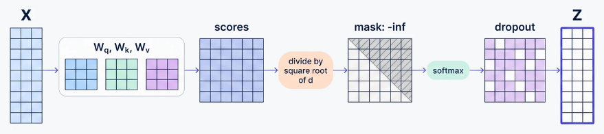

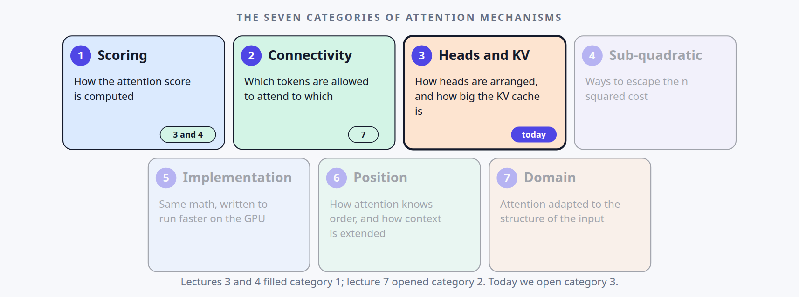

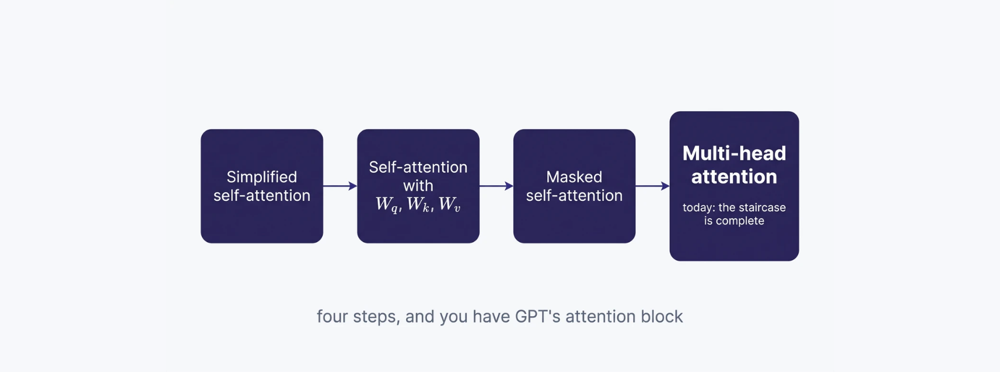

This lecture has three passes: why several mixtures help, how a loop implements them directly, and how a packed tensor implementation preserves their operation. All three passes stay together in this MHA tutorial. MQA, GQA and MLA each have their own complete tutorial in Attention Heads.

### What a second head changes

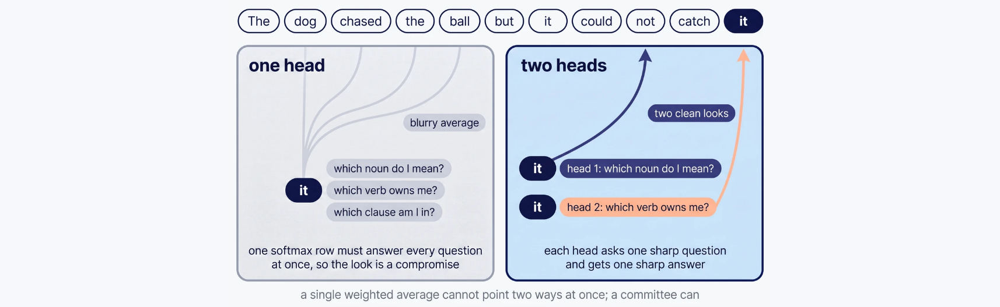

In “The dog chased the ball, but it could not catch it”, the final it refers to the ball and participates in the catch relation. These are possible information needs, not named responsibilities assigned to head numbers. One mixture may combine useful evidence about several things; several learned mixtures offer additional separately parameterized channels.

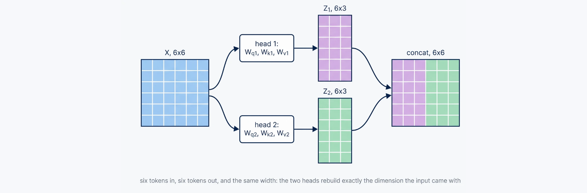


Follow the input into both projection branches, then keep the two resulting attention patterns distinct until their outputs are joined. Each general projection can use every input feature; this is not a requirement to divide the raw embedding into disjoint slices. Separate parameters allow different retrievals but do not guarantee linguistic specialization.

For one head, every value-feature column is mixed using the same matrix $A$:

$$Z=AV.$$

A single query row can distribute weight over several source positions. It is therefore too strong to say that one head can attend to only one token or represent only one relationship. Its actual restriction is that one distribution is shared across the value-feature channels of that head.

For heads $r=1,\ldots,H$, use separate parameter matrices:

$$Q_r=XW_{Q,r},\quad K_r=XW_{K,r},\quad V_r=XW_{V,r},$$
$$Z_r=\operatorname{softmax}\left(Q_rK_r^\top/\sqrt{d_k}+M\right)V_r.$$

The different $A_r$ matrices can route information differently. Separate parameters permit this; they do not guarantee interpretable roles or prevent redundant heads. Labels such as “syntax head” require analysis of an actually trained model, not an assumption based on head number.

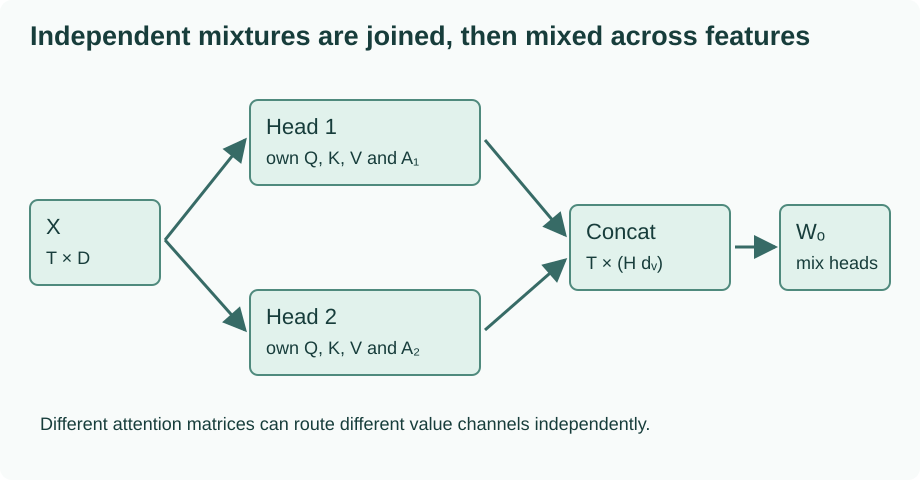

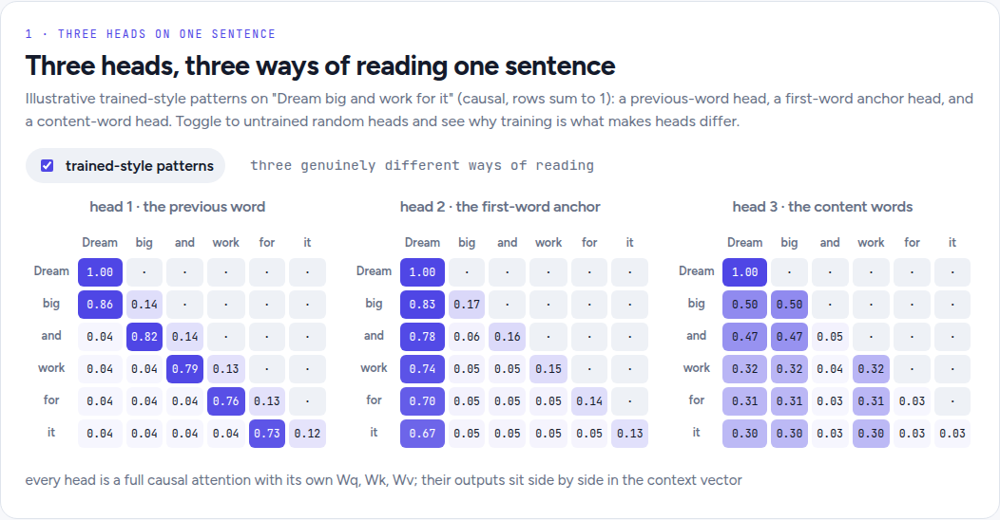

Read one row across all three matrices. They retrieve different mixtures from the same sentence, while sharing the same causal restriction. These are designed examples of possible patterns, not measurements from a trained model in this project.

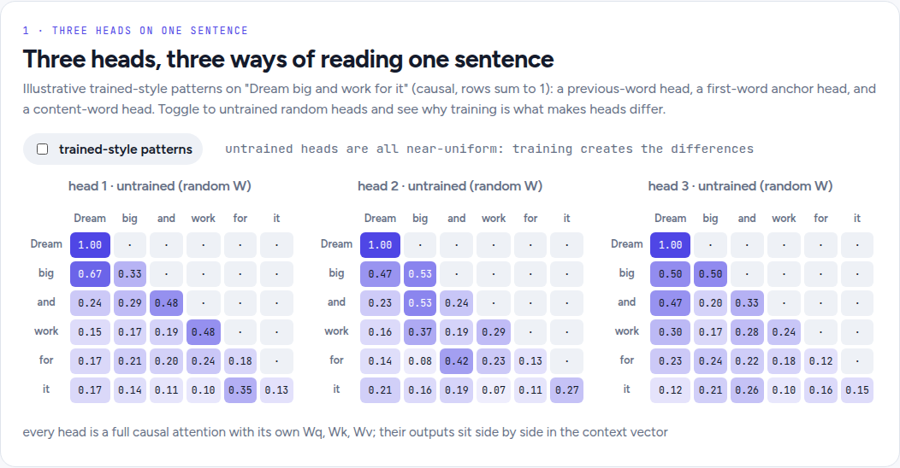

Separate initial parameters can produce different patterns, but meaningful specialization requires evidence about training and behavior. Heads can overlap or become redundant too. Training does not guarantee that every head becomes an easily named grammar detector.

### Count tokens and feature widths separately

For the six-token, width-six example, each of two heads projects from all six input features into three comparison features and three value features. Each per-head projection matrix has shape $6\times3$; each projected Q/K/V and head output has shape $6\times3$. Concatenate the **features of matching token rows** to obtain $6\times6$. Six tokens remain six tokens.

The output projection then uses a $6\times6$ matrix to combine channels inside each row. With twelve tokens and the same widths, the input and output would become $12\times6$, while the output projection would remain $6\times6$: its size depends on feature widths, not sequence length.

For six tokens, width twelve and four equal-width heads, each head returns $6\times3$; concatenation returns $6\times12$. Familiar model configurations use the same arithmetic: GPT-2 small has width $768=12\times64$, and the largest GPT-3 configuration has width $12288=96\times128$. These are architecture examples, not required sizes for this project.

### A small example with two genuinely different patterns

Keep the three input rows from the foundations route:

$$X=\begin{bmatrix}1&0\\0&1\\1&1\end{bmatrix}.$$

Each of two heads now has comparison width one and value width one. Head 1 selects the first input coordinate for queries and keys, and returns the sum of the two coordinates as its scalar value. Head 2 selects the second coordinate for queries and keys, and returns the first coordinate minus the second as its value.

| Head | $W_Q$ | $W_K$ | $W_V$ |
| --- | --- | --- | --- |
| 1 | `[1,0]` as a column | `[1,0]` as a column | `[1,1]` as a column |
| 2 | `[0,1]` as a column | `[0,1]` as a column | `[1,-1]` as a column |

For the final position, Head 1 has query 1 and keys `[1,0,1]`, so its weight row is approximately `[0.422319,0.155362,0.422319]`. Head 2 has query 1 and keys `[0,1,1]`, yielding `[0.155362,0.422319,0.422319]`. Scaling divides by $\sqrt1$, so it makes no numerical change here.

The value lists are `[1,1,2]` and `[1,-1,0]`. Their final-position context scalars are about `1.422319` and `-0.266956`. Concatenation puts those two outputs next to each other:

$$z_{\mathrm{joined},3}=[1.422319,-0.266956].$$

At the first position only the first key is allowed. Its two head outputs are `[1]` and `[1]`, so concatenation gives `[1,1]`. The head arrangement changes neither the causal permission rule nor the meaning of the sequence axis.

### Concatenation preserves the separate channels; projection mixes them

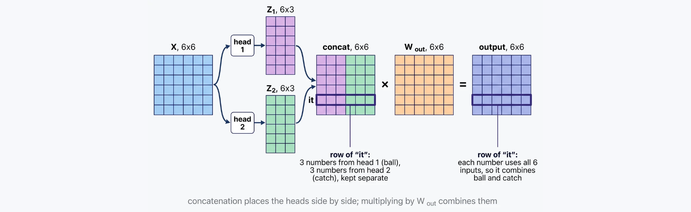


Concatenation preserves the separate head channels; the following matrix can combine those channels into the layer’s output width. The output projection acts within a token row. It does not create a new attention distribution across tokens, and it is not required to mix every feature if the learned parameters preserve some channels.

Use the row-vector output matrix

$$W_O=\begin{bmatrix}1&0.5\\-0.5&1\end{bmatrix},\qquad
Y=\operatorname{Concat}(Z_1,Z_2)W_O.$$

The first position becomes $[1,1]W_O=[0.5,1.5]$. At the final position,

$$Y_3=[1.422319+0.133478,\ 0.711159-0.266956]
\approx[1.555797,0.444203].$$

The output projection acts on feature channels **within each token**. It does not create a new token-to-token attention distribution; the cross-token mixing already happened inside the heads. It can combine, rotate, suppress or preserve head features according to learned parameters.

Concatenation order is a consistent bookkeeping choice, not an automatic priority ranking. If we swap the two joined channels and swap the matching rows of $W_O$, the final output remains the same. The output projection supplies learned combinations of head features; it need not scramble every coordinate, and an identity projection would preserve their separation.

<!-- example:multihead.py:start -->

Complete file: [multihead.py](examples/multihead.py).

```python
"""Two independent scalar heads, with all helpers defined here."""
import json
import math


def dot(a, b):
    if len(a) != len(b):
        raise ValueError('Mismatched widths')
    return sum(x * y for x, y in zip(a, b))


def matmul(a, b):
    return [[dot(row, column) for column in zip(*b)] for row in a]


def head(x, wq, wk, wv):
    q, k, v = matmul(x, wq), matmul(x, wk), matmul(x, wv)
    outputs, patterns = [], []
    for i, query in enumerate(q):
        scores = [dot(query, key) / math.sqrt(len(key)) for key in k[:i + 1]]
        maximum = max(scores)
        numerators = [math.exp(s - maximum) for s in scores]
        weights = [s / sum(numerators) for s in numerators]
        outputs.append(matmul([weights], v[:i + 1])[0])
        patterns.append(weights + [0.0] * (len(x) - i - 1))
    return outputs, patterns


if __name__ == '__main__':
    x = [[1.0, 0.0], [0.0, 1.0], [1.0, 1.0]]
    h1, a1 = head(x, [[1.0], [0.0]], [[1.0], [0.0]], [[1.0], [1.0]])
    h2, a2 = head(x, [[0.0], [1.0]], [[0.0], [1.0]], [[1.0], [-1.0]])
    joined = [first + second for first, second in zip(h1, h2)]
    output = matmul(joined, [[1.0, 0.5], [-0.5, 1.0]])
    def rounded(matrix):
        return [[round(v, 6) for v in row] for row in matrix]
    assert a1[-1] != a2[-1]
    assert output[0] == [0.5, 1.5]
    print(json.dumps({'head1_weights': rounded(a1), 'head2_weights': rounded(a2),
                      'concatenated': rounded(joined), 'output': rounded(output)}))
```

<!-- example:multihead.py:end -->

From `ai_projects/docs/tutorials/projects/attention-labs/attention-heads/v1/`, run:

```bash
python3 examples/multihead.py
```

The script is self-contained and prints both full head-weight matrices, the concatenated outputs and the final outputs. It checks that the last-row distributions differ. The weights are hand-set snapshots, so no claim about learned linguistic specialization follows from these results.

### Dimensions express a design choice

In general, $X$ has width $D$, each head returns width $d_v$, concatenation has width $Hd_v$, and $W_O$ can have shape $Hd_v\times D_{\mathrm{out}}$. A common Transformer choice sets $D_{\mathrm{out}}=D$ and $d_k=d_v=D/H$. That produces the familiar relation $D=H d_k$.

This relation is a convention enforced by our packed implementation, not a universal mathematical requirement for attention. Other implementations can use different projection widths. At fixed $D$ with the conventional split, increasing $H$ makes each head narrower rather than multiplying the total projection width by $H$.

Each general head projection can use **all $D$ input features**. Its $D\times d_k$ query matrix produces a smaller set of comparison features from that entire input row. Our sparse hand-set matrices make the arithmetic small; they are not a rule to cut the raw input into disjoint slices. The packed implementation splits the outputs of learned projections into heads.

### First implement the picture literally: one module per head

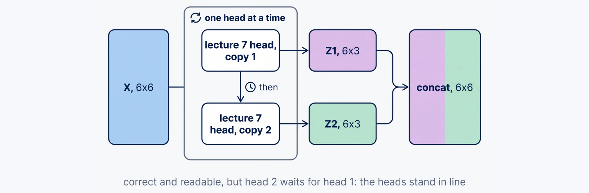

`nn.ModuleList` registers the head modules so their parameters are included in optimizer discovery, device moves and checkpoint state. It does not automatically run them in parallel. The list comprehension in `forward` explicitly calls each head, then `torch.cat(..., dim=-1)` joins their output features. Each head has its own Q/K/V projections; the inputs can still be the same tensor.

Complete file: [head_loop.py](examples/head_loop.py). It contains the head definition before the wrapper that calls it, and runs a `[2,6,6]` example. Paste the whole file into Colab or upload it and run `!python head_loop.py`.

```python
"""An explicit ModuleList of independent causal heads, followed by output mixing."""
import math
import torch
from torch import nn


class CausalHead(nn.Module):
    def __init__(self, width, head_dim, context_len, dropout=0.0):
        super().__init__()
        self.query = nn.Linear(width, head_dim, bias=False, dtype=torch.float64)
        self.key = nn.Linear(width, head_dim, bias=False, dtype=torch.float64)
        self.value = nn.Linear(width, head_dim, bias=False, dtype=torch.float64)
        self.dropout = nn.Dropout(dropout)
        self.register_buffer('future', torch.ones(context_len, context_len,
                             dtype=torch.bool).triu(1))

    def forward(self, x):
        length = x.shape[-2]
        if not 0 < length <= self.future.shape[0]:
            raise ValueError('Input is outside the prepared context length')
        q, k, v = self.query(x), self.key(x), self.value(x)
        scores = q @ k.transpose(-2, -1) / math.sqrt(k.shape[-1])
        weights = scores.masked_fill(self.future[:length, :length], -torch.inf).softmax(-1)
        return self.dropout(weights) @ v


class LoopMHA(nn.Module):
    def __init__(self, width=6, heads=2, context_len=6, dropout=0.0):
        super().__init__()
        if width <= 0 or heads <= 0 or width % heads:
            raise ValueError('This layout requires a positive width divisible by heads')
        self.heads = nn.ModuleList([
            CausalHead(width, width // heads, context_len, dropout) for _ in range(heads)])
        self.output = nn.Linear(width, width, bias=False, dtype=torch.float64)

    def forward(self, x):
        joined = torch.cat([head(x) for head in self.heads], dim=-1)
        return self.output(joined)


if __name__ == '__main__':
    torch.manual_seed(123)
    x = torch.randn(2, 6, 6, dtype=torch.float64)
    layer = LoopMHA().eval()
    print('input shape', list(x.shape))
    print('each head shape', [list(head(x).shape) for head in layer.heads])
    print('output shape', list(layer(x).shape))
    print('registered parameter count', sum(p.numel() for p in layer.parameters()))
    assert layer(x).shape == x.shape
    assert sum(p.numel() for p in layer.parameters()) == 144
```

The output reports two head tensors of shape `[2,6,3]` and a final tensor of shape `[2,6,6]`. The batch dimension indexes sequences, not heads. Distinct inputs in the two batch items also help expose an accidental mixing of the batch axis. With no biases, each head has $3(6\times3)=54$ projection parameters; two heads plus the $6\times6$ output matrix give $108+36=144$ registered parameters.

### Why replace the head loop?

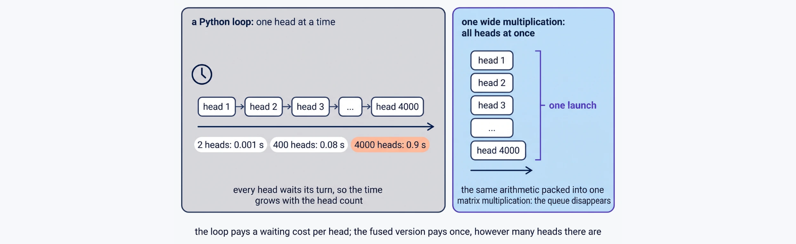

Read the head-count labels and runtime units together. The illustration shows roughly a millisecond for two heads, 0.08 seconds for four hundred, and 0.9 seconds for four thousand in its demonstrated environment. These values are not a runtime promise for another machine.

The large-count demonstration keeps each head's width fixed at three while adding more heads. It therefore increases total projection width, parameter count and arithmetic as well as loop dispatch. It is not a controlled comparison at fixed model width. The 4,000-head case is an exaggerated workload used to expose the issue, not our architecture choice.

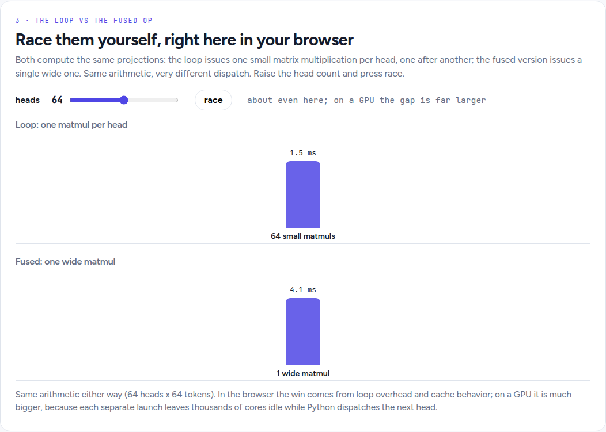

This small browser run even makes the loop faster than the combined version. That is useful: fewer calls do not prove a speedup for every backend and shape. Python dispatch, kernel launches, array layout, device utilization and synchronization all matter. GPU work can be queued asynchronously; a host loop does not mean every GPU operation is forced to finish before the next launch. The next pass proves that packing preserves the calculation; a performance claim would additionally require a matched, synchronized benchmark.

### Predict or explain: After concatenating two scalar head outputs, does W_O mix tokens or head features?

<details data-practice-id="heads-check"><summary>Reveal worked answer and rubric</summary>

It mixes head-feature channels separately at each token. Token-to-token mixing already occurred inside each attention head. In our first row, [1,1] multiplied by the declared W_O becomes [0.5,1.5]. Multiple heads allow different distributions but do not guarantee unique linguistic roles.

**Rubric:** Identify the feature contraction and reproduce the small output-projection calculation.

</details>


The optional [transfer review](practice/transfer-review.md) tests feature mixing, equal-size axis mistakes and the difference between packing and sharing.

### Pack independent heads without changing the operation

The explicit loop above computed each head separately. A tensor implementation can place the head axis beside the batch axis, allowing a numerical backend to evaluate the heads through batched operations. Packing changes representation and execution; it need not change the parameters, outputs or derivatives.

### Combine the projections first

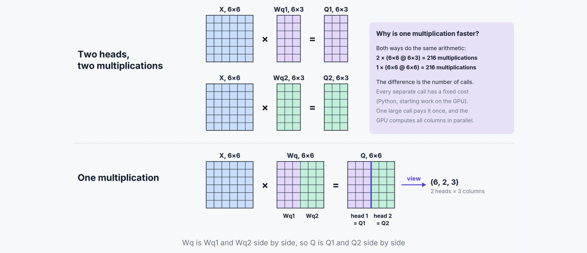


The packed matrix places the independent per-head projection columns together. Splitting its computed output recovers those head features without replacing the parameters with shared weights. This is why the equality below can be checked using one parameter set rather than comparing separately initialized layers.

For two heads with query matrices $W_{Q,1}$ and $W_{Q,2}$, concatenate their columns:

$$W_Q=[W_{Q,1}\ W_{Q,2}],\qquad
XW_Q=[XW_{Q,1}\ XW_{Q,2}].$$

This equality follows directly from matrix multiplication. The same construction applies separately to keys and values. Some implementations combine Q, K and V into one even wider projection; our reference keeps three linear layers so the three roles stay visible.

The packed layer does not share parameters between heads. Each head still selects its own contiguous output slice of the larger matrix. A grouped-query implementation would intentionally share some key/value information; that would be a mathematical change, not just this packing transformation.

### Track the axes through a real example

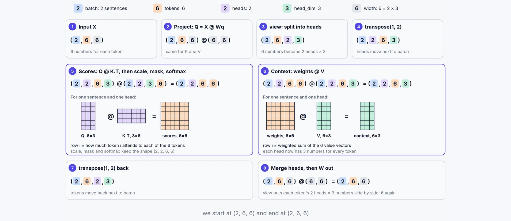


Read the axis names at each transition before trusting the shape alone. We first follow the six-token, two-head route completely, then use the smaller checked fixture to make the equivalence arithmetic inspectable.

### Follow the full six-token shape journey

Let $B=2$, $T=6$, $D=6$, $H=2$, and $d_h=3$. The first two leading quantities count different things: two **sequences** and six **tokens per sequence**. The last six counts features. Repeating the same sequence twice is one possible batch, but the implementation must also work for two different sequences.

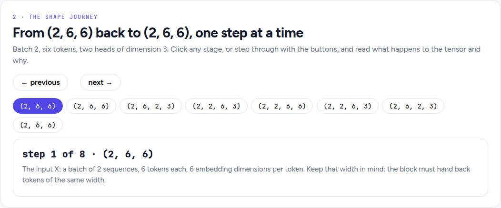

**1. Input `[2,6,6]`.** A row is a token representation. No head axis exists yet. The final block output will have this shape too, because this conventional configuration returns the model width.

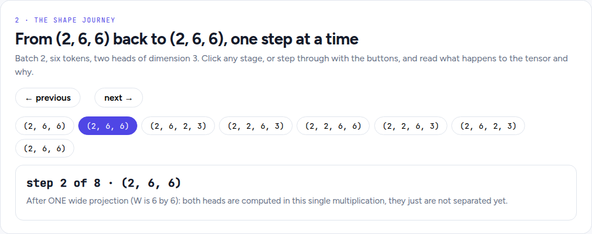

**2. Projection `[2,6,6]`.** One $6\times6$ query matrix produces all query features. Its first three output columns belong to head 1 and its last three to head 2. Make the same kind of projection separately for keys and values. This is a feature partition **after projection**, not a restriction on which original input features a head can use.

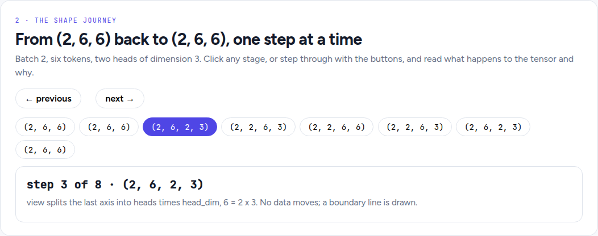

**3. Split `[2,6,2,3]`.** `view(B,T,H,d_h)` exposes the head grouping. The total element count stays $2\times6\times6=72$. No new numbers are learned or calculated by this view.

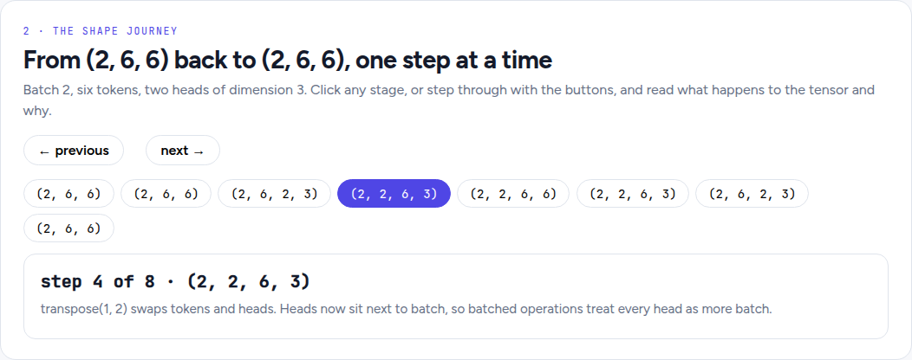

**4. Transpose `[2,2,6,3]`.** `transpose(1,2)` swaps token and head axes. Every batch/head pair now has a $6\times3$ query matrix. There are **four** such pairs, not only two: two sequences times two heads.

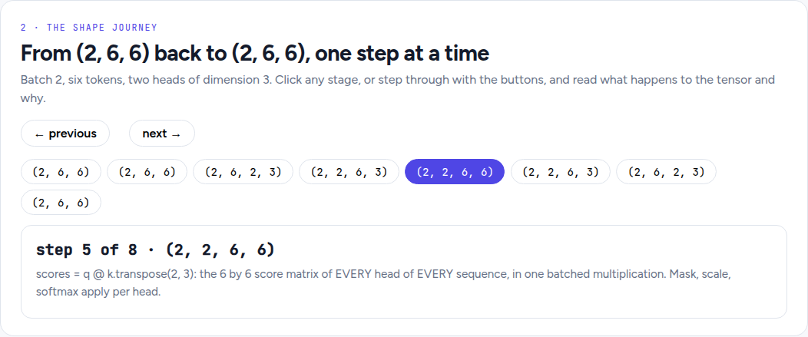

**5. Scores and weights `[2,2,6,6]`.** Multiply Q by `K.transpose(-2,-1)`. The contracted feature width is three; the remaining last axes are query token and source token. Scale by $\sqrt3$, apply the causal mask, then softmax across the final source-token axis. Masking, scaling and normalization preserve shape. Training-time dropout, if used, also preserves shape.

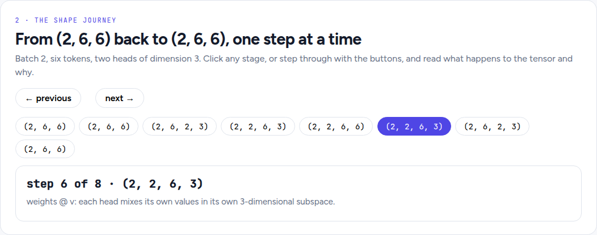

**6. Contexts `[2,2,6,3]`.** Multiply each $6\times6$ weight matrix by its $6\times3$ values. There are still four batch/head matrices, each with six token rows and three value features.

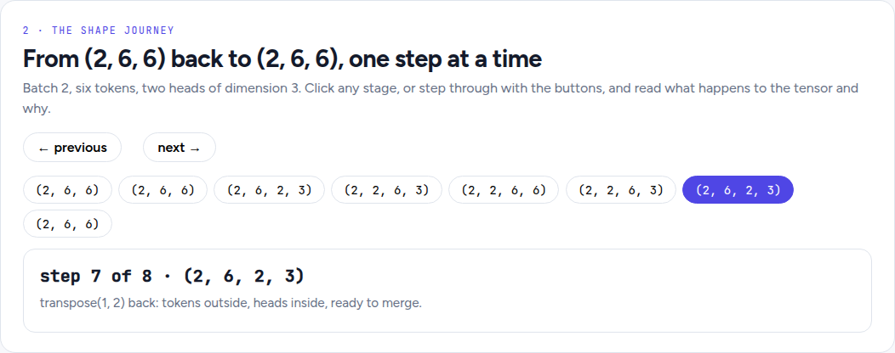

**7. Restore `[2,6,2,3]`.** Transpose token and head axes back. Now each token owns two adjacent head groups. Repeating an in-place reassignment such as `context = context.transpose(1,2)` in a notebook cell swaps them again, which can undo the intended layout. Inspect the shape at each stage or recompute from named intermediate tensors.

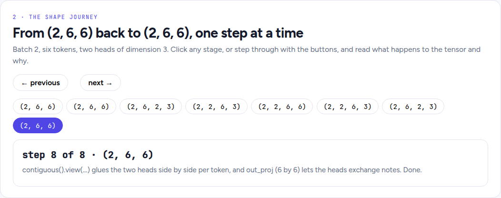

**8. Merge and mix `[2,6,6]`.** Combine head and within-head feature axes, preserving their order. The $6\times6$ output projection then mixes feature channels within each token. These are two operations even though their input and output shapes agree.

The scale is the per-head width $d_h=3$. Using the combined width six would alter the softmax, and using the head count two would use a different quantity again.

### Relate the full route to the compact numerical check

Use batch size $B=2$, sequence length $T=3$, model width $D=2$, head count $H=2$, and head width $d_h=1$. The first sequence reuses the earlier three-row input. A second, different sequence verifies that the batch axis remains independent.

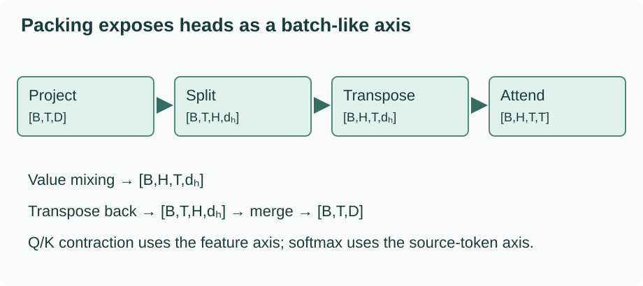

| Stage | Shape | Meaning of the last two axes |
| --- | --- | --- |
| Input and full-width Q/K/V projections | `[2,3,2]` | token, combined head features |
| Reshape after projection | `[2,3,2,1]` | head, feature within head |
| Transpose token and head axes | `[2,2,3,1]` | token, feature within head |
| Q times transposed K | `[2,2,3,3]` | query token, source token |
| Weighted values | `[2,2,3,1]` | token, value feature within head |
| Transpose back | `[2,3,2,1]` | head, value feature within head |
| Merge the last two axes | `[2,3,2]` | token, concatenated features |
| Output projection | `[2,3,2]` | token, output features |

A reshape reinterprets a projected width as two axes. The transpose then determines which axes participate in matrix multiplication. Batched matrix multiplication contracts the last dimension of Q with the feature dimension of K and treats the earlier axes as batch-like axes.

After the head split but **before** that transpose, the last two axes are heads and features. Multiplication there produces a head-by-head matrix for each token, which is the wrong relationship. We need token-by-token comparisons separately for each head, so queries and keys must have shape `[B,H,T,d_h]` first.

### Transpose the right axes, then merge deliberately

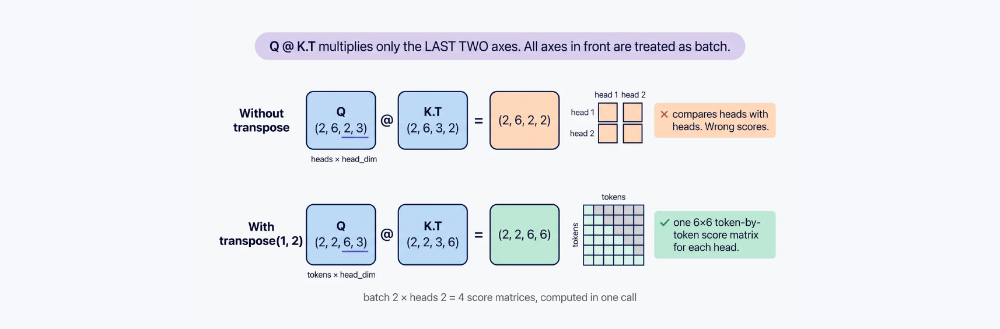


The transpose positions batch and head as the leading batch-like axes, leaving token and feature in the last two axes. Matrix multiplication can then compare tokens within one head. Reversing that transpose before merging is equally necessary: having the right number of elements does not establish the right token/head ordering.

Use `k.transpose(-2,-1)` to change `[B,H,T,d_h]` into `[B,H,d_h,T]`. A plain `.T` on a tensor with more than two axes does not express this intended operation. The causal mask has shape `[T,T]` and broadcasts over batch and heads; future weights are zero in every head.

After value mixing, transpose `[B,H,T,d_h]` to `[B,T,H,d_h]` before merging heads. A tensor transpose often produces a noncontiguous view. Our reference explicitly calls `.contiguous()` and then reshapes, so the flattened feature order matches the concatenation in Lesson 1. A shape that merely has the expected number of elements does not prove that its token/head ordering is correct.

### The complete packed layer and independent loop

The following reference needs PyTorch. The scalar reference above remains dependency-free. This program uses CPU float64, explicit parameter assignment and no data downloads. It contains a packed layer and a separate implementation that loops over slices of the **same** parameters. Comparing independently initialized modules would not test packing equivalence.

PyTorch `nn.Linear` stores weights as `[out_features,in_features]` and applies their transpose to row-vector inputs. For example, the row-vector $W_O$ from Lesson 1 is stored transposed in `model.output.weight`. The assignment below accounts for that convention.

<!-- example:multihead_torch.py:start -->

Complete file: [multihead_torch.py](examples/multihead_torch.py).

```python
"""CPU float64 correctness probe, not a performance benchmark or trained GPT."""
import json
import math
import torch
from torch import nn


class PackedMHA(nn.Module):
    def __init__(self, width=2, heads=2):
        super().__init__()
        if width <= 0 or heads <= 0 or width % heads:
            raise ValueError('Positive width must be divisible by positive head count')
        self.heads = heads
        self.head_dim = width // heads
        self.query = nn.Linear(width, width, bias=False)
        self.key = nn.Linear(width, width, bias=False)
        self.value = nn.Linear(width, width, bias=False)
        self.output = nn.Linear(width, width, bias=False)

    def forward(self, x):
        batch, tokens, width = x.shape
        def split(layer):
            projected = layer(x)
            return projected.reshape(batch, tokens, self.heads, self.head_dim).transpose(1, 2)
        q, k, v = split(self.query), split(self.key), split(self.value)
        scores = q @ k.transpose(-2, -1) / math.sqrt(self.head_dim)
        forbidden = torch.ones(tokens, tokens, dtype=torch.bool, device=x.device).triu(1)
        weights = scores.masked_fill(forbidden, -torch.inf).softmax(dim=-1)
        contexts = weights @ v
        joined = contexts.transpose(1, 2).contiguous().reshape(batch, tokens, width)
        return self.output(joined), weights


def loop_reference(x, model):
    batch, tokens, width = x.shape
    mask = torch.ones(tokens, tokens, dtype=torch.bool, device=x.device).triu(1)
    outputs = []
    for index in range(model.heads):
        start, end = index * model.head_dim, (index + 1) * model.head_dim
        q = x @ model.query.weight[start:end].T
        k = x @ model.key.weight[start:end].T
        v = x @ model.value.weight[start:end].T
        scores = q @ k.transpose(-2, -1) / math.sqrt(model.head_dim)
        weights = scores.masked_fill(mask, -torch.inf).softmax(-1)
        outputs.append(weights @ v)
    return model.output(torch.cat(outputs, dim=-1))


if __name__ == '__main__':
    torch.manual_seed(17)
    model = PackedMHA().double().eval()
    with torch.no_grad():
        model.query.weight.copy_(torch.eye(2, dtype=torch.float64))
        model.key.weight.copy_(torch.eye(2, dtype=torch.float64))
        model.value.weight.copy_(torch.tensor([[1., 1.], [1., -1.]], dtype=torch.float64))
        model.output.weight.copy_(torch.tensor([[1., -0.5], [0.5, 1.]], dtype=torch.float64))
    x = torch.tensor([[[1., 0.], [0., 1.], [1., 1.]],
                      [[2., 0.], [0., 2.], [1., -1.]]], dtype=torch.float64, requires_grad=True)
    result, weights = model(x)
    looped = loop_reference(x, model)
    torch.testing.assert_close(result, looped, atol=1e-12, rtol=1e-12)
    loss = result.square().sum()
    parameter = model.query.weight
    (packed_gradient,) = torch.autograd.grad(loss, parameter, retain_graph=True)
    (looped_gradient,) = torch.autograd.grad(looped.square().sum(), parameter)
    torch.testing.assert_close(packed_gradient, looped_gradient, atol=1e-12, rtol=1e-12)
    changed = x.detach().clone()
    changed[:, -1] = 50.0
    torch.testing.assert_close(model(changed)[0][:, :2], result.detach()[:, :2])
    print(json.dumps({'shape': list(result.shape), 'weight_shape': list(weights.shape),
                      'first_sequence_output': [[round(v, 6) for v in row] for row in result[0].tolist()],
                      'max_output_difference': round((result - looped).abs().max().item(), 12),
                      'gradients_equal': True, 'future_invariant': True,
                      'torch_version': torch.__version__}))
```

<!-- example:multihead_torch.py:end -->

If PyTorch is already installed, run `python examples/multihead_torch.py` from this package. A separate disposable environment can be made without modifying a learner project:

```bash
uv venv --python 3.12 /tmp/attention-heads-env
uv pip install --python /tmp/attention-heads-env/bin/python --index-url https://download.pytorch.org/whl/cpu torch==2.14.1
/tmp/attention-heads-env/bin/python examples/multihead_torch.py
```

The installer command downloads a CPU dependency; it does not train or fetch a model. Author verification used the already-installed `2.14.1+cpu` environment rather than executing this installation. See the [actual run record](project/reference-runs.md). The checked program prints output shape `[2,3,2]`, weight shape `[2,2,3,3]`, zero maximum output difference for this fixture, equal query-projection gradients within tolerance, and a successful future-input intervention.

### Reproduce the six-token route with the very same head parameters

The previous program keeps the compact numerical fixture. This additional file uses `[2,6,6]` and the explicit ModuleList shown above, copies every Q/K/V and output coefficient into its corresponding packed slice, and compares all parameter gradients as well as input gradients.

Complete file: [lecture8_equivalence.py](examples/lecture8_equivalence.py). Keep it beside the complete `head_loop.py` and `multihead_torch.py` files. In Colab, upload all three and run `!python lecture8_equivalence.py`.

```python
"""The 2x6x6 shape route and independent ModuleList/packed forward/backward checks."""
import torch
from head_loop import LoopMHA
from multihead_torch import PackedMHA


if __name__ == '__main__':
    torch.manual_seed(123)
    loop = LoopMHA(width=6, heads=2, context_len=6).eval()
    packed = PackedMHA(width=6, heads=2).double().eval()
    with torch.no_grad():
        for name in ['query', 'key', 'value']:
            source = torch.cat([getattr(head, name).weight for head in loop.heads], dim=0)
            getattr(packed, name).weight.copy_(source)
        packed.output.weight.copy_(loop.output.weight)
    x_loop = torch.randn(2, 6, 6, dtype=torch.float64, requires_grad=True)
    x_packed = x_loop.detach().clone().requires_grad_()
    y_loop = loop(x_loop)
    y_packed, weights = packed(x_packed)
    torch.testing.assert_close(y_loop, y_packed, atol=1e-12, rtol=1e-12)
    y_loop.square().sum().backward()
    y_packed.square().sum().backward()
    torch.testing.assert_close(x_loop.grad, x_packed.grad, atol=1e-12, rtol=1e-12)
    for name in ['query', 'key', 'value']:
        expected = torch.cat([getattr(head, name).weight.grad for head in loop.heads], dim=0)
        torch.testing.assert_close(expected, getattr(packed, name).weight.grad,
                                   atol=1e-12, rtol=1e-12)
    torch.testing.assert_close(loop.output.weight.grad, packed.output.weight.grad,
                               atol=1e-12, rtol=1e-12)
    q_full = packed.query(x_packed.detach())
    q_view = q_full.view(2, 6, 2, 3)
    wrong = q_view @ q_view.transpose(-2, -1)
    q_heads = q_view.transpose(1, 2)
    right = q_heads @ q_heads.transpose(-2, -1)
    for label, tensor in [('projected', q_full), ('split', q_view), ('wrong scores', wrong),
                          ('transposed', q_heads), ('right scores', right), ('weights', weights)]:
        print(label, list(tensor.shape))
    changed = x_packed.detach().clone()
    changed[:, 4:] += 100
    torch.testing.assert_close(packed(changed)[0][:, :4], y_packed.detach()[:, :4],
                               atol=1e-12, rtol=1e-12)
    print('output', list(y_packed.shape), 'maximum difference', (y_loop-y_packed).abs().max().item())
    print('Input, Q/K/V and output-projection gradients agree; future intervention passes.')
```

It prints the incorrect score shape `[2,6,2,2]` produced before moving heads, then the correct `[2,2,6,6]`. The loop and packed outputs differ by about $2.22\times10^{-16}$ in this CPU float64 run; the comparisons use tolerances. It also checks gradients for the input, all Q/K/V slices and the output projection, then changes future positions to test causality.

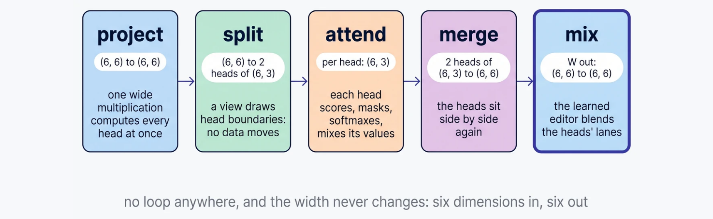

The implementation is a packaging of the same independent learned heads. It does not share K/V across query heads. Packing fewer key/value heads would be a different head arrangement and is developed in the separate GQA lesson.

### Why compare derivatives too?

Forward equality on one small input can miss a detached tensor or an accidental copy that breaks gradient flow. The program differentiates the same squared-output objective through both implementations and compares derivatives with respect to the shared query weights. It then changes the final input token and checks that earlier outputs remain fixed.

Those checks establish the declared small computation on CPU. They do not establish a performance advantage on every device, equality across all possible inputs, or numerical identity between every optimized kernel. The loop's kernel-launch and interpreter overhead can matter in practice, but timings depend on hardware, shapes, synchronization, dtype and implementation. No timing claim is made from the original lecture's demonstration.

### Predict or explain: Why is [B,T,H,d_h] the wrong layout for Q @ K.transpose(-2,-1)?

<details data-practice-id="layout-check"><summary>Reveal worked answer and rubric</summary>

Its last two axes are heads and features. That product compares heads for each token, producing [B,T,H,H]. Transposing to [B,H,T,d_h] makes the contraction produce [B,H,T,T], one token-by-token score matrix per head and sequence. Merging outputs also requires restoring token/head order, not merely matching element counts.

**Rubric:** Name the query-token and source-token axes before multiplication and the feature order after merging.

</details>


### Keep head arrangements separate from other attention choices

We now have a concrete multi-head implementation and a reference loop that computes the same result. This folder can grow into other arrangements of query heads and key/value heads without scattering the foundational single-head material across new project directories.

### Describe the current implementation exactly

The head/KV area highlighted in the opening map is the concern this folder develops. Scoring, visibility, positional information and execution strategy remain separate questions about the same component. The map motivates the separate GQA/MQA lessons. This MHA reference itself has independent KV heads and no retained cache.

Our MHA reference has two independent query projections, two independent key projections and two independent value projections. It uses scaled dot-product scores, causal visibility, no bias terms and an output projection. Attention dropout is disabled in the matched calculations. The packed reference has no padding interface, positional method or KV cache; the explicit-head class exposes an optional dropout setting for training illustrations. It implements an attention component rather than a complete GPT: residual paths, normalization, feed-forward blocks, tokenization, vocabulary prediction and training are outside this reference.

Being precise about that boundary makes later changes easier to understand. Adding a key/value cache would change retained state and the inference interface. Adding dropout would change training behavior. Adding positional information would change the inputs to the computation. None of those is implied merely by naming the component MHA.

### A vocabulary for comparing head layouts

Let $H_q$ be the number of query heads and $H_{kv}$ the number of key/value heads. The following is a planning vocabulary, not a report of additional implemented models:

The terminology follows [Ainslie and colleagues' GQA paper, version 3](https://arxiv.org/abs/2305.13245v3). We use its head-sharing definitions here; its model quality and speed results are not reproduced by this tutorial.

| Arrangement | Query heads | Key/value heads | Meaning of the relationship |
| --- | --- | --- | --- |
| MHA | $H_q$ | $H_{kv}=H_q$ | Each query head has its own key/value head |
| GQA | $H_q$ | Fewer than $H_q$, typically dividing it | Groups of query heads share key/value heads |
| MQA | $H_q$ | One | All query heads share one key/value head |

For a conventional cache containing one key row and one value row per stored token, per key/value head, a simple storage count is

$$\text{bytes}=B\,T\,L\,H_{kv}(d_k+d_v)\,s,$$

where $B$ is batch size, $T$ stored token count, $L$ layers, and $s$ bytes per stored number. This expression describes the arrays under its stated layout. It excludes allocator overhead, quantization scales, temporary buffers, duplicated cache blocks, and architectures with different retained-state representations.

At fixed $B,T,L,d_k,d_v,s$, reducing $H_{kv}$ reduces those array bytes. It does not imply that the attention score matrix disappears or that quality and speed are unchanged. The separate GQA lesson defines and checks the query-to-KV mapping, including masks and cached query offsets. MQA and MLA have their own references. This MHA program remains the independent-head baseline; no trained-model benchmark is inferred.

### Do not infer token order from the head axis

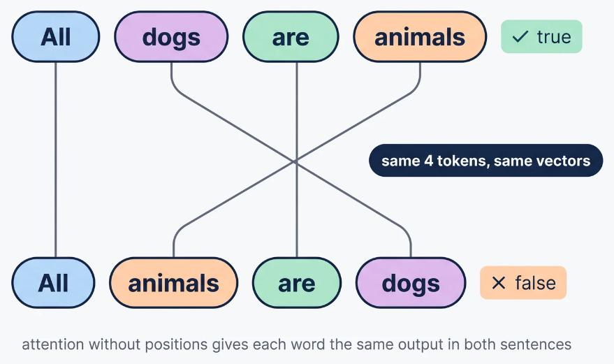

The first statement and second statement have different meanings. If the operation receives only token identity embeddings and allows every position to inspect every other position, rearranging those rows simply rearranges the corresponding output rows. There is no separate indication of which arrangement was supplied. Multiple independently projected heads and output mixing do not remove that limitation by themselves.

Several heads still need a specification of visibility and order. Unmasked, position-free attention is permutation equivariant even with independent heads and a shared output projection: shuffling input rows shuffles output rows. The causal mask selects an ordered prefix and changes that condition; it is inaccurate to apply the same permutation test while silently keeping a fixed triangular mask.

That is a useful boundary check for this implementation. It does not open the omitted positional-encoding lecture or add its slides to the course. Lecture 9 remains outside the requested material.

### What you can now review

Given a proposed packed implementation, identify the query-token and source-token axes at the score product, check that per-head parameters are preserved, compare output ordering with explicit concatenation, and test the same loss gradient. Given a proposed grouped-query implementation, ask which query heads share which key/value head and which retained state that sharing changes.

### Predict or explain: Does packing query/key/value projections implement GQA or reduce the count of stored KV heads?

<details data-practice-id="boundary-check"><summary>Reveal worked answer and rubric</summary>

No. Our packed MHA preserves separate Q/K/V parameters per head and H_q=H_kv. GQA deliberately shares key/value heads among query heads, which needs an explicit grouping rule and corresponding correctness checks. Neither packing nor grouping automatically removes the sequence-length cost of the score calculation.

**Rubric:** Separate an equivalent tensor layout from a changed head-sharing relationship.

</details>


The [readiness record](project/readiness.md) lists the checks and explanation prompts for this route. Technical verification records the behavior of these examples; learner understanding and full-model results remain separate.

The [learning points](project/learning-points.md), [implementation notes](project/implementation.md), [reference runs](project/reference-runs.md), and [lecture reference list](project/source-map.md) support returning to the completed route.

### References

[Vizuara — The Attention Family, Lecture 8](https://www.youtube.com/watch?v=IOmg660SvmM) · [Presentation and diagrams](https://lecture8-attention-mechanisms.vercel.app/) · [Interactive heads, shape and timing lab](https://lecture8-attention-lab.vercel.app/) · [Lecture Colab notebook](https://colab.research.google.com/drive/1WVYWQh4YcjQq-kPDi1Hug-KYDud-bDkK?usp=sharing).

[Ainslie et al. — GQA: Training Generalized Multi-Query Transformer Models from Multi-Head Checkpoints](https://arxiv.org/abs/2305.13245v3) supplies the terminology used by the separate head-sharing lessons.


## Multi-query attention: many questions, one stored memory

MHA gives each query head its own key/value projection. Caching avoids recomputing those projections, but it retains every head's keys and values for every token. Our next problem is the size of that retained memory. Can several independent questions retrieve from one shared representation of the same history?

The change we will make is precise: keep the query heads, share the K/V projection. We will trace the wiring, calculate distinct answers from the shared memory, count parameters and stored bytes, then implement the layer and compare it with an explicit head loop. This is a change to the model's architecture, unlike the equivalent tensor packing in the MHA tutorial.

### Find the factor we can change

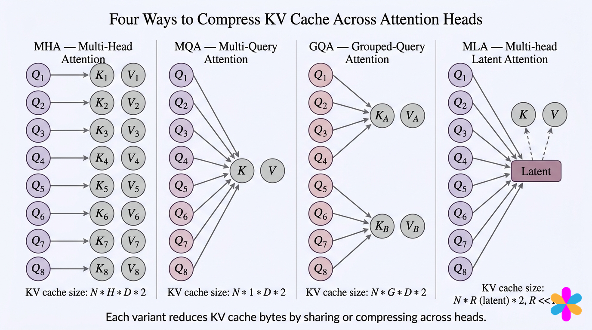

Read the query count separately from the number of stored key/value channels. A model can keep eight query heads while storing eight KV heads, two KV groups or one shared KV head. The latent case changes the representation again; we will open that only after understanding sharing.

From the cache lesson, payload is $BTLH_{kv}(d_k+d_v)s$. Holding sequence length, feature widths, layers, batch and dtype fixed, changing $H_{kv}$ changes this payload directly. It does not remove the query heads or the query-token/key-token comparison work.

### Start from the familiar MHA wiring

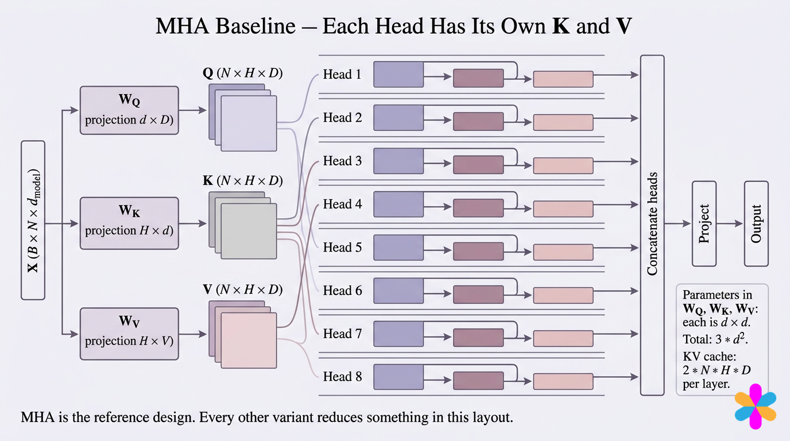

Each head gets all input features through its own projection. Its output is a mixture over the same source-token positions, using its own learned comparisons and value coordinates. The output projection mixes the concatenated channels at each token. Multiple heads permit distinct patterns; specialization into grammatical roles is not guaranteed.

### Share the memory projection while keeping the queries

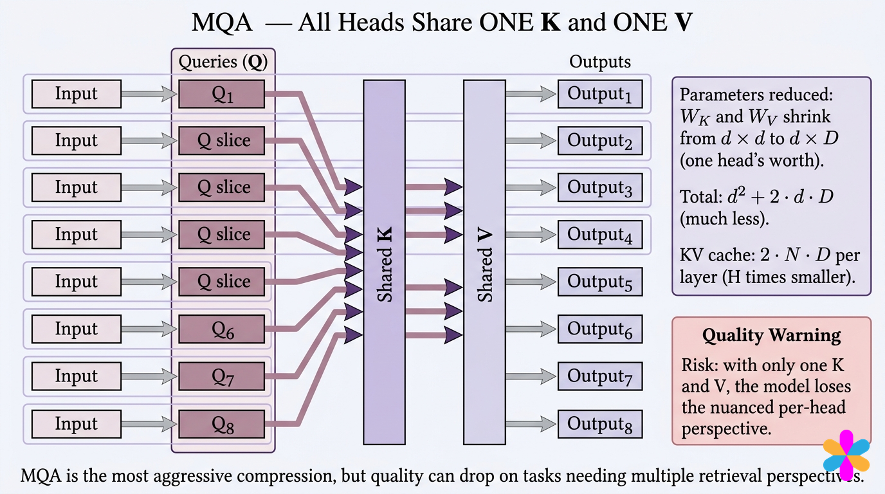

The vertical shared K/V blocks represent tensors over **all retained token positions**. They are not one key vector and one value vector for the whole conversation. There is one KV head, containing one key and one value row per retained token. Every query head compares against those same key rows but can assign them different weights.

For query head $h$ and token $i$,

$$a_{h,i}=\operatorname{softmax}\!\left(q_{h,i}K^\top/\sqrt{d_k}+M_i\right),\qquad z_{h,i}=a_{h,i}V.$$

$M_i$ applies the same visibility rule to each head. The shared K/V appear without a head-specific subscript. Query vectors retain the head subscript. Finally concatenate $z_{h,i}$ across h and apply $W_O$.

The picture's arrows describe this retrieval relationship. V is combined with the attention weights, not multiplied directly by K as an extra projection stage. The box's input-projection parameter formula excludes $W_O$; include the output projection when counting the complete layer.

### Calculate different answers from identical keys and values

Use a scalar comparison width, so the scale is one. All four query heads can see three keys $[1,0,2]$ and three values $[2,-1,3]$. At the final position, choose queries 1, 2, −1 and 0. These are declared numerical probes, not trained word meanings.

| Query | Scores across the three keys | Softmax weights | Output |
| --- | --- | --- | --- |
| 1 | `[1,0,2]` | `[0.244728,0.090031,0.665241]` | `2.395149` |
| 2 | `[2,0,4]` | `[0.117310,0.015876,0.866813]` | `2.819185` |
| −1 | `[-1,0,-2]` | `[0.244728,0.665241,0.090031]` | `0.094308` |
| 0 | `[0,0,0]` | `[1/3,1/3,1/3]` | `1.333333` |

For the first head, the value mixture is $2(0.244728)-0.090031+3(0.665241)\approx2.395149$. Sharing memory did not force identical attention patterns. Equal queries would yield equal patterns under these same keys and masks; distinct queries make different patterns possible, not inevitable.


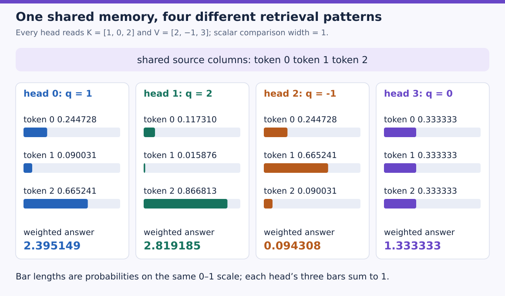

Each colored panel is one query head, and every panel uses the same source-token order. Compare token 1: its value is negative, so the large middle bar for q = −1 pulls that head’s answer toward −1. The zero query gives three equal bars. Follow the probabilities into the weighted answers before the output projection joins the four channels. This is what the table’s four numerical rows look like as retrieval patterns.

The output projection combines the four resulting channels. It still does not mix source-token rows directly: that mixing happened inside each attention distribution.

### Predict or explain: If every head uses the same K and V, must its output be identical?

<details data-practice-id="mqa-patterns"><summary>Reveal worked answer and rubric</summary>

No. Distinct query vectors can give distinct score rows, softmax distributions and value mixtures. Equal queries and masks would give equal retrievals. Shared memory alone does not force equal queries.

**Rubric:** Explain the roles of Q versus K/V and use the scalar example.

</details>


### Follow the tensor dimensions into code

For the complete implementation below, model width is 4, query-head count is 4 and each head width is 1. The small dimensions make parameter counting inspectable. With input `[B,T,4]`:

| Step | Shape | Meaning |
| --- | --- | --- |
| Query projection | `[B,T,4]` | All four query-head features |
| Reshape and transpose Q | `[B,4,T,1]` | Four independent query heads |
| Key/value projection and head-axis insertion | `[B,1,T,1]` each | One shared KV head |
| Scores and probabilities | `[B,4,T,T]` | Four token-to-token patterns |
| Contexts | `[B,4,T,1]` | One channel per head and token |
| Merge, then output projection | `[B,T,4]` | Restored model feature width |

Broadcasting the size-one KV-head axis means the same logical K/V are used for all query heads. It does not mean the cache should physically store four copies. Some backends expand or repeat K/V as an intermediate; account for that separately from retained cache bytes.

For bias-free row-vector projections, $W_Q$ has shape $[4,4]$, $W_K,W_V$ each $[4,1]$, and $W_O$ has shape $[4,4]$. Total parameters are $16+4+4+16=40$. PyTorch Linear stores the transposed coefficient arrangement internally. An otherwise corresponding MHA layer has $16+16+16+16=64$ parameters. Output width stays four in both cases.

### Implement both the broadcast and explicit retrieval paths

Save [mqa.py](examples/mqa.py). The `MQA` class defines all projections before use. Its forward pass builds Q, inserts the singleton K/V-head axis, applies the causal rule, retrieves contexts, restores token/head ordering and projects the joined features. The alternative `loop=True` path calculates one query head at a time against the same K/V and parameters.

Run `python mqa.py` in a PyTorch environment. In Google Colab, first inspect `torch.__version__`, upload the file, then run `!python mqa.py`. The author run uses CPU float64 and no data/model downloads. Here is the complete file:

```python
"""Complete illustrative MQA layer; same parameters, broadcast and explicit loop."""
import json
import math
import torch
from torch import nn


class MQA(nn.Module):
    def __init__(self, width=4, heads=4, head_width=1):
        super().__init__()
        self.heads, self.head_width = heads, head_width
        self.wq = nn.Linear(width, heads*head_width, bias=False, dtype=torch.float64)
        self.wk = nn.Linear(width, head_width, bias=False, dtype=torch.float64)
        self.wv = nn.Linear(width, head_width, bias=False, dtype=torch.float64)
        self.wo = nn.Linear(heads*head_width, width, bias=False, dtype=torch.float64)

    def forward(self, x, loop=False):
        b, t, _ = x.shape
        q = self.wq(x).reshape(b,t,self.heads,self.head_width).transpose(1,2)
        k, v = self.wk(x).unsqueeze(1), self.wv(x).unsqueeze(1)
        future = torch.triu(torch.ones(t,t,device=x.device,dtype=torch.bool),diagonal=1)
        if loop:
            weights = torch.stack([
                ((q[:,h] @ k[:,0].transpose(-2,-1))/math.sqrt(self.head_width))
                .masked_fill(future,-torch.inf).softmax(-1)
                for h in range(self.heads)], dim=1)
            context = torch.stack([weights[:,h] @ v[:,0] for h in range(self.heads)], dim=1)
        else:
            scores = q @ k.transpose(-2,-1) / math.sqrt(self.head_width)
            weights = scores.masked_fill(future,-torch.inf).softmax(-1)
            context = weights @ v
        joined = context.transpose(1,2).contiguous().reshape(b,t,-1)
        return self.wo(joined), weights, k, v


def run_checks():
    torch.manual_seed(31)
    layer = MQA()
    x = torch.randn(2,3,4,dtype=torch.float64,requires_grad=True)
    y, weights, k, v = layer(x)
    loop, _, _, _ = layer(x,loop=True)
    torch.testing.assert_close(y,loop,atol=1e-12,rtol=1e-12)
    parameters = (x,*layer.parameters())
    a = torch.autograd.grad(y.square().sum(),parameters,retain_graph=True)
    b = torch.autograd.grad(loop.square().sum(),parameters)
    for left,right in zip(a,b):
        torch.testing.assert_close(left,right,atol=1e-12,rtol=1e-12)
    changed = x.detach().clone();changed[:,2] += 100
    torch.testing.assert_close(layer(changed)[0][:,:2],y.detach()[:,:2])
    assert not torch.allclose(weights[:,0,-1],weights[:,1,-1])
    assert k.shape == v.shape == (2,1,3,1)
    assert sum(p.numel() for p in layer.parameters()) == 40
    return {'loop_and_gradients_equal':True,'causal_intervention':True,
            'shared_kv_shape':[2,1,3,1],'distinct_query_patterns':True,'parameters':40}


if __name__ == '__main__':
    print(json.dumps(run_checks(),sort_keys=True))
```

The output confirms 40 parameters and actual shared K/V shape `[2,1,3,1]`. The broadcast and explicit-loop outputs agree. Differentiating the same squared-output objective gives matching input and all-projection gradients; this checks that shared K/V gradients collect contributions from all query heads. Changing the final input cannot alter the first two causal outputs. The two tested query patterns differ even though their K/V are shared.

This program checks the MQA component. It does not load or convert an MHA checkpoint, implement a generation loop or establish model quality. Combine its head relationship with the cache lesson's append/position contract when adding generation.

### Count the cache saving without claiming a speed result

For $B=1,T=3,L=1,d_k=d_v=1,s=2$, four-head MHA retains $1\cdot3\cdot1\cdot4\cdot2\cdot2=48$ bytes. MQA retains 12 bytes. At fixed head width, the MHA-to-MQA payload ratio is $H_q$; with 64 query heads it is 64, not universally 32. These values exclude temporary tensors and allocation overhead.

Each query head still creates scores over permitted keys, so sharing alone does not eliminate dense attention's pairwise dependence on sequence length. Cache bandwidth, kernel support and batching determine whether a measured workload gets faster. Architectural sharing can affect learned quality; averaging existing MHA K/V weights is not an algebraically exact conversion for arbitrary models. Model adaptation and evaluation are separate work.

### Predict or explain: At fixed head width, what happens when eight query heads share one KV head instead of eight?

<details data-practice-id="mqa-memory"><summary>Reveal worked answer and rubric</summary>

The retained KV payload becomes one eighth as large. The query-head count remains eight; score calculations still exist for all eight. This is an architectural restriction, not a guarantee of unchanged pretrained-MHA outputs or eightfold wall-clock speed.

**Rubric:** Separate stored bytes, operation count, model behavior and measured latency.

</details>


### The next unresolved choice

One shared KV head is the strongest sharing among these conventional head arrangements. Could we retain several KV representations and share only within groups? GQA will give that mapping an explicit group index, then check MHA and MQA as its two endpoints.

The [implementation notes](project/implementation.md), [readiness record](project/readiness.md) and [transfer review](practice/transfer-review.md) remain available for returning to the route.

### References

[Vizuara: Multi-Query Attention Explained](https://www.youtube.com/watch?v=Z6B51Odtn-Y). [Vizuara Inference Engineering, Chapter 8](https://vizuaraai.github.io/convolution-musical-journey/book.html): original workshop figures and head-sharing progression. [Shazeer, Fast Transformer Decoding, version 1, Sections 2–3](https://arxiv.org/html/1911.02150v1): primary definition and incremental-memory analysis. Workshop figures are separate from the video page; this lesson does not assert a complete subtitle audit of that older video.
- Additional worked SVG figures are original to this tutorial; their inputs and calculations follow the complete executable reference above.


## Grouped-query attention: choose who shares memory

MQA showed that query heads can retrieve different mixtures from one shared K/V representation. It also introduced a restriction: every query head must use the same learned key and value projection. Now keep several KV projections and let only a selected group of query heads share each one. The decision is **which query head uses which KV head**.

We will draw that mapping before reshaping tensors. Then calculate one group, count storage, compare grouped and expanded implementations including derivatives, and inspect what a checkpoint conversion would change. This lesson implements GQA retrieval; it does not infer quality from a small example.

### Read the group boundary before counting heads

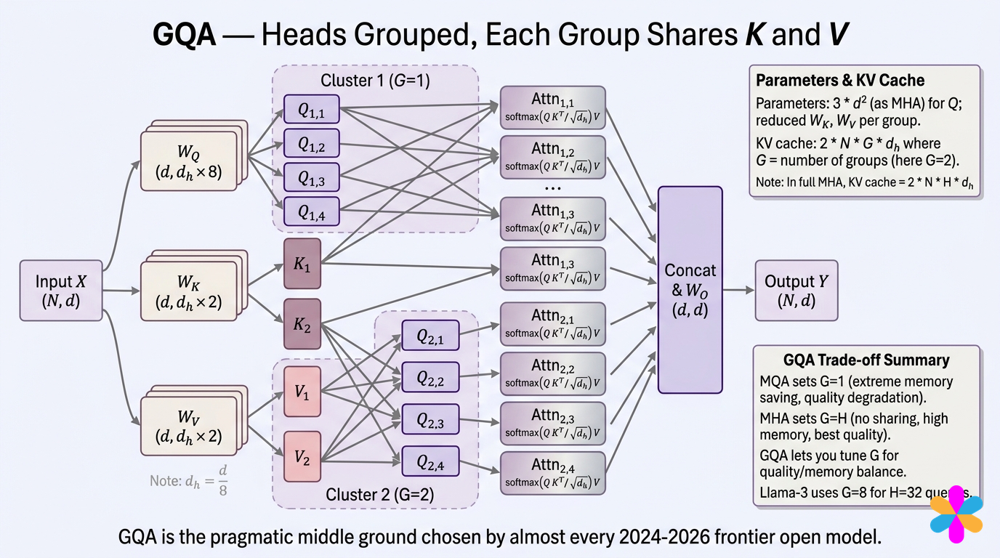

Let $H_q$ be the number of query heads and $G=H_{kv}$ the number of KV heads. For equal contiguous groups, each group contains $R=H_q/G$ query heads. Require G to divide $H_q$. Using zero-based query-head index h, choose

$$g(h)=\left\lfloor h/R\right\rfloor.$$

For eight query heads and two KV groups, the mapping is `[0,0,0,0,1,1,1,1]`. Read one arrow all the way to its KV group. Heads 0–3 compare against $K_0$ and retrieve from $V_0$; heads 4–7 use $K_1,V_1$. Queries within a group still have independent projections. The shared objects contain a row per token, not a single vector for the entire sequence.

For each h,

$$z_h=\operatorname{softmax}\!\left(Q_hK_{g(h)}^\top/\sqrt{d_k}+M\right)V_{g(h)}.$$

After that, concatenate head outputs in query-head order and apply the existing output projection. Grouping changes neither the causal rule nor the meaning of the query/source-token axes.


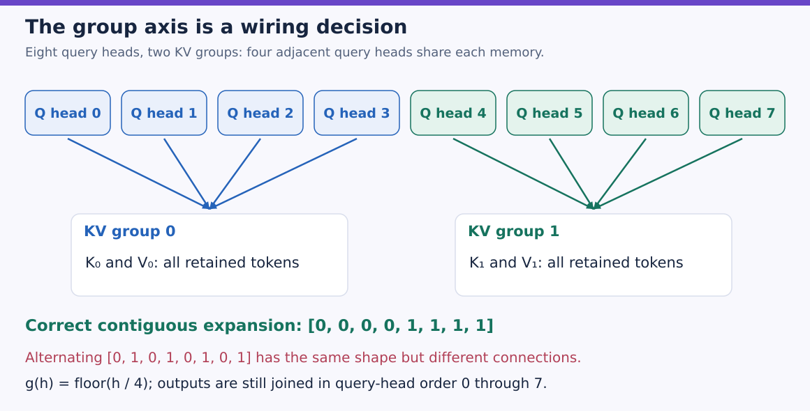

Trace each arrow from a query to the memory it reads. Blue and green identify KV ownership, not token positions. A KV box contains every retained token row for that group. `repeat_interleave` reproduces the pictured mapping; alternating copies connect half the queries to the wrong memory even though every tensor dimension still fits.

### Work one group before generalizing

Use four query heads in two groups so the numbers fit on paper. The mapping is `[0,0,1,1]`. At the final position, heads 0 and 1 have scalar queries 1 and 2; group 0 has keys `[1,0,2]` and values `[2,-1,3]`. Their outputs from the MQA calculation are `2.395149` and `2.819185`.

Let heads 2 and 3 both have query zero, but let group 1 values be `[4,0,2]`. Zero queries give equal scores and therefore uniform weights within this fully visible prefix. Their output is $(4+0+2)/3=2$. Equal queries in different groups need not yield equal outputs because the retrieved values can differ. Here the joined feature row is `[2.395149,2.819185,2,2]` before the output projection.

This exposes both freedoms: queries can differ inside a group, and memory projections can differ between groups. A head cannot silently pick another group's KV just because the resulting tensor has a legal shape.

### Predict or explain: For eight query heads and two contiguous KV groups, which KV head does query head 5 use?

<details data-practice-id="gqa-map"><summary>Reveal worked answer and rubric</summary>

Each group contains four query heads. floor(5/4)=1, so query head 5 uses KV head 1 in zero-based indexing. It must not be assigned by h mod G for this mapping.

**Rubric:** State the indexing convention and the complete grouping rule.

</details>


### Cache size depends on KV groups

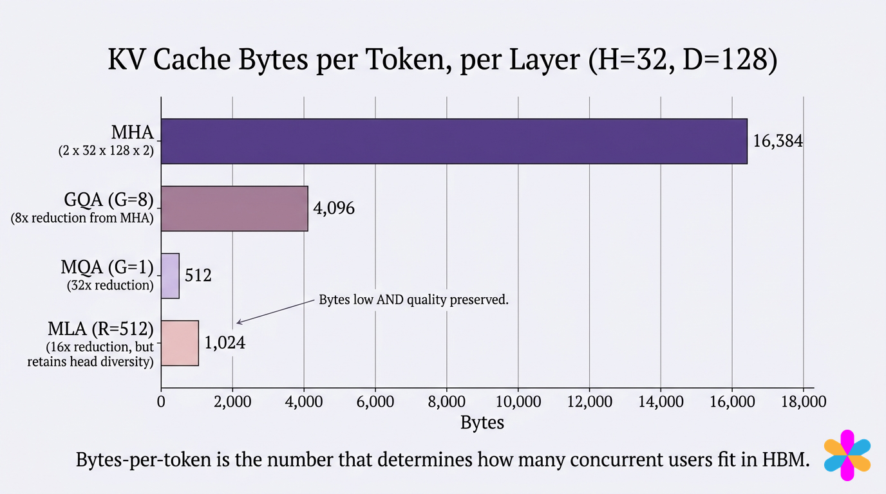

At $H_q=32,d_k=d_v=128$, FP16, one token and one layer, MHA retains $32(128+128)2=16384$ bytes. GQA with G=8 retains 4096 bytes. MQA retains 512 bytes. The GQA/MHA ratio is $G/H_q=1/4$. This is a per-layer, per-token payload count; multiply by batch, retained tokens and layers for a complete cache.


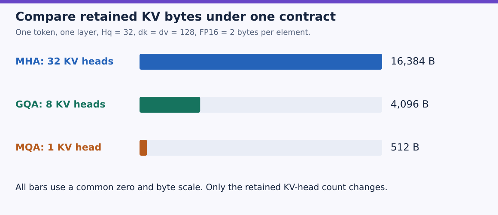

The horizontal lengths now follow exactly the dimensions above. GQA is one quarter of MHA because 8 of 32 KV heads remain; MQA is one thirty-second. This comparison includes both keys and values, and excludes weights, temporary tensors and allocation metadata. Those exclusions are the same for all three bars.

The latent bar requires its own representation specification. If a positional component is cached alongside the latent, count it too; a latent rank alone does not define a complete MLA cache. We will resolve that in the MLA lesson.

For a second explicit example, $H_q=64,G=8,d_h=128,L=80,T=32768,B=1,s=2$ gives GQA 10 GiB and the corresponding MHA 80 GiB. MQA would be 1.25 GiB. The storage ratio for this 64-head example is 8, not 4. Binary GiB and decimal GB are different units.

### Choose a group count through evaluation

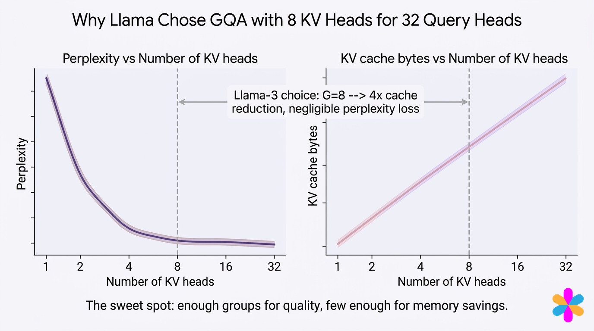

The memory curve follows directly from the group-count formula. A quality curve requires trained models, a dataset and an evaluator. Its plateau cannot be established from architecture alone. Treat this drawing as the selection idea, not a measured proof that a chosen group count has negligible quality loss in every model.

The GQA paper evaluated uptrained T5 models under stated tasks and hardware. That is evidence about those experiments. Our component equality checks below establish a different fact: two ways to compute the **same GQA** agree when their inputs and coefficients match.

### Group the query axis explicitly

Our reference accepts already projected Q/K/V. Q has shape `[B,Hq,S,dk]`, K `[B,G,T,dk]` and V `[B,G,T,dv]`. S counts current query rows, T retained key/value rows. Reshape Q as `[B,G,R,S,dk]`; insert a size-one axis in K and V to obtain `[B,G,1,T,dk/dv]`. The backend broadcasts memory within each group. Scores have shape `[B,G,R,S,T]`.

That extra group axis makes the mapping visible. An equivalent expanded reference repeats each KV head R times along the head axis. It is `repeat_interleave`, not a tiling that alternates groups: `[0,0,1,1]` and `[0,1,0,1]` represent different wiring. Both can fit the same dimensions.

The retained cache should stay `[B,G,T,D]`; saving an expanded Hq-head copy forfeits the retained-state saving. A backend may still materialize expanded intermediates, which affects peak memory and performance separately.

### Verify endpoints, derivatives and appended chunks

Save [gqa.py](examples/gqa.py), inspect `torch.__version__`, then run `python gqa.py` in your PyTorch environment or upload it and run `!python gqa.py` in Google Colab. CPU float64 is sufficient. `attention` defines visibility and score normalization first. `grouped_attention` then validates the layout and exposes grouping; `run_checks` exercises it independently through expansion.

```python
"""Projected GQA: explicit grouping, expanded reference and cached chunk checks."""
import json
import math
import torch


def attention(q, k, v, offset=0):
    query = offset + torch.arange(q.shape[-2],device=q.device)
    key = torch.arange(k.shape[-2],device=k.device)
    scores = q @ k.transpose(-2,-1) / math.sqrt(q.shape[-1])
    return scores.masked_fill(key[None,:] > query[:,None],-torch.inf).softmax(-1) @ v


def grouped_attention(q, k, v, offset=0):
    if any(t.ndim != 4 for t in [q,k,v]):
        raise ValueError('Expected four named axes')
    b,h,t,d = q.shape
    g = k.shape[1]
    if g < 1 or h % g or k.shape[:3] != v.shape[:3]:
        raise ValueError('KV heads must divide query heads and K/V leading axes must agree')
    if k.shape[0] != b or k.shape[-1] != d:
        raise ValueError('Batch or comparison width mismatch')
    queries = q.reshape(b,g,h//g,t,d)
    out = attention(queries,k.unsqueeze(2),v.unsqueeze(2),offset)
    return out.reshape(b,h,t,v.shape[-1])


def run_checks():
    torch.manual_seed(43)
    q = torch.randn(2,4,5,2,dtype=torch.float64,requires_grad=True)
    results = {}
    for g in [1,2,4]:
        k = torch.randn(2,g,5,2,dtype=torch.float64,requires_grad=True)
        v = torch.randn(2,g,5,3,dtype=torch.float64,requires_grad=True)
        actual = grouped_attention(q,k,v)
        repeat = 4//g
        expanded = attention(q,k.repeat_interleave(repeat,1),v.repeat_interleave(repeat,1))
        torch.testing.assert_close(actual,expanded,atol=1e-12,rtol=1e-12)
        left = torch.autograd.grad(actual.square().sum(),(q,k,v),retain_graph=True)
        right = torch.autograd.grad(expanded.square().sum(),(q,k,v))
        for a,b in zip(left,right):
            torch.testing.assert_close(a,b,atol=1e-12,rtol=1e-12)
        first = grouped_attention(q[:,:,:2],k[:,:,:2],v[:,:,:2])
        later = grouped_attention(q[:,:,2:],k,v,offset=2)
        torch.testing.assert_close(torch.cat([first,later],2),actual)
        results[str(g)] = {'head_map':[h//repeat for h in range(4)],
                          'kv_payload_bytes':sum(x.numel()*x.element_size() for x in [k,v])}
    try:
        grouped_attention(q,torch.zeros(2,3,5,2),torch.zeros(2,3,5,3))
    except ValueError:
        pass
    else:
        raise AssertionError('Non-divisible grouping accepted')
    return {'groups':results,'output_and_gradients_equal':True,'cached_chunks_equal':True,
            'invalid_grouping_rejected':True}


if __name__ == '__main__':
    print(json.dumps(run_checks(),sort_keys=True))
```

For G=1, the printed mapping is `[0,0,0,0]`: MQA. For G=4, it is `[0,1,2,3]`: MHA. G=2 gives `[0,0,1,1]`, our intermediate case. At B=2, T=5, dk=2, dv=3, float64, their payloads are 400, 800 and 1600 bytes respectively. Every case agrees with its expanded reference on outputs and Q/K/V gradients. Processing the first two query positions and then the remaining three with offset two reproduces the full causal result. G=3 is rejected for four query heads.

This is a retrieval kernel, not a complete trained decoder. Q/K/V projection, joining and output mixing use the contracts already established in MHA/MQA. The cache lesson supplies request/reset/absolute-position ownership. Real grouped kernels can avoid the expanded intermediate; this reference makes no GPU timing claim.

### Converting pretrained coefficients changes the model

Ainslie and colleagues initialize each group's K/V projection by averaging the corresponding MHA heads, then continue training. For two scalar key weights 1 and 3, the group initializer is 2. In general,

$$\operatorname{softmax}\!\left(q(K_1+K_2)^\top/2\right)
\ne\tfrac12\left(\operatorname{softmax}(qK_1^\top)+\operatorname{softmax}(qK_2^\top)\right).$$

Softmax is nonlinear; averaging parameters is not an output-preserving rewrite. Averaging value coefficients also removes independent degrees of freedom. The original paper's uptraining recipe and measured results should not be confused with the grouping/expansion identity we tested.

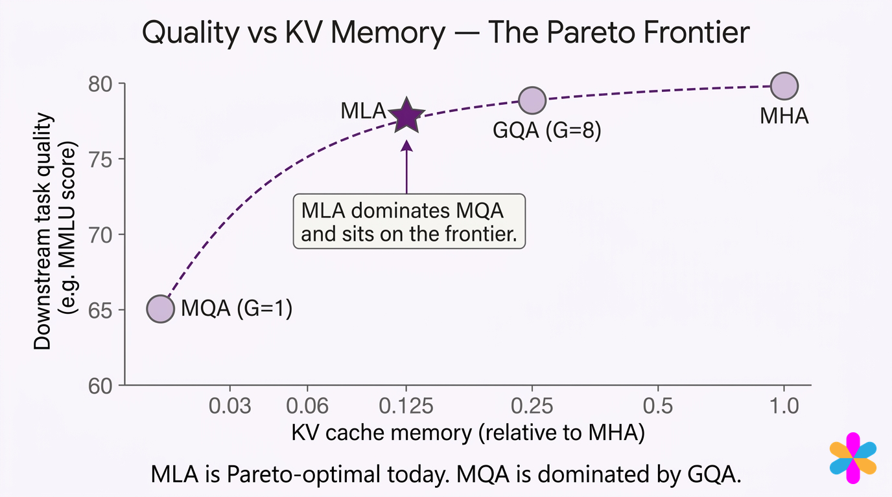

A point on this plot must correspond to a specified trained configuration and evaluation before we can rank it. There is no theorem here that GQA always dominates MQA or MLA always dominates GQA. State quality, bytes and runtime separately, and report the conditions behind comparisons.

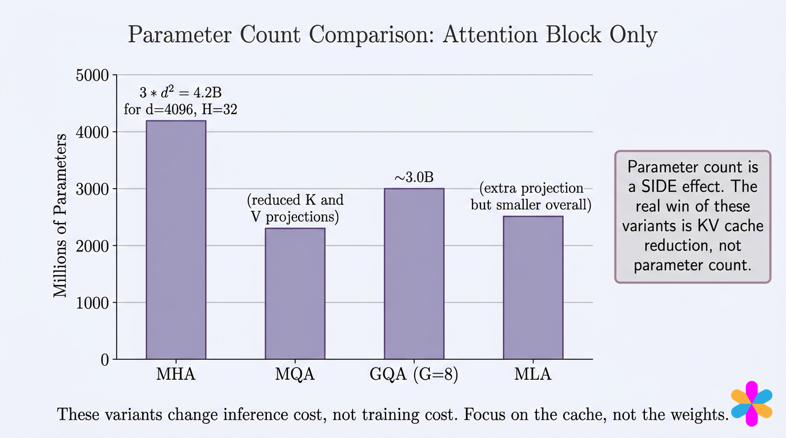

With model width D and equal head width d, the input-projection parameter count is $DH_qd+2DGd$. Include $H_qdD$ more for the output projection if it maps joined heads back to D. For D=8, Hq=4, d=2 and G=2, this gives 128 input-projection parameters and 64 output parameters, total 192 without biases. The corresponding MHA total is 256; MQA is 160. MLA requires counting its own compression and expansion matrices rather than inserting an arbitrary group count into this formula.

### Predict or explain: Does mean-pooling an arbitrary pretrained MHA checkpoint into GQA preserve all outputs?

<details data-practice-id="gqa-conversion"><summary>Reveal worked answer and rubric</summary>

No. Sharing reduces independent K/V parameters, and softmax does not commute with averaging. Uptraining/evaluation is separate from the exact identity between grouped and expanded execution of an already specified GQA.

**Rubric:** Distinguish architecture conversion from equivalent execution and explain nonlinearity.

</details>


### What we have and what comes next

MHA, MQA and GQA now share one consistent vocabulary: the query-head count, KV-head count, query-to-KV mapping and actual retained tensor shape. GQA changes how many memory representations remain. MLA will change how those representations are stored, but first we need to understand how positional information interacts with query/key transformations.

Use the [implementation notes](project/implementation.md), [readiness record](project/readiness.md) and [transfer review](practice/transfer-review.md) for checks and review.

### References

[Vizuara: Understand Grouped Query Attention](https://www.youtube.com/watch?v=kx3rETIxo4Q). [Vizuara Inference Engineering, Chapter 8](https://vizuaraai.github.io/convolution-musical-journey/book.html): original figures 8.4–8.6 and 8.9–8.10. [Ainslie et al., GQA, version 3, Sections 2–3](https://arxiv.org/html/2305.13245v3): grouping, mean-pooling initialization, uptraining and scoped experimental results. The workshop diagrams are not asserted to be frames/slides from the older video.
- Additional worked SVG figures are original to this tutorial; their inputs and calculations follow the complete executable reference above.


## Multi-head latent attention: retain the ingredients

GQA reduced how many distinct key/value heads we keep. MLA asks a different question: can each token retain a smaller common representation from which the heads' keys and values are computed? Start with the stored object, then follow its two uses: comparing a query against history and retrieving a weighted mixture. Finally add position, because a content-only compression picture is incomplete for RoPE.

### Replace many retained vectors with one latent row

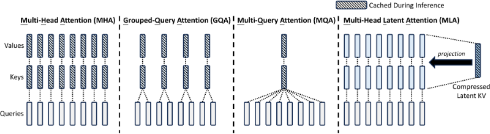

The shaded objects are retained between generation steps. On the left, MHA stores every head's K and V. GQA/MQA share some of those objects. On the right, MLA stores a common compressed row, while head-specific linear maps still define different content representations. A head can retain a distinct retrieval pattern without storing an expanded historical key for every head.

For one input row $x_t\in\mathbb R^D$, use row-vector notation:

$$c_t=x_tW_D\in\mathbb R^r,\quad k^C_{t,h}=c_tU^K_h,\quad v_{t,h}=c_tU^V_h.$$

$W_D$ has shape D by r. Each $U^K_h$ is r by $d_c$, and each $U^V_h$ is r by $d_v$. Across T retained tokens, C has shape T by r. This is a learned bottleneck, not a lossless encoding of arbitrary independently chosen MHA keys and values. A model must be trained or adapted for these factorized coefficients.

### Follow the multiplication before storing expanded keys

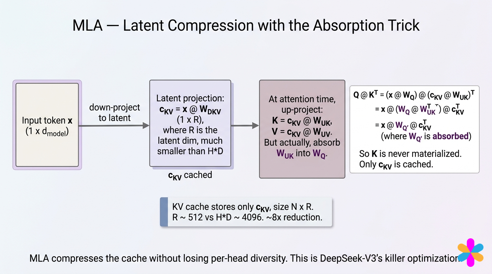

For one head, the content score is

$$q^C_h(CU^K_h)^\top=(q^C_h(U^K_h)^\top)C^\top.$$

The left computes expanded historical keys first. The right transforms the current query into latent coordinates first. Both produce the same T scores. If $q^C_h=xW^Q_h$, the product $W^Q_h(U^K_h)^\top$ can be precomputed when fixed inference weights are loaded. We call this absorption: it changes the multiplication order, preserving the same factorized model.

Work a two-dimensional example. Let the retained latent rows be `[1,0]`, `[0,1]`, `[1,1]`, the query `[1,1]`, and

$$U^K=\begin{bmatrix}1&2\\0&1\end{bmatrix}.$$

Expanded keys are `[1,2]`, `[0,1]`, `[1,3]`. Their raw dot products with q are `[3,1,4]`. Instead form $q(U^K)^\top=[3,1]$ and compare that against the three latent rows. The result is again `[3,1,4]`. Scale by $\sqrt2$ in this **content-only** example and apply softmax once across those three scores. Do not softmax the coordinates of the transformed query.

The value path has the same associativity. For attention weights a,

$$a(CU^V_h)=(aC)U^V_h.$$

If $U^V=\operatorname{diag}(2,3)$, the expanded values are `[2,0]`, `[0,3]`, `[2,3]`. Mixing the latent rows first gives `[a_0+a_2,a_1+a_2]`; multiplying by $U^V$ gives `[2(a_0+a_2),3(a_1+a_2)]`, exactly the expanded weighted sum. A fixed output projection can also be combined with the value up-projection. Neither rewrite permits moving a linear map through softmax arbitrarily; we preserved the logits and the weights themselves.


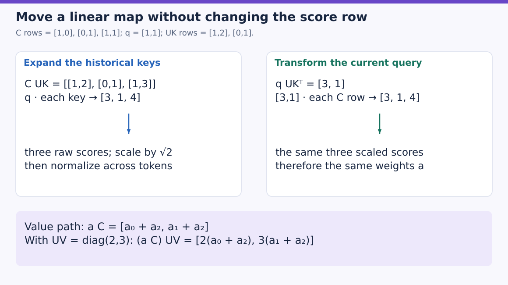

Read the two columns as alternative computations, using the same fixed coefficients. Each ends at the score row `[3,1,4]`; scaling and normalization therefore remain identical. The lower strip follows the value mixture through the same change of parentheses. We moved linear operations around matrix multiplication, while leaving softmax between the score calculation and value retrieval.

### Predict or explain: Can you average MHA heads and call the result an exact MLA conversion?

<details data-practice-id="mla-absorb"><summary>Reveal worked answer and rubric</summary>

No. Absorption is exact inside a specified factorized model; choosing a low-rank bottleneck constrains the coefficients and requires separate adaptation/evaluation.

**Rubric:** Distinguish architecture approximation from algebraic associativity.

</details>


### Position introduces a second retained object

RoPE rotates a query at its query position and a key at its source position. Applying those rotations to the content keys inserts a position-dependent matrix between the factors. In column notation this contains $R_i^\top R_j$; in general it does not commute with the learned up-projection. A single fixed absorbed matrix cannot stand in for every relative position.

Decouple the paths. Give each query head a content vector $q^C_{i,h}$ and a rotated positional vector $q^R_{i,h}$. Retain the latent content $c_j$ and a shared rotated positional key $k^R_j$. Then

$$\ell_{h,i,j}=\frac{q^C_{i,h}(U^K_h)^\top c_j^\top+q^R_{i,h}(k^R_j)^\top}{\sqrt{d_c+d_r}}+M_{i,j}.$$

This is the dot product of the conceptual concatenations $[q^C;q^R]$ and $[k^C;k^R]$. The scale counts their combined comparison width. Softmax normalizes the combined content-plus-position score. Values use the content latent; they are not rotated in this construction.

The drawing above isolates the content factorization. Its phrase “only latent cached” omits this positional path. A complete decoupled-RoPE cache keeps **both** $c_j$ and $k^R_j$. Queries, including any query compression used during training, are current computations and need not be retained as historical cache entries.


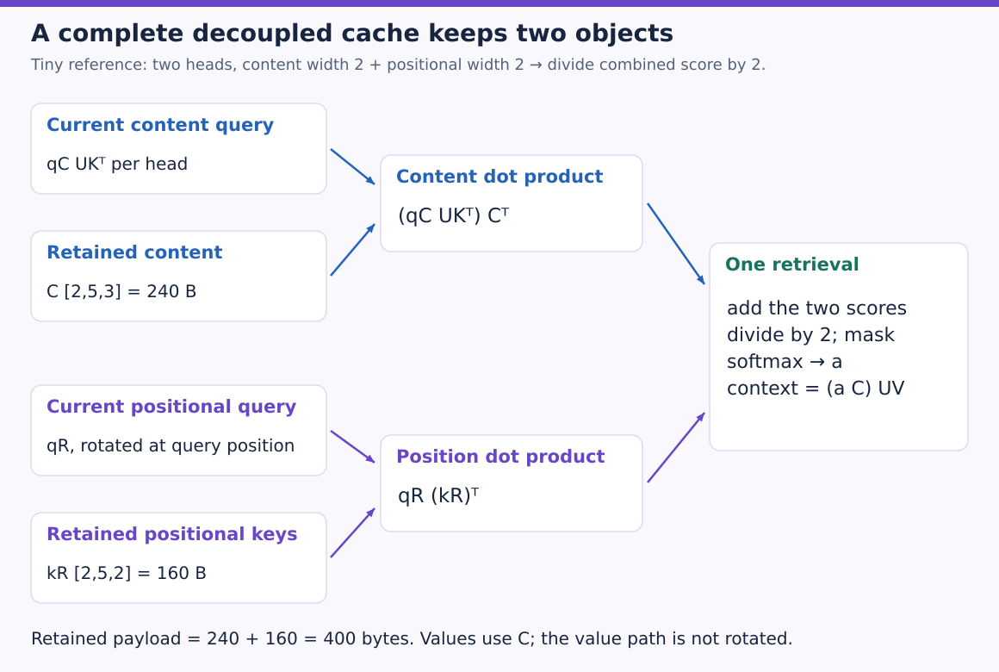

The left-hand boxes separate current computations from retained arrays. Blue produces a content score for each source token; purple produces its positional score. Follow both arrows into the green box: add, scale and mask before one softmax. Its weights mix C for the value path. The two retained boxes sum to the reference’s 400-byte payload; retaining C alone would omit the positional keys. The diagram shows one retrieval per head, while the labeled cache arrays include both batch items.

### Count a complete cache before reading the bar chart

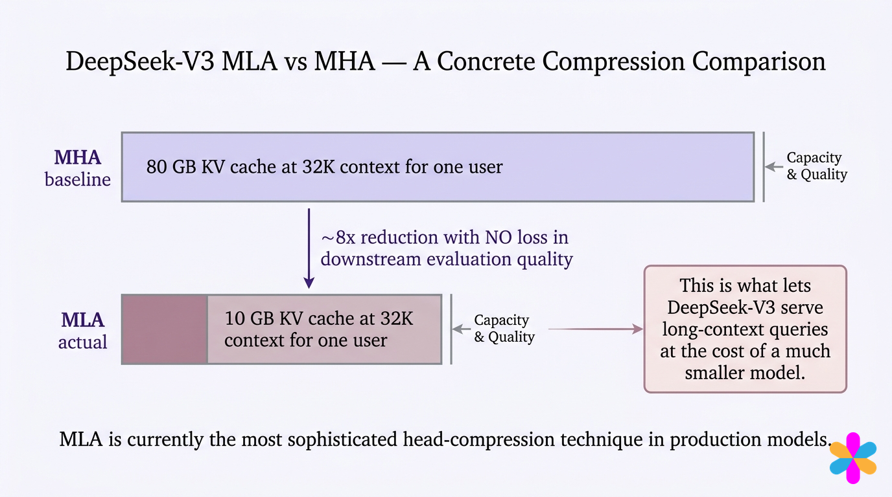

The general payload count for batch B, tokens T, layers L and s bytes per element is

$$\text{MLA cache bytes}=BTL(r+d_r)s.$$

For the executable example below, B=2, T=5, L=1, r=3, $d_r=2$ and float64 give $2\cdot5\cdot(3+2)\cdot8=400$ bytes. Keeping two heads of fully expanded content keys of width two, positional keys of width two and values of width two would use 960 bytes. If the positional key remains shared even in the expanded reference, that alternative uses 800 bytes. State which representation is being compared.

The large bars are a teaching illustration, not a derivation of a particular DeepSeek checkpoint's allocation. Their 80/10 GB labels do not follow from unspecified rank, positional width, layer count or precision. Nor does equal architecture-level “capacity” establish equal benchmark quality. The original DeepSeek-V2 paper reports its own trained-model experiments; our checks establish factorization identities for fixed coefficients. Runtime allocation also includes metadata, workspace and allocator overhead beyond the payload formula.

### Trace a complete reference through both paths

Our input X is `[B,T,4]`. `projections` first computes C `[B,T,3]`, two content queries `[B,2,T,2]`, two positional queries of width two and a shared positional key `[B,T,2]`. `rotate_pair` uses absolute token positions. `attend` either expands keys/values or performs the equivalent latent-domain contractions. Both paths add the same positional scores, divide by two, mask future positions, normalize, join two value heads and apply the same output matrix.

The code fixes dimensions so each axis is visible. It omits the full model's query bottleneck, normalization, feed-forward network, tokenizer and trained coefficients. The gradient comparison is useful precisely because a shape-correct contraction can still wire the wrong head or latent axis.

Save [mla.py](examples/mla.py) and run `python mla.py` in a PyTorch environment. In Colab upload the file, inspect `torch.__version__`, and run `!python mla.py`; CPU float64 is sufficient for this small check.

```python
"""Tiny MLA algebra: expanded and latent-domain retrieval with decoupled RoPE."""
import json
import math
import torch


def rotate_pair(x, positions):
    c,s=positions.to(x).cos(),positions.to(x).sin()
    a,b=x[...,0],x[...,1]
    return torch.stack([a*c-b*s,a*s+b*c],-1)


def projections(x,wd,wq,wqr,wkr):
    b,t,_=x.shape
    latent=x@wd
    q=(x@wq).reshape(b,t,2,2).transpose(1,2)
    qr=(x@wqr).reshape(b,t,2,2).transpose(1,2)
    kr=x@wkr
    positions=torch.arange(t,device=x.device)
    return q,rotate_pair(qr,positions),latent,rotate_pair(kr,positions)


def attend(q,qr,latent,kr,uk,uv,wo,offset=0,absorbed=True):
    t=latent.shape[1];s=q.shape[-2]
    if absorbed:
        query_latent=torch.einsum('bhsd,hrd->bhsr',q,uk)
        content_scores=torch.einsum('bhsr,btr->bhst',query_latent,latent)
    else:
        keys=torch.einsum('btr,hrd->bhtd',latent,uk)
        content_scores=q@keys.transpose(-2,-1)
    scores=(content_scores+torch.einsum('bhsd,btd->bhst',qr,kr))/math.sqrt(2+2)
    query_positions=offset+torch.arange(s,device=q.device)
    future=torch.arange(t,device=q.device)[None,:]>query_positions[:,None]
    weights=scores.masked_fill(future,-torch.inf).softmax(-1)
    if absorbed:
        mixed_latent=torch.einsum('bhst,btr->bhsr',weights,latent)
        context=torch.einsum('bhsr,hrd->bhsd',mixed_latent,uv)
    else:
        values=torch.einsum('btr,hrd->bhtd',latent,uv)
        context=weights@values
    joined=context.transpose(1,2).contiguous().reshape(q.shape[0],s,4)
    return joined@wo


def run_checks():
    torch.manual_seed(71)
    shapes=[(2,5,4),(4,3),(4,4),(4,4),(4,2),(2,3,2),(2,3,2),(4,4)]
    x,wd,wq,wqr,wkr,uk,uv,wo=[torch.randn(*s,dtype=torch.float64,requires_grad=True) for s in shapes]
    q,qr,c,kr=projections(x,wd,wq,wqr,wkr)
    a=attend(q,qr,c,kr,uk,uv,wo,absorbed=True)
    b=attend(q,qr,c,kr,uk,uv,wo,absorbed=False)
    torch.testing.assert_close(a,b,atol=1e-10,rtol=1e-10)
    variables=(x,wd,wq,wqr,wkr,uk,uv,wo)
    ga=torch.autograd.grad(a.square().sum(),variables,retain_graph=True)
    gb=torch.autograd.grad(b.square().sum(),variables)
    for left,right in zip(ga,gb):
        torch.testing.assert_close(left,right,atol=1e-9,rtol=1e-9)
    first=attend(q[:,:,:2],qr[:,:,:2],c[:,:2],kr[:,:2],uk,uv,wo)
    later=attend(q[:,:,2:],qr[:,:,2:],c,kr,uk,uv,wo,offset=2)
    torch.testing.assert_close(torch.cat([first,later],1),a)
    assert sum(z.numel()*z.element_size() for z in [c,kr])==400
    wrong=attend(q[:,:,2:],rotate_pair((x@wqr).reshape(2,5,2,2).transpose(1,2)[:,:,2:],torch.arange(3)),c,kr,uk,uv,wo,offset=2)
    assert not torch.allclose(wrong,a[:,2:])
    return {'expanded_absorbed_outputs_and_gradients_equal':True,
            'cached_chunks_equal':True,'latent_plus_position_bytes':400,
            'wrong_rotary_offset_detected':True}


if __name__ == '__main__':
    print(json.dumps(run_checks(),sort_keys=True))
```

The program prints that expanded/absorbed outputs and all input/matrix gradients agree, cached chunks agree, payload is 400 bytes and resetting the rotary offset is detected. The chunks use query positions 0–1 and then 2–4. The second chunk sees all five retained rows but its causal mask uses offset two. Resetting its rotations to 0–2 is a different positional computation even if tensor shapes still match.

During training, changing coefficients invalidates precomputed absorbed products; form them from the current coefficients or recompute them appropriately. In serving, cache ownership, absolute positions, truncation and reset remain the contracts from the KV-cache lesson. Smaller storage does not make stale state valid.

### Predict or explain: For B=1,T=10,r=4,dr=2,float32, what is retained per layer?

<details data-practice-id="mla-position"><summary>Reveal worked answer and rubric</summary>

10*(4+2)*4=240 bytes of latent plus positional-key payload. Queries are not retained; metadata is additional.

**Rubric:** Include the positional key and distinguish payload from allocation.

</details>


### What the identity does and does not buy

The same factorized MLA can be evaluated through expanded or absorbed paths. This does not show that arbitrary MHA coefficients can be compressed into rank r without changing outputs. It also does not guarantee a speedup: latent width, kernel support, batch shape, memory traffic and the cost of additional projections matter. The next lesson keeps the dense attention formula and changes execution order through tiled online softmax.

[Implementation and commands](project/implementation.md) · [Readiness and limits](project/readiness.md) · [Transfer review](practice/transfer-review.md)

### References

- [Vizuara, Inference Engineering workshop book](https://vizuaraai.github.io/convolution-musical-journey/book.html), Chapter 8.7–8.9; original compression and memory figures.
- [DeepSeek-V2](https://arxiv.org/html/2405.04434v5), Sections 2.1.2–2.1.4 and Figure 3; original architecture comparison and decoupled rotary derivation.
- Additional worked SVG figures are original to this tutorial; their inputs and calculations follow the complete executable reference above.


## Evidence and proof limits

### Claim ledger

| Claim | Status | Proof limit |
| --- | --- | --- |
| 1. Several independent mixtures, then one output | illustrative | Original small worked example and stated mathematical assumptions. Source review and executed author checks do not establish a trained model or learner mastery. |
| 2. Pack independent heads without changing the operation | illustrative | Original small worked example and stated mathematical assumptions. Source review and executed author checks do not establish a trained model or learner mastery. |
| 3. Keep head arrangements separate from other attention choices | illustrative | Original small worked example and stated mathematical assumptions. Source review and executed author checks do not establish a trained model or learner mastery. |
| MQA keeps independent query heads and shares one key/value head; equal-parameter loop and broadcast computations agree. | verified | Declared local component and mathematical contract; no model-quality or speed result. |
| Contiguous equal groups select KV head floor(h/R); group endpoints are MQA and MHA, while mean-pooling conversion is not a general output-preserving identity. | verified | Exact grouping contract and local output/gradient/cache checks; no trained-quality claim. |
| For fixed factorized coefficients, expanded and latent-domain MLA retrieval agree with decoupled positional scores; both latent and positional keys must be counted. | verified | Stated mathematical assumptions and executed tiny reference; no learner, hosted or full-model result. |

## Sources

- [Vizuara · The Attention Family · Lecture 8 · video](https://www.youtube.com/watch?v=IOmg660SvmM) — Video page/description and full English automatic caption text, 00:00:00.880–01:11:30.400; checked 2026-10-30
- [Vizuara · The Attention Family · Lecture 8 · slides](https://lecture8-attention-mechanisms.vercel.app/) — Complete original Slidev presentation, 22 slides; checked 2026-10-30
- [Bahdanau et al. · Neural Machine Translation by Jointly Learning to Align and Translate](https://arxiv.org/abs/1409.0473) — Alignment model and source-memory motivation; checked 2026-10-30
- [Luong et al. · Effective Approaches to Attention-based Neural Machine Translation](https://aclanthology.org/D15-1166/) — Global attention and score alternatives; checked 2026-10-30
- [Vaswani et al. · Attention Is All You Need](https://arxiv.org/html/1706.03762v7) — Sections 3.2.1–3.2.3 and the scaling assumptions; checked 2026-10-30
- [Dive into Deep Learning · Attention Scoring Functions](https://d2l.ai/chapter_attention-mechanisms-and-transformers/attention-scoring-functions.html) — Sections 11.3.2–11.3.4: masked normalization, scaled dot product, additive scoring; checked 2026-10-30
- [Ainslie et al. · GQA, version 3](https://arxiv.org/abs/2305.13245v3) — Abstract: MHA, intermediate grouped KV heads and MQA definitions only; model results not reproduced; checked 2026-10-30
- [Shazeer Fast Transformer Decoding v1](https://arxiv.org/html/1911.02150v1) — Sections 2–3 and incremental attention state; checked 2026-10-30
- [Vizuara Inference Engineering Chapter 8](https://vizuaraai.github.io/convolution-musical-journey/book.html) — Sections 8.1–8.4; figures 8.1–8.3; checked 2026-10-30
- [Ainslie et al. GQA v3](https://arxiv.org/html/2305.13245v3) — Sections 2.1–2.2 and 3, grouping and conversion; checked 2026-10-30
- [DeepSeek-V2 MLA method](https://arxiv.org/html/2405.04434v5) — Sections 2.1.2–2.1.4; Figure 3; checked 2026-10-30
