# Attention inference: KV caching and memory management

How can generation reuse past computation while keeping each request’s state correct?

Learning material for attention-labs. Model implementation/training and learner mastery are separate states.

**Outcomes:** Explain prefill/decode reuse and construct absolute-position masks.; Count stored tensor bytes and distinguish them from runtime speed.; Translate token positions and mask an incomplete logical tail.; Preserve ownership through prefix forks, copy-on-write, failure and release..

## KV caching: reuse the past without changing the answer

We already know how a causal attention layer turns projected queries, keys and values into contextual vectors. Now put that layer inside generation. The input is a prompt followed by the tokens generated so far. The required result at each step is one vocabulary distribution for the next token. The output vector of the attention layer is one contribution to that distribution; it is not itself a word prediction.

We will first follow the whole generation loop, open the repeated matrix calculation, retain exactly the information the next query needs, then count the memory that retention costs. The practical check is simple: processing a sequence in chunks must agree with processing its full causal prefix. The same fixed model, positions, input prefix and inference settings are essential to that comparison.

### Locate the repeated work in generation

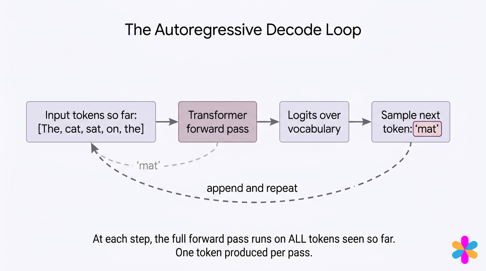

Follow the return arrow. After sampling a token, the input prefix is longer. A straightforward implementation sends that whole prefix through the model again. The model is correct, but it repeats work for positions it has already processed.

Use the prompt “The next day is”. Suppose the model produces “bright”. To produce the token after “bright”, a full-prefix implementation processes five positions. We only require the last position's logits now. Earlier logits already served their purpose. In a complete decoder, embeddings, transformer blocks and the vocabulary projection surround the attention component we study here.

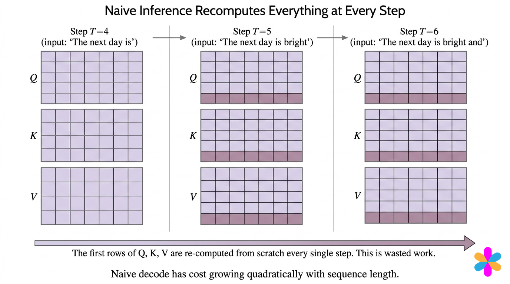

Compare rows with the same token and absolute position. In causal inference, appending a later token cannot change their permitted inputs. Fixed weights and deterministic inference therefore reproduce their old representations. This remains true through multiple causal layers: unchanged earlier states at one layer give unchanged earlier states at the next. Bidirectional attention, changed prefixes, changed weights or active stochastic dropout break this argument.

### Open the four-token calculation

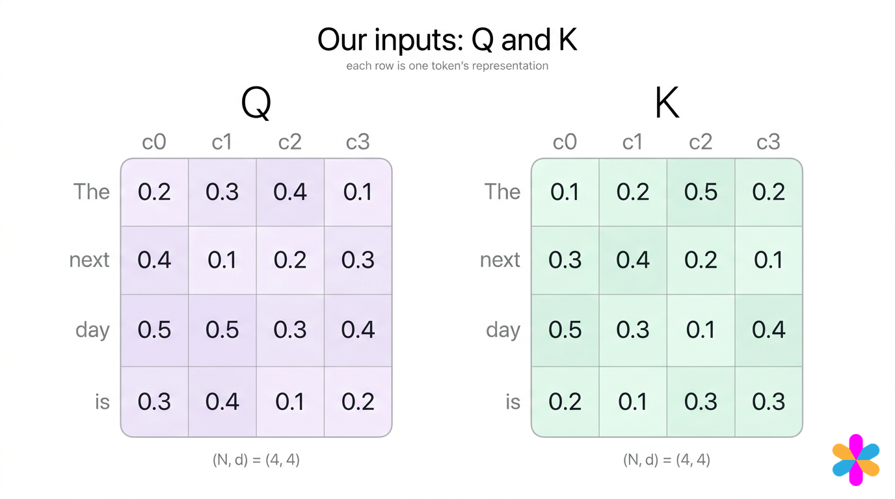

Each row names a token; each column names a feature. Here $T=4$ and $d_k=4$. We start with explicitly supplied Q and K rather than claim these hand-set coordinates came from a trained language model. The task of projection was covered earlier; the new question is which computed rows must survive between steps.

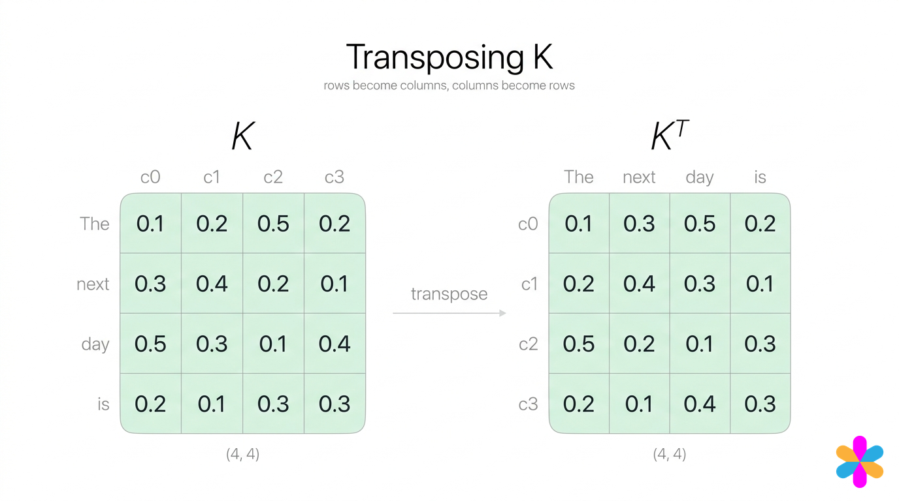

Transposition does not compute new keys. It changes how the same numbers are arranged for the contraction. A query row meets one key column to produce one scalar comparison. Thus $[4,4]@[4,4]$ produces four query rows and four source-token columns, not a feature-by-feature attention matrix.

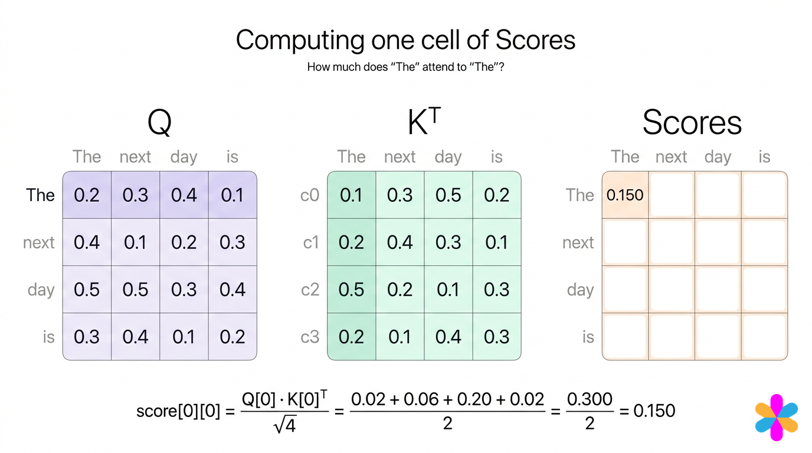

For “The” looking at “The”, multiply matching coordinates and add:

$$q_0\cdot k_0=0.2(0.1)+0.3(0.2)+0.4(0.5)+0.1(0.2)=0.30.$$

Divide by $\sqrt{4}=2$: the scaled score is $0.15$. Notice that the scale is the comparison width, not the number of tokens. They happen to be equal in this fixture.

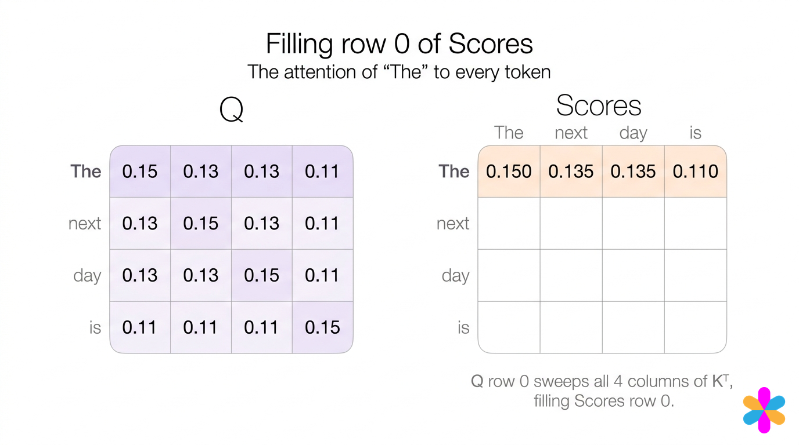

The remaining first-row scores are $0.135,0.135,0.110$. This row still describes all possible comparisons before visibility is applied. A causal first position may ultimately use only the first key.

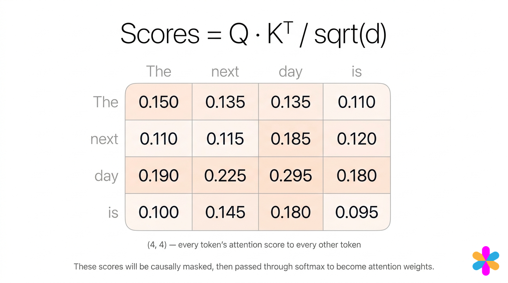

The complete scaled scores are

$$S=\begin{bmatrix}.150&.135&.135&.110\\.110&.115&.185&.120\\.190&.225&.295&.180\\.100&.145&.180&.095\end{bmatrix}.$$

Set future **logits** to minus infinity before softmax. Setting them to zero would permit nonzero future weights. Normalization runs across source-token columns. The final row has no future positions within this prefix, so all four of its keys are permitted. The arithmetic reference below reproduces all sixteen scores independently of PyTorch.

### At the next step, retain information rather than redo it

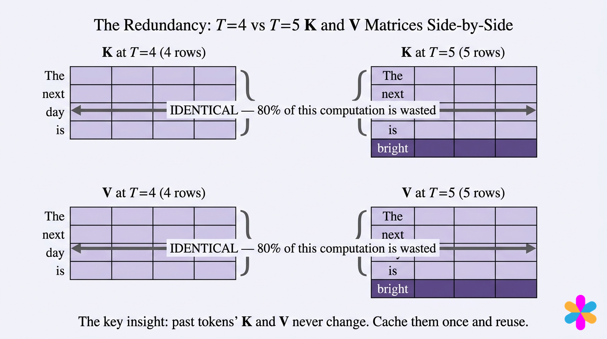

Four of five projected rows can be reused at this step. That is an 80% reduction in newly computed rows for that projection, not an 80% end-to-end latency guarantee. Other layers, memory reads, allocation and kernel overhead still cost time.

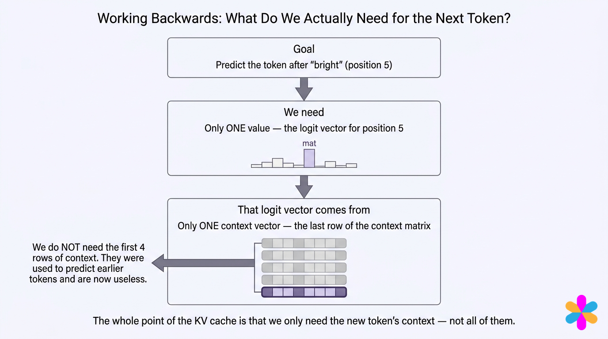

Work backward from the result we need. One next-token distribution comes from the current position's final hidden state. Its attention contribution needs the current query and all permitted past keys and values. Previous query rows do not help a different current query answer its own question.

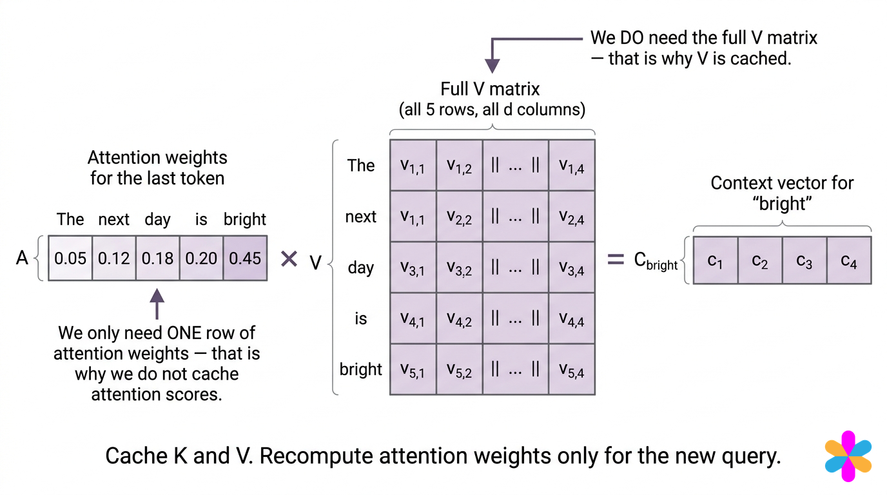

The shape is $[1,5]@[5,d_v]=[1,d_v]$. Every retained value can contribute, even though we calculate only one query row. The five illustrated weights show that relationship; they are not derived from the four-token Q/K table, because a fifth query and key have not been specified in that table.

To make a fully specified extension, choose $q_4=[.2,.6,.1,.4]$, $k_4=[.7,.2,.3,.1]$, the four basis vectors as earlier values, and $v_4=[1,1,1,1]$. The scaled new scores are $[.135,.180,.225,.125,.165]$. Softmax gives approximately

$$[.193772,.202691,.212020,.191844,.199673].$$
 The first context coordinate is $.193772+.199673=.393445$; all four coordinates are

$$[.393445,.402364,.411693,.391517].$$
 This is a numerical fixture for checking reuse, with no claimed linguistic meaning.


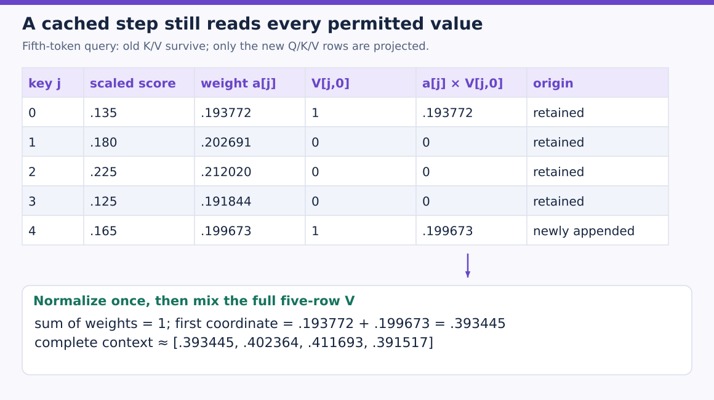

Read one row as one source token. The first four rows are retained, yet they still participate in the new weighted sum. Only rows 0 and 4 contribute to the first output coordinate because the first four values are basis vectors and the fifth is all ones. Reuse avoids repeating old projections; it does not skip retrieval from old values. The complete arithmetic below checks the displayed weights and context.

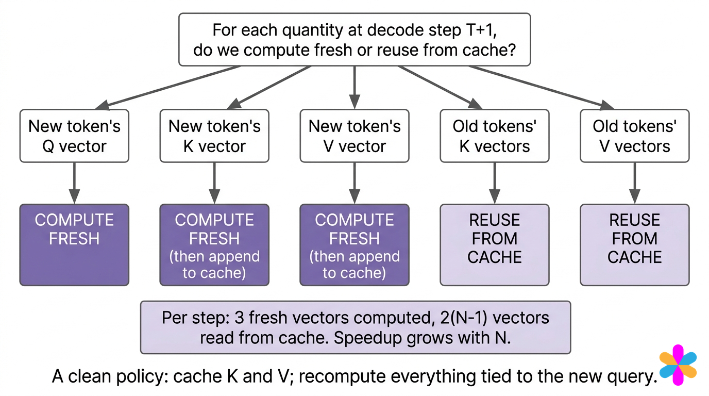

Compute the new Q, K and V, append the new K/V, compute the current score row against the complete cache, normalize, then retrieve its context. Keep a separate cache for every layer: deeper-layer keys and values come from that layer's own input states, not from reusing layer zero's projections.

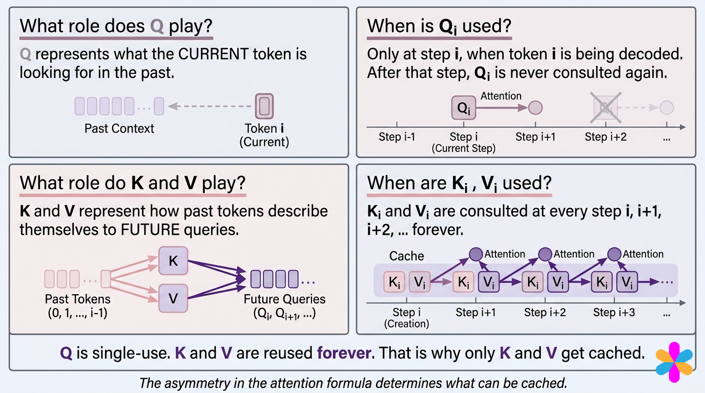

This is why an ordinary autoregressive KV cache does not retain old queries or old score rows. It is a lifetime decision derived from the operation. Other algorithms may retain different state for other purposes; the claim concerns this inference loop.

### Separate prefill from decoding

The initial prompt is usually processed in parallel with a causal mask. That is **prefill**: create each layer's cache and obtain the last prompt position's prediction. **Decode** processes the newly sampled token, appends its K/V, and produces the following prediction. A chunk can contain several new tokens, provided each query sees only keys at or before its own absolute position.

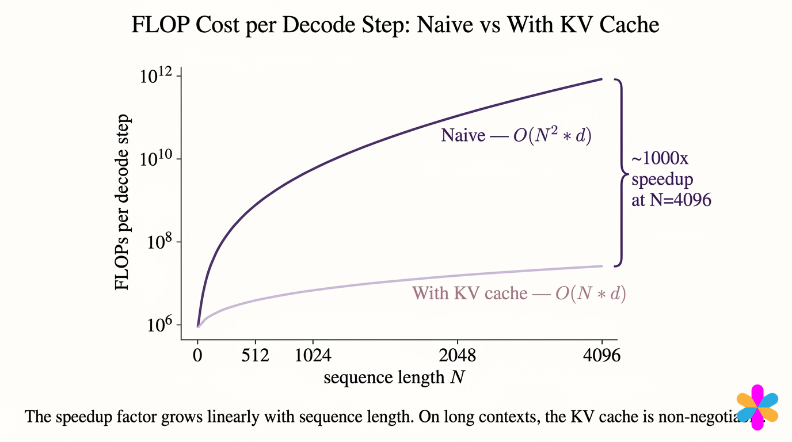

For full-prefix attention, the two matrix products require about $4T^2d$ floating-point operations per layer when value and comparison widths agree. For one new query, they require about $4Td$. Projections and the feed-forward network change from processing $T$ rows to processing one. These are operation counts at stated dimensions. The chart's speedup labels are illustrations of avoided computation, not measured latency on this machine.

### Store tensors with explicit ownership and positions

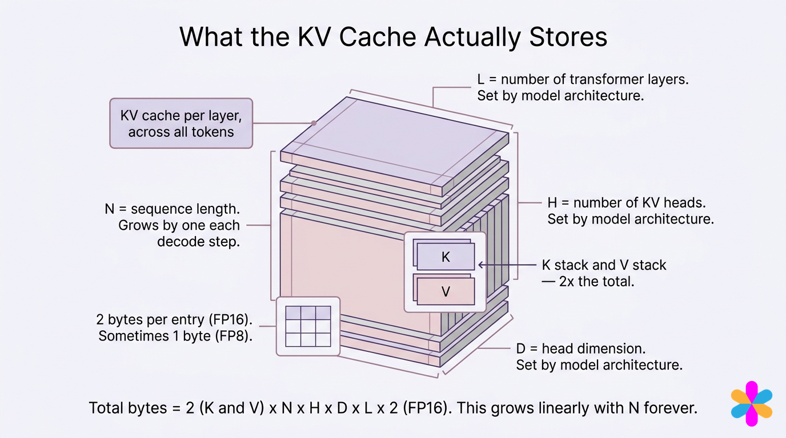

We use cache layout `[B,H,T,D]`, where B indexes independent sequences, H indexes KV heads, T indexes retained tokens and D indexes features. The diagram arranges axes differently for display; consistent indexing is what matters. The cache belongs to a request and a specific model state. A request ID alone is not sufficient for a production cache key: weights, adapters, exact token prefix, positional policy, dtype and other computation-affecting settings must also agree.

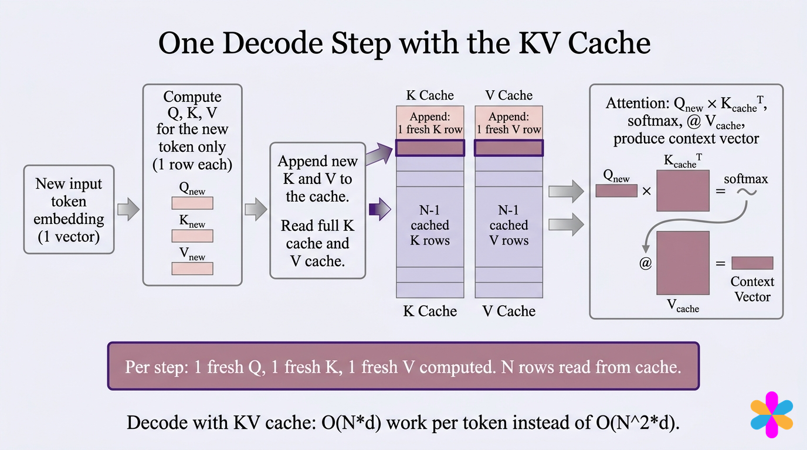

There is one subtle mask boundary. Suppose three tokens are already cached and the next chunk contains two. Its query positions are 3 and 4, while keys occupy 0 through 4. The first query can see keys 0–3; the second can see 0–4. A top-left triangle on a `[2,5]` array incorrectly allows only 1 and 2 keys. Build visibility using **absolute positions**, $j\leq\text{past}+i$.


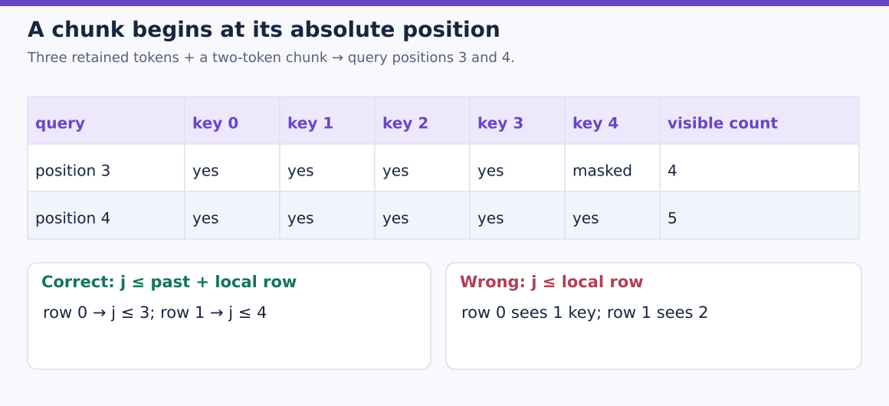

The columns name absolute key positions. Read the first query row left to right: key 3 is the current token, while key 4 belongs to its future. The second query may read both new keys. This is the mask built by the reference using the cache length; a fresh local triangle would discard valid history.

### Predict or explain: With three cached tokens and a two-token append, which keys may the two new queries see?

<details data-practice-id="offset"><summary>Reveal worked answer and rubric</summary>

The absolute query positions are 3 and 4. They may see key indices 0–3 and 0–4 respectively. A top-left 2×5 triangle would incorrectly allow only 1 and 2 keys.

**Rubric:** Use absolute positions and state both key sets.

</details>


### Quantify both savings and costs

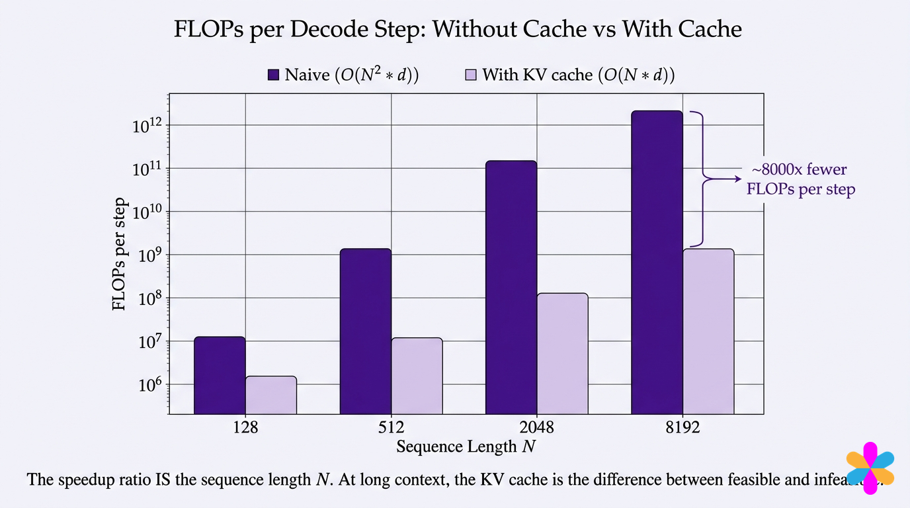

Compare matching sequence lengths and distinguish FLOPs from seconds. A cached decode still reads retained K/V and compares the new query with the allowed history. It does not make history retrieval constant-cost.

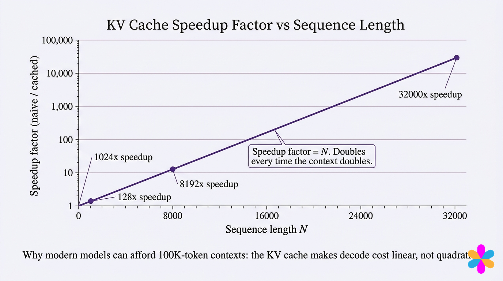

The attention-only ratio above is $T$ for this full-prefix-versus-one-row comparison. A decoder's actual runtime ratio depends on memory traffic, batching, kernels, projections and cache management. It must be measured under matched conditions.

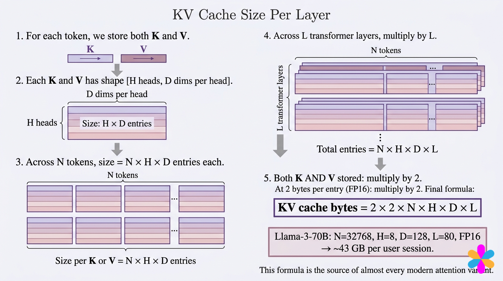

For K width $d_k$, V width $d_v$ and $s$ bytes per element, the payload is

$$M=B\,T\,L\,H_{kv}(d_k+d_v)s.$$

When the widths agree and FP16/BF16 uses two bytes, this becomes $4BTLH_{kv}d_h$. Count KV heads, not automatically query heads. MHA has equal head counts; MQA and GQA will change that equality. Allocator metadata, reserved capacity, padding, quantization scales and temporary copies are additional costs.

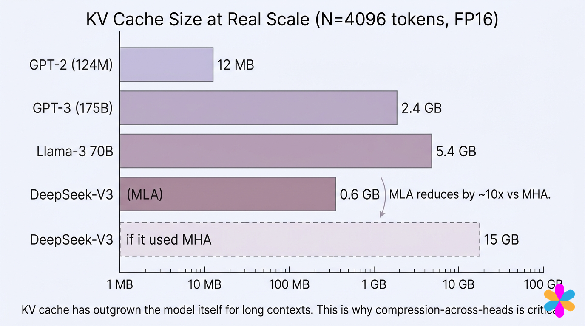

Use the chart to ask which dimensions produced a bar; verify its labels with the formula before using them as a capacity estimate. For an explicitly declared configuration $B=1,T=4096,L=80,H_{kv}=8,d_k=d_v=128,s=2$, the result is **1,342,177,280 bytes = 1.25 GiB**, or about 1.342 GB. Giving the same dimensions 64 KV heads instead produces 10 GiB. Several labels in the illustrated model comparison do not follow this accounting; they are not reliable configuration measurements. A model name alone does not specify its cache representation or dtype.

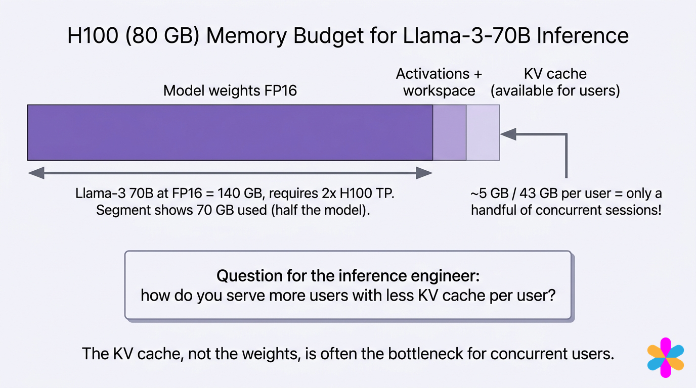

Subtract resident weights, runtime workspace and safety headroom before budgeting cache. If usable cache capacity is 5 GiB and one request needs 1.25 GiB, at most four such payloads fit before additional overhead. The figure's separate 43-GB-per-user annotation uses different assumptions and cannot be combined with that example. With tensor parallelism, count the actual per-device KV sharding or replication; do not divide blindly by the number of GPUs.

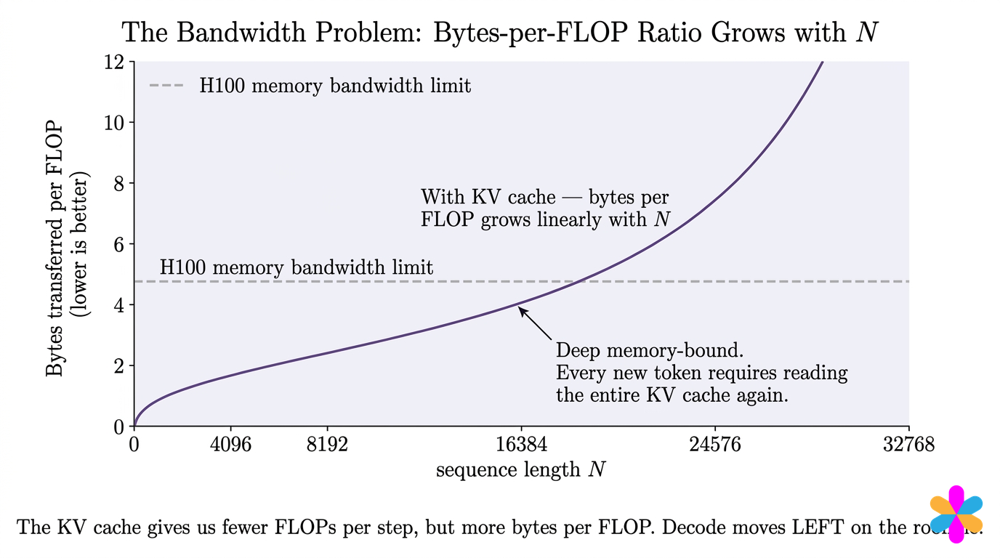

Longer retained history increases bytes read per decode step. However, its plotted bytes-per-FLOP curve is schematic: for one-head dense decode, attention reads about $2Tds$ bytes and performs about $4Td$ FLOPs, so their ratio is approximately $s/2$, independent of T under this simplified model. Other model work and memory reuse change the total. An HBM bandwidth rate has units bytes/second, so it cannot be compared directly with a bytes/FLOP axis without a compute rate.

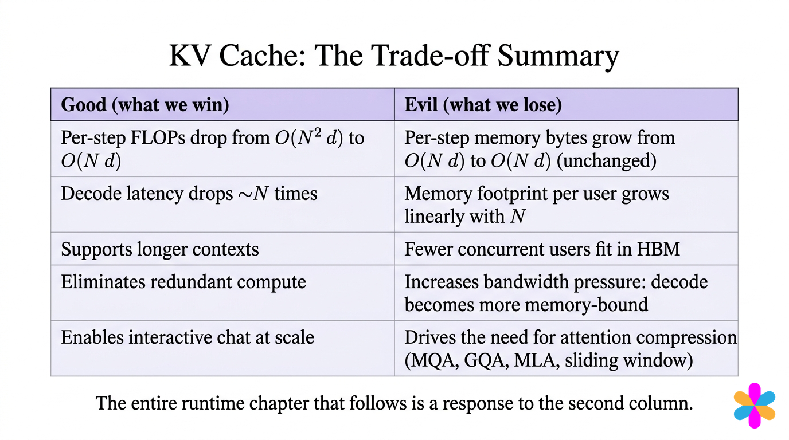

The benefit is reuse; the cost is persistent, growing state and its movement. Keeping the same mathematical output says nothing by itself about portable speedup. Changing dtype or dropping keys introduces additional questions about approximation and accuracy.

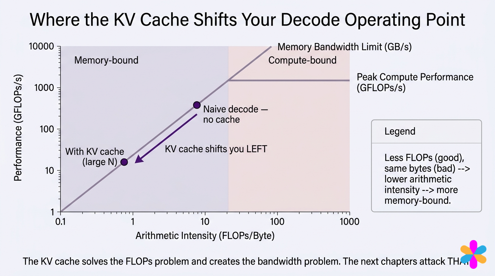

A roofline compares FLOPs/byte horizontally with FLOPs/second vertically. Removing repeated arithmetic can lower arithmetic intensity even while reducing total elapsed work. For example, 100 FLOPs at 10 FLOPs/second takes 10 seconds; 10 FLOPs at 5 FLOPs/second takes 2 seconds. A lower FLOP rate does not necessarily mean a slower request. Actual operating points require profiling; the arrows are a conceptual explanation.

### Run the arithmetic independently

Save [cache_arithmetic.py](examples/cache_arithmetic.py) and run `python3 cache_arithmetic.py` from its directory. It uses only the standard library and verifies the sixteen scores, the explicitly declared fifth-token mixture and both cache capacities. The complete file is:

```python
import json
import math


def softmax(row):
    values = [math.exp(x-max(row)) for x in row]
    return [x/sum(values) for x in values]


def run():
    q = [[.2,.3,.4,.1], [.4,.1,.2,.3], [.5,.5,.3,.4], [.3,.4,.1,.2]]
    k = [[.1,.2,.5,.2], [.3,.4,.2,.1], [.5,.3,.1,.4], [.2,.1,.3,.3]]
    scores = [[sum(a*b for a,b in zip(qi,kj))/2 for kj in k] for qi in q]
    assert abs(scores[0][0]-.15) < 1e-15
    q_new = [.2,.6,.1,.4]
    keys = k + [[.7,.2,.3,.1]]
    weights = softmax([sum(a*b for a,b in zip(q_new,kj))/2 for kj in keys])
    values = [[1,0,0,0],[0,1,0,0],[0,0,1,0],[0,0,0,1],[1,1,1,1]]
    context = [sum(w*v[j] for w,v in zip(weights,values)) for j in range(4)]
    assert abs(sum(weights)-1) < 1e-15
    memory = 2*1*4096*8*128*80*2
    return {'scores': [[round(x,6) for x in row] for row in scores],
            'new_weights': [round(x,6) for x in weights],
            'new_context': [round(x,6) for x in context],
            'gqa_cache_bytes': memory, 'gqa_cache_gib': memory/2**30,
            'mha_cache_gib': memory*8/2**30}


if __name__ == '__main__':
    print(json.dumps(run(),sort_keys=True))
```

### Build the cache and test a changed execution order

The next file accepts already projected Q/K/V. It keeps the focus on storage and visibility rather than implementing a vocabulary, projections or a trained generator again. `causal_attention` defines the mathematical reference first. `KVCache.append` then checks ownership/layout, constructs candidate state, computes outputs using the correct offset and commits only after successful calculation. `reset` starts an independent request; `payload_bytes` counts the actual retained tensor payload.

The implementation uses concatenation for readability. Appending that way copies old cache contents; real runtimes often preallocate storage or use pages. This component is therefore a correctness reference, not an optimized serving engine.

Save [kv_cache.py](examples/kv_cache.py). In Google Colab, run `import torch; print(torch.__version__)`, upload the file, then run `!python kv_cache.py`. Locally use an environment with PyTorch; the author checks use CPU float64. No model download or GPU is required. Here is the complete file, including every helper and its checks:

```python
"""CPU component reference: causal prefill/chunks, ownership and exact cache size."""
import json
import math
import torch


def causal_attention(q, k, v, offset=0):
    """q: [B,H,S,Dk]; k/v: [B,H,T,Dk/Dv]; q positions start at offset."""
    query_positions = offset + torch.arange(q.shape[-2], device=q.device)
    key_positions = torch.arange(k.shape[-2], device=k.device)
    visible = key_positions[None, :] <= query_positions[:, None]
    scores = q @ k.transpose(-2, -1) / math.sqrt(q.shape[-1])
    return scores.masked_fill(~visible, -torch.inf).softmax(-1) @ v


class KVCache:
    def __init__(self):
        self.reset()

    def reset(self):
        self.owner = None
        self.k = self.v = None

    @torch.no_grad()
    def append(self, q, k_new, v_new, *, owner, start):
        if any(t.ndim != 4 for t in [q, k_new, v_new]):
            raise ValueError('Expected [batch,head,token,feature] tensors')
        if q.shape != k_new.shape or q.shape[:3] != v_new.shape[:3]:
            raise ValueError('MHA query/key shapes and value leading axes must match')
        if q.shape[-2] == 0 or q.shape[-1] == 0 or v_new.shape[-1] == 0:
            raise ValueError('Empty chunks or features are not supported')
        tensors = [q, k_new, v_new]
        if self.k is not None:
            tensors += [self.k, self.v]
        if any(t.dtype != q.dtype or t.device != q.device for t in tensors):
            raise ValueError('Dtype/device changed')
        past = 0 if self.k is None else self.k.shape[-2]
        if start != past or (self.owner is not None and self.owner != owner):
            raise ValueError('Wrong absolute position or request owner')
        if self.k is not None:
            if self.k.shape[:2] + self.k.shape[-1:] != k_new.shape[:2] + k_new.shape[-1:]:
                raise ValueError('Key layout changed')
            if self.v.shape[:2] + self.v.shape[-1:] != v_new.shape[:2] + v_new.shape[-1:]:
                raise ValueError('Value layout changed')
        # Build candidates first; invalid input must not partly update retained state.
        k = k_new.clone() if self.k is None else torch.cat([self.k, k_new], dim=-2)
        v = v_new.clone() if self.v is None else torch.cat([self.v, v_new], dim=-2)
        result = causal_attention(q, k, v, offset=past)
        self.owner, self.k, self.v = owner, k, v
        return result

    def payload_bytes(self):
        return sum(t.numel() * t.element_size() for t in [self.k, self.v] if t is not None)


def run_checks():
    torch.manual_seed(17)
    q = torch.randn(2, 2, 6, 3, dtype=torch.float64)
    k = torch.randn_like(q)
    v = torch.randn(2, 2, 6, 2, dtype=torch.float64)
    expected = causal_attention(q, k, v)
    cache = KVCache()
    outputs = []
    for start, end in [(0, 3), (3, 5), (5, 6)]:
        outputs.append(cache.append(q[:, :, start:end], k[:, :, start:end],
                       v[:, :, start:end], owner='request-a', start=start))
    actual = torch.cat(outputs, dim=-2)
    torch.testing.assert_close(actual, expected, atol=1e-12, rtol=1e-12)
    assert cache.payload_bytes() == 2 * 2 * 6 * (3 + 2) * 8 == 960
    # Top-left masking of a non-square decode matrix incorrectly keeps only key 0.
    wrong = causal_attention(q[:, :, -1:], k, v, offset=0)
    assert not torch.allclose(wrong, expected[:, :, -1:])
    original = cache.k.clone()
    for owner, start in [('request-b', 6), ('request-a', 0)]:
        try:
            cache.append(q[:, :, :1], k[:, :, :1], v[:, :, :1], owner=owner, start=start)
        except ValueError:
            pass
        else:
            raise AssertionError('Invalid request/position accepted')
        assert torch.equal(cache.k, original)
    cache.reset()
    reused = cache.append(q, k, v, owner='request-b', start=0)
    torch.testing.assert_close(reused, expected)
    # Real zero-valued tokens stay valid keys. Padding needs separate validity metadata.
    z = torch.zeros(1, 1, 2, 1, dtype=torch.float64)
    values = torch.tensor([[[[2.0], [4.0]]]], dtype=torch.float64)
    assert causal_attention(z, z, values)[0, 0, -1, 0].item() == 3.0
    return {'chunks_equal_full': True, 'cache_bytes': 960,
            'wrong_offset_detected': True, 'owner_and_position_rejected': True,
            'reset_equal_full': True, 'zero_token_is_valid': True}


if __name__ == '__main__':
    print(json.dumps(run_checks(), sort_keys=True))
```

The reported payload is 960 bytes: $2\cdot2\cdot6\cdot(3+2)\cdot8$. The three chunks `[0:3]`, `[3:5]`, `[5:6]` produce the same outputs as the six-token causal reference. The deliberately wrong offset produces a different answer; changed request identity and stale positions are rejected without updating state. Resetting restores independent-request behavior. A true zero-valued token remains visible; padding requires a separate validity mask. This reference does not support ragged/padded batches or retained autograd graphs.

### Predict or explain: What payload is retained for B=2,Hkv=2,T=6,dk=3,dv=2 in float64?

<details data-practice-id="cache-size"><summary>Reveal worked answer and rubric</summary>

2×2×6×(3+2)×8 = 960 bytes. Include both K and V widths, but do not count a persistent Q cache. This excludes transient concatenation copies and allocator overhead.

**Rubric:** Derive each factor and distinguish payload from peak allocation.

</details>


### What this enables next

We now have a precise reason to reduce stored KV information: the payload and reads grow with retained history. MQA will keep multiple query heads while sharing one KV head; GQA will share within groups. Their output need not equal an arbitrary pretrained MHA model, because that changes the architecture. The cache equivalence check here instead holds the architecture and coefficients fixed.

The [implementation record](project/implementation.md), [readiness checks](project/readiness.md) and [transfer practice](practice/review.md) support reviewing the result.

### References

[Vizuara: Key Value Cache from Scratch](https://www.youtube.com/watch?v=IDwTiS4_bKo). [Vizuara Inference Engineering, Chapters 5 and 7](https://vizuaraai.github.io/convolution-musical-journey/book.html): original figures reproduced for the worked explanation above; schematic/inconsistent numerical labels are qualified beside their figures. These workshop figures are separate from the earlier Attention Family presentations. [Hugging Face: How caching works](https://huggingface.co/docs/transformers/cache_explanation) supplies the implementation conventions and mask considerations.
- Additional worked SVG figures are original to this tutorial; their inputs and calculations follow the complete executable reference above.


## PagedAttention: separate token order from storage order

A server does not know how long every request will become. Reserving each request's maximum possible cache can leave large amounts of device memory unavailable to others. PagedAttention breaks the cache into fixed-size blocks and keeps a small mapping from logical token order to physical storage. The attention function stays the same; allocation, sharing and lifetime become explicit.

### Find the unused reservation before changing the attention math

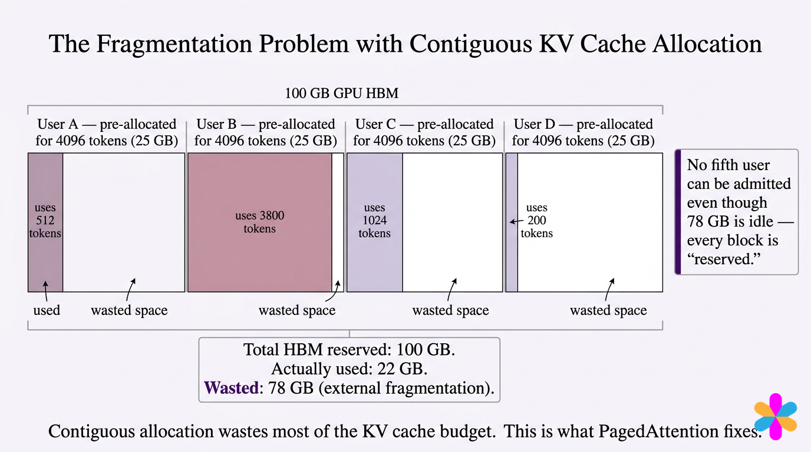

Three costs should be distinguished: space reserved for possible future tokens, unused capacity inside an allocation, and free gaps between allocations that cannot satisfy a large contiguous request. These are related but not identical. The diagram's blanket external-fragmentation label conflates them.

Its numbers also need a consistent basis. At equal 4096-token reservations and identical bytes per token, actual lengths512,3800,1024,200 use $5536/16384\approx33.79$ percent of the reserved space, not22 percent. The allocation problem is real without relying on the inconsistent total printed in the picture.

### Borrow address translation, not an automatic operating-system implementation

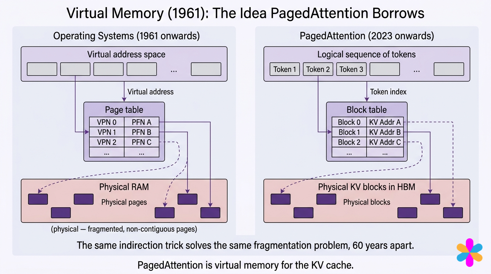

The left diagram shows the general virtual-memory idea; the right applies indirection to a model's cache. A request sees tokens0,1,2,… in sequence order. A block table maps each group of P tokens to a physical block identifier. The serving engine and kernel manage that table; this does not imply an OS page fault or MMU translation for every token lookup.

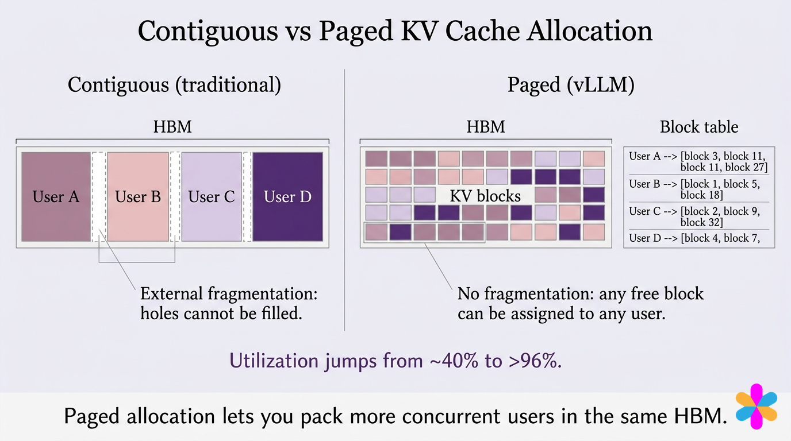

Any free block of the right shape can extend a request. Larger batches may fit because the engine avoids reserving every request's worst-case length. The illustrated utilization percentage is workload-dependent. Paging still wastes the unused tail of a last block and needs table/allocator metadata. A request should not list the same physical block twice for different logical content; repeated IDs in a schematic table are not an instruction to alias unrelated tokens.

### Translate one address completely

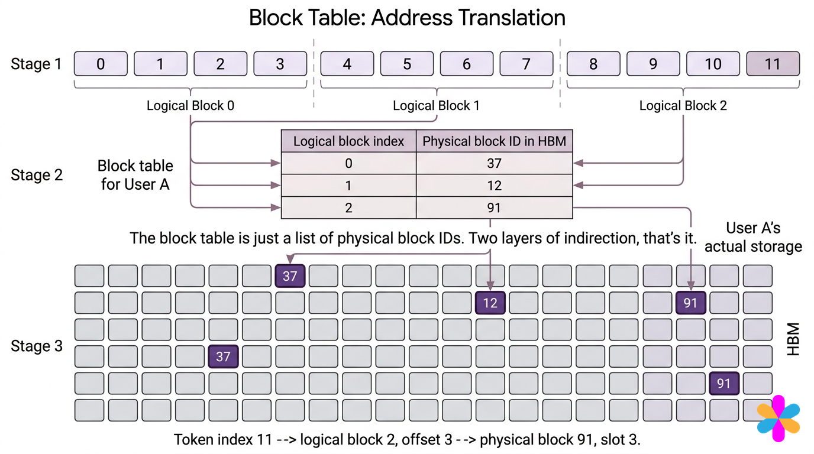

For zero-based token t,

$$b=\lfloor t/P\rfloor,\qquad o=t\bmod P,\qquad p=\text{table}[b].$$

Read physical block p at offset o. In the figure, P=4 and the table is `[37,12,91]`, so token11 is logical block2, physical91, offset3. If P were16, token11 would instead be logical block0, offset11. Do not mix the four-token figure with the sixteen-token convention used elsewhere in the workshop. Physical block IDs are addresses, not positional coordinates for RoPE or causal masks.


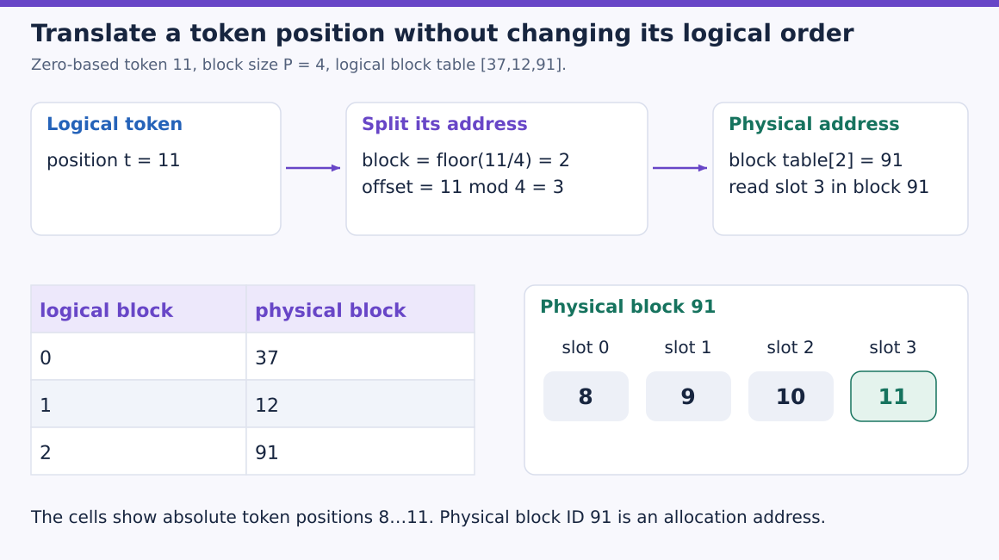

Follow the two-part address through the top row. Only the logical block number goes through the table; the offset remains 3. In the physical block, slot 3 contains the KV for absolute token 11. Neither the allocation ID nor the offset replaces its absolute position for masks or RoPE. The table and four cells fully specify this lookup.

### Allocate at a boundary and mask the incomplete tail

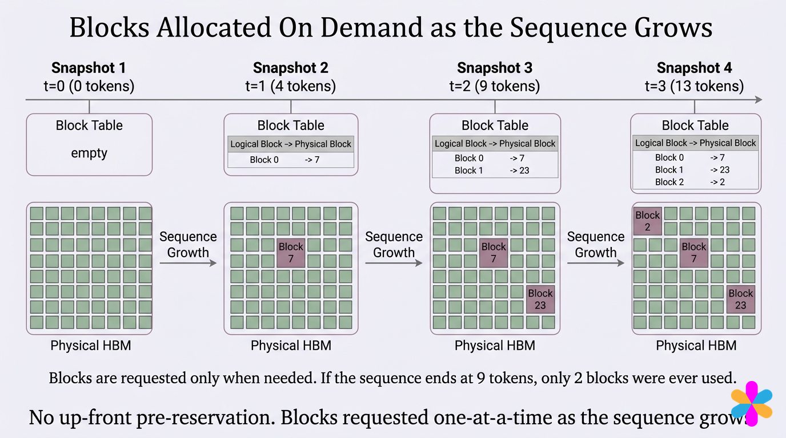

With P=4, lengths0,4,9,13 require0,1,3,4 blocks. With P=8, they require0,1,2,2. The picture's0,1,2,3 progression does not match one fixed P for those lengths. The rule is always $\lceil T/P\rceil$, allocating the next block only when needed.

For T=9,P=4, capacity is12 and three positions are unused. They must never enter the softmax denominator or the value mixture, even if their storage happens to contain zeros. Zero data is not a mask. In general, last-block waste is $(P-(T\bmod P))\bmod P$, strictly less than P positions per unshared request tail.

### Predict or explain: At P=4,table=[7,2,9], where is token10 and how much tail is unused at length11?

<details data-practice-id="paged-address"><summary>Reveal worked answer and rubric</summary>

Logical block2, physical block9, offset2. Twelve slots are allocated, one unused; that slot must be excluded from retrieval.

**Rubric:** Calculate quotient, remainder and logical length.

</details>


### Fetch the logical prefix through the table

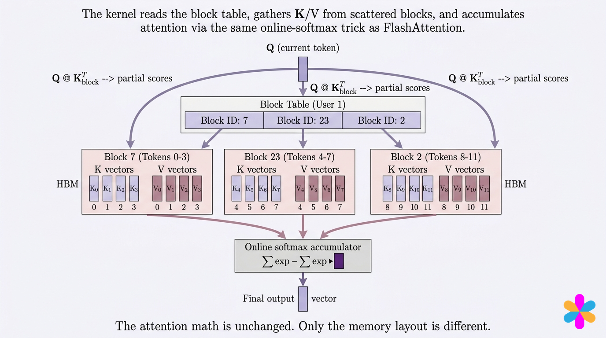

The same scaled dot products, permitted positions and value mixture apply after address translation. A dense teaching reference can gather all valid entries into a contiguous tensor first. A real paged kernel reads physical blocks directly without that full gather. Correct addressing is necessary for both; the gather's allocation and runtime are not representative of the production kernel.

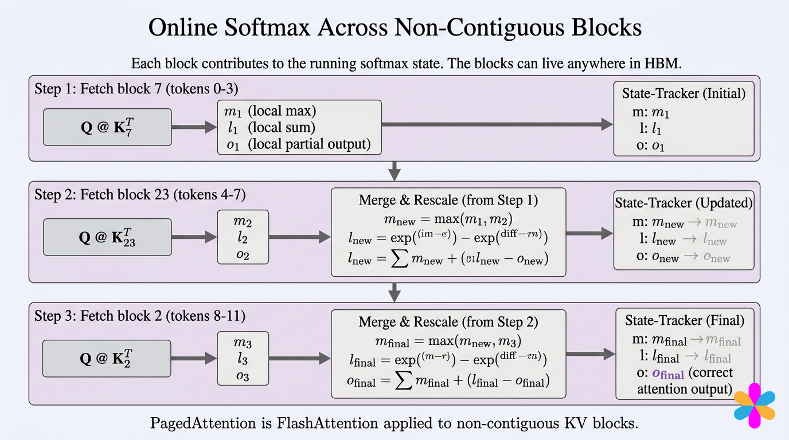

The equations printed inside this drawing are not a valid recurrence. Use the common-maximum merge established in FlashAttention: for old state m,l,u and a new tile with local maximum $m_b$, set $m'=\max(m,m_b)$, then

$$l'=e^{m-m'}l+\sum_{j\in B}e^{s_j-m'},\qquad u'=e^{m-m'}u+\sum_{j\in B}e^{s_j-m'}v_j.$$

Finally return u/l. Include only valid logical tokens; exclude future positions when processing more than a final decode query. Scattered physical addresses do not change these formulas. PagedAttention and FlashAttention are related execution ideas, but the allocator, cache lifetime and prefix-sharing mechanisms are additional responsibilities.

### Share a prefix without sharing future mutations

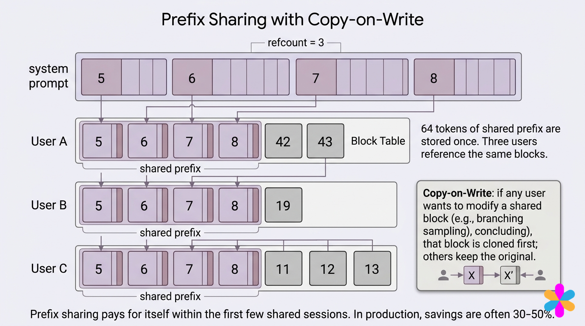

Keep one physical copy of a valid common prefix and let each request's table reference it. Increment a reference count for every table that owns the block. When one request finishes, decrement counts and return a block to the free pool only when its count reaches zero.

The subtle case is a **partially filled shared last block**. Suppose P=4, request A has six tokens and table `[4,1]`. Fork B with the same six-token prefix; both blocks now have refcount2. B's seventh token belongs in offset2 of the second block. Clone that partial block into a new physical block3 first, copy its two valid entries, change B's table to `[4,3]`, decrement block1's count, then write B's new entry. A still sees six unchanged tokens through `[4,1]`.

A full shared block need not be copied merely because a request appends after it; allocate a new suffix block instead. Sharing also requires identical model parameters, tokenized prefix, relevant positions and runtime configuration. Equal text under different tokenization or adapters does not prove equal cached tensors. Our `fork` operates on an already identical prefix; it is not a general cross-request prefix matching service.


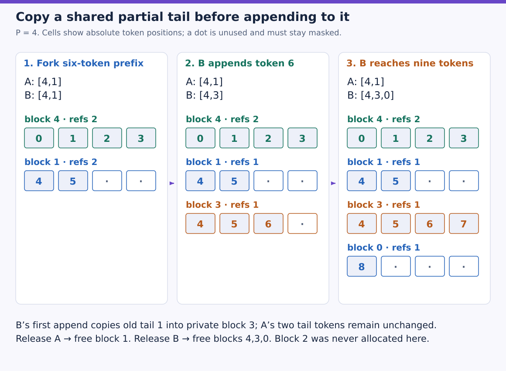

The three panels are consecutive states of the executable pool example. Each row is a physical block, with its reference count above four token slots. Start with two shared blocks. When B appends token 6, it copies the two valid tail entries into block 3 before writing; A still points to unchanged block 1. At nine tokens B fills block 3 and allocates block 0. The final block’s three dots are spare capacity, not valid zero-valued tokens. The release line follows the reference counts so shared prefix block 4 stays alive until B also releases it.

### Run the ownership lifecycle before discussing capacity gains

Download [paged.py](examples/paged.py), run `python paged.py` with PyTorch, or upload it to Colab and run `!python paged.py`. CPU float64 suffices. `Request` owns logical length/table; `Pool` owns physical blocks, reference counts and the free list. All helpers are defined before the worked lifecycle.

```python
"""Logical cache pages, reference counts and copy-on-write; CPU teaching model."""
from dataclasses import dataclass,field
import json
import math
import torch


@dataclass
class Request:
    table:list=field(default_factory=list)
    length:int=0
    active:bool=True


class Pool:
    def __init__(self,block_size=4):
        self.block_size=block_size;self.blocks={};self.refs={}
        self.free=[4,1,3,0,2]

    def allocate(self):
        if not self.free:raise MemoryError('No free physical block')
        block=self.free.pop(0)
        self.blocks[block]=[None]*self.block_size;self.refs[block]=1
        return block

    def append(self,request,key,value):
        if not request.active:raise ValueError('Closed request')
        logical,offset=divmod(request.length,self.block_size)
        if offset==0:
            block=self.allocate();request.table.append(block)
        else:
            block=request.table[logical]
            if self.refs[block]>1:
                old=block;block=self.allocate()
                self.blocks[block][:offset]=list(self.blocks[old][:offset])
                self.refs[old]-=1;request.table[logical]=block
        self.blocks[block][offset]=(key.clone(),value.clone())
        request.length+=1

    def fork(self,request):
        if not request.active:raise ValueError('Closed request')
        for block in request.table:self.refs[block]+=1
        return Request(list(request.table),request.length)

    def materialize(self,request):
        if not request.active or not request.length:raise ValueError('No active tokens')
        rows=[]
        for token in range(request.length):
            logical,offset=divmod(token,self.block_size)
            rows.append(self.blocks[request.table[logical]][offset])
        return torch.stack([r[0] for r in rows]),torch.stack([r[1] for r in rows])

    def release(self,request):
        if not request.active:raise ValueError('Already closed')
        for block in request.table:
            self.refs[block]-=1
            if self.refs[block]==0:
                self.blocks[block]=[None]*self.block_size
                self.free.append(block)
        request.active=False;request.table.clear();request.length=0


def attention(query,k,v):
    return (query@k.T/math.sqrt(k.shape[-1])).softmax(-1)@v


def run_checks():
    torch.manual_seed(127)
    k=torch.randn(9,2,dtype=torch.float64);v=torch.randn(9,3,dtype=torch.float64)
    query=torch.randn(2,dtype=torch.float64)
    pool=Pool();a=Request()
    for i in range(6):pool.append(a,k[i],v[i])
    assert a.table==[4,1]
    b=pool.fork(a);pool.append(b,k[6],v[6])
    assert a.table==[4,1] and b.table==[4,3]
    ak,av=pool.materialize(a);torch.testing.assert_close(ak,k[:6]);torch.testing.assert_close(av,v[:6])
    for i in [7,8]:pool.append(b,k[i],v[i])
    bk,bv=pool.materialize(b)
    torch.testing.assert_close(attention(query,bk,bv),attention(query,k,v))
    assert b.table==[4,3,0] and 0<=len(b.table)*4-b.length<4
    pool.release(a);assert pool.refs[4]==1
    pool.release(b);assert len(pool.free)==5 and all(x==0 for x in pool.refs.values())
    fresh=Request()
    for _ in range(20):pool.append(fresh,k[0],v[0])
    fk,fv=pool.materialize(fresh)
    torch.testing.assert_close(fk,k[0].expand(20,2));torch.testing.assert_close(fv,v[0].expand(20,3))
    before=(list(fresh.table),fresh.length,dict(pool.refs))
    try:pool.append(fresh,k[1],v[1])
    except MemoryError:pass
    else:raise AssertionError('Expected pool exhaustion')
    assert before==(fresh.table,fresh.length,pool.refs)
    try:pool.materialize(a)
    except ValueError:pass
    else:raise AssertionError('Closed request accepted')
    return {'noncontiguous_table':[4,3,0],'paged_contiguous_output_equal':True,
            'partial_tail_copy_on_write':True,'reclaimed_blocks_reused_without_old_tokens':True,
            'exhaustion_preserves_request':True,'last_block_waste':3}


if __name__=='__main__':print(json.dumps(run_checks(),sort_keys=True))
```

The program creates A's `[4,1]` mapping, forks B, copies B's partial tail and grows B to `[4,3,0]` at nine tokens. Gathered paged retrieval matches the contiguous reference. A's prefix remains unchanged. Releasing A preserves block4 while B still references it; releasing B returns all blocks. A fresh20-token request fills every block, proving reuse reads only new entries. A failed21st append leaves the request/table/counts unchanged, and a closed request cannot be read.

This single-process teaching pool is not thread-safe or an actual GPU allocator. It supports append and whole-prefix forks, not arbitrary edits, swapping, persistent prefix hashing or scheduler preemption. Those need additional contracts. The output comparison verifies the final decode query over its valid prefix; it does not benchmark a fused paged kernel.

### Read capacity and roofline bars as conditional consequences

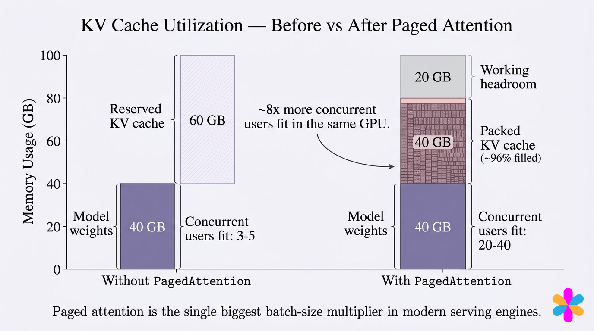

The bars illustrate reservation versus use, but neither a fixed user count nor an eightfold throughput gain follows from paging alone. Context lengths, KV head count, dtype, weight allocation, workspace and scheduling determine capacity. The100-GB schematic is not a verified configuration of a particular accelerator. Retained KV bytes per logical token are unchanged unless another compression method is applied.

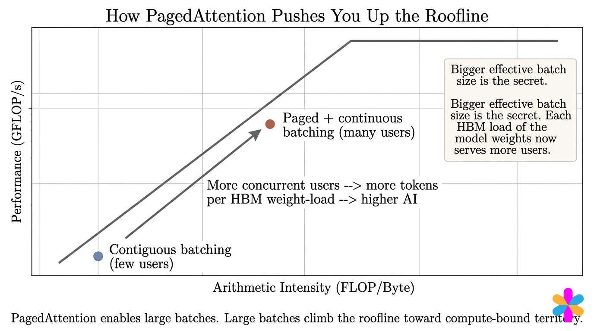

If improved packing permits a scheduler to run a larger useful batch, model-weight reads can be shared across more token computations. That is the route from allocation to throughput; the address table itself does not multiply FLOPs per byte automatically. Continuous batching and paging can complement each other, but continuous batching is not mathematically dependent on this one allocator design.

Local pointer/count/output checks, measured server capacity, per-user latency, deployed vLLM behavior and hosted execution remain separate results. The final topic moves blocks between devices while preserving the same global normalization.

### Predict or explain: Two requests share a half-full last block; can one append in place?

<details data-practice-id="paged-share"><summary>Reveal worked answer and rubric</summary>

It must copy the shared tail first, update its own mapping and reference counts, then write. Otherwise a future mutation can corrupt the other request.

**Rubric:** Distinguish partial-tail copy-on-write from appending after a full block.

</details>


[Implementation and commands](project/implementation.md) · [Readiness and limits](project/readiness.md) · [Transfer review](practice/review.md)

### References

- [Vizuara workshop book](https://vizuaraai.github.io/convolution-musical-journey/book.html), Chapter11 and all ten original allocation/translation/kernel/sharing/utilization figures.
- [Efficient Memory Management for Large Language Model Serving with PagedAttention](https://arxiv.org/html/2309.06180v1), Sections3.1 and4.1–4.4, block tables, reference counts and partial-block copy-on-write.
- Additional worked SVG figures are original to this tutorial; their inputs and calculations follow the complete executable reference above.


## Evidence and proof limits

### Claim ledger

| Claim | Status | Proof limit |
| --- | --- | --- |
| Fixed causal inference can reuse past keys and values while computing the new query rows, with absolute-position visibility and matching model/request state. | verified | Declared deterministic component and local reference checks; no full-model speed or hosted result. |
| Logical-to-physical cache translation preserves retrieval; shared partial tails require copy-on-write and blocks are reclaimed only after their final reference is released. | verified | Stated mathematical assumptions and executed tiny reference; no learner, hosted or full-model result. |

## Sources

- [Vizuara Inference Engineering Chapters 5 and 7](https://vizuaraai.github.io/convolution-musical-journey/book.html) — Complete chapters 5 and 7 and all 23 original figures; checked 2026-10-30
- [Hugging Face How caching works](https://huggingface.co/docs/transformers/cache_explanation) — Cache append, attention shapes and causal positions; checked 2026-10-30
- [Vizuara paged allocation](https://vizuaraai.github.io/convolution-musical-journey/book.html) — Chapter11; all ten figures; checked 2026-10-30
- [PagedAttention](https://arxiv.org/html/2309.06180v1) — Sections3.1 and4.1–4.4; checked 2026-10-30
