# Attention execution: FlashAttention

How can exact attention avoid storing every score and probability?

Learning material for attention-labs. Model implementation/training and learner mastery are separate states.

**Outcomes:** Derive a common-reference merge of partial softmax numerators and denominators.; Separate exact dense arithmetic, intermediate storage and measured runtime..

## FlashAttention: normalize a row without storing the row

A long prefill can run out of memory even when its Q, K and V fit. The extra object is the query-by-key score matrix, followed by a probability matrix of the same size. FlashAttention retains the dense softmax formula while changing where and when those intermediates exist. We will follow the memory arrows, derive the running state, work both tiles, then test the complete computation and its derivatives.

### Locate the expensive intermediate

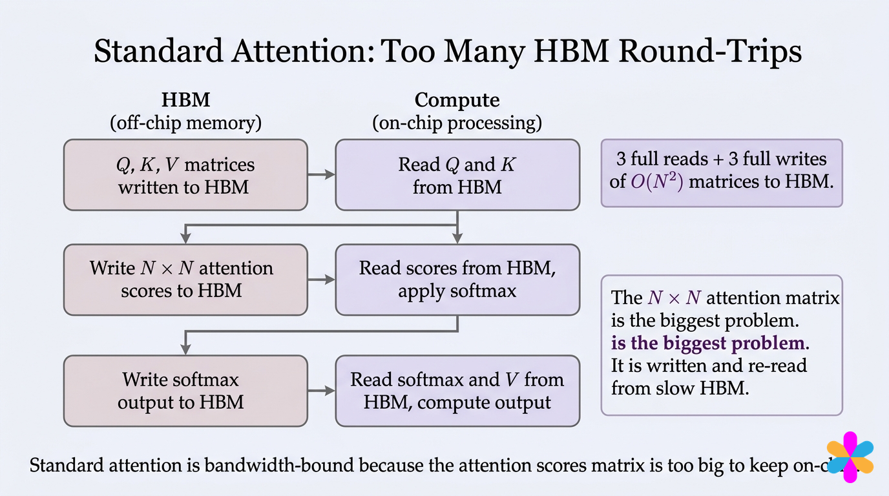

For S query rows and T keys, scores have shape S by T. Q/K comparison produces them, row softmax normalizes them, and multiplication by V consumes them. A straightforward sequence of separate operations writes and reads the scores and probabilities in device memory, HBM. On-chip SRAM is smaller but closer to the computation.

Distinguish two workloads now. Full self-attention prefill has S=T=N, so the intermediate is N squared. One-token cached decode has S=1, so its score row has T entries. It still reads historical K/V, but it does not create a T-by-T score matrix at that step. The square-matrix argument in the pictures concerns prefill/training, not a single cached query.

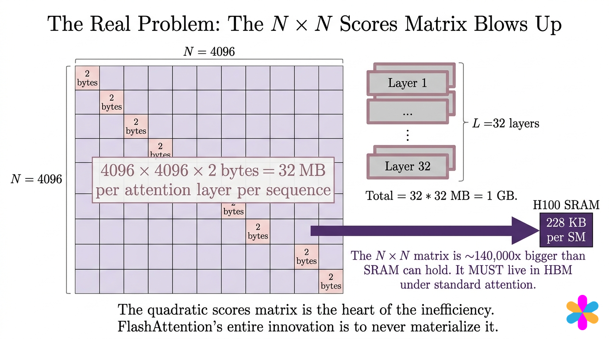

At N=4096 and two bytes per entry, one head's square matrix is 33,554,432 bytes, or 32 MiB. That is about 144 times 228 KiB, not 140,000 times as the annotation states. Multiply by batch and query heads when counting all scores; multiply across layers only if the particular lifetime or traffic accounting requires it. A sum over layers is not automatically simultaneous inference peak storage. The useful observation survives the unit correction: a full score matrix cannot simply stay in a small on-chip workspace.

### Compute a tile and consume it immediately

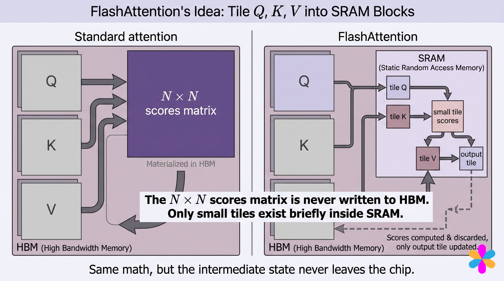

Hold a block of query rows, load a block of keys and its matching values, compute their small score tile and use it to update the query block's output state. Then discard that tile. Repeat until every permitted source key has contributed. Inputs, output and small normalization statistics still exist; the avoided objects are the full S-by-T scores and probabilities.

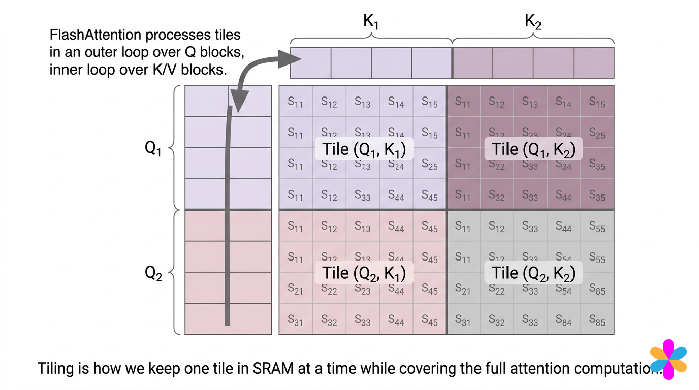

Read rows as query positions and columns as source positions. An eight-by-eight example with four-by-four tiles has two blocks along each axis. The subscripts printed in some individual cells are schematic; the actual cell at row i, column j is always the comparison between $q_i$ and $k_j$. Reversing the order of key tiles must not change the mathematical answer. Causality removes future cells even when their containing tile also includes valid cells.

A tempting mistake is to normalize each tile independently and average its output with the next tile. Each tile has its own denominator; an equally weighted average discards how much total probability mass belongs to it. We need enough state to merge the **unnormalized** contributions.

### Derive the running max, denominator and numerator

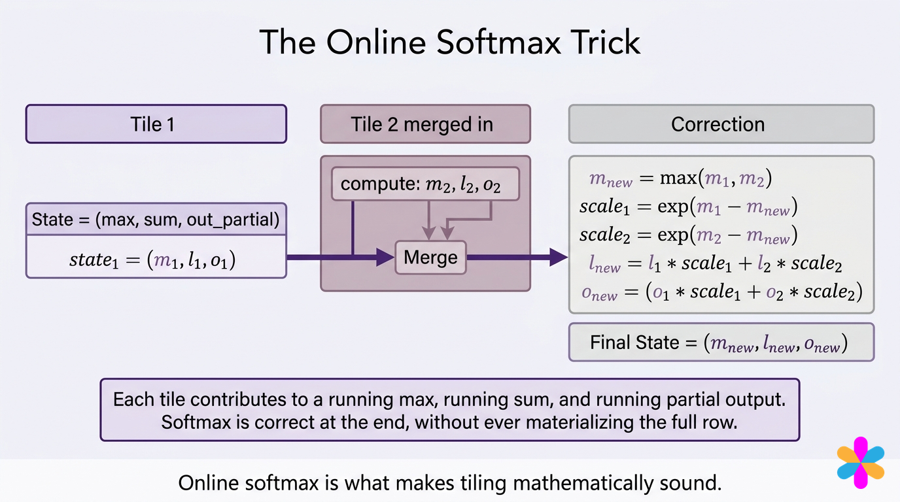

For one query row, after processing a set A of source indices, retain

$$m=\max_{j\in A}s_j,\qquad l=\sum_{j\in A}e^{s_j-m},\qquad u=\sum_{j\in A}e^{s_j-m}v_j.$$

m and l are scalars; u is a vector of value width. The output is u/l. A new block B may contain a larger maximum. Set $m'=\max(m,\max_{j\in B}s_j)$ and $\alpha=e^{m-m'}$. Then

$$l'=\alpha l+\sum_{j\in B}e^{s_j-m'},\qquad u'=\alpha u+\sum_{j\in B}e^{s_j-m'}v_j.$$

Why rescale? Every old exponential used reference m. Multiplying by $e^{m-m'}$ converts $e^{s_j-m}$ into $e^{s_j-m'}$. Both old and new contributions now share one reference, which cancels when we divide. This is ordinary dense softmax, decomposed over blocks.

For the first nonempty block, initialize from that block directly. A fully masked block contributes nothing. Skip it; subtracting negative infinity from negative infinity is undefined and can create NaNs. If an entire query has no visible keys, define a policy explicitly; our teaching reference rejects it.

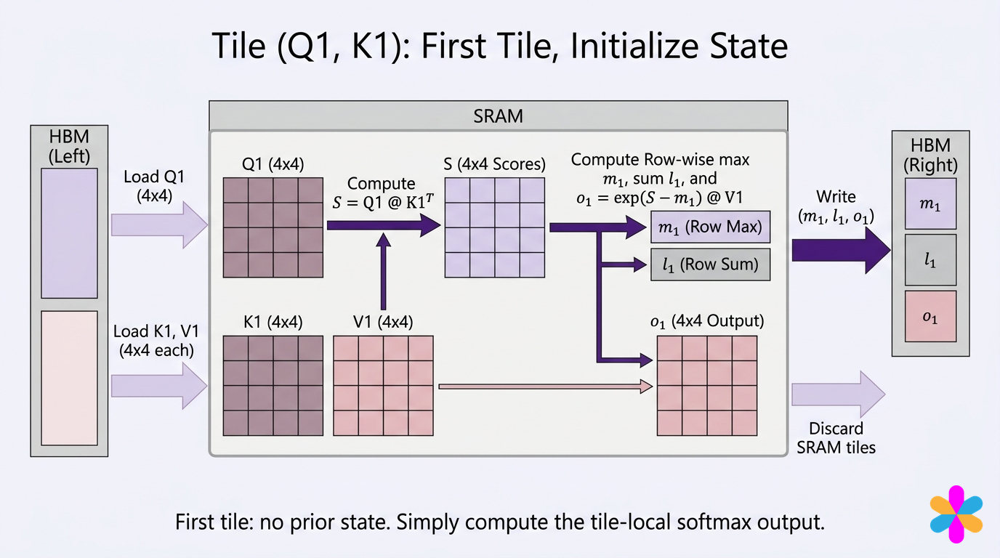

The partial output in our equations is the numerator u, not a normalized context vector. The pictured writeback of state describes one scheduling choice. A query-outer implementation can keep its state while it visits key blocks; the original FA-1 algorithm used a different loop order with state writeback. Neither changes the merge identity.

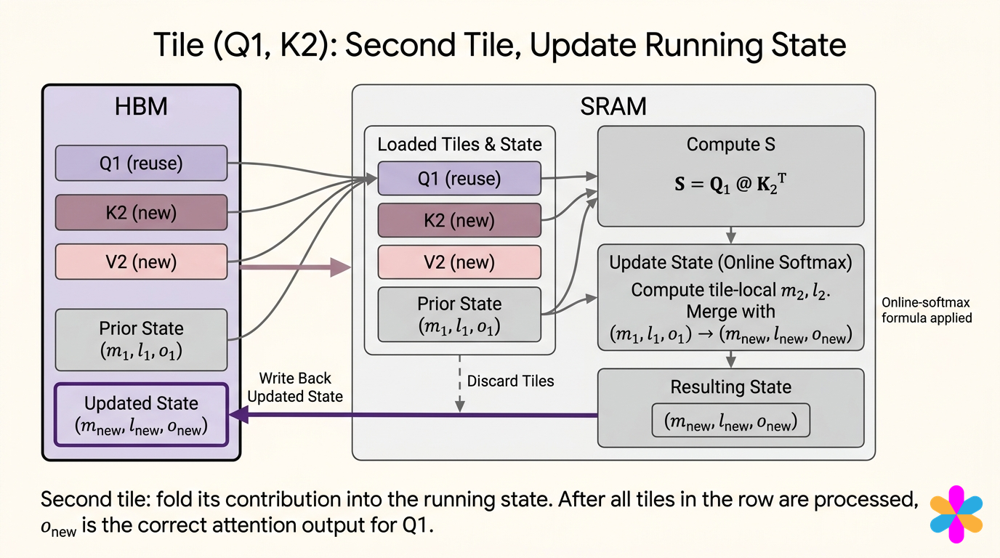

The $1/\sqrt{d_k}$ scale must be included before finding maxima and exponentiating. It is omitted from some schematic score arrows. Changing a scale after softmax is a different operation.

### Predict or explain: Can two block outputs be averaged equally?

<details data-practice-id="flash-merge"><summary>Reveal worked answer and rubric</summary>

Only in the special case that their softmax partition masses are equal. In general merge numerators and denominators after correcting maxima; then divide once.

**Rubric:** Name the lost denominator and the rescaling.

</details>


### Recompute the complete worked row

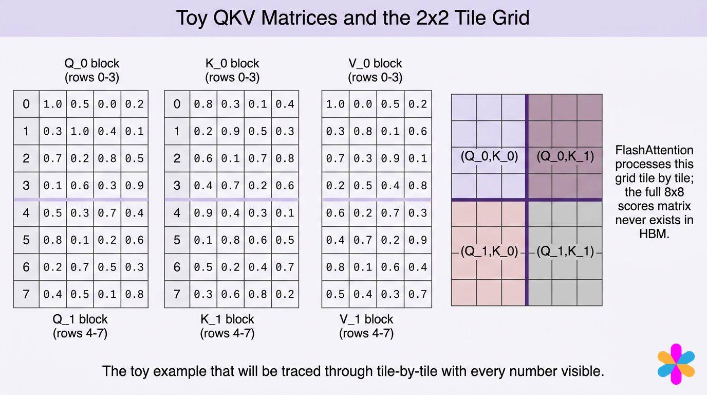

Use every displayed Q/K/V entry in the complete program below. Its first query is `[1,.5,0,.2]`; key width four gives scale one half. The first score is $(1(.8)+.5(.3)+0(.1)+.2(.4))/2=.515$. The second is $(.2+.45+.06)/2=.355$. This corrects the .385 printed in the following trace. The actual row is

$$[.515,.355,.405,.435,\ .560,.300,.370,.320].$$

After the first four keys, $m=.515$, $l=3.671094$ and

$$u=[2.067350,1.412023,1.760712,1.539363].$$

The next block raises the maximum to .560. The old contributions receive $\alpha=e^{.515-.560}=.955997$. After merging, the denominator is 6.894195. Normalizing yields

$$[.571449,.360734,.474255,.485480].$$

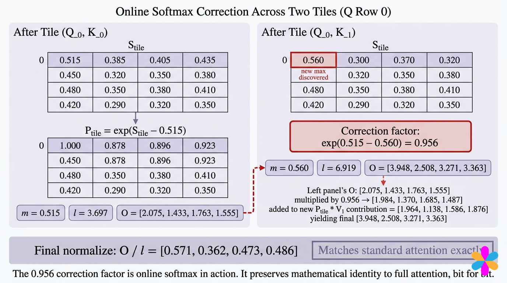

The diagram shows the right correction idea, but its rounded state values and several other row entries do not follow from the displayed Q/K/V. Use the recomputed values above and the executed reference as the numerical contract. Algebraic equivalence does not imply bit-for-bit floating-point equality: a different summation order can produce small rounding differences. We check a declared tolerance.


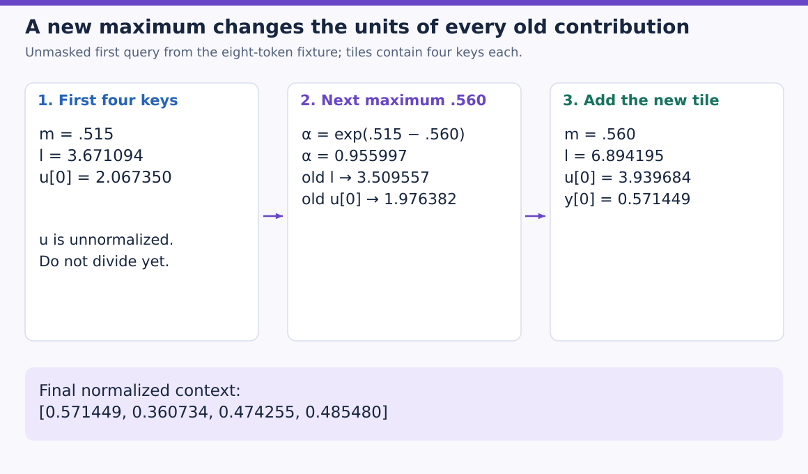

The first panel carries a partial denominator and one coordinate of the unnormalized numerator. In the middle panel both change units by the same factor, about 0.955997. Only then can the new block’s contributions be added. The final division occurs in the right panel; all four output coordinates appear below. This board uses the corrected fixture arithmetic, with all eight keys visible. A causal query at position zero would instead see only its first key.

### Count traffic with one consistent boundary

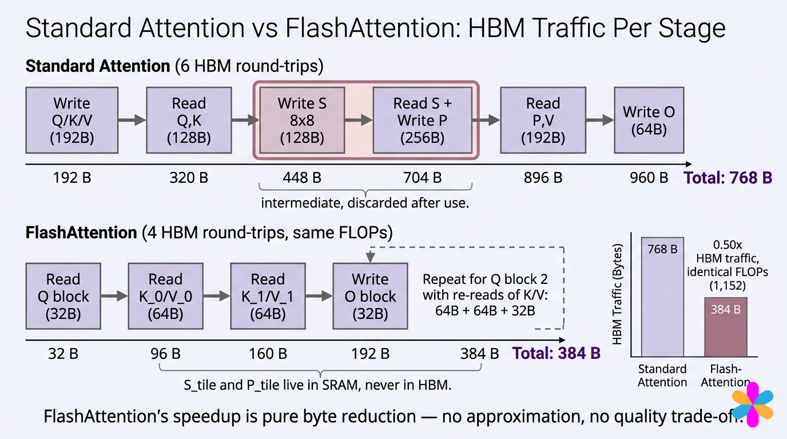

Assume N=8, d=4, two-byte elements, Q/K/V already resident in HBM, two four-row Q blocks, no cache reuse across those Q blocks, and ignore small state transfers. The straightforward three-stage route reads Q/K (128 bytes), writes and reads scores (256), writes and reads probabilities (256), reads V (64) and writes output (64): **768 bytes**. Counting an initial Q/K/V write adds 192 to both appropriately bounded pipelines; the top timeline includes that write while still printing the old total, hence its inconsistent 960/768 labels.

For the query-outer tiled route, Q reads total 64 bytes, K/V reads total 256 bytes because each Q block revisits them, and output writes total 64: **384 bytes** under this simplified ledger. This is a toy accounting example, not a hardware measurement. It does not mean each K/V element is globally read only once. Both GEMMs still perform their dense comparisons and mixtures; there are 1024 multiply/add FLOPs for those two eight-by-eight-by-four products if one multiply/add counts as two. Softmax and bookkeeping add other operations; the picture's 1152 is not a universal kernel FLOP count.


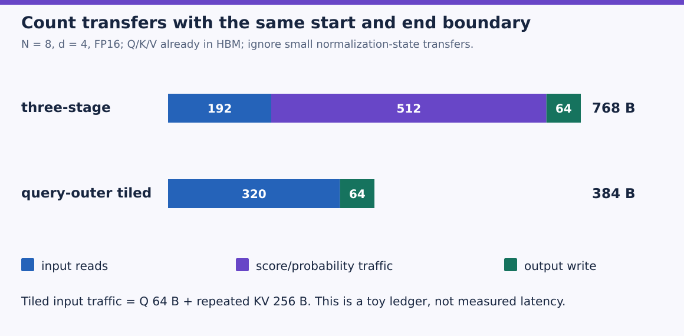

Read colored segments as traffic categories, all on the same byte scale. Purple is the score/probability write-and-read traffic avoided by this tiled schedule. Blue grows from 192 to 320 bytes because each query block revisits K/V. The smaller total follows from the specified ledger, while the dense arithmetic and persistent KV cache remain. Neither bar measures GPU execution time.

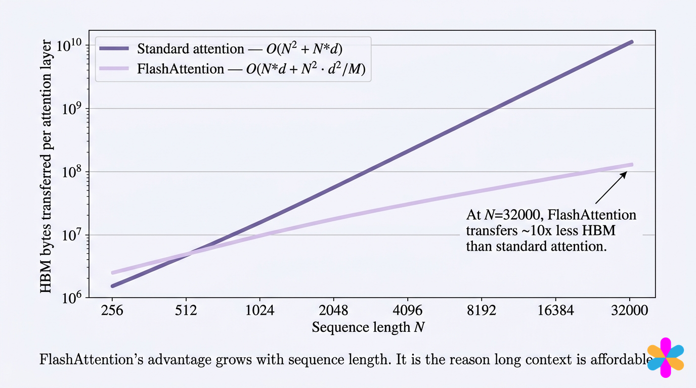

The original analysis compares standard $\Theta(Nd+N^2)$ element transfers with $\Theta(N^2d^2/M)$ in its stated SRAM-capacity range, where M counts elements, not raw bytes. Fixed d and M still leave a quadratic N term. A line drawn nearly straight on one graph does not turn exact dense attention into a linear-time algorithm. Tiling removes full intermediate storage and reduces transfers; it preserves quadratic dense comparison work. Backward recomputes tiles from Q/K and saved normalization statistics rather than saving every probability, exchanging additional arithmetic for reduced memory traffic.

### The same invariant supports different GPU schedules

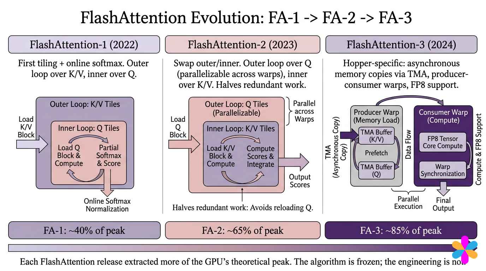

FA-1 established fused tiled attention with online normalization and recomputation. FA-2 reduced non-matmul work and improved partitioning across blocks and warps, including parallelism over query blocks. A change of loop order alone does not explain all of its improvement. FA-3 overlaps data movement, matrix products and softmax using Hopper's asynchronous facilities; its low-precision path adds a separate numerical-error question.

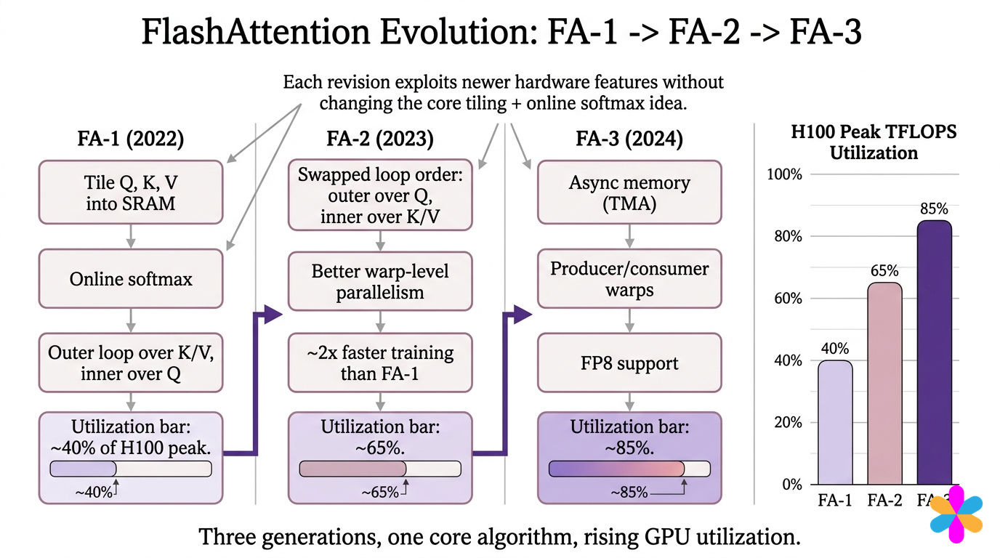

The 40/65/85 percent bars are a schematic teaching comparison, not interchangeable measurements on one verified workload. The primary FA-3 report, for example, states its own H100 settings and FP16/FP8 results. A kernel version, device, dtype, dimensions, mask, forward/backward mode and benchmark method must accompany a real speed comparison. Our CPU reference tests the math only.

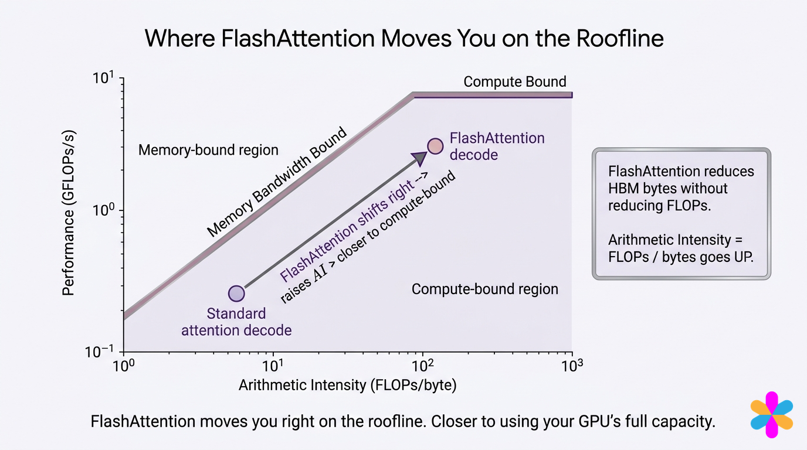

Arithmetic intensity is operations divided by bytes moved. Reducing transfers can move an operating point rightward, but the plotted decode arrow does not establish a universal tenfold change or compute-bound execution. One-query decode has no square probability matrix to eliminate, and whole-model latency includes projections, feed-forward layers and scheduling. The inference cache remains stored; FlashAttention does not compress its token count or feature width.

### Execute the math, masks and derivatives

`dense` establishes the reference formula. `online` visits one query row at a time and configurable key blocks, preserving the running triple. Keeping just one query row makes the invariant easy to inspect; it is not a performant CUDA implementation. The fixture then tests several block widths and both visit orders, causal and full attention, Q/K/V gradients, an offset query chunk and large logits.

Download [flash.py](examples/flash.py), run `python flash.py` with PyTorch, or upload it to Colab and run `!python flash.py`. CPU float64 suffices. Inspect the printed row against the calculation before altering block size.

```python
"""Online tiled softmax mathematics; this is not a CUDA kernel."""
import json
import math
import torch


def dense(q,k,v,causal=False,offset=0):
    scores=q@k.T/math.sqrt(q.shape[-1])
    if causal:
        mask=torch.arange(k.shape[0])[None,:]>offset+torch.arange(q.shape[0])[:,None]
        scores=scores.masked_fill(mask,-torch.inf)
    return scores.softmax(-1)@v


def online(q,k,v,block=4,causal=False,offset=0,reverse=False):
    outputs=[]
    starts=list(range(0,k.shape[0],block))
    if reverse:starts.reverse()
    for i,query in enumerate(q):
        m=None;total=None;numerator=None
        for start in starts:
            stop=min(start+block,k.shape[0])
            ids=torch.arange(start,stop)
            allowed=(ids<=i+offset) if causal else torch.ones_like(ids,dtype=torch.bool)
            if not allowed.any():continue
            keys=k[start:stop][allowed];values=v[start:stop][allowed]
            scores=query@keys.T/math.sqrt(q.shape[-1])
            tile_m=scores.max()
            new_m=tile_m if m is None else torch.maximum(m,tile_m)
            weights=(scores-new_m).exp()
            if m is None:
                total=weights.sum();numerator=weights@values
            else:
                correction=(m-new_m).exp()
                total=correction*total+weights.sum()
                numerator=correction*numerator+weights@values
            m=new_m
        if m is None:raise ValueError('Query has no visible keys')
        outputs.append(numerator/total)
    return torch.stack(outputs)


def run_checks():
    q=torch.tensor([[1,.5,0,.2],[.3,1,.4,.1],[.7,.2,.8,.5],[.1,.6,.3,.9],
                    [.5,.3,.7,.4],[.8,.1,.2,.6],[.2,.7,.5,.3],[.4,.5,.1,.8]],dtype=torch.float64,requires_grad=True)
    k=torch.tensor([[.8,.3,.1,.4],[.2,.9,.5,.3],[.6,.1,.7,.8],[.4,.7,.2,.6],
                    [.9,.4,.3,.1],[.1,.8,.6,.5],[.5,.2,.4,.7],[.3,.6,.8,.2]],dtype=torch.float64,requires_grad=True)
    v=torch.tensor([[1,0,.5,.2],[.3,.8,.1,.6],[.7,.3,.9,.1],[.2,.5,.4,.8],
                    [.6,.2,.7,.3],[.4,.7,.2,.9],[.8,.1,.6,.4],[.5,.4,.3,.7]],dtype=torch.float64,requires_grad=True)
    for causal in [False,True]:
        expected=dense(q,k,v,causal)
        for size in [1,3,4,8]:
            for reverse in [False,True]:
                actual=online(q,k,v,size,causal,reverse=reverse)
                torch.testing.assert_close(actual,expected,atol=1e-12,rtol=1e-12)
        ga=torch.autograd.grad(online(q,k,v,3,causal).square().sum(),(q,k,v),retain_graph=True)
        gb=torch.autograd.grad(expected.square().sum(),(q,k,v),retain_graph=True)
        for a,b in zip(ga,gb):torch.testing.assert_close(a,b,atol=1e-11,rtol=1e-11)
    torch.testing.assert_close(online(q[3:],k,v,3,True,offset=3),dense(q,k,v,True)[3:])
    torch.testing.assert_close(online(q*1000,k,v,3),dense(q*1000,k,v))
    scores=(q[0]@k.T/2).detach();w=(scores-scores.max()).exp()
    first=(scores[:4]-scores[:4].max()).exp()
    return {'scores_row0':scores.tolist(),'first_m':float(scores[:4].max()),
            'first_l':float(first.sum()),'first_u':(first@v[:4].detach()).tolist(),
            'correction':float((scores[:4].max()-scores.max()).exp()),
            'final_l':float(w.sum()),'output_row0':dense(q,k,v).detach()[0].tolist(),
            'outputs_gradients_masks_and_orders_equal':True}


if __name__=='__main__':print(json.dumps(run_checks(),sort_keys=True))
```

The printed row and state match the recomputation above. All dense/online outputs and gradients agree within the specified tolerances. Reversed causal traversal encounters entirely future blocks first and skips them safely. The large-logit probe verifies that subtracting the maximum prevents overflow. Actual CUDA kernel timing, peak allocated GPU memory, backward recomputation savings and hosted Colab execution require separate runs.

### Predict or explain: Does avoiding N-squared storage eliminate N-squared comparisons?

<details data-practice-id="flash-cost"><summary>Reveal worked answer and rubric</summary>

No. Dense attention still compares every allowed query/key pair. Tiling reduces intermediate storage and IO; sparse connectivity changes which pairs are computed.

**Rubric:** Distinguish pair count, storage and IO.

</details>


[Implementation and commands](project/implementation.md) · [Readiness and limits](project/readiness.md) · [Transfer review](practice/review.md)

### References

- [Vizuara workshop book](https://vizuaraai.github.io/convolution-musical-journey/book.html), Chapter 10 and all fourteen original figures.
- [FlashAttention](https://arxiv.org/html/2205.14135v2), Section 3, Algorithm 1 and IO analysis.
- [FlashAttention-2](https://arxiv.org/abs/2307.08691), work partitioning and reduced non-matmul operations.
- [FlashAttention-3](https://arxiv.org/html/2407.08608v2), Introduction and hardware scheduling overview.
- Additional worked SVG figures are original to this tutorial; their inputs and calculations follow the complete executable reference above.


## Evidence and proof limits

### Claim ledger

| Claim | Status | Proof limit |
| --- | --- | --- |
| Common-maximum online accumulation reproduces dense attention including causal masks and derivatives within floating-point tolerance, without retaining the full score matrix. | verified | Stated mathematical assumptions and executed tiny reference; no learner, hosted or full-model result. |

## Sources

- [FlashAttention method](https://arxiv.org/html/2205.14135v2) — Section 3 and Algorithm 1; checked 2026-10-30
- [Vizuara Chapter 10](https://vizuaraai.github.io/convolution-musical-journey/book.html) — Chapter 10; fourteen figures; checked 2026-10-30
- [FlashAttention-2](https://arxiv.org/abs/2307.08691) — Abstract and algorithm overview; checked 2026-10-30
- [FlashAttention-3](https://arxiv.org/html/2407.08608v2) — Introduction; checked 2026-10-30
