# Attention memory: linear attention and selective updates

How can a fixed-size state summarize and revise past associations?

Learning material for attention-labs. Model implementation/training and learner mastery are separate states.

**Outcomes:** Reassociate a chosen positive kernel while preserving its denominator.; Explain prefix state, ownership and information collisions.; Derive positive features with the correct dot-product scaling.; Separate same-feature equality, statistical error and projection-state compatibility.; Derive residual writes and the unit-key overwrite condition.; Trace online regression, key interference and chunk continuation.; Derive decay before prediction and compare affine/residual forms.; Distinguish write strength, forgetting, reset and complete-model state..

## Linear attention: summarize keys and values before a query arrives

A sliding window deliberately forgets old individual entries. Now let every old token contribute to a fixed-size state. The question is what summary lets a new query retrieve a meaningful mixture without revisiting every past key. We will first define a similarity function, then move the parentheses, preserve normalization, and turn the result into a recurrence.

### The parentheses can move only after the similarity is specified

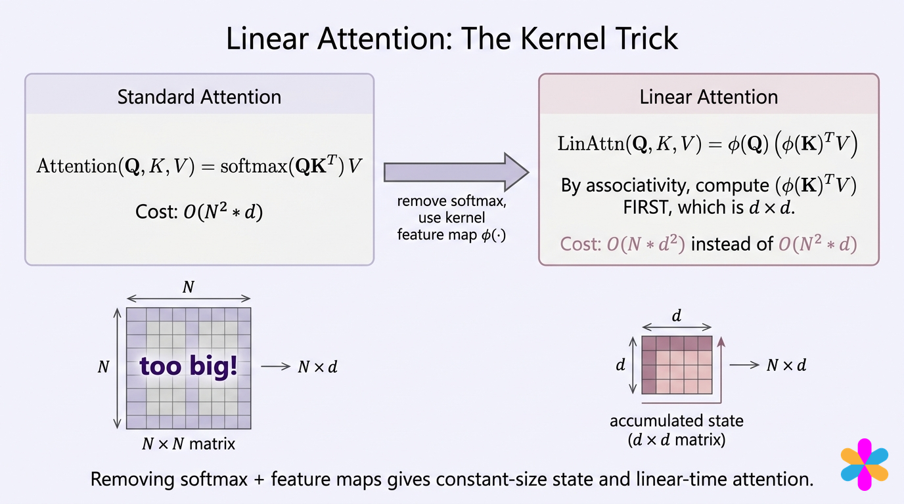

Dense softmax attention uses similarities $e^{q_i k_j^\top/\sqrt{d_k}}$, normalized across source j. You cannot simply replace $\operatorname{softmax}(QK^\top)V$ by $Q(K^\top V)$: softmax is nonlinear. The left complexity annotation should be $O(N^2d)$ for full prefill, not $O(Nd)$; one-query decode is a separate case.

Choose instead a positive kernel with a finite feature map $\phi:\mathbb R^{d_k}\to\mathbb R^F$:

$$\kappa(q,k)=\phi(q)\phi(k)^\top,\qquad y_i=\frac{\sum_j\kappa(q_i,k_j)v_j}{\sum_j\kappa(q_i,k_j)}.$$

The numerator can be reassociated:

$$\sum_j\phi(q_i)\phi(k_j)^\top v_j=\phi(q_i)\left(\sum_j\phi(k_j)^\top v_j\right).$$

The object in parentheses has shape F by dv, independent of the number of source tokens. Keep a second F-vector $z=\sum_j\phi(k_j)$ for the denominator. The diagram's formula displays only the numerator; omitting z would change the output scale as history grows.

The original linear-transformer paper uses $\phi(x)=\operatorname{ELU}(x)+1$, applied coordinatewise. For nonnegative x, this is x+1; for negative x, it is $e^x$. It gives positive features in exact arithmetic. This kernel is a different function from the exponential dot-product kernel. Performer, next, instead approximates that exponential kernel with random features.

### Write one association, then a second

Use already mapped key features $[1,2]$ and $[2,1]$, with scalar values 2 and 4. These correspond to raw nonnegative keys `[0,1]` and `[1,0]` under ELU+1. Start S as two zeros and z as `[0,0]`.

The first outer product adds `[2,4]` to S and `[1,2]` to z. Every normalized query with positive similarity returns the only visible value, 2. The second outer product adds `[8,4]`. Now

$$S=\begin{bmatrix}10\\8\end{bmatrix},\qquad z=[3,3].$$

For query feature `[1,3]`, the numerator is $1(10)+3(8)=34$ and the denominator is $1(3)+3(3)=12$. The result is $17/6=2.833333$. Check the explicit retrieval view: the two similarities are 7 and 5, so weights are 7/12 and 5/12 and the mixture is $(7(2)+5(4))/12$. The stored state and the explicit pairwise computation agree.


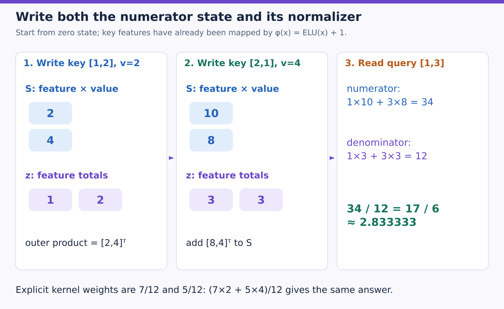

Blue cells hold value-weighted sums, while purple cells count key-feature mass. The second token changes both objects. Follow the two coordinates separately: S becomes `[2+8,4+4]`, and z becomes `[1+2,2+1]`. The right panel contracts the same query with each state. Dividing their results is essential; returning 34 alone would grow with unnormalized accumulated mass.

This also corrects a common intuition: additive state updates do **not** make all tokens equally weighted for every query. The weights depend on the query/key feature match. What the simple additive rule lacks is a separate learned erase or correction mechanism for an association already stored.

### Predict or explain: If all values are3, what should normalized retrieval return as history grows?

<details data-practice-id="linear-normalize"><summary>Reveal worked answer and rubric</summary>

3 whenever the denominator is positive. Without the normalizer, the numerator grows with accumulated similarity mass.

**Rubric:** Explain numerator/denominator cancellation.

</details>


### Causality becomes a prefix state

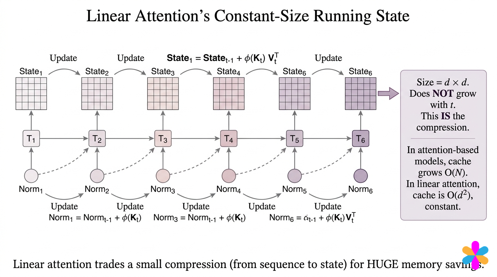

For self-inclusive causal attention, update before reading:

$$S_t=S_{t-1}+\phi(k_t)^\top v_t,\quad z_t=z_{t-1}+\phi(k_t),\quad y_t=\frac{\phi(q_t)S_t}{\phi(q_t)z_t}.$$

Reading before the update excludes the current token and gives a different causal convention. The matrix-state and vector-normalizer paths have different jobs; the diagram's final normalizer label accidentally includes a value term. z sums key features only. State indices should progress once per token.

A full training sequence can compute prefix sums, while generation carries only the current S,z between steps. Our simple autograd loop saves its computational graph when gradients are requested; it does not implement the paper's memory-efficient custom backward. Constant retained **inference** state does not mean the naive training graph has constant memory.

### Count state dimensions instead of comparing incompatible bars

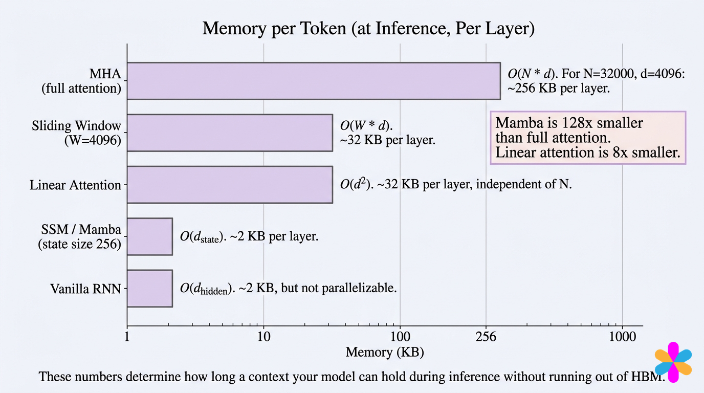

For B batches, H heads, F kernel features, value width dv and element size s, the retained state is $BH(Fd_v+F)s$ bytes per layer. At B=H=1,F=dv=128,float32, that is 66,048 bytes, or 64.5 KiB. A corresponding ordinary KV cache at T=32768,dk=dv=128,float32 is 32 MiB per head per layer. Count every head and layer when comparing whole models.

The picture mixes per-token, per-layer and per-sequence labels, so its KB numbers and universal ratios are not a consistent allocation ledger. The precise formulas above define our comparison. A state-space model's state shape depends on its channels and internal dimensions; its label cannot be substituted for F-by-dv without defining that architecture.

### A bounded summary can merge distinct histories

Suppose every key feature is the scalar1. Histories with scalar values `[1,3]` and `[2,2]` both yield S=4,z=2. Every later query sees the same state and normalized answer2, although the histories differ. The state has no separately addressable row that tells us the first history's most recent value was3.


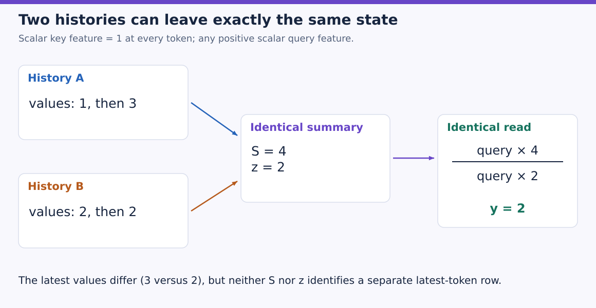

Each arrow into the central box represents accumulating a complete history. The values arrive in different sequences, but the state records only their sum and total key-feature mass in this scalar fixture. Every positive query cancels between numerator and denominator and returns 2. A larger fixed matrix can express more associations, but this example shows why a summary is not an individually addressable list of old tokens.

Positive features do not make values nonnegative: signed value contributions can cancel. Conversely, a blanket statement that positive kernel keys point in opposite directions is inappropriate for this feature map. The concrete collision above demonstrates the information limit without relying on that explanation.

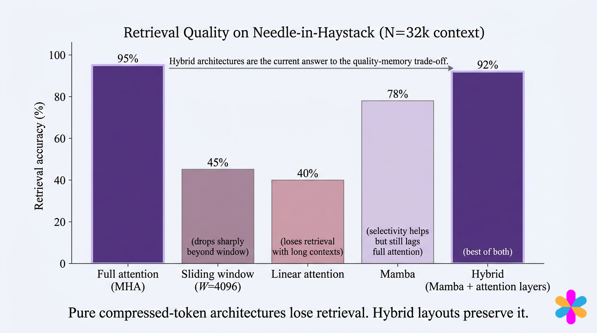

These percentages are explicitly a stylized comparison in the workshop, not a common controlled benchmark we reproduced. They motivate testing exact fact retrieval, recency, repeated conflicting facts and long gaps. They do not establish that every linear model has 40 percent accuracy or every hybrid has 92 percent. Quality depends on training, architecture and the task. Delta-rule updates later address one specific problem: revising what the state predicts for a repeated key.

### Run both the pairwise and recurrent computations

`parallel` forms a kernel similarity matrix, removes future entries, then normalizes. `recurrent` instead accumulates S,z, reads the query and returns the final state for a later chunk. It never needs the full kernel matrix. The two paths test the **same kernel**, not equality to softmax attention.

Download [linear.py](examples/linear.py), run `python linear.py` with PyTorch, or upload it to Colab and run `!python linear.py`. CPU float64 is sufficient. The complete program includes all functions and declared inputs.

```python
"""Normalized positive-kernel attention: parallel and recurrent references."""
import json
import torch
import torch.nn.functional as F


def phi(x):return F.elu(x)+1


def parallel(q,k,v):
    weights=phi(q)@phi(k).T
    weights=weights.tril()
    return (weights@v)/weights.sum(-1,keepdim=True)


def recurrent(q,k,v,state=None):
    if state is None:
        s=q.new_zeros(q.shape[-1],v.shape[-1]);z=q.new_zeros(q.shape[-1])
    else:s,z=state
    outputs=[]
    for query,key,value in zip(phi(q),phi(k),v):
        s=s+torch.outer(key,value);z=z+key
        denominator=query@z
        if not denominator>0:raise ValueError('Nonpositive denominator')
        outputs.append((query@s)/denominator)
    return torch.stack(outputs),(s,z)


def run_checks():
    q=torch.tensor([[0.,0.],[0.,2.]],dtype=torch.float64)
    k=torch.tensor([[0.,1.],[1.,0.]],dtype=torch.float64)
    v=torch.tensor([[2.],[4.]],dtype=torch.float64)
    hand,state=recurrent(q,k,v)
    torch.testing.assert_close(hand,torch.tensor([[2.],[17/6]],dtype=torch.float64))
    torch.manual_seed(97)
    q,k,v=[torch.randn(7,3,dtype=torch.float64,requires_grad=True) for _ in range(3)]
    a,state=recurrent(q,k,v);b=parallel(q,k,v)
    torch.testing.assert_close(a,b)
    ga=torch.autograd.grad(a.square().sum(),(q,k,v),retain_graph=True)
    gb=torch.autograd.grad(b.square().sum(),(q,k,v))
    for x,y in zip(ga,gb):torch.testing.assert_close(x,y)
    first,s=recurrent(q[:3],k[:3],v[:3]);later,_=recurrent(q[3:],k[3:],v[3:],s)
    torch.testing.assert_close(torch.cat([first,later]),a)
    modified=v.detach().clone();modified[-1]+=100
    torch.testing.assert_close(recurrent(q,k,modified)[0][:-1],a[:-1])
    fresh,_=recurrent(q[3:],k[3:],v[3:])
    assert not torch.allclose(fresh,later)
    # Even a one-dimensional summary can collapse distinct histories.
    keys=torch.ones(2,1,dtype=torch.float64)
    left=keys.T@torch.tensor([[1.],[3.]],dtype=torch.float64)
    right=keys.T@torch.tensor([[2.],[2.]],dtype=torch.float64)
    torch.testing.assert_close(left,right)
    return {'worked_outputs':hand.flatten().tolist(),'state_elements_per_head':12,
            'parallel_recurrent_outputs_gradients_chunks_equal':True,
            'future_and_reset_checks':True,'distinct_histories_can_collide':True}


if __name__=='__main__':print(json.dumps(run_checks(),sort_keys=True))
```

Expected outputs include `[2,2.8333333333333335]`,12 retained scalar elements for the three-feature/three-value random case, equal outputs/gradients across both paths and equal chunked continuation. Changing the final value leaves earlier results unchanged. Starting a new state for the later chunk differs from continuation, illustrating why request ownership and deliberate resets matter.

A positive denominator is required; the reference rejects a nonpositive one rather than silently altering the formula. Extreme floating-point feature values can still underflow/overflow. Production kernels need a declared stabilization and accumulation policy. Actual GPU speed, custom-backward memory, model quality and hosted execution remain separate checks.

### Predict or explain: Does parallel/recurrent equality prove equality to softmax attention?

<details data-practice-id="linear-collision"><summary>Reveal worked answer and rubric</summary>

No. It proves two evaluations of the same selected kernel. ELU+1 similarities differ from exponentiated dot products.

**Rubric:** Separate exact reassociation from changing the kernel.

</details>


[Implementation and commands](project/implementation.md) · [Readiness and limits](project/readiness.md) · [Transfer review](practice/review.md)

### References

- [Vizuara workshop book](https://vizuaraai.github.io/convolution-musical-journey/book.html), Sections9.3 and9.6; original kernel, state and comparison figures.
- [Transformers are RNNs](https://arxiv.org/html/2006.16236v3), Sections3.2–3.4, normalized kernel formulation and recurrence.
- Additional worked SVG figures are original to this tutorial; their inputs and calculations follow the complete executable reference above.


## Performer: approximate the kernel, then reuse the state

The previous lesson chose ELU+1 similarity. That enabled a small recurrent state but changed the attention kernel. Performer instead asks whether the exponential dot-product similarities behind softmax can be estimated with positive finite features. Keep two questions separate throughout: how accurately those features estimate softmax, and whether two computations of the selected feature approximation agree.

### Read the multiplication order and its missing normalizer

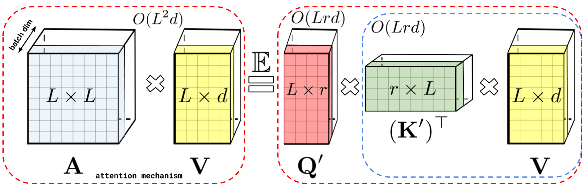

On the left, L-by-L similarities multiply L-by-d values. On the right, key features are combined with V first, producing an r-by-d state, then query features read it. The dashed blue box identifies the product to compute first. The diagram depicts the unnormalized numerator; normalized retrieval also needs the corresponding feature sum. This is the same S,z structure from linear attention, with a new feature map.

For raw query/key width d, let $x=q/d^{1/4}$ and $y=k/d^{1/4}$. Then $x\cdot y=q\cdot k/\sqrt d$. Scaling **both** inputs by the fourth root is necessary; dividing both by the square root would apply too much scaling.

### Derive a positive random feature

For a Gaussian vector $\omega\sim\mathcal N(0,I)$, define

$$f_\omega(x)=\exp(\omega\cdot x-\|x\|^2/2).$$

The Gaussian moment identity gives

$$\mathbb E[f_\omega(x)f_\omega(y)]
=e^{-(\|x\|^2+\|y\|^2)/2}\mathbb E[e^{\omega\cdot(x+y)}]
=e^{x\cdot y}.$$

With r samples, form $\phi(x)_a=f_{\omega_a}(x)/\sqrt r$. Their dot product is an average of r positive products, estimating the exponential kernel. Every finite sample gives positive similarities in exact arithmetic. That helps keep normalization meaningful, although floating-point exponentials can still overflow or underflow.

Check a hand example where d=1, x=1, y=0 and two selected directions are +1 and -1. The feature dot product is

$$\tfrac12(e^{1-.5}+e^{-1-.5})=.935925,$$

whereas the true kernel is $e^{1(0)}=1$. This deliberately chosen two-direction example is an arithmetic illustration, not a Gaussian-distributed estimator. It shows why a finite feature calculation is not exact softmax even when every operation is implemented correctly. At x=y=0, every component is $1/\sqrt r$, so the estimated kernel is exactly1 for any projection samples.


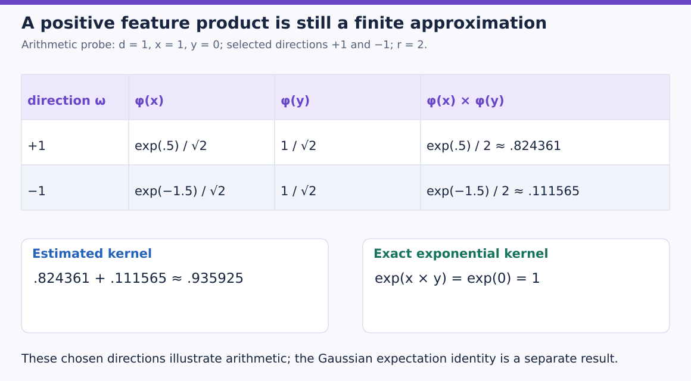

Each row is one feature coordinate. The factor 1/√2 appears in both vectors, so their product carries 1/2. Sum the two positive products to obtain the estimate, then compare it with the exact kernel in the green panel. A positive result can still have approximation error. The rounded products may sum to 0.935926; the displayed total is rounded after summing the unrounded exponentials.

### Predict or explain: Why divide both raw Q and K by d to the one-quarter power?

<details data-practice-id="performer-scale"><summary>Reveal worked answer and rubric</summary>

Their dot product then divides by sqrt(d), matching scaled dot-product attention. Dividing both by sqrt(d) would divide the dot product by d.

**Rubric:** Account for both factors.

</details>


### Why positive and orthogonal both appear in FAVOR+

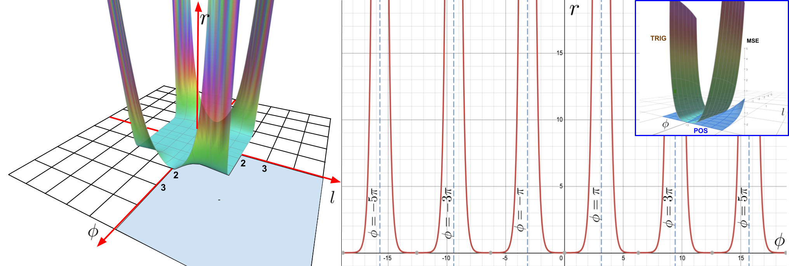

Read the left surface as the error ratio across angle and length, the center as a fixed-length angular slice, and the inset as the two errors in a small-kernel region. The plotted ratio is estimator MSE, not downstream model accuracy or output latency. Signed sine/cosine approximations can produce negative estimated similarities or problematic denominator cancellation; positive features address that issue for this kernel construction.

Orthogonal directions reduce redundant sampling. At most d vectors can be mutually orthogonal in d dimensions, so for r>d our reference creates independent orthogonal blocks. A Gaussian vector has both a uniform direction and a random radius. QR alone returns unit-length directions; multiply each by an independent Gaussian-vector norm to preserve Gaussian radial marginals. Setting every radius to $\sqrt d$ instead corresponds to a related regularized construction, not the same Gaussian-marginal estimator.

`orthogonal_features` therefore draws a square Gaussian matrix, takes QR, corrects column signs, transposes to row directions and attaches independent radii. Rows within each block are orthogonal; rows across different blocks need not be. The code checks this property before using the features.

### Normalize the estimated similarities before interpreting their output

With a fixed sampled projection matrix, update $S_t=S_{t-1}+\phi(k_t)^\top v_t$ and $z_t=z_{t-1}+\phi(k_t)$, then return $\phi(q_t)S_t/(\phi(q_t)z_t)$. This is exactly the recurrent evaluation of that sample's finite kernel. It approximates normalized softmax retrieval because the kernel itself is estimated.

Even an unbiased estimate of each unnormalized similarity does not make a ratio of random numerator and denominator an unbiased output estimator. Nor does it guarantee an error threshold for every finite seed and query. Increasing features improves statistical estimates under stated assumptions; one particular sample's error need not decrease monotonically.

The sampled matrix is part of the state contract. Redrawing it halfway through a cached sequence changes the coordinates in which old S,z were accumulated. Rebuild the state when changing the projection, or use an explicitly derived compatible transformation. Save the projection/seed and feature convention with any reusable state.

### Execute equality and approximation as different checks

Download [performer.py](examples/performer.py), run `python performer.py` with PyTorch, or upload it to Colab and run `!python performer.py`. CPU float64 is sufficient. The complete reference includes orthogonal sampling, feature construction, pairwise finite-kernel normalization, recurrent evaluation and the exact softmax reference.

```python
"""Positive orthogonal random features; small float64 reference, not a fused kernel."""
import json
import math
import torch


def orthogonal_features(count,width,seed):
    generator=torch.Generator().manual_seed(seed);blocks=[]
    for _ in range(math.ceil(count/width)):
        a=torch.randn(width,width,generator=generator,dtype=torch.float64)
        q,r=torch.linalg.qr(a)
        signs=torch.where(r.diag()<0,-1.,1.)
        directions=(q*signs).T
        radii=torch.randn(width,width,generator=generator,dtype=torch.float64).norm(dim=1)
        blocks.append(directions*radii[:,None])
    return torch.cat(blocks)[:count]


def features(x,omega):
    x=x/(x.shape[-1]**.25)
    exponent=x@omega.T-x.square().sum(-1,keepdim=True)/2
    return exponent.exp()/math.sqrt(len(omega))


def pairwise(qf,kf,v):
    a=(qf@kf.T).tril()
    return (a@v)/a.sum(-1,keepdim=True)


def recurrent(qf,kf,v,state=None):
    s,z=(qf.new_zeros(qf.shape[-1],v.shape[-1]),qf.new_zeros(qf.shape[-1])) if state is None else state
    out=[]
    for q,k,value in zip(qf,kf,v):
        s=s+torch.outer(k,value);z=z+k
        out.append((q@s)/(q@z))
    return torch.stack(out),(s,z)


def softmax_reference(q,k,v):
    scores=q@k.T/math.sqrt(q.shape[-1])
    return scores.masked_fill(torch.ones_like(scores,dtype=torch.bool).triu(1),-torch.inf).softmax(-1)@v


def run_checks():
    torch.manual_seed(101)
    q=(torch.randn(6,4,dtype=torch.float64)*.3).requires_grad_()
    k=(torch.randn(6,4,dtype=torch.float64)*.3).requires_grad_()
    v=torch.randn(6,2,dtype=torch.float64,requires_grad=True)
    omega=orthogonal_features(64,4,7)
    units=omega[:4]/omega[:4].norm(dim=1,keepdim=True)
    torch.testing.assert_close(units@units.T,torch.eye(4,dtype=torch.float64))
    qf,kf=features(q,omega),features(k,omega)
    assert (qf>0).all() and (kf>0).all()
    a,state=recurrent(qf,kf,v);b=pairwise(qf,kf,v)
    torch.testing.assert_close(a,b)
    ga=torch.autograd.grad(a.square().sum(),(q,k,v),retain_graph=True)
    gb=torch.autograd.grad(b.square().sum(),(q,k,v),retain_graph=True)
    for x,y in zip(ga,gb):torch.testing.assert_close(x,y)
    first,s=recurrent(qf[:2],kf[:2],v[:2]);later,_=recurrent(qf[2:],kf[2:],v[2:],s)
    torch.testing.assert_close(torch.cat([first,later]),a)
    target=softmax_reference(q,k,v)
    errors={}
    for count in [16,64,256]:
        errors[count]=[]
        for seed in range(4):
            w=orthogonal_features(count,4,seed)
            result,_=recurrent(features(q,w),features(k,w),v)
            errors[count].append(float((result-target).abs().mean().detach()))
    return {'output_mae_by_features_and_seeds':errors,'same_feature_outputs_gradients_chunks_equal':True,
            'orthogonal_within_blocks':True,'state_elements_at_64_features':192}


if __name__=='__main__':print(json.dumps(run_checks(),sort_keys=True))
```

For the fixed six-token fixture, pairwise and recurrent feature outputs, Q/K/V gradients and chunk continuation agree. That is the equality check. Against exact causal softmax, mean absolute output errors across seeds0–3 are:

| Features r | Seed0 | Seed1 | Seed2 | Seed3 |
| --- | --- | --- | --- | --- |
|16|.018012|.120389|.037320|.013626|
|64|.008472|.039542|.009077|.013935|
|256|.004816|.010569|.005387|.002583|

These are tiny-component results, not task accuracy. Seed3 slightly worsens from16 to64, demonstrating why we do not assert monotonicity for a single draw. At r=64,dv=2, the state contains $64(2+1)=192$ scalar elements per head. Raising r buys sampling capacity while increasing state size and work.

This reference uses direct exponentials and bounded inputs to expose the derivation. A performant FAVOR+ implementation also needs numerical stabilization, efficient scans/backward and a projection-redraw policy during training. A per-query common feature scale cancels in its normalized output; arbitrary per-key scales change relative source weights unless compensated consistently. Do not stabilize a recurrence by rescaling new keys while leaving old state in incompatible units.


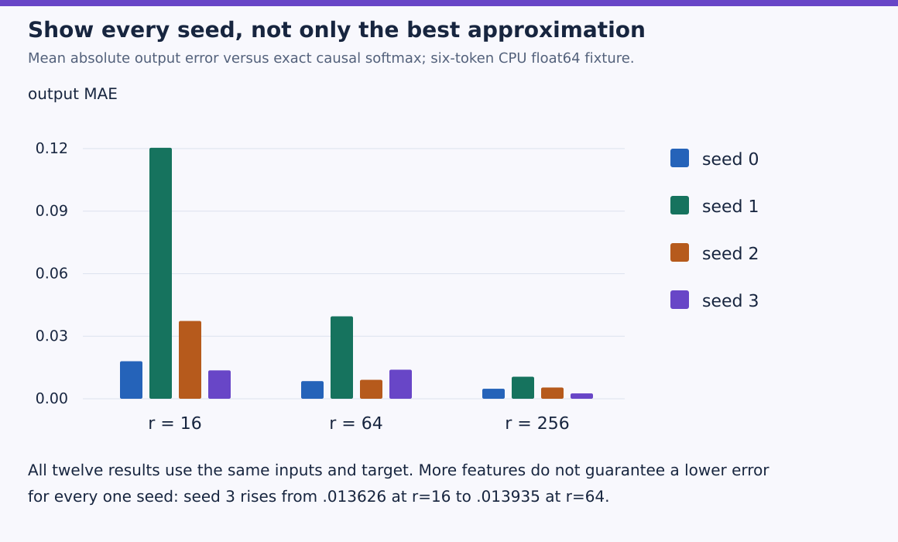

The horizontal groups change feature count; color identifies the same seed across groups. Height is output MAE, not model accuracy or runtime. Seed 1 is the tallest at every count in this fixture, while seed 3’s small increase from 16 to 64 features shows why one finite draw need not improve monotonically. The runnable reference prints every value used here. Its exact pairwise/recurrent equality check holds within each fixed feature sample; the bars test that sample against a different target, exact softmax.

### Predict or explain: Can you redraw random projections and keep the old recurrent state?

<details data-practice-id="performer-state"><summary>Reveal worked answer and rubric</summary>

Not directly. S,z encode the old feature coordinates; rebuild them or derive a compatible transformation. Same-feature equality does not prove exact softmax output.

**Rubric:** Name the representation dependency and approximation boundary.

</details>


The next lesson changes the write rule itself. Instead of always adding another association, DeltaNet reads what memory already predicts and writes the residual needed to correct it.

[Implementation and commands](project/implementation.md) · [Readiness and limits](project/readiness.md) · [Transfer review](practice/review.md)

### References

- [Rethinking Attention with Performers](https://arxiv.org/html/2009.14794v4), Sections2.2–2.4, Lemma1 and Figures1–2. Both original primary-author figures are included with every panel. This topic uses the primary method source because a matching public Vizuara lesson was not available.
- Additional worked SVG figures are original to this tutorial; their inputs and calculations follow the complete executable reference above.


## DeltaNet: read the old association before writing the correction

A fixed matrix can summarize a long history, but an additive write does not know whether the same association is already present. Suppose the current value for a key changes from2 to5. Adding5 on top of2 produces7. DeltaNet first retrieves the old prediction, compares it with5, and writes only the correction. Follow those three operations before naming the matrix recurrence.

### Start from the cost and the retained object

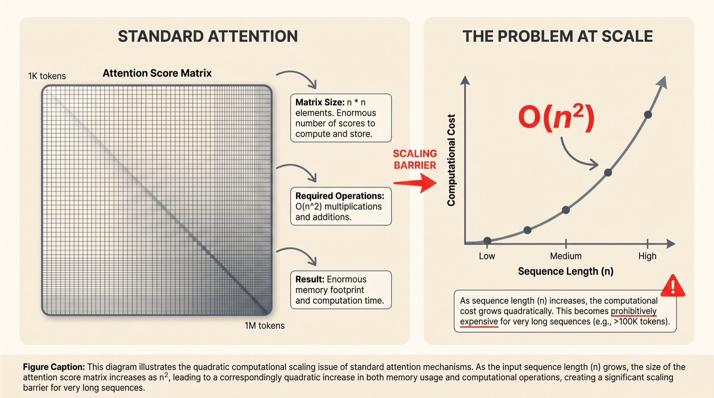

The square-matrix picture concerns a full sequence computation. A single cached decode query has a one-by-T score row and linear historical KV traffic. FlashAttention avoids materializing the square intermediate without removing dense comparisons; DeltaNet instead changes the history representation and read/write function. These solve different problems.

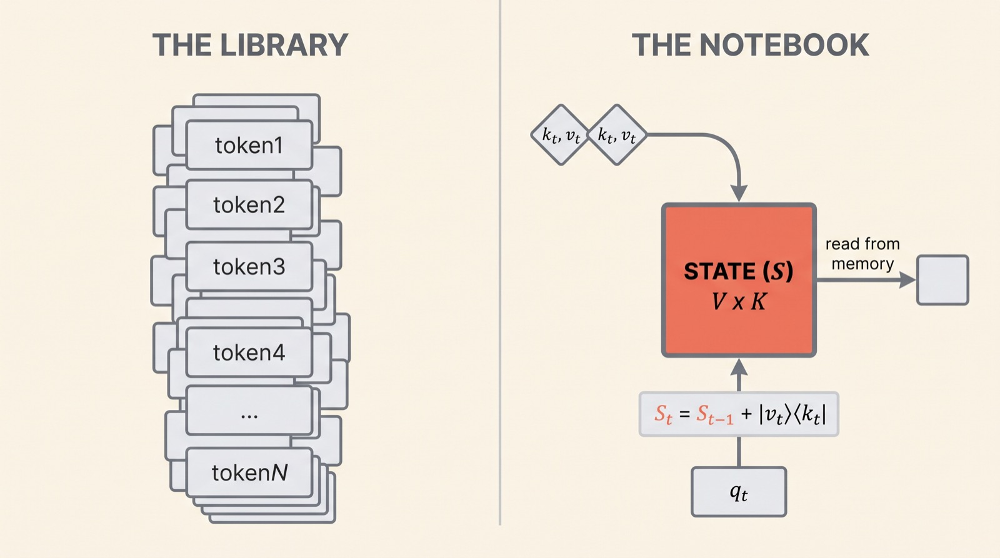

Think of S as a small learned associative memory. We use row-vector convention with S shaped dk-by-dv: a key k predicts `k @ S`, and a query q reads `q @ S`. The drawing uses the transposed value-by-key convention, so its $vk^\top$ update becomes $k^\top v$ in ours. Both are valid when used consistently. A query reads state; key and value define a write. The query arrow should not be interpreted as replacing the key in the outer product.

Unlike normalized positive-kernel retrieval, this DeltaNet reference does not carry a z denominator. It follows the delta-rule fast-memory formulation with normalized queries/keys and direct matrix readout. Do not silently attach the preceding lesson's normalizer and claim the same architecture.

### Predict, compare, correct

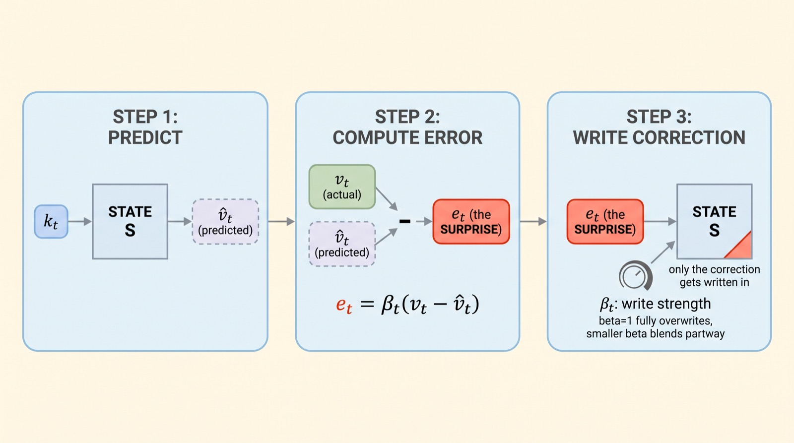

For current k,v and write strength $\beta\in[0,1]$:

$$\hat v=kS_{old},\qquad e=v-\hat v,\qquad S_{new}=S_{old}+\beta k^\top e.$$

The learned model produces beta from its input; our tiny reference supplies beta explicitly. A beta of zero leaves the state unchanged. A beta of one applies the full residual outer product. This is a state update inside a forward pass, not a change to the model's learned projection parameters at inference.

Use dk=2,dv=1 and key `[1,0]`. Start S=`[0,0]` as a column. First value2 with beta1 gives S=`[2,0]`. A later value5 at the same key predicts2, residual3, and adds `[3,0]`, giving S=`[5,0]`. Read with query `[1,0]` and obtain5. With beta one quarter on the second write, add only .75 and obtain2.75. With zero beta, it stays2.

The additive rule would instead reach7. A normalized additive kernel at this repeated key would average to3.5. These are three different update/read functions; the desired behavior determines which comparison is meaningful.


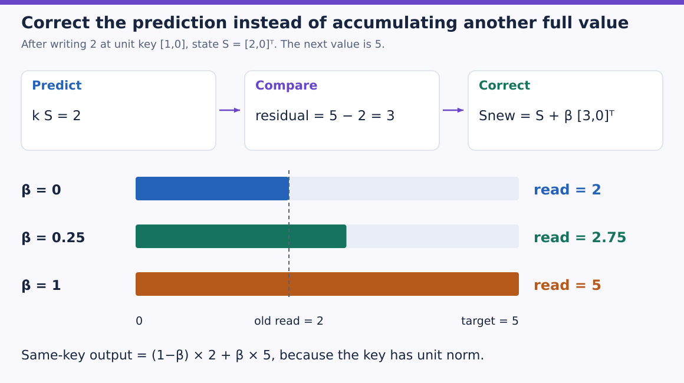

The top row follows the three operations in order. In the lower bars the dashed line marks the old read, 2, on the common 0–5 scale. Beta zero keeps it, beta one quarter adds 0.75, and beta one adds the complete residual. The target value is not added wholesale to the old memory. This distinction explains why additive accumulation would instead give 7.

### Derive when “overwrite” is exact

Multiply the updated state by the same key:

$$kS_{new}=\hat v+\beta\|k\|^2(v-\hat v).$$

For a **unit-norm** key, this is $(1-\beta)\hat v+\beta v$. The picture's full-overwrite statement at beta1 relies on this normalization. If k=`[2,0]`, its squared norm is4 and the effective correction is four times as large. The raw beta bound alone does not ensure interpolation.

Writing at one key can also affect another query u:

$$u(S_{new}-S_{old})=\beta(u\cdot k)(v-\hat v).$$

An orthogonal query is unaffected; a similar query sees some change. For k=`[1,0]`, query `[0,1]` sees none, while query $[1,1]/\sqrt2$ sees the correction divided by $\sqrt2$. Error-driven writes improve control; they do not create unlimited independent storage or erase every form of interference.


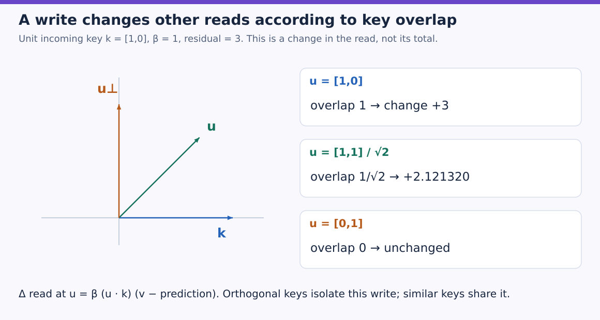

The blue horizontal arrow is the incoming key direction. A query along it receives the full change of 3; the green unit query receives 3/√2; the orange orthogonal query receives none. The right-hand numbers are changes to whatever those queries read before the write. They show how a correction can affect related associations without promising that every association has its own independent slot.

### Predict or explain: Does beta1 always overwrite a prediction for an unnormalized key?

<details data-practice-id="delta-overwrite"><summary>Reveal worked answer and rubric</summary>

No. The effective correction is beta*||k||². Full overwrite at beta1 follows for a unit-norm key.

**Rubric:** Derive the same-key read after the update.

</details>


### Interpret the update as one online regression step

Hold the incoming key/value fixed and define

$$L(S)=\tfrac12\|kS-v\|^2,\qquad \nabla_S L=k^\top(kS-v).$$

Then $S_{new}=S_{old}-\beta\nabla L$ is exactly our residual update. S is the transient fast memory being fitted online. The surrounding model parameters are learned across training examples by the model's outer loss. Distinguish these two learning timescales.

Expand the residual and collect terms:

$$S_{new}=(I-\beta k^\top k)S_{old}+\beta k^\top v.$$

This affine matrix form makes the key-dependent transition explicit. Products of such transitions permit chunkwise parallel training strategies. Plain cumulative outer-product sums are insufficient because the new write depends on the previous prediction. Order matters: writing2 and then5 at the same unit key differs from writing5 and then2.

The primary parallel-DeltaNet work develops efficient compact representations and GPU algorithms. Our program checks the residual and matrix forms; a Python loop is not that optimized implementation.

### Execute both update forms, including their derivatives

Download [delta.py](examples/delta.py), run `python delta.py` with PyTorch, or upload it to Colab and run `!python delta.py`. CPU float64 is sufficient. `retrieve` shows both forms before `run_checks` calls either. Normalization is explicit in the random fixture; the hand example already uses a unit key.

```python
"""Delta-rule fast memory with equivalent residual and matrix updates."""
import json
import torch
import torch.nn.functional as F


def retrieve(q,k,v,beta,state=None,matrix=False):
    s=q.new_zeros(k.shape[-1],v.shape[-1]) if state is None else state
    out=[]
    for query,key,value,b in zip(q,k,v,beta):
        if matrix:
            transition=torch.eye(len(key),dtype=key.dtype)-b*torch.outer(key,key)
            s=transition@s+b*torch.outer(key,value)
        else:
            prediction=key@s
            s=s+b*torch.outer(key,value-prediction)
        out.append(query@s)
    return torch.stack(out),s


def run_checks():
    q=k=torch.tensor([[1.,0.],[1.,0.]],dtype=torch.float64)
    v=torch.tensor([[2.],[5.]],dtype=torch.float64)
    overwrite,_=retrieve(q,k,v,torch.ones(2))
    partial,_=retrieve(q,k,v,torch.tensor([1.,.25]))
    torch.testing.assert_close(overwrite.flatten(),torch.tensor([2.,5.],dtype=torch.float64))
    torch.testing.assert_close(partial.flatten(),torch.tensor([2.,2.75],dtype=torch.float64))
    torch.manual_seed(107)
    qraw,kraw=[torch.randn(7,3,dtype=torch.float64,requires_grad=True) for _ in range(2)]
    values=torch.randn(7,2,dtype=torch.float64,requires_grad=True)
    gate=torch.randn(7,dtype=torch.float64,requires_grad=True)
    q,k=F.normalize(qraw,dim=-1),F.normalize(kraw,dim=-1);beta=gate.sigmoid()
    a,sa=retrieve(q,k,values,beta);b,sb=retrieve(q,k,values,beta,matrix=True)
    torch.testing.assert_close(a,b);torch.testing.assert_close(sa,sb)
    inputs=(qraw,kraw,values,gate)
    ga=torch.autograd.grad(a.square().sum(),inputs,retain_graph=True)
    gb=torch.autograd.grad(b.square().sum(),inputs,retain_graph=True)
    for x,y in zip(ga,gb):torch.testing.assert_close(x,y)
    first,s=retrieve(q[:3],k[:3],values[:3],beta[:3]);later,end=retrieve(q[3:],k[3:],values[3:],beta[3:],s)
    torch.testing.assert_close(torch.cat([first,later]),a);torch.testing.assert_close(end,sa)
    memory=torch.randn(3,2,dtype=torch.float64,requires_grad=True)
    loss=.5*(k[0]@memory-values[0]).square().sum()
    gradient=torch.autograd.grad(loss,memory)[0]
    expected=memory-beta[0]*gradient
    actual=memory+beta[0]*torch.outer(k[0],values[0]-k[0]@memory)
    torch.testing.assert_close(actual,expected)
    untouched=memory.detach().clone();_,result=retrieve(q[:1],k[:1],values[:1],torch.zeros(1),untouched)
    torch.testing.assert_close(result,untouched)
    return {'overwrite':overwrite.flatten().tolist(),'partial_write':partial.flatten().tolist(),
            'residual_matrix_outputs_gradients_chunks_equal':True,'online_sgd_identity':True,'zero_gate_preserves_state':True}


if __name__=='__main__':print(json.dumps(run_checks(),sort_keys=True))
```

The repeated-key outputs are `[2,5]`; the partial-write route prints `[2,2.75]`. Both matrix/residual computations agree on all outputs, final state and gradients with respect to raw queries, raw keys, values and write-gate logits. A carried state reproduces a full seven-token execution. An independent autograd calculation verifies the one-step regression identity, and beta0 preserves the previous state.

These checks establish local algebra and continuation. They do not reproduce the paper's language model, recall benchmark, custom GPU training kernel or actual hosted Colab run. A real request must carry the correct per-layer/per-head state and reset it deliberately. The next lesson adds a separate control for fading old state even when no conflicting key arrives.

### Predict or explain: What happens to an orthogonal query when one association is corrected?

<details data-practice-id="delta-interference"><summary>Reveal worked answer and rubric</summary>

Its direct read change is zero because u dot k=0. Similar queries can change, so this is not unlimited independent memory.

**Rubric:** Use the dot-product interference term.

</details>


[Implementation and commands](project/implementation.md) · [Readiness and limits](project/readiness.md) · [Transfer review](practice/review.md)

### References

- [Vizuara, Write only the surprise](https://vizuaraai.github.io/vizuara-ai-daily/kimi-delta-attention-explained/), Sections1–3 and the three original cost/state/correction figures. This lesson uses its mechanism explanation; full-model product and performance claims are outside the component check.
- [Parallelizing Linear Transformers with the Delta Rule](https://arxiv.org/html/2406.06484v6), Section2.2 and the online-regression/affine recurrence derivation.
- Additional worked SVG figures are original to this tutorial; their inputs and calculations follow the complete executable reference above.


## Gated DeltaNet: forget first, then correct what remains

DeltaNet corrects an association when a related key arrives. Some old associations become irrelevant without ever receiving a contradictory update. Add a separate decay control so the state can fade before the next correction. The two controls answer different questions: alpha chooses how much old state survives; beta chooses how strongly the incoming key/value corrects it.

### Read the scalar dial before the channel-wise extension

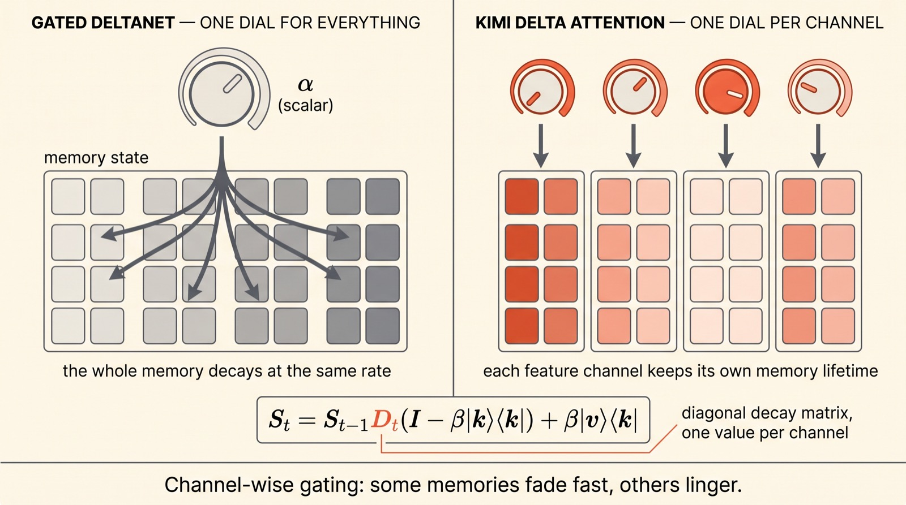

The left panel is our subject: scalar $\alpha_t$ multiplies the entire head's state. The right panel previews a different extension with a diagonal matrix of per-channel decays. We retain both original panels so the distinction is visible, but the executable lesson implements **scalar** Gated DeltaNet. A scalar per head can differ between heads and tokens without becoming a per-channel vector.

We keep the previous lesson's row-vector convention S shaped dk-by-dv. Its update is

$$\bar S_t=\alpha_t S_{t-1},\quad \hat v_t=k_t\bar S_t,\quad S_t=\bar S_t+\beta_t k_t^\top(v_t-\hat v_t),\quad y_t=q_tS_t.$$

The positional order matters: predict from the **decayed** state. Expanding yields

$$S_t=\alpha_t(I-\beta_t k_t^\top k_t)S_{t-1}+\beta_t k_t^\top v_t.$$

Transpose the equation to match the value-by-key orientation printed in the diagram. Alpha is a scalar in this lesson; it commutes with the key transition. A diagonal channel gate generally does not commute, so substituting a vector and moving it around is not justified.

### Work one two-association memory

Let

$$S_{old}=\begin{bmatrix}2&0\\0&4\end{bmatrix},\quad k=[1,0],\quad v=[5,0],\quad\alpha=.5,\quad\beta=.25.$$

Before the write, `[1,0]` retrieves `[2,0]` and `[0,1]` retrieves `[0,4]`. Decay first gives $\bar S=\operatorname{diag}(1,2)$. The incoming key now predicts `[1,0]`, so residual is `[4,0]`. The correction outer product adds1 to the first diagonal entry. The final state is $\operatorname{diag}(2,2)$.

Two things happened at once. The unrelated orthogonal association fell from4 to2 because alpha affects the whole state. The targeted prediction moved from its decayed1 toward5 by one quarter, reaching2. If we incorrectly computed the residual from the old prediction2, the first entry would become $1+.25(5-2)=1.75$. The program tests that this wrong order differs.


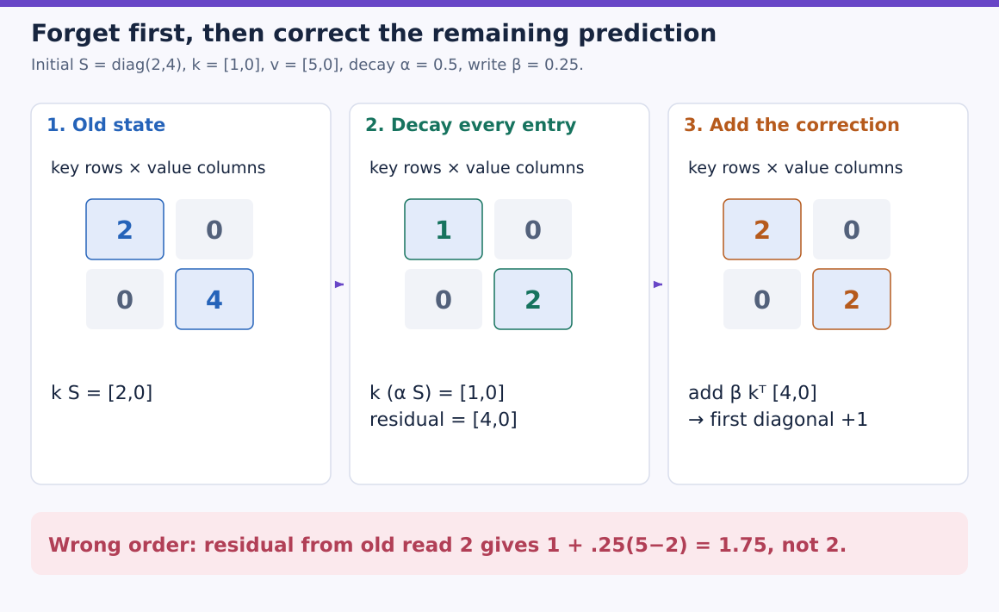

Each matrix uses key-feature rows and value-feature columns. Compare the diagonals from left to right: 2 and 4 become 1 and 2 under decay. The key `[1,0]` then selects the first row, predicts `[1,0]`, and writes one quarter of residual `[4,0]` back into that row. The second diagonal stays 2 during this correction. Computing the residual before decay would produce the red failure case instead.

With alpha1, the same state/key/value/beta gives $\operatorname{diag}(2.75,4)$: ordinary DeltaNet. With beta0 and alpha.5, no correction is written but the entire state still halves. “No write” therefore does not mean “state unchanged” once forgetting exists.

### Predict or explain: Why is predicting from the old state before decay wrong here?

<details data-practice-id="gated-order"><summary>Reveal worked answer and rubric</summary>

The correction must target the remaining decayed prediction. In the worked example the correct first diagonal is2; using the old prediction gives1.75.

**Rubric:** Trace all three operations in order.

</details>


### Derive the same-key behavior and memory lifetime

For a unit key,

$$k_tS_t=(1-\beta_t)\alpha_t(k_tS_{t-1})+\beta_t v_t.$$

Beta1 replaces that key's prediction with the new value even after decay. Alpha0 removes the old-state contribution but still allows a fresh write; alpha0,beta0 clears state completely. For an arbitrary key norm, the correction again includes $\|k\|^2$, so normalize or specify an appropriate step-size rule.

With beta0 over n steps and constant alpha, $S_{t+n}=\alpha^nS_t$. For alpha.9, the half-life is $\log(.5)/\log(.9)\approx6.58$ updates. Token-dependent alpha produces a product of the intervening decays. Forgetting can filter stale information, but it can also erase a useful old fact. No gate setting guarantees perfect long-term retrieval from finite state.


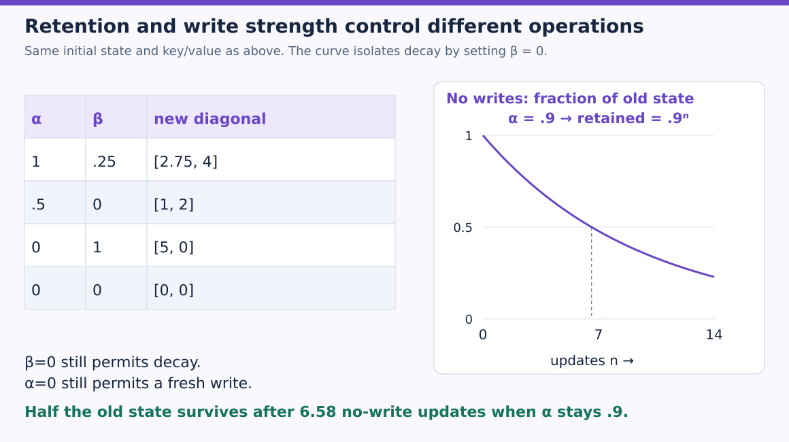

Read the left table as four separate interventions, each starting from the same old state. Zero beta disables correction while alpha can still forget; zero alpha clears the old contribution while beta can still write a new association. The right curve follows only the surviving old contribution over repeated no-write updates. Its vertical scale is a fraction of the starting state, and the dashed marker reaches one half at about 6.58 updates. Learned token-dependent gates need not follow one fixed curve.

The original work compares retention and filtering on different recall tasks and reports both strengths and remaining failures. Its model includes learned projections, short convolutions, query/key L2 normalization, output normalization/gating and an MLP stack. Our reference isolates the recurrence. Supplying sigmoid gate values in a toy program does not reproduce its trained gate parameterization or full architecture.

### The training algorithm must preserve the transition product

The expanded recurrence has the affine form $S_t=A_tS_{t-1}+B_t$, where $A_t=\alpha_t(I-\beta_t k_t^\top k_t)$ and $B_t=\beta_tk_t^\top v_t$. Over two tokens,

$$S_2=A_2A_1S_0+A_2B_1+B_2.$$

The first write is transformed by later transitions. Summing all $B_t$ independently drops that interaction. Chunkwise algorithms exploit structured transition products to train efficiently while retaining the same sequential result. A sequential Python implementation verifies semantics and supports chunk continuation; it does not demonstrate parallel GPU throughput or constant training-memory use.

### Run the residual and affine forms

Download [gated_delta.py](examples/gated_delta.py), run `python gated_delta.py` with PyTorch, or upload it to Colab and run `!python gated_delta.py`. CPU float64 is sufficient. `retrieve` makes the decay/predict/correct order explicit before the fixture exercises it.

```python
"""Scalar forgetting followed by a delta correction, in row-vector convention."""
import json
import torch
import torch.nn.functional as F


def retrieve(q,k,v,alpha,beta,state=None,matrix=False):
    s=q.new_zeros(k.shape[-1],v.shape[-1]) if state is None else state
    outputs=[]
    for query,key,value,a,b in zip(q,k,v,alpha,beta):
        if matrix:
            transition=a*(torch.eye(len(key),dtype=key.dtype)-b*torch.outer(key,key))
            s=transition@s+b*torch.outer(key,value)
        else:
            decayed=a*s
            prediction=key@decayed
            s=decayed+b*torch.outer(key,value-prediction)
        outputs.append(query@s)
    return torch.stack(outputs),s


def run_checks():
    initial=torch.diag(torch.tensor([2.,4.],dtype=torch.float64))
    key=torch.tensor([[1.,0.]],dtype=torch.float64);value=torch.tensor([[5.,0.]],dtype=torch.float64)
    _,hand=retrieve(key,key,value,torch.tensor([.5]),torch.tensor([.25]),initial)
    torch.testing.assert_close(hand,torch.diag(torch.tensor([2.,2.],dtype=torch.float64)))
    _,ungated=retrieve(key,key,value,torch.ones(1),torch.tensor([.25]),initial)
    torch.testing.assert_close(ungated,torch.diag(torch.tensor([2.75,4.],dtype=torch.float64)))
    wrong=.5*initial+.25*torch.outer(key[0],value[0]-key[0]@initial)
    assert not torch.allclose(hand,wrong)
    torch.manual_seed(113)
    qr,kr=[torch.randn(6,3,dtype=torch.float64,requires_grad=True) for _ in range(2)]
    v=torch.randn(6,2,dtype=torch.float64,requires_grad=True)
    ar,br=[torch.randn(6,dtype=torch.float64,requires_grad=True) for _ in range(2)]
    q,k=F.normalize(qr,dim=-1),F.normalize(kr,dim=-1);alpha,beta=ar.sigmoid(),br.sigmoid()
    out,s=retrieve(q,k,v,alpha,beta);ref,r=retrieve(q,k,v,alpha,beta,matrix=True)
    torch.testing.assert_close(out,ref);torch.testing.assert_close(s,r)
    args=(qr,kr,v,ar,br)
    ga=torch.autograd.grad(out.square().sum(),args,retain_graph=True)
    gb=torch.autograd.grad(ref.square().sum(),args,retain_graph=True)
    for x,y in zip(ga,gb):torch.testing.assert_close(x,y)
    first,s1=retrieve(q[:2],k[:2],v[:2],alpha[:2],beta[:2])
    later,s2=retrieve(q[2:],k[2:],v[2:],alpha[2:],beta[2:],s1)
    torch.testing.assert_close(torch.cat([first,later]),out);torch.testing.assert_close(s2,s)
    old=torch.randn(3,2,dtype=torch.float64)
    _,decayed=retrieve(q[:1],k[:1],v[:1],torch.tensor([.5]),torch.zeros(1),old)
    torch.testing.assert_close(decayed,.5*old)
    _,cleared=retrieve(q[:1],k[:1],v[:1],torch.zeros(1),torch.zeros(1),old)
    torch.testing.assert_close(cleared,torch.zeros_like(old))
    _,written=retrieve(q[:1],k[:1],v[:1],torch.zeros(1),torch.ones(1),old)
    torch.testing.assert_close(k[0]@written,v[0])
    return {'worked_state':hand.tolist(),'outputs_gradients_chunks_equal':True,
            'decay_before_prediction_required':True,'zero_write_still_forgets':True,'zero_decay_reset_and_write_checks':True}


if __name__=='__main__':print(json.dumps(run_checks(),sort_keys=True))
```

The worked state prints `[[2,0],[0,2]]`. The program verifies alpha1's ungated boundary, full output/final-state and query/key/value/alpha/beta-logit gradient equality between residual and affine forms, and chunk continuation. Beta0 decay, complete clearing and a fresh unit-key write after alpha0 are checked separately. Wrong residual timing is detected.

State storage remains dk-by-dv per batch/head/layer. A full network also needs any convolution state and per-layer bookkeeping. Hybrid full/sliding-attention layers retain their own caches; their storage does not disappear because other layers use a recurrence. Model quality, efficient kernels and actual hosted Colab execution remain separate work.

### Predict or explain: At beta0 and alpha.8, is the state unchanged?

<details data-practice-id="gated-forget"><summary>Reveal worked answer and rubric</summary>

No. It becomes .8 times the old state. Beta controls the correction; alpha independently controls retention.

**Rubric:** Separate the two gates and name alpha1 as the no-decay case.

</details>


[Implementation and commands](project/implementation.md) · [Readiness and limits](project/readiness.md) · [Transfer review](practice/review.md)

### References

- [Vizuara, Write only the surprise](https://vizuaraai.github.io/vizuara-ai-daily/kimi-delta-attention-explained/), Section4 and its complete original scalar/channel-gate figure.
- [Gated Delta Networks](https://arxiv.org/html/2412.06464v3), Sections3.1–3.4, Equation10, recurrence, retention/filtering cases and full-block boundary.
- Additional worked SVG figures are original to this tutorial; their inputs and calculations follow the complete executable reference above.


## Evidence and proof limits

### Claim ledger

| Claim | Status | Proof limit |
| --- | --- | --- |
| Normalized positive-kernel retrieval has equivalent pairwise and prefix-state evaluations; constant inference state can merge distinct histories. | verified | Stated mathematical assumptions and executed tiny reference; no learner, hosted or full-model result. |
| Finite positive random features approximate the exponential kernel; fixed-feature pairwise and recurrent outputs/gradients agree while finite-seed softmax error remains measurable. | verified | Stated mathematical assumptions and executed tiny reference; no learner, hosted or full-model result. |
| The delta write is one online squared-error gradient step; unit-key full writes replace the same-key prediction while nonorthogonal queries can interfere. | verified | Stated mathematical assumptions and executed tiny reference; no learner, hosted or full-model result. |
| Scalar decay followed by correction of the decayed prediction equals the affine gated delta recurrence; forgetting persists even with a zero write gate. | verified | Stated mathematical assumptions and executed tiny reference; no learner, hosted or full-model result. |

## Sources

- [Vizuara kernel state](https://vizuaraai.github.io/convolution-musical-journey/book.html) — Sections9.3 and9.6; checked 2026-10-30
- [Transformers are RNNs](https://arxiv.org/html/2006.16236v3) — Sections3.2–3.4; checked 2026-10-30
- [Performer and FAVOR+](https://arxiv.org/html/2009.14794v4) — Sections2.2–2.4; Lemma1; Figures1–2; checked 2026-10-30
- [Vizuara delta-memory teaching](https://vizuaraai.github.io/vizuara-ai-daily/kimi-delta-attention-explained/) — Sections1–3; Figures1–3; checked 2026-10-30
- [Parallel DeltaNet](https://arxiv.org/html/2406.06484v6) — Section2.2; checked 2026-10-30
- [Gated Delta Networks](https://arxiv.org/html/2412.06464v3) — Sections3.1–3.4; Equation10; checked 2026-10-30
