# Attention position: RoPE and ALiBi

How can attention use token positions and relative distances?

Learning material for attention-labs. Model implementation/training and learner mastery are separate states.

**Outcomes:** Derive and calculate the relative-position rotary identity.; Implement paired rotations and retain correct positions during cached execution.; Calculate head-specific distance biases and their probability effect.; Preserve distance semantics across chunks and distinguish extrapolation evidence..

## RoPE: make the query-key comparison depend on distance

Attention already knows what content is available and which positions it is allowed to inspect. A different question remains: how does a query-key comparison express where two tokens sit relative to each other? We will transform the query and key coordinates before taking their dot product. The transformation should preserve vector length and make a shared shift of the two positions cancel from that comparison.

We will begin with the ordering problem, rotate a two-number vector by hand, calculate one score at two different position pairs, then build a complete multi-pair implementation and check cached positions. The worked unit-vector example stays fixed throughout. This is a new topic sourced from Vizuara's public RoPE explanation; it does not restore the omitted Attention Family Lecture 9.

### Separate content, visibility and position

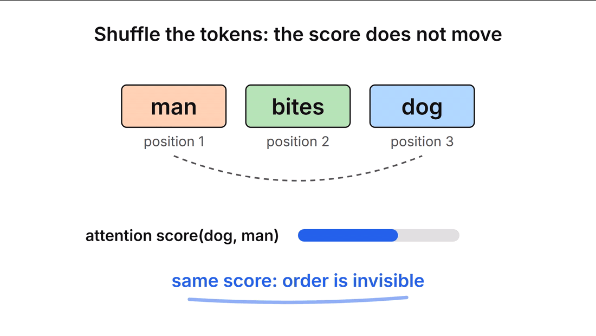

“Dog bites man” and “man bites dog” contain the same words, but their roles differ. If Q/K depend only on token identity, the content comparison for the same word pair has no separate position input. Unmasked, position-free self-attention is permutation equivariant: reordering inputs reorders its outputs. A causal mask already introduces ordered visibility, so the same unrestricted permutation argument cannot be applied while silently keeping a fixed triangle. RoPE supplies an explicit positional transformation within that visibility rule.

### Change direction rather than add a position vector

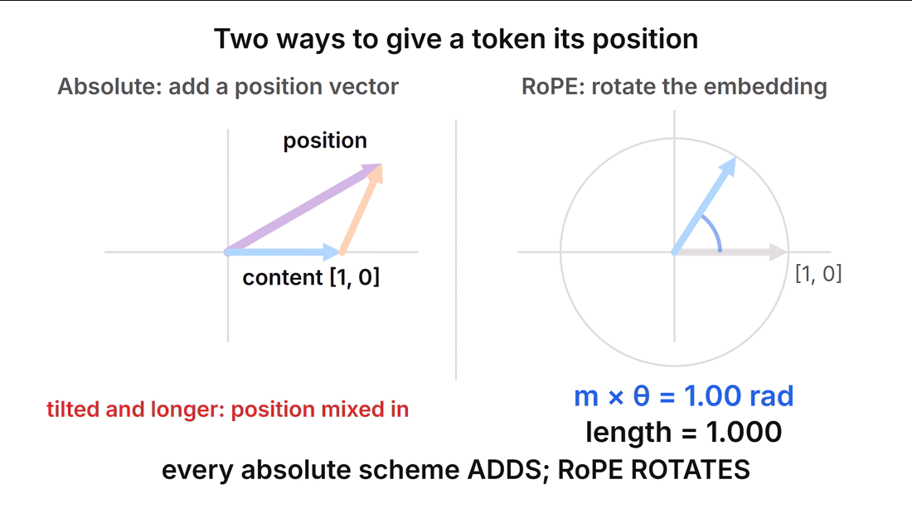

Learned absolute vectors, sinusoidal additions and relative score biases are other valid choices with different contracts. Learned tables need an extension policy beyond their allocated positions. Relative biases can be implemented efficiently too; they are not inherently incompatible with fast attention. RoPE's particular choice is to rotate paired query/key coordinates using their positions.

### Understand a single two-dimensional rotation

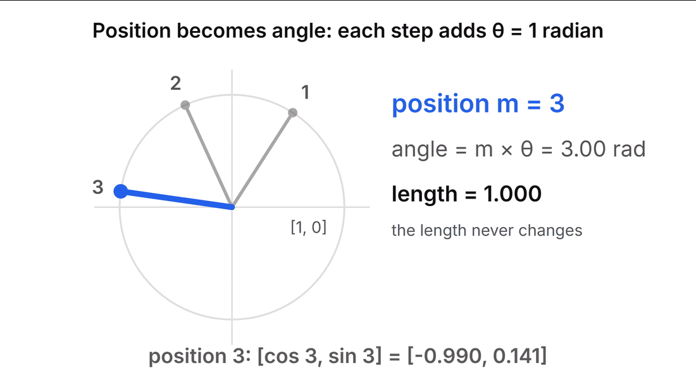

With column-vector notation, rotating by angle a uses

$$R(a)=\begin{bmatrix}\cos a&-\sin a\\\sin a&\cos a\end{bmatrix}.$$

Thus $[x,y]$ becomes $[x\cos a-y\sin a,\;x\sin a+y\cos a]$ when written as the resulting coordinate list. Position m sets the angle $a=m\theta$. For the first pair, take $\theta=1$ radian per position. Position 0 leaves `[1,0]` fixed; position 1 gives approximately `[0.540302,0.841471]`; position 3 gives `[-0.989992,0.141120]`. Squared length remains $\cos^2a+\sin^2a=1$.

### Rotate the query and key separately

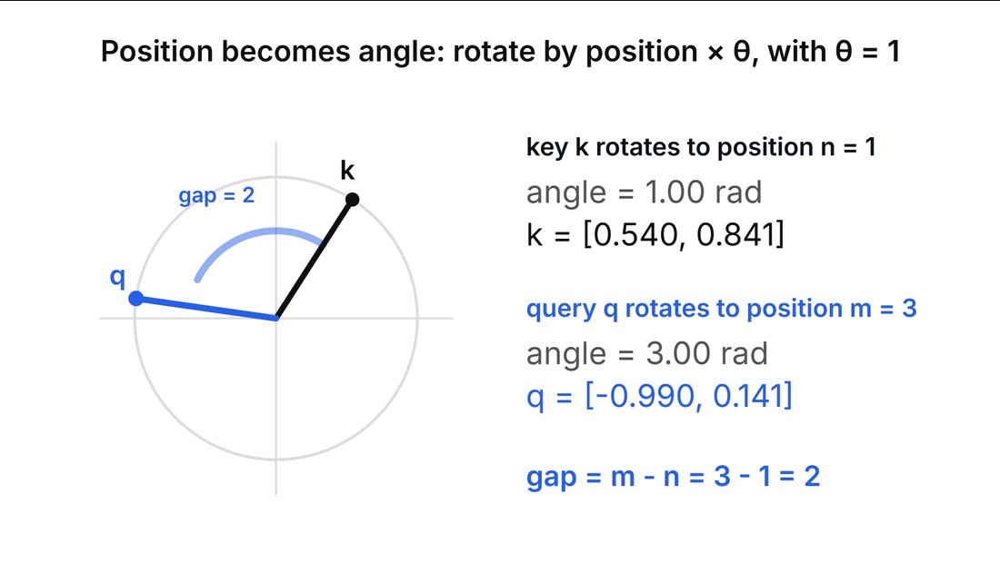

Keep the unrotated content vectors fixed at $q=k=[1,0]$. Put the query at m=3 and the key at n=1. Their rotated coordinates are $R(3)q$ and $R(1)k$. The relative angle is two radians even though neither rotated vector uses the number two directly.

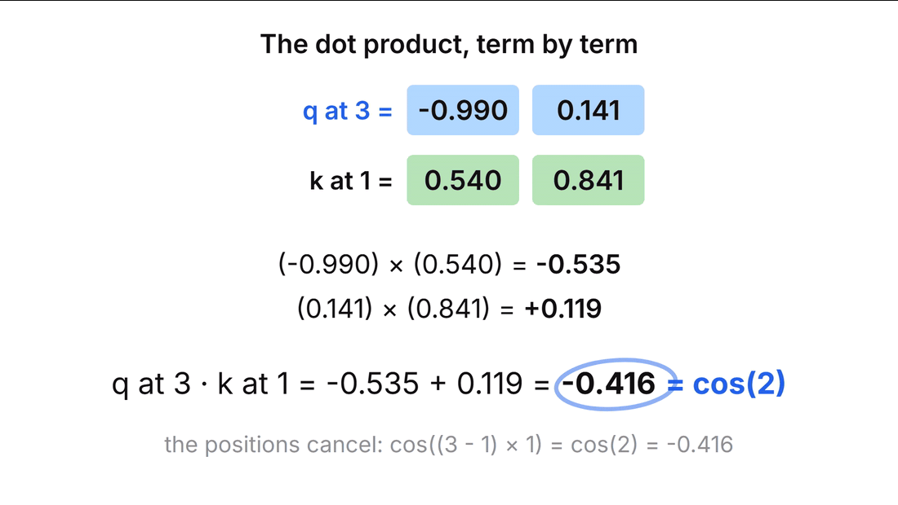

Calculate the dot product:

$$\cos3\cos1+\sin3\sin1=\cos(3-1)=\cos2\approx-0.416147.$$

The first product is approximately −0.534895 and the second +0.118748. Their sum is the raw dot product; an attention layer would additionally divide by $\sqrt{d_k}$ before softmax. A negative raw score is valid: exponentiation still gives a positive normalization contribution.

### Move both positions while retaining the same gap

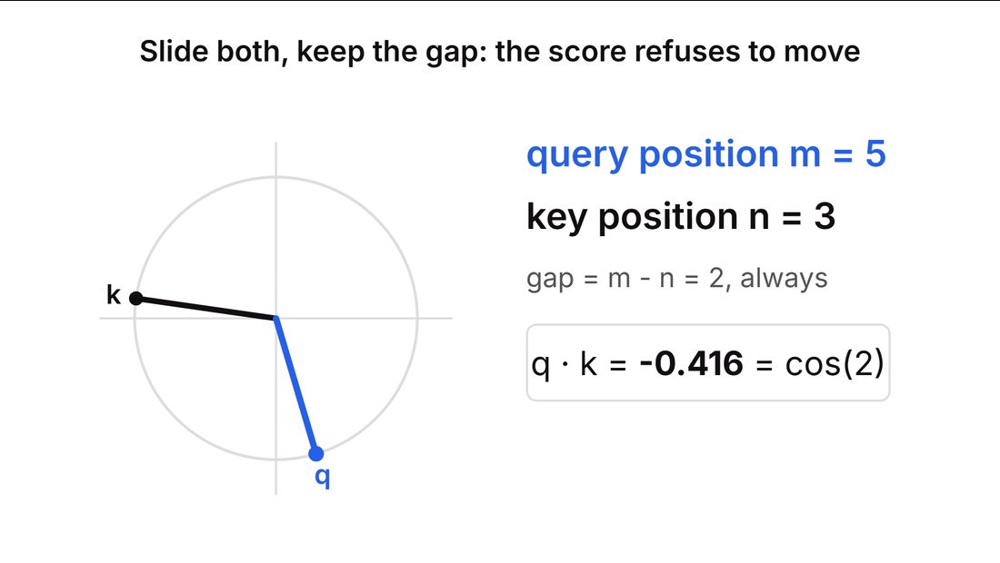

Move the query/key pair to (5,3). The coordinates are approximately `[0.283662,-0.958924]` and `[-0.989992,0.141120]`. Their dot product is still −0.416147. The pair (100,98) gives the same result up to numerical roundoff. This holds with the unrotated content vectors fixed; it is not a claim that shifting arbitrary text in an entire trained decoder leaves every hidden state unchanged.

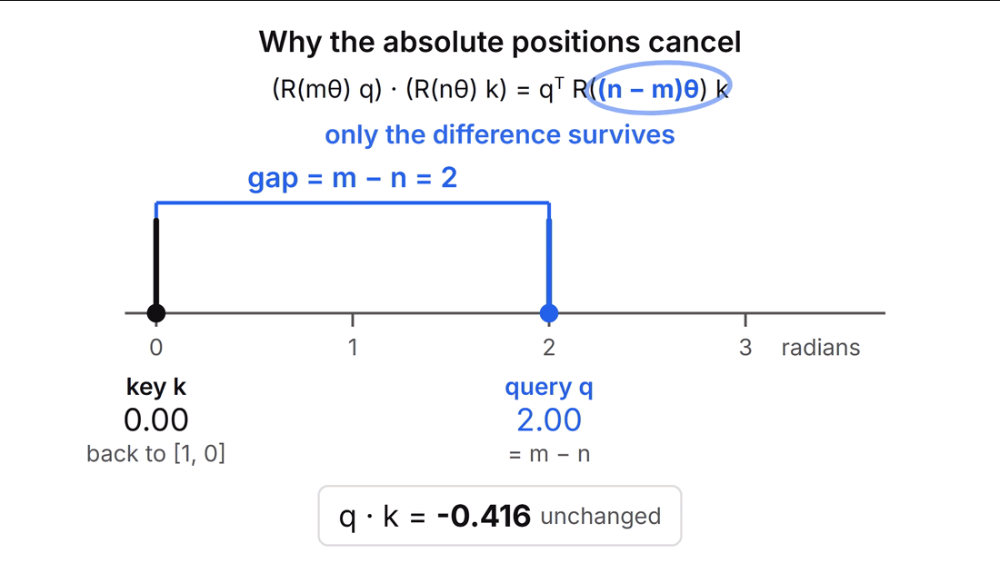

The identity behind that numerical observation is

$$\begin{aligned}(R(m\theta)q)^\top(R(n\theta)k)
&=q^\top R(m\theta)^\top R(n\theta)k\\
&=q^\top R((n-m)\theta)k.\end{aligned}$$

A rotation transpose is its inverse. Composing two rotations adds their angles, so the inverse contributes the minus sign. The two absolute position terms enter only through their difference. General content vectors still contribute their magnitudes and directions: a RoPE score is not merely a function of distance independent of content.


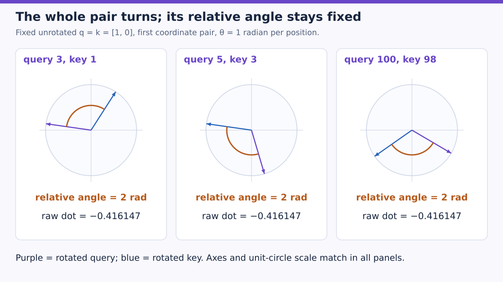

Use the same horizontal and vertical axes in all three panels. Both arrows move when the absolute positions change, while the orange arc between them stays two radians. Their dot product therefore stays the same. These are the fixed-content numerical probes used by the reference; the figure does not predict that an entire shifted sentence has identical hidden states. An attention score still applies its comparison-width scaling after this raw dot product.

### Predict or explain: Does shifting (query,key) positions from (3,1) to (5,3) preserve the rotated dot product?

<details data-practice-id="rope-gap"><summary>Reveal worked answer and rubric</summary>

Yes, with unrotated content and frequency fixed: both have n−m=−2. For unit vectors at frequency one the raw dot product is cos(2)≈−0.416147. This is a component identity, not an arbitrary complete-model shift-invariance claim.

**Rubric:** State what is held fixed and derive the position difference.

</details>


### Give different coordinate pairs different frequencies

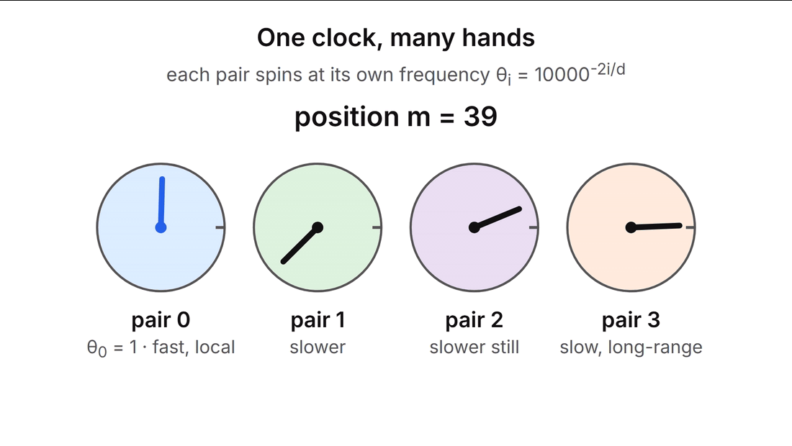

A width-d head is split into d/2 pairs, requiring an even rotated width in this reference. Pair r uses

$$\theta_r=b^{-2r/d},\qquad r=0,1,\ldots,d/2-1.$$

For d=4 and base b=10000, the two frequencies are 1 and 0.01 radians per position. At position 3, their angles are 3 and 0.03. For d=8, four pairs use 1, 0.1, 0.01 and 0.001. These multiple rates let comparisons represent several distance scales. A clock phase is periodic, so one pair alone cannot identify arbitrarily many positions uniquely.

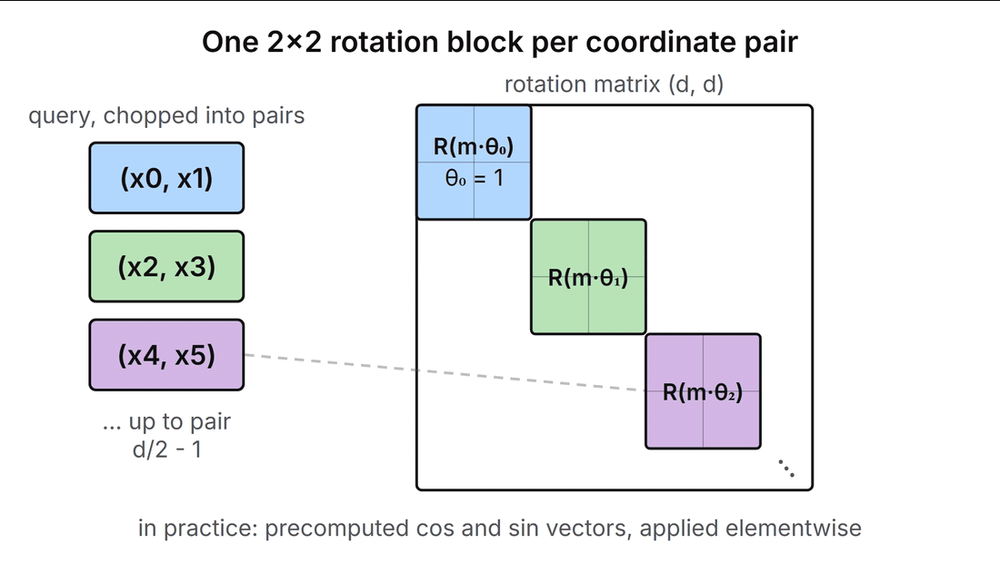

The block-diagonal matrix is a mathematical description. Each pair interacts only with its partner; no off-diagonal pair mixing is needed. We implement the coordinate formulas directly, avoiding a large dense rotation matrix. The program separately builds explicit blocks as an independent reference and compares the derivatives.

### Apply the transformation at the right location

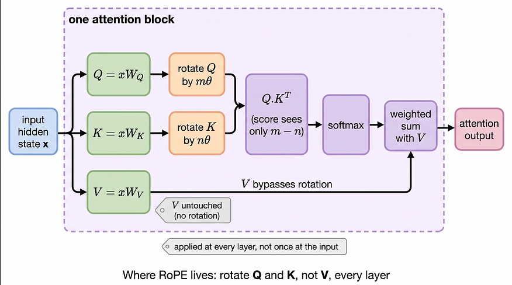

Project the layer input into Q/K/V, rotate Q and K with their own positions, then calculate scaled scores and apply visibility. In this formulation V is unchanged. GQA's shared key head is rotated once per token and reused by its query group. Query-head count and KV-head count need not agree; the positional frequency contract for corresponding comparison coordinates must agree.

For cached generation, storing already-rotated keys is convenient. Prefill positions 0–2, then process new tokens at 3 and 4. Do not restart their position IDs at 0 and 1, and do not rotate stored keys a second time when appending. That changes their relative geometry even if every tensor shape remains legal. A different context-rescaling policy may invalidate an existing cache unless the runtime explicitly supports adapting it.

### Understand what the distance picture does and does not prove

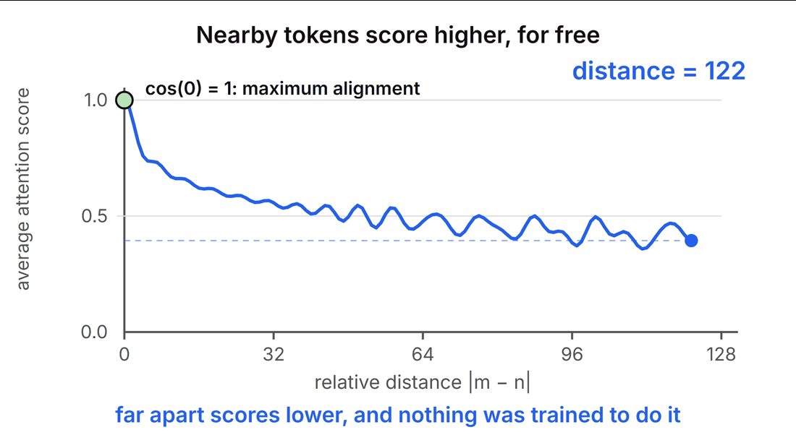

RoPE changes how distance enters scores, but it does not guarantee that every individual score decreases monotonically as distance grows. Our one-pair example already refutes that: $\cos6\approx0.960170$ exceeds $\cos3\approx-0.989992$. Content-dependent sums and their bounds can show aggregate decay tendencies under stated assumptions; they do not turn every attention row into a monotone distance penalty.

### Run a complete implementation

Save [rope.py](examples/rope.py). The `rotate` function receives tensors ending in `[T,D]` and one absolute position per token. Leading batch/head axes broadcast over the same position/frequency grid. It reshapes adjacent pairs, applies the two coordinate formulas, and restores the original shape. Other models use a half-split pair convention; coefficients and permutation must match the checkpoint's convention.

Use `python rope.py` with PyTorch available. In Google Colab, inspect the installed Torch version, upload the file, then run `!python rope.py`. The reference needs no model download or GPU:

```python
"""Adjacent-pair RoPE: norms, relative positions, explicit blocks and cache offsets."""
import json
import math
import torch


def rotate(x, positions, base=10000.0):
    d = x.shape[-1]
    if d % 2 or len(positions) != x.shape[-2] or base <= 0:
        raise ValueError('Even rotated width, matching positions and positive base required')
    frequencies = base ** (-torch.arange(0,d,2,dtype=x.dtype,device=x.device)/d)
    angles = positions.to(dtype=x.dtype,device=x.device)[:,None] * frequencies[None,:]
    pairs = x.reshape(*x.shape[:-1],d//2,2)
    a,b = pairs[...,0],pairs[...,1]
    c,s = angles.cos(),angles.sin()
    return torch.stack([a*c-b*s,a*s+b*c],dim=-1).flatten(-2)


def run_checks():
    unit = torch.tensor([[[[1.0,0.0]]]],dtype=torch.float64)
    scores = []
    for m,n in [(3,1),(5,3),(100,98)]:
        q = rotate(unit,torch.tensor([m]))
        k = rotate(unit,torch.tensor([n]))
        score = (q*k).sum().item()
        assert math.isclose(score,math.cos(2),abs_tol=1e-12)
        scores.append(round(score,6))
    torch.manual_seed(53)
    x = torch.randn(2,3,6,4,dtype=torch.float64,requires_grad=True)
    pos = torch.arange(6)
    actual = rotate(x,pos)
    torch.testing.assert_close(actual.norm(dim=-1),x.norm(dim=-1))
    matrices = []
    for t in pos.tolist():
        blocks = []
        for f in [1.0,0.01]:
            c,s = math.cos(t*f),math.sin(t*f)
            blocks.append(torch.tensor([[c,-s],[s,c]],dtype=x.dtype))
        matrices.append(torch.block_diag(*blocks))
    reference = torch.einsum('tij,bhtj->bhti',torch.stack(matrices),x)
    torch.testing.assert_close(actual,reference)
    left = torch.autograd.grad(actual.square().sum(),x,retain_graph=True)[0]
    right = torch.autograd.grad(reference.square().sum(),x)[0]
    torch.testing.assert_close(left,right)
    chunks = torch.cat([rotate(x[:,:,:2],pos[:2]),rotate(x[:,:,2:],pos[2:])],dim=2)
    torch.testing.assert_close(chunks,actual)
    wrong = rotate(x[:,:,2:],torch.arange(4))
    assert not torch.allclose(wrong,actual[:,:,2:])
    # One pair oscillates; position separation does not guarantee monotonic scores.
    assert math.cos(6) > math.cos(3)
    try:
        rotate(torch.ones(1,1,2,3),torch.arange(2))
    except ValueError:
        pass
    else:
        raise AssertionError('Odd rotated width accepted')
    return {'equal_gap_scores':scores,'norm_and_block_gradients_equal':True,
            'cached_positions_equal':True,'reset_position_bug_detected':True,
            'odd_width_rejected':True}


if __name__ == '__main__':
    print(json.dumps(run_checks(),sort_keys=True))
```

All three equal-gap scores print −0.416147. The random multi-head fixture preserves norms, equals explicit block-matrix multiplication and has matching input gradients. Splitting the token sequence into two chunks while retaining absolute positions agrees with one full rotation. Resetting the second chunk's positions is deliberately detected; an odd rotated width is rejected. A partial-RoPE model could leave an unrotated suffix, but that is a separate interface choice from accepting an invalid paired width silently.

### Predict or explain: After caching positions 0–2, can the next two tokens use RoPE positions 0 and 1?

<details data-practice-id="rope-cache"><summary>Reveal worked answer and rubric</summary>

No. Under this uninterrupted absolute-position contract their positions are 3 and 4. Restarting changes comparisons with cached keys; already-rotated keys must not be rotated again.

**Rubric:** Explain the relative-angle error and state the correct positions.

</details>


### Keep quality and context extension as separate evidence

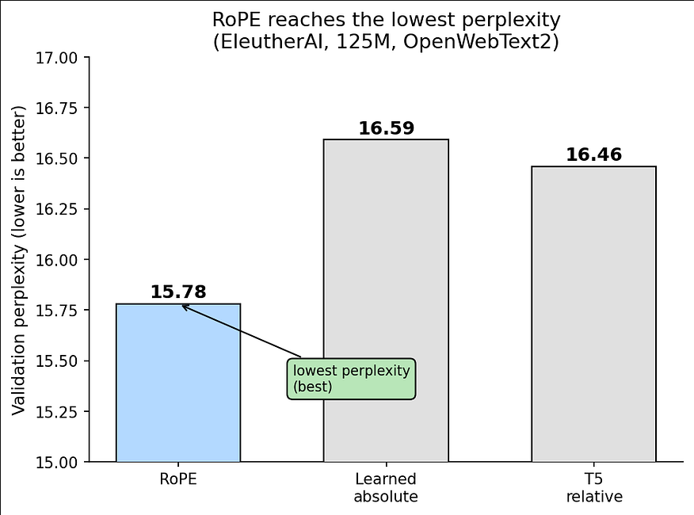

The plotted quality numbers describe source experiments, not this tiny geometry check. To reproduce a ranking, fix architecture, corpus, training budget, context, evaluation and positional method. Having no learned positional parameters does not imply no execution cost: sine/cosine handling and pairwise rotation still require arithmetic and memory access.

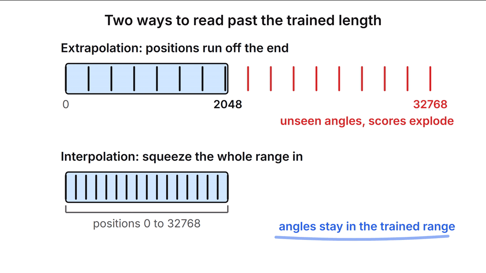

RoPE can compute rotations for position IDs beyond the training length. That mathematical availability does not guarantee useful trained-model behavior there. The diagram's “scores explode” label is not a consequence of rotation alone: preserved norms give the bound $|q^\top R(a)k|\leq\lVert q\rVert\lVert k\rVert$. Unfamiliar phases can harm learned behavior without an unbounded raw dot product. Position interpolation and frequency-rescaling methods change the positional schedule and require their own model/evaluation contract. We have not reproduced their training or promised unlimited context.

ALiBi will open a contrasting design: keep Q/K coordinates as they are and add a distance-dependent term directly to the attention logits. Then MLA will use this understanding of positional transformations to explain why its content and positional key paths are separated.

The [implementation notes](project/implementation.md), [readiness checks](project/readiness.md) and [transfer review](practice/review.md) support returning to this topic.

### References

[Vizuara: What exactly is Rotary Position Embedding?](https://vizuara.medium.com/what-exactly-is-rotary-position-embedding-rope-59d616f02e0d): original diagrams and the two-dimensional teaching progression, with numerical/claim qualifications above. [Su et al., RoFormer, version 5, Section 3](https://arxiv.org/html/2104.09864v5): rotation construction, relative-position identity and scoped decay analysis. The complete source animations remain available at the original article.
- Additional worked SVG figures are original to this tutorial; their inputs and calculations follow the complete executable reference above.


## ALiBi: put a distance penalty directly in the scores

RoPE supplied relative-position structure by rotating Q and K. Now ask whether the model can express a simple preference for nearby context without rotating those vectors or looking up a position embedding. We keep the content comparison and add a number determined by query–key distance before normalization. That number is a bias in the attention logits.

The plan is to inspect the bias matrix, calculate one complete row and its value mixture, give heads different slopes, then verify that cached chunks use the same distances as full attention. A longer-context quality claim will remain a separate trained-model question.

### Read content scores and distance biases as separate arrays

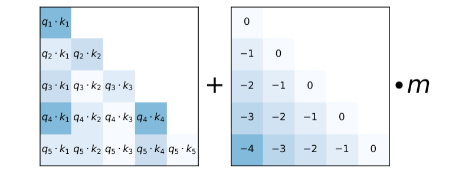

On the left, query–key comparisons measure content compatibility. On the right, the relative-position term is added before softmax. The two terms have different jobs. Content can make a distant key useful; the bias asks the model to overcome a larger penalty for a larger distance.

For a causal query at absolute position i and a permitted key at j, write

$$\ell_{h,i,j}=q_{h,i}\cdot k_{h,j}/\sqrt{d_k}-m_h(i-j),\qquad j\leq i.$$

The slope $m_h$ is positive and fixed in the original method. Future positions receive minus infinity separately. Apply the dot-product scaling to the content term **before** adding the bias. Dividing the bias by $\sqrt{d_k}$ too would change its effective slope.

At i=3, the permitted distances to keys 0,1,2,3 are `[3,2,1,0]`. With slope 0.5, the corresponding biases are `[-1.5,-1,-0.5,0]`. The current position has no distance penalty. We describe a causal decoder here; using the signed difference unchanged for unrestricted bidirectional attention would favor one direction and needs a separately chosen bidirectional policy.

### Work an entire probability row

Set all four content logits to zero to isolate position. Exponentiate the biases:

$$[e^{-1.5},e^{-1},e^{-0.5},1]\approx[.223130,.367879,.606531,1].$$

Their sum is 2.197540. Normalizing gives approximately `[0.101536,0.167405,0.276004,0.455054]`. With scalar values `[1,2,3,4]`, the output is

$$.101536(1)+.167405(2)+.276004(3)+.455054(4)\approx3.084576.$$


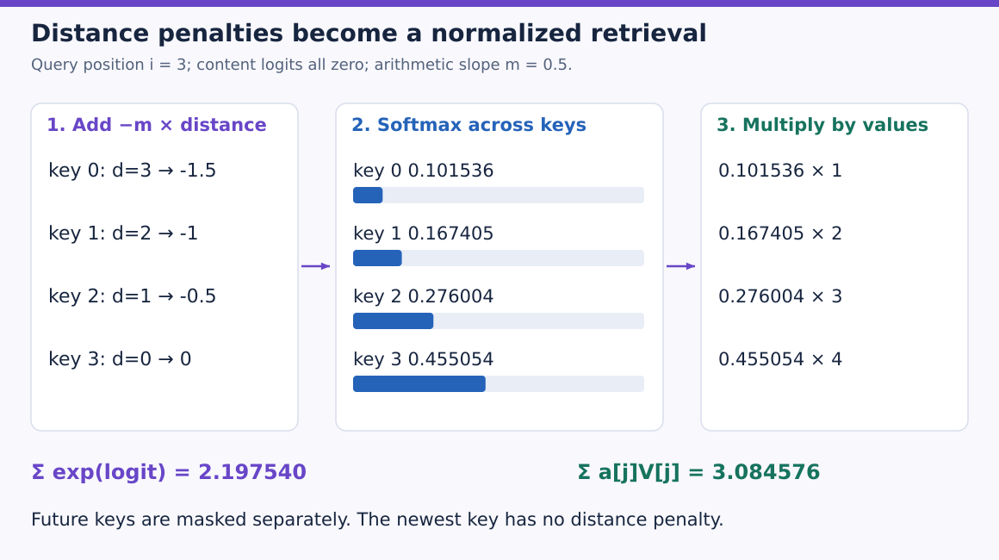

Follow one key horizontally through all three stages. Key 0 starts three positions away, receives logit −1.5, contributes about 0.101536 of the probability mass and supplies value 1. Key 3 starts at distance zero and supplies value 4 with weight about 0.455054. Add the four products in the last panel to obtain the output. The bars share a 0–1 probability scale; exponentials are divided by the same sum.

The last position receives more probability here because the content scores were equal. If the oldest key's content logit increases by 3, its combined logit becomes 1.5 while the most recent remains zero, so that older key outranks the recent key. ALiBi is an inductive preference, not a rule that older information must always lose.

A useful check is the probability ratio. For equal content logits, newest/oldest is $\exp(1.5)\approx4.481689$. Softmax's common denominator cancels in the ratio. Negating the intended bias sign would reverse this preference.

### Predict or explain: With equal content logits, slope 0.5 and distances 3 and 0, which key gets more weight and by what ratio?

<details data-practice-id="alibi-sign"><summary>Reveal worked answer and rubric</summary>

The distance-zero key gets more weight. Its logit exceeds the older key by 1.5, so its probability is exp(1.5)≈4.481689 times as large. Different content logits can overcome this preference.

**Rubric:** Use the sign, distance and softmax ratio; avoid an unconditional oldest-token rejection claim.

</details>


### Give heads different distance preferences

The original work fixes a geometric set of slopes instead of learning a separate embedding table. For a power-of-two head count H, our implementation uses

$$m_h=2^{-8(h+1)/H},\qquad h=0,\ldots,H-1.$$

With H=4, the values are `[0.25,0.0625,0.015625,0.00390625]`. A larger slope produces a stronger recency preference when content is held fixed. The slope 0.5 above was an explicitly selected arithmetic example. The program rejects non-power-of-two head counts rather than quietly claim it implements the upstream extension schedule; that extension is available in the authors' code.


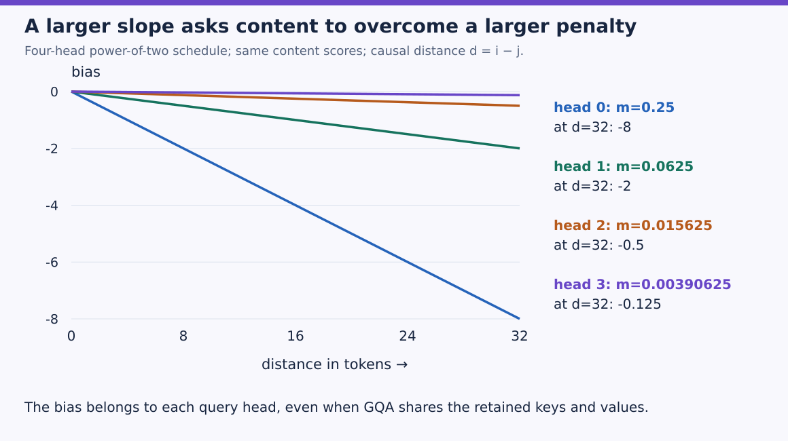

The horizontal axis measures how far back a key is, and the vertical axis is the additive logit bias. Every line starts at zero because a current-position key has zero distance. Blue falls fastest: at 32 positions back its penalty is −8, while purple is only −0.125. These are the four scheduled slopes in the program; the preceding 0.5 example was chosen separately to make one probability row easy to calculate.

Heads still have their own content projections. This positional choice can coexist with an MHA, MQA or GQA memory arrangement. For GQA, the bias belongs to each **query** head even though several query heads share a KV head. Sharing K/V does not require sharing the positional slope.

### Keep the distance contract during cached inference

If the cache contains positions 0–2 and the next chunk contains positions 3 and 4, form distances between `[3,4]` and `[0,1,2,3,4]`. This gives two rows of length five; apply the causal rule independently to each row. Starting the new query positions at zero would change both the distance bias and permitted-key set.

Shifting every query and key position by the same constant leaves differences unchanged. Shifting queries alone does not. This makes a good reference check: cached chunks must agree with full attention when their absolute positions are consistent.

ALiBi does not require rotating cached keys. It also does not remove the need to store K/V for full-context attention. The retained-cache payload formula is unchanged. If a sliding window evicts history, the runtime must retain enough position information to preserve the chosen distance semantics.

### Implement and test the mechanism

Save [alibi.py](examples/alibi.py) and run `python alibi.py` with PyTorch installed. In Google Colab, inspect `torch.__version__`, upload the file, then run `!python alibi.py`. No weights or dataset are downloaded.

The `slopes` helper defines the supported schedule. `attention` constructs query/key distances, broadcasts one slope per head, combines scaled content scores with the bias, masks future entries and computes the value mixture. Tests cover both the arithmetic row and a larger random multi-head fixture:

```python
"""Causal ALiBi with explicit positions and a stated power-of-two slope schedule."""
import json
import math
import torch


def slopes(heads):
    if heads < 1 or heads & (heads-1):
        raise ValueError('This reference supports power-of-two head counts')
    return 2.0 ** (-8*torch.arange(1,heads+1,dtype=torch.float64)/heads)


def attention(q,k,v,query_positions,key_positions,m):
    distance = query_positions[:,None]-key_positions[None,:]
    bias = -m.to(q)[:,None,None]*distance.to(q)[None,:,:]
    score = q @ k.transpose(-2,-1)/math.sqrt(q.shape[-1]) + bias
    score = score.masked_fill(distance[None,None,:,:]<0,-torch.inf)
    weights = score.softmax(-1)
    return weights @ v,weights


def run_checks():
    torch.manual_seed(61)
    q = torch.randn(2,4,5,2,dtype=torch.float64)
    k = torch.randn_like(q);v = torch.randn(2,4,5,3,dtype=torch.float64)
    pos=torch.arange(5);m=slopes(4)
    y,w=attention(q,k,v,pos,pos,m)
    a,_=attention(q[:,:,:2],k[:,:,:2],v[:,:,:2],pos[:2],pos[:2],m)
    b,_=attention(q[:,:,2:],k,v,pos[2:],pos,m)
    torch.testing.assert_close(torch.cat([a,b],2),y)
    shifted,_=attention(q,k,v,pos+100,pos+100,m)
    torch.testing.assert_close(shifted,y)
    altered=v.clone();altered[:,:,3:]+=100
    torch.testing.assert_close(attention(q,k,altered,pos,pos,m)[0][:,:,:3],y[:,:,:3])
    z=torch.zeros(1,1,4,1,dtype=torch.float64)
    values=torch.arange(1,5,dtype=torch.float64).reshape(1,1,4,1)
    out,weights=attention(z,z,values,torch.arange(4),torch.arange(4),torch.tensor([.5]))
    row=weights[0,0,-1]
    assert torch.all(row[1:]>row[:-1])
    assert math.isclose((row[-1]/row[0]).item(),math.exp(1.5),rel_tol=1e-12)
    return {'slopes':m.tolist(),'last_weights':[round(x,6) for x in row.tolist()],
            'last_output':round(out[0,0,-1,0].item(),6),
            'chunks_and_shared_position_shift_equal':True,'future_intervention':True}


if __name__ == '__main__':
    print(json.dumps(run_checks(),sort_keys=True))
```

The scalar row reproduces output 3.084576. The four-head fixture processed as two chunks agrees with the full causal computation; shifting all positions by 100 preserves outputs. Changing values at future positions cannot alter earlier outputs. These are mathematical/component checks, not a trained model's long-context evaluation.

### Predict or explain: Can the queries in a two-token append restart their position IDs at zero while cached keys keep IDs 0–2?

<details data-practice-id="alibi-cache"><summary>Reveal worked answer and rubric</summary>

No. Their uninterrupted positions are 3 and 4. Resetting only query positions changes distances and visibility. A shared shift of both query and key IDs preserves relative differences.

**Rubric:** State what may be shifted together and explain the cached/full equality condition.

</details>


### Interpret the original evaluation plots carefully

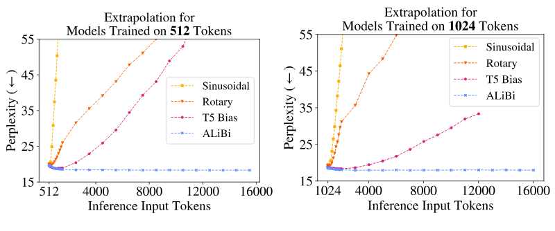

Read the axes and training-length labels before comparing curves. The horizontal axis changes validation input length; the vertical axis measures perplexity. These plots test particular trained models and evaluation policies. The existence of a bias formula for any integer distance is a mathematical fact; maintaining quality at those distances is an empirical result that can depend on the model and data.

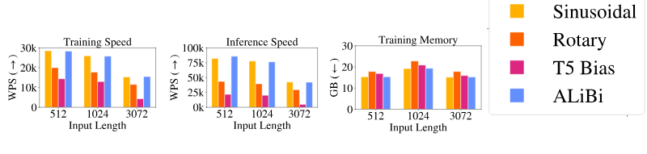

The source measurements belong to their hardware, batch/layout and implementation. A dense materialized per-head bias can consume memory proportional to $H_qT^2$ during full-sequence evaluation; an optimized kernel may generate its elements on demand. “No learned positional parameters” is not permission to ignore allocated masks, bias buffers or memory traffic.

To test longer-context behavior yourself, freeze a model, a dataset, evaluation token accounting, stride/window policy and context lengths. Changing the number of early tokens scored can change perplexity even without a better mechanism. We have not run that training/evaluation study here.

### Reconnect position to the next topic

RoPE modifies Q/K coordinates; ALiBi modifies the score by a fixed distance term. Neither determines how many KV heads exist. MLA will combine a compressed content representation with a separate rotary positional path, so we need both the algebra of linear projections and a precise understanding of where rotation occurs.

The [implementation notes](project/implementation.md), [readiness checks](project/readiness.md) and [transfer review](practice/review.md) support review.

### References

[Press, Smith and Lewis, ALiBi, version 2, Section 3 and Figures 1–3](https://arxiv.org/html/2108.12409v2) and [the authors' implementation and explanation](https://github.com/ofirpress/attention_with_linear_biases). These are the original authors' figures. A separate public Vizuara ALiBi lesson with matching diagrams was not found; the worked progression follows the same problem → matrix → arithmetic → code → limits structure as the preceding tutorials.
- Additional worked SVG figures are original to this tutorial; their inputs and calculations follow the complete executable reference above.


## Evidence and proof limits

### Claim ledger

| Claim | Status | Proof limit |
| --- | --- | --- |
| RoPE rotates paired Q/K coordinates, preserves norms and gives the relative-position dot-product identity when content and frequency are held fixed. | verified | Stated mathematical assumptions and executed tiny reference; no learner, hosted or full-model result. |
| Causal ALiBi adds a fixed head-specific negative distance bias after content scaling; consistent absolute differences preserve cached/full execution equality. | verified | Stated mathematical assumptions and executed tiny reference; no learner, hosted or full-model result. |

## Sources

- [Vizuara RoPE worked explanation](https://vizuara.medium.com/what-exactly-is-rotary-position-embedding-rope-59d616f02e0d) — Complete public article and all thirteen figures; checked 2026-10-30
- [Su et al. RoFormer v5](https://arxiv.org/html/2104.09864v5) — Section 3, pair construction, relative identity and decay assumptions; checked 2026-10-30
- [Press et al. ALiBi v2](https://arxiv.org/html/2108.12409v2) — Section 3 and original Figures 1–3; checked 2026-10-30
- [ALiBi authors implementation and explanation](https://github.com/ofirpress/attention_with_linear_biases) — README mechanism, fixed slopes and implementation links; checked 2026-10-30
