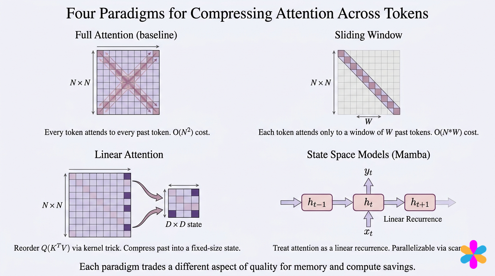
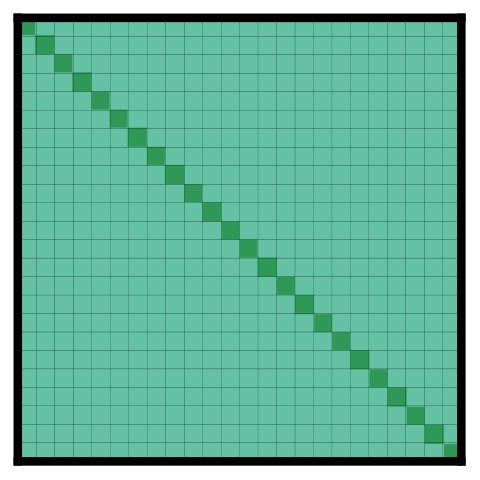
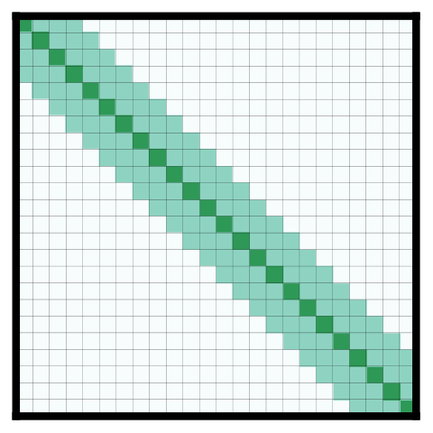
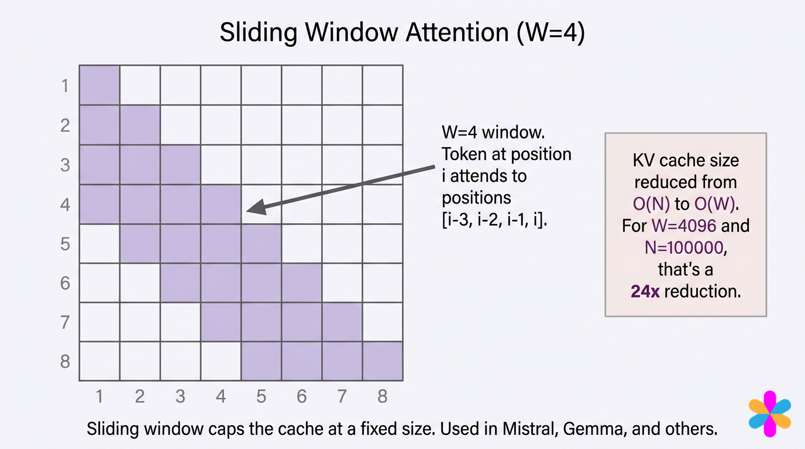
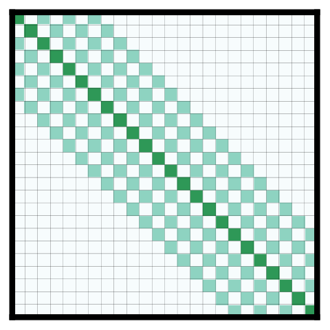
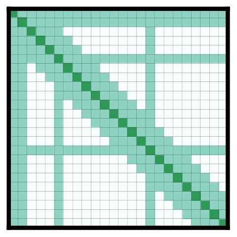
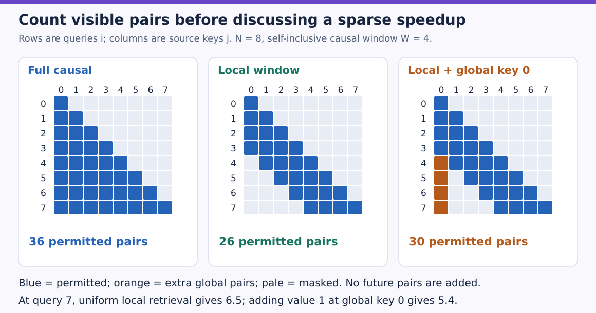
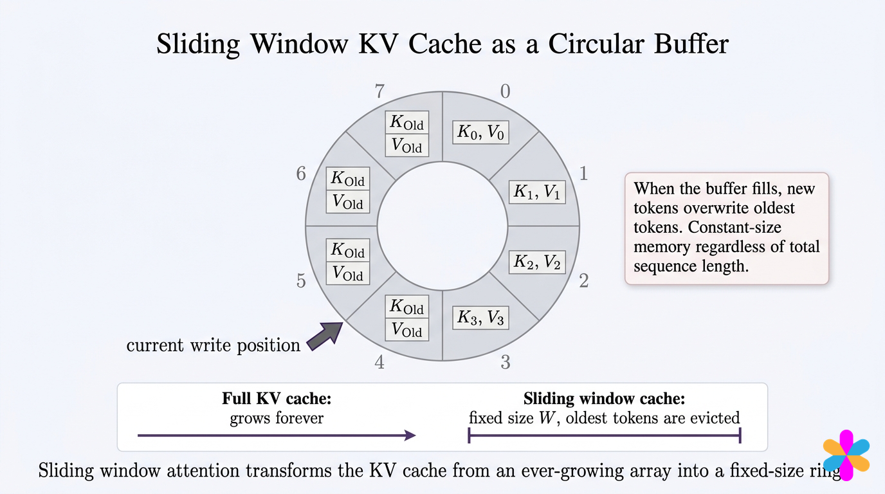
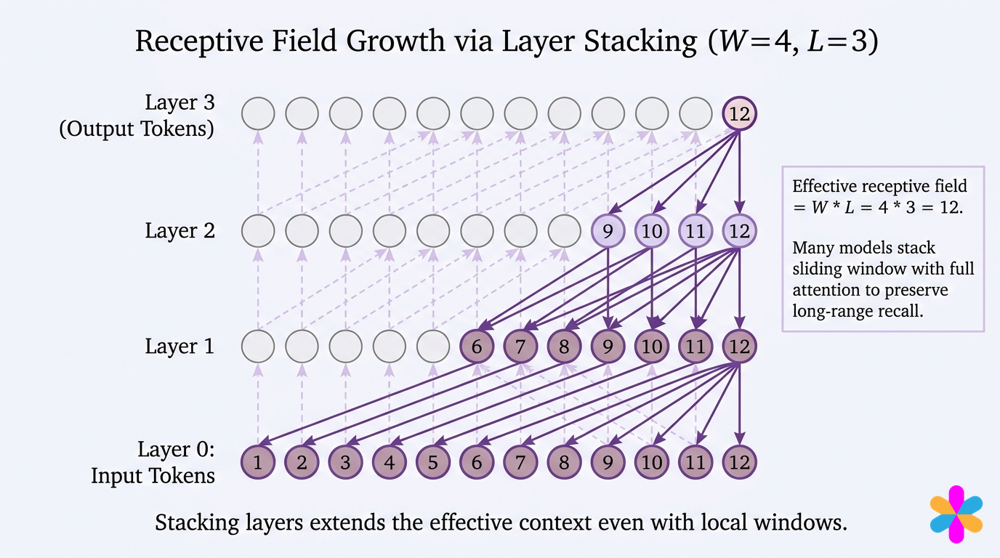
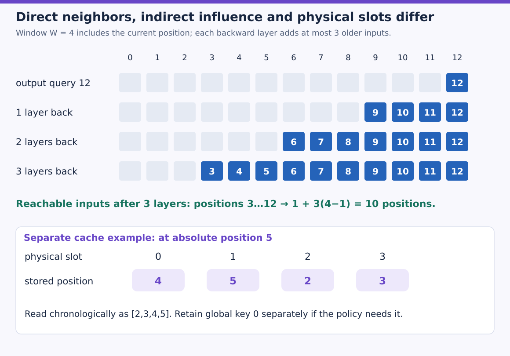

# Attention connectivity: local, global and sliding windows

Which query/key pairs must be visible, and what can be forgotten?

Learning material for attention-labs. Model implementation/training and learner mastery are separate states.

**Outcomes:** Build global/local visibility without causal leakage.; Derive exact reachability and cache retention from the chosen graph..

## Sparse attention: decide which connections exist

FlashAttention kept every permitted dense comparison and changed execution order. Sparse attention changes the permitted comparisons themselves. Begin with a long document: nearby words need detailed context, while a question or document summary may need a route across the whole sequence. A mask can express those different jobs before any kernel is chosen.

### Place the options on one map



A sliding window preserves individual recent keys and values while dropping direct access to older ones. Linear attention, covered next, instead summarizes history in a fixed matrix. State-space models have their own learned recurrence; they are not universally an exact rewrite of softmax attention. Here we implement explicit sparse connections, keeping ordinary softmax over the selected source keys.

### Read rows as destinations and columns as sources



The diagonal marks self-connections. In this bidirectional encoder picture, both earlier and later tokens are visible. A causal decoder intersects the pattern with $j\le i$. With N=8, full causal visibility has $1+2+\cdots+8=36$ pairs. Full bidirectional visibility has 64. Always establish this distinction before comparing counts.



Local attention means visibility is restricted to a neighborhood. A sliding window is a particular local rule that moves with each query. We define W as the **total number of visible positions including the query itself** in the causal case:

$$A_{i,j}=(0\le i-j<W).$$

At W=4, query i sees $i-3,i-2,i-1,i$, clipped at sequence start. Some publications define window width as neighbors on each side; that convention produces a different count. Our program and arithmetic consistently include self within W.



For N=8 and W=4, row counts are `[1,2,3,4,4,4,4,4]`, total 26. Query 7 sees positions `[4,5,6,7]` using zero-based indices. If its four content scores are all zero and their scalar values are `[5,6,7,8]`, weights are one quarter and the result is 6.5. An older value at position 0 cannot affect this row in a single such layer, even if its content would have had a very high score.

### Reach further with gaps or selected global tokens



A causal dilated variant with four selected positions and spacing two sees `[i-6,i-4,i-2,i]`, clipped at the start. It reaches further with the same maximum pair count, but skips intervening positions. A wider span is not the same as representing every token in that span. Multiple heads may use different patterns, provided the wiring and positional coordinates remain explicit.



A global **key** is readable by otherwise distant queries; a global **query** can read distant keys. Longformer's encoder uses both directions for selected task-related positions and separate global projections. For example, a classification token can gather document information, while question tokens connect the question and document.

In a causal decoder, global connections must still obey causality:

$$A_{i,j}=(\text{local}_{i,j}\lor j\in G\lor i\in G)\land(j\le i).$$

Without the last intersection, a global query at position zero reads future tokens. The reference explicitly detects that leakage. It verifies mask semantics with common Q/K/V; it does not implement all of Longformer's separate projection parameters or reproduce its trained model.

With only position zero global, our eight-token causal example has 30 pairs. Rows 4–7 gain the old source zero; earlier rows already contain it. At query 7, uniform content scores now mix values `[1,5,6,7,8]`, giving 5.4. A global path changes the function, not merely its storage layout.

### Predict or explain: Can a causal global token at position zero collect the complete future document?

<details data-practice-id="sparse-global"><summary>Reveal worked answer and rubric</summary>

No. It can collect only keys at positions zero or earlier. Symmetric encoder global attention would leak the future in this decoder setting.

**Rubric:** Intersect global visibility with causality.

</details>




Read one square as one possible query–key comparison. The middle board removes old comparisons while keeping the diagonal. The right board restores four extra pairs in column zero; it does not restore every old key or any future key. The explicit counts distinguish this causal policy from the earlier bidirectional source patterns. Masking a dense result gives the same visibility, but a speed benefit also requires computing only the selected pairs.

### Bound storage only when future queries permit eviction



For pure causal window attention, token t writes physical slot `t % W`. Keep its absolute position with the payload. At t=5,W=4, the physical slots contain positions `[4,5,2,3]`; chronological retrieval uses `[2,3,4,5]`. Physical address zero does not mean positional coordinate zero. RoPE and masks continue to use the original positions.

Global keys require separate retained entries once they leave the window. Our example holds four rolling entries plus global token zero, at most five distinct positions. A model with arbitrary future global queries that read every old key cannot evict those keys under this policy. Similarly, a full-attention layer in a hybrid stack needs its own larger cache. Storage claims must be derived per layer and connectivity rule.

For batch B, KV heads G, widths dk/dv, L window-only layers and element size s, payload is bounded by $B\min(T,W)GL(d_k+d_v)s$, plus retained globals if any. At T=100000,W=4096, the token ratio is about 24.414; using W=4000 would give 25. Neither is an unbounded-context quality guarantee.

### Follow indirect influence through the layer stack



Each causal layer with self-inclusive W reaches at most W-1 positions further back. After L such layers, reachable input positions are

$$[i-L(W-1),i],\qquad\text{width}=1+L(W-1),$$

clipped at zero. For W=4,L=3, this is ten positions, not twelve. With zero-based query12, positions3–12 are reachable. The broad bottom arrows and W-times-L annotation are approximate and include an off-by-one convention; our boolean graph multiplication checks the exact rule used here.

Reachability is only a possible information path. It does not prove that the network preserves a specific old fact or can retrieve it accurately. The old token's influence passes through intermediate representations and learned mixtures. Evaluate direct retrieval and task quality separately.




Start with query 12 and walk backward one row at a time. Each layer can add three earlier positions, so the last row reaches 3 through 12. Blue indicates a possible path, not a preserved fact or an attention weight. The lower panel is a separate decode step at position 5: physical slot zero holds position 4, not position 0. Reorder by stored positions for retrieval and keep any required global entry outside the rolling overwrite policy.

### Compute only the selected sources, then compare

`visibility` constructs a precise boolean graph. `selected` gathers visible keys for each query and softmaxes over those keys. The dense reference computes all scores and masks them afterward; it verifies the same function but still performs a quadratic matrix multiply. The selected-key loop has fewer comparisons but Python overhead, so it is not a fast sparse GPU kernel.

Download [sparse.py](examples/sparse.py) and run `python sparse.py` with PyTorch, or upload it to Colab and run `!python sparse.py`. The complete CPU float64 reference checks outputs and gradients, the rolling cache, future intervention and three-layer reachability.

```python
"""Masks, selected-key execution, receptive fields and a bounded decode cache."""
import json
import math
import torch


def visibility(n,window,globals=(),causal=True,dilation=1):
    i=torch.arange(n)[:,None];j=torch.arange(n)[None,:]
    distance=i-j
    local=((distance>=0)&(distance<window)) if causal else (distance.abs()<window)
    if dilation>1:
        local=((distance>=0)&(distance<=dilation*(window-1))&(distance%dilation==0))
    g=torch.tensor([x in globals for x in range(n)])
    allowed=local|g[None,:]|g[:,None]
    return allowed&(j<=i) if causal else allowed


def selected(q,k,v,mask):
    out=[]
    for i in range(len(q)):
        ids=mask[i].nonzero().flatten()
        if not len(ids):raise ValueError('No visible keys')
        out.append((q[i]@k[ids].T/math.sqrt(q.shape[-1])).softmax(-1)@v[ids])
    return torch.stack(out)


def run_checks():
    torch.manual_seed(83)
    q,k,v=[torch.randn(8,2,dtype=torch.float64,requires_grad=True) for _ in range(3)]
    counts=[]
    for globals in [(),(0,)]:
        mask=visibility(8,4,globals)
        dense=(q@k.T/math.sqrt(2)).masked_fill(~mask,-torch.inf).softmax(-1)@v
        actual=selected(q,k,v,mask)
        torch.testing.assert_close(actual,dense)
        ga=torch.autograd.grad(actual.square().sum(),(q,k,v),retain_graph=True)
        gb=torch.autograd.grad(dense.square().sum(),(q,k,v),retain_graph=True)
        for a,b in zip(ga,gb):torch.testing.assert_close(a,b)
        counts.append(int(mask.sum()))
    ring={};decoded=[];peak=0
    for i in range(8):
        ring[i%4]=(i,k[i],v[i])
        retained={pos:(key,value) for pos,key,value in ring.values()}
        retained[0]=(k[0],v[0])
        ids=sorted(retained);peak=max(peak,len(ids))
        keys=torch.stack([retained[j][0] for j in ids]);values=torch.stack([retained[j][1] for j in ids])
        decoded.append((q[i]@keys.T/math.sqrt(2)).softmax(-1)@values)
    torch.testing.assert_close(torch.stack(decoded),selected(q,k,v,visibility(8,4,(0,))))
    assert peak==5
    reach=visibility(16,4)
    total=torch.eye(16,dtype=torch.bool)
    for _ in range(3):total=(total.to(torch.int64)@reach.to(torch.int64))>0
    assert total[12].nonzero().flatten().tolist()==list(range(3,13))
    assert visibility(8,4,(0,),False)[0,7] and not visibility(8,4,(0,),True)[0,7]
    changed=v.detach().clone();changed[7]+=100
    mask=visibility(8,4,(0,))
    torch.testing.assert_close(selected(q,k,changed,mask)[:7],selected(q,k,v,mask)[:7])
    return {'window_and_global_pairs':counts,'dense_causal_pairs':36,'peak_retained_tokens':peak,
            'three_layer_receptive_positions':list(range(3,13)),
            'outputs_gradients_cache_and_future_checks':True}


if __name__=='__main__':print(json.dumps(run_checks(),sort_keys=True))
```

Expected output includes pair counts 26 and 30, dense causal count36, peak retained positions5 and reachable positions3–12. Banded/block-sparse GPU kernels, trained-model quality and actual Colab execution are separate work. The next lesson changes the memory representation itself using a kernel summary instead of selecting individual old entries.

### Predict or explain: For W=3,L=4, what is the largest causal input span including self?

<details data-practice-id="sparse-depth"><summary>Reveal worked answer and rubric</summary>

1+4*(3-1)=9 positions, clipped at the sequence start. This is possible reachability, not guaranteed retrieval quality.

**Rubric:** Use W-1 and distinguish reachability from learned information.

</details>


[Implementation and commands](project/implementation.md) · [Readiness and limits](project/readiness.md) · [Transfer review](practice/review.md)

### References

- [Vizuara workshop book](https://vizuaraai.github.io/convolution-musical-journey/book.html), Chapter 9.1–9.2 and its four original overview/window/cache/receptive-field figures.
- [Longformer](https://arxiv.org/html/2004.05150v2), Section 3 and all four Figure 2 pattern panels.
- Additional worked SVG figures are original to this tutorial; their inputs and calculations follow the complete executable reference above.


## Evidence and proof limits

### Claim ledger

| Claim | Status | Proof limit |
| --- | --- | --- |
| Selected-key retrieval matches a dense masked reference; causal globals, rolling-cache retention and self-inclusive receptive-field counts follow the declared connectivity. | verified | Stated mathematical assumptions and executed tiny reference; no learner, hosted or full-model result. |

## Sources

- [Vizuara windows](https://vizuaraai.github.io/convolution-musical-journey/book.html) — Chapter 9.1–9.2; checked 2026-10-30
- [Longformer attention patterns](https://arxiv.org/html/2004.05150v2) — Section 3 and Figure 2; checked 2026-10-30
