# Foundation Lab: Bike Demand Planner

How do we turn a future calendar hour into a reproducible demand estimate, and decide what that estimate can support?

Learning material for bike-demand-planner. Model implementation/training and learner mastery are separate states.

**Outcomes:** Which information can a forecast use, and how does an error move the weights?; How do real records become a leakage-safe matrix?; What can a small prediction rule achieve?; Can a weighted calendar sum explain the same hours?; What changes when each update sees fewer rows?; Which errors and calendar patterns does the model represent?; Can tree partitions and ensembles improve later estimates?; Where do the estimates fail and what requests are supported?; What must survive a process restart?; What do untouched later outcomes say about the selected function?.

## One hourly prediction and one numerical update

It is 07:00, and the question is how many bikes will be rented between 08:00 and 09:00. Start by keeping that request separate from the count that will only be known later. We will use a deliberately small calculation first, then connect it to the real dataset in the next lesson. You already have tutorial and PDF background; this course makes those ideas concrete through the running project rather than repeating a prerequisite course. A useful first stopping point is the comparison between targets 45 and 35: explain the opposite updates before continuing.

### 1. Begin with the question an analyst actually asks

```video
{
  "title": "What is known before the rental hour?",
  "duration": 220.5,
  "src": "media/bike-first-hourly-contract/video.mp4",
  "poster": "media/bike-first-hourly-contract/poster.jpg",
  "captions": "media/bike-first-hourly-contract/captions.vtt",
  "transcript": "media/bike-first-hourly-contract/transcript.md"
}
```

Imagine it is Monday, 17 October 2011, at 07:00 in the bike system's local time. An operations analyst wants an estimate for rentals during the upcoming 08:00–09:00 hour. The date is genuinely a Monday, but everything about the rental count and starting weights below is illustrative. We have not acquired a UCI record for it. Local time here is the working scenario for Washington's system; the archive's actual timestamp/holiday conventions will be checked in the data phase.

The question is: **given what is available at 07:00, how many rentals will be recorded across the whole system during that specified hour?** This is observed rental demand. It is not station inventory, unmet requests or an operational allocation decision.

| Part of the contract | Concrete choice in this example |
| --- | --- |
| Forecast issue time | 2011-10-17, 07:00 local system time |
| Target interval | [08:00, 09:00): include the start, exclude the next hour's start |
| Lead time to the interval's start | One hour |
| Duration being aggregated | One hour |
| Target | Total observed rentals during that interval, eventually `cnt` |
| Available information | Target calendar date/hour, weekday/month and known calendar flags |
| Initial task | Calendar-only prediction, no future observed weather/demand |
| Output | A numeric estimate in rentals during that hour, with model/feature identity |
| Later comparison | Recorded target and signed error, stored separately from forecast inputs |

A conceptual request might carry the issue/target times and known calendar fields. It does **not** carry `cnt`, `casual` or `registered`. In the intended data, the latter two components reveal the total and would defeat the problem if used as predictors. This contract is written for the worked example; an application request parser and complete runtime enforcement have not been implemented in lesson 1.

For this example we treat the date as a nonholiday working day. That working-day value is an explicit scenario assumption; dataset acquisition will verify the source's calendar meaning. Known information is allowed information, but a toy model does not have to use every allowed field.

### 2. Keep prediction and learning on the correct sides of time

At 07:00 we can run the prediction rule using calendar inputs and its current weights. At that point the 08:00–09:00 count is still unknown. Once the interval finishes, a recorded target can be paired with the earlier features and used to calculate an error or a training update.

This order matters even in historical replay: a CSV row may contain both features and target, but their being present in the same file does not make the target available to a forecast. Likewise, an observed future-hour weather field is not a forecast issued beforehand. The model-input construction must preserve the declared information boundary.

When we later recalculate the same example with updated weights, we are checking the training step retrospectively. We are not pretending the updated prediction was the original 07:00 forecast.

### 3. Choose a small explicit feature representation

Use two features for this arithmetic:

```python
working_day = 1.0
hour = 8.0
hour_scale = 4.0
features = [working_day, hour / hour_scale]  # [1.0, 2.0]
```

The first value tells the toy rule that this is a working day. The second expresses the clock hour in units of four hours. The divisor four is a fixed demonstration choice: it makes the retained `[1, 2]` numerical example correspond to the concrete 08:00 scenario. It is not fitted on held-out data, and it is not a recommendation for the final model. Later lessons compare calendar encodings and training-fitted scaling.

Feature order is part of the contract: position zero is working day, and position one is this scaled hour. Swapping them while retaining the same weights changes the meaning of the calculation. The eventual predictor must save and validate its exact feature schema rather than trusting arbitrary column order.

We will use `x` for this two-element feature vector, `w` for the matching weights, `b` for the bias, `p` for a prediction and `y` for the observed target. For this one observation, `x` and `w` each have length two and the other quantities are scalar numbers.

### 4. Make the first prediction

```video
{
  "title": "Build the prediction and measure its error",
  "duration": 236.29166666666666,
  "src": "media/bike-first-prediction-and-loss/video.mp4",
  "poster": "media/bike-first-prediction-and-loss/poster.jpg",
  "captions": "media/bike-first-prediction-and-loss/captions.vtt",
  "transcript": "media/bike-first-prediction-and-loss/transcript.md"
}
```

Start from hand-chosen parameters, not trained bike-data estimates:

```python
weights = [10.0, 5.0]
bias = 20.0
```

The prediction rule is a weighted sum plus the bias:

```text
p = w1*x1 + w2*x2 + b
  = 10*1 + 5*2 + 20
  = 10 + 10 + 20
  = 40
```

The first feature contributes 10 rentals, the second contributes another 10, and the intercept adds 20. The intercept allows a common offset rather than requiring the weighted sum alone to explain the level. These are components of a deliberately simplified rule, not causal claims about working days or clock time.

The source function implements that same expression:

```python
return sum(x * w for x, w in zip(features, weights, strict=True)) + bias
```

The full function also rejects empty/mismatched vectors and nonfinite inputs. Those checks protect the stated numerical contract; the useful mathematical operation remains the weighted sum.

At forecast time this calculation needs features, weights and bias. It does not need a target or loss. It currently predicts 40 rentals for the specified hour. A model can return a fractional estimate even though an observed rental count is integer-valued; it represents a point estimate, not a literal fractional rental event.

### 5. Observe a target, then measure the error

After 09:00, suppose the recorded count is `y = 45`. Again, 45 is an invented target for the example, not an acquired data result.

Choose residual `r = prediction - target`:

```text
r = 40 - 45 = -5
```

This sign convention makes an underprediction negative and an overprediction positive. Keeping it explicit is important: mixing it with a target-minus-prediction derivative would reverse the update.

For one observation, use half squared error:

```text
L = (1/2)*(p-y)^2
  = (1/2)*(-5)^2
  = 12.5
```

The factor one-half is chosen so its derivative is simpler. It does not make this an alternative final evaluation metric: later task comparison primarily uses MAE in rentals/hour, with RMSE and error slices. This objective has squared rental units and is not an accuracy percentage. No batch mean is needed here because there is exactly one observation.

The corresponding source uses the same residual:

```python
residual = prediction - target
return 0.5 * residual**2
```

### 6. Connect the loss to each parameter through the chain rule

```video
{
  "title": "Follow the chain rule through one update",
  "duration": 234.41666666666666,
  "src": "media/bike-first-gradient-update/video.mp4",
  "poster": "media/bike-first-gradient-update/poster.jpg",
  "captions": "media/bike-first-gradient-update/captions.vtt",
  "transcript": "media/bike-first-gradient-update/transcript.md"
}
```

The loss depends on the prediction, and the prediction depends on each weight and the bias. To see how a parameter affects the loss, multiply those two local relationships.

For half squared error, differentiating with respect to the prediction gives:

```text
dL/dp = (1/2)*2*(p-y) = p-y = r
```

For the linear rule, increasing `w1` by a tiny amount increases the prediction by `x1` times that amount, so `dp/dw1 = x1`. Similarly `dp/dw2 = x2`, and `dp/db = 1`. Therefore:

```text
dL/dw1 = (dL/dp)*(dp/dw1) = r*x1 = -5*1 = -5
dL/dw2 = (dL/dp)*(dp/dw2) = r*x2 = -5*2 = -10
dL/db  = (dL/dp)*(dp/db)  = r*1  = -5
```

The result is a gradient for every trainable parameter: `gradient_w = [-5, -10]` and `gradient_b = -5`. Features and target describe the fixed example; gradients say how the current loss changes locally when the parameters change. We do not change the target to make the model look better.

The second weight gradient is twice the first because the second feature is twice as large. This is an early concrete connection between feature scaling and optimization. It does not mean the second feature is universally twice as useful; it is a property of this particular forward path and example.

The gradient function is the calculation above in vector form:

```python
residual = prediction - target
return [residual * x for x in features], residual
```

### 7. Apply one gradient-descent update

Choose learning rate `eta = 0.01`. For each parameter, subtract the learning rate times its gradient:

```text
parameter_next = parameter_current - eta*gradient
```

| Parameter | Current | Gradient | Scaled gradient | New value |
| --- | ---: | ---: | ---: | ---: |
| First weight | 10.00 | -5 | -0.05 | 10.05 |
| Second weight | 5.00 | -10 | -0.10 | 5.10 |
| Bias | 20.00 | -5 | -0.05 | 20.05 |

The negative gradients make subtraction increase the parameters here. That is consistent with the current underprediction: increasing weights on these positive features and increasing the bias raises this prediction toward its target. With other feature signs or another target, the directions can differ; do not memorize “training increases weights.” The invariant is subtraction of the actual gradient.

The source creates new parameter values rather than mutating the old list, so before/after state remains inspectable:

```python
next_weights = [
    weight - learning_rate * gradient
    for weight, gradient in zip(weights, weight_gradients, strict=True)
]
next_bias = bias - learning_rate * bias_gradient
```

A rate of 0.01 is a demonstration setting, not a rate already chosen for bike-data training. It controls step scale; too large a step can overshoot. A zero rate leaves the parameters unchanged, and the numerical API rejects a negative or nonfinite rate.

### 8. Recompute the same example as a check

Hold the feature vector and target fixed. The new prediction is:

```text
p_next = 1*10.05 + 2*5.10 + 20.05
       = 10.05 + 10.20 + 20.05
       = 40.30

r_next = 40.30 - 45 = -4.70
L_next = (1/2)*(-4.70)^2 = 11.045
```

The new weights contribute `0.05 + 2*0.10`, and the bias contributes another `0.05`, so the total prediction increase is `0.30`. This separate arithmetic check helps catch an incorrect sign or a missed feature contribution. Loss decreases from 12.5 to 11.045 on this same observation.

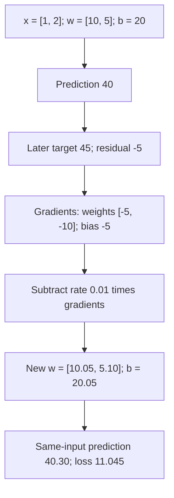

These arrows follow the arithmetic and parameter state, not a causal account of real bike demand. The final node is a repeated training-example check. It says nothing yet about unseen-hour error, seasonal robustness, baseline improvement or the best feature design.

### 9. Read and run the actual source

The reusable functions are in [linear.py](code/src/bike_demand_planner/linear.py). The standalone [linear_example.py](code/linear_example.py) declares working day/hour/scale, starting weights/bias, targets and rate in its main block, then calls prediction, loss, gradients, update and the repeated check in that order. It now runs the original target 45 and the changed target 35 independently from the same starting parameters. No dataset or hidden trainer is involved.

From the project folder:

```bash
uv run --frozen python linear_example.py
uv run --frozen python -m unittest discover -s tests -v
```

The first executed case reports prediction 40.0 and loss 12.5, gradients `[-5.0, -10.0]` and `-5.0`, updated parameters `[10.05, 5.1]` and `20.05`, then prediction 40.3 and loss approximately 11.045. The second case is traced below. Python's binary floating-point output can show `11.045000000000014` and residual magnitude `4.700000000000003`; these are representation roundoff, not a different objective.

Seven checks pass. They cover the two known-answer update directions, old-parameter preservation, central finite differences on a different mixed-sign input, zero-error/zero-rate behavior, vector-shape failures and nonfinite/negative-rate rejection. Finite differences check how perturbing one parameter changes the executed objective; they are not just another copy of the analytic formula.

### 10. Change only the target to 35 and compare the update

```video
{
  "title": "Change the target to 35 and compare both updates",
  "duration": 230.75,
  "src": "media/bike-first-opposite-target/video.mp4",
  "poster": "media/bike-first-opposite-target/poster.jpg",
  "captions": "media/bike-first-opposite-target/captions.vtt",
  "transcript": "media/bike-first-opposite-target/transcript.md"
}
```

This is an alternative outcome for the same illustrative hour. It is a controlled comparison, not another observation after the target-45 update. Both cases start from `[10, 5]` and bias `20`. In the actual source, the main block holds these starting parameters fixed and stores each result separately:

```python
targets = [45.0, 35.0]
learning_rate = 0.01

cases = []
for target in targets:
    # Each target starts from the same weights and bias.
    prediction = predict(features, weights, bias)
    loss = half_squared_error(prediction, target)
    weight_gradients, bias_gradient = squared_error_gradients(features, prediction, target)
    next_weights, next_bias = sgd_step(
        weights, bias, weight_gradients, bias_gradient, learning_rate,
    )
    next_prediction = predict(features, next_weights, next_bias)
    next_loss = half_squared_error(next_prediction, target)
```

The result-building/JSON lines follow this block in the source. The distinction between `weights` and `next_weights` matters: `sgd_step` returns a new list, and the loop never assigns it back to the starting `weights`. Therefore the second case begins with prediction 40, not 40.30. A loop that assigned the updated values back would answer a different question about successive training steps.

**First, predict with the unchanged parameters.** The prediction function receives only features, weights and bias. Changing the target does not alter this call or its result:

```text
p = 1*10 + 2*5 + 20 = 40
```

**Second, compare that prediction with the new outcome.** We use prediction minus target consistently, so the residual is positive:

```text
r = 40 - 35 = +5
L = (1/2)*(+5)^2 = 12.5
```

Positive residual means the model is five rentals too high. The objective has exactly the same value as before because `(+5)^2` and `(-5)^2` both equal 25. That equality does not mean the corrections should go in the same direction.

**Third, follow the chain rule to each parameter.** For `L = (1/2)*(p-y)^2`, the prediction derivative is `p-y = 5`. The prediction changes by `x_i` per unit change in weight `w_i`, and by one per unit change in bias. Thus:

```text
dL/dw1 = (p-y)*x1 = 5*1 = +5
dL/dw2 = (p-y)*x2 = 5*2 = +10
dL/db  = (p-y)*1  = 5*1 = +5
```

The second gradient is twice as large because the second feature is two. A positive weight gradient means that a small increase in that weight would increase the loss at the starting point. Gradient descent takes a step in the other direction by subtracting the scaled gradient. This statement about both weight directions relies on the positive features in this case; a negative feature would reverse its corresponding weight gradient.

**Fourth, apply the same rate of 0.01 to each gradient.** The subtraction is unchanged between cases; only the signs of the gradients change:

| Parameter | Starting value | Gradient | Actual parameter change, `-0.01*gradient` | Updated value |
| --- | ---: | ---: | ---: | ---: |
| First weight | 10.00 | +5 | -0.05 | 9.95 |
| Second weight | 5.00 | +10 | -0.10 | 4.90 |
| Bias | 20.00 | +5 | -0.05 | 19.95 |

**Fifth, recompute with the updated parameters and the same input.** The first weighted contribution falls by 0.05, the second by `2*0.10 = 0.20`, and the bias by another 0.05. The total prediction falls by 0.30:

```text
p_next = 1*9.95 + 2*4.90 + 19.95
       = 9.95 + 9.80 + 19.95
       = 39.70

r_next = 39.70 - 35 = +4.70
L_next = (1/2)*(4.70)^2 = 11.045
```

This step leaves an overprediction, but a smaller one. The rate specifies a step along the loss gradient; it does not require the updated prediction to equal the target after one step.

The [comparison table](project/comparisons/01-prediction-contract.md#targets-on-opposite-sides-of-the-same-prediction) puts the two cases next to each other. They have the same initial error magnitude, final error magnitude and loss reduction, while their residuals, gradients and parameter changes have opposite signs. The executed JSON is saved separately as [changed-target output](evidence/01-prediction-contract-and-one-update/changed-target-output.json); the original target-45 evidence remains in [numerical-output.json](evidence/01-prediction-contract-and-one-update/numerical-output.json).

### 11. What is complete, and where to pause

The worked contract and single-observation arithmetic are implemented/explained. We have not acquired data, fitted a real demand estimator, built a batch trainer or evaluated future hours. Calendar/holiday and source timestamp semantics still need the data phase, and the production request schema is not enforced by an application yet.

The learner has correctly explained the update direction for the target-35 case with these positive features. Both cases are implemented, executed and compared step by step, and the source is committed as `4794ad4`. The completion review closes the worked contract/update scope and moves to official data acquisition/audit. This records one observed piece of reasoning rather than independent verification of every calculation or blanket mastery. Feature scaling can be revisited as reinforcement when the actual feature encoding is chosen.

### Keep the reasoning beside the result

[Learning points](project/learning-points/01-prediction-contract.md) explain what this calculation changes in our understanding. [Comparisons](project/comparisons/01-prediction-contract.md) put the alternatives side by side. [Setup and commands](project/setup.md) and the [current completion record](project/implementation.md) give the executable project context.

### Predict or explain: Starting again from prediction 40, what happens if only the target changes from 45 to 35?

<details data-practice-id="prediction-contract-check"><summary>Reveal worked answer and rubric</summary>

Residual changes from -5 to +5. With x=[1,2] and rate .01, gradients change from [-5,-10], -5 to [5,10], 5. Parameters become [9.95,4.9], 19.95 and the same input predicts 39.70. Compare both runs from the same initial parameters.

**Rubric:** Keep the initial state fixed, name the residual convention, and account for all three updates.

</details>


The arithmetic needs actual calendar records and a time boundary. Continue to [the next lesson](lessons/02-hourly-data-and-splits.md) when this step is clear.

### Course records

[Reading route](project/course-outline.md) · [Reference runs](project/reference-runs.md) · [Sources and retained choices](research.md) · [Review questions](practice/explain-your-model.md) · [Migration map](evidence/migration.json) · [Local video identities](local-videos.json)


## Understand the hourly data, calendar features and time split

The first calculation gave us a clear forecast and update rule. Now follow an actual Monday 08:00 row from the acquired CSV into the feature vector and its time partition. Watch each short companion before reading its worked explanation; none of the later counts is allowed to cross back into the original request.

### Start with a Monday morning

```video
{
  "title": "The hourly prediction contract",
  "duration": 281.604667,
  "src": "media/bike-data-hourly-contract-depth/video.mp4",
  "poster": "media/bike-data-hourly-contract-depth/poster.jpg",
  "captions": "media/bike-data-hourly-contract-depth/captions.vtt",
  "transcript": "media/bike-data-hourly-contract-depth/transcript.md"
}
```


Imagine it is 07:00 on Monday, 3 January 2011. We want to estimate how many rentals the system will record between 08:00 and 09:00. That gives us one hour of lead time before the target interval begins.

The acquired CSV has a real observation for that hour: **record 54**, with a total of **154 rentals**. We can read that outcome now because we are looking back at a completed day. At the original 07:00 forecast time, those rentals had not happened yet.

Here is the part of the row we will use to describe the upcoming hour:

| Field | Value | What it tells us |
| --- | ---: | --- |
| `hr` | 8 | The target interval begins at 08:00 |
| `weekday` | 1 | It is Monday; this source uses Sunday as 0 |
| `mnth` | 1 | It is January |
| `holiday` | 0 | The source's holiday flag is off |
| `workingday` | 1 | The source marks it as a working day |

The observed `cnt=154` sits alongside those fields in the CSV, but it has a different job. The calendar describes the case we want to predict. The count is the answer we can compare with a prediction once the hour has finished.

This is why having everything in one file does not make everything a valid input. If we pass the later outcome into the prediction function, we have changed the problem. We would be giving the model information that the real forecast would not have had.

There is no fitted prediction for this row yet. The 154 is an observation from the source, and the earlier 40 came from a separate arithmetic example with hand-chosen weights.

#### Ask what changes when the requested hour changes

Suppose the next request is for 09:00–10:00 on the same Monday. With the same one-hour lead, its issue time is 08:00. The calendar hour changes from 8 to 9; weekday, month, holiday and working-day status stay the same. Its later rental total belongs to that new interval, so we cannot carry the earlier target of 154 across as its answer. Moving the requested interval changes the question even when most inputs remain identical.

This is why the target timestamp and issue timestamp travel with the row as metadata. The feature vector describes the request, while those timestamps let us ask whether the request could actually have been made. Knowing the calendar at issue time is different from knowing the eventual count. In particular, the source convention makes an interval's observed count available at its end, not simply because its start-time label is already known.

The implementation follows this boundary explicitly: the parser keeps the target apart from the calendar fields, and `encode_calendar` receives only the declared inputs. If `cnt` appears in that mapping, rejecting it is useful. It catches a violation of the forecasting question before an impressive score can hide it.


### Separate the useful inputs from the rest of the row

```video
{
  "title": "Useful inputs, leakage and missing hours",
  "duration": 289.979329,
  "src": "media/bike-data-source-audit-depth/video.mp4",
  "poster": "media/bike-data-source-audit-depth/poster.jpg",
  "captions": "media/bike-data-source-audit-depth/captions.vtt",
  "transcript": "media/bike-data-source-audit-depth/transcript.md"
}
```


A source row carries several kinds of information. We need its record ID and date/hour to find it again, check ordering and decide which time period it belongs to. We need calendar fields to describe it to a model. We need its rental count later for training or evaluation. Those roles should stay visible in the code.

The first row in the file gives a particularly simple example of a field that is useful for checking data but unsuitable as a forecast input. It describes Saturday, 1 January 2011 at 00:00, and records:

```text
casual rentals       = 3
registered rentals   = 13
total rentals, cnt   = 16

3 + 13 = 16
```

The component counts help us check that the total is consistent. If we used those same-hour components as predictors, their sum would reveal the answer directly. We therefore validate the equality while keeping both components out of the model inputs.

Observed weather needs the same timing check. A measurement taken during 08:00–09:00 is different from a weather forecast available at 07:00. Our first task uses calendar information only, so the observed-weather fields stay out. A weather-based comparison would need its own definition of what was available and when.

In [data.py](code/src/bike_demand_planner/data.py), `parse_hourly_row()` gives the row's parts separate names:

```python
return HourlyRecord(
    record_id=numbers["instant"],
    target_time=datetime.combine(day, time(hour=numbers["hr"])),
    calendar={name: numbers[name] for name in CALENDAR_FIELDS},
    target=numbers["cnt"],
)
```

The `calendar` dictionary here keeps seven validated source fields: season, year, month, hour, holiday, weekday and working day. It is an intermediate record of the source information. We make the modelling choice about which fields to use in the next step. The target remains separate throughout.

Before returning that record, the parser also checks that all 17 required fields are present, codes are in range, numeric values are finite and the date agrees with the year, month and weekday fields. Working-day status must agree with the weekend and holiday flags. For example, the first row is a Saturday, so a working-day flag of zero is consistent even though its holiday flag is also zero.

The file audit then checks unique record IDs, unique date/hour labels and chronological order. These checks give us a sensible collection of observations to work with. They do not tell us how accurately a future model will predict rentals.

#### See how filling a missing hour changes the answer

The complete naive grid would have 17,544 hourly slots, while the file records 17,379 observations. The difference is 165 slots, about 0.94% of that grid. That fraction tells us how much is unrecorded under this label convention; it does not tell us why the rows are missing or what their demand was. The source's naive timestamps also do not establish a time zone or a daylight-saving interpretation.

Consider an explicitly illustrative three-hour window with recorded counts 10, no row, and 30. The average of the two observed counts is 20. If we manufacture a zero for the middle hour, the average becomes `(10 + 0 + 30) / 3`, about 13.33. We changed both the numerator and the denominator by introducing an outcome the source never supplied. That change could alter a fitted constant baseline, its residuals and any lag built from the sequence.

There are therefore two different checks to perform. Validate the rows that exist: their fields, finite values, identities and component counts must agree. Separately inspect the time grid for absent labels. A file can pass every cell-level check and still have a gap between two valid rows. Keep the gap as missing evidence until a later, explicitly justified missing-data policy is chosen.


### Give each hour its own place in the vector

```video
{
  "title": "Build the 45 calendar inputs",
  "duration": 394.145996,
  "src": "media/bike-data-calendar-vector-depth/video.mp4",
  "poster": "media/bike-data-calendar-vector-depth/poster.jpg",
  "captions": "media/bike-data-calendar-vector-depth/captions.vtt",
  "transcript": "media/bike-data-calendar-vector-depth/transcript.md"
}
```


We now have a clean description of Monday at 08:00. The next question is how to turn it into numbers that a linear model can use.

Suppose we feed the hour in as the single number 8. Its contribution to a linear prediction would be:

```text
hour contribution = hour_weight × hour
```

Every increase of one hour would change the prediction by the same `hour_weight`. That is a straight-line relationship across the day. One slope cannot describe a morning rise, a midday dip and another rise in the evening. There is another awkward detail: 23:00 and 00:00 are adjacent on a clock, but their raw numbers are far apart.

For our first representation, we give each hour its own indicator. At 08:00, the indicator for hour 8 is one and the other 23 hour indicators are zero. We do the same for weekday and month, then keep the two flags as ordinary zero-or-one values.

The declarations in [features.py](code/src/bike_demand_planner/features.py) make the groups explicit:

```python
CATEGORY_DOMAINS = (
    ("hr", tuple(range(24))),
    ("weekday", tuple(range(7))),
    ("mnth", tuple(range(1, 13))),
)
FLAG_FIELDS = ("holiday", "workingday")
INPUT_FIELDS = tuple(name for name, _ in CATEGORY_DOMAINS) + FLAG_FIELDS
```

Those groups give us `24 + 7 + 12 + 2 = 45` values in a fixed order. We first select the five fields we actually want from the larger source calendar:

```python
calendar = {name: record.calendar[name] for name in INPUT_FIELDS}
features = encode_calendar(calendar)
```

After checking the fields and their values, the encoder builds the indicators like this:

```python
encoded = [
    float(calendar[name] == category)
    for name, categories in CATEGORY_DOMAINS
    for category in categories
]
return encoded + [float(calendar[name]) for name in FLAG_FIELDS]
```

Read the comparison inside the loop as a simple question: does this row belong to this hour, weekday or month? A match becomes 1.0; every other category gets 0.0.

For our Monday example, the positions are:

| Part of the vector | Positions, counting from zero | Value for this row |
| --- | --- | --- |
| Hour indicators | 0–23 | Position 8, `hr_08`, is 1 |
| Weekday indicators | 24–30 | Position 25, `weekday_01`, is 1 |
| Month indicators | 31–42 | Position 31, `mnth_01`, is 1 |
| Holiday flag | 43 | 0 |
| Working-day flag | 44 | 1 |

That is four ones and 41 zeros. The diagram shows the same construction without listing all 45 values:

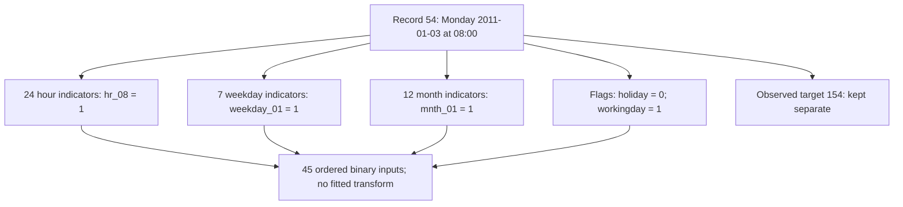

Each calendar branch contributes its part of the input vector. The recorded 154 follows a separate branch because it is the outcome we will eventually compare against.

Once we fit a linear model, its calculation for this row will have this form:

```text
prediction = bias
           + weight_for_hour_08
           + weight_for_Monday
           + weight_for_January
           + weight_for_working_day
```

There are no fitted weights yet, so this expression does not produce a numeric estimate here. It shows which coefficients would participate in the prediction.

If we change only the encoder's hour input from 8 to 9, `hr_08` switches off and `hr_09` switches on. The weekday, month and flag values stay the same. With fitted weights, the prediction would change by `weight_for_hour_09 - weight_for_hour_08`. This is a useful way to see what the representation permits. It does not assume that the next real hour has the same observed target of 154.

One-hot encoding gives the model flexibility to learn a separate hourly effect, but it does not teach the model that neighbouring hours should behave similarly. A sine/cosine representation can express circular proximity using fewer columns, while a linear model with one such pair has a more constrained daily shape. We have chosen a readable first representation, with alternatives left for a controlled comparison later.

#### Trace a changed hour all the way to a dot product

For the Monday 08:00 example, the active positions are `[8, 25, 31, 44]`. Asking about 09:00 on that same day gives `[9, 25, 31, 44]`. There are still 45 values and four ones. Exactly two coordinates change: position 8 goes from one to zero and position 9 goes from zero to one. All other coordinates retain their meanings and values.

To see why that matters to a linear model, temporarily choose illustrative coefficients rather than fitted ones. Let the intercept be 10, the hour-8 coefficient 20, the Monday coefficient 3, January 2, and working-day 5. The 08:00 prediction is `10 + 20 + 3 + 2 + 5 = 40`. If the hour-9 coefficient is 12, the changed request predicts `10 + 12 + 3 + 2 + 5 = 32`. The eight-rental difference comes entirely from replacing one hour coefficient. These numbers explain the representation; they are not trained predictions for source record 54.

The code's nested iteration over the fixed category domains establishes that coordinate order. `FEATURE_NAMES` describes it, and the schema saves it. Keeping only the array length is insufficient: swapping the meanings of hour 8 and hour 9 would preserve the shape and number of ones while changing the calculation. A later model and its saved schema must agree on names and order.


### Understand the fields we left out

```video
{
  "title": "What the calendar representation assumes",
  "duration": 345.270996,
  "src": "media/bike-data-representation-depth/video.mp4",
  "poster": "media/bike-data-representation-depth/poster.jpg",
  "captions": "media/bike-data-representation-depth/captions.vtt",
  "transcript": "media/bike-data-representation-depth/transcript.md"
}
```


Year is available in advance, so excluding it is not a leakage rule. The reason is more specific: our training period is 2011, and every row in it has `yr=0`.

Recall the weight gradient from the earlier numerical example:

```text
weight gradient = residual × feature value
```

For a raw year feature that is zero on every training row, that gradient is always zero. Training cannot learn a year-to-year effect from that feature. Supplying `yr=1` in 2012 would then use a coefficient whose effect was never identified by these training examples. We leave year out of this first schema rather than imply that it has learned growth between the two years.

We also leave out the source's coarser season code while keeping month. This keeps the first representation small enough to inspect and avoids attaching the source documents' conflicting season names. It does not establish that season is useless or that month fully determines it. We can test a different feature set later using the same evaluation periods.

There is one further detail about the full one-hot representation. Exactly one hour indicator is always one. If we added 2 to every hour coefficient and subtracted 2 from the bias, the prediction would be unchanged:

```text
(bias - 2) + (active_hour_weight + 2)
= bias + active_hour_weight
```

That is a dependency between the hour columns and the intercept. The other full category groups have a similar dependency, and some flags can overlap with the calendar groups too. Predictions and gradients still have a clear meaning, but individual coefficients need not have a unique value. We should therefore be careful about interpreting a single coefficient as a unique effect, especially a causal one.

Dropping one reference category from each group would reduce the representation from 45 to 42 values. Regularization is another choice we will study later. Neither has been added silently to this preparation step.

#### Compare clock distance and coefficient meaning

The circular alternative uses an angle `2πh/24`. At hour 0, sine and cosine are `(0, 1)`. At hour 23 they are approximately `(-0.2588, 0.9659)`, giving a Euclidean distance of about 0.2611. Raw hour numbers put those adjacent clock positions 23 units apart. Circular coordinates encode that closeness, while a linear model over one sine/cosine pair still has a smooth single-harmonic daily shape. That is a modelling assumption, not a guarantee of better forecasts; richer harmonics or interactions would be separate choices.

Full one-hot encoding makes a different tradeoff: the hour contribution can vary independently across categories. With an intercept, however, the individual coefficients need not be unique. Every row activates exactly one hour indicator. Add 5 to all 24 hour coefficients and subtract 5 from the intercept: the active hour adds five more, the intercept adds five less, and every prediction stays identical. For the illustrative 08:00 calculation, `10 + 20` becomes `5 + 25`.

That does not make the predictions undefined. It means a coefficient's isolated value is not automatically a unique, causal explanation. Dropping a reference category or adding regularization changes how parameters are represented or selected; those choices must be made and compared explicitly later. For now, retain the fixed schema and avoid reading more into its coefficients than the model identifies.


### Keep fixed encoding separate from learning statistics

The possible hours, weekdays and months come from calendar definitions. We do not need to inspect future observations to discover that an hour can be between 0 and 23. This encoding therefore has no fitting step: the same fixed rules apply to training, validation and test rows.

Every output value is already zero or one, so we have not fitted a scaler. If we later introduce a transform that learns a mean, scale or selected feature set, that learning must use the training portion only. Validation and test rows must use the already fitted transform. A time-based cross-validation fold would have its own training portion and follow the same rule.

The current code does count how often each feature is one, using training rows only. That is a descriptive check, not a fitted scaler. If a column is constant in training, it keeps its declared position. We do not divide by a zero standard deviation or use the later data to decide which columns disappear. None of the actual 45 training columns is constant; a small test fixture exercises the constant-column case.

A known calendar category can be absent from a small training sample and still have a valid place in the schema. The model simply has no examples from which to estimate that category's effect. An impossible hour such as 24 is different: it is rejected. Missing fields, extra fields such as `cnt`, noninteger category codes and inconsistent working-day flags are rejected as well.

`calendar_schema()` saves these rules with the ordered feature names. Saving the order matters because a weight belongs to a particular feature position. Swapping columns later while retaining the weights would change what the prediction means.

### Let the time split follow the forecasting question

```video
{
  "title": "Time splits and information availability",
  "duration": 369.395996,
  "src": "media/bike-data-chronological-split-depth/video.mp4",
  "poster": "media/bike-data-chronological-split-depth/poster.jpg",
  "captions": "media/bike-data-chronological-split-depth/captions.vtt",
  "transcript": "media/bike-data-chronological-split-depth/transcript.md"
}
```


We want to estimate later hours using earlier observations, so our evaluation should follow that direction. Training on a random mixture that includes later hours would answer a different question from the one-hour-ahead forecasting task.

The chosen periods give each part a clear role. We use 2011 to estimate parameters, January–June 2012 to compare choices, and July–December 2012 for the reserved final evaluation. We have not used test outcomes or model errors to choose these boundaries.

There is a small but important complication at midnight. An outcome belongs to a target interval, and it becomes known after that interval finishes. Sorting the interval start times alone does not check that the outcome was available when a forecast needed to be issued.

Look at the end of training:

```text
Last training interval:       31 Dec 2011, 23:00–00:00
Last training outcome ready:   1 Jan 2012, 00:00
```

Now consider a validation target starting at 00:00 on 1 January. With a one-hour lead, its forecast must be issued at 23:00 on 31 December. At that moment, the last training interval is only beginning. We cannot use its completed outcome to build the model for that forecast.

We solve this by leaving the midnight target out of evaluation. The first validation target is 01:00, whose forecast is issued at 00:00. That issue time meets the point at which the preceding stage's outcomes are available. The same reasoning leaves out the midnight target at the July boundary after validation-based selection.

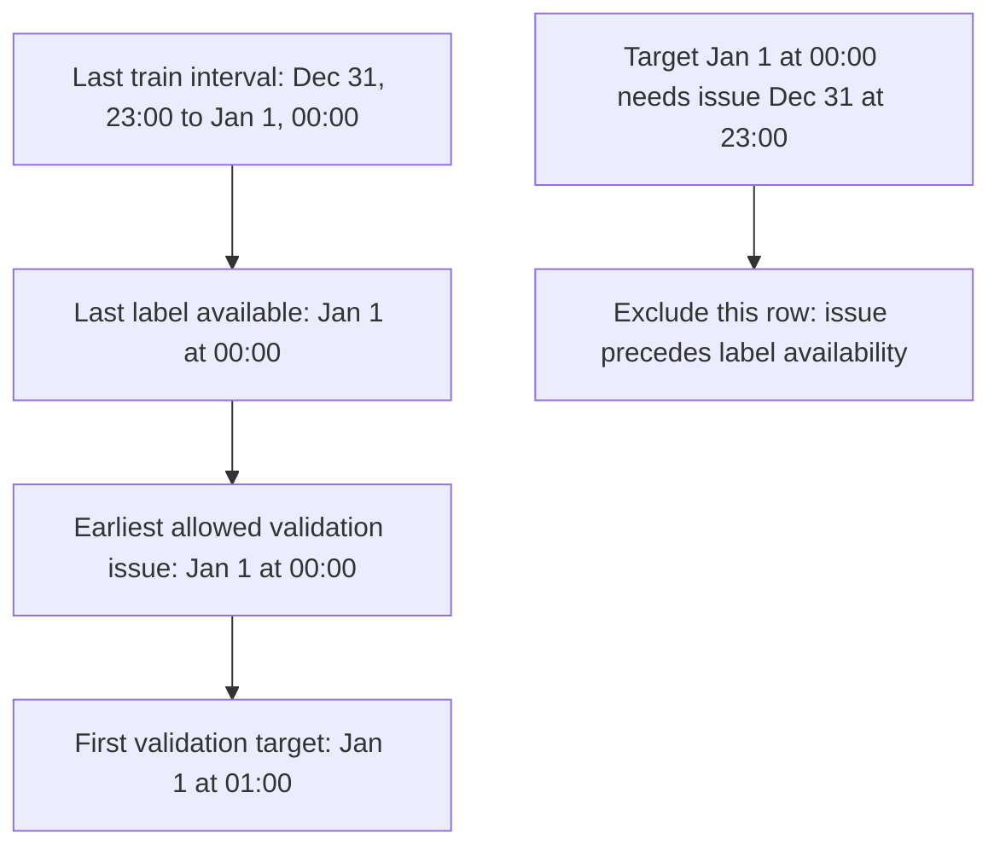

The left-hand path follows the allowed order: the last training interval ends, its outcome becomes available, and the first validation forecast can be issued. The right-hand path shows why the midnight target requires an issue time that is too early.

For this offline exercise, we treat source hour labels as interval starts, outcomes as available at interval end, and the preceding stage as ready at the boundary. We assume zero reporting and model-build delay. Those assumptions are written into the manifest; a practical system with additional delay would need a later readiness time. The source does not specify timezone or daylight-saving disambiguation, so these calculations use its date/hour labels without assigning UTC offsets.

In [splits.py](code/src/bike_demand_planner/splits.py), the main decisions read directly from that reasoning:

```python
if target_time < VALIDATION_READY:
    return "train"
if target_time - FORECAST_LEAD < VALIDATION_READY:
    return "embargo"
if target_time < TEST_READY:
    return "validation"
if target_time - FORECAST_LEAD < TEST_READY:
    return "embargo"
return "test"
```

`VALIDATION_READY` is 1 January 2012 at 00:00, `TEST_READY` is 1 July 2012 at 00:00, and `FORECAST_LEAD` is one hour. The code calls an excluded boundary row `embargo`. The name means that we deliberately leave this existing observation outside the three model partitions because of its timing.

Before those branches run, the function checks that the target is an hour-aligned source label in 2011 or 2012, without timezone information. The time windows include their starts and exclude their ends, so a row cannot belong to both sides of a boundary.

The preparation also checks the timing after assigning rows. The last training interval must end no later than the first validation issue time; the last validation interval must end no later than the first test issue time. The first of those guards is:

```python
if bounds["train"]["last"] + TARGET_DURATION > bounds["validation"]["first"] - FORECAST_LEAD:
    raise ValueError("A training label is unavailable at the first validation issue time.")
```

The same check is made between validation and test. That connects the split rule to the original prediction contract instead of relying only on a date-range label.

Here is the resulting membership:

| Part | Recorded target hours | Rows |
| --- | --- | ---: |
| Training | All recorded hours in 2011 | 8,645 |
| Validation | 1 Jan 2012, 01:00 through 30 Jun, 23:00 | 4,357 |
| Reserved test | 1 Jul 2012, 01:00 through 31 Dec, 23:00 | 4,375 |
| Boundary exclusions | 1 Jan and 1 Jul 2012, both at 00:00 | 2 |
| Total | Every acquired observation | 17,379 |

The two excluded rows have source IDs 8646 and 13004. We keep them in the raw file and in the membership record, with the reason for exclusion. The model partitions contain 17,377 observations in total.

#### Add reporting and build delays without changing the frozen split

The frozen preparation assumes zero reporting and model-build delay. Under that convention, the final training interval finishes at 00:00, its count is available then, and a forecast issued at 00:00 can target 01:00. The midnight target itself would need an issue at 23:00, before the final training outcome was available, which is why that existing boundary row is excluded.

Now make a hypothetical timing change: reporting takes 20 minutes and preparing the model takes another 15. Readiness becomes 00:35. The 01:00 target still needs a 00:00 issue, so it is now too early. The next hourly target, 02:00, has issue time 01:00, which is after 00:35. The rule is `target_start - lead >= training_outcome_ready + build_delay`, with reporting already included in when the outcome is ready.

This sensitivity example explains why a gap is determined by availability rather than by an attractive round number. It does not revise our saved membership or claim that a delayed model has been built. If the real contract changes, regenerate and version the preparation deliberately. Keep the current one-hour lead, zero-delay assumptions and saved two-boundary-exclusion evidence intact for comparisons that use this dataset.


### Distinguish an excluded observation from an unrecorded hour

The two boundary exclusions are observations we have chosen not to evaluate. The file also has hours for which no row exists at all. Those require different reasoning.

One actual jump is from `2011-01-02 04:00` to `2011-01-02 06:00`. The labels are two hours apart, so one intermediate slot, 05:00, is absent:

```text
unrecorded slots = difference in hours - 1
                 = 2 - 1
                 = 1
```

Across the file, the first and last labels cover 731 calendar days. A naive hourly grid would therefore contain `731 × 24 = 17,544` slots. We have 17,379 recorded rows, leaving 165 unrecorded slots across 75 gaps. There are no empty required cells in the existing rows, no duplicate IDs or date/hour labels, and no count-component mismatches. Complete rows can still sit on an incomplete time grid.

We leave absent hours absent. Writing a new row with a zero rental count would assert that zero rentals occurred, which the absence of a record does not establish. We also do not assign a cause to each gap or interpret the grid as verified physical elapsed time across daylight-saving changes.

This explains why the split uses timestamps rather than dropping an arbitrary number of neighbouring rows. It will also matter if we add lagged demand later: the previous recorded row is not automatically the previous clock hour. A lag needs a time lookup and the same information-availability check as the original forecast.

The gap calculation in `audit_hourly_csv()` is:

```python
hours = (record.target_time - previous).total_seconds() / 3600
if hours <= 0:
    raise ValueError("Rows are not strictly chronological.")
if hours > 1:
    gaps.append({
        "after": previous.isoformat(),
        "before": record.target_time.isoformat(),
        "unrecorded_hours": int(hours) - 1,
    })
```

It records the gap and continues with the actual observations. It creates no replacement target.

### Follow the prepared row into the saved files

```video
{
  "title": "Follow the row through files, code and checks",
  "duration": 363.312663,
  "src": "media/bike-data-saved-artifacts-depth/video.mp4",
  "poster": "media/bike-data-saved-artifacts-depth/poster.jpg",
  "captions": "media/bike-data-saved-artifacts-depth/captions.vtt",
  "transcript": "media/bike-data-saved-artifacts-depth/transcript.md"
}
```


At this point, each observation has a place in time and a defined input representation. The remaining job is to save those choices so that the next model uses the same data and the same column meanings.

`prepare_calendar_dataset()` verifies the hourly file against its saved source hash, then selects the input fields, encodes them and writes the appropriate partition:

```python
calendar = {name: record.calendar[name] for name in INPUT_FIELDS}
features = encode_calendar(calendar)
row = [*identity, *features]
if split != "test":
    row.append(record.target)
partitions[split].append(row)
```

`identity` contains the record ID, target time and forecast issue time. These are saved as metadata columns so we can trace a prediction back to its hour. They are outside the schema's 45 model inputs. A later loader must select the feature names explicitly instead of treating every CSV column as a predictor.

Training and validation exports have a separate target column. The test export contains identity and features without targets. The original source still retains the test outcomes for the eventual final evaluation, using the frozen membership to identify them. We have not examined test target distributions or model errors for selection.

The files imply input shapes of `(8645, 45)` for training, `(4357, 45)` for validation and `(4375, 45)` for test. Training and validation each have their corresponding one-dimensional target column. These are row/column contracts for a later loader; we have not built NumPy training arrays or a trainer in this step.

The prepared files live under ignored `data/processed/`:

| File | Why we keep it |
| --- | --- |
| `calendar-schema.json` | The exact input fields, category definitions, column order and transform rules |
| `membership.csv` | Every recorded hour's identity, issue time and assigned part, including exclusions |
| `train.csv` | Training metadata, 45 features and separate targets |
| `validation.csv` | Validation metadata, the same 45 features and separate targets |
| `test.csv` | Reserved-test metadata and features, with targets omitted |
| `split-manifest.json` | The periods, timing assumptions, counts and hashes connecting these files |

The manifest is a JSON record of how this particular dataset was prepared. Its hashes let us recognise the same source and outputs on a later run. If a frozen file differs, preparation raises an error instead of silently redefining the dataset. This keeps a later model comparison meaningful: both runs must refer to the same observations and feature meanings.

#### Distinguish a correct shape from the correct data identity

Imagine two exported arrays with 45 columns. In one, position 8 means hour 08; in the other, positions 8 and 9 have been exchanged. A shape check passes both arrays, yet the same weight vector answers different questions. The saved calendar schema records the feature names and order so we can detect or prevent that mismatch. Identity and issue-time columns remain outside the 45 predictive values; an identifier is useful for tracing a row without becoming a demand feature.

The preparation also records more than one kind of identity. A retained CSV hash refers to its exact bytes, so changing line endings can change that hash even when the parsed numbers look the same. The schema identity refers to the representation contract. Membership records connect observation IDs, timestamps and assigned partitions. These checks answer related but different questions: which bytes were used, what each input means, and which observations belonged to each stage.

A concrete replay is therefore: locate record 54 by identity, confirm its target/issue times, select its named calendar fields, encode the active positions `[8, 25, 31, 44]`, and compare those meanings with the saved schema. Its target remains separate. That is evidence for a reproducible prepared observation. Fitting a model and measuring generalization are subsequent operations, and the reserved final-test targets remain unavailable for tuning.


### Run the example and inspect what changed

From the project folder, the normal commands are:

```bash
uv run --frozen python prepare_data.py
uv run --frozen python calendar_example.py
uv run --frozen python -m unittest discover -s tests -v
```

The first command acquires or verifies the raw data, audits it and writes the prepared files. The second runs the Monday 08:00 walkthrough. Its saved [actual output](evidence/02-hourly-data-audit-and-splits/calendar-example-output.json) reports record 54, issue time 07:00, train membership, the four active feature names and the separate observed target of 154. [calendar_example.py](code/calendar_example.py) has those inputs in its main block so the example is easy to revisit.

We also ran the changed-hour probe described earlier. Its [saved output](evidence/02-hourly-data-audit-and-splits/encoding-changed-case-and-failures.json) shows `hr_09` replacing `hr_08` while the other active groups stay the same. That record includes two deliberate failures: adding `cnt=154` to encoder inputs raises the exact-field error, and requesting a split for a 2013 date raises the supported-date error.

The latest implementation run on 16 October passed 22 checks: seven for the earlier numerical functions, six for the raw audit, three for encoding and six for the splits and exports. The fixtures check independent active-column positions, malformed fields, exact boundaries, complete and disjoint membership, missing test-target columns and repeatable output. Other cases cover constant training columns, duplicate or out-of-order records, altered cached bytes and totals that disagree with their components.

One particularly useful check changes held-out calendar flags and outcomes while leaving the training observations alone. The training export, training-only feature summary, schema and membership remain unchanged. That is the behaviour we want: later outcomes cannot secretly alter the training representation. Repeating preparation with the actual cached source also produced identical output bytes without network access.

We now have a defined data handoff for the next modelling step. There is still no baseline, fitted demand estimator or accuracy result. A baseline can now use these training rows and make predictions for the validation hours. That is the next modelling step; these notes stop at preparing that handoff.

### Reference: source details and saved evidence

The source is the [UCI Bike Sharing dataset](https://archive.ics.uci.edu/dataset/275/bike+sharing+dataset), using the [official ZIP](https://archive.ics.uci.edu/static/public/275/bike%2Bsharing%2Bdataset.zip). The 16 October source review records Hadi Fanaee-T as creator, dataset [DOI 10.24432/C5W894](https://doi.org/10.24432/C5W894), and [CC BY 4.0](https://creativecommons.org/licenses/by/4.0/). The bundled README requests citation of Fanaee-T and Gama's 2013 paper, DOI `10.1007/s13748-013-0040-3`, and is retained unchanged.

Only `hour.csv` and `Readme.txt` are extracted. Daily observations in `day.csv` remain separate inside the retained archive. Raw files, source information and generated reports are under ignored `data/`. The recorded acquisition time is `2026-10-16T07:20:16.714389+00:00` in `data/raw/source.json`.

There are a few source details worth keeping visible when returning to the data:

- At the 16 October review, the landing page listed 17,389 instances, while the bundled README and the parsed hourly file agreed on 17,379. We use the measured hourly file count.
- The landing page described season code 1 as winter; the README called it `springer`. Their temperature-normalization descriptions also differed. We retain raw codes, validate finite normalized weather values in `[0,1]` and make no disputed season-name or raw-temperature conversion.
- Date/hour labels carry no explicit timezone or daylight-saving disambiguation. Our interval/availability convention is a project assumption, not documentary proof of UTC offsets or reporting latency.

For completeness, the first raw row used for the component-count example is:

```text
instant=1, dteday=2011-01-01, season=1, yr=0, mnth=1, hr=0,
holiday=0, weekday=6, workingday=0, weathersit=1,
temp=0.24, atemp=0.2879, hum=0.81, windspeed=0,
casual=3, registered=13, cnt=16
```

The source and prepared-file identities below are locally computed SHA-256 values. They identify the bytes used here; they are not official signed checksums. The schema hash excludes its own hash field. The manifest hash is likewise computed from its canonical content before adding its hash field; the manifest also holds the individual export hashes.

| Object | SHA-256 |
| --- | --- |
| Official ZIP | `b70182d0d0508e9abbb79306ce5c0cec34869000f8220175ac83d11dbe845401` |
| `hour.csv` | `e03de4ee4ef4dc376ac6e04bf829673c6269e8eba5c60fa121640fa2f829504f` |
| `Readme.txt` | `b92c8628622948bf0828c43a1b315d1517c3d7fd63654730d0dea379b8e88175` |
| Calendar schema | `9e84223da4af4942296245357837e6ac5910a869f38071f7ab6995d6bfdfb521` |
| Membership | `d5d353a176be326bf24c07ce12f33330ca180af814b0b4eff61bbc0b7e2d782e` |
| Split manifest | `e551edfad465ede2ba76042564bf184d38408e85a0ef61cb6e7534cf544af733` |

The [first acquisition output](evidence/02-hourly-data-audit-and-splits/first-acquisition-output.json) preserves the earlier download/audit checkpoint. The raw audit now reports `scope: raw_structural_audit`, while the preparation output includes the prepared-dataset manifest separately. [The full preparation output](evidence/02-hourly-data-audit-and-splits/encoding-splits-preparation.json), [changed-case output](evidence/02-hourly-data-audit-and-splits/encoding-changed-case-and-failures.json) and [implementation verification](evidence/02-hourly-data-audit-and-splits/encoding-splits-verification.json) retain the exact results behind this walkthrough. The earlier numerical source was committed as `4794ad4`, and data preparation was subsequently signed as `ad1b870`. The completed project is now at `0b49c0a`; these earlier receipts preserve what ran at each step.

For more background, the primary references are the scikit-learn pages on [time-feature representations](https://scikit-learn.org/stable/auto_examples/applications/plot_cyclical_feature_engineering.html), [training-only preprocessing](https://scikit-learn.org/stable/common_pitfalls.html) and [time-series cross-validation](https://scikit-learn.org/stable/modules/generated/sklearn.model_selection.TimeSeriesSplit.html). We use timestamp windows in our own split function. The library's `gap` argument counts samples, which would need care with this file's missing hours.

### Keep the reasoning beside the result

[Learning points](project/learning-points/02-hourly-data-and-splits.md) explain what this calculation changes in our understanding. [Comparisons](project/comparisons/02-hourly-data-and-splits.md) put the alternatives side by side. [Setup and commands](project/setup.md) and the [current completion record](project/implementation.md) give the executable project context.

### Predict or explain: A source has counts 10, an unrecorded hour and 30. Why is the observed mean 20 rather than 13.33?

<details data-practice-id="hourly-data-and-splits-check"><summary>Reveal worked answer and rubric</summary>

There are two observed targets, with sum 40. Dividing by two gives 20. Dividing by three after inserting a zero manufactures a target and changes both the fit and evaluation question. The gap remains missing.

**Rubric:** Distinguish an absent row from an observed zero and retain the denominator.

</details>


A correct dataset can now support a simple fitted reference. Continue to [the next lesson](lessons/03-calendar-baselines.md) when this step is clear.


## Build and compare simple calendar predictions

The data contract is ready. Before asking a larger model to learn, fit two small references and inspect exactly which hours their error averages contain. Monday at 02:00 and Monday at 08:00 make the value and the limits of calendar grouping visible.

### Start with the hour we are trying to predict

Take Monday, 9 January 2012 at 08:00. Under the project's protocol, we issue that forecast at 07:00 for the hour beginning at 08:00. The source row is record 8845. Its eventual recorded outcome is **420 rentals**. That outcome belongs on the scoring side of the example; it does not help form the forecast issued at 07:00.

Our first model uses one constant learned from 2011. Across the 8,645 recorded training hours, the sum of `target` is 1,243,103. The fitted value is therefore:

```text
training mean = sum of training targets / training row count
              = 1,243,103 / 8,645
              = 143.79444765760556 rentals per hour
```

The training rows are the observations retained by the earlier preparation. Missing source hours have not become zero-target rows. Dividing by some imagined complete calendar grid would fit a different statistic using invented outcomes.

At 07:00, the saved model returns 143.79444765760556. It would return exactly the same number for a different supported hour. A forecast may be fractional even though the recorded count is an integer: this value is a point estimate, and we keep it unrounded for evaluation. Later presentation choices can be recorded and evaluated separately.

When the 08:00 outcome becomes available, its residual is:

```text
residual = prediction - target
         = 143.79444765760556 - 420
         = -276.2055523423944 rentals
```

The negative sign says the forecast was too low. Its absolute error is 276.2055523423944. Its squared error is approximately 76,289.5071 rentals squared. Its underprediction deficit is 276.2055523423944. These all come from the same miss; each quantity keeps a different aspect of it.

Now look at 02:00 that same Monday. Record 8839 has an issue time of 01:00 and a target of **5 rentals**. The prediction is unchanged, so its residual is `143.79444765760556 - 5 = +138.79444765760556`. We have an overprediction at the quiet hour and an underprediction at the busy hour. That is an understandable limitation of a constant model before we introduce more expressive predictors.

| Target hour | Issue time | Recorded rentals | Prediction | Prediction − target |
| --- | --- | ---: | ---: | ---: |
| 2012-01-09 02:00 | 01:00 | 5 | 143.7944 | +138.7944 |
| 2012-01-09 08:00 | 07:00 | 420 | 143.7944 | −276.2056 |

The row's calendar inputs already exist in the 45-column schema. The constant model deliberately uses no feature columns; it learns only a global level. The calendar-group continuation below gives those already-permitted calendar distinctions a role in prediction.

### Why fitting the mean solves a loss minimization problem

Call our constant prediction `c` and the training outcomes `y₁, …, yN`. Consider the mean half squared error:

```text
L(c) = (1 / 2N) Σ (c - yi)²
```

Differentiating each term gives `c - yi`, so:

```text
dL/dc = (1 / N) Σ (c - yi)
      = c - (1 / N) Σ yi
      = c - mean(training targets)
```

Setting the derivative to zero gives `c = mean(training targets)`. The second derivative is 1, so this point is the minimum. We have solved this one-parameter squared-error problem directly. There is no reason to introduce a learning rate or an iterative update just to recover a statistic we can calculate exactly.

This also connects to the earlier gradient discussion. If the constant is above the training mean, its average gradient is positive and a small gradient step decreases it. If it is below the mean, the average gradient is negative and a step increases it. The direct fit simply goes straight to the answer for this particular model family and objective.

The headline reporting metric in this project is MAE. A training median minimizes absolute error among constants, whereas the training mean minimizes squared error. We keep that distinction explicit: this first predictor is a familiar mean-based reference, and we judge it using the shared metrics. Its name does not claim it is the strongest constant under every objective.

### The fit function in the source

[baselines.py](code/src/bike_demand_planner/baselines.py) contains the fit:

```python
def fit_mean_baseline(training_targets: Sequence[float]) -> MeanBaseline:
    """The training mean minimizes squared error among constant predictors."""
    if not training_targets or any(not math.isfinite(value) or value < 0 for value in training_targets):
        raise ValueError("Expected nonempty, finite, nonnegative training targets.")
    return MeanBaseline(math.fsum(training_targets) / len(training_targets), len(training_targets))
```

The consequential line is the final one. `math.fsum` accumulates the training targets, and the denominator is the number of those targets. The returned immutable model retains both the fitted value and its training row count. The input validation makes an empty fit or a nonfinite/negative observed rental count fail visibly.

The training targets reach this function through `run_mean_baseline` and its shared runner in [evaluation.py](code/src/bike_demand_planner/evaluation.py). Its constant-fit branch performs these two operations:

```python
train, manifest = load_labelled_partition(processed_directory, "train")
model = fit_mean_baseline([row.target for row in train])
```

The runner loads validation only after this fit. More fundamentally, the model's prediction method accepts a count rather than outcomes:

```python
def predict(self, count: int) -> list[float]:
    """Repeat the fitted statistic without accepting outcomes."""
    if isinstance(count, bool) or not isinstance(count, int) or count < 0:
        raise ValueError("Prediction count must be a nonnegative integer.")
    return [self.value] * count
```

Calling `model.predict(2)` returns two copies of the saved mean. It has no argument through which the 02:00 target of 5 or the 08:00 target of 420 can alter that mean. The runner associates the returned predictions with each requested row identity, then sends those forecasts to scoring.

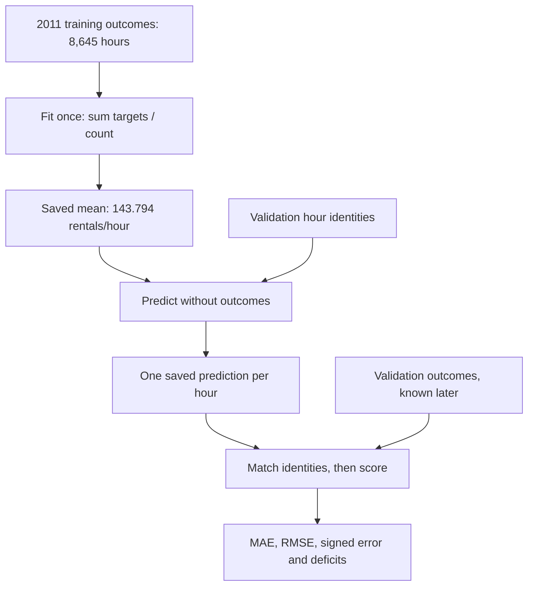

The top branch is the learning path; the bottom outcome branch enters only when measuring the saved forecasts. The target and issue timestamps remain attached to each row throughout. We are replaying historical hours under an explicit availability convention, rather than treating all columns in a historical CSV as information available at forecast time.

### How the error reduction works, one operation at a time

The full calculation lives in [metrics.py](code/src/bike_demand_planner/metrics.py). We first compute one residual for every aligned pair:

```python
errors = [prediction - target
          for target, prediction in zip(targets, predictions, strict=True)]
deficits = [max(-error, 0.0) for error in errors]
count = len(errors)
```

To see the denominator and each reduction clearly, use two deliberately small target/prediction pairs: targets `[10, 30]`, predictions `[12, 22]`. These are an independent arithmetic check, separate from the real validation result. The residuals are `[+2, -8]`.

MAE takes the size of each residual before averaging:

```text
MAE = (|2| + |-8|) / 2 = 10 / 2 = 5 rentals/hour
```

RMSE squares before averaging and then restores the original units with a square root:

```text
MSE  = (2² + (-8)²) / 2 = (4 + 64) / 2 = 34
RMSE = sqrt(34) = 5.830951894845301 rentals/hour
```

The squared terms make the miss of 8 contribute sixteen times as much as the miss of 2 before the square root. This is why a model with occasional larger misses can look considerably worse under RMSE than under MAE. Each gives a useful view; MAE remains the primary metric for this project.

Mean signed error preserves direction:

```text
mean signed error = (2 + (-8)) / 2 = -3 rentals/hour
```

The negative result describes average underprediction. It does not mean that each individual forecast is too low: our first residual is positive. The cancellation example makes the limitation even clearer. For targets `[10, 30]` and predictions `[20, 20]`, residuals are `[+10, -10]`. Their mean is zero, while MAE and RMSE are both 10. A zero signed mean can coexist with substantial hourly mistakes.

### Underprediction: the same numerator can answer two questions

For residuals `[+2, -8]`, the deficits are `[0, 8]`. We explicitly define the main `mean_underprediction` over **all evaluated rows**:

```text
total deficit = 0 + 8 = 8
mean_underprediction = 8 / 2 = 4 rentals/hour
```

There is one underpredicted row. Dividing by that count instead answers how much we missed on the hours where we were too low:

```text
underprediction_count = 1
mean_underprediction_when_under = 8 / 1 = 8 rentals/hour
```

Both quantities are saved under different names. If there are no underpredicted rows, the overall mean is zero and the conditional mean is `null`, since its denominator would be zero. An exact prediction counts as zero deficit and is not an underpredicted hour.

This is an error in predicted recorded rentals. A deficit in this calculation cannot by itself tell us how many customers could not find a bike or how many bikes a particular station needed. Those operational questions require other observations.

### Check which hours are being compared before calculating averages

The prepared files retain a record ID, target timestamp and forecast issue timestamp before their feature columns. The loader verifies the frozen manifest, schema and selected partition bytes, then compares the row identities with frozen membership. It accepts only `train` and `validation`; asking it for `test` fails before opening a file.

Once forecasts exist, scoring checks the identities again:

```python
def score_forecasts(rows: list[LabelledHour], forecasts: list[Forecast]) -> dict:
    """Refuse missing, reordered or duplicated predictions before reducing errors."""
    identities = [row.identity for row in rows]
    if [forecast.identity for forecast in forecasts] != identities or len(set(identities)) != len(identities):
        raise ValueError("Forecast identities must match each target row in order.")
    return regression_metrics([row.target for row in rows], [forecast.prediction for forecast in forecasts])
```

Matching array lengths alone would allow an 08:00 forecast to be scored against a 02:00 target after a row-order mistake. The explicit identity comparison rejects that error. The constant predictor would hide it numerically because every prediction is the same; later hour-dependent models would expose the mistake as incorrect metrics. We establish the check now so the evaluation path can be reused.

A saved probe reverses two forecast identities and raises:

```text
Forecast identities must match each target row in order.
```

The [probe output](evidence/03-simple-predictions-and-hourly-error-metrics/metric-and-alignment-probes.json) also retains the small metric calculations above. Our tests separately change validation targets in a tiny fixture from 16 to 1,000. The fitted training mean stays at 20 in both runs, while validation MAE changes from 4 to 980. The fixture's raw file and test export are deleted before evaluation; the run still succeeds with the required frozen training/validation artifacts. This checks the information boundary independently of the real dataset's score.

### The actual first run

Run the entry point from the project folder after data preparation:

```bash
uv run --frozen python baseline_example.py
```

The main block declares the processed-data directory and creates a new timestamped directory under ignored `runs/`. It prints the fitted mean, metric summaries and the two Monday examples. The saved result for the frozen periods is:

| Summary | Training | Validation |
| --- | ---: | ---: |
| Recorded hours | 8,645 | 4,357 |
| MAE, rentals/hour | 106.5935 | 154.2452 |
| RMSE, rentals/hour | 133.7901 | 208.1723 |
| Mean signed error, rentals/hour | approximately 0 | −71.4057 |
| Mean underprediction across all hours | 53.2967 | 112.8254 |
| Underpredicted hours | 3,524 | 2,391 |
| Mean deficit on underpredicted hours | 130.7464 | 205.5962 |

Training signed error is about `8.67e-15`, effectively zero within floating-point arithmetic. Algebraically, `sum(mean(y) - yi)` is zero on the same training rows used to calculate that mean. Training MAE is still 106.5935, so this cancellation tells us about the fitted level rather than hourly accuracy.

For validation, the constant prediction minus the validation mean equals the signed error. The validation target mean is about 215.2001, exceeding the fitted 143.7944 by 71.4057. The larger validation MAE and negative signed error describe a real weakness of this predictor on these later hours. We have not identified a unique cause: full-year 2011 and January–June 2012 also have different seasonal composition and other conditions.

There is another useful consistency check. Let `U` be mean underprediction across all rows and `O` the corresponding mean overprediction. Then `MAE = U + O`, while signed error is `O - U`. Here `U = 112.8254` and `O ≈ 41.4198`, giving MAE 154.2452 and signed error −71.4057. This connects the reported numbers without introducing a new model or metric.

An independent calculation using `statistics.mean` agrees with all saved summaries. It also verifies the training total, every prediction's identity and the saved artifact hashes. The [captured command output](evidence/03-simple-predictions-and-hourly-error-metrics/first-baseline-output.json) and [verification](evidence/03-simple-predictions-and-hourly-error-metrics/baseline-verification.json) retain full precision.

### What is saved, and why it will help the next comparison

Each new run contains:

```text
model.json                  fitted value, count and fit policy
train-predictions.csv        one aligned forecast/error row per training hour
validation-predictions.csv   one aligned forecast/error row per validation hour
run.json                    versioned identities, definitions, timings and status
```

`run.json` uses version `hourly-regression-run-v1`. It records the Git parent and actual source-file content hashes, Python/platform and dependency hashes, source data/schema/membership/manifest identities, the fit objective, prediction policy and metric definitions. The mean model records an empty list of used feature columns. It retains the shared schema identity so the upcoming feature-using models can be compared against the same prepared data.

These historical runs were captured before their source commit. Their content hashes therefore identify the exact code alongside the parent Git SHA; the completed source is now signed as `0b49c0a`. Timings are measured locally; they are not a promised runtime on another machine. A failure writes a failed receipt and its reason. An existing run directory is rejected rather than overwritten, keeping an earlier result recoverable.

The original constant-baseline chunk passed 33 unit checks. Its build inspection confirmed private docs, raw/prepared data and generated runs stay outside source/wheel exports, and an isolated wheel passed the mean/metric calculation. The current group-baseline continuation passes 38 unit checks; its evidence is linked below. These are implementation checks; our discussion records separately what the learner has actually explained.

### Use the hour and working day to choose a training mean

```video
{
  "title": "Choose a training mean for a real hour",
  "duration": 209.125,
  "src": "media/bike-group-hourly-example/video.mp4",
  "poster": "media/bike-group-hourly-example/poster.jpg",
  "captions": "media/bike-group-hourly-example/captions.vtt",
  "transcript": "media/bike-group-hourly-example/transcript.md"
}
```


Return to Monday, 9 January 2012. At 07:00 we need a forecast for the hour beginning at 08:00. The calendar already tells us that the target hour is 8 and its working-day flag is 1. We turn those two known inputs into the key `(8, 1)`. The future outcome of 420 rentals remains outside that key and outside fitting.

Instead of averaging every training hour together, select only recorded 2011 hours whose key is `(8, 1)`. There are **248** such hours and their targets sum to **86,677 rentals**. The fitted value is therefore:

```text
working-day 08:00 mean = 86,677 / 248
                       = 349.5040322580645 rentals/hour
```

This is a fitted statistic from real training data. It is not a hand-chosen weight like the earlier gradient illustration, and it is not the average of the later validation outcomes. At prediction time the saved model only needs the key. The actual call is:

```python
model.predict([(8, 1), (2, 1)])
# [349.5040322580645, 7.514644351464435]
```

The second value comes from 1,796 rentals across 239 working-day 02:00 training hours. We can now give the quiet and busy hours different predictions without an optimizer or a learning rate. After their outcomes become available, the same residual rule shows the effect:

| Monday target hour | Target, known afterward | Constant prediction | Group prediction | Constant residual | Group residual |
| --- | ---: | ---: | ---: | ---: | ---: |
| 02:00, issued 01:00 | 5 | 143.7944 | 7.5146 | +138.7944 | +2.5146 |
| 08:00, issued 07:00 | 420 | 143.7944 | 349.5040 | −276.2056 | −70.4960 |

For 08:00, subtracting 420 from 349.5040 gives −70.4960. It is still an underprediction, but much closer for this row. For 02:00, subtracting 5 from 7.5146 gives a small overprediction. Neither example proves that every validation hour improves; we check the complete validation window later in this page.

The grouping is **hour crossed with working-day status**, giving at most `24 × 2 = 48` means. It does not fit a separate Monday effect. Tuesdays through Fridays can share the same working-day group, while weekends and source holidays share the nonworking group. Month and weekday remain in the saved 45-column schema, but this particular model does not use them. That is a deliberate, readable model choice rather than a change to the dataset.

One useful changed request is 08:00 on a valid nonworking day. Its key is `(8, 0)`, supported by 115 training hours and 8,790 rentals. It returns `8,790 / 115 = 76.4348`, rather than 349.5040. We changed which group is selected; we did not refit the model or reuse the Monday target of 420. This also exposes a limitation: one flag pools holidays and ordinary weekends even when their actual behavior differs.

The group mean solves the same squared-error problem as the global mean, within a smaller set of training rows. If `G` is one group and `cG` its constant, the derivative of `Σ(cG − yi)² / (2 nG)` is `cG − mean(y in G)`. Setting it to zero gives the group mean. More parameters make a richer fitted function, even though each parameter still has a direct arithmetic solution. Mean fitting remains a squared-error choice; reporting MAE does not turn these means into medians.

### Fit the groups once and keep prediction target-free

```video
{
  "title": "Fit once, then predict from calendar keys",
  "duration": 225.083333,
  "src": "media/bike-group-fit-predict/video.mp4",
  "poster": "media/bike-group-fit-predict/poster.jpg",
  "captions": "media/bike-group-fit-predict/captions.vtt",
  "transcript": "media/bike-group-fit-predict/transcript.md"
}
```


The implementation is in [baselines.py](code/src/bike_demand_planner/baselines.py). `fit_hour_workingday_baseline` accepts training keys and training targets of equal length. It first fits the global training mean for fallback, then collects targets belonging to each key. The central source block is:

```python
fallback = fit_mean_baseline(training_targets)
grouped_targets: dict[tuple[int, int], list[float]] = {}
for key, target in zip(training_keys, training_targets, strict=True):
    _validate_group_key(key)
    grouped_targets.setdefault(key, []).append(target)
groups = tuple(
    CalendarGroupMean(hour, workingday, math.fsum(targets) / len(targets), len(targets))
    for (hour, workingday), targets in sorted(grouped_targets.items())
)
return HourWorkingDayBaseline(groups, fallback)
```

For key `(8, 1)`, the collected list has 248 values, `math.fsum` gives 86,677, and `len` supplies 248. The saved `CalendarGroupMean` retains the key, fitted value and support count. The immutable model also retains the global mean and its full training count of 8,645. Sorting makes the saved group order reproducible; it does not change the statistical fit.

In [evaluation.py](code/src/bike_demand_planner/evaluation.py), `hour_workingday_key` reads the active position in the first 24 one-hot hour columns and the named `workingday` position. It checks the 45-column length, exactly one active hour and a binary working-day flag. For the real 08:00 row, those selected values become `(8, 1)`. This is an interpretation of the frozen schema; it does not infer new categories or fit a transform. The run record lists the 24 encoded hour columns and working-day column as used features, while retaining the identity of the full schema.

The shared runner loads training and fits the chosen predictor before loading validation. Fitting consumes training targets; prediction consumes keys:

```python
def predict(self, keys: Sequence[tuple[int, int]]) -> list[float]:
    """Look up fitted groups; valid absent groups use the global training mean."""
    values = {(group.hour, group.workingday): group.value for group in self.groups}
    predictions = []
    for key in keys:
        _validate_group_key(key)
        predictions.append(values.get(key, self.fallback.value))
    return predictions
```

For `(8, 1)`, the dictionary contains 349.5040. The method returns that value without seeing 420. Calling it again does not update a count, a mean or a group. The runner attaches each prediction to the original record ID, target time and issue time, then sends the aligned forecasts to the unchanged scoring function. The model stays frozen through validation; this chunk does not introduce online learning.

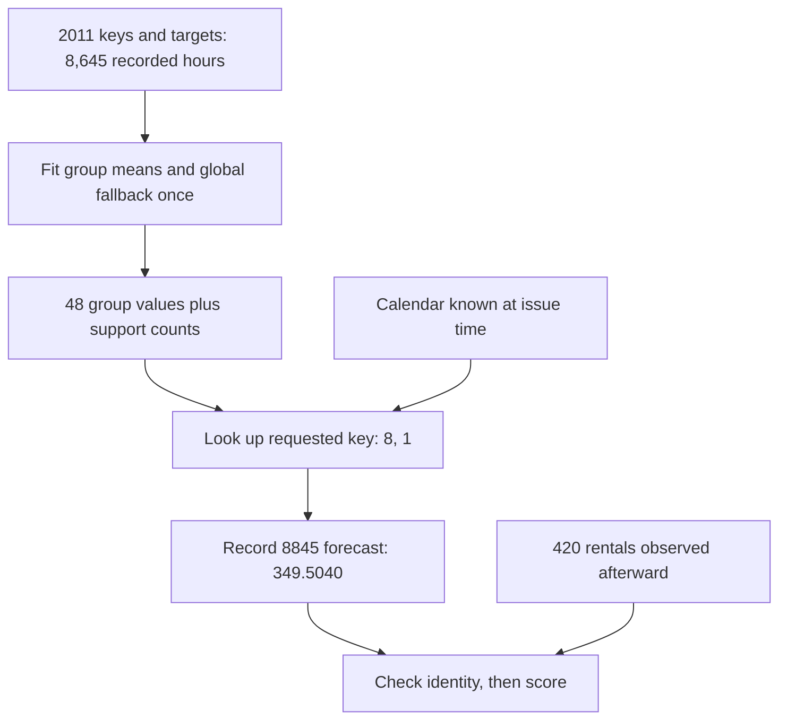

The outcome arrow enters scoring, not the group lookup. That separation is the mechanism behind the information boundary. As an independent check, the integration fixture changes validation targets from 16 to 1,000 while retaining its training rows. Its fitted group model and global fallback remain identical, while validation MAE changes from 9 to 975. The fixture runs after its raw file and test export have been removed. This checks fit isolation, rather than merely trusting an API name containing “training.”

### Give an absent group a training-only fallback

```video
{
  "title": "A training-only fallback for an absent group",
  "duration": 227.25,
  "src": "media/bike-group-missing-pairs/video.mp4",
  "poster": "media/bike-group-missing-pairs/poster.jpg",
  "captions": "media/bike-group-missing-pairs/captions.vtt",
  "transcript": "media/bike-group-missing-pairs/transcript.md"
}
```


A small dataset might contain working-day 08:00 observations but no nonworking-day 02:00 observation. That requested key is valid, yet there is no fitted value for it. We declare the fallback before evaluating: return the **global mean of recorded training targets**. Validation answers never fill the missing entry. Invalid inputs, such as hour 24 or a working-day value of 2, raise an error instead of being treated as absent valid groups.

Use a deliberately small fixture so the whole calculation is visible:

| Training key | Recorded training targets | Saved group mean | Support |
| --- | --- | ---: | ---: |
| `(8, 1)` | 10, 30 | 20 | 2 |
| `(2, 1)` | 2 | 2 | 1 |
| `(8, 0)` | 100 | 100 | 1 |

There are four training rows, with total `10 + 30 + 2 + 100 = 142`. The fallback is `142 / 4 = 35.5`. It is **not** `(20 + 2 + 100) / 3 = 40.6667`, because averaging the group means equally would give a one-row group the same weight as the two-row group. The chosen fallback estimates the level across rows, preserving their original weights.

```python
model = fit_hour_workingday_baseline(
    [(8, 1), (8, 1), (2, 1), (8, 0)],
    [10, 30, 2, 100],
)
model.predict([(8, 1), (2, 0)])
# [20.0, 35.5]
```

The first key is observed and uses 20. The second is absent and uses 35.5. Repeating the second forecast does not create a new group or turn its later outcome into training data. Changing one of the original input lists after fitting also leaves the saved model unchanged; the test checks this explicitly. A more elaborate hierarchy, such as falling back to an hour-only mean, would be another modelling policy to declare and compare. It is not silently added here.

In the actual 2011 training export, all 48 valid pairs occur. Fallback usage is therefore **zero in training and zero in validation**. The real validation score measures group lookup behavior, while the small fixture establishes the absent-group policy. Both are needed: an untriggered branch in a successful real run is not evidence that the branch works.

### Compare the same validation hours and inspect the misses

```video
{
  "title": "Read the baseline comparison and its failures",
  "duration": 233.666667,
  "src": "media/bike-group-validation-review/video.mp4",
  "poster": "media/bike-group-validation-review/poster.jpg",
  "captions": "media/bike-group-validation-review/captions.vtt",
  "transcript": "media/bike-group-validation-review/transcript.md"
}
```


Run [group_baseline_example.py](code/group_baseline_example.py) from the project folder:

```bash
uv run --frozen python group_baseline_example.py
```

This produces a fresh global run and group run under one comparison directory. Both use the same 2011 training rows, the same 4,357 validation identities from January–June 2012, the same unrounded real-valued prediction policy and the same metric definitions. Both use the same shared loading/scoring/receipt path. Only the fitted predictor changes. The command verifies matching dataset and metric identities before writing `comparison.json`.

| Validation summary | Global training mean | Hour/working-day means |
| --- | ---: | ---: |
| Hours scored | 4,357 | 4,357 |
| MAE, rentals/hour | 154.2452 | **91.5729** |
| RMSE, rentals/hour | 208.1723 | **137.3900** |
| Mean signed error | −71.4057 | −72.3422 |
| Mean deficit across all hours | 112.8254 | 81.9576 |
| Underpredicted hours | 2,391 | 3,143 |
| Mean deficit when underpredicted | 205.5962 | 113.6141 |

The absolute MAE reduction is `154.2452053582 − 91.5729396191 = 62.6722657391 rentals/hour`. Dividing by the original MAE gives `62.6722657391 / 154.2452053582 × 100 = 40.6316%`. This is an improvement on this frozen development window, not a claim about reserved-test performance or every future month.

Notice that signed error is slightly more negative even though MAE and RMSE improve. The group predictor removes many large overpredictions at quiet hours, while it still underestimates many busy hours. The count of underpredicted hours rises, but their conditional mean deficit falls. Error frequency, size and average direction answer different questions. The aggregate prediction level still falls below the later observed mean; these summaries do not identify one cause such as demand growth or weather.

Training MAE falls from 106.5935 to 55.4280, and training RMSE falls from 133.7901 to 78.8394. Separate group constants include the global constant as a possible assignment, so their minimum training squared error cannot be worse under the same data and objective. That argument does not guarantee lower validation error, and it does not guarantee a lower MAE simply because the fit minimized squared error. The validation improvement above is measured evidence.

Across individual validation hours, absolute error improves on **3,323** and worsens on **1,034**, with no ties. For a concrete regression, take record 8901 at **2012-01-11 17:00**, issued at 16:00. Its working-day group predicts **394.916**, while the observed target is **134**. Its group residual is `394.916 − 134 = +260.916`; the global predictor's absolute error is only **9.7944**. The model knows a typical working-day 17:00 level, but cannot distinguish that particular day from other days with the same key. We have not established why this hour was quiet, so the explanation stops at the limitation we can observe.

Conversely, the largest group miss is record 10623 at **2012-03-23 17:00**: target **957**, group forecast **394.916**, absolute error **562.084**. That is still better than the global miss of **813.2056**, but “better” is not “accurate enough for an application.” These failures motivate later features/models and an explicit application-quality decision; they do not authorize using future outcomes or retuning on the reserved test.

The [captured comparison](evidence/03-simple-predictions-and-hourly-error-metrics/group-baseline-output.json) retains full-precision metrics, both Monday examples and the run directory. The [independent verification](evidence/03-simple-predictions-and-hourly-error-metrics/group-baseline-verification.json) recomputes all group means with exact integer fractions, checks every saved prediction/identity, recomputes metrics separately and verifies artifact hashes. Each nested run keeps `model.json`, aligned prediction CSVs and a `hourly-regression-run-v1` receipt. The group model adds all 48 values/support counts, the global fallback, grouping fields and absent-group policy; the receipt records fallback counts. The previous constant run remains preserved.

### Where we stop for this chunk

Both requested baselines, the declared fallback and their fair comparison are now implemented and checked. The final test has stayed reserved. Optimized linear-regression fitting and the application remain later work.

The useful review is to explain the route from `(8, 1)` to 349.5040, why an absent valid pair uses the row-weighted global mean, and how lower MAE can coexist with more underpredicted hours. No new learner answer is recorded yet. lesson 3 is ready for that review; lesson 4 has not started. There is no routine typing assignment before discussing the result.

[Learning points](project/learning-points/03-calendar-baselines.md) · [Comparisons](project/comparisons/03-calendar-baselines.md) · [Progress and evidence](project/implementation.md)

### Keep the reasoning beside the result

[Learning points](project/learning-points/03-calendar-baselines.md) explain what this calculation changes in our understanding. [Comparisons](project/comparisons/03-calendar-baselines.md) put the alternatives side by side. [Setup and commands](project/setup.md) and the [current completion record](project/implementation.md) give the executable project context.

### Predict or explain: Why can January Monday at 08:00 and June Monday at 08:00 receive exactly the same group prediction?

<details data-practice-id="calendar-baselines-check"><summary>Reveal worked answer and rubric</summary>

The group key is only (hour, workingday). Both requests use (8,1), whose 2011 total is 86677 over 248 observations, giving 349.504032258. Month is not part of this fitted function even though the calendar schema contains it.

**Rubric:** Explain which fields the estimator actually uses and separate prediction from the later outcome.

</details>


Compare the lookup with a learned additive function. Continue to [the next lesson](lessons/04-linear-regression.md) when this step is clear.


## Fit linear regression and follow its gradients

The group baseline already gives us a useful standard. This lesson asks a different function to explain the same observations: a weighted sum of calendar columns. Follow its actual updates, compare the converged function with least squares, and keep the weaker validation result visible.

### Follow Monday at eight into the linear model

```video
{
  "title": "Follow Monday at eight into the linear model",
  "duration": 233.666667,
  "src": "media/bike-linear-calendar-scaling/video.mp4",
  "poster": "media/bike-linear-calendar-scaling/poster.jpg",
  "captions": "media/bike-linear-calendar-scaling/captions.vtt",
  "transcript": "media/bike-linear-calendar-scaling/transcript.md"
}
```


Start with **Monday, 3 January 2011, 08:00**, training record **54**. Under our retained interval-start convention, the request is issued at 07:00 and predicts observed rentals during 08:00–09:00. Its recorded outcome is **154 rentals**, available after the target interval. At issue time we know the hour, weekday, month, holiday status and working-day status. We do not know the target-hour count or the observed weather.

The raw input is the same ordered 45-column vector prepared earlier. Four entries are one: `hr_08`, `weekday_01`, `mnth_01` and `workingday`. All other entries are zero, including `holiday`. Record identity and the outcome stay outside that vector. The model must receive the same feature order during fitting and prediction; a correct multiplication with the wrong column order is still a wrong forecast.

A raw-coordinate linear prediction would be:

$$
\hat y = b_{raw} + x^T w_{raw}.
$$

For this hour that reduces to an intercept plus four active coefficients. Each active coefficient contributes an additive adjustment. The model is linear in its parameters even though the original hour number has been expanded into separate indicator columns. It can learn a different adjustment for 08:00 and 02:00; it does not have to assume that one more hour always means the same change in rentals.

Our training loop uses standardized coordinates instead. For each column, fit its mean and **population** standard deviation on the 8,645 training rows:

$$
\mu_j=\frac{1}{B}\sum_i x_{ij},\qquad
s_j=\sqrt{\frac{1}{B}\sum_i(x_{ij}-\mu_j)^2},\qquad
z_{ij}=\frac{x_{ij}-\mu_j}{s_j}.
$$

For a constant column we save scale one, which maps that training column to zero without dividing by zero. No real training column is constant in this run, but the small fixtures exercise the policy. The saved calendar exports remain binary and unchanged; the scaler is separate fitted model state.

For `hr_08`, the training mean is **0.0419895894** and the scale is **0.2005653603**. Monday at eight therefore has approximately `(1 − 0.0419895894) / 0.2005653603 = 4.7766` in this standardized column. An inactive hour column becomes a negative value after centering. This is why we must not take just four standardized coefficients and add them to the standardized intercept: all centered columns participate. Use the full vector, or convert the fitted function back to raw coordinates before using only its active indicators.

The consequential implementation in [regression.py](code/src/bike_demand_planner/regression.py) is small:

```python
means = X.mean(axis=0)
scales = X.std(axis=0, ddof=0)
constants = np.flatnonzero(scales == 0)
scales[constants] = 1.0
# Prediction reuses these saved arrays; it does not fit new statistics.
Z = (X - means) / scales
predictions = Z @ weights + bias
```

`axis=0` means a separate statistic for each feature column. `ddof=0` uses the population denominator B, matching the formula above. These choices follow the [NumPy standard-deviation API](https://numpy.org/doc/2.5/reference/generated/numpy.std.html). Standardization puts gradient coordinates on more comparable scales; it does not make the indicator columns independent, add information, or change the set of linear functions representable when an intercept is included. Targets remain unscaled in rentals/hour.


The target joins the prediction when calculating a training residual; it is not an input to prediction. The same information boundary holds for validation. If next year's batch has a different frequency of 08:00 records, `predict` still uses the saved 2011 statistics. Recomputing the scaler from that batch would change the meaning of the saved weights and make the prediction depend on other requests in the batch.

### Work two batch updates with numbers we can check

```video
{
  "title": "Work two batch updates with numbers we can check",
  "duration": 283.5,
  "src": "media/bike-linear-two-updates/video.mp4",
  "poster": "media/bike-linear-two-updates/poster.jpg",
  "captions": "media/bike-linear-two-updates/captions.vtt",
  "transcript": "media/bike-linear-two-updates/transcript.md"
}
```


Before trusting 45 columns, use four illustrative rows and two features. These are arithmetic fixtures, not four bike observations. We deliberately choose unequal batch and feature counts so a transposition cannot quietly pass because the dimensions happen to be equal.

$$
X=\begin{bmatrix}1&0\\0&1\\1&1\\2&-1\end{bmatrix},\quad
y=\begin{bmatrix}5\\2\\4\\8\end{bmatrix},\quad
w=\begin{bmatrix}1\\1\end{bmatrix},\quad b=0.
$$

Here `X` has shape **[4,2]**, `w` has **[2]**, and `y` and the predictions have **[4]**. The bias is a scalar. The forward expression `X @ w + b` returns `[1, 1, 2, 1]`. For the first row, that is `1×1 + 0×1 + 0 = 1`, against target 5. With our residual convention, prediction minus target, that row's error is −4.

All four residuals are `[-4, −1, −2, −7]`. The training objective is mean half squared error:

$$
J=\frac{1}{2B}\sum_i e_i^2
 =\frac{16+1+4+49}{8}=8.75.
$$

This is a squared-error objective, with squared rental units when applied to the real problem. It is not MAE and it is not a typical hourly count. The factor one half cancels the two from differentiating a square; dividing by B averages contributions across the batch.

For a single row, differentiating through `e_i = x_i dot w + b − y_i` gives `e_i x_i` for the weights and `e_i` for the bias. Average those contributions:

$$
\nabla_w J=\frac{X^T e}{B},\qquad
\frac{\partial J}{\partial b}=\frac{\sum_i e_i}{B}.
$$

The first weight's gradient is `(−4×1 −1×0 −2×1 −7×2) / 4 = −5`. The second is `(−4×0 −1×1 −2×1 −7×(−1)) / 4 = 1`. The bias gradient is `−14 / 4 = −3.5`. The last row has a negative second feature, so its negative residual contributes **positively** to that second gradient. Gradient direction depends on both the error and the feature value.

These are the actual expressions in `loss_and_gradients` and `batch_step`:

```python
errors = X @ w + b - y
loss = float(np.dot(errors, errors) / (2 * len(y)))
weight_gradients = X.T @ errors / len(y)
bias_gradient = float(errors.mean())

new_weights = weights - learning_rate * weight_gradients
new_bias = bias - learning_rate * bias_gradient
```

At learning rate **0.1**, subtracting the gradient gives `w₁ = [1.5, 0.9]` and `b₁ = 0.35`. Recompute the predictions with those new parameters: `[1.85, 1.25, 2.75, 2.45]`. The loss falls to **5.35625**. The second update must use the new residuals, `[-3.15, −0.75, −1.25, −5.55]`; reusing the original gradient would be a different algorithm.

The new weight gradients are `[-3.875, 0.8875]`. Their bias counterpart is `(−3.15 −0.75 −1.25 −5.55) / 4 = −2.675`. Therefore:

$$
w_2=[1.8875,\;0.81125],\qquad b_2=0.6175.
$$

| State | Weights | Bias | Predictions | Mean half squared error |
| --- | --- | --- | --- | --- |
| Initial | [1, 1] | 0 | [1, 1, 2, 1] | 8.75 |
| One update | [1.5, 0.9] | 0.35 | [1.85, 1.25, 2.75, 2.45] | 5.35625 |
| Two updates | [1.8875, 0.81125] | 0.6175 | [2.505, 1.42875, 3.31625, 3.58125] | 3.3180271484 |

An independent Decimal calculation checks these values. It caught an initial hand-calculated bias expectation of 0.625; the corrected sum gives 0.6175. Central finite differences also compare the analytic derivatives with changes in a separately calculated scalar objective. The maximum measured discrepancy is **9.14×10⁻¹⁰**, comfortably below the chosen 1e-7 absolute check threshold. Known answers establish the intended calculation; finite differences check local derivative consistency. They serve different purposes.

Now change only the learning rate to **1.0** from the original parameters. The new weights are `[6,0]` and the bias is 3.5. Predictions become `[9.5,3.5,9.5,15.5]`; loss rises to **13.625**. The gradient was correct, but the step overshot. Also, duplicating all four rows leaves the **mean** loss and gradients unchanged, because both the numerator and B double. Dropping the averaging would change the effective step size whenever the batch size changed.

### Watch the real training hour move, then let the batch converge

```video
{
  "title": "Watch the real training hour move, then let the batch converge",
  "duration": 230.25,
  "src": "media/bike-linear-batch-convergence/video.mp4",
  "poster": "media/bike-linear-batch-convergence/poster.jpg",
  "captions": "media/bike-linear-batch-convergence/captions.vtt",
  "transcript": "media/bike-linear-batch-convergence/transcript.md"
}
```


Return to record 54 with target 154. On all 8,645 standardized training rows, start weights at zero and bias at the training target mean, **143.7944476576**. Every row initially receives that same baseline prediction. This makes the first learned change easy to interpret: we are asking the calendar features to explain departures from the training mean.

The first bias gradient is essentially zero because the residuals sum to zero at the mean. That does not mean every row is correct. Record 54 has residual `143.7944476576 − 154 = −10.2055523424`, while many other rows are overpredicted. With centered columns, later weight updates also leave the mean training prediction at the intercept, up to floating-point error.

For `hr_08`, the first full-batch gradient is **−24.9552606567**. At rate 0.1, its standardized weight moves from zero to **+2.4955260657**. The first January gradient is **+25.9607470900**, so that weight moves to **−2.5960747090**. These are different calendar effects learned from all training observations, not just Monday's target. The resulting full-vector prediction is:

| State | Record 54 prediction | Its prediction − target | Full-training mean half squared error |
| --- | --- | --- | --- |
| Initial | 143.7944476576 | −10.2055523424 | 8949.8974975990 |
| After one update | 147.0363379469 | −6.9636620531 | 7810.8268527493 |
| After two updates | 149.9337029894 | −4.0662970106 | 6896.3388587653 |
| Converged fit | 174.7785241786 | +20.7785241786 | 3167.5272647334 |

The first two predictions agree with the separate standard-library calculation to **6.1×10⁻¹²** rentals/hour. Notice the final row: this hour eventually becomes overpredicted, even though the whole-batch objective has fallen much further. Full-batch learning minimizes a shared objective across all rows; it does not promise that every individual residual shrinks at every update.

The actual loop in [regression.py](code/src/bike_demand_planner/regression.py) computes one full-training gradient per update:

```python
weights = np.zeros(Z.shape[1], dtype=np.float64)
bias = float(y.mean())
for step in range(max_steps + 1):
    loss, dw, db = _objective_and_gradients(Z, y, weights, bias)
    gradient_norm = float(np.hypot(np.linalg.norm(dw), db))
    history.append(OptimizationPoint(step, loss, gradient_norm))
    if gradient_norm <= gradient_tolerance:
        converged = True
        break
    if step == max_steps:
        break
    weights = weights - learning_rate * dw
    bias = bias - learning_rate * db
```

The source uses the longer names `weight_gradients` and `bias_gradient`; the shortened names here keep the same calculation in view. We use float64, a fixed learning rate of 0.1, at most 10,000 updates and a combined weight/bias gradient norm threshold of **1e-7**. Step zero is the initial objective, not an update. This run stops after **200 updates**, at gradient norm **9.7244×10⁻⁸**. The stop reason is saved explicitly; reaching the update limit would produce `converged: false`, not a claim of convergence.

The model checks a training-only stability bound before fitting. With an intercept column added to Z, let A be that design and let L be the largest eigenvalue of `A.T @ A / B`. For this quadratic objective, a positive constant step below `2/L` contracts the error in each positive-curvature direction. Here L is **2.12898**, giving a strict upper bound of approximately **0.93942**; 0.1 is inside it. This is a safety check for this full-batch quadratic, not an optimizer search or a general promise for neural networks. A smaller safe step can take more iterations; the gradient tolerance determines whether the recorded fit has actually reached our stopping condition.

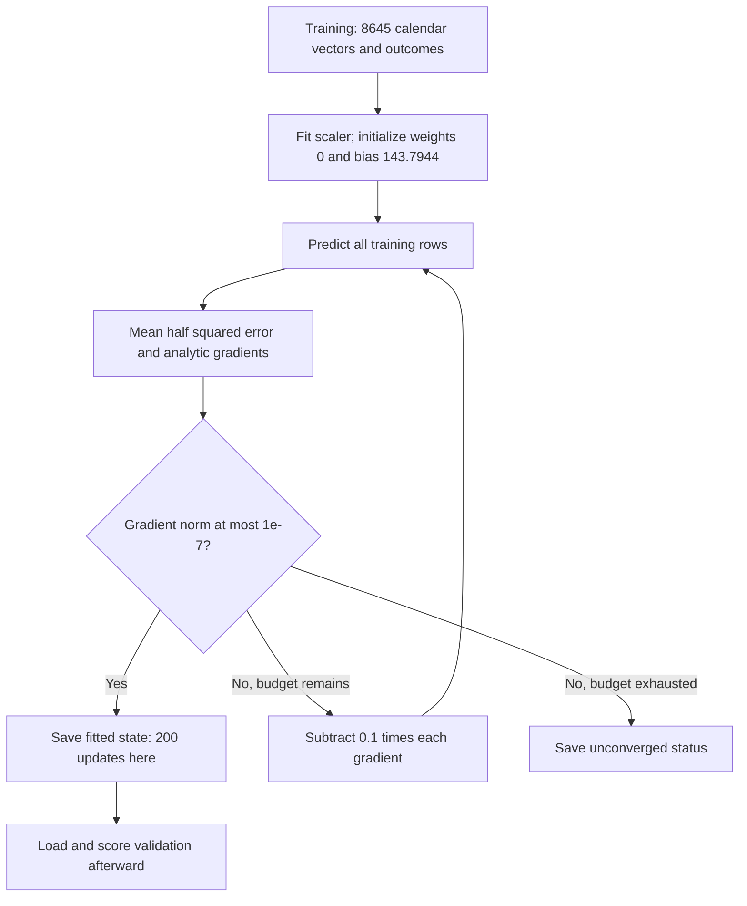

Validation is first opened by [linear_evaluation.py](code/src/bike_demand_planner/linear_evaluation.py) after fitting and the reference solve. Its outcomes choose neither the scaler, initialization, updates nor stopping point. Changing validation targets in the isolation fixture changes validation metrics while leaving the complete model, training metrics and optimization record unchanged. The fixture also removes raw and test CSVs before fitting, establishing that this path does not need them.

### Check the fitted function when coefficients are not unique

```video
{
  "title": "Check the fitted function when coefficients are not unique",
  "duration": 247.833333,
  "src": "media/bike-linear-dependent-coefficients/video.mp4",
  "poster": "media/bike-linear-dependent-coefficients/poster.jpg",
  "captions": "media/bike-linear-dependent-coefficients/captions.vtt",
  "transcript": "media/bike-linear-dependent-coefficients/transcript.md"
}
```


A decreasing loss is reassuring, but a wrong gradient can sometimes still decrease it. We therefore solve the same training least-squares problem independently with a stable numerical solver. Use the same saved scaler, append a column of ones for the intercept, and solve for the combined parameters:

```python
design = np.column_stack((Z, np.ones(len(Z))))
parameters, _, rank, _ = np.linalg.lstsq(design, y, rcond=None)
```

The [NumPy least-squares API](https://numpy.org/doc/2.5/reference/generated/numpy.linalg.lstsq.html) handles rank-deficient systems and returns the effective rank. It does not require us to invert a singular normal matrix. Its returned residual-summary array can be empty for rank-deficient designs; we recompute the actual prediction errors and objective instead of interpreting an empty array as zero error.

Our design is **8,645 × 46** but has rank **42**. The full hour, weekday and month indicators each sum to an intercept column in raw coordinates. There is also a fourth dependence in these training records: `workingday` equals the sum of Monday–Friday indicators minus `holiday`. The independent audit checks that last relation on this training export; it is not an assumption about every possible calendar dataset. Standardization changes coordinates but does not remove these dependencies.

This has a practical consequence. A coefficient vector is not a unique explanation of the fitted function. In raw coordinates, adding c to every hour coefficient and subtracting c from the intercept leaves every valid one-hot-hour prediction unchanged. Both parameter sets can have the same training objective. We compare predictions and objectives, rather than requiring visually identical coefficient arrays. Agreement on observed inputs also does not establish identical behavior on arbitrary off-domain vectors.

The measured maximum prediction difference between gradient descent and the reference is **5.75×10⁻⁷** rentals/hour on training and **4.76×10⁻⁷** on validation. Both training mean half squared errors are **3167.5272647334** to the shown precision. This supports the claim that our iterative implementation reached the same fitted function on these inputs. It says nothing by itself about whether that function is useful on future hours.

To make one forecast readable, convert the model back to raw feature coordinates:

$$
w_{raw,j}=w_j/s_j,\qquad
b_{raw}=b-\sum_j\mu_jw_{raw,j}.
$$

The saved model gives this equivalent decomposition for our Monday January hour:

```text
raw intercept              143.5653872680
hour 08 adjustment        +119.5579063956
Monday adjustment           +3.7310414990
January adjustment         -92.7873014453
working-day adjustment      +0.7114904613
                         ----------------
prediction                 174.7785241786 rentals/hour
```

This is a valid calculation using the saved representation. It is not a causal account of how many rentals Monday or January creates, and those individual numbers can move under an equivalent parameterization. The conversion is checked against standardized predictions. If a feature has zero training variance, scale one protects the arithmetic, but it cannot teach the model the effect of values never observed in that column.

### Compare the forecasts and explain the failures

```video
{
  "title": "Compare the forecasts and explain the failures",
  "duration": 241.958333,
  "src": "media/bike-linear-validation-failures/video.mp4",
  "poster": "media/bike-linear-validation-failures/poster.jpg",
  "captions": "media/bike-linear-validation-failures/captions.vtt",
  "transcript": "media/bike-linear-validation-failures/transcript.md"
}
```


Now consider the later **Monday, 9 January 2012** examples from the baseline discussion. At 02:00 the recorded target is 5; at 08:00 it is 420. These are validation outcomes, not fitting inputs. All three models use identical frozen rows, one-hour issue leads, identity checks, units and metric definitions.

| Validation hour | Outcome | Global mean | Hour/working-day mean | Linear model |
| --- | --- | --- | --- | --- |
| 2012-01-09 02:00 | 5 | 143.7944 | 7.5146 | **−70.6779** |
| 2012-01-09 08:00 | 420 | 143.7944 | 349.5040 | **174.7785** |

The 2012 08:00 prediction is exactly the same as the fitted 2011 example because their 45 calendar inputs are identical. There is no year feature or demand trend in this model. Different outcomes for the same inputs cannot be separated by adjusting a deterministic function of only those inputs.

The quiet-hour prediction is impossible as a rental count. An unconstrained linear function can cross below zero when negative adjustments add up. At 02:00, residual is `−70.6779 − 5 = −75.6779`, so the absolute error is 75.6779, worse than the group model's 2.5146. We keep the raw prediction and report it. Clipping would be a different prediction policy and would require its own retained comparison; silently clipping would hide the behavior being evaluated.

| Model | Training MAE | Validation MAE | Validation RMSE | Validation mean signed error |
| --- | --- | --- | --- | --- |
| Training constant | 106.5935 | 154.2452 | 208.1723 | −71.4057 |
| Hour/working-day groups | 55.4280 | **91.5729** | **137.3900** | −72.3422 |
| Additive calendar linear model | 59.2294 | 116.7312 | 157.9791 | −95.0794 |

The linear model improves on the constant, but its validation MAE is **25.1582 rentals/hour worse** than the group predictor. It improves absolute error on 1,364 validation rows and worsens it on 2,993. Negative forecasts occur on **797 training** and **724 validation** rows; the minimum is approximately −103.4273. These are measured failures, not rounding noise.

The model families explain why “more columns” does not ensure a better result. Our linear function has separate hour, weekday, month and flag effects. Its working-day contribution shifts the whole daily curve by one constant amount, conditional on the remaining main effects. The group baseline has an independently fitted value for each `(hour, workingday)` pair, allowing its working-day versus nonworking-day difference to vary by hour. That interaction can express a commuter morning peak without requiring the same gap at 02:00. The linear model adds month/weekday information but omits that interaction; these model families are not nested.

That is a structural limitation, not evidence of a failed gradient implementation. The stable solver produces essentially the same predictions, and even training RMSE is slightly worse for linear regression: **79.5931** versus **78.8394** for groups. More iterations at the same objective will not turn an additive model into a separate curve for each day type. Interactions and alternative objectives belong to later controlled studies.

There are other limitations. Training mean demand is 143.7944; validation mean demand is approximately 215.2001. Linear validation mean prediction is approximately 120.1207, which gives signed error −95.0794. Month composition and other calendar frequencies differ across the windows, while growth or omitted conditions may also matter. These observations establish the distribution difference and underprediction; they do not identify its cause. The worst linear error is 23 March 2012 at 17:00: prediction **296.4809** against **957**, an absolute error of **660.5191**.

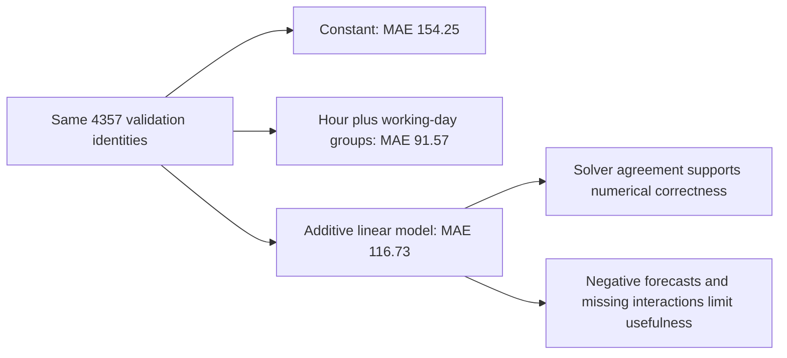

If we add more updates after convergence, the independent reference tells us to expect essentially the same solution. If we add hour-by-working-day interaction columns, we change the representable function and must fit and compare it separately. Those are different interventions. For now, keep the group predictor as the stronger observed validation reference and use this checked linear path as the foundation for the next study.

### Run the same calculation and inspect its evidence

From the project directory:

```bash
uv sync --frozen
OPENBLAS_NUM_THREADS=1 uv run --frozen python regression_example.py
OPENBLAS_NUM_THREADS=1 uv run --frozen python train.py
uv run --frozen python -m unittest discover -s tests -v
```

The thread setting makes these small local numerical runs predictable; it is not a change to the model. `regression_example.py` writes a fresh comparison directory with all three runs plus `updates.json` and `comparison.json`. `train.py` calls the same linear fitting/evaluation path without rerunning the baselines. Existing directories cannot be overwritten. A run that raises an error retains a failed receipt and reason; a completed run with `converged: false` is distinguishable from a converged one.

The reviewed comparison is [linear-comparison-20261019T230603269342Z](evidence/04-linear-regression-and-full-batch-learning/comparison.json). Its `linear/` folder retains `model.json`, `reference.json`, `optimization.csv`, train/validation predictions and `run.json`. The receipt records source hashes, Git state, lock hashes, Python/NumPy, configuration, frozen data identities, timings and artifact hashes. Saved raw and standardized parameters describe the fitted function; fresh-process saved-model inference and resumable optimizer state remain later work.

The [independent verification](evidence/04-linear-regression-and-full-batch-learning/independent-linear-verification.json) checks Decimal fixture arithmetic, scalar finite differences, the real first updates, all saved metrics, prediction identities, artifact hashes, unchanged frozen bytes and preserved indexes. All **48 source checks** pass. Source/wheel inspection excludes personal docs, data and runs; the installed wheel also passes an isolated numerical fit and reference comparison outside the checkout. Test outcomes remain reserved and no hosted training or learner understanding is inferred from these checks.

The most useful review question now is: **why can record 54 become overpredicted at convergence even while the full-training objective continues to decrease?** The worked batch above gives the ingredients. The next discussion can connect that answer to the weaker validation result before any optimizer study begins.

### Keep the reasoning beside the result

[Learning points](project/learning-points/04-linear-regression.md) explain what this calculation changes in our understanding. [Comparisons](project/comparisons/04-linear-regression.md) put the alternatives side by side. [Setup and commands](project/setup.md) and the [current completion record](project/implementation.md) give the executable project context.

### Predict or explain: The fitted additive model converges but has validation MAE 116.7312, worse than groups. Is another optimizer guaranteed to fix that?

<details data-practice-id="linear-regression-check"><summary>Reveal worked answer and rubric</summary>

No. Reaching the chosen training objective does not make the additive function expressive enough to learn separate working-day hourly shapes, nor does it guarantee the validation objective improves. Inspect representation, loss and temporal shift separately.

**Rubric:** Separate optimizer convergence, function structure and later prediction error.

</details>


Vary the update mechanism while keeping the forecasting problem fixed. Continue to [the next lesson](lessons/05-batches-and-optimizers.md) when this step is clear.


## Compare batches, momentum and Adam

The additive model has a full-batch reference solution. We can now change how it approaches that solution without changing the task. Follow the same training hour through SGD, momentum and Adam, then compare the complete runs using their actual work budgets.

### Follow the same hour through SGD and momentum

```video
{
  "title": "Follow the same hour through SGD and momentum",
  "duration": 255.708333,
  "src": "media/bike-optimizer-sgd-momentum/video.mp4",
  "poster": "media/bike-optimizer-sgd-momentum/poster.jpg",
  "captions": "media/bike-optimizer-sgd-momentum/captions.vtt",
  "transcript": "media/bike-optimizer-sgd-momentum/transcript.md"
}
```


Return to **Monday, 3 January 2011 at 08:00**, training record **54**. The request is issued at 07:00 under our retained interval-start convention; its outcome is **154 observed rentals** in 08:00–09:00. Calendar values are known in advance. The outcome joins the calculation when we calculate a training residual, after remaining separate from the inputs.

The parameters in this probe use the completed 2011 training window. We are inspecting a training calculation; we do not claim that these fitted values were available on 3 January.

The raw vector activates hour 8, Monday, January and the working-day flag. We reuse means and population scales fitted only on the 8,645 training rows. The standardized hour-8 value is **4.7765496959**. The other centered columns participate too, including columns whose raw indicators were zero. For this calculation, append the bias to the 45 weights so the optimizer receives a 46-element parameter vector, called theta. The bias gradient becomes its last entry.

We start at zero weights and bias **143.7944476576**, the training target mean. That gives this hour residual `143.7944476576 − 154 = −10.2055523424`. Its hour-8 gradient is residual times the standardized feature:

$$
g_{08}=-10.2055523424\times4.7765496959=-48.7473279374.
$$

For this opening probe, repeat **this one real row twice**, with learning rate **0.01**. This is an intentionally small arithmetic experiment. The later dataset study draws batches from all training rows, and its results must be read separately.

Plain SGD subtracts the current gradient times the rate. The first hour-8 weight becomes `0 − 0.01×(−48.7473279374) = 0.4874732794`. The bias becomes `143.7944476576 − 0.01×(−10.2055523424) = 143.8965031810`. All other weight coordinates also update. Recomputing the whole-vector forecast gives **148.3742989399**. That forecast cannot be obtained from the hour-8 coefficient alone.

The second gradient must be recomputed at the new parameters. The row now has residual **−5.6257010601**, and its hour-8 gradient is **−26.8714406879**. SGD therefore gives hour-8 weight **0.7561876863**, with a full-row forecast of **150.8988927442** after two updates.

Momentum changes what we subtract. We choose a specific convention: start velocity at zero, keep 90% of its previous value, and add the new gradient. The rate is applied after accumulating that velocity:

```python
# optimizers.py: classical momentum, without dampening
first = config.momentum * first + gradient
updated = parameters - learning_rate * first
```

The first velocity equals the first gradient, so its first prediction is identical to SGD: **148.3743**. On the second step, the hour-8 velocity is:

$$
v_{2,08}=0.9(-48.7473279374)-26.8714406879=-70.7440358315.
$$

The second hour-8 coefficient becomes `0.4874732794 − 0.01×(−70.7440358315) = 1.1949136377`. The complete forecast reaches **155.0207588983**, slightly above target 154. The remembered gradient has carried the parameter farther than the current gradient alone would.

| Repeated-row probe, rate 0.01 | Initial prediction | After one update | After two updates |
| --- | --- | --- | --- |
| SGD | 143.7944 | 148.3743 | 150.8989 |
| Momentum, coefficient 0.9 | 143.7944 | 148.3743 | 155.0208 |

The [actual optimizer source](code/src/bike_demand_planner/optimizers.py) and [runnable probe](code/optimization_example.py) use these same calculations. A separate scalar implementation reproduces all shown parameters and forecasts to floating-point precision. A four-row matrix fixture also checks two known SGD and momentum updates independently.

If the momentum coefficient were zero, the velocity would equal the current gradient at every step and this rule would reduce to SGD. With a persistent gradient and coefficient 0.9, the accumulated direction can approach ten times the gradient. This explains why equal numerical rates need not create equal movement. In our dataset pilot, momentum consequently selects a lower base rate than SGD. Overshooting the one-row target is a visible consequence of remembered direction, not evidence that the derivative was calculated incorrectly.

### Let Adam remember gradient direction and size

```video
{
  "title": "Let Adam remember gradient direction and size",
  "duration": 251.583333,
  "src": "media/bike-optimizer-adam-moments/video.mp4",
  "poster": "media/bike-optimizer-adam-moments/poster.jpg",
  "captions": "media/bike-optimizer-adam-moments/captions.vtt",
  "transcript": "media/bike-optimizer-adam-moments/transcript.md"
}
```


Adam keeps two moving averages for each parameter. One tracks the gradient, including its sign. The other tracks the squared gradient, giving a measure of its recent magnitude. That second quantity is an average of squares; it is not the variance obtained by subtracting the gradient mean. The two buffers start at zero, and the optimizer counts completed parameter updates from **t = 1**.

We use beta1 **0.9**, beta2 **0.999**, and epsilon **1e-8**, with no weight decay or AMSGrad. Our convention follows Algorithm 1 of the [original Adam paper](https://arxiv.org/pdf/1412.6980): correct both moments for zero initialization, then place epsilon **outside** the square root of the corrected second moment.

$$
m_t=0.9m_{t-1}+0.1g_t,\qquad v_t=0.999v_{t-1}+0.001g_t^2,
$$
$$
\hat m_t=\frac{m_t}{1-0.9^t},\qquad
\hat v_t=\frac{v_t}{1-0.999^t},\qquad
\theta_t=\theta_{t-1}-\alpha_t\frac{\hat m_t}{\sqrt{\hat v_t}+10^{-8}}.
$$

The short source trace shows where the update index and epsilon enter:

```python
step = state.step + 1
first = beta1 * state.first + (1 - beta1) * gradient
second = beta2 * state.second + (1 - beta2) * gradient ** 2
first_corrected = first / (1 - beta1 ** step)
second_corrected = second / (1 - beta2 ** step)
direction = first_corrected / (np.sqrt(second_corrected) + epsilon)
updated = parameters - learning_rate * direction
```

Those shortened beta/epsilon names correspond to fields of `OptimizerConfig`. The executed source keeps the configuration explicit. One update on a batch of 32 increments t by one, just as one update on a single row does; t is not the number of examples processed.

For the same real hour, the initial hour-8 gradient is still **−48.7473279374**. Its first moment becomes **−4.8747327937** and its second moment becomes **2.3763019810**. Dividing by `1 − 0.9 = 0.1` and `1 − 0.999 = 0.001` restores a corrected gradient of −48.7473 and a corrected squared magnitude of approximately 2376.302. The square root is approximately 48.7473. Their ratio is almost −1, so rate 0.01 moves this coordinate by approximately **+0.01**, rather than SGD's +0.48747.

All 46 coordinates receive their own normalized direction. The full prediction becomes **144.0248813311** after one update. Before the second, this hour's residual is **−9.9751186689**, giving hour-8 gradient **−47.6466500444**. Its new stored moments are **−9.1519245188** and **4.6441289395**. At t=2 the correction denominators are **0.19** and **0.001999**. Applying that corrected ratio moves the hour-8 coefficient from about 0.01 to **0.0199933959**. The second complete forecast is **144.2551628230**.

Adam moves less than SGD in this probe at the same rate because it divides out much of the gradient magnitude. This does not rank the algorithms. Later, the equal-allowance pilot selects Adam rate **1.0** for this unscaled rental target. A useful numerical rate belongs to an update rule and problem scale.

Two changed cases clarify details that are easy to memorize without understanding. With a tiny gradient of **1e-10**, rate 0.1 and corrected moments at the first step, our epsilon placement gives a parameter change of approximately **−0.000990099**. Placing epsilon inside the square root would give a different result. The source check calculates the expected value directly, so that convention cannot change unnoticed.

Also consider a separate one-dimensional fixture with gradients **+2, then −1**. Adam's corrected mean still points positively after the sign reversal, and its parameter moves from about −0.1 to **−0.1266337033**. Restarting its buffers at the second step would change that direction. This fixture and the real-hour calculation check changing history, rather than testing only an unchanging gradient. Stored moments and the update counter are part of the algorithm's state.

### Change the batch while keeping the time boundary intact

```video
{
  "title": "Change the batch while keeping the time boundary intact",
  "duration": 258.125,
  "src": "media/bike-optimizer-batches-work/video.mp4",
  "poster": "media/bike-optimizer-batches-work/poster.jpg",
  "captions": "media/bike-optimizer-batches-work/captions.vtt",
  "transcript": "media/bike-optimizer-batches-work/transcript.md"
}
```


The dataset still has **8,645 training rows from 2011**. Shuffling those rows changes the order of optimization work; it does not change which observations belong to training. Validation remains the frozen January–June 2012 window, and its outcomes enter only later scoring. The current calendar model has no recurrent state or lag window whose internal ordering would be broken by row shuffling.

`BatchStream` uses a NumPy PCG64 generator with an explicit seed. At the start of each epoch, it generates a fresh permutation of all training row positions. Consecutive batches take slices from that permutation without replacement. Each training row appears once per completed epoch, and the smaller final batch is retained.

```python
if self.cursor == self.count:
    self.epoch += 1
    self.order = self.rng.permutation(self.count)
    self.cursor = 0
size = min(self.batch_size, self.count - self.cursor, remaining)
indices = self.order[self.cursor:self.cursor + size].copy()
self.cursor += size
self.examples_seen += size
```

Here `remaining` represents the remaining example budget; the source also handles an unspecified budget. The source is in [optimization.py](code/src/bike_demand_planner/optimization.py). A gradient uses the actual returned rows:

$$
g_w=\frac{Z_{batch}^T e_{batch}}{B_{actual}},\qquad
 g_b=\frac{\sum e_{batch}}{B_{actual}}.
$$

For batch size 32, `8645 = 270×32 + 5`. That gives **271 updates per epoch**, with five rows in the tail. Dividing that last sum by 32 would shrink its intended mean gradient to **5/32** of its value. Dropping the tail would discard five recorded hours each epoch. We keep them and divide by five. A small constant-feature fixture checks this denominator using independent scalar arithmetic.

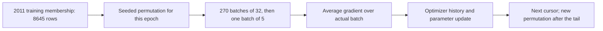

The arrows show the order of training work. No validation row feeds that loop. A changed seed gives another training order, while repeating a seed reproduces the same order. Independent replay checks the saved final permutation and RNG state against ten direct PCG64 permutations.

We compare batch policies using **ten passes, or 86,450 processed examples**, for every trial. The update counts differ substantially:

| SGD batch policy, rate 0.01 | Examples processed | Parameter updates | Final mean validation MAE | Mean fitting time on this machine |
| --- | --- | --- | --- | --- |
| One row | 86,450 | 86,450 | 118.0924 | 0.9792 s |
| 32 rows | 86,450 | 2,710 | 116.1661 | 0.0352 s |
| All 8,645 rows | 86,450 | 10 | 146.9448 | 0.0047 s |

These averages use paired seeds 17, 29 and 43. Fitting time covers the optimizer loop and its training monitoring, excluding data acquisition, scaler fitting, serialization and validation scoring. Tiny timings on one machine describe this run, rather than a general hardware benchmark.

The full-batch result needs context. Ten updates at 0.01 leave training half-MSE at **7859.9613**. The previous full-batch fit used rate 0.1 and 200 updates to reach approximately **3167.5273**. The full-batch method remains capable of fitting this model; our new fixed-work comparison gives it only ten small steps. Conversely, single-row SGD makes many noisy updates and has more variation across seeds: validation MAE sample standard deviation is **6.0390**, versus **0.5594** for batches of 32. Equal examples, equal updates and equal wall time are three different comparison questions.

### Freeze a fair comparison and read what it says

```video
{
  "title": "Freeze a fair comparison and read what it says",
  "duration": 298.416667,
  "src": "media/bike-optimizer-controlled-comparison/video.mp4",
  "poster": "media/bike-optimizer-controlled-comparison/poster.jpg",
  "captions": "media/bike-optimizer-controlled-comparison/captions.vtt",
  "transcript": "media/bike-optimizer-controlled-comparison/transcript.md"
}
```


We separate changes rather than making one large cross-product experiment. The optimizer comparison fixes batch size at 32, the batching comparison fixes plain SGD and rate 0.01, and the schedule comparison fixes SGD, batch 32 and its selected initial rate. Model, target, scaling, initialization, split identities and error definitions are shared throughout.

Before the main comparisons, a **single-seed training-only pilot** gives each optimizer the same four rates, **0.001, 0.01, 0.1 and 1.0**, and at most **200 updates**. It selects the lowest final **full-training half-MSE** among candidates that complete that allowance. Validation MAE does not choose a rate. We deliberately include 1.0 because normalized Adam updates need useful movement on this target scale, while the same grid also exposes excessive SGD/momentum steps.

| Pilot result at batch 32 | Selected rate | Training half-MSE after 200 updates |
| --- | --- | --- |
| SGD | 0.01 | 3271.57 |
| Momentum | 0.001 | 3254.55 |
| Adam | 1.0 | 3256.37 |

The pilot resets weights, bias and optimizer buffers for every candidate. Its rate-1.0 SGD and momentum candidates diverge and are retained as failures. The guard checks for nonfinite calculations or batch/monitored training loss above 100 times the initial full-training half-MSE, with a floor of one for that reference. SGD completes **11 updates** before the failed attempt has visited **384 examples**; momentum completes **8**, with **288 examples visited**. A failed attempt consumes work even when it does not apply another parameter update. Failed state is marked unsuitable for successful continuation, and no validation score is presented for those pilot failures.

The earlier update-cap proposal was 10,000. A ten-pass single-row trial needs 86,450 updates, so that cap would stop it after about one pass and defeat the equal-example comparison. Before the main runs, we freeze a **100,000-update safety cap**, the **300-second limit**, the ten-pass exposure budget and the three paired seeds. The pilot's measured fitting costs are only a few milliseconds per candidate, making this bounded local study feasible.

The protocol is written and hashed before any main trial or validation load:

```python
selected[kind] = min(completed_pilots,
                     key=lambda row: (row['training_half_mse'], row['rate']))['rate']
write_frozen_protocol(selected, seeds, budgets)
# Fit paired main trials using those fixed choices.
# Load validation only after the main fits have finished.
```

This shortened trace describes [optimizer_evaluation.py](code/src/bike_demand_planner/optimizer_evaluation.py); its actual JSON writing and hashing are explicit in the source. Identical configurations share a retained trial. In this run, the selected SGD rate is already 0.01, so SGD/batch-32/constant-schedule entries reuse the same per-seed result. There are **12 pilot runs and 18 unique main runs**, rather than pretending reused entries are additional independent repetitions.

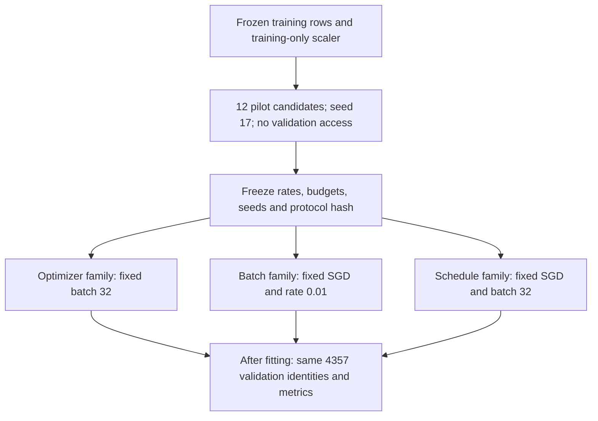

The branch point prevents an apparent optimizer improvement from quietly including a new batch size or feature set. Changing validation outcomes in a small integration fixture leaves pilot choices and every saved model unchanged. Independent checks also recalculate the protocol hash, rate selection, artifact hashes, prediction identities and scalar metrics.

At batch 32, the main results after the same ten passes are:

| Rule | Base rate | Validation MAE, mean ± sample SD | Mean training half-MSE |
| --- | --- | --- | --- |
| SGD | 0.01 | 116.1661 ± 0.5594 | 3177.8966 |
| Momentum | 0.001 | 116.6027 ± 0.6582 | 3174.3066 |
| Adam | 1.0 | 114.3608 ± 2.3676 | 3297.8450 |

Adam has the lowest observed mean validation MAE in this bounded comparison, while its training objective and seed variation are larger. The model family is unchanged, and none beats the retained hour/working-day baseline's **91.5729**. Three seeded orderings provide a small reproducibility comparison; their spread is not a population confidence interval. Pilot seed 17 is also one of the three main seeds, a declared design choice rather than three entirely new tuning holdouts. We retain all results instead of picking the most flattering seed.

The hourly examples remain useful. For seed 17, SGD predicts **168.9081** for Monday 9 January 2012 at 08:00, against target **420**. Adam predicts **153.2071** for that same hour, even though it has lower validation MAE overall. At 02:00, target 5, both still produce negative forecasts. A lower average error does not promise improvement on each row. Changing the optimizer has also left the additive model's absent interaction and negative-count behavior visible.

### Reduce the rate using work already processed

```video
{
  "title": "Reduce the rate using work already processed",
  "duration": 250.833333,
  "src": "media/bike-optimizer-rate-decay/video.mp4",
  "poster": "media/bike-optimizer-rate-decay/poster.jpg",
  "captions": "media/bike-optimizer-rate-decay/captions.vtt",
  "transcript": "media/bike-optimizer-rate-decay/transcript.md"
}
```


A fixed rate keeps reacting to the noise in later batches. We compare it with one declared inverse-time schedule, holding SGD, batch size 32, initial rate **0.01**, paired orders and ten-pass budgets fixed. The schedule uses the number of examples already processed **before the next update**:

$$
\alpha(s)=\frac{0.01}{1+s/43225},\qquad43225=5\times8645.
$$

At the start, s=0 and the rate is 0.01. After five passes, s=43,225 and it becomes **0.005**. After ten passes, it would be **0.0033333333** for the next update. The saved `next_learning_rate` describes that next step; it is not a claim that another update was performed after the budget ended.

```python
rate = base_rate / (1 + examples_seen / decay_examples)
indices = stream.next_indices(remaining_examples)
# Calculate the mean gradient on indices, then apply rate.
```

Using examples keeps the progress measure explicit. A counter of 100 updates could mean 100 single observations, 3,200 mini-batch observations or 864,500 full-batch observations. The chosen schedule decays after a declared amount of training exposure. We do not sweep several schedule families or tune the decay point using validation.

| SGD at batch 32 | Mean training half-MSE | Validation MAE mean | Validation MAE sample SD |
| --- | --- | --- | --- |
| Constant rate 0.01 | 3177.8966 | 116.1661 | 0.5594 |
| Inverse-time decay | 3168.3497 | 116.5579 | 0.1221 |

Decay settles closer to the full-batch training optimum of **3167.5273** and reduces the observed seed spread. Its mean validation MAE is about **0.3919 worse** in this comparison. The three paired validation MAEs are 115.5840/116.4198 for seed 17, 116.6995/116.6515 for seed 29, and 116.2147/116.6024 for seed 43, listed constant/decayed. The direction of the change is visible without relying on a single mean.

This is a useful separation between optimization and forecasting. A smoother fit to training squared error need not improve later absolute error. The fitting loop stops at the declared example budget; it does not declare convergence because a curve looks flatter. The records also distinguish update-budget, time-budget, divergence and nonfinite stops. A different decay interval would be a new comparison, rather than an explanation added after looking at the answers.

### Save what determines the next update

```video
{
  "title": "Save what determines the next update",
  "duration": 275.75,
  "src": "media/bike-optimizer-continuation-state/video.mp4",
  "poster": "media/bike-optimizer-continuation-state/poster.jpg",
  "captions": "media/bike-optimizer-continuation-state/captions.vtt",
  "transcript": "media/bike-optimizer-continuation-state/transcript.md"
}
```


The optimizer is now a stateful calculation. A saved coefficient vector is enough to make the same forward prediction, together with the scaler and feature order, but it is insufficient to reproduce the next training step. Momentum needs its velocity. Adam needs both moment buffers and its one-based update counter. The stream needs its exact current permutation and cursor, because regenerating an epoch from its beginning would choose a different next batch.

For a concrete pause, take the four-row numerical fixture with batch size three. After one update, three examples have been visited and **one row remains in the current epoch**. The next update must use that tail row with denominator one. It must also use the optimizer history accumulated from the first batch and the saved schedule progress. Starting another random permutation immediately would silently skip the intended remainder of the epoch.

The saved state contains the coupled pieces:

```text
parameters: 45 weights plus the intercept
optimizer: rule/configuration, first buffer, second buffer, update index
batch_stream: epoch permutation, cursor, epoch count, examples seen, PCG64 state
schedule: base/decay configuration and next rate derived from examples seen
identity: source, lock/data/schema identities, scaler and feature order
```

The actual source writes [a representative state.json](evidence/05-batches-momentum-and-adam/state.json), alongside model parameters, training history, aligned predictions and the run receipt. The state header declares its version and whether the trial is suitable for continuation. Failed numerical trials remain separate from valid paused runs.

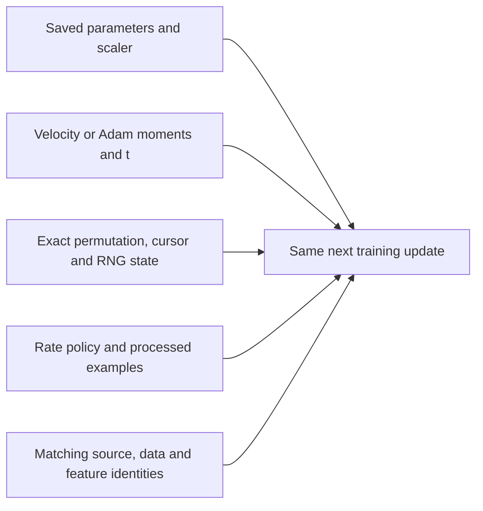

Every incoming arrow represents information that can change the next result. We test this by pausing after one update, passing the state through JSON, and continuing with the same configuration. For SGD, momentum and Adam, the resulting parameters, moment buffers, epoch order and RNG state match the uninterrupted numerical run **exactly**. Elapsed wall time naturally differs. The fitting function checks its configuration and stream dimensions; a production recovery caller must also enforce the saved source/data/scaler identities.

The changing-gradient Adam example makes a reset error visible: after gradients +2 and −1, preserved history produces parameter −0.1266337033. Treating the second step as a new optimizer would move it in another direction. Resetting only the update index while retaining the old buffers would be inconsistent with their correction factors as well.

These checks establish local algorithm-state continuation. The later application/recovery work still needs a real saved run restored in a fresh process and its supported prediction interface. We have saved the required pieces now without claiming that later integration is already complete.

### Run it and inspect the retained evidence

From the project directory:

```bash
uv sync --frozen
OPENBLAS_NUM_THREADS=1 uv run --frozen python optimization_example.py
uv run --frozen python -m unittest discover -s tests -v
```

The example writes the real-hour probe to `updates.json`, a twelve-run pilot, the hashed protocol and eighteen unique main trial folders. All inputs are declared in the script's main block. Existing run directories cannot be overwritten. The reviewed study is [optimization-20261019T234355414391Z](evidence/05-batches-momentum-and-adam/study.json); its protocol and per-trial receipts retain source/lock/data identities, task and transform policy, hardware/thread environment, optimizer settings, budgets, work counts, timings and stopping status.

The [independent verification](evidence/05-batches-momentum-and-adam/independent-study-verification.json) recomputes every saved prediction metric, checks row identities and artifact hashes, replays epoch/RNG state independently and verifies the training-only rate choices and protocol hash. It also confirms unchanged frozen non-test bytes and repository indexes. Population feature scales agree with an independent binary-column calculation within **6.91e-14**, and the real-hour probe agrees with scalar arithmetic within **1.1e-17**. All **60 source checks** pass. Personal notes, data and generated media remain ignored and excluded from source/wheel exports; isolated installed-package checks exercise the optimizer and continuation path.

The useful next discussion is why Adam's larger training squared error can coexist with lower observed validation MAE, while the group baseline remains stronger. The objective/feature studies remain in their later overview. No new learner answer or final-test outcome is inferred from the implementation or videos.

### Keep the reasoning beside the result

[Learning points](project/learning-points/05-batches-and-optimizers.md) explain what this calculation changes in our understanding. [Comparisons](project/comparisons/05-batches-and-optimizers.md) put the alternatives side by side. [Setup and commands](project/setup.md) and the [current completion record](project/implementation.md) give the executable project context.

### Predict or explain: Two runs each process 86450 examples, one with batch 32 and one with full batches. Do they take the same number of updates?

<details data-practice-id="batches-and-optimizers-check"><summary>Reveal worked answer and rubric</summary>

No. Work in processed examples is held fixed while batch size changes the number and noise of updates. A final partial batch uses its actual size. Optimizer state and schedules must use their declared update/example counters.

**Rubric:** Name the fixed budget and explain why update count and training passes are different quantities.

</details>


Update rules do not remove the loss and representation choices. Continue to [the next lesson](lessons/06-losses-and-calendar-structure.md) when this step is clear.


## Change the loss, regularization and calendar structure

An optimizer can only optimize the objective and representation it receives. Keep the hourly problem fixed while changing one of those choices at a time. The worked errors show why a different slope, coordinate system or calendar interaction changes the calculation.

### Follow the same hourly error through three losses

```video
{
  "title": "Follow the same hourly error through three losses",
  "duration": 246.0,
  "src": "media/bike-objectives-loss-influence/video.mp4",
  "poster": "media/bike-objectives-loss-influence/poster.jpg",
  "captions": "media/bike-objectives-loss-influence/captions.vtt",
  "transcript": "media/bike-objectives-loss-influence/transcript.md"
}
```


Return to **Monday, 3 January 2011 at 08:00**, training record **54**, whose observed target is **154 rentals** during 08:00–09:00. The request is issued at 07:00 under the retained convention. Calendar inputs are available in advance; the outcome joins a training residual afterward. The starting bias **143.7944476576** uses the completed 2011 training window. This is a training calculation, rather than a claim that those fitted statistics existed on 3 January.

With zero weights, the prediction equals that bias. Our residual convention stays prediction minus target:

$$
e=143.7944476576-154=-10.2055523424.
$$

The model is too low. A negative loss slope tells gradient descent to move its prediction upward, subject to the feature values and the other observations in the batch. The loss changes how strongly this particular miss contributes.

| Per-example calculation | Loss value | Slope with respect to prediction |
| --- | --- | --- |
| Half squared error, e²/2 | 52.0766493 | −10.2055523 |
| Absolute error, abs(e) | 10.2055523 | −1 |
| Huber, delta = 10 | 52.0555234 | −10 |

Half squared error has slope e, so a larger error contributes a proportionally larger pull. Absolute error has slope −1 or +1 away from zero; our implementation chooses **zero at an exact match**. That is a declared subgradient policy at its corner, rather than a derivative that exists there.

Huber uses a squared region near zero and a linear region beyond a threshold. Delta has the same units as the residual: rentals/hour. At delta 10, this error lies just beyond the transition. Its loss is `10 × (10.2055523424 − 5) = 52.055523424`, while its slope is capped at −10.

$$
\ell_\delta(e)=
\begin{cases}
e^2/2,& |e|\leq\delta,\\
\delta(|e|-\delta/2),& |e|>\delta.
\end{cases}
$$

The corresponding source in [objectives.py](code/src/bike_demand_planner/objectives.py) keeps the consequential branches visible:

```python
if config.kind == "half_mse":
    values, slopes = .5 * e ** 2, e.copy()
elif config.kind == "mae":
    values, slopes = np.abs(e), np.sign(e)
else:
    quadratic = np.minimum(np.abs(e), config.delta)
    values = .5 * quadratic ** 2 + config.delta * (np.abs(e) - quadratic)
    slopes = np.clip(e, -config.delta, config.delta)
```

The batch objective averages these values. Its weight gradient is `Z.T @ slopes / N`, and its intercept gradient is the slope mean. Our earlier hour-8 standardized value was 4.7765497. In a one-row calculation, multiply each shown slope by that feature to obtain the hour-8 weight gradient. Absolute error therefore pulls that coordinate about one tenth as strongly as squared error at this starting residual. A full training update combines all 8,645 rows, whose contributions can oppose one another.

Now change only the target to **454 as an illustrative counterfactual**, keeping the same prediction and vector. The residual becomes −310.2056. Squared error's slope becomes −310.2056, while MAE stays −1 and Huber10 stays −10. This is the mechanism behind reduced sensitivity to very large residuals. It does not say which objective will forecast the later period best, or identify a recorded observation as a corrupt outlier.

We compare half-MSE, MAE, Huber10 and Huber50 using the same 45 inputs, training-fitted standardization, initialization and full-batch Adam convention. Each gets rates **0.01, 0.1 and 1.0**, with **200 training-only pilot updates** per candidate. Selection is by final full-training objective **within that loss**, never by comparing MAE's numerical loss with Huber's differently scaled loss. Every loss selects rate 1.0 here. Main fits reset all state and run **2,000 updates**, with a 60-second safety limit. All finish their update allowance.

| Objective | Training data loss in its own units | Raw validation MAE | Nonnegative validation MAE |
| --- | --- | --- | --- |
| Half-MSE | 3167.5275 | 116.7294 | 109.1418 |
| MAE | 56.7591 | 117.5594 | 110.8203 |
| Huber10 | 520.6173 | 117.2829 | 110.5990 |
| Huber50 | 1899.5263 | 116.7405 | 110.5935 |

The MAE fit has lower training absolute error than the squared-error reference's **59.2294**, yet worse later absolute error. At the later Monday 08:00 example, target 420, MAE predicts **218.3283** and Huber10 **219.2912**, versus squared error's **174.7737**. Those improvements on one hour coexist with a weaker aggregate result. Raw negative quiet-hour predictions remain under all four losses.

These are bounded fits. Fixed-step Adam is not guaranteed to improve the objective monotonically: MAE's pilot ends at about 56.7566, slightly below its 2,000-step result. We do not claim an exact global MAE solution or silently choose a flattering earlier checkpoint. Finite-difference checks away from corners, explicit boundary checks and the independent study audit establish what was calculated. The [Huber definition](https://docs.pytorch.org/docs/2.14/generated/torch.nn.modules.loss.HuberLoss.html) is a useful reference for the delta-scaled linear region; this implementation uses NumPy and is not a PyTorch training wrapper or normalized Smooth L1 loss.

### Shrink weights without pulling the intercept toward zero

```video
{
  "title": "Shrink weights without pulling the intercept toward zero",
  "duration": 244.291667,
  "src": "media/bike-objectives-l2-weights/video.mp4",
  "poster": "media/bike-objectives-l2-weights/poster.jpg",
  "captions": "media/bike-objectives-l2-weights/captions.vtt",
  "transcript": "media/bike-objectives-l2-weights/transcript.md"
}
```


A different loss changes how a miss is valued. L2 changes the preference among parameter vectors, adding a cost for large weights. We isolate that question using the same standardized 45-column design and half squared error:

$$
J(w,b)=\frac{1}{N}\sum_i\frac{(z_i^Tw+b-y_i)^2}{2}
+\frac{\lambda}{2}\sum_j w_j^2.
$$

The intercept b is excluded. The data loss is a **mean**, and the penalty is **lambda/2 times the squared weight norm**, with no additional division by N. Consequently the gradient adds `lambda * weights`; the intercept gradient remains the residual mean.

For a small independent example, weights `[2, −3]` and lambda 0.2 contribute `0.2 × (4 + 9) / 2 = 1.3` to the objective. Their penalty gradients are `[0.4, −0.6]`. An intercept of 100 contributes nothing to the penalty. At zero data residuals, a rate-0.1 step shrinks the weights to `[1.96, −2.94]` while that intercept stays 100. This illustrates the penalty contribution in isolation, not a new fitted Bike model.

```python
penalty = .5 * config.l2 * float(w @ w)
total = float(values.mean()) + penalty
dw = X.T @ slopes / len(X) + config.l2 * w
db = float(slopes.mean())
```

Duplicating every training row should leave this objective unchanged: its mean data term stays the same, as does its penalty. Both the numerical-gradient checks and a duplicated-data fit check this normalization. Penalizing the bias would instead pull the overall level toward zero rentals, which is a different model preference.

To make regularization the main change, these fits use an exact training-only least-squares construction. Append penalty rows `sqrt(N*lambda) * I` for weights and zero for the intercept, then solve the augmented system stably. Dividing the augmented sum of squares by 2N yields precisely the declared objective. There is no inverse of a potentially singular normal matrix, and no extra optimizer-rate choice in this family.

| Lambda | Training half-MSE without penalty | Standardized weight norm | Raw validation MAE | Nonnegative validation MAE |
| --- | --- | --- | --- | --- |
| 0 | 3167.5273 | 105.5410 | 116.7312 | 109.1436 |
| 0.1 | 3212.1764 | 96.2645 | 115.4056 | 110.4199 |
| 1 | 4559.2240 | 53.7555 | 120.9063 | 120.9063 |
| 10 | 7912.7777 | 9.9291 | 147.3114 | 147.3114 |

Lambda 0.1 slightly improves raw MAE, but loses to lambda 0 after the declared nonnegative policy. That reversal is why output policy must accompany a model comparison. Strong penalties remove negative forecasts here while sacrificing the hourly pattern: lambda 10 predicts **123.6588** at the quiet target-5 hour and **146.7258** at the target-420 commute hour. Positive outputs alone do not establish useful demand forecasts.

The centered, unpenalized intercept remains near the training mean. As the weights are forced toward zero, this model approaches a constant prediction. Its behavior becomes understandable without treating regularization as a universal improvement. Also, this penalty is defined in **standardized coordinates**. Applying the same lambda to raw coefficients would change its meaning. We keep that alternative outside this comparison.

### Change coordinates without adding a new pattern

```video
{
  "title": "Change coordinates without adding a new pattern",
  "duration": 256.75,
  "src": "media/bike-objectives-scaling-coordinates/video.mp4",
  "poster": "media/bike-objectives-scaling-coordinates/poster.jpg",
  "captions": "media/bike-objectives-scaling-coordinates/captions.vtt",
  "transcript": "media/bike-objectives-scaling-coordinates/transcript.md"
}
```


Standardization can accelerate movement through a parameter space while leaving the unpenalized representable function unchanged. To see that distinction, keep half-MSE, no penalty, zero weights, the training-mean intercept and full-batch SGD fixed. Both raw and standardized versions get rate **0.1** and exactly **200 updates**.

The raw input for the real Monday hour has four active indicators. Standardization maps its hour-8 entry to **4.7765497** and its inactive entries to centered negative values. Weights now measure adjustment per standardized unit. The source fits these coordinates using training only and saves them beside the model; prediction reuses them without adapting to a request batch.

```python
fitted = fit_standardizer(training_features)
scaler = fitted if scaling == "standardized" else identity_scaler
Z = scaler.transform(training_features)
# Apply the same full-batch SGD rule and rate in either coordinate system.
```

Here `identity_scaler` describes the executed raw branch: stored means are zero and scales one. Constant training columns in the standardized branch use scale one. Both branches retain the same feature order and target units.

| After 200 SGD updates | Training half-MSE | Gradient norm in that coordinate system | Raw validation MAE |
| --- | --- | --- | --- |
| Raw indicators | 4114.4970 | 9.0162 | 120.6604 |
| Standardized indicators | 3167.5273 | about 9.7e-8 | 116.7312 |

At this fixed work allowance, the standardized fit is much closer to the training optimum. Gradient norms themselves depend on coordinates, so they are not an invariant distance between the two predictors. The configured stopping rule is still the update budget; a very small final gradient does not retroactively make it an early-convergence run.

We also solve training least squares in both coordinate systems. Their predictions on every observed training and validation input agree within **2.3e-12 rentals/hour**. That independent comparison shows that the raw model's weak 200-step result comes from its trajectory, rather than lost representational capacity. Dependent columns mean coefficients need not match, and coordinate-dependent minimum-norm solutions can disagree on unsupported inputs; the agreement claim here is for the checked observed inputs.

The quiet Monday example is a useful changed perspective. The unfinished raw fit predicts **4.3946**, close to target 5, while the nearly optimized standardized function predicts **−70.6779**. One hour improves under the less optimized function even though its training objective and aggregate validation MAE are worse. That reinforces the earlier distinction between an individual residual, the fitting objective and later forecast quality.

### Give the calendar a circle and inspect what it loses

```video
{
  "title": "Give the calendar a circle and inspect what it loses",
  "duration": 239.041667,
  "src": "media/bike-objectives-cyclic-calendar/video.mp4",
  "poster": "media/bike-objectives-cyclic-calendar/poster.jpg",
  "captions": "media/bike-objectives-cyclic-calendar/captions.vtt",
  "transcript": "media/bike-objectives-cyclic-calendar/transcript.md"
}
```


Hour 23 and hour 0 are adjacent on a clock. A sine/cosine pair encodes that relation without a jump at midnight:

$$
x_{\sin}=\sin(2\pi h/24),\qquad x_{\cos}=\cos(2\pi h/24).
$$

For hour 8, the values are approximately **0.8660254 and −0.5**. For hour 0 they are 0 and 1; for hour 23 they are approximately −0.2588190 and 0.9659258. The last two hours are close in this two-dimensional space. We similarly use weekday period 7 and month period 12, indexing January at zero. Three pairs plus holiday and working-day flags give **eight columns**.

```python
angle = 2 * np.pi * calendar_index / period
values.extend((np.sin(angle), np.cos(angle)))
```

The indices are recovered from the already frozen one-hot calendar vector, so this transformation needs no labels or future observations. Feature order and periods are explicit model state. Training-fitted standardization follows the transformation.

There is a subtle capacity change. The pair still distinguishes the 24 hourly positions, but a **linear** model of that pair can express only a constant plus a single sinusoidal hourly wave. It cannot assign 24 independent hourly effects. Two sharp commuting peaks are difficult to express with one wave. More harmonics or a different nonlinear learner would be another model; they are not included silently.

Both cyclic and one-hot fits use stable training least squares, no L2 and the same split:

| Representation | Inputs plus intercept | Training half-MSE | Raw validation MAE | Nonnegative validation MAE |
| --- | --- | --- | --- | --- |
| One-hot | 46 | 3167.5273 | 116.7312 | 109.1436 |
| Cyclic pairs | 9 | 4810.5088 | 115.8388 | 113.7926 |

The cyclic fit has slightly better raw MAE but worse clipped MAE and worse RMSE. At Monday 08:00, it predicts only **52.0365** against target 420. Smooth calendar geometry did not produce a useful commuting shape in this linear family. A lower dimension or a visually pleasing circle is not enough to choose it. The [scikit-learn calendar example](https://scikit-learn.org/stable/auto_examples/applications/plot_cyclical_feature_engineering.html) is an additional conceptual reference; its full pipeline and numerical benchmark differ from this frozen calendar-only experiment.

### Give working days their own hourly shape

```video
{
  "title": "Give working days their own hourly shape",
  "duration": 241.416667,
  "src": "media/bike-objectives-hour-interactions/video.mp4",
  "poster": "media/bike-objectives-hour-interactions/poster.jpg",
  "captions": "media/bike-objectives-hour-interactions/captions.vtt",
  "transcript": "media/bike-objectives-hour-interactions/transcript.md"
}
```


The earlier additive model shares one working-day adjustment across hours. Its raw-coordinate structure is an intercept, an hour effect, a weekday effect, a month effect and two flags. It cannot make the working-day difference particularly large at 08:00 and small overnight unless the inputs explicitly express that relationship.

We append **24 products**, one for each hour indicator times the working-day flag. The 45 original columns remain in place, giving 69 inputs. For the real Monday at 08:00, the new `hr_08_workingday` column at index 53 equals one; the other new products are zero.

```python
interaction_columns = X[:, :24] * X[:, 44:45]
expanded = np.column_stack((X, interaction_columns))
```

In raw coordinates, hour h can now receive `hour_effect[h] + workingday * interaction[h]`, alongside the other main effects. The working-day contrast contains the shared flag coefficient **plus an hour-specific term**. This changes which functions are representable, whereas changing Adam or scaling did not add this term. The coefficients remain dependent, so that decomposition is a representation of the function rather than a unique causal account of working days.

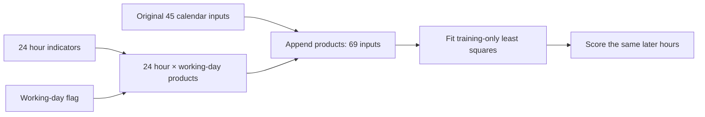

The arrows describe feature construction followed by fitting and evaluation. Outcomes do not feed the feature products. We use the same exact-solve policy as the one-hot and cyclic comparisons, so incomplete gradient optimization cannot explain a representational difference.

Training half-MSE falls from **3167.5273 to 1932.2748**. Raw validation MAE improves from **116.7312 to 108.6937**, and nonnegative MAE from **109.1436 to 100.5164**. At the busy Monday hour, the forecast rises from **174.7785 to 260.3130**, closer to 420. At the quiet hour it becomes **−83.6927**, worse than the original raw −70.6779. The additional flexibility does not improve every row or enforce count constraints.

The hour/working-day group baseline remains better at **91.5729 MAE**. The expanded model can represent group means, but its extra calendar main effects and fitting preferences can still generalize less well to the later period. The observed result does not prove one omitted factor caused the remaining gap. We keep the stronger reference rather than declaring the newest implementation the winner.

### Score nonnegative forecasts and freeze the next reference

```video
{
  "title": "Score nonnegative forecasts and freeze the next reference",
  "duration": 249.5,
  "src": "media/bike-objectives-output-selection/video.mp4",
  "poster": "media/bike-objectives-output-selection/poster.jpg",
  "captions": "media/bike-objectives-output-selection/captions.vtt",
  "transcript": "media/bike-objectives-output-selection/transcript.md"
}
```


All targets are nonnegative hourly counts, but an unconstrained linear function can produce negative estimates. We retain each raw output and separately score one declared policy: **max(0, prediction)**. No rounding is applied.

For the exact one-hot model at Monday 9 January 2012, 02:00, the raw prediction is **−70.6779**, against target **5**. Its absolute error is **75.6779**. Clipping gives prediction zero and error five. For the 08:00 prediction **174.7785**, clipping changes nothing, so the large target-420 deficit remains.

```python
if policy == "raw":
    return predictions.copy()
if policy == "nonnegative":
    return np.maximum(predictions, 0)
```

This improvement has a direct arithmetic reason. For p < 0 and y ≥ 0, raw absolute error is `y − p`, while the clipped error is y. Clipping reduces that row's error by −p and also cannot increase squared error. That result concerns MAE/RMSE against nonnegative targets; it does not repair the model's learned shape or reveal unobserved unmet demand.

The exact one-hot model has **724 negative validation forecasts**. Clipping reduces its MAE **116.7312 → 109.1436**. The interaction model has **751**, with MAE **108.6937 → 100.5164**. Their raw and clipped predictions have separate aligned CSVs. The same policy is applied to every row during scoring, rather than changing only a displayed chart.

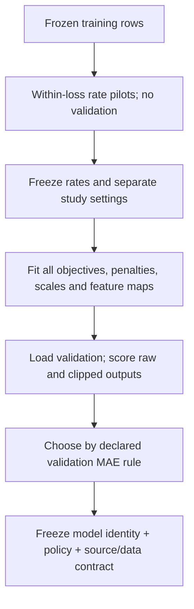

Validation is deliberately used for the final development selection after all model fitting. It does not choose scaler statistics, gradients or pilot rates. We keep every candidate's score, including both policies, and use a deterministic tie rule: raw policy first, then model name. The group baseline's outputs are already nonnegative, so its policies tie and **groups/raw** wins. Its saved model hash and the protocol hash are included in [selection.json](evidence/06-losses-regularization-and-calendar-structure/selection.json).

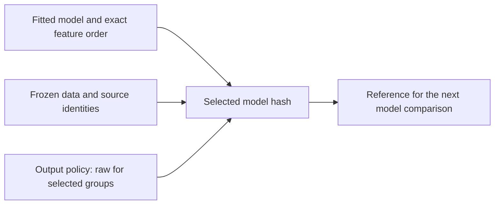

This freezes a reference to carry forward, not an implemented serving API or an externally validated winner. The same development window has now informed several comparisons, so its scores are not an unbiased final-test claim. At this point in the build, final assessment and the saved application are still ahead; lessons 9 and 10 complete them without revising these development choices. The next review is to explain why changing a loss, shrinking weights, reparameterizing inputs and adding an interaction answer four different questions.

### Run it and inspect the retained evidence

From the project directory, `uv run --frozen python objective_example.py` prints the real-hour loss probe and creates a new versioned study. `OPENBLAS_NUM_THREADS=1 OMP_NUM_THREADS=1` fixes the BLAS thread setting used for the reviewed local run. The new code adds no dependencies. [objective_evaluation.py](code/src/bike_demand_planner/objective_evaluation.py) owns the pilot/fitting/scoring order; [objective_example.py](code/objective_example.py) owns its runnable inputs.

Each comparison retains its model, scaler/feature order, objective configuration, update or direct-solve work, stop reason, histories, raw/clipped predictions and source/config/data identities. The pilot artifacts are hashed. All 72 checks pass, including independent finite differences, corner conventions, penalty normalization, representation values, changed-validation isolation and failure/no-overwrite behavior. [Independent verification](evidence/06-losses-regularization-and-calendar-structure/independent-study-verification.json) reproduces every saved prediction and metric, the direct-solve stationarity checks and selection, while confirming frozen non-test files and all repository indexes. Passing these checks does not supply a new learner explanation or hosted recovery result.

### Keep the reasoning beside the result

[Learning points](project/learning-points/06-losses-and-calendar-structure.md) explain what this calculation changes in our understanding. [Comparisons](project/comparisons/06-losses-and-calendar-structure.md) put the alternatives side by side. [Setup and commands](project/setup.md) and the [current completion record](project/implementation.md) give the executable project context.

### Predict or explain: If a raw model predicts -10 rentals and the observation is 5, what does clipping change?

<details data-practice-id="losses-and-calendar-structure-check"><summary>Reveal worked answer and rubric</summary>

Raw residual is -15 and absolute error is 15. A predeclared nonnegative policy returns zero, making residual -5 and absolute error 5. This is a different output function; it does not change the fitted weights or justify selecting the policy on final-test outcomes.

**Rubric:** Account for the changed prediction and error while preserving fit and selection boundaries.

</details>


Try a fitted piecewise function on the same frozen contract. Continue to [the next lesson](lessons/07-trees-and-ensembles.md) when this step is clear.


## Follow tree leaves, forests and boosted corrections

The earlier comparisons exposed an additive model’s structural limits. Trees offer a different kind of function: successive calendar questions ending at a mean. Trace a real leaf, then see what averaging trees and adding residual corrections change in the saved comparisons.

### Follow one hourly request to a leaf mean

```video
{
  "title": "Follow one hourly request to a leaf mean",
  "duration": 224.958333,
  "src": "media/bike-trees-leaf-prediction/video.mp4",
  "poster": "media/bike-trees-leaf-prediction/poster.jpg",
  "captions": "media/bike-trees-leaf-prediction/captions.vtt",
  "transcript": "media/bike-trees-leaf-prediction/transcript.md"
}
```


Begin with four real training observations. On **4 January 2011**, record 72 at **02:00** has target **1**, and record 77 at **08:00** has target **179**. On **5 January**, record 95 at 02:00 has target **2**, and record 100 at 08:00 has target **195**. These outcomes are known after their intervals. The corresponding calendar hours can be known in advance. This tiny probe uses only the declared `hr_08` indicator; the later benchmark uses all 45 frozen calendar columns.

A constant fitted on these four targets predicts their mean, **94.25 rentals/hour**, for both quiet and commuting hours. A one-split regression tree can instead ask whether `hr_08` is at most 0.5. Binary value zero takes the left branch, while one takes the right branch. For the shown observations, the two leaf means are **1.5** and **187**:

$$
\hat y_{\text{leaf}}=\frac{1}{n_{\text{leaf}}}\sum_{i\in\text{leaf}}y_i,
\qquad \hat y_{08}=\frac{179+195}{2}=187.
$$

The mean is the constant that minimizes squared error inside a fixed leaf. A tree searches candidate feature thresholds for useful reductions of that error, makes a split and continues within its resulting regions until its configured stopping conditions apply. This is a greedy construction of regions and leaf values. It is different from updating a fixed linear weight vector by SGD. The library owns that construction; our source keeps the input contract, fitted state and prediction arithmetic visible.

```python
# tree_example.py: a four-row teaching probe with one named input.
X = np.asarray([[r.features[8]] for r in chosen])
y = np.asarray([r.target for r in chosen])
stump = DecisionTreeRegressor(max_depth=1, random_state=17).fit(X, y)
quiet, busy = stump.predict([[0], [1]])  # 1.5, 187.0
```

The first output does not mean every hour other than 08:00 truly has demand 1.5. It means this deliberately restricted model sends every other hour to the leaf whose only supporting examples were 02:00 observations. Asking for 09:00 also sets this one indicator to zero and therefore returns 1.5. That changed case exposes the boundary of the tiny probe immediately. It is a mechanism demonstration, not the project's selected predictor.

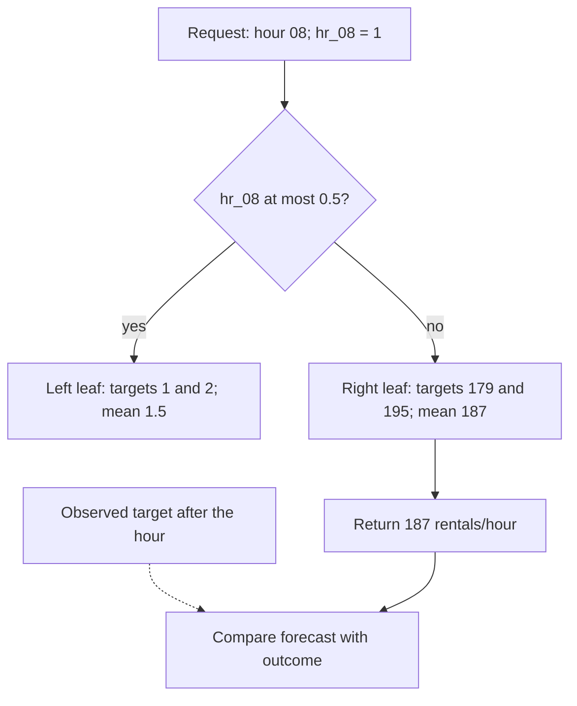

The solid branches are the prediction path. The dashed outcome arrow belongs to later scoring; the target is absent from a prediction request. Fitting used historical targets to learn those leaf values, but prediction only follows saved tests and reads a saved value.

$$
\mathrm{SSE}=\sum_{L\in\mathrm{leaves}}\sum_{i\in L}(y_i-\bar y_L)^2.
$$

The total squared error over these four fitting rows falls from **34,538.75** for the constant to **128.5** for the stump. That is a training reduction on this probe, not evidence about later hours. The two busy observations still differ around their mean: each contributes 64 squared rentals, and the two quiet observations contribute 0.25 each. The [decision-tree reference](https://scikit-learn.org/stable/modules/generated/sklearn.tree.DecisionTreeRegressor.html) describes the squared-error mean-leaf convention used here.

### Let the tree grow and inspect what its smaller leaves remember

```video
{
  "title": "Let the tree grow and inspect what its smaller leaves remember",
  "duration": 243.958333,
  "src": "media/bike-trees-depth-and-support/video.mp4",
  "poster": "media/bike-trees-depth-and-support/poster.jpg",
  "captions": "media/bike-trees-depth-and-support/captions.vtt",
  "transcript": "media/bike-trees-depth-and-support/transcript.md"
}
```


The full decision-tree family receives all 45 raw binary calendar columns. It can test an hour, then a working-day flag, then a month, so a path can express interactions without us appending every product explicitly. A leaf represents the intersection of the tests on that path. This increases flexibility, but also divides the available examples among more regions.

We compare three predeclared settings: depth 3 with minimum leaf support 20; depth 8 with minimum support 10; and no explicit depth limit with minimum support 1. **Every tree is capped at 1,024 leaves**, including the last setting. That cap still bounds size when depth is unrestricted. With one-hot features, a tree can peel individual hours away through a long sequence of binary questions; depth is not a count of independent calendar variables.

```python
common = dict(max_depth=spec.max_depth,
              min_samples_leaf=spec.min_samples_leaf,
              max_leaf_nodes=1024, random_state=seed)
estimator = DecisionTreeRegressor(criterion="squared_error", **common)
estimator.fit(X, y)
```

Training sees only the frozen training vectors and targets. Trees need no learned standardizer in this comparison. sklearn uses float32 feature inputs internally; our binary zero/one values are exact in that format, while targets and retained leaf values use floating-point rental units. Snapshots save the exact feature order and thresholds. Changing the numerical representation would be another comparison, so we do not substitute ordinal hour values halfway through this one.

| Tree setting | Training MAE, seed 17 | Mean validation MAE over three seeds | Nodes, seed 17 |
| --- | --- | --- | --- |
| Depth 3, leaf support 20 | 93.7008 | 140.7420 | 13 |
| Depth 8, leaf support 10 | 67.6150 | 121.1000 | 105 |
| Up to 1,024 leaves, support 1 | 25.8294 | 99.9993 | 2,047 |

The deeper configuration improves both training and validation relative to the shallow trees. Calling that depth sweep alone proof of overfitting would be incorrect. The more revealing comparison is with the group baseline: its training MAE is **55.4280**, but its later MAE is **91.5729**, better than the much more flexible deep tree. Lower training error did not settle which function transfers better to the later period.

Follow the actual deep tree, seed 17, for **Monday, 9 January 2012 at 08:00**, whose later target is **420**. The path tests hour 17 and hour 18 first, then takes the hour-8 branch. It continues through working-day, January and weekday tests. Its reached leaf contains eight training targets: **154, 210, 188, 158, 217, 177, 157 and 185**. Their sum is **1,446**, so the stored leaf mean is **180.75**. The independent audit reconstructs that membership and arithmetic from training rows.

This is a real fitted forecast under the retained offline contract, unlike the earlier four-row probe. It misses the later busy hour by **239.25 rentals**. The broader hour/working-day mean predicts **349.5040**, missing by about **70.4960**. The finer January/weekday partition is a concrete example of fitting historical detail that does not help this later observation. It does not prove which omitted factor caused the change in demand.

Change only the requested hour to 02:00 on that same Monday. The saved tree follows another path and returns **6.5503**, close to the observed **5**. That good quiet-hour result coexists with the poor commute result and with a worse aggregate score than the group baseline. We retain both rather than selecting whichever hour supports a preferred story.

### Average varied trees without assuming their shared errors disappear

```video
{
  "title": "Average varied trees without assuming their shared errors disappear",
  "duration": 247.958333,
  "src": "media/bike-trees-forest-averaging/video.mp4",
  "poster": "media/bike-trees-forest-averaging/poster.jpg",
  "captions": "media/bike-trees-forest-averaging/captions.vtt",
  "transcript": "media/bike-trees-forest-averaging/transcript.md"
}
```


A random forest fits many trees, gives them varied training views and averages their predictions. Our forest uses **64 trees**, bootstrap sampling of training rows, **70% of features considered at each split**, and one fitting job. Each bootstrap draw has the training row count but can repeat observations and omit others. In a saved component tree, distinct supporting rows and bootstrap-weighted support are therefore different quantities.

```python
estimator = RandomForestRegressor(
    n_estimators=64, bootstrap=True, max_features=.7, n_jobs=1,
    max_depth=spec.max_depth, min_samples_leaf=spec.min_samples_leaf,
    max_leaf_nodes=1024, random_state=seed,
)
estimator.fit(X, y)
```

At the real Monday 08:00 request, the first three trees of the deepest seed-17 forest return **180.0, 190.3 and 187.5**. Those are three actual components, not the whole ensemble. All 64 leaf predictions sum to **11,436.4819**, giving the complete forest forecast:

$$
\hat y(x)=\frac{1}{64}\sum_{t=1}^{64}T_t(x)
=\frac{11436.4819}{64}\approx178.6950.
$$

The forest is slightly lower than the single tree's 180.75 for this hour and still far below target 420. Averaging different models can reduce variation due to their individual training samples and splits. It cannot guarantee removal of errors they share. As a changed case, if every tree returned 187, their mean would still be 187 regardless of whether there were three trees or sixty-four. More copies of a shared miss provide no new information.

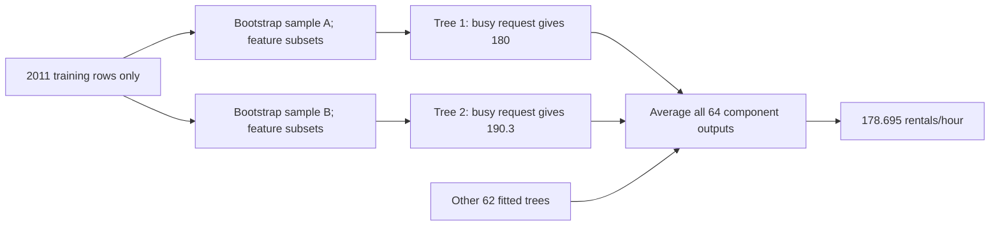

The branches show varied fitted trees; the final arrows mean averaging, not sequential correction. None of these fitting samples includes validation outcomes. The [forest reference](https://scikit-learn.org/stable/modules/generated/sklearn.ensemble.RandomForestRegressor.html) documents the bootstrap and feature-sampling controls.

| Forest setting | Mean validation MAE | Seed MAE population SD | Training MAE, seed 17 |
| --- | --- | --- | --- |
| Depth 8, leaf support 10 | 116.6008 | 0.3355 | 67.0199 |
| Depth 16, leaf support 5 | 103.6533 | 0.1566 | 42.7665 |
| Up to 1,024 leaves/tree, support 1 | 99.7549 | 0.0553 | 26.0368 |

These are descriptive results for seeds 17, 29 and 43 on the same validation hours. The standard deviation describes algorithm variation, not a confidence interval over future dates. Seed 17's deepest forest has MAE **99.8324**; **99.7549** is the configuration's mean across all three seeds. We keep that distinction visible and retain seed 17 by prior declaration rather than selecting a lucky artifact.

A tree fitted with squared-error leaf means stays within the range of its fitting targets, and averaging such trees preserves that range. Thus these particular plain-tree and forest outputs are already nonnegative. Raw and clipped policies tie. This fact does not extend automatically to an additive boosting model whose correction leaves can be negative.

### Add successive residual corrections instead of averaging forecasts

```video
{
  "title": "Add successive residual corrections instead of averaging forecasts",
  "duration": 254.375,
  "src": "media/bike-trees-boosting-corrections/video.mp4",
  "poster": "media/bike-trees-boosting-corrections/poster.jpg",
  "captions": "media/bike-trees-boosting-corrections/captions.vtt",
  "transcript": "media/bike-trees-boosting-corrections/transcript.md"
}
```


Gradient boosting begins with an initial constant and adds fitted correction trees one at a time. For squared error, the next tree learns the residual **target minus current prediction**, which is the negative of our scoring residual convention. The direction matters: a target above the current forecast needs a positive correction.

Return to the four-row probe. Its initial constant is **94.25**. Busy-hour residuals are **84.75** and **100.75**, whose mean is **92.75**. The first residual tree stores that correction for the hour-8 branch; the quiet branch stores **−92.75**. At learning rate 0.1, the first busy prediction becomes **103.525**, and the quiet prediction becomes **84.975**:

$$
F_1(08)=94.25+0.1\times92.75=103.525.
$$

A second tree fits residuals relative to the updated forecast. Its busy-leaf correction is **83.475**, moving the result to **111.8725**. It does not keep fitting the original residual forever. The small learning rate deliberately applies part of each correction, and the number of stages determines how many such additions are made.

The actual benchmark fits the library estimator, then saves every component's numerical state. Our replay makes the aggregation rule visible:

```python
result = np.full(len(X), snapshot["initial_prediction"], dtype=np.float64)
for tree in snapshot["trees"]:
    result += snapshot["learning_rate"] * _predict_tree(tree, X)
return result
```

This is the replay of an already fitted model. The library's fitting path constructs the changing residual targets and trees; the replay neither refits them nor receives observed outcomes. Our choice is squared-error loss, full training subsampling, depth-three trees, minimum leaf support 10, learning rate 0.1 and **100, 200 or 300 stages**. Validation-based early stopping is disabled, so the configured stage count is the stopping rule. See the [boosting reference](https://scikit-learn.org/stable/modules/generated/sklearn.ensemble.GradientBoostingRegressor.html) for the stagewise estimator contract.

| Stages | Training MAE, seed 17 | Mean raw validation MAE | Mean nonnegative validation MAE |
| --- | --- | --- | --- |
| 100 | 52.0192 | 107.3085 | 106.6978 |
| 200 | 43.8255 | 106.1417 | 103.8079 |
| 300 | 39.9185 | 104.8376 | 102.2215 |

All three declared seeds give identical scores for this boosting setup. That is an observed absence of variation here, not three new validation datasets or a guarantee that all boosting configurations are deterministic.

The full 300-stage seed-17 model starts at the 2011 training mean **143.7944**. Its correction-tree values for the busy Monday sum to **747.3746**. Applying rate 0.1 gives **218.5319**, closer to target 420 than this tree or forest, but still a substantial underestimate. At 02:00, however, the same model returns **−25.5203**. Its additive corrections can leave the nonnegative target range. The explicitly scored nonnegative policy changes that forecast to zero; it does not alter the positive 08:00 forecast. Individual improvements and failures must therefore be read alongside both aggregate policies.

### Choose a development reference using quality, cost and honest evidence

```video
{
  "title": "Choose a development reference using quality, cost and honest evidence",
  "duration": 265.083333,
  "src": "media/bike-trees-comparison-choice/video.mp4",
  "poster": "media/bike-trees-comparison-choice/poster.jpg",
  "captions": "media/bike-trees-comparison-choice/captions.vtt",
  "transcript": "media/bike-trees-comparison-choice/transcript.md"
}
```


The comparison protocol is saved before any validation targets are loaded. Each tree family receives **three configurations and three declared seeds**, giving nine main fits per family. Four deterministic references—constant, groups, additive linear and interaction linear—receive one fit each. There are **27 main tree-family fits plus four references**, and **26 configuration/policy summaries** after seed aggregation. These counts describe different things and should not be interchanged.

Before the main sweep, the smallest configuration in each family is timed on the first 1,024 training rows. The pilots take about **0.001, 0.043 and 0.044 seconds** locally and only check feasibility. They choose no accuracy setting. The protocol stops expansion if a pilot exceeds five seconds; a main fit exceeding sixty seconds is marked over budget and later fits stop. These checks run after a fit returns, so they are not interruptible timeouts. Structural caps bound the actual trees. All reviewed fits complete within their settings, without warnings or failed trials.

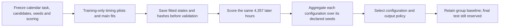

Validation deliberately selects among already fitted candidates. It does not fit the tree splits, preprocessing or boosting residuals. Within each configuration, we average validation MAE across all declared seeds. Exact ties prefer raw outputs, then the declared order, which puts smaller configurations first within a family. The first declared seed supplies a representative model artifact. This is not an average of the three seed models and not selection of the best seed.

| Reference or best family configuration | Mean raw validation MAE | Mean nonnegative validation MAE |
| --- | --- | --- |
| Training mean | 154.2452 | 154.2452 |
| Hour/working-day means | **91.5729** | **91.5729** |
| Additive linear | 116.7312 | 109.1436 |
| Interaction linear | 108.6937 | 100.5164 |
| Deep bounded tree | 99.9993 | 99.9993 |
| Deep bounded forest | 99.7549 | 99.7549 |
| 300-stage boosting | 104.8376 | 102.2215 |

The group model remains selected with raw policy. The nonlinear families improve on the raw additive linear model, but that is not enough to replace the stronger baseline. Keeping the baseline is an actual outcome, not an unfinished experiment. It directs attention to the information and transfer limits before adding complexity again.

Cost makes the choice even clearer on this run. Seed 17's deep tree fits in about **0.023 seconds** and saves **2,047 nodes** in roughly **250 KB of JSON**. The deep forest fits in about **0.676 seconds**, saves **131,008 nodes** in **16.1 MB of JSON**, and replays the 4,357 validation requests in about **0.101 seconds**. The 300-stage booster fits in about **0.816 seconds**, saves **4,268 nodes** in about **664 KB**, and replays that validation batch in about **0.038 seconds**. These are local wall-clock observations, not production latency, peak memory or a universal library-speed ranking. Tree prediction timings measure our inspectable snapshot traversal, including state checks and calendar conversion, rather than sklearn's optimized native prediction. JSON storage bytes are not resident-memory measurements.

The selected group model is simpler and has lower measured validation error here. Repeated use of this same validation window can make development selection optimistic. The final test remains unopened, and deeper error slices belong to the next requested stage. No feature importance or path is treated as a causal explanation. Passing checks, written records and companion media also do not supply the learner's own explanation; the next conversation can examine why more precise historical leaves did not forecast the busy Monday better.

### Run the code and inspect the retained evidence

The consequential source is in [trees.py](code/src/bike_demand_planner/trees.py), [tree_evaluation.py](code/src/bike_demand_planner/tree_evaluation.py), [comparison.py](code/src/bike_demand_planner/comparison.py) and [tree_example.py](code/tree_example.py). From the project directory, run `uv sync --frozen`, then `OPENBLAS_NUM_THREADS=1 OMP_NUM_THREADS=1 uv run --frozen python tree_example.py`. This creates a new immutable run directory rather than overwriting the reviewed one. `uv run --frozen python compare.py` verifies and summarizes the latest compatible saved tree study. `uv run --frozen python -m unittest discover -s tests -v` runs the checks.

The reviewed run is `runs/trees-20261020T010936542440Z`. It retains the protocol, three pilots, all fitted snapshots, configuration/seed states, aligned raw/clipped predictions, sizes, times and selection identity. The [independent audit](evidence/07-tree-forest-and-boosting-comparisons/independent-study-verification.json) reconstructs every prediction within 1e-9, reproduces every scalar metric exactly, verifies all source/dependency/data/artifact identities and refits one representative of each family through the library API to check held-out replay. It also verifies the busy-hour leaf's eight targets and 1,446 sum. [Packaging](evidence/07-tree-forest-and-boosting-comparisons/distribution-verification.json) and [isolated-wheel checks](evidence/07-tree-forest-and-boosting-comparisons/isolated-wheel-verification.json) confirm that the installed package works without the source checkout and that private docs, data, runs and media are absent from distributions.

The earlier exploratory run is retained. Its boosting receipts exposed a deprecated library criterion argument; the final source leaves that obsolete argument at its default, repeats the same declared comparison and emits no warnings. No candidate grid or selection rule was changed in response to validation quality. That run predates the later completion commit. The completed source is now signed as `0b49c0a`; the original run and its content hashes remain unchanged.

### Keep the reasoning beside the result

[Learning points](project/learning-points/07-trees-and-ensembles.md) explain what this calculation changes in our understanding. [Comparisons](project/comparisons/07-trees-and-ensembles.md) put the alternatives side by side. [Setup and commands](project/setup.md) and the [current completion record](project/implementation.md) give the executable project context.

### Predict or explain: Why does averaging 64 trees not guarantee that the morning demand deficit disappears?

<details data-practice-id="trees-and-ensembles-check"><summary>Reveal worked answer and rubric</summary>

Averaging reduces variation when errors differ, but a shared historical underprediction remains in the mean. Training all trees on the same older demand period can preserve that common bias. Compare the actual later forecasts and counts.

**Rubric:** Separate diversity across trees from a shared error in their data or function.

</details>


An overall number must be unpacked into particular hours and supported requests. Continue to [the next lesson](lessons/08-residuals-and-candidate-choice.md) when this step is clear.


## Read hourly errors and freeze a supported candidate

There are now several fixed predictions for each validation hour. Rather than fitting another candidate, keep those predictions unchanged and inspect their signed errors, counted subsets and time order. This is where the application’s supported request contract becomes concrete.

### Read an hourly miss without losing its sign

```video
{
  "title": "Read an hourly miss without losing its sign",
  "duration": 268.208333,
  "src": "media/bike-errors-residuals/video.mp4",
  "poster": "media/bike-errors-residuals/poster.jpg",
  "captions": "media/bike-errors-residuals/captions.vtt",
  "transcript": "media/bike-errors-residuals/transcript.md"
}
```


Start with **Monday, 9 January 2012 at 08:00**, issued at 07:00 under the retained one-hour convention. The group baseline uses the completed 2011 training history for its hour-8/working-day mean, **349.5040323 rentals/hour**. The later observed count is **420**. Prediction minus target gives **−70.4959677**, an underestimate. The request did not contain the target; that number becomes available after the target interval and belongs to scoring.

Change the requested hour to **02:00** on the same Monday. Its fitted group mean is **7.5146444**, against observed count **5**, giving **+2.5146444**. This one is an overestimate. Keep those signs while also measuring their sizes:

| Real validation hour | Prediction | Observed target | Signed error | Absolute error |
| --- | --- | --- | --- | --- |
| 02:00 | 7.5146 | 5 | +2.5146 | 2.5146 |
| 08:00 | 349.5040 | 420 | −70.4960 | 70.4960 |

Across just these two observations, mean signed error is **−33.9907**, while MAE is **36.5053**. Adding the signed errors allows one direction to cancel the other; adding their magnitudes does not. Neither two-row summary replaces the full validation result. They make the residual convention concrete before we apply it to thousands of hours.

```python
error = prediction - row.target
absolute_error = abs(error)
underprediction = max(-error, 0.0)
```

The saved-result reader in [error_analysis.py](code/src/bike_demand_planner/error_analysis.py) checks record ID, target time, issue time, target value and row order before using these reductions. It also checks the exported error columns against the prediction and target. A checksum identifies a file, but does not establish that its rows belong to the right targets. An integration check deliberately reorders rows and updates the checksum; the identity check still rejects the file.


The dashed outcome arrow belongs to evaluation, not prediction. On the full **4,357 validation hours**, MAE is **91.5729**, RMSE **137.3900** and mean signed error **−72.3422**. The larger RMSE reflects stronger weighting of large misses; it is still in rentals/hour after the square root. The largest retained absolute miss is **23 March 2012 at 17:00**: forecast **394.916**, target **957**, underestimate **562.084**. That row is a real diagnostic example, not a reason to remove a difficult observation from the headline score.

The underprediction summaries answer two different questions. There are **3,143 underpredicted hours**, with total deficit **357,089.089 rentals** across those one-hour records. Dividing by all 4,357 evaluated hours gives **81.9576**; dividing only by the 3,143 underpredicted hours gives **113.6141**. There are also 1,214 overpredicted hours, contributing **9.6154** average excess across all rows. With D as total deficit, O as total excess and N as evaluated count:

$$
\mathrm{MAE}=\frac{D+O}{N}=91.5729,\qquad
\mathrm{mean\ signed\ error}=\frac{O-D}{N}=-72.3422.
$$

These are errors in observed rentals, not measured unmet demand or station shortages. The dataset does not contain enough information to turn a 70-rental underestimate into a verified inventory decision or a financial cost.

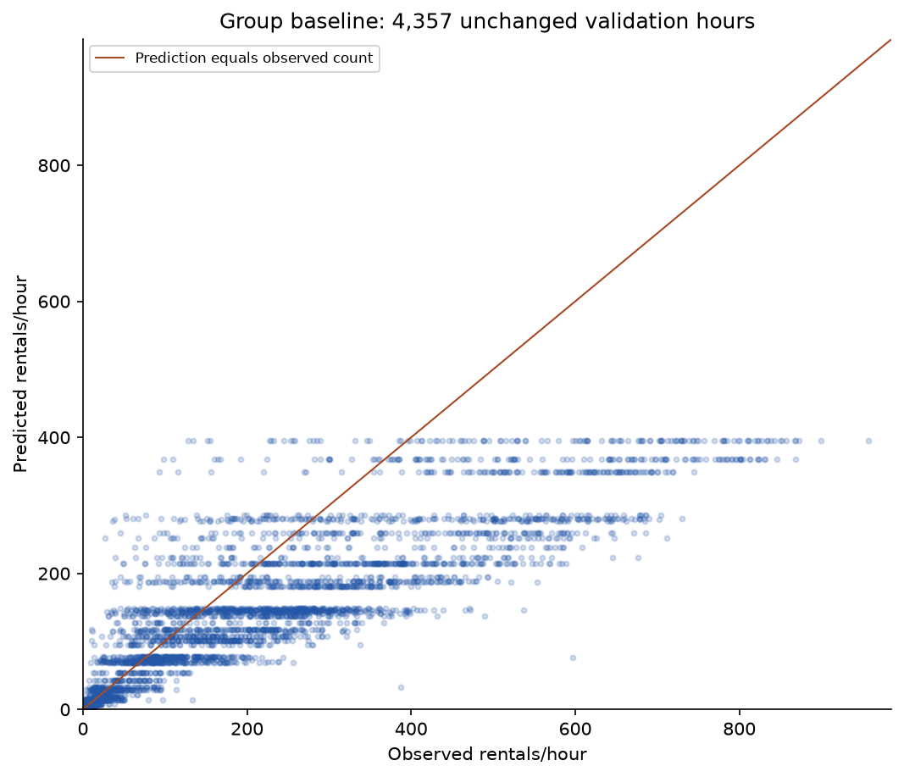

Each point is one retained validation hour. The diagonal means a perfect forecast; high-count points below it are underpredictions. Horizontal bands appear because a fixed `(hour, workingday)` pair returns one fitted mean. The picture makes a limitation visible without assigning a cause to every large count.

### Keep the denominator when you split the hours

```video
{
  "title": "Keep the denominator when you split the hours",
  "duration": 258.291667,
  "src": "media/bike-errors-counted-slices/video.mp4",
  "poster": "media/bike-errors-counted-slices/poster.jpg",
  "captions": "media/bike-errors-counted-slices/captions.vtt",
  "transcript": "media/bike-errors-counted-slices/transcript.md"
}
```


The same overall MAE can hide very different behavior during a commute and overnight. We therefore keep a concrete slice definition beside each result. Here **rush clock hours are 07, 08, 09, 16, 17 and 18**. That clock window exists on every day. The narrower **working-day rush** slice additionally requires `workingday = 1`.

There are **1,092 rush-clock observations**, with MAE **161.3814**. Of these, **750 are working-day rush hours**, whose MAE is **178.1954**. The remaining **3,607 observations outside that narrower slice** have MAE **73.5616**. Those last two populations partition the entire validation set:

$$
\mathrm{MAE}_{all}
=\frac{750\times178.1954+3607\times73.5616}{4357}
\approx91.5729.
$$

A simple average of 178.1954 and 73.5616 would give the two populations equal influence despite their different sizes. Reconstructing the full result needs their actual counts. For RMSE, reassemble the squared-error sums first, divide by total count and then take the square root; averaging slice RMSEs is generally wrong too.

```python
subset = [rows[i] for i in indices]
summary = error_summary(subset, predictions[indices])
# Each dimension must preserve the population and every error total.
assert sum(s["count"] for s in dimension.values()) == len(rows)
```

The implementation checks absolute-error, squared-error, residual, deficit and excess totals for each dimension. The independent audit verifies **686 slice summaries** across seven model/policy pairs and both partitions. Hour, day-type, month and demand-band views each partition their own population. They overlap with each other, so their counts should not be added across dimensions as though they were disjoint new observations.

| Validation month | Observed hours | Group MAE | Mean signed error |
| --- | --- | --- | --- |
| January | 740 | 39.6133 | +12.3807 |
| February | 692 | 38.5790 | −5.7006 |
| March | 743 | 88.1317 | −79.1674 |
| April | 718 | 111.6377 | −99.7863 |
| May | 744 | 126.8528 | −120.6563 |
| June | 720 | 142.9952 | −139.1326 |

Working days as a whole have MAE **88.7874** across 2,993 rows; nonworking days have **97.6851** across 1,364. That does not contradict the much larger working-day rush error: most working-day observations are outside its six rush hours. The month table also shows why a single score loses information about when the model is struggling.

Season labels need their actual coverage. In this validation window, winter contains January–February (**1,432 rows**), spring contains March–May (**2,205**) and summer contains only June (**720**). Autumn has **zero rows**, so its metrics are **undefined**, represented by null. Zero error would falsely imply observations were predicted perfectly. The month domain remains twelve positions, with July–December empty in this analysis; no test observations are borrowed to fill them.

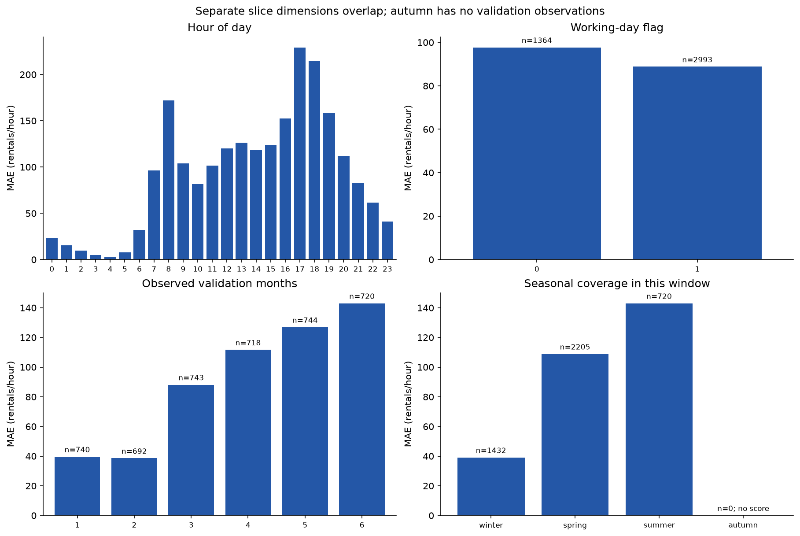

We also inspect outcome-defined bands: observed demand below 50 has MAE **11.9504** across 1,093 hours, while demand at least 200 has MAE **168.1371** across 1,938. These bands describe failures retrospectively. The future observed target is unavailable when issuing a request, so it cannot be used to route the forecast to a model. That would turn a legitimate diagnostic into target leakage.

### Keep time order when the demand level changes

```video
{
  "title": "Keep time order when the demand level changes",
  "duration": 263.416667,
  "src": "media/bike-errors-time-and-levels/video.mp4",
  "poster": "media/bike-errors-time-and-levels/poster.jpg",
  "captions": "media/bike-errors-time-and-levels/captions.vtt",
  "transcript": "media/bike-errors-time-and-levels/transcript.md"
}
```


The month results suggest that errors are not scattered uniformly through the window. Keep the daily residual means in chronological order rather than shuffling them into an exchangeable bag. The generated figure shows mostly larger negative errors later in the period, alongside larger daily MAE. Each day uses its actual observation count.

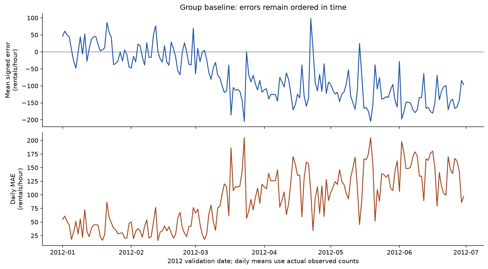

There are **ten unrecorded hourly slots inside this validation window**. We do not insert zero targets or connect a missing observation to the next one as if it were exactly one hour later. Consecutive-hour correlation uses only pairs whose recorded timestamps differ by one hour: **4,346 pairs** here. Their residual correlation is **0.8677**.

For paired residuals a and b, correlation centers each side by its own pair mean and normalizes the cross-product:

$$
\rho=\frac{\sum_i(a_i-\bar a)(b_i-\bar b)}
{\sqrt{\sum_i(a_i-\bar a)^2\sum_i(b_i-\bar b)^2}}.
$$

This is a descriptive calculation of how neighboring errors move together. It is not a calibrated predictive interval, a causal relationship or a proof that the same correlation will persist. The saved weekly summaries similarly retain Monday-start dates and actual counts. There are 27 weekly groups with counts from 23 to 168. Their MAE ranges from **32.7497** in the full week beginning 13 February to **157.2648** in the full week beginning 4 June. The range describes those observed weeks; it is not a confidence interval for the next week.

The previous forest seed standard deviation, about 0.055 MAE units, answers a different question: how that fitting algorithm varied with its declared random seeds on these same held-out dates. Repeated seeds do not generate new future periods. Treating that small number as uncertainty over future hourly errors would discard the time structure visible here. The [time-series evaluation guidance](https://scikit-learn.org/stable/modules/cross_validation.html#time-series-split) explains why temporal order needs a distinct evaluation treatment. This review reports descriptive time summaries and does not manufacture an IID interval.

To examine level differences more carefully, compare matching **month, hour and working-day** cells in Jan–Jun 2011 and Jan–Jun 2012. For each cell, first calculate its mean from 2011 training targets. Then weight that historical mean by the number of validation observations in the same cell. With n2012,k as later cell counts and mu2011,k as historical means:

$$
\mu_{historical\ reweighted}=\frac{\sum_k n_{2012,k}\mu_{2011,k}}{\sum_k n_{2012,k}}.
$$

All **4,357 validation rows** have shared cells here; none are dropped as unmatched. The historical means, weighted to this later calendar membership, average **121.3077**. The observed later target mean is **215.2001**, leaving an observed difference of **93.8925 rentals/hour**. This diagnostic differs from the selected group forecast mean **142.8580**, because it conditions on month as well as hour and day type and uses only Jan–Jun historical cells.

```python
means = {key: math.fsum(targets) / len(targets)
         for key, targets in training_cells.items()}
# For each later row, compare its observed target with its old cell mean.
historical_value = means[(month, hour, workingday)]
```

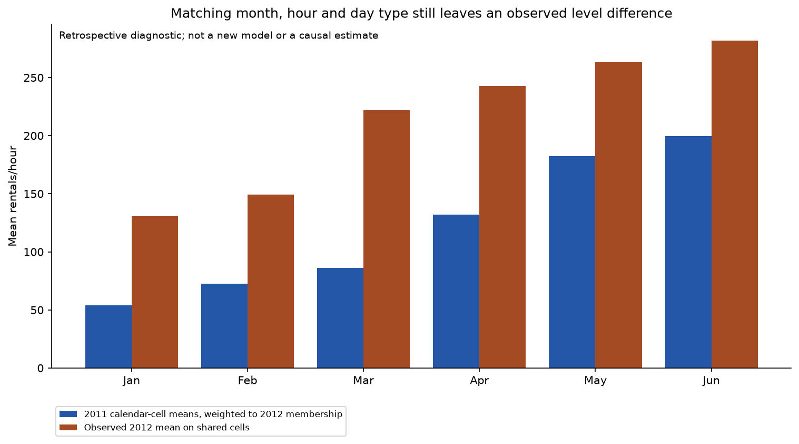

Matching these calendar variables makes a composition-only explanation less adequate, but it does not isolate a cause. Demand growth, unmodelled weather or other changes could contribute. We have not measured their separate effects. The calendar-cell calculation is also **not another ranked forecasting candidate**: its role is to understand a failure after outcomes are known. We do not move the split, rescale targets or refit the selected predictor in response to this picture.

### Separate a valid calendar change from an unsupported request

```video
{
  "title": "Separate a valid calendar change from an unsupported request",
  "duration": 272.041667,
  "src": "media/bike-errors-input-boundary/video.mp4",
  "poster": "media/bike-errors-input-boundary/poster.jpg",
  "captions": "media/bike-errors-input-boundary/captions.vtt",
  "transcript": "media/bike-errors-input-boundary/transcript.md"
}
```


A model may be insensitive to a valid input change without the request being malformed. The selected predictor uses only hour and working-day status. The real Monday 08:00 request returns **349.5040**, supported by **248 training observations** for that pair. A Monday at the same hour on **4 June 2012** returns exactly the same value. The calendar month changed, but the selected function has no month term. That explains the invariant output; it does not prove January and June should have equal demand.

A valid **Sunday, 8 January at 08:00** uses the nonworking key and returns **76.4348**, supported by 115 training observations. The date, weekday and working-day flag change together consistently. This is a contrast between valid requests, not an estimate of a causal effect of changing one flag while holding an impossible calendar fixed. The quiet Monday request returns 7.5146 from its separate key.

A second large-miss case, identified from the retained error ranking, helps make the distinction sharper. On **Monday, 16 April 2012 at 08:00**, the source marks `holiday = 1` and `workingday = 0`. The group lookup therefore returns **76.4348**, while the observed count is **597**. The source's calendar classification does not guarantee Sunday-like rental behavior. We do not change a trusted flag afterward to get a more favorable prediction. This is a diagnostic case selected after inspecting errors, with no model or metric change.

The request validator in [review_contract.py](code/src/bike_demand_planner/review_contract.py) performs a different job. It accepts exactly four outer fields: schema version, target time, issue time and named calendar inputs. It checks the known feature order, exact hourly timestamps, one-hour lead, calendar/timestamp agreement and the fixed category domains. Holiday metadata must come from a trusted recorded or external calendar; the validator checks structure and working-day consistency, not the authority of the holiday source.

```python
features = encode_calendar(request["calendar"])
if issue != target - timedelta(hours=1):
    raise ValueError("Issue time must be exactly one hour before the target interval.")
if (hour, month, weekday) != expected_calendar_from_target:
    raise ValueError("Calendar values disagree with the target timestamp.")
```

The final tuple comparison is abbreviated here; the source exposes the exact hour, month and UCI weekday mapping. Named input-dictionary order is harmless because encoding follows the declared schema. A reordered **model feature-name list** is not harmless and is rejected: equal dimensions cannot identify a misplaced feature's meaning.

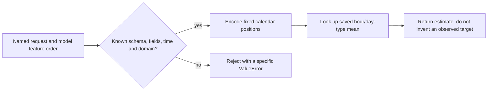

The review retains **four accepted sensitivity cases and fourteen rejected probes**. Missing hour, nonfinite value, hour 24, extra weather or outcome fields, unknown schema, inconsistent weekday/working-day flag, wrong lead, timezone-aware or non-hourly timestamp and reordered features all produce explicit rejection. Reserved-test dates and a future 2013 request are outside this candidate's supported replay domain, even if their calendar values could be encoded numerically.

That domain is the historical validation replay window, **2012-01-01 01:00 through 2012-06-30 23:00**, using the source's naive timestamp convention. The lower boundary preserves the frozen lead-time protocol. Accepting a syntactically valid hour inside the domain does not guarantee it has an observed record: missing-hour coverage is a separate question. We can discuss an estimate without assigning a fabricated zero target or adding that request to benchmark denominators. The application and saved-model serving adapter are still later work.

### Freeze the candidate together with the limits we just found

```video
{
  "title": "Freeze the candidate together with the limits we just found",
  "duration": 280.583333,
  "src": "media/bike-errors-candidate-handoff/video.mp4",
  "poster": "media/bike-errors-candidate-handoff/poster.jpg",
  "captions": "media/bike-errors-candidate-handoff/captions.vtt",
  "transcript": "media/bike-errors-candidate-handoff/transcript.md"
}
```


The original study selected groups/raw by overall validation MAE across the declared configuration comparisons. This review keeps that choice fixed while examining seven representative functions. A representative forest score belongs to one retained seed-17 artifact; it is distinct from the earlier mean across three fitting seeds.

| Retained function and output policy | Overall validation MAE | Working-day rush MAE | June MAE |
| --- | --- | --- | --- |
| Constant, raw | 154.2452 | 301.4966 | 201.1625 |
| Groups, raw | **91.5729** | **178.1954** | 142.9952 |
| Additive linear, nonnegative | 109.1436 | 225.3767 | 123.8178 |
| Interaction linear, nonnegative | 100.5164 | 191.5674 | 111.8167 |
| Deep tree, raw | 99.9829 | 207.5925 | **90.3638** |
| Deep forest, raw | 99.8324 | 207.8724 | 90.8782 |
| Boosting, nonnegative | 102.2215 | 209.9206 | 107.8505 |

This is a tradeoff, not one model winning every view. The forest and tree have much lower June error, while groups is better overall and on the defined working-day rush slice. The project's primary summary currently weights each observed validation hour equally. We have not agreed a separate operational cost function or a June-only objective. We therefore retain the prior candidate and record its later-period weakness, rather than silently changing the selection target or constructing a new slice-routed estimator.

The handoff is a versioned `candidate.json` together with `candidate-model.json`. The model copy is byte-for-byte identical to the original selected group's artifact; this review does not train it again. The configuration records its model hash, fitting source, dataset/split identities, review and source protocols, schema/feature order, used fields, units, input domain, raw floating-point output and absent-group fallback.

```python
shutil.copyfile(groups_dir / "model.json", run_directory / "candidate-model.json")
model_identity = sha256((run_directory / "candidate-model.json").read_bytes())
# candidate.json retains that identity together with its task and policies.
```

The output is neither rounded nor clipped; group means are already nonnegative. A valid group absent from training uses the saved **training-only global mean**, 143.7944 here. All 48 possible pairs are present in the real fitted artifact, so that fallback is not used by these real examples. Its independent fixture check still matters for the declared behavior. Invalid requests are rejected before lookup; fallback is not permission to repair an unknown schema or a missing field.

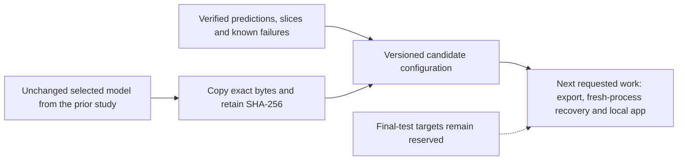

This original candidate receipt predates serving and recovery, so it explicitly records those as unimplemented and unverified at that point. Lesson 9 adds and checks them while preserving the earlier receipt. Its known limitations include the invariant month response, large rush-hour underprediction, unmeasured unmet demand/inventory and absence of calibrated predictive uncertainty. Those limits travel with the model identity. Passing a request probe or producing a configuration is not evidence that an operational analyst's decisions would improve.

No learner explanation is inferred from the 96 checks, written explanations or requested media. The useful review is to explain why a well-formed June request gets the January hour/day-type mean, why that can coexist with the lowest overall validation MAE, and what evidence would justify changing the intended objective. We stop here before the application/recovery work.

### Run the review and inspect the evidence

The main sources are [error_analysis.py](code/src/bike_demand_planner/error_analysis.py), [error_review.py](code/src/bike_demand_planner/error_review.py), [review_contract.py](code/src/bike_demand_planner/review_contract.py) and [error_plots.py](code/src/bike_demand_planner/error_plots.py). The [entry point](code/error_review_example.py) consumes the latest compatible saved tree study, creates a new immutable review directory and retains failures instead of overwriting existing results.

From the project directory, run `uv sync --frozen`, then `OPENBLAS_NUM_THREADS=1 OMP_NUM_THREADS=1 uv run --frozen python error_review_example.py`. A fresh checkout first needs the documented data and `tree_example.py` run. The analysis command does not refit models. Use `uv run --frozen python -m unittest discover -s tests -v` for the checks. Matplotlib 3.11.2 creates the four standalone PNG/SVG figures; generated data, runs and private records remain ignored.

The [independent audit](evidence/08-residuals-slices-and-candidate-choice/independent-review-verification.json) verifies 14 saved prediction files, all 686 slices, daily/weekly groups, gap-sensitive correlation, largest misses, calendar-level comparisons, candidate bytes and source/dependency/artifact identities. Its largest independent numerical difference is about 3.4e-16, from correlation arithmetic. [Distribution](evidence/08-residuals-slices-and-candidate-choice/distribution-verification.json) and [isolated-wheel](evidence/08-residuals-slices-and-candidate-choice/isolated-wheel-verification.json) checks verify the installed package and exclude private material. Two earlier exploratory renderings are retained; final figure review made the empty autumn category explicit and moved the level-chart legend clear of the data. No model, score or selection rule changed during those layout fixes.

### Keep the reasoning beside the result

[Learning points](project/learning-points/08-residuals-and-candidate-choice.md) explain what this calculation changes in our understanding. [Comparisons](project/comparisons/08-residuals-and-candidate-choice.md) put the alternatives side by side. [Setup and commands](project/setup.md) and the [current completion record](project/implementation.md) give the executable project context.

### Predict or explain: Why should a rush-hour slice report both MAE and its number of observations?

<details data-practice-id="residuals-and-candidate-choice-check"><summary>Reveal worked answer and rubric</summary>

The subset answers a different question from all-hour error. Its mean must be weighted by the actual count when recombining a partition. A small or empty slice cannot be treated as equally supported or as zero error.

**Rubric:** Preserve the denominator, subset definition and undefined empty metrics.

</details>


A chosen artifact needs safe reloading and a distinct prediction interface. Continue to [the next lesson](lessons/09-saved-predictions-and-recovery.md) when this step is clear.


## Reload predictions and recover the next training update

A model choice is useful only if another process can recover the same function and apply the same input rules. Separate that inference problem from resuming training: the latter must also restore what determines the next update. The application keeps a forecast separate from its later recorded outcome.

### Reload the same forecast without carrying the training process

```video
{
  "title": "Reload the same forecast without carrying the training process",
  "duration": 264.375,
  "src": "media/bike-save-prediction-reload/video.mp4",
  "poster": "media/bike-save-prediction-reload/poster.jpg",
  "captions": "media/bike-save-prediction-reload/captions.vtt",
  "transcript": "media/bike-save-prediction-reload/transcript.md"
}
```


Return to **Monday, 9 January 2012 at 08:00**, issued at 07:00. Now imagine closing the Python process that fitted the model. The next process does not have its training lists, local variables or earlier function calls. It still needs to return the same **349.5040323 rentals/hour** from the saved hour-8/working-day group, whose training support is 248 observations:

$$
\widehat y_{8,1}=\frac{86{,}677}{248}=349.5040323\ \text{rentals/hour}.
$$

The later recorded outcome is 420. It explains an error of −70.4959677 when we evaluate the forecast, but it is absent from the request and from the inference bundle. A restart must preserve the fitted function and its interpretation. It must not reconstruct an answer by looking at the later outcome.

The bundle in `models/selected/` contains four JSON files with different jobs. `model.json` retains the original selected group's exact bytes. `candidate.json` retains the original schema, feature order, raw-output/fallback policy, data/protocol identities, supported domain and known limits. `calendar.json` supplies recorded holiday flags by date, without rental outcomes. `manifest.json` hashes those three members and records their producer source/dependency identity. There are **182 supported calendar dates**, from January through June of this leap year; the lower hourly boundary is still 1 January at 01:00.

The recorded calendar completes the trusted-holiday requirement from the earlier review. The request must agree with that authority as well as its own timestamp and weekday. This prevents a caller from changing a real historical working day into a holiday simply to obtain another group mean. The predictor still uses hour and working-day status; the holiday flag helps determine a consistent working-day input rather than adding a newly trained holiday coefficient.

```python
predictor = SavedPredictor(bundle_directory,
                           expected_manifest_sha256=trusted_bundle_hash)
request = predictor.request_for_target("2012-01-09T08:00:00")
result = predictor.predict(request)
```

[SavedPredictor](code/src/bike_demand_planner/saved_predictor.py) checks member hashes and the known candidate/schema contract before using fitted values. Prediction reuses the existing calendar validator and saved lookup. It fits no transform, reads no target file and mutates neither the request nor the fitted groups. The selected group model has no learned scaler to restore; its fixed 45-column schema is nevertheless retained, because matching dimensions alone would not establish matching feature meanings.

```mermaid
flowchart LR
    B["Verified JSON bundle; fixed 2011 means"] --> P["Fresh process: validate and look up key"]
    R["08:00 request, issue 07:00; no outcome"] --> P
    P --> F["349.504 rentals/hour; baseline 143.794"]
    F --> E["Separate evaluation: error −70.496"]
    Y["420 observed after the target hour"] -.-> E
```

The dashed arrow belongs to evaluation. The same model can be loaded without an observations file at all. A fresh subprocess, launched from the run directory with target-free requests, reproduces **all 4,357 validation forecasts exactly**, including support, fallback and model/bundle identities. The independent audit also checks each estimate against the saved group value selected by that row's hour and working-day flag. This is stronger evidence than checking one attractive request after a restart.

Change the request to Monday 02:00 and the answer becomes 7.5146444; change it to Sunday 08:00 and it becomes 76.4347826. A Monday 08:00 request in June remains 349.5040323. Reloading has preserved both useful behavior and the existing lack of month sensitivity. It has not improved forecast quality. A valid absent training key uses the saved global mean, 143.7944477; all 48 real groups are present, so a small fixture establishes that fallback separately. Missing or malformed input is rejected before lookup.

The manifest is an identity check, not a certificate that an arbitrary producer is trustworthy. A caller with a trusted manifest hash can reject a different bundle before loading it. Recomputing checksums after changing a schema does not bypass the semantic checks. These are plain JSON artifacts from the trusted local workflow, with no executable serialized estimator to unpickle.

The original candidate and fitting provenance are preserved as historical evidence. Its earlier `serving_implemented: false` describes the review that created it. The later bundle/application preparation records the implemented adapter and verified parity. Reusing identical bundle members preserves the first export's producer identity; the new application receipt independently records the current executing source. We do not rewrite old fitting or review records to make their history look newer.

### Resume the next update with the same state and next batch

```video
{
  "title": "Resume the next update with the same state and next batch",
  "duration": 280.416667,
  "src": "media/bike-save-next-update/video.mp4",
  "poster": "media/bike-save-next-update/poster.jpg",
  "captions": "media/bike-save-next-update/captions.vtt",
  "transcript": "media/bike-save-next-update/transcript.md"
}
```


Predicting and continuing training require different saved information. The selected group model is already a completed set of means. For a concrete iterative example, use the existing 45-feature linear trainer with an intercept, training-only standardization, Adam, batch size 32 and seed 17. The declared recovery demonstration uses rate 0.01, inverse-time decay by examples and **three training passes**, with a 10,000-update/300-second safety guard. It is a continuation check, with no new validation selection or claim of convergence.

A prediction export needs the fitted parameters and transforms. This training checkpoint also needs Adam's first and second moments, update index, current epoch permutation/cursor, generator state, processed-example count, rate policy, monitoring history and stopping policy. Source/runtime/dependency, training-data, schema/order, scaler and configuration identities travel in its context. A weights-only file cannot tell us which training rows or optimizer direction should come next.

The useful pause is update **273**. The first pass through 8,645 observations requires 271 batches: 270 batches of 32 followed by a tail of 5. Two batches into the next permutation add 64 observations. The saved stream therefore has epoch index 1, cursor 64 and 8,709 processed examples. The next rate follows the saved progress:

$$
\mathrm{seen}=8645+64=8709,\qquad
\eta_{next}=\frac{0.01}{1+8709/8645}=0.004981560447.
$$

The next batch contains 32 **training-row positions**, beginning 3156, 3250, 6488, 2764 and 7957. Those positions are not raw record IDs. Preserving a seed alone would restart random-number consumption and does not identify this cursor or the generator state needed for a later epoch. The saved permutation supplies the current batch; the saved PCG64 state supplies the next shuffle.

```python
saved, receipt = load_generation(generation_directory, expected_context)
scaler = FeatureStandardizer(**expected_context["standardizer"])
Z = scaler.transform(training_features)
continued = fit_trial(Z, targets, configuration,
                      continuation=saved["trainer_state"])
```

The [recovery worker](code/src/bike_demand_planner/recovery.py) loads the frozen training partition, verifies its context and reuses the saved means/scales. It does not fit them again during resume. The same [fit_trial](code/src/bike_demand_planner/optimization.py) performs uninterrupted and resumed updates. The saved state is checked against the expected source/data/schema/config/runtime, rather than accepted because its vectors happen to have 46 positions.

Now inspect the hour-8 coefficient at the first resumed update. These are **standardized-feature parameters**; they are not the group baseline's 349.504 estimate. The old weight is 1.1941539882. The next batch gives gradient −54.0642608931, with saved Adam moments −30.5755004649 and 459.6098165223. Carry the moments into update 274:

$$
m_{274}=0.9(-30.5755004649)+0.1(-54.0642608931)=-32.9243765077,
\qquad v_{274}=0.999(459.6098165223)+0.001(-54.0642608931)^2=462.0731510117.
$$

Correcting by the retained update index gives first moment −32.9243765077 and second moment 1927.1343482999. The first correction is almost unchanged this late because 0.9 to power 274 is tiny; the second correction still matters. With epsilon outside the square root, the actual weight update is:

$$
w'_{8}=1.1941539882-0.004981560447\,
\frac{-32.9243765077}{\sqrt{1927.1343482999}+10^{-8}}
=1.1978901611.
$$

The weight goes up because the carried, corrected direction is negative and the optimizer subtracts it. In another batch, a new gradient can disagree with the momentum history, so the last gradient's sign alone is not a complete account of Adam's move. The independent audit reconstructs this batch gradient, moments, rate and weight update from the saved state and training rows.

After restarting, the demonstration reaches **813 updates and 25,935 examples**, with final training half-MSE **7782.1557832**. Parameters, both moment vectors, update index, permutation/cursor/RNG and schedule match the uninterrupted run exactly. The exact next batch and common monitoring observations match too. Extra pause observations remain in the resumed monitoring history; they did not control early stopping, which is disabled here. Wall-clock fields differ and are excluded from numerical parity. The ample time guard was not the active stopping condition.

For a changed case, zero both Adam moment vectors at the pause while retaining the same parameters, update index, batch order and remaining budget. The final parameters now differ by up to **1.0029187** in standardized parameter coordinates. This is a deliberately altered-state control, not another candidate or a validation result. It shows why retaining only weights and data order fails to reproduce training. Exact continuation also does not make this short run a good forecaster: it is far from the previously solved training optimum and does not replace the selected group baseline.

### Recover from a damaged save without hiding the fallback

```video
{
  "title": "Recover from a damaged save without hiding the fallback",
  "duration": 275.166667,
  "src": "media/bike-save-generation-fallback/video.mp4",
  "poster": "media/bike-save-generation-fallback/poster.jpg",
  "captions": "media/bike-save-generation-fallback/captions.vtt",
  "transcript": "media/bike-save-generation-fallback/transcript.md"
}
```


A complete checkpoint schema is useful only when the bytes can be recovered consistently. Writing a single live file in place risks leaving a partial state if publication is interrupted. Mixing the newest weights with older moments or an unrelated cursor would create a state that never actually existed. The checkpoint store therefore publishes a complete generation and loads all its members together.

[publish_directory](code/src/bike_demand_planner/artifacts.py) writes `state.json`, `context.json` and a receipt into a unique `.pending` directory beside the intended destination. It flushes and synchronizes each file, synchronizes the staging directory, then renames the complete directory into its numbered published name on the same filesystem. The parent directory is synchronized afterward on POSIX. The receipt records hashes of state/context and the optimizer step. The loader scans published generations in descending order; pending directories are not candidates.

```python
durable_write(temporary / name, content)  # flush and fsync in the helper
sync_directory(temporary)
os.rename(temporary, destination)        # publish the complete directory
sync_directory(destination.parent)
```

The full helper also rejects overwriting an existing destination and uses plain member filenames. [Python's filesystem documentation](https://docs.python.org/3.12/library/os.html#os.rename) describes the rename and synchronization primitives. This local design exercises their use; it does not prove every filesystem, storage device or hard power-loss scenario. Save directories assume a single writer. A stale writer lock after an actual process failure needs inspection before further saves; loading a previous generation does not silently discard that evidence.

The executed fault-injection sequence makes the fallback observable:

| Saved item | State or injected condition | Recovery behavior |
| --- | --- | --- |
| generation-000001 | Complete state at update 269 | Retained older fallback |
| generation-000002 | Complete state at update 273 | Loaded for resume |
| generation-000003 | Update 274, then appended corrupt state bytes | Rejected: state hash mismatch |
| .generation-000004.pending | Truncated, unpublished state with no receipt | Ignored as incomplete |

```mermaid
flowchart LR
    S["Write state, context and receipt in .pending"] --> V["Flush files; synchronize staging directory"]
    V --> P["Rename complete numbered generation"]
    P --> L["Load newest compatible, hash-verified generation"]
    C["Generation 3: corrupted state"] --> R["Reject and retain reason"]
    R --> G["Generation 2: update 273, cursor 64"]
    G --> N["Recompute update 274; continue same batch stream"]
```

The receipt explicitly names generation 2 as loaded, generation 3 as rejected and the pending directory as ignored. Recovery rolls back the entire state by one update and recomputes that update, which is why the final numerical result still matches the uninterrupted path. The corrupt/incomplete artifacts remain available for inspection. This was deliberate byte-corruption and partial-publication injection; it was not an observed machine crash or hosted-runtime deletion.

Change the expected source, training hash, feature order or configuration instead. An older generation from that incompatible context must not be presented as a successful recovery. The loader keeps looking for a genuinely matching generation and raises an explicit error if none exists. This distinction prevents the word “fallback” from hiding an unintended old model or dataset. Unit checks also simulate a failure before directory publication and confirm that no loadable generation appears.

### Keep the forecast and recorded outcome separate in the application

```video
{
  "title": "Keep the forecast and recorded outcome separate in the application",
  "duration": 271.333333,
  "src": "media/bike-save-replay-application/video.mp4",
  "poster": "media/bike-save-replay-application/poster.jpg",
  "captions": "media/bike-save-replay-application/captions.vtt",
  "transcript": "media/bike-save-replay-application/transcript.md"
}
```


Open the [local replay application](http://127.0.0.1:8503/). Its first request is the same Monday at 08:00. The large estimate is **349.5 rentals/hour**, with the **143.8 global training-mean baseline** beside it and 248 matching training observations underneath. The display rounds for reading; the API retains 349.5040322580645 and 143.79444765760556. Model and bundle hashes, schema identity, used fields and the issue time remain inspectable.

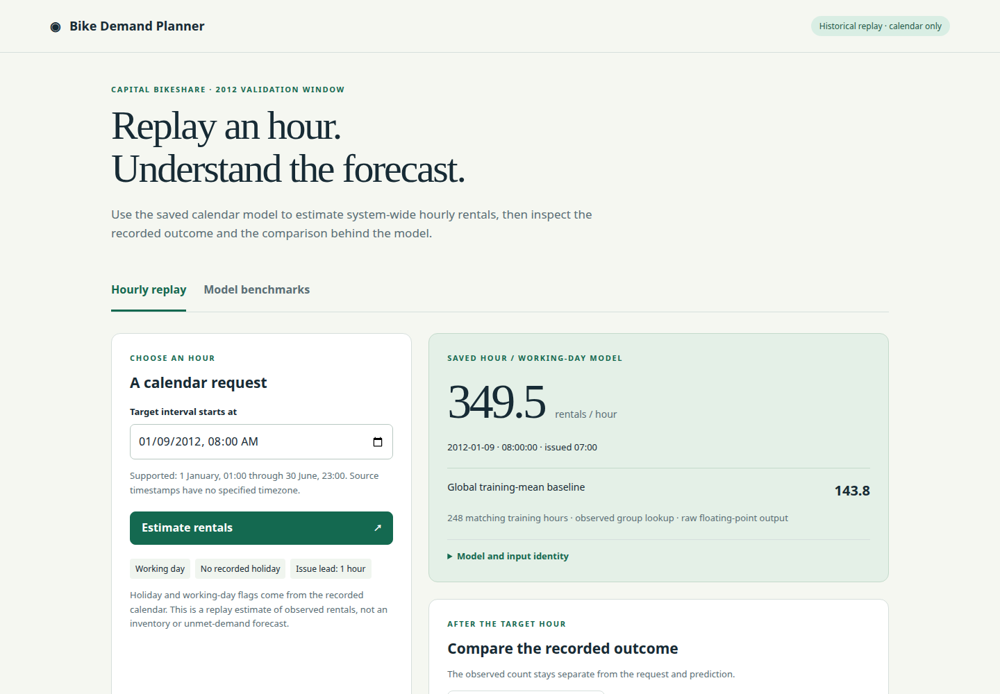

The server holds a separate, validated observation record for the replay view. The predictor can run without that record and its request has no outcome field. The browser first resolves trusted calendar metadata through `/api/request`, then sends that target-free request to `/api/predict`. The forecast response contains the estimate, baseline and identities. It does not contain `target` or a residual.

Only the separate “Show recorded outcome” action calls `/api/observation`. For Monday 08:00 it displays **420**, then calculates **349.5040323 − 420 = −70.4959677**, shown as −70.50. The browser check confirms that no observation request is made before this action. The application can keep outcomes for a historical comparison without making those outcomes an input to the fitted function.

```mermaid
flowchart LR
    U["Choose historical date/hour"] --> C["Resolve recorded calendar flags"]
    C --> Q["POST target-free calendar request"]
    B["Verified saved predictor"] --> Q
    Q --> F["Display estimate, baseline and identities"]
    A["Separate show-outcome action"] --> O["GET optional recorded observation"]
    F --> E["Compare after prediction"]
    O -.-> E
```

The [HTTP adapter](code/src/bike_demand_planner/application.py) binds to loopback, serves the packaged interface and exposes fixed request/prediction/observation/benchmark routes. It does not fit a model when the server starts or when a button is clicked. Preparation is a separate explicit command, `application_example.py`. The application-data manifest binds its observations and benchmark records to the same predictor and dataset identities before serving them.

```python
request = application.predictor.request_for_target(target_time)
forecast = application.predictor.predict(request)
# A separate action asks for an observation; it never changes forecast.
observed = application.observation(target_time)
```

Change the request to **2 January 2012 at 03:00**, a genuinely unrecorded validation hour. Its calendar can be resolved from the recorded date metadata and the model can return an estimate. The observation endpoint returns `available: false` with no target. The interface says that an actual count and error are unavailable. It does not insert zero rentals or extend any benchmark denominator.

Change it to a future 2013 date, a reserved-test date or a non-hourly timestamp and the backend rejects the request. The browser clears the old estimate when input changes, so a previously valid 349.5 is not left looking like the forecast for the rejected date. Structural schema/feature/order checks are still enforced, and a request carrying an outcome is rejected. The exact same historical domain and source timestamp convention travel from the review into the working interface.

Actual browser checks cover the quiet Monday, Sunday, June invariance, recorded outcome, missing observation, unsupported date and seven-model view. Desktop/mobile screenshots and widths **1440, 768, 390 and 320** pass without document overflow or JavaScript errors. The installed wheel serves its HTML, JavaScript and CSS from a separate environment while an audit hook denies all access to the source project. That checks the application's packaged assets as well as the Python module imports.

### Read the benchmark alongside the candidate's limits

```video
{
  "title": "Read the benchmark alongside the candidate's limits",
  "duration": 289.375,
  "src": "media/bike-save-benchmark-limits/video.mp4",
  "poster": "media/bike-save-benchmark-limits/poster.jpg",
  "captions": "media/bike-save-benchmark-limits/captions.vtt",
  "transcript": "media/bike-save-benchmark-limits/transcript.md"
}
```


The benchmark view reads the prior reviewed artifacts; opening or sorting it runs no new experiment. The candidate stays the hour/working-day model with raw output, selected by overall validation MAE. Sorting by June moves a different model to the top because June answers a narrower question. The view makes that distinction visible without letting row order silently change the active predictor.

| Representative artifact | Overall MAE | Working-day rush MAE | June MAE |
| --- | --- | --- | --- |
| Groups, raw | **91.5729** | **178.1954** | 142.9952 |
| Additive linear, nonnegative | 109.1436 | 225.3767 | 123.8178 |
| Interaction linear, nonnegative | 100.5164 | 191.5674 | 111.8167 |
| Deep tree, raw | 99.9829 | 207.5925 | **90.3638** |
| Seed-17 forest, raw | 99.8324 | 207.8724 | 90.8782 |
| Boosting, nonnegative | 102.2215 | 209.9206 | 107.8505 |

The global reference remains in the full seven-row view at overall MAE 154.2452. All rows describe the same 4,357 validation observations. Working-day rush still means hours 07, 08, 09, 16, 17 and 18 with the working-day flag set; it has 750 observations. June has 720. These are the earlier scores of particular retained artifacts, rather than the previous forest configuration mean across three fitting seeds.

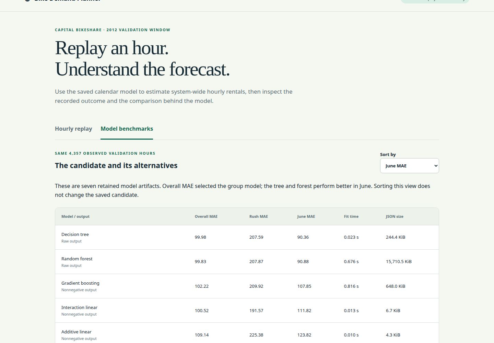

The table also loads actual fitting time, snapshot bytes, fitting/stopping details and source-study failures. The forest's recorded local fit took about **0.676 seconds** and its JSON snapshot is **16,087,600 bytes**, roughly 15,710.5 KiB. The group fit took about 0.0136 seconds. Those are retained observations on this machine and implementation, not universal serving latency or peak-memory measurements. The expandable fitting record distinguishes direct linear solves, training means and structurally bounded tree fits. A direct solver's zero iterative updates does not mean its model was never fitted. A null convergence field means that particular iterative criterion was not applicable.

The practical source study retained zero failed main trials. Earlier excessive-rate optimizer failures remain in their own records, rather than being invented or merged into this study's count. Snapshot prediction timing describes transparent batch replay on the validation rows; reading a stored cost is not a new application performance benchmark. Displayed values keep their original scope and provenance.

What has changed is usability and reproducibility. The same selected candidate now runs after a restart and drives a local interface. Its June/rush weakness, lack of weather or demand history, unmeasured unmet demand/inventory and absence of calibrated predictive uncertainty remain. Application startup and training recovery demonstrate implemented behavior; neither establishes operational usefulness or learner understanding.

The final held-out assessment is still later work. The application rejects test dates, which keeps interactive replay from quietly turning the reserved period into another development set. No hosted run or Colab recovery was added. Before advancing, a useful discussion is why exact recovery can coexist with a poor three-pass linear fit, and why a working saved predictor can still underpredict June while winning the existing overall objective.

### Run the implementation and inspect its evidence

From the project directory, use `uv sync --frozen`, then `OPENBLAS_NUM_THREADS=1 OMP_NUM_THREADS=1 uv run --frozen python application_example.py`. This consumes a completed error-review study, creates/reuses matching inference bundle members, creates a new immutable preparation directory, verifies fresh prediction parity and runs the bounded training-only recovery demonstration in separate processes. It does not overwrite changed exports or quietly use an older failed preparation. The earlier exploratory run is retained beside the final reviewed run.

Run `uv run --frozen python inference.py` for the saved Monday request, and `uv run --frozen python serve_app.py` for the loopback application. The main blocks declare the model/run/input paths and port. If prerequisites are absent, these entry points return a clear `needs_run` result; source preparation, server startup and prediction remain separate actions. `uv run --frozen python -m unittest discover -s tests -v` runs the 109 checks.

The consequential sources are [saved_predictor.py](code/src/bike_demand_planner/saved_predictor.py), [application_data.py](code/src/bike_demand_planner/application_data.py), [checkpoints.py](code/src/bike_demand_planner/checkpoints.py), [recovery.py](code/src/bike_demand_planner/recovery.py), [application.py](code/src/bike_demand_planner/application.py) and [application_run.py](code/src/bike_demand_planner/application_run.py). The existing trainer/optimizer/scaler modules retain their earlier bytes and teaching provenance.

[Independent verification](evidence/09-saved-prediction-recovery-and-replay/independent-application-verification.json) checks all forecasts, seven benchmark artifacts, original candidate/model bytes, next-batch identity, Adam arithmetic, resumed state, fallback, runtime/source context and unchanged frozen non-test inputs/indexes. [Installed-wheel verification](evidence/09-saved-prediction-recovery-and-replay/isolated-wheel-verification.json) denies source-project access while checking inference and packaged HTTP assets. [Browser verification](evidence/09-saved-prediction-recovery-and-replay/application-browser-verification.json) retains the actual UI cases. Personal records, models, checkpoints, data, runs and generated media remain ignored and excluded from ordinary project exports. No assessed learner explanation has been supplied by these checks or notes.

### Keep the reasoning beside the result

[Learning points](project/learning-points/09-saved-predictions-and-recovery.md) explain what this calculation changes in our understanding. [Comparisons](project/comparisons/09-saved-predictions-and-recovery.md) put the alternatives side by side. [Setup and commands](project/setup.md) and the [current completion record](project/implementation.md) give the executable project context.

### Predict or explain: Why can restoring weights alone change the next Adam update?

<details data-practice-id="saved-predictions-and-recovery-check"><summary>Reveal worked answer and rubric</summary>

The next step also depends on first/second moments, update index and bias correction, next batch/permutation/cursor, schedule, RNG and transformation/context. Restoring a compatible complete generation reproduces these; zeroing moments is a different continuation.

**Rubric:** Trace the next update state, rather than only whether a model file can be loaded.

</details>


The last assessment must preserve the earlier selection and information boundary. Continue to [the next lesson](lessons/10-final-evaluation-and-application.md) when this step is clear.


## Evaluate later hours and inspect the completed application

The development decision is already frozen. This lesson follows the last information boundary: save forecasts for the later calendar before exposing its outcomes. Then read the final results, including the forest’s ranking reversal, beside the actual saved application.

### Freeze the question before looking at later outcomes

```video
{
  "title": "Freeze the question before looking at later outcomes",
  "duration": 260.208333,
  "src": "media/bike-final-freeze-boundary/video.mp4",
  "poster": "media/bike-final-freeze-boundary/poster.jpg",
  "captions": "media/bike-final-freeze-boundary/captions.vtt",
  "transcript": "media/bike-final-freeze-boundary/transcript.md"
}
```


Imagine it is **07:00 on Monday, 2 July 2012**, and the request concerns the hour beginning at 08:00. We know the calendar and have a saved hour/working-day model. That model returns **349.5040323 rentals/hour** before July's observed count is opened. The task now is to measure how the function chosen during development behaves on later hours. Changing that function after seeing those outcomes would answer a different question.

The project deliberately keeps its original **2011-only fits**. January–June 2012 was used to compare configurations and output policies; groups/raw won that overall validation objective. We could have designed a new train-plus-validation refit procedure before the final assessment, but we did not. Retaining the exact fitted artifacts makes the measured function identical to the one reviewed and exported. It also makes the claim narrower: this is an assessment of these old calendar-only functions, not the best possible use of every observation available by July.

The freeze contains seven already chosen representatives: global mean, hour/working-day mean, additive linear, interaction linear, decision tree, random forest and boosting. It preserves the validation-chosen raw or nonnegative policy for each. Tree-family representatives use seed 17, the first seed declared in the earlier study. Their final scores describe those exact artifacts; they are not new means over three seeds, and no seed is chosen because it happens to do well on the final hours.

Before final labels were requested, [freeze_assessment](code/src/bike_demand_planner/final_evaluation.py) verified each saved function against all **4,357 retained validation forecasts**. The immutable protocol then bound the candidate/model bytes, feature schema, training transforms, objective/configuration receipts, seeds, output policies, metrics, slices, example timestamps, data membership, source and dependency identities. Its SHA-256 is `cbcb093fd32682e75a2e25486e239197b5702e77c5682613e109c41185ccfe04`. The frozen source records Git parent `b140d58` plus the actual changed source-file hashes, so a parent commit alone is not mistaken for the full running implementation.

```python
protocol_hash = freeze_assessment(project, review, study, destination)
result = run_final_assessment(project, destination / "protocol.json",
                              protocol_hash, new_run_directory)
```

The freeze occurred at **03:10:37 UTC on 20 October**; the final run started at 03:10:44. Local study dates remain 19 October in America/Toronto. Inside that run, every model's target-free forecasts were durably saved before the label-access receipt and raw target join. These files make the intended order inspectable; the independent audit also checks their hashes, identities and timestamps. A hash binds bytes, while the code and retained execution record explain what those bytes mean. Neither a timestamp nor a checksum alone proves that a model is scientifically appropriate.

```mermaid
flowchart LR
    D["2011 fits; Jan–Jun validation choices"] --> F["Freeze seven artifacts, policies and report definitions"]
    F --> P["Jul–Dec calendar features; save all forecasts"]
    P --> A["Durable label-access receipt"]
    Y["Raw outcomes; frozen source identity"] -.-> J["Join by record, hour and calendar"]
    A --> J
    J --> E["Fixed final assessment; no reselection"]
```

The normal development loader still rejects `test` before file access. A separate guarded join requires the matching protocol, pre-label prediction file/hash and membership before reading the official raw CSV. It matches record ID, timestamp and encoded calendar, checks the raw source digest, and retains the frozen chronological row order. Two boundary midnight rows remain excluded. Test features still contain no target column; there is no rewrite of prepared data to make the final result easier to obtain.

Change the protocol hash, alter a saved model, reorder a prediction identity or change the raw bytes and the relevant boundary rejects the run. These failure cases are checked with synthetic data. They are different from a poor forecast: a valid but inaccurate estimate belongs in the report. The root example also shows an existing assessment receipt on a repeated invocation; it does not quietly refreeze or reopen outcomes. A failed attempt remains available for inspection.

### Carry one July hour from calendar to counted error

```video
{
  "title": "Carry one July hour from calendar to counted error",
  "duration": 266.0,
  "src": "media/bike-final-hourly-forward/video.mp4",
  "poster": "media/bike-final-hourly-forward/poster.jpg",
  "captions": "media/bike-final-hourly-forward/captions.vtt",
  "transcript": "media/bike-final-hourly-forward/transcript.md"
}
```


The request for **2 July 08:00**, issued at 07:00, activates positions **8, 25, 37 and 44** of the fixed 45-column vector: hour 8, Monday, July and working day. The holiday flag is zero. Calendar encoding uses known definitions rather than categories learned from the final period. Weather measured during that hour, rental components and the final rental count never enter this vector.

The selected model uses only the hour and working-day key. Its saved value is the average of **248 training observations**, whose counts total **86,677**:

$$
\widehat y_{8,1}=\frac{86{,}677}{248}=349.5040323\ \text{rentals/hour}.
$$

In [predict_frozen](code/src/bike_demand_planner/final_evaluation.py), replay loads the saved group values and the global training fallback, then makes predictions from features alone:

```python
values = model.predict([
    (int(row[:24].argmax()), int(row[44])) for row in X
])
```

That line does no fitting. All 48 groups exist in this training data, while synthetic checks still establish the absent-key fallback. The future count is opened only after all seven models' forecasts are persisted. For record **13036**, the later observed count is **568**. The signed residual, defined throughout as prediction minus target, is therefore:

$$
e=349.5040323-568=-218.4959677\ \text{rentals/hour}.
$$

Its absolute error is 218.496 rentals/hour, its underprediction contribution is also 218.496, and its squared error contributes about 47,740.49 squared rental units before averaging. The negative sign says the saved level is too low. This is evaluation, so there is **no gradient update** using the new target. Earlier numerical updates explained training; adding an update here would turn final outcomes into training information.

The additive linear reference follows the same feature vector through its saved training-only scaler. For hour-8 coordinate 8, the training mean is about .0419896 and scale .2005654, so the active value becomes **4.7765497**. Inactive one-hot entries also become nonzero after centering; evaluating only active coordinates after standardization would be wrong.

```python
z = (x - training_means) / training_scales
raw_prediction = z @ saved_weights + saved_bias
prediction = max(raw_prediction, 0.0)  # preselected nonnegative policy
```

For this real July row, the fitted dot product is **171.2404024**, and the intercept is **143.7944477**, giving **315.0348501 rentals/hour**. The nonnegative policy leaves it unchanged. Against 568, its error is −252.9651499, worse than the group estimate for this single hour. The final aggregate comparison can still favor additive regression because it averages thousands of different requests. Neither one row nor one coefficient proves a model's overall usefulness. The full one-hot/intercept system also has dependent columns, so individual fitted coefficients are not unique causal effects.

Now change to **4 July 08:00**, the second example declared before opening outcomes. The recorded holiday flag is 1 and working-day flag is 0, despite the date falling on a Wednesday. The group changes from `(8,1)` to `(8,0)` and the estimate becomes **76.4347826**. The observed count is **153**, so the error is **−76.5652174**. This is a concrete response to a changed valid input, not a new holiday model fitted from test data.

The third predeclared request, **3 December 08:00**, has the ordinary working-day key again. Its estimate returns to **349.5040323**, while the observed count is **731** and the error is **−381.4959677**. July and December have different month coordinates, but the selected function ignores them. That unchanged answer is an implemented property; attributing the actual demand difference to a particular cause would require more evidence.

### Read the final comparison without moving the goalposts

```video
{
  "title": "Read the final comparison without moving the goalposts",
  "duration": 268.75,
  "src": "media/bike-final-ranking-and-error/video.mp4",
  "poster": "media/bike-final-ranking-and-error/poster.jpg",
  "captions": "media/bike-final-ranking-and-error/captions.vtt",
  "transcript": "media/bike-final-ranking-and-error/transcript.md"
}
```


There are **4,375 recorded final hours**. The primary metric remains mean absolute error in rentals/hour. It answers how far the prediction misses by, on average over those recorded hours, without allowing positive and negative errors to cancel. For the selected group model:

$$
\operatorname{MAE}=\frac{\sum_{i=1}^{4375}|e_i|}{4375}
=\frac{548{,}698.1118994}{4375}=125.4167113.
$$

The report also retains RMSE **174.4702175**. Squaring before averaging gives larger misses more influence; the square root returns the result to rental units. Mean signed error is **−111.3563212**, so the dominant tendency is underprediction. These metrics answer different questions and should remain beside one another. A low signed error by itself could hide equally large positive and negative misses.

The aligned reduction reuses the same identity contract as development:

```python
forecasts = [Forecast(row.identity, float(value))
             for row, value in zip(labelled_rows, values, strict=True)]
# score_forecasts rejects missing, duplicated or reordered row identities
summary = error_summary(labelled_rows, values)
```

| Frozen representative / policy | Validation MAE | Final MAE | Final RMSE | Final signed error |
| --- | ---: | ---: | ---: | ---: |
| global / raw | 154.2452 | 182.2549 | 245.8529 | -110.3203 |
| groups / raw | 91.5729 | 125.4167 | 174.4702 | -111.3563 |
| linear-additive / nonnegative | 109.1436 | 121.0569 | 175.6209 | -90.2970 |
| linear-interactions / nonnegative | 100.5164 | 111.3046 | 156.5493 | -90.2197 |
| tree / raw | 99.9829 | 103.7331 | 146.2323 | -90.9492 |
| forest / raw | 99.8324 | 103.6474 | 145.9814 | -90.9088 |
| boosting / nonnegative | 102.2215 | 111.2769 | 157.5660 | -90.8961 |


All rows use the same recorded final hours. The group model's MAE rises from **91.5729** on validation to **125.4167** later. The fixed forest is slightly worse on validation, at **99.8324**, but has lower final MAE, **103.6474**. Interaction regression also scores lower than groups on the final hours, at **111.3046**. These are valid negative findings about the original selection's later transfer. They do not invalidate the implementation or justify hiding the reversal.

The selected badge remains attached to groups/raw. This preserves the distinction between **what development selected** and **what the final assessment revealed**. It does not assert that groups must be used operationally regardless of evidence. If the next decision is to adopt the forest because of this table, the decision is now informed by the test. We should retain that fact and obtain new independent future evidence before making a fresh final-performance claim about the revised process. Another random split of the already inspected outcomes would not restore their original independence.

A comparison also needs its scope. These final numbers describe one retained artifact per row; seed-17 forest MAE is not the earlier three-seed configuration mean. The report preserves original fitting configuration, stopping/failure receipts and storage size. Groups' recorded fit took about **.0136 seconds** and saved **5,640 JSON bytes**. The forest's fit took **.6762 seconds** and saved **16,087,600 bytes**. Final saved-snapshot prediction took **.0288 seconds** for the group batch and **.1842 seconds** for the forest batch on this local run. Those timings include this replay implementation and are not optimized production request latency, peak RAM measurements or a portable speed guarantee.

Change the question from average absolute error to the cost of failing a busy commute and the appropriate decision may change. That operational cost was never supplied, so the report does not invent an acceptance threshold or claim that beating the global mean proves readiness. It presents the fixed measurements needed for that later discussion.

### Find where the later forecasts still fall short

```video
{
  "title": "Find where the later forecasts still fall short",
  "duration": 276.916667,
  "src": "media/bike-final-slices-and-deficits/video.mp4",
  "poster": "media/bike-final-slices-and-deficits/poster.jpg",
  "captions": "media/bike-final-slices-and-deficits/captions.vtt",
  "transcript": "media/bike-final-slices-and-deficits/transcript.md"
}
```


The group model's overall average hides a much harder slice. For **working-day hours 7, 8, 9, 16, 17 and 18**, there are **741 recorded observations** and MAE is **265.4319998 rentals/hour**. Its mean signed error there is **−243.8144204**. This is the same rush definition used before test access, rather than a boundary discovered to make the final model look better or worse. The fixed forest has rush MAE **226.7375077**, which is lower but still large.

The implementation chooses slice membership from each row, retains its actual count, and reduces the aligned error values. Each dimension reconstructs the overall count and error mass. An hour can belong to a month slice and a working-day rush slice at the same time; adding counts across these different dimensions would double-count observations. Within the month dimension, the six observed counts sum to 4,375. January–June entries have count zero and null metrics in the final report, rather than fabricated zero errors.

| Final month | Recorded hours | Group MAE, rentals/hour |
| --- | ---: | ---: |
| July | 743 | 132.1431 |
| August | 744 | 148.0871 |
| September | 720 | 164.3355 |
| October | 708 | 145.5234 |
| November | 718 | 84.9300 |
| December | 742 | 78.1767 |

The **40 unrecorded naive hour slots** between the first and last final observations are excluded from error denominators. They are not assumed to have zero demand. October's count, for example, is 708 rather than a fully populated calendar month's slot count. We can describe that missingness, but the data does not establish how the model would have scored on missing outcomes. Filling them with zeros would change both the question and the result.

Underprediction also has two useful denominators. Across all final hours, the group model's total deficit is **517,941.0084671 rentals**, giving **118.3865162 rentals/hour** when divided by 4,375. Among only the **3,735 underpredicted hours**, the average deficit is **138.6722914**. These numbers differ because one includes every recorded hour and the other conditions on a deficit having occurred. Neither quantity measures unmet demand; the label is observed rental count, not the count of everyone who wanted a bicycle.

```mermaid
flowchart TD
    R["4375 recorded final hours"] --> M["All-hour MAE: 125.4167"]
    R --> U["3735 underpredicted hours; total deficit 517941.0085"]
    U --> A["Divide by all 4375: 118.3865"]
    U --> C["Divide by 3735 only: 138.6723"]
    G["40 unrecorded slots"] -.-> N["No observed target; no scored zero"]
```

The largest retained group miss is **12 September at 18:00**: forecast **367.4538153**, observed **977**, error **−609.5461847**. That is more useful to inspect than an isolated overall score, but it is still an observed example rather than proof of a particular underlying cause. Mean final demand is **254.1147429** while the model's mean forecast is **142.7584217**. Their difference agrees with the signed error. This describes a level gap consistent with the model's old group means; it does not establish why that gap occurred.

Hourly errors are also dependent over time. Among **4,369 consecutive observed-hour pairs**, residual correlation is **.8349**. Gaps are excluded from that adjacency calculation. The daily and Monday-start weekly summaries preserve counts, while the report supplies no confidence interval pretending that thousands of nearby hours are independent future experiments. The slice and time results are descriptive evidence about this one later period. A changed future operating environment remains an unanswered generalization question.

### Connect the saved artifact to the application and an honest handoff

```video
{
  "title": "Connect the saved artifact to the application and an honest handoff",
  "duration": 285.541667,
  "src": "media/bike-final-application-and-handoff/video.mp4",
  "poster": "media/bike-final-application-and-handoff/poster.jpg",
  "captions": "media/bike-final-application-and-handoff/captions.vtt",
  "transcript": "media/bike-final-application-and-handoff/transcript.md"
}
```


The [final application](http://127.0.0.1:8504/) now places the frozen assessment and historical replay in one local page. Its highlighted row identifies the original validation-selected artifact even though the forest's final score is lower. Monthly bars carry actual counts, the three examples were declared before outcomes were opened, and the details retain model/bundle/protocol identities, fit costs and UCI attribution. These visible boundaries help the reader connect a displayed number to the saved function and evaluation procedure behind it.

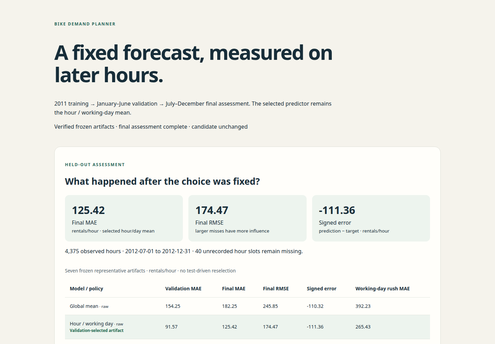

The predictor's original model hash is unchanged: `803ebf5afbedf6049ff9124b5e5d018b878e018570508ffc20f7443fc07dc354`. The saved bundle hash is still `2cda65e58a8aad7dd40cd152491009e59daa235a8a81d48df122eeebd909f408`. [FinalApplication](code/src/bike_demand_planner/final_application.py) checks the assessment protocol identity, selected model/bundle context and retained artifact hashes before serving. It does not refit a model when the page starts or when a reader inspects a different score.

The interactive request remains a historical **January–June validation replay**. The final batch uses the already frozen July–December calendar features, including source holiday flags. It would be misleading to silently turn those into an unrestricted future holiday authority. A July request is therefore rejected by the interactive adapter even though July is present in the final evaluation table. These are distinct, explicitly named scopes rather than an accidental missing prediction feature.

```python
request = app.predictor.request_for_target("2012-01-09T08:00:00")
forecast = app.predictor.predict(request)  # 349.5040; no observed outcome
observed = app.observation(request["target_time"])  # explicit later action
residual = forecast["prediction"] - observed["target"]  # −70.4960
```

The actual interface first displays 349.5 and the training-mean baseline. Clicking **Show recorded outcome** then reveals 420 and −70.50. A valid request for the unrecorded 2 January 03:00 hour still receives an estimate, but there is no actual count or residual. Changing the input clears the previous forecast; an unsupported date cannot leave an old successful-looking answer on screen. Browser checks exercise these cases at 1440, 768, 390 and 320 pixel widths. The installed-wheel check denies all source-project file access and still loads copied inference/evaluation assets and packaged web files.

```mermaid
flowchart LR
    B["Same verified saved model"] --> P["Target-free historical request"]
    P --> F["Forecast shown first"]
    O["Separate observation store"] --> R["Explicit reveal action"]
    F --> R
    E["Frozen final assessment"] --> T["Result table; model identity unchanged"]
```

The local training-recovery proof remains the earlier separate linear Adam demonstration: full parameters, scaler, moments/index, order/cursor/RNG, schedule, monitoring and context recover the same continuation after a damaged save. Final evaluation adds no new training or recovery result. Exact continuation proves reproducibility of that numerical run, while held-out scores measure later forecasting error. They are related parts of a usable project, but one cannot substitute for the other.

The technical local route is implemented and checked: provenance and splits, model calculations and comparisons, saved inference, recovery, replay and a frozen final assessment. The final results expose substantial deficits; no operational quality threshold was defined, no calibrated predictive uncertainty was implemented, no hosted recovery or external publication occurred, and the learner's changed-condition explanation remains unobserved. E-commerce Purchase Predictor is the next planned application, but this record does not start it or claim its prerequisites are understood merely because code and videos exist.

The useful next conversation is concrete: **the forest is now better on the final hours, so what can we honestly claim if we choose it next?** We can report its already measured result and record a test-informed development choice. We cannot present that choice as if the same test were still untouched. Keeping that distinction connects the maths, the implementation and the practical meaning of the final evidence.

### Run the implementation and inspect its evidence

```bash
uv run --frozen python -m unittest discover -s tests
uv run --frozen python final_evaluation_example.py
uv run --frozen python serve_final.py
```

The evaluation command shows the retained receipt when an assessment already exists; it does not quietly reopen labels. Run directories, models, downloaded source and these personal notes remain ignored. Ordinary distributions include source and packaged web assets, with no private notes, model/run outputs or datasets. Complete attribution is retained in the frozen protocol: Fanaee-T, H. (2013), UCI Bike Sharing, DOI `10.24432/C5W894`, CC BY 4.0, archive/member hashes and acquisition metadata. [Implementation source](code/src/bike_demand_planner/final_evaluation.py), [application source](code/src/bike_demand_planner/final_application.py), [learning points](project/learning-points/10-final-evaluation-and-application.md), [comparisons](project/comparisons/10-final-evaluation-and-application.md) and [tracker](project/implementation.md) provide the connected record.

### Keep the reasoning beside the result

[Learning points](project/learning-points/10-final-evaluation-and-application.md) explain what this calculation changes in our understanding. [Comparisons](project/comparisons/10-final-evaluation-and-application.md) put the alternatives side by side. [Setup and commands](project/setup.md) and the [current completion record](project/implementation.md) give the executable project context.

### Predict or explain: The forest has final MAE 103.6474 versus groups 125.4167. What happens to the claim if it is chosen now?

<details data-practice-id="final-evaluation-and-application-check"><summary>Reveal worked answer and rubric</summary>

The original groups selection remains the validation decision. Choosing the forest now is informed by the final outcomes, so that same period cannot supply a fresh independent performance claim for the newly selected decision. Record the new choice and use new held-out evidence for a new claim.

**Rubric:** Retain the observed ranking reversal and distinguish selection evidence from independent assessment.

</details>


Use the [readiness record](project/readiness.md) to distinguish the completed local application from questions that need new evidence.

### Complete source reference

The [setup record](project/setup.md) explains how to run these in the actual pinned checkout. The files below are exact source downloads.

- [application_example.py](code/application_example.py)
- [baseline_example.py](code/baseline_example.py)
- [calendar_example.py](code/calendar_example.py)
- [check_setup.py](code/check_setup.py)
- [compare.py](code/compare.py)
- [demo.py](code/demo.py)
- [error_review_example.py](code/error_review_example.py)
- [final_evaluation_example.py](code/final_evaluation_example.py)
- [group_baseline_example.py](code/group_baseline_example.py)
- [inference.py](code/inference.py)
- [linear_example.py](code/linear_example.py)
- [objective_example.py](code/objective_example.py)
- [optimization_example.py](code/optimization_example.py)
- [prepare_data.py](code/prepare_data.py)
- [regression_example.py](code/regression_example.py)
- [serve_app.py](code/serve_app.py)
- [serve_final.py](code/serve_final.py)
- [__init__.py](code/src/bike_demand_planner/__init__.py)
- [__main__.py](code/src/bike_demand_planner/__main__.py)
- [application.py](code/src/bike_demand_planner/application.py)
- [application_data.py](code/src/bike_demand_planner/application_data.py)
- [application_run.py](code/src/bike_demand_planner/application_run.py)
- [artifacts.py](code/src/bike_demand_planner/artifacts.py)
- [baselines.py](code/src/bike_demand_planner/baselines.py)
- [checkpoints.py](code/src/bike_demand_planner/checkpoints.py)
- [comparison.py](code/src/bike_demand_planner/comparison.py)
- [data.py](code/src/bike_demand_planner/data.py)
- [error_analysis.py](code/src/bike_demand_planner/error_analysis.py)
- [error_plots.py](code/src/bike_demand_planner/error_plots.py)
- [error_review.py](code/src/bike_demand_planner/error_review.py)
- [evaluation.py](code/src/bike_demand_planner/evaluation.py)
- [features.py](code/src/bike_demand_planner/features.py)
- [final_application.py](code/src/bike_demand_planner/final_application.py)
- [final_evaluation.py](code/src/bike_demand_planner/final_evaluation.py)
- [linear.py](code/src/bike_demand_planner/linear.py)
- [linear_evaluation.py](code/src/bike_demand_planner/linear_evaluation.py)
- [metrics.py](code/src/bike_demand_planner/metrics.py)
- [objective_evaluation.py](code/src/bike_demand_planner/objective_evaluation.py)
- [objectives.py](code/src/bike_demand_planner/objectives.py)
- [optimization.py](code/src/bike_demand_planner/optimization.py)
- [optimizer_evaluation.py](code/src/bike_demand_planner/optimizer_evaluation.py)
- [optimizers.py](code/src/bike_demand_planner/optimizers.py)
- [prediction_worker.py](code/src/bike_demand_planner/prediction_worker.py)
- [project.py](code/src/bike_demand_planner/project.py)
- [recovery.py](code/src/bike_demand_planner/recovery.py)
- [regression.py](code/src/bike_demand_planner/regression.py)
- [review_contract.py](code/src/bike_demand_planner/review_contract.py)
- [saved_predictor.py](code/src/bike_demand_planner/saved_predictor.py)
- [splits.py](code/src/bike_demand_planner/splits.py)
- [tree_evaluation.py](code/src/bike_demand_planner/tree_evaluation.py)
- [trees.py](code/src/bike_demand_planner/trees.py)
- [train.py](code/train.py)
- [tree_example.py](code/tree_example.py)

[Source README and preparation commands](evidence/project-readme.txt)


## Evidence and proof limits

### Claim ledger

| Claim | Status | Proof limit |
| --- | --- | --- |
| The worked course consolidates the implemented and checked local Bike project and its retained historical results. | verified | The source and historical checks describe local software behavior; they do not establish learner mastery, operational acceptance, a new independent test or hosted recovery. |

## Sources

- [Bike numerical prediction and update at completed source 0b49c0a](evidence/bike-source.txt) — captured excerpt SHA256 b37e1e639c3681e4bd93befd15d726361b380ee187a25016f6bd148d315fed80
