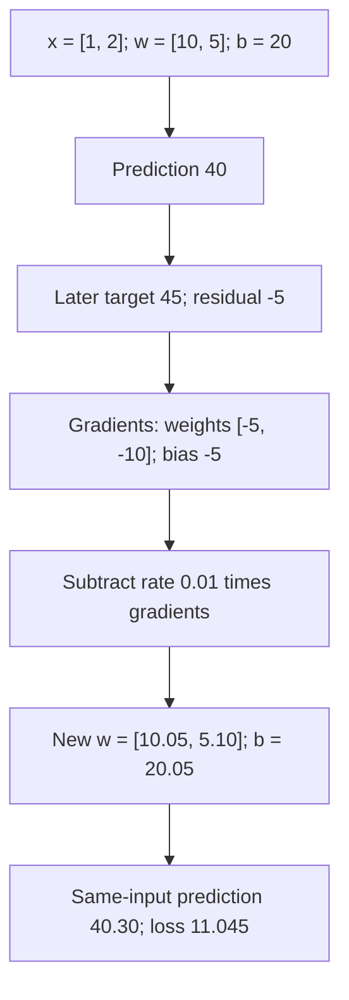

## One hourly prediction and one numerical update

It is 07:00, and the question is how many bikes will be rented between 08:00 and 09:00. Start by keeping that request separate from the count that will only be known later. We will use a deliberately small calculation first, then connect it to the real dataset in the next lesson. You already have tutorial and PDF background; this course makes those ideas concrete through the running project rather than repeating a prerequisite course. A useful first stopping point is the comparison between targets 45 and 35: explain the opposite updates before continuing.

### 1. Begin with the question an analyst actually asks

```video
{
  "title": "What is known before the rental hour?",
  "duration": 220.5,
  "src": "media/bike-first-hourly-contract/video.mp4",
  "poster": "media/bike-first-hourly-contract/poster.jpg",
  "captions": "media/bike-first-hourly-contract/captions.vtt",
  "transcript": "media/bike-first-hourly-contract/transcript.md"
}
```

Imagine it is Monday, 17 October 2011, at 07:00 in the bike system's local time. An operations analyst wants an estimate for rentals during the upcoming 08:00–09:00 hour. The date is genuinely a Monday, but everything about the rental count and starting weights below is illustrative. We have not acquired a UCI record for it. Local time here is the working scenario for Washington's system; the archive's actual timestamp/holiday conventions will be checked in the data phase.

The question is: **given what is available at 07:00, how many rentals will be recorded across the whole system during that specified hour?** This is observed rental demand. It is not station inventory, unmet requests or an operational allocation decision.

| Part of the contract | Concrete choice in this example |
| --- | --- |
| Forecast issue time | 2011-10-17, 07:00 local system time |
| Target interval | [08:00, 09:00): include the start, exclude the next hour's start |
| Lead time to the interval's start | One hour |
| Duration being aggregated | One hour |
| Target | Total observed rentals during that interval, eventually `cnt` |
| Available information | Target calendar date/hour, weekday/month and known calendar flags |
| Initial task | Calendar-only prediction, no future observed weather/demand |
| Output | A numeric estimate in rentals during that hour, with model/feature identity |
| Later comparison | Recorded target and signed error, stored separately from forecast inputs |

A conceptual request might carry the issue/target times and known calendar fields. It does **not** carry `cnt`, `casual` or `registered`. In the intended data, the latter two components reveal the total and would defeat the problem if used as predictors. This contract is written for the worked example; an application request parser and complete runtime enforcement have not been implemented in lesson 1.

For this example we treat the date as a nonholiday working day. That working-day value is an explicit scenario assumption; dataset acquisition will verify the source's calendar meaning. Known information is allowed information, but a toy model does not have to use every allowed field.

### 2. Keep prediction and learning on the correct sides of time

At 07:00 we can run the prediction rule using calendar inputs and its current weights. At that point the 08:00–09:00 count is still unknown. Once the interval finishes, a recorded target can be paired with the earlier features and used to calculate an error or a training update.

This order matters even in historical replay: a CSV row may contain both features and target, but their being present in the same file does not make the target available to a forecast. Likewise, an observed future-hour weather field is not a forecast issued beforehand. The model-input construction must preserve the declared information boundary.

When we later recalculate the same example with updated weights, we are checking the training step retrospectively. We are not pretending the updated prediction was the original 07:00 forecast.

### 3. Choose a small explicit feature representation

Use two features for this arithmetic:

```python
working_day = 1.0
hour = 8.0
hour_scale = 4.0
features = [working_day, hour / hour_scale]  # [1.0, 2.0]
```

The first value tells the toy rule that this is a working day. The second expresses the clock hour in units of four hours. The divisor four is a fixed demonstration choice: it makes the retained `[1, 2]` numerical example correspond to the concrete 08:00 scenario. It is not fitted on held-out data, and it is not a recommendation for the final model. Later lessons compare calendar encodings and training-fitted scaling.

Feature order is part of the contract: position zero is working day, and position one is this scaled hour. Swapping them while retaining the same weights changes the meaning of the calculation. The eventual predictor must save and validate its exact feature schema rather than trusting arbitrary column order.

We will use `x` for this two-element feature vector, `w` for the matching weights, `b` for the bias, `p` for a prediction and `y` for the observed target. For this one observation, `x` and `w` each have length two and the other quantities are scalar numbers.

### 4. Make the first prediction

```video
{
  "title": "Build the prediction and measure its error",
  "duration": 236.29166666666666,
  "src": "media/bike-first-prediction-and-loss/video.mp4",
  "poster": "media/bike-first-prediction-and-loss/poster.jpg",
  "captions": "media/bike-first-prediction-and-loss/captions.vtt",
  "transcript": "media/bike-first-prediction-and-loss/transcript.md"
}
```

Start from hand-chosen parameters, not trained bike-data estimates:

```python
weights = [10.0, 5.0]
bias = 20.0
```

The prediction rule is a weighted sum plus the bias:

```text
p = w1*x1 + w2*x2 + b
  = 10*1 + 5*2 + 20
  = 10 + 10 + 20
  = 40
```

The first feature contributes 10 rentals, the second contributes another 10, and the intercept adds 20. The intercept allows a common offset rather than requiring the weighted sum alone to explain the level. These are components of a deliberately simplified rule, not causal claims about working days or clock time.

The source function implements that same expression:

```python
return sum(x * w for x, w in zip(features, weights, strict=True)) + bias
```

The full function also rejects empty/mismatched vectors and nonfinite inputs. Those checks protect the stated numerical contract; the useful mathematical operation remains the weighted sum.

At forecast time this calculation needs features, weights and bias. It does not need a target or loss. It currently predicts 40 rentals for the specified hour. A model can return a fractional estimate even though an observed rental count is integer-valued; it represents a point estimate, not a literal fractional rental event.

### 5. Observe a target, then measure the error

After 09:00, suppose the recorded count is `y = 45`. Again, 45 is an invented target for the example, not an acquired data result.

Choose residual `r = prediction - target`:

```text
r = 40 - 45 = -5
```

This sign convention makes an underprediction negative and an overprediction positive. Keeping it explicit is important: mixing it with a target-minus-prediction derivative would reverse the update.

For one observation, use half squared error:

```text
L = (1/2)*(p-y)^2
  = (1/2)*(-5)^2
  = 12.5
```

The factor one-half is chosen so its derivative is simpler. It does not make this an alternative final evaluation metric: later task comparison primarily uses MAE in rentals/hour, with RMSE and error slices. This objective has squared rental units and is not an accuracy percentage. No batch mean is needed here because there is exactly one observation.

The corresponding source uses the same residual:

```python
residual = prediction - target
return 0.5 * residual**2
```

### 6. Connect the loss to each parameter through the chain rule

```video
{
  "title": "Follow the chain rule through one update",
  "duration": 234.41666666666666,
  "src": "media/bike-first-gradient-update/video.mp4",
  "poster": "media/bike-first-gradient-update/poster.jpg",
  "captions": "media/bike-first-gradient-update/captions.vtt",
  "transcript": "media/bike-first-gradient-update/transcript.md"
}
```

The loss depends on the prediction, and the prediction depends on each weight and the bias. To see how a parameter affects the loss, multiply those two local relationships.

For half squared error, differentiating with respect to the prediction gives:

```text
dL/dp = (1/2)*2*(p-y) = p-y = r
```

For the linear rule, increasing `w1` by a tiny amount increases the prediction by `x1` times that amount, so `dp/dw1 = x1`. Similarly `dp/dw2 = x2`, and `dp/db = 1`. Therefore:

```text
dL/dw1 = (dL/dp)*(dp/dw1) = r*x1 = -5*1 = -5
dL/dw2 = (dL/dp)*(dp/dw2) = r*x2 = -5*2 = -10
dL/db  = (dL/dp)*(dp/db)  = r*1  = -5
```

The result is a gradient for every trainable parameter: `gradient_w = [-5, -10]` and `gradient_b = -5`. Features and target describe the fixed example; gradients say how the current loss changes locally when the parameters change. We do not change the target to make the model look better.

The second weight gradient is twice the first because the second feature is twice as large. This is an early concrete connection between feature scaling and optimization. It does not mean the second feature is universally twice as useful; it is a property of this particular forward path and example.

The gradient function is the calculation above in vector form:

```python
residual = prediction - target
return [residual * x for x in features], residual
```

### 7. Apply one gradient-descent update

Choose learning rate `eta = 0.01`. For each parameter, subtract the learning rate times its gradient:

```text
parameter_next = parameter_current - eta*gradient
```

| Parameter | Current | Gradient | Scaled gradient | New value |
| --- | ---: | ---: | ---: | ---: |
| First weight | 10.00 | -5 | -0.05 | 10.05 |
| Second weight | 5.00 | -10 | -0.10 | 5.10 |
| Bias | 20.00 | -5 | -0.05 | 20.05 |

The negative gradients make subtraction increase the parameters here. That is consistent with the current underprediction: increasing weights on these positive features and increasing the bias raises this prediction toward its target. With other feature signs or another target, the directions can differ; do not memorize “training increases weights.” The invariant is subtraction of the actual gradient.

The source creates new parameter values rather than mutating the old list, so before/after state remains inspectable:

```python
next_weights = [
    weight - learning_rate * gradient
    for weight, gradient in zip(weights, weight_gradients, strict=True)
]
next_bias = bias - learning_rate * bias_gradient
```

A rate of 0.01 is a demonstration setting, not a rate already chosen for bike-data training. It controls step scale; too large a step can overshoot. A zero rate leaves the parameters unchanged, and the numerical API rejects a negative or nonfinite rate.

### 8. Recompute the same example as a check

Hold the feature vector and target fixed. The new prediction is:

```text
p_next = 1*10.05 + 2*5.10 + 20.05
       = 10.05 + 10.20 + 20.05
       = 40.30

r_next = 40.30 - 45 = -4.70
L_next = (1/2)*(-4.70)^2 = 11.045
```

The new weights contribute `0.05 + 2*0.10`, and the bias contributes another `0.05`, so the total prediction increase is `0.30`. This separate arithmetic check helps catch an incorrect sign or a missed feature contribution. Loss decreases from 12.5 to 11.045 on this same observation.



These arrows follow the arithmetic and parameter state, not a causal account of real bike demand. The final node is a repeated training-example check. It says nothing yet about unseen-hour error, seasonal robustness, baseline improvement or the best feature design.

### 9. Read and run the actual source

The reusable functions are in [linear.py](code/src/bike_demand_planner/linear.py). The standalone [linear_example.py](code/linear_example.py) declares working day/hour/scale, starting weights/bias, targets and rate in its main block, then calls prediction, loss, gradients, update and the repeated check in that order. It now runs the original target 45 and the changed target 35 independently from the same starting parameters. No dataset or hidden trainer is involved.

From the project folder:

```bash
uv run --frozen python linear_example.py
uv run --frozen python -m unittest discover -s tests -v
```

The first executed case reports prediction 40.0 and loss 12.5, gradients `[-5.0, -10.0]` and `-5.0`, updated parameters `[10.05, 5.1]` and `20.05`, then prediction 40.3 and loss approximately 11.045. The second case is traced below. Python's binary floating-point output can show `11.045000000000014` and residual magnitude `4.700000000000003`; these are representation roundoff, not a different objective.

Seven checks pass. They cover the two known-answer update directions, old-parameter preservation, central finite differences on a different mixed-sign input, zero-error/zero-rate behavior, vector-shape failures and nonfinite/negative-rate rejection. Finite differences check how perturbing one parameter changes the executed objective; they are not just another copy of the analytic formula.

### 10. Change only the target to 35 and compare the update

```video
{
  "title": "Change the target to 35 and compare both updates",
  "duration": 230.75,
  "src": "media/bike-first-opposite-target/video.mp4",
  "poster": "media/bike-first-opposite-target/poster.jpg",
  "captions": "media/bike-first-opposite-target/captions.vtt",
  "transcript": "media/bike-first-opposite-target/transcript.md"
}
```

This is an alternative outcome for the same illustrative hour. It is a controlled comparison, not another observation after the target-45 update. Both cases start from `[10, 5]` and bias `20`. In the actual source, the main block holds these starting parameters fixed and stores each result separately:

```python
targets = [45.0, 35.0]
learning_rate = 0.01

cases = []
for target in targets:
    # Each target starts from the same weights and bias.
    prediction = predict(features, weights, bias)
    loss = half_squared_error(prediction, target)
    weight_gradients, bias_gradient = squared_error_gradients(features, prediction, target)
    next_weights, next_bias = sgd_step(
        weights, bias, weight_gradients, bias_gradient, learning_rate,
    )
    next_prediction = predict(features, next_weights, next_bias)
    next_loss = half_squared_error(next_prediction, target)
```

The result-building/JSON lines follow this block in the source. The distinction between `weights` and `next_weights` matters: `sgd_step` returns a new list, and the loop never assigns it back to the starting `weights`. Therefore the second case begins with prediction 40, not 40.30. A loop that assigned the updated values back would answer a different question about successive training steps.

**First, predict with the unchanged parameters.** The prediction function receives only features, weights and bias. Changing the target does not alter this call or its result:

```text
p = 1*10 + 2*5 + 20 = 40
```

**Second, compare that prediction with the new outcome.** We use prediction minus target consistently, so the residual is positive:

```text
r = 40 - 35 = +5
L = (1/2)*(+5)^2 = 12.5
```

Positive residual means the model is five rentals too high. The objective has exactly the same value as before because `(+5)^2` and `(-5)^2` both equal 25. That equality does not mean the corrections should go in the same direction.

**Third, follow the chain rule to each parameter.** For `L = (1/2)*(p-y)^2`, the prediction derivative is `p-y = 5`. The prediction changes by `x_i` per unit change in weight `w_i`, and by one per unit change in bias. Thus:

```text
dL/dw1 = (p-y)*x1 = 5*1 = +5
dL/dw2 = (p-y)*x2 = 5*2 = +10
dL/db  = (p-y)*1  = 5*1 = +5
```

The second gradient is twice as large because the second feature is two. A positive weight gradient means that a small increase in that weight would increase the loss at the starting point. Gradient descent takes a step in the other direction by subtracting the scaled gradient. This statement about both weight directions relies on the positive features in this case; a negative feature would reverse its corresponding weight gradient.

**Fourth, apply the same rate of 0.01 to each gradient.** The subtraction is unchanged between cases; only the signs of the gradients change:

| Parameter | Starting value | Gradient | Actual parameter change, `-0.01*gradient` | Updated value |
| --- | ---: | ---: | ---: | ---: |
| First weight | 10.00 | +5 | -0.05 | 9.95 |
| Second weight | 5.00 | +10 | -0.10 | 4.90 |
| Bias | 20.00 | +5 | -0.05 | 19.95 |

**Fifth, recompute with the updated parameters and the same input.** The first weighted contribution falls by 0.05, the second by `2*0.10 = 0.20`, and the bias by another 0.05. The total prediction falls by 0.30:

```text
p_next = 1*9.95 + 2*4.90 + 19.95
       = 9.95 + 9.80 + 19.95
       = 39.70

r_next = 39.70 - 35 = +4.70
L_next = (1/2)*(4.70)^2 = 11.045
```

This step leaves an overprediction, but a smaller one. The rate specifies a step along the loss gradient; it does not require the updated prediction to equal the target after one step.

The [comparison table](project/comparisons/01-prediction-contract.md#targets-on-opposite-sides-of-the-same-prediction) puts the two cases next to each other. They have the same initial error magnitude, final error magnitude and loss reduction, while their residuals, gradients and parameter changes have opposite signs. The executed JSON is saved separately as [changed-target output](evidence/01-prediction-contract-and-one-update/changed-target-output.json); the original target-45 evidence remains in [numerical-output.json](evidence/01-prediction-contract-and-one-update/numerical-output.json).

### 11. What is complete, and where to pause

The worked contract and single-observation arithmetic are implemented/explained. We have not acquired data, fitted a real demand estimator, built a batch trainer or evaluated future hours. Calendar/holiday and source timestamp semantics still need the data phase, and the production request schema is not enforced by an application yet.

The learner has correctly explained the update direction for the target-35 case with these positive features. Both cases are implemented, executed and compared step by step, and the source is committed as `4794ad4`. The completion review closes the worked contract/update scope and moves to official data acquisition/audit. This records one observed piece of reasoning rather than independent verification of every calculation or blanket mastery. Feature scaling can be revisited as reinforcement when the actual feature encoding is chosen.

### Keep the reasoning beside the result

[Learning points](project/learning-points/01-prediction-contract.md) explain what this calculation changes in our understanding. [Comparisons](project/comparisons/01-prediction-contract.md) put the alternatives side by side. [Setup and commands](project/setup.md) and the [current completion record](project/implementation.md) give the executable project context.

[[practice:prediction-contract-check]]

The arithmetic needs actual calendar records and a time boundary. Continue to [the next lesson](lessons/02-hourly-data-and-splits.md) when this step is clear.

### Course records

[Reading route](project/course-outline.md) · [Reference runs](project/reference-runs.md) · [Sources and retained choices](research.md) · [Review questions](practice/explain-your-model.md) · [Migration map](evidence/migration.json) · [Local video identities](local-videos.json)
