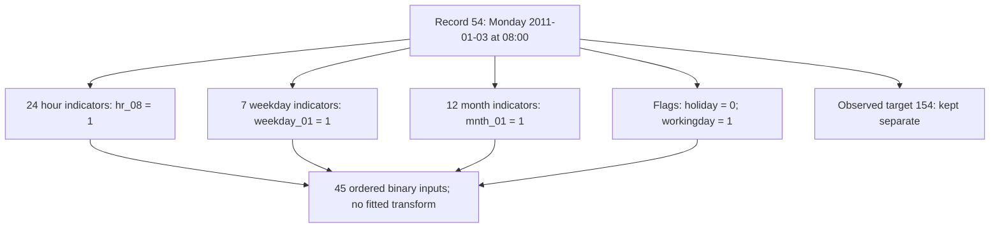
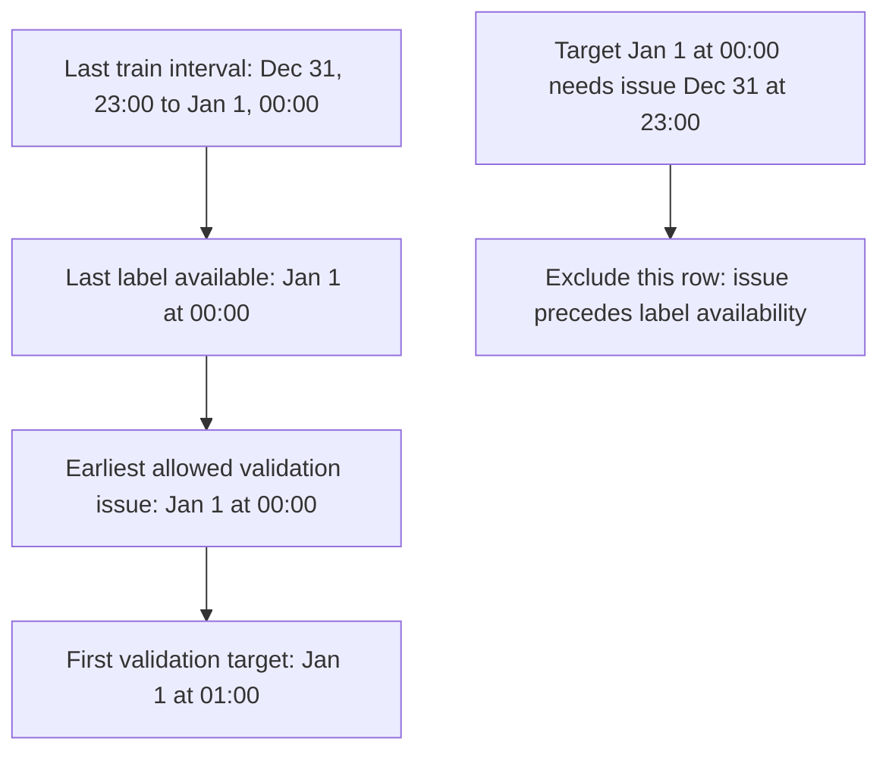

## Understand the hourly data, calendar features and time split

The first calculation gave us a clear forecast and update rule. Now follow an actual Monday 08:00 row from the acquired CSV into the feature vector and its time partition. Watch each short companion before reading its worked explanation; none of the later counts is allowed to cross back into the original request.

### Start with a Monday morning

```video
{
  "title": "The hourly prediction contract",
  "duration": 281.604667,
  "src": "media/bike-data-hourly-contract-depth/video.mp4",
  "poster": "media/bike-data-hourly-contract-depth/poster.jpg",
  "captions": "media/bike-data-hourly-contract-depth/captions.vtt",
  "transcript": "media/bike-data-hourly-contract-depth/transcript.md"
}
```


Imagine it is 07:00 on Monday, 3 January 2011. We want to estimate how many rentals the system will record between 08:00 and 09:00. That gives us one hour of lead time before the target interval begins.

The acquired CSV has a real observation for that hour: **record 54**, with a total of **154 rentals**. We can read that outcome now because we are looking back at a completed day. At the original 07:00 forecast time, those rentals had not happened yet.

Here is the part of the row we will use to describe the upcoming hour:

| Field | Value | What it tells us |
| --- | ---: | --- |
| `hr` | 8 | The target interval begins at 08:00 |
| `weekday` | 1 | It is Monday; this source uses Sunday as 0 |
| `mnth` | 1 | It is January |
| `holiday` | 0 | The source's holiday flag is off |
| `workingday` | 1 | The source marks it as a working day |

The observed `cnt=154` sits alongside those fields in the CSV, but it has a different job. The calendar describes the case we want to predict. The count is the answer we can compare with a prediction once the hour has finished.

This is why having everything in one file does not make everything a valid input. If we pass the later outcome into the prediction function, we have changed the problem. We would be giving the model information that the real forecast would not have had.

There is no fitted prediction for this row yet. The 154 is an observation from the source, and the earlier 40 came from a separate arithmetic example with hand-chosen weights.

#### Ask what changes when the requested hour changes

Suppose the next request is for 09:00–10:00 on the same Monday. With the same one-hour lead, its issue time is 08:00. The calendar hour changes from 8 to 9; weekday, month, holiday and working-day status stay the same. Its later rental total belongs to that new interval, so we cannot carry the earlier target of 154 across as its answer. Moving the requested interval changes the question even when most inputs remain identical.

This is why the target timestamp and issue timestamp travel with the row as metadata. The feature vector describes the request, while those timestamps let us ask whether the request could actually have been made. Knowing the calendar at issue time is different from knowing the eventual count. In particular, the source convention makes an interval's observed count available at its end, not simply because its start-time label is already known.

The implementation follows this boundary explicitly: the parser keeps the target apart from the calendar fields, and `encode_calendar` receives only the declared inputs. If `cnt` appears in that mapping, rejecting it is useful. It catches a violation of the forecasting question before an impressive score can hide it.


### Separate the useful inputs from the rest of the row

```video
{
  "title": "Useful inputs, leakage and missing hours",
  "duration": 289.979329,
  "src": "media/bike-data-source-audit-depth/video.mp4",
  "poster": "media/bike-data-source-audit-depth/poster.jpg",
  "captions": "media/bike-data-source-audit-depth/captions.vtt",
  "transcript": "media/bike-data-source-audit-depth/transcript.md"
}
```


A source row carries several kinds of information. We need its record ID and date/hour to find it again, check ordering and decide which time period it belongs to. We need calendar fields to describe it to a model. We need its rental count later for training or evaluation. Those roles should stay visible in the code.

The first row in the file gives a particularly simple example of a field that is useful for checking data but unsuitable as a forecast input. It describes Saturday, 1 January 2011 at 00:00, and records:

```text
casual rentals       = 3
registered rentals   = 13
total rentals, cnt   = 16

3 + 13 = 16
```

The component counts help us check that the total is consistent. If we used those same-hour components as predictors, their sum would reveal the answer directly. We therefore validate the equality while keeping both components out of the model inputs.

Observed weather needs the same timing check. A measurement taken during 08:00–09:00 is different from a weather forecast available at 07:00. Our first task uses calendar information only, so the observed-weather fields stay out. A weather-based comparison would need its own definition of what was available and when.

In [data.py](code/src/bike_demand_planner/data.py), `parse_hourly_row()` gives the row's parts separate names:

```python
return HourlyRecord(
    record_id=numbers["instant"],
    target_time=datetime.combine(day, time(hour=numbers["hr"])),
    calendar={name: numbers[name] for name in CALENDAR_FIELDS},
    target=numbers["cnt"],
)
```

The `calendar` dictionary here keeps seven validated source fields: season, year, month, hour, holiday, weekday and working day. It is an intermediate record of the source information. We make the modelling choice about which fields to use in the next step. The target remains separate throughout.

Before returning that record, the parser also checks that all 17 required fields are present, codes are in range, numeric values are finite and the date agrees with the year, month and weekday fields. Working-day status must agree with the weekend and holiday flags. For example, the first row is a Saturday, so a working-day flag of zero is consistent even though its holiday flag is also zero.

The file audit then checks unique record IDs, unique date/hour labels and chronological order. These checks give us a sensible collection of observations to work with. They do not tell us how accurately a future model will predict rentals.

#### See how filling a missing hour changes the answer

The complete naive grid would have 17,544 hourly slots, while the file records 17,379 observations. The difference is 165 slots, about 0.94% of that grid. That fraction tells us how much is unrecorded under this label convention; it does not tell us why the rows are missing or what their demand was. The source's naive timestamps also do not establish a time zone or a daylight-saving interpretation.

Consider an explicitly illustrative three-hour window with recorded counts 10, no row, and 30. The average of the two observed counts is 20. If we manufacture a zero for the middle hour, the average becomes `(10 + 0 + 30) / 3`, about 13.33. We changed both the numerator and the denominator by introducing an outcome the source never supplied. That change could alter a fitted constant baseline, its residuals and any lag built from the sequence.

There are therefore two different checks to perform. Validate the rows that exist: their fields, finite values, identities and component counts must agree. Separately inspect the time grid for absent labels. A file can pass every cell-level check and still have a gap between two valid rows. Keep the gap as missing evidence until a later, explicitly justified missing-data policy is chosen.


### Give each hour its own place in the vector

```video
{
  "title": "Build the 45 calendar inputs",
  "duration": 394.145996,
  "src": "media/bike-data-calendar-vector-depth/video.mp4",
  "poster": "media/bike-data-calendar-vector-depth/poster.jpg",
  "captions": "media/bike-data-calendar-vector-depth/captions.vtt",
  "transcript": "media/bike-data-calendar-vector-depth/transcript.md"
}
```


We now have a clean description of Monday at 08:00. The next question is how to turn it into numbers that a linear model can use.

Suppose we feed the hour in as the single number 8. Its contribution to a linear prediction would be:

```text
hour contribution = hour_weight × hour
```

Every increase of one hour would change the prediction by the same `hour_weight`. That is a straight-line relationship across the day. One slope cannot describe a morning rise, a midday dip and another rise in the evening. There is another awkward detail: 23:00 and 00:00 are adjacent on a clock, but their raw numbers are far apart.

For our first representation, we give each hour its own indicator. At 08:00, the indicator for hour 8 is one and the other 23 hour indicators are zero. We do the same for weekday and month, then keep the two flags as ordinary zero-or-one values.

The declarations in [features.py](code/src/bike_demand_planner/features.py) make the groups explicit:

```python
CATEGORY_DOMAINS = (
    ("hr", tuple(range(24))),
    ("weekday", tuple(range(7))),
    ("mnth", tuple(range(1, 13))),
)
FLAG_FIELDS = ("holiday", "workingday")
INPUT_FIELDS = tuple(name for name, _ in CATEGORY_DOMAINS) + FLAG_FIELDS
```

Those groups give us `24 + 7 + 12 + 2 = 45` values in a fixed order. We first select the five fields we actually want from the larger source calendar:

```python
calendar = {name: record.calendar[name] for name in INPUT_FIELDS}
features = encode_calendar(calendar)
```

After checking the fields and their values, the encoder builds the indicators like this:

```python
encoded = [
    float(calendar[name] == category)
    for name, categories in CATEGORY_DOMAINS
    for category in categories
]
return encoded + [float(calendar[name]) for name in FLAG_FIELDS]
```

Read the comparison inside the loop as a simple question: does this row belong to this hour, weekday or month? A match becomes 1.0; every other category gets 0.0.

For our Monday example, the positions are:

| Part of the vector | Positions, counting from zero | Value for this row |
| --- | --- | --- |
| Hour indicators | 0–23 | Position 8, `hr_08`, is 1 |
| Weekday indicators | 24–30 | Position 25, `weekday_01`, is 1 |
| Month indicators | 31–42 | Position 31, `mnth_01`, is 1 |
| Holiday flag | 43 | 0 |
| Working-day flag | 44 | 1 |

That is four ones and 41 zeros. The diagram shows the same construction without listing all 45 values:



Each calendar branch contributes its part of the input vector. The recorded 154 follows a separate branch because it is the outcome we will eventually compare against.

Once we fit a linear model, its calculation for this row will have this form:

```text
prediction = bias
           + weight_for_hour_08
           + weight_for_Monday
           + weight_for_January
           + weight_for_working_day
```

There are no fitted weights yet, so this expression does not produce a numeric estimate here. It shows which coefficients would participate in the prediction.

If we change only the encoder's hour input from 8 to 9, `hr_08` switches off and `hr_09` switches on. The weekday, month and flag values stay the same. With fitted weights, the prediction would change by `weight_for_hour_09 - weight_for_hour_08`. This is a useful way to see what the representation permits. It does not assume that the next real hour has the same observed target of 154.

One-hot encoding gives the model flexibility to learn a separate hourly effect, but it does not teach the model that neighbouring hours should behave similarly. A sine/cosine representation can express circular proximity using fewer columns, while a linear model with one such pair has a more constrained daily shape. We have chosen a readable first representation, with alternatives left for a controlled comparison later.

#### Trace a changed hour all the way to a dot product

For the Monday 08:00 example, the active positions are `[8, 25, 31, 44]`. Asking about 09:00 on that same day gives `[9, 25, 31, 44]`. There are still 45 values and four ones. Exactly two coordinates change: position 8 goes from one to zero and position 9 goes from zero to one. All other coordinates retain their meanings and values.

To see why that matters to a linear model, temporarily choose illustrative coefficients rather than fitted ones. Let the intercept be 10, the hour-8 coefficient 20, the Monday coefficient 3, January 2, and working-day 5. The 08:00 prediction is `10 + 20 + 3 + 2 + 5 = 40`. If the hour-9 coefficient is 12, the changed request predicts `10 + 12 + 3 + 2 + 5 = 32`. The eight-rental difference comes entirely from replacing one hour coefficient. These numbers explain the representation; they are not trained predictions for source record 54.

The code's nested iteration over the fixed category domains establishes that coordinate order. `FEATURE_NAMES` describes it, and the schema saves it. Keeping only the array length is insufficient: swapping the meanings of hour 8 and hour 9 would preserve the shape and number of ones while changing the calculation. A later model and its saved schema must agree on names and order.


### Understand the fields we left out

```video
{
  "title": "What the calendar representation assumes",
  "duration": 345.270996,
  "src": "media/bike-data-representation-depth/video.mp4",
  "poster": "media/bike-data-representation-depth/poster.jpg",
  "captions": "media/bike-data-representation-depth/captions.vtt",
  "transcript": "media/bike-data-representation-depth/transcript.md"
}
```


Year is available in advance, so excluding it is not a leakage rule. The reason is more specific: our training period is 2011, and every row in it has `yr=0`.

Recall the weight gradient from the earlier numerical example:

```text
weight gradient = residual × feature value
```

For a raw year feature that is zero on every training row, that gradient is always zero. Training cannot learn a year-to-year effect from that feature. Supplying `yr=1` in 2012 would then use a coefficient whose effect was never identified by these training examples. We leave year out of this first schema rather than imply that it has learned growth between the two years.

We also leave out the source's coarser season code while keeping month. This keeps the first representation small enough to inspect and avoids attaching the source documents' conflicting season names. It does not establish that season is useless or that month fully determines it. We can test a different feature set later using the same evaluation periods.

There is one further detail about the full one-hot representation. Exactly one hour indicator is always one. If we added 2 to every hour coefficient and subtracted 2 from the bias, the prediction would be unchanged:

```text
(bias - 2) + (active_hour_weight + 2)
= bias + active_hour_weight
```

That is a dependency between the hour columns and the intercept. The other full category groups have a similar dependency, and some flags can overlap with the calendar groups too. Predictions and gradients still have a clear meaning, but individual coefficients need not have a unique value. We should therefore be careful about interpreting a single coefficient as a unique effect, especially a causal one.

Dropping one reference category from each group would reduce the representation from 45 to 42 values. Regularization is another choice we will study later. Neither has been added silently to this preparation step.

#### Compare clock distance and coefficient meaning

The circular alternative uses an angle `2πh/24`. At hour 0, sine and cosine are `(0, 1)`. At hour 23 they are approximately `(-0.2588, 0.9659)`, giving a Euclidean distance of about 0.2611. Raw hour numbers put those adjacent clock positions 23 units apart. Circular coordinates encode that closeness, while a linear model over one sine/cosine pair still has a smooth single-harmonic daily shape. That is a modelling assumption, not a guarantee of better forecasts; richer harmonics or interactions would be separate choices.

Full one-hot encoding makes a different tradeoff: the hour contribution can vary independently across categories. With an intercept, however, the individual coefficients need not be unique. Every row activates exactly one hour indicator. Add 5 to all 24 hour coefficients and subtract 5 from the intercept: the active hour adds five more, the intercept adds five less, and every prediction stays identical. For the illustrative 08:00 calculation, `10 + 20` becomes `5 + 25`.

That does not make the predictions undefined. It means a coefficient's isolated value is not automatically a unique, causal explanation. Dropping a reference category or adding regularization changes how parameters are represented or selected; those choices must be made and compared explicitly later. For now, retain the fixed schema and avoid reading more into its coefficients than the model identifies.


### Keep fixed encoding separate from learning statistics

The possible hours, weekdays and months come from calendar definitions. We do not need to inspect future observations to discover that an hour can be between 0 and 23. This encoding therefore has no fitting step: the same fixed rules apply to training, validation and test rows.

Every output value is already zero or one, so we have not fitted a scaler. If we later introduce a transform that learns a mean, scale or selected feature set, that learning must use the training portion only. Validation and test rows must use the already fitted transform. A time-based cross-validation fold would have its own training portion and follow the same rule.

The current code does count how often each feature is one, using training rows only. That is a descriptive check, not a fitted scaler. If a column is constant in training, it keeps its declared position. We do not divide by a zero standard deviation or use the later data to decide which columns disappear. None of the actual 45 training columns is constant; a small test fixture exercises the constant-column case.

A known calendar category can be absent from a small training sample and still have a valid place in the schema. The model simply has no examples from which to estimate that category's effect. An impossible hour such as 24 is different: it is rejected. Missing fields, extra fields such as `cnt`, noninteger category codes and inconsistent working-day flags are rejected as well.

`calendar_schema()` saves these rules with the ordered feature names. Saving the order matters because a weight belongs to a particular feature position. Swapping columns later while retaining the weights would change what the prediction means.

### Let the time split follow the forecasting question

```video
{
  "title": "Time splits and information availability",
  "duration": 369.395996,
  "src": "media/bike-data-chronological-split-depth/video.mp4",
  "poster": "media/bike-data-chronological-split-depth/poster.jpg",
  "captions": "media/bike-data-chronological-split-depth/captions.vtt",
  "transcript": "media/bike-data-chronological-split-depth/transcript.md"
}
```


We want to estimate later hours using earlier observations, so our evaluation should follow that direction. Training on a random mixture that includes later hours would answer a different question from the one-hour-ahead forecasting task.

The chosen periods give each part a clear role. We use 2011 to estimate parameters, January–June 2012 to compare choices, and July–December 2012 for the reserved final evaluation. We have not used test outcomes or model errors to choose these boundaries.

There is a small but important complication at midnight. An outcome belongs to a target interval, and it becomes known after that interval finishes. Sorting the interval start times alone does not check that the outcome was available when a forecast needed to be issued.

Look at the end of training:

```text
Last training interval:       31 Dec 2011, 23:00–00:00
Last training outcome ready:   1 Jan 2012, 00:00
```

Now consider a validation target starting at 00:00 on 1 January. With a one-hour lead, its forecast must be issued at 23:00 on 31 December. At that moment, the last training interval is only beginning. We cannot use its completed outcome to build the model for that forecast.

We solve this by leaving the midnight target out of evaluation. The first validation target is 01:00, whose forecast is issued at 00:00. That issue time meets the point at which the preceding stage's outcomes are available. The same reasoning leaves out the midnight target at the July boundary after validation-based selection.



The left-hand path follows the allowed order: the last training interval ends, its outcome becomes available, and the first validation forecast can be issued. The right-hand path shows why the midnight target requires an issue time that is too early.

For this offline exercise, we treat source hour labels as interval starts, outcomes as available at interval end, and the preceding stage as ready at the boundary. We assume zero reporting and model-build delay. Those assumptions are written into the manifest; a practical system with additional delay would need a later readiness time. The source does not specify timezone or daylight-saving disambiguation, so these calculations use its date/hour labels without assigning UTC offsets.

In [splits.py](code/src/bike_demand_planner/splits.py), the main decisions read directly from that reasoning:

```python
if target_time < VALIDATION_READY:
    return "train"
if target_time - FORECAST_LEAD < VALIDATION_READY:
    return "embargo"
if target_time < TEST_READY:
    return "validation"
if target_time - FORECAST_LEAD < TEST_READY:
    return "embargo"
return "test"
```

`VALIDATION_READY` is 1 January 2012 at 00:00, `TEST_READY` is 1 July 2012 at 00:00, and `FORECAST_LEAD` is one hour. The code calls an excluded boundary row `embargo`. The name means that we deliberately leave this existing observation outside the three model partitions because of its timing.

Before those branches run, the function checks that the target is an hour-aligned source label in 2011 or 2012, without timezone information. The time windows include their starts and exclude their ends, so a row cannot belong to both sides of a boundary.

The preparation also checks the timing after assigning rows. The last training interval must end no later than the first validation issue time; the last validation interval must end no later than the first test issue time. The first of those guards is:

```python
if bounds["train"]["last"] + TARGET_DURATION > bounds["validation"]["first"] - FORECAST_LEAD:
    raise ValueError("A training label is unavailable at the first validation issue time.")
```

The same check is made between validation and test. That connects the split rule to the original prediction contract instead of relying only on a date-range label.

Here is the resulting membership:

| Part | Recorded target hours | Rows |
| --- | --- | ---: |
| Training | All recorded hours in 2011 | 8,645 |
| Validation | 1 Jan 2012, 01:00 through 30 Jun, 23:00 | 4,357 |
| Reserved test | 1 Jul 2012, 01:00 through 31 Dec, 23:00 | 4,375 |
| Boundary exclusions | 1 Jan and 1 Jul 2012, both at 00:00 | 2 |
| Total | Every acquired observation | 17,379 |

The two excluded rows have source IDs 8646 and 13004. We keep them in the raw file and in the membership record, with the reason for exclusion. The model partitions contain 17,377 observations in total.

#### Add reporting and build delays without changing the frozen split

The frozen preparation assumes zero reporting and model-build delay. Under that convention, the final training interval finishes at 00:00, its count is available then, and a forecast issued at 00:00 can target 01:00. The midnight target itself would need an issue at 23:00, before the final training outcome was available, which is why that existing boundary row is excluded.

Now make a hypothetical timing change: reporting takes 20 minutes and preparing the model takes another 15. Readiness becomes 00:35. The 01:00 target still needs a 00:00 issue, so it is now too early. The next hourly target, 02:00, has issue time 01:00, which is after 00:35. The rule is `target_start - lead >= training_outcome_ready + build_delay`, with reporting already included in when the outcome is ready.

This sensitivity example explains why a gap is determined by availability rather than by an attractive round number. It does not revise our saved membership or claim that a delayed model has been built. If the real contract changes, regenerate and version the preparation deliberately. Keep the current one-hour lead, zero-delay assumptions and saved two-boundary-exclusion evidence intact for comparisons that use this dataset.


### Distinguish an excluded observation from an unrecorded hour

The two boundary exclusions are observations we have chosen not to evaluate. The file also has hours for which no row exists at all. Those require different reasoning.

One actual jump is from `2011-01-02 04:00` to `2011-01-02 06:00`. The labels are two hours apart, so one intermediate slot, 05:00, is absent:

```text
unrecorded slots = difference in hours - 1
                 = 2 - 1
                 = 1
```

Across the file, the first and last labels cover 731 calendar days. A naive hourly grid would therefore contain `731 × 24 = 17,544` slots. We have 17,379 recorded rows, leaving 165 unrecorded slots across 75 gaps. There are no empty required cells in the existing rows, no duplicate IDs or date/hour labels, and no count-component mismatches. Complete rows can still sit on an incomplete time grid.

We leave absent hours absent. Writing a new row with a zero rental count would assert that zero rentals occurred, which the absence of a record does not establish. We also do not assign a cause to each gap or interpret the grid as verified physical elapsed time across daylight-saving changes.

This explains why the split uses timestamps rather than dropping an arbitrary number of neighbouring rows. It will also matter if we add lagged demand later: the previous recorded row is not automatically the previous clock hour. A lag needs a time lookup and the same information-availability check as the original forecast.

The gap calculation in `audit_hourly_csv()` is:

```python
hours = (record.target_time - previous).total_seconds() / 3600
if hours <= 0:
    raise ValueError("Rows are not strictly chronological.")
if hours > 1:
    gaps.append({
        "after": previous.isoformat(),
        "before": record.target_time.isoformat(),
        "unrecorded_hours": int(hours) - 1,
    })
```

It records the gap and continues with the actual observations. It creates no replacement target.

### Follow the prepared row into the saved files

```video
{
  "title": "Follow the row through files, code and checks",
  "duration": 363.312663,
  "src": "media/bike-data-saved-artifacts-depth/video.mp4",
  "poster": "media/bike-data-saved-artifacts-depth/poster.jpg",
  "captions": "media/bike-data-saved-artifacts-depth/captions.vtt",
  "transcript": "media/bike-data-saved-artifacts-depth/transcript.md"
}
```


At this point, each observation has a place in time and a defined input representation. The remaining job is to save those choices so that the next model uses the same data and the same column meanings.

`prepare_calendar_dataset()` verifies the hourly file against its saved source hash, then selects the input fields, encodes them and writes the appropriate partition:

```python
calendar = {name: record.calendar[name] for name in INPUT_FIELDS}
features = encode_calendar(calendar)
row = [*identity, *features]
if split != "test":
    row.append(record.target)
partitions[split].append(row)
```

`identity` contains the record ID, target time and forecast issue time. These are saved as metadata columns so we can trace a prediction back to its hour. They are outside the schema's 45 model inputs. A later loader must select the feature names explicitly instead of treating every CSV column as a predictor.

Training and validation exports have a separate target column. The test export contains identity and features without targets. The original source still retains the test outcomes for the eventual final evaluation, using the frozen membership to identify them. We have not examined test target distributions or model errors for selection.

The files imply input shapes of `(8645, 45)` for training, `(4357, 45)` for validation and `(4375, 45)` for test. Training and validation each have their corresponding one-dimensional target column. These are row/column contracts for a later loader; we have not built NumPy training arrays or a trainer in this step.

The prepared files live under ignored `data/processed/`:

| File | Why we keep it |
| --- | --- |
| `calendar-schema.json` | The exact input fields, category definitions, column order and transform rules |
| `membership.csv` | Every recorded hour's identity, issue time and assigned part, including exclusions |
| `train.csv` | Training metadata, 45 features and separate targets |
| `validation.csv` | Validation metadata, the same 45 features and separate targets |
| `test.csv` | Reserved-test metadata and features, with targets omitted |
| `split-manifest.json` | The periods, timing assumptions, counts and hashes connecting these files |

The manifest is a JSON record of how this particular dataset was prepared. Its hashes let us recognise the same source and outputs on a later run. If a frozen file differs, preparation raises an error instead of silently redefining the dataset. This keeps a later model comparison meaningful: both runs must refer to the same observations and feature meanings.

#### Distinguish a correct shape from the correct data identity

Imagine two exported arrays with 45 columns. In one, position 8 means hour 08; in the other, positions 8 and 9 have been exchanged. A shape check passes both arrays, yet the same weight vector answers different questions. The saved calendar schema records the feature names and order so we can detect or prevent that mismatch. Identity and issue-time columns remain outside the 45 predictive values; an identifier is useful for tracing a row without becoming a demand feature.

The preparation also records more than one kind of identity. A retained CSV hash refers to its exact bytes, so changing line endings can change that hash even when the parsed numbers look the same. The schema identity refers to the representation contract. Membership records connect observation IDs, timestamps and assigned partitions. These checks answer related but different questions: which bytes were used, what each input means, and which observations belonged to each stage.

A concrete replay is therefore: locate record 54 by identity, confirm its target/issue times, select its named calendar fields, encode the active positions `[8, 25, 31, 44]`, and compare those meanings with the saved schema. Its target remains separate. That is evidence for a reproducible prepared observation. Fitting a model and measuring generalization are subsequent operations, and the reserved final-test targets remain unavailable for tuning.


### Run the example and inspect what changed

From the project folder, the normal commands are:

```bash
uv run --frozen python prepare_data.py
uv run --frozen python calendar_example.py
uv run --frozen python -m unittest discover -s tests -v
```

The first command acquires or verifies the raw data, audits it and writes the prepared files. The second runs the Monday 08:00 walkthrough. Its saved [actual output](evidence/02-hourly-data-audit-and-splits/calendar-example-output.json) reports record 54, issue time 07:00, train membership, the four active feature names and the separate observed target of 154. [calendar_example.py](code/calendar_example.py) has those inputs in its main block so the example is easy to revisit.

We also ran the changed-hour probe described earlier. Its [saved output](evidence/02-hourly-data-audit-and-splits/encoding-changed-case-and-failures.json) shows `hr_09` replacing `hr_08` while the other active groups stay the same. That record includes two deliberate failures: adding `cnt=154` to encoder inputs raises the exact-field error, and requesting a split for a 2013 date raises the supported-date error.

The latest implementation run on 16 October passed 22 checks: seven for the earlier numerical functions, six for the raw audit, three for encoding and six for the splits and exports. The fixtures check independent active-column positions, malformed fields, exact boundaries, complete and disjoint membership, missing test-target columns and repeatable output. Other cases cover constant training columns, duplicate or out-of-order records, altered cached bytes and totals that disagree with their components.

One particularly useful check changes held-out calendar flags and outcomes while leaving the training observations alone. The training export, training-only feature summary, schema and membership remain unchanged. That is the behaviour we want: later outcomes cannot secretly alter the training representation. Repeating preparation with the actual cached source also produced identical output bytes without network access.

We now have a defined data handoff for the next modelling step. There is still no baseline, fitted demand estimator or accuracy result. A baseline can now use these training rows and make predictions for the validation hours. That is the next modelling step; these notes stop at preparing that handoff.

### Reference: source details and saved evidence

The source is the [UCI Bike Sharing dataset](https://archive.ics.uci.edu/dataset/275/bike+sharing+dataset), using the [official ZIP](https://archive.ics.uci.edu/static/public/275/bike%2Bsharing%2Bdataset.zip). The 16 October source review records Hadi Fanaee-T as creator, dataset [DOI 10.24432/C5W894](https://doi.org/10.24432/C5W894), and [CC BY 4.0](https://creativecommons.org/licenses/by/4.0/). The bundled README requests citation of Fanaee-T and Gama's 2013 paper, DOI `10.1007/s13748-013-0040-3`, and is retained unchanged.

Only `hour.csv` and `Readme.txt` are extracted. Daily observations in `day.csv` remain separate inside the retained archive. Raw files, source information and generated reports are under ignored `data/`. The recorded acquisition time is `2026-10-16T07:20:16.714389+00:00` in `data/raw/source.json`.

There are a few source details worth keeping visible when returning to the data:

- At the 16 October review, the landing page listed 17,389 instances, while the bundled README and the parsed hourly file agreed on 17,379. We use the measured hourly file count.
- The landing page described season code 1 as winter; the README called it `springer`. Their temperature-normalization descriptions also differed. We retain raw codes, validate finite normalized weather values in `[0,1]` and make no disputed season-name or raw-temperature conversion.
- Date/hour labels carry no explicit timezone or daylight-saving disambiguation. Our interval/availability convention is a project assumption, not documentary proof of UTC offsets or reporting latency.

For completeness, the first raw row used for the component-count example is:

```text
instant=1, dteday=2011-01-01, season=1, yr=0, mnth=1, hr=0,
holiday=0, weekday=6, workingday=0, weathersit=1,
temp=0.24, atemp=0.2879, hum=0.81, windspeed=0,
casual=3, registered=13, cnt=16
```

The source and prepared-file identities below are locally computed SHA-256 values. They identify the bytes used here; they are not official signed checksums. The schema hash excludes its own hash field. The manifest hash is likewise computed from its canonical content before adding its hash field; the manifest also holds the individual export hashes.

| Object | SHA-256 |
| --- | --- |
| Official ZIP | `b70182d0d0508e9abbb79306ce5c0cec34869000f8220175ac83d11dbe845401` |
| `hour.csv` | `e03de4ee4ef4dc376ac6e04bf829673c6269e8eba5c60fa121640fa2f829504f` |
| `Readme.txt` | `b92c8628622948bf0828c43a1b315d1517c3d7fd63654730d0dea379b8e88175` |
| Calendar schema | `9e84223da4af4942296245357837e6ac5910a869f38071f7ab6995d6bfdfb521` |
| Membership | `d5d353a176be326bf24c07ce12f33330ca180af814b0b4eff61bbc0b7e2d782e` |
| Split manifest | `e551edfad465ede2ba76042564bf184d38408e85a0ef61cb6e7534cf544af733` |

The [first acquisition output](evidence/02-hourly-data-audit-and-splits/first-acquisition-output.json) preserves the earlier download/audit checkpoint. The raw audit now reports `scope: raw_structural_audit`, while the preparation output includes the prepared-dataset manifest separately. [The full preparation output](evidence/02-hourly-data-audit-and-splits/encoding-splits-preparation.json), [changed-case output](evidence/02-hourly-data-audit-and-splits/encoding-changed-case-and-failures.json) and [implementation verification](evidence/02-hourly-data-audit-and-splits/encoding-splits-verification.json) retain the exact results behind this walkthrough. The earlier numerical source was committed as `4794ad4`, and data preparation was subsequently signed as `ad1b870`. The completed project is now at `0b49c0a`; these earlier receipts preserve what ran at each step.

For more background, the primary references are the scikit-learn pages on [time-feature representations](https://scikit-learn.org/stable/auto_examples/applications/plot_cyclical_feature_engineering.html), [training-only preprocessing](https://scikit-learn.org/stable/common_pitfalls.html) and [time-series cross-validation](https://scikit-learn.org/stable/modules/generated/sklearn.model_selection.TimeSeriesSplit.html). We use timestamp windows in our own split function. The library's `gap` argument counts samples, which would need care with this file's missing hours.

### Keep the reasoning beside the result

[Learning points](project/learning-points/02-hourly-data-and-splits.md) explain what this calculation changes in our understanding. [Comparisons](project/comparisons/02-hourly-data-and-splits.md) put the alternatives side by side. [Setup and commands](project/setup.md) and the [current completion record](project/implementation.md) give the executable project context.

[[practice:hourly-data-and-splits-check]]

A correct dataset can now support a simple fitted reference. Continue to [the next lesson](lessons/03-calendar-baselines.md) when this step is clear.
