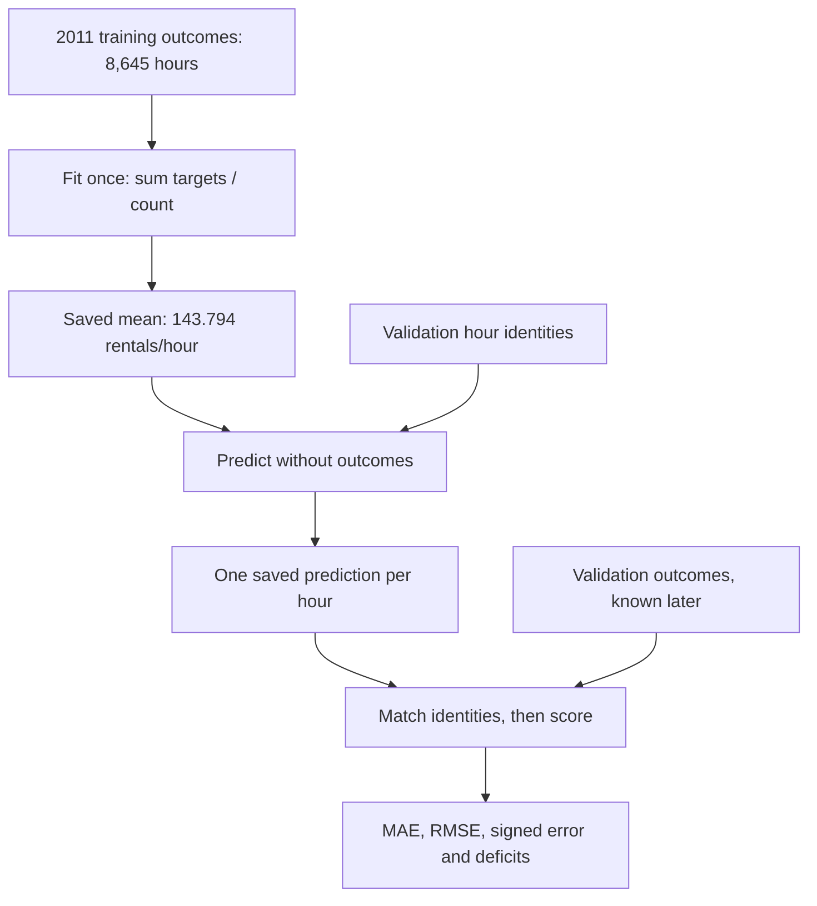
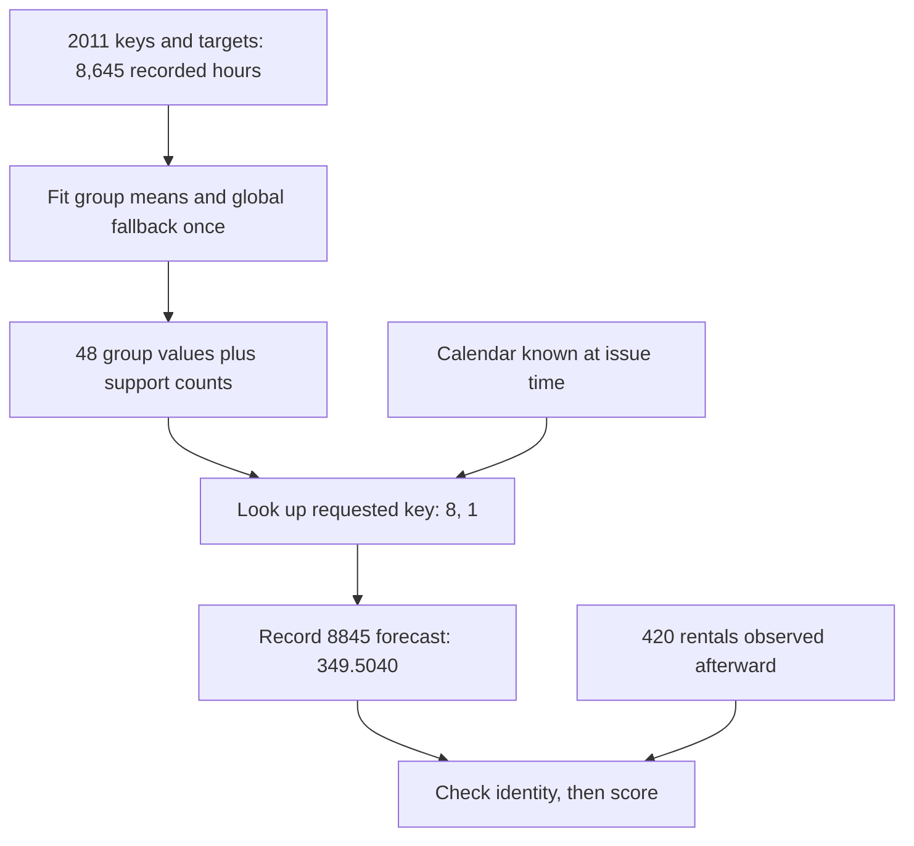

## Build and compare simple calendar predictions

The data contract is ready. Before asking a larger model to learn, fit two small references and inspect exactly which hours their error averages contain. Monday at 02:00 and Monday at 08:00 make the value and the limits of calendar grouping visible.

### Start with the hour we are trying to predict

Take Monday, 9 January 2012 at 08:00. Under the project's protocol, we issue that forecast at 07:00 for the hour beginning at 08:00. The source row is record 8845. Its eventual recorded outcome is **420 rentals**. That outcome belongs on the scoring side of the example; it does not help form the forecast issued at 07:00.

Our first model uses one constant learned from 2011. Across the 8,645 recorded training hours, the sum of `target` is 1,243,103. The fitted value is therefore:

```text
training mean = sum of training targets / training row count
              = 1,243,103 / 8,645
              = 143.79444765760556 rentals per hour
```

The training rows are the observations retained by the earlier preparation. Missing source hours have not become zero-target rows. Dividing by some imagined complete calendar grid would fit a different statistic using invented outcomes.

At 07:00, the saved model returns 143.79444765760556. It would return exactly the same number for a different supported hour. A forecast may be fractional even though the recorded count is an integer: this value is a point estimate, and we keep it unrounded for evaluation. Later presentation choices can be recorded and evaluated separately.

When the 08:00 outcome becomes available, its residual is:

```text
residual = prediction - target
         = 143.79444765760556 - 420
         = -276.2055523423944 rentals
```

The negative sign says the forecast was too low. Its absolute error is 276.2055523423944. Its squared error is approximately 76,289.5071 rentals squared. Its underprediction deficit is 276.2055523423944. These all come from the same miss; each quantity keeps a different aspect of it.

Now look at 02:00 that same Monday. Record 8839 has an issue time of 01:00 and a target of **5 rentals**. The prediction is unchanged, so its residual is `143.79444765760556 - 5 = +138.79444765760556`. We have an overprediction at the quiet hour and an underprediction at the busy hour. That is an understandable limitation of a constant model before we introduce more expressive predictors.

| Target hour | Issue time | Recorded rentals | Prediction | Prediction − target |
| --- | --- | ---: | ---: | ---: |
| 2012-01-09 02:00 | 01:00 | 5 | 143.7944 | +138.7944 |
| 2012-01-09 08:00 | 07:00 | 420 | 143.7944 | −276.2056 |

The row's calendar inputs already exist in the 45-column schema. The constant model deliberately uses no feature columns; it learns only a global level. The calendar-group continuation below gives those already-permitted calendar distinctions a role in prediction.

### Why fitting the mean solves a loss minimization problem

Call our constant prediction `c` and the training outcomes `y₁, …, yN`. Consider the mean half squared error:

```text
L(c) = (1 / 2N) Σ (c - yi)²
```

Differentiating each term gives `c - yi`, so:

```text
dL/dc = (1 / N) Σ (c - yi)
      = c - (1 / N) Σ yi
      = c - mean(training targets)
```

Setting the derivative to zero gives `c = mean(training targets)`. The second derivative is 1, so this point is the minimum. We have solved this one-parameter squared-error problem directly. There is no reason to introduce a learning rate or an iterative update just to recover a statistic we can calculate exactly.

This also connects to the earlier gradient discussion. If the constant is above the training mean, its average gradient is positive and a small gradient step decreases it. If it is below the mean, the average gradient is negative and a step increases it. The direct fit simply goes straight to the answer for this particular model family and objective.

The headline reporting metric in this project is MAE. A training median minimizes absolute error among constants, whereas the training mean minimizes squared error. We keep that distinction explicit: this first predictor is a familiar mean-based reference, and we judge it using the shared metrics. Its name does not claim it is the strongest constant under every objective.

### The fit function in the source

[baselines.py](code/src/bike_demand_planner/baselines.py) contains the fit:

```python
def fit_mean_baseline(training_targets: Sequence[float]) -> MeanBaseline:
    """The training mean minimizes squared error among constant predictors."""
    if not training_targets or any(not math.isfinite(value) or value < 0 for value in training_targets):
        raise ValueError("Expected nonempty, finite, nonnegative training targets.")
    return MeanBaseline(math.fsum(training_targets) / len(training_targets), len(training_targets))
```

The consequential line is the final one. `math.fsum` accumulates the training targets, and the denominator is the number of those targets. The returned immutable model retains both the fitted value and its training row count. The input validation makes an empty fit or a nonfinite/negative observed rental count fail visibly.

The training targets reach this function through `run_mean_baseline` and its shared runner in [evaluation.py](code/src/bike_demand_planner/evaluation.py). Its constant-fit branch performs these two operations:

```python
train, manifest = load_labelled_partition(processed_directory, "train")
model = fit_mean_baseline([row.target for row in train])
```

The runner loads validation only after this fit. More fundamentally, the model's prediction method accepts a count rather than outcomes:

```python
def predict(self, count: int) -> list[float]:
    """Repeat the fitted statistic without accepting outcomes."""
    if isinstance(count, bool) or not isinstance(count, int) or count < 0:
        raise ValueError("Prediction count must be a nonnegative integer.")
    return [self.value] * count
```

Calling `model.predict(2)` returns two copies of the saved mean. It has no argument through which the 02:00 target of 5 or the 08:00 target of 420 can alter that mean. The runner associates the returned predictions with each requested row identity, then sends those forecasts to scoring.



The top branch is the learning path; the bottom outcome branch enters only when measuring the saved forecasts. The target and issue timestamps remain attached to each row throughout. We are replaying historical hours under an explicit availability convention, rather than treating all columns in a historical CSV as information available at forecast time.

### How the error reduction works, one operation at a time

The full calculation lives in [metrics.py](code/src/bike_demand_planner/metrics.py). We first compute one residual for every aligned pair:

```python
errors = [prediction - target
          for target, prediction in zip(targets, predictions, strict=True)]
deficits = [max(-error, 0.0) for error in errors]
count = len(errors)
```

To see the denominator and each reduction clearly, use two deliberately small target/prediction pairs: targets `[10, 30]`, predictions `[12, 22]`. These are an independent arithmetic check, separate from the real validation result. The residuals are `[+2, -8]`.

MAE takes the size of each residual before averaging:

```text
MAE = (|2| + |-8|) / 2 = 10 / 2 = 5 rentals/hour
```

RMSE squares before averaging and then restores the original units with a square root:

```text
MSE  = (2² + (-8)²) / 2 = (4 + 64) / 2 = 34
RMSE = sqrt(34) = 5.830951894845301 rentals/hour
```

The squared terms make the miss of 8 contribute sixteen times as much as the miss of 2 before the square root. This is why a model with occasional larger misses can look considerably worse under RMSE than under MAE. Each gives a useful view; MAE remains the primary metric for this project.

Mean signed error preserves direction:

```text
mean signed error = (2 + (-8)) / 2 = -3 rentals/hour
```

The negative result describes average underprediction. It does not mean that each individual forecast is too low: our first residual is positive. The cancellation example makes the limitation even clearer. For targets `[10, 30]` and predictions `[20, 20]`, residuals are `[+10, -10]`. Their mean is zero, while MAE and RMSE are both 10. A zero signed mean can coexist with substantial hourly mistakes.

### Underprediction: the same numerator can answer two questions

For residuals `[+2, -8]`, the deficits are `[0, 8]`. We explicitly define the main `mean_underprediction` over **all evaluated rows**:

```text
total deficit = 0 + 8 = 8
mean_underprediction = 8 / 2 = 4 rentals/hour
```

There is one underpredicted row. Dividing by that count instead answers how much we missed on the hours where we were too low:

```text
underprediction_count = 1
mean_underprediction_when_under = 8 / 1 = 8 rentals/hour
```

Both quantities are saved under different names. If there are no underpredicted rows, the overall mean is zero and the conditional mean is `null`, since its denominator would be zero. An exact prediction counts as zero deficit and is not an underpredicted hour.

This is an error in predicted recorded rentals. A deficit in this calculation cannot by itself tell us how many customers could not find a bike or how many bikes a particular station needed. Those operational questions require other observations.

### Check which hours are being compared before calculating averages

The prepared files retain a record ID, target timestamp and forecast issue timestamp before their feature columns. The loader verifies the frozen manifest, schema and selected partition bytes, then compares the row identities with frozen membership. It accepts only `train` and `validation`; asking it for `test` fails before opening a file.

Once forecasts exist, scoring checks the identities again:

```python
def score_forecasts(rows: list[LabelledHour], forecasts: list[Forecast]) -> dict:
    """Refuse missing, reordered or duplicated predictions before reducing errors."""
    identities = [row.identity for row in rows]
    if [forecast.identity for forecast in forecasts] != identities or len(set(identities)) != len(identities):
        raise ValueError("Forecast identities must match each target row in order.")
    return regression_metrics([row.target for row in rows], [forecast.prediction for forecast in forecasts])
```

Matching array lengths alone would allow an 08:00 forecast to be scored against a 02:00 target after a row-order mistake. The explicit identity comparison rejects that error. The constant predictor would hide it numerically because every prediction is the same; later hour-dependent models would expose the mistake as incorrect metrics. We establish the check now so the evaluation path can be reused.

A saved probe reverses two forecast identities and raises:

```text
Forecast identities must match each target row in order.
```

The [probe output](evidence/03-simple-predictions-and-hourly-error-metrics/metric-and-alignment-probes.json) also retains the small metric calculations above. Our tests separately change validation targets in a tiny fixture from 16 to 1,000. The fitted training mean stays at 20 in both runs, while validation MAE changes from 4 to 980. The fixture's raw file and test export are deleted before evaluation; the run still succeeds with the required frozen training/validation artifacts. This checks the information boundary independently of the real dataset's score.

### The actual first run

Run the entry point from the project folder after data preparation:

```bash
uv run --frozen python baseline_example.py
```

The main block declares the processed-data directory and creates a new timestamped directory under ignored `runs/`. It prints the fitted mean, metric summaries and the two Monday examples. The saved result for the frozen periods is:

| Summary | Training | Validation |
| --- | ---: | ---: |
| Recorded hours | 8,645 | 4,357 |
| MAE, rentals/hour | 106.5935 | 154.2452 |
| RMSE, rentals/hour | 133.7901 | 208.1723 |
| Mean signed error, rentals/hour | approximately 0 | −71.4057 |
| Mean underprediction across all hours | 53.2967 | 112.8254 |
| Underpredicted hours | 3,524 | 2,391 |
| Mean deficit on underpredicted hours | 130.7464 | 205.5962 |

Training signed error is about `8.67e-15`, effectively zero within floating-point arithmetic. Algebraically, `sum(mean(y) - yi)` is zero on the same training rows used to calculate that mean. Training MAE is still 106.5935, so this cancellation tells us about the fitted level rather than hourly accuracy.

For validation, the constant prediction minus the validation mean equals the signed error. The validation target mean is about 215.2001, exceeding the fitted 143.7944 by 71.4057. The larger validation MAE and negative signed error describe a real weakness of this predictor on these later hours. We have not identified a unique cause: full-year 2011 and January–June 2012 also have different seasonal composition and other conditions.

There is another useful consistency check. Let `U` be mean underprediction across all rows and `O` the corresponding mean overprediction. Then `MAE = U + O`, while signed error is `O - U`. Here `U = 112.8254` and `O ≈ 41.4198`, giving MAE 154.2452 and signed error −71.4057. This connects the reported numbers without introducing a new model or metric.

An independent calculation using `statistics.mean` agrees with all saved summaries. It also verifies the training total, every prediction's identity and the saved artifact hashes. The [captured command output](evidence/03-simple-predictions-and-hourly-error-metrics/first-baseline-output.json) and [verification](evidence/03-simple-predictions-and-hourly-error-metrics/baseline-verification.json) retain full precision.

### What is saved, and why it will help the next comparison

Each new run contains:

```text
model.json                  fitted value, count and fit policy
train-predictions.csv        one aligned forecast/error row per training hour
validation-predictions.csv   one aligned forecast/error row per validation hour
run.json                    versioned identities, definitions, timings and status
```

`run.json` uses version `hourly-regression-run-v1`. It records the Git parent and actual source-file content hashes, Python/platform and dependency hashes, source data/schema/membership/manifest identities, the fit objective, prediction policy and metric definitions. The mean model records an empty list of used feature columns. It retains the shared schema identity so the upcoming feature-using models can be compared against the same prepared data.

These historical runs were captured before their source commit. Their content hashes therefore identify the exact code alongside the parent Git SHA; the completed source is now signed as `0b49c0a`. Timings are measured locally; they are not a promised runtime on another machine. A failure writes a failed receipt and its reason. An existing run directory is rejected rather than overwritten, keeping an earlier result recoverable.

The original constant-baseline chunk passed 33 unit checks. Its build inspection confirmed private docs, raw/prepared data and generated runs stay outside source/wheel exports, and an isolated wheel passed the mean/metric calculation. The current group-baseline continuation passes 38 unit checks; its evidence is linked below. These are implementation checks; our discussion records separately what the learner has actually explained.

### Use the hour and working day to choose a training mean

```video
{
  "title": "Choose a training mean for a real hour",
  "duration": 209.125,
  "src": "media/bike-group-hourly-example/video.mp4",
  "poster": "media/bike-group-hourly-example/poster.jpg",
  "captions": "media/bike-group-hourly-example/captions.vtt",
  "transcript": "media/bike-group-hourly-example/transcript.md"
}
```


Return to Monday, 9 January 2012. At 07:00 we need a forecast for the hour beginning at 08:00. The calendar already tells us that the target hour is 8 and its working-day flag is 1. We turn those two known inputs into the key `(8, 1)`. The future outcome of 420 rentals remains outside that key and outside fitting.

Instead of averaging every training hour together, select only recorded 2011 hours whose key is `(8, 1)`. There are **248** such hours and their targets sum to **86,677 rentals**. The fitted value is therefore:

```text
working-day 08:00 mean = 86,677 / 248
                       = 349.5040322580645 rentals/hour
```

This is a fitted statistic from real training data. It is not a hand-chosen weight like the earlier gradient illustration, and it is not the average of the later validation outcomes. At prediction time the saved model only needs the key. The actual call is:

```python
model.predict([(8, 1), (2, 1)])
# [349.5040322580645, 7.514644351464435]
```

The second value comes from 1,796 rentals across 239 working-day 02:00 training hours. We can now give the quiet and busy hours different predictions without an optimizer or a learning rate. After their outcomes become available, the same residual rule shows the effect:

| Monday target hour | Target, known afterward | Constant prediction | Group prediction | Constant residual | Group residual |
| --- | ---: | ---: | ---: | ---: | ---: |
| 02:00, issued 01:00 | 5 | 143.7944 | 7.5146 | +138.7944 | +2.5146 |
| 08:00, issued 07:00 | 420 | 143.7944 | 349.5040 | −276.2056 | −70.4960 |

For 08:00, subtracting 420 from 349.5040 gives −70.4960. It is still an underprediction, but much closer for this row. For 02:00, subtracting 5 from 7.5146 gives a small overprediction. Neither example proves that every validation hour improves; we check the complete validation window later in this page.

The grouping is **hour crossed with working-day status**, giving at most `24 × 2 = 48` means. It does not fit a separate Monday effect. Tuesdays through Fridays can share the same working-day group, while weekends and source holidays share the nonworking group. Month and weekday remain in the saved 45-column schema, but this particular model does not use them. That is a deliberate, readable model choice rather than a change to the dataset.

One useful changed request is 08:00 on a valid nonworking day. Its key is `(8, 0)`, supported by 115 training hours and 8,790 rentals. It returns `8,790 / 115 = 76.4348`, rather than 349.5040. We changed which group is selected; we did not refit the model or reuse the Monday target of 420. This also exposes a limitation: one flag pools holidays and ordinary weekends even when their actual behavior differs.

The group mean solves the same squared-error problem as the global mean, within a smaller set of training rows. If `G` is one group and `cG` its constant, the derivative of `Σ(cG − yi)² / (2 nG)` is `cG − mean(y in G)`. Setting it to zero gives the group mean. More parameters make a richer fitted function, even though each parameter still has a direct arithmetic solution. Mean fitting remains a squared-error choice; reporting MAE does not turn these means into medians.

### Fit the groups once and keep prediction target-free

```video
{
  "title": "Fit once, then predict from calendar keys",
  "duration": 225.083333,
  "src": "media/bike-group-fit-predict/video.mp4",
  "poster": "media/bike-group-fit-predict/poster.jpg",
  "captions": "media/bike-group-fit-predict/captions.vtt",
  "transcript": "media/bike-group-fit-predict/transcript.md"
}
```


The implementation is in [baselines.py](code/src/bike_demand_planner/baselines.py). `fit_hour_workingday_baseline` accepts training keys and training targets of equal length. It first fits the global training mean for fallback, then collects targets belonging to each key. The central source block is:

```python
fallback = fit_mean_baseline(training_targets)
grouped_targets: dict[tuple[int, int], list[float]] = {}
for key, target in zip(training_keys, training_targets, strict=True):
    _validate_group_key(key)
    grouped_targets.setdefault(key, []).append(target)
groups = tuple(
    CalendarGroupMean(hour, workingday, math.fsum(targets) / len(targets), len(targets))
    for (hour, workingday), targets in sorted(grouped_targets.items())
)
return HourWorkingDayBaseline(groups, fallback)
```

For key `(8, 1)`, the collected list has 248 values, `math.fsum` gives 86,677, and `len` supplies 248. The saved `CalendarGroupMean` retains the key, fitted value and support count. The immutable model also retains the global mean and its full training count of 8,645. Sorting makes the saved group order reproducible; it does not change the statistical fit.

In [evaluation.py](code/src/bike_demand_planner/evaluation.py), `hour_workingday_key` reads the active position in the first 24 one-hot hour columns and the named `workingday` position. It checks the 45-column length, exactly one active hour and a binary working-day flag. For the real 08:00 row, those selected values become `(8, 1)`. This is an interpretation of the frozen schema; it does not infer new categories or fit a transform. The run record lists the 24 encoded hour columns and working-day column as used features, while retaining the identity of the full schema.

The shared runner loads training and fits the chosen predictor before loading validation. Fitting consumes training targets; prediction consumes keys:

```python
def predict(self, keys: Sequence[tuple[int, int]]) -> list[float]:
    """Look up fitted groups; valid absent groups use the global training mean."""
    values = {(group.hour, group.workingday): group.value for group in self.groups}
    predictions = []
    for key in keys:
        _validate_group_key(key)
        predictions.append(values.get(key, self.fallback.value))
    return predictions
```

For `(8, 1)`, the dictionary contains 349.5040. The method returns that value without seeing 420. Calling it again does not update a count, a mean or a group. The runner attaches each prediction to the original record ID, target time and issue time, then sends the aligned forecasts to the unchanged scoring function. The model stays frozen through validation; this chunk does not introduce online learning.



The outcome arrow enters scoring, not the group lookup. That separation is the mechanism behind the information boundary. As an independent check, the integration fixture changes validation targets from 16 to 1,000 while retaining its training rows. Its fitted group model and global fallback remain identical, while validation MAE changes from 9 to 975. The fixture runs after its raw file and test export have been removed. This checks fit isolation, rather than merely trusting an API name containing “training.”

### Give an absent group a training-only fallback

```video
{
  "title": "A training-only fallback for an absent group",
  "duration": 227.25,
  "src": "media/bike-group-missing-pairs/video.mp4",
  "poster": "media/bike-group-missing-pairs/poster.jpg",
  "captions": "media/bike-group-missing-pairs/captions.vtt",
  "transcript": "media/bike-group-missing-pairs/transcript.md"
}
```


A small dataset might contain working-day 08:00 observations but no nonworking-day 02:00 observation. That requested key is valid, yet there is no fitted value for it. We declare the fallback before evaluating: return the **global mean of recorded training targets**. Validation answers never fill the missing entry. Invalid inputs, such as hour 24 or a working-day value of 2, raise an error instead of being treated as absent valid groups.

Use a deliberately small fixture so the whole calculation is visible:

| Training key | Recorded training targets | Saved group mean | Support |
| --- | --- | ---: | ---: |
| `(8, 1)` | 10, 30 | 20 | 2 |
| `(2, 1)` | 2 | 2 | 1 |
| `(8, 0)` | 100 | 100 | 1 |

There are four training rows, with total `10 + 30 + 2 + 100 = 142`. The fallback is `142 / 4 = 35.5`. It is **not** `(20 + 2 + 100) / 3 = 40.6667`, because averaging the group means equally would give a one-row group the same weight as the two-row group. The chosen fallback estimates the level across rows, preserving their original weights.

```python
model = fit_hour_workingday_baseline(
    [(8, 1), (8, 1), (2, 1), (8, 0)],
    [10, 30, 2, 100],
)
model.predict([(8, 1), (2, 0)])
# [20.0, 35.5]
```

The first key is observed and uses 20. The second is absent and uses 35.5. Repeating the second forecast does not create a new group or turn its later outcome into training data. Changing one of the original input lists after fitting also leaves the saved model unchanged; the test checks this explicitly. A more elaborate hierarchy, such as falling back to an hour-only mean, would be another modelling policy to declare and compare. It is not silently added here.

In the actual 2011 training export, all 48 valid pairs occur. Fallback usage is therefore **zero in training and zero in validation**. The real validation score measures group lookup behavior, while the small fixture establishes the absent-group policy. Both are needed: an untriggered branch in a successful real run is not evidence that the branch works.

### Compare the same validation hours and inspect the misses

```video
{
  "title": "Read the baseline comparison and its failures",
  "duration": 233.666667,
  "src": "media/bike-group-validation-review/video.mp4",
  "poster": "media/bike-group-validation-review/poster.jpg",
  "captions": "media/bike-group-validation-review/captions.vtt",
  "transcript": "media/bike-group-validation-review/transcript.md"
}
```


Run [group_baseline_example.py](code/group_baseline_example.py) from the project folder:

```bash
uv run --frozen python group_baseline_example.py
```

This produces a fresh global run and group run under one comparison directory. Both use the same 2011 training rows, the same 4,357 validation identities from January–June 2012, the same unrounded real-valued prediction policy and the same metric definitions. Both use the same shared loading/scoring/receipt path. Only the fitted predictor changes. The command verifies matching dataset and metric identities before writing `comparison.json`.

| Validation summary | Global training mean | Hour/working-day means |
| --- | ---: | ---: |
| Hours scored | 4,357 | 4,357 |
| MAE, rentals/hour | 154.2452 | **91.5729** |
| RMSE, rentals/hour | 208.1723 | **137.3900** |
| Mean signed error | −71.4057 | −72.3422 |
| Mean deficit across all hours | 112.8254 | 81.9576 |
| Underpredicted hours | 2,391 | 3,143 |
| Mean deficit when underpredicted | 205.5962 | 113.6141 |

The absolute MAE reduction is `154.2452053582 − 91.5729396191 = 62.6722657391 rentals/hour`. Dividing by the original MAE gives `62.6722657391 / 154.2452053582 × 100 = 40.6316%`. This is an improvement on this frozen development window, not a claim about reserved-test performance or every future month.

Notice that signed error is slightly more negative even though MAE and RMSE improve. The group predictor removes many large overpredictions at quiet hours, while it still underestimates many busy hours. The count of underpredicted hours rises, but their conditional mean deficit falls. Error frequency, size and average direction answer different questions. The aggregate prediction level still falls below the later observed mean; these summaries do not identify one cause such as demand growth or weather.

Training MAE falls from 106.5935 to 55.4280, and training RMSE falls from 133.7901 to 78.8394. Separate group constants include the global constant as a possible assignment, so their minimum training squared error cannot be worse under the same data and objective. That argument does not guarantee lower validation error, and it does not guarantee a lower MAE simply because the fit minimized squared error. The validation improvement above is measured evidence.

Across individual validation hours, absolute error improves on **3,323** and worsens on **1,034**, with no ties. For a concrete regression, take record 8901 at **2012-01-11 17:00**, issued at 16:00. Its working-day group predicts **394.916**, while the observed target is **134**. Its group residual is `394.916 − 134 = +260.916`; the global predictor's absolute error is only **9.7944**. The model knows a typical working-day 17:00 level, but cannot distinguish that particular day from other days with the same key. We have not established why this hour was quiet, so the explanation stops at the limitation we can observe.

Conversely, the largest group miss is record 10623 at **2012-03-23 17:00**: target **957**, group forecast **394.916**, absolute error **562.084**. That is still better than the global miss of **813.2056**, but “better” is not “accurate enough for an application.” These failures motivate later features/models and an explicit application-quality decision; they do not authorize using future outcomes or retuning on the reserved test.

The [captured comparison](evidence/03-simple-predictions-and-hourly-error-metrics/group-baseline-output.json) retains full-precision metrics, both Monday examples and the run directory. The [independent verification](evidence/03-simple-predictions-and-hourly-error-metrics/group-baseline-verification.json) recomputes all group means with exact integer fractions, checks every saved prediction/identity, recomputes metrics separately and verifies artifact hashes. Each nested run keeps `model.json`, aligned prediction CSVs and a `hourly-regression-run-v1` receipt. The group model adds all 48 values/support counts, the global fallback, grouping fields and absent-group policy; the receipt records fallback counts. The previous constant run remains preserved.

### Where we stop for this chunk

Both requested baselines, the declared fallback and their fair comparison are now implemented and checked. The final test has stayed reserved. Optimized linear-regression fitting and the application remain later work.

The useful review is to explain the route from `(8, 1)` to 349.5040, why an absent valid pair uses the row-weighted global mean, and how lower MAE can coexist with more underpredicted hours. No new learner answer is recorded yet. lesson 3 is ready for that review; lesson 4 has not started. There is no routine typing assignment before discussing the result.

[Learning points](project/learning-points/03-calendar-baselines.md) · [Comparisons](project/comparisons/03-calendar-baselines.md) · [Progress and evidence](project/implementation.md)

### Keep the reasoning beside the result

[Learning points](project/learning-points/03-calendar-baselines.md) explain what this calculation changes in our understanding. [Comparisons](project/comparisons/03-calendar-baselines.md) put the alternatives side by side. [Setup and commands](project/setup.md) and the [current completion record](project/implementation.md) give the executable project context.

[[practice:calendar-baselines-check]]

Compare the lookup with a learned additive function. Continue to [the next lesson](lessons/04-linear-regression.md) when this step is clear.
