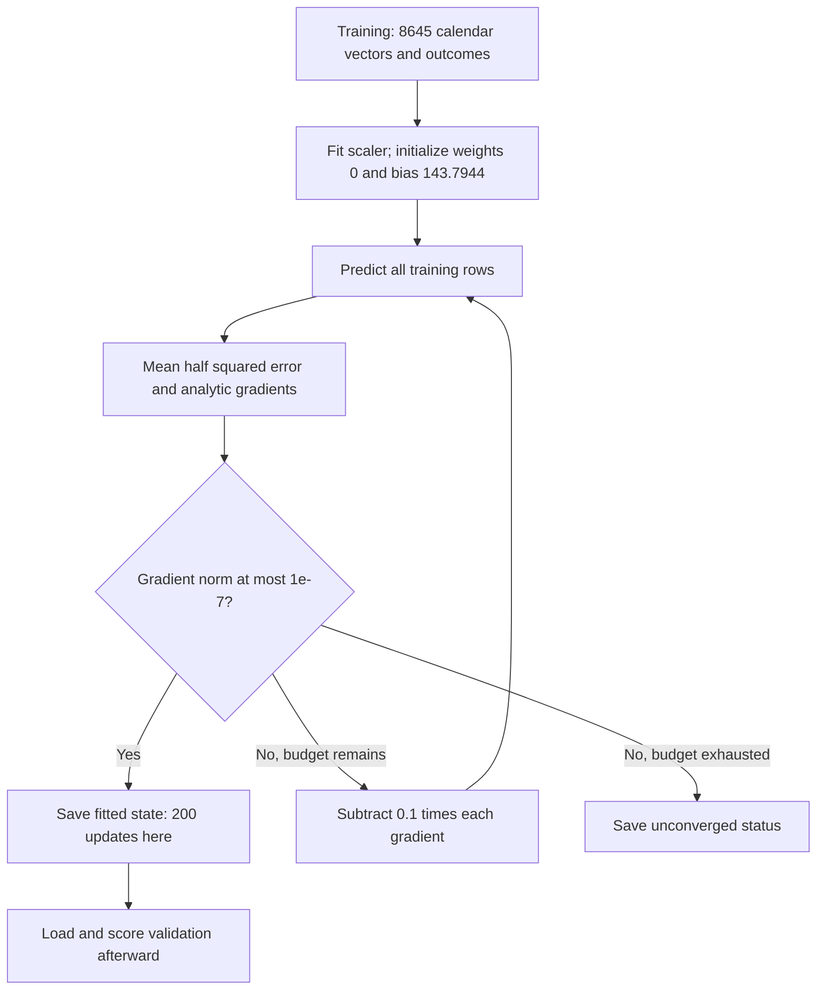
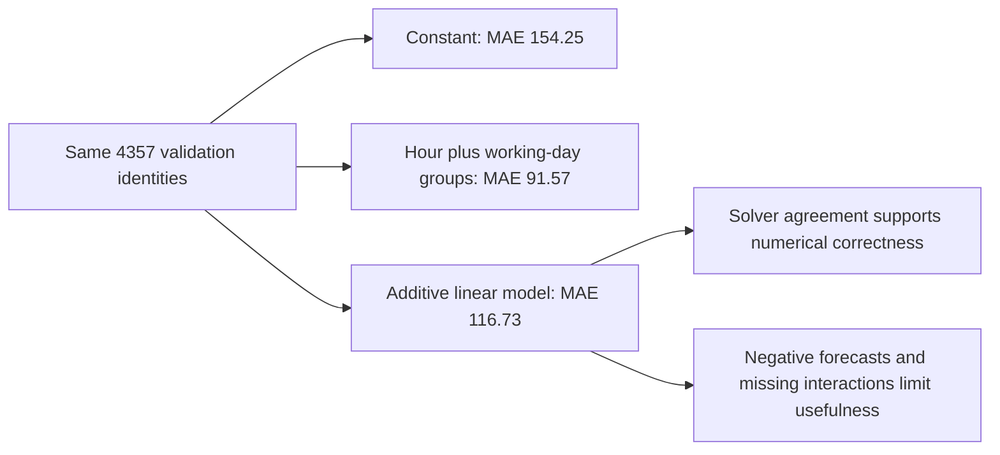

## Fit linear regression and follow its gradients

The group baseline already gives us a useful standard. This lesson asks a different function to explain the same observations: a weighted sum of calendar columns. Follow its actual updates, compare the converged function with least squares, and keep the weaker validation result visible.

### Follow Monday at eight into the linear model

```video
{
  "title": "Follow Monday at eight into the linear model",
  "duration": 233.666667,
  "src": "media/bike-linear-calendar-scaling/video.mp4",
  "poster": "media/bike-linear-calendar-scaling/poster.jpg",
  "captions": "media/bike-linear-calendar-scaling/captions.vtt",
  "transcript": "media/bike-linear-calendar-scaling/transcript.md"
}
```


Start with **Monday, 3 January 2011, 08:00**, training record **54**. Under our retained interval-start convention, the request is issued at 07:00 and predicts observed rentals during 08:00–09:00. Its recorded outcome is **154 rentals**, available after the target interval. At issue time we know the hour, weekday, month, holiday status and working-day status. We do not know the target-hour count or the observed weather.

The raw input is the same ordered 45-column vector prepared earlier. Four entries are one: `hr_08`, `weekday_01`, `mnth_01` and `workingday`. All other entries are zero, including `holiday`. Record identity and the outcome stay outside that vector. The model must receive the same feature order during fitting and prediction; a correct multiplication with the wrong column order is still a wrong forecast.

A raw-coordinate linear prediction would be:

$$
\hat y = b_{raw} + x^T w_{raw}.
$$

For this hour that reduces to an intercept plus four active coefficients. Each active coefficient contributes an additive adjustment. The model is linear in its parameters even though the original hour number has been expanded into separate indicator columns. It can learn a different adjustment for 08:00 and 02:00; it does not have to assume that one more hour always means the same change in rentals.

Our training loop uses standardized coordinates instead. For each column, fit its mean and **population** standard deviation on the 8,645 training rows:

$$
\mu_j=\frac{1}{B}\sum_i x_{ij},\qquad
s_j=\sqrt{\frac{1}{B}\sum_i(x_{ij}-\mu_j)^2},\qquad
z_{ij}=\frac{x_{ij}-\mu_j}{s_j}.
$$

For a constant column we save scale one, which maps that training column to zero without dividing by zero. No real training column is constant in this run, but the small fixtures exercise the policy. The saved calendar exports remain binary and unchanged; the scaler is separate fitted model state.

For `hr_08`, the training mean is **0.0419895894** and the scale is **0.2005653603**. Monday at eight therefore has approximately `(1 − 0.0419895894) / 0.2005653603 = 4.7766` in this standardized column. An inactive hour column becomes a negative value after centering. This is why we must not take just four standardized coefficients and add them to the standardized intercept: all centered columns participate. Use the full vector, or convert the fitted function back to raw coordinates before using only its active indicators.

The consequential implementation in [regression.py](code/src/bike_demand_planner/regression.py) is small:

```python
means = X.mean(axis=0)
scales = X.std(axis=0, ddof=0)
constants = np.flatnonzero(scales == 0)
scales[constants] = 1.0
# Prediction reuses these saved arrays; it does not fit new statistics.
Z = (X - means) / scales
predictions = Z @ weights + bias
```

`axis=0` means a separate statistic for each feature column. `ddof=0` uses the population denominator B, matching the formula above. These choices follow the [NumPy standard-deviation API](https://numpy.org/doc/2.5/reference/generated/numpy.std.html). Standardization puts gradient coordinates on more comparable scales; it does not make the indicator columns independent, add information, or change the set of linear functions representable when an intercept is included. Targets remain unscaled in rentals/hour.


The target joins the prediction when calculating a training residual; it is not an input to prediction. The same information boundary holds for validation. If next year's batch has a different frequency of 08:00 records, `predict` still uses the saved 2011 statistics. Recomputing the scaler from that batch would change the meaning of the saved weights and make the prediction depend on other requests in the batch.

### Work two batch updates with numbers we can check

```video
{
  "title": "Work two batch updates with numbers we can check",
  "duration": 283.5,
  "src": "media/bike-linear-two-updates/video.mp4",
  "poster": "media/bike-linear-two-updates/poster.jpg",
  "captions": "media/bike-linear-two-updates/captions.vtt",
  "transcript": "media/bike-linear-two-updates/transcript.md"
}
```


Before trusting 45 columns, use four illustrative rows and two features. These are arithmetic fixtures, not four bike observations. We deliberately choose unequal batch and feature counts so a transposition cannot quietly pass because the dimensions happen to be equal.

$$
X=\begin{bmatrix}1&0\\0&1\\1&1\\2&-1\end{bmatrix},\quad
y=\begin{bmatrix}5\\2\\4\\8\end{bmatrix},\quad
w=\begin{bmatrix}1\\1\end{bmatrix},\quad b=0.
$$

Here `X` has shape **[4,2]**, `w` has **[2]**, and `y` and the predictions have **[4]**. The bias is a scalar. The forward expression `X @ w + b` returns `[1, 1, 2, 1]`. For the first row, that is `1×1 + 0×1 + 0 = 1`, against target 5. With our residual convention, prediction minus target, that row's error is −4.

All four residuals are `[-4, −1, −2, −7]`. The training objective is mean half squared error:

$$
J=\frac{1}{2B}\sum_i e_i^2
 =\frac{16+1+4+49}{8}=8.75.
$$

This is a squared-error objective, with squared rental units when applied to the real problem. It is not MAE and it is not a typical hourly count. The factor one half cancels the two from differentiating a square; dividing by B averages contributions across the batch.

For a single row, differentiating through `e_i = x_i dot w + b − y_i` gives `e_i x_i` for the weights and `e_i` for the bias. Average those contributions:

$$
\nabla_w J=\frac{X^T e}{B},\qquad
\frac{\partial J}{\partial b}=\frac{\sum_i e_i}{B}.
$$

The first weight's gradient is `(−4×1 −1×0 −2×1 −7×2) / 4 = −5`. The second is `(−4×0 −1×1 −2×1 −7×(−1)) / 4 = 1`. The bias gradient is `−14 / 4 = −3.5`. The last row has a negative second feature, so its negative residual contributes **positively** to that second gradient. Gradient direction depends on both the error and the feature value.

These are the actual expressions in `loss_and_gradients` and `batch_step`:

```python
errors = X @ w + b - y
loss = float(np.dot(errors, errors) / (2 * len(y)))
weight_gradients = X.T @ errors / len(y)
bias_gradient = float(errors.mean())

new_weights = weights - learning_rate * weight_gradients
new_bias = bias - learning_rate * bias_gradient
```

At learning rate **0.1**, subtracting the gradient gives `w₁ = [1.5, 0.9]` and `b₁ = 0.35`. Recompute the predictions with those new parameters: `[1.85, 1.25, 2.75, 2.45]`. The loss falls to **5.35625**. The second update must use the new residuals, `[-3.15, −0.75, −1.25, −5.55]`; reusing the original gradient would be a different algorithm.

The new weight gradients are `[-3.875, 0.8875]`. Their bias counterpart is `(−3.15 −0.75 −1.25 −5.55) / 4 = −2.675`. Therefore:

$$
w_2=[1.8875,\;0.81125],\qquad b_2=0.6175.
$$

| State | Weights | Bias | Predictions | Mean half squared error |
| --- | --- | --- | --- | --- |
| Initial | [1, 1] | 0 | [1, 1, 2, 1] | 8.75 |
| One update | [1.5, 0.9] | 0.35 | [1.85, 1.25, 2.75, 2.45] | 5.35625 |
| Two updates | [1.8875, 0.81125] | 0.6175 | [2.505, 1.42875, 3.31625, 3.58125] | 3.3180271484 |

An independent Decimal calculation checks these values. It caught an initial hand-calculated bias expectation of 0.625; the corrected sum gives 0.6175. Central finite differences also compare the analytic derivatives with changes in a separately calculated scalar objective. The maximum measured discrepancy is **9.14×10⁻¹⁰**, comfortably below the chosen 1e-7 absolute check threshold. Known answers establish the intended calculation; finite differences check local derivative consistency. They serve different purposes.

Now change only the learning rate to **1.0** from the original parameters. The new weights are `[6,0]` and the bias is 3.5. Predictions become `[9.5,3.5,9.5,15.5]`; loss rises to **13.625**. The gradient was correct, but the step overshot. Also, duplicating all four rows leaves the **mean** loss and gradients unchanged, because both the numerator and B double. Dropping the averaging would change the effective step size whenever the batch size changed.

### Watch the real training hour move, then let the batch converge

```video
{
  "title": "Watch the real training hour move, then let the batch converge",
  "duration": 230.25,
  "src": "media/bike-linear-batch-convergence/video.mp4",
  "poster": "media/bike-linear-batch-convergence/poster.jpg",
  "captions": "media/bike-linear-batch-convergence/captions.vtt",
  "transcript": "media/bike-linear-batch-convergence/transcript.md"
}
```


Return to record 54 with target 154. On all 8,645 standardized training rows, start weights at zero and bias at the training target mean, **143.7944476576**. Every row initially receives that same baseline prediction. This makes the first learned change easy to interpret: we are asking the calendar features to explain departures from the training mean.

The first bias gradient is essentially zero because the residuals sum to zero at the mean. That does not mean every row is correct. Record 54 has residual `143.7944476576 − 154 = −10.2055523424`, while many other rows are overpredicted. With centered columns, later weight updates also leave the mean training prediction at the intercept, up to floating-point error.

For `hr_08`, the first full-batch gradient is **−24.9552606567**. At rate 0.1, its standardized weight moves from zero to **+2.4955260657**. The first January gradient is **+25.9607470900**, so that weight moves to **−2.5960747090**. These are different calendar effects learned from all training observations, not just Monday's target. The resulting full-vector prediction is:

| State | Record 54 prediction | Its prediction − target | Full-training mean half squared error |
| --- | --- | --- | --- |
| Initial | 143.7944476576 | −10.2055523424 | 8949.8974975990 |
| After one update | 147.0363379469 | −6.9636620531 | 7810.8268527493 |
| After two updates | 149.9337029894 | −4.0662970106 | 6896.3388587653 |
| Converged fit | 174.7785241786 | +20.7785241786 | 3167.5272647334 |

The first two predictions agree with the separate standard-library calculation to **6.1×10⁻¹²** rentals/hour. Notice the final row: this hour eventually becomes overpredicted, even though the whole-batch objective has fallen much further. Full-batch learning minimizes a shared objective across all rows; it does not promise that every individual residual shrinks at every update.

The actual loop in [regression.py](code/src/bike_demand_planner/regression.py) computes one full-training gradient per update:

```python
weights = np.zeros(Z.shape[1], dtype=np.float64)
bias = float(y.mean())
for step in range(max_steps + 1):
    loss, dw, db = _objective_and_gradients(Z, y, weights, bias)
    gradient_norm = float(np.hypot(np.linalg.norm(dw), db))
    history.append(OptimizationPoint(step, loss, gradient_norm))
    if gradient_norm <= gradient_tolerance:
        converged = True
        break
    if step == max_steps:
        break
    weights = weights - learning_rate * dw
    bias = bias - learning_rate * db
```

The source uses the longer names `weight_gradients` and `bias_gradient`; the shortened names here keep the same calculation in view. We use float64, a fixed learning rate of 0.1, at most 10,000 updates and a combined weight/bias gradient norm threshold of **1e-7**. Step zero is the initial objective, not an update. This run stops after **200 updates**, at gradient norm **9.7244×10⁻⁸**. The stop reason is saved explicitly; reaching the update limit would produce `converged: false`, not a claim of convergence.

The model checks a training-only stability bound before fitting. With an intercept column added to Z, let A be that design and let L be the largest eigenvalue of `A.T @ A / B`. For this quadratic objective, a positive constant step below `2/L` contracts the error in each positive-curvature direction. Here L is **2.12898**, giving a strict upper bound of approximately **0.93942**; 0.1 is inside it. This is a safety check for this full-batch quadratic, not an optimizer search or a general promise for neural networks. A smaller safe step can take more iterations; the gradient tolerance determines whether the recorded fit has actually reached our stopping condition.



Validation is first opened by [linear_evaluation.py](code/src/bike_demand_planner/linear_evaluation.py) after fitting and the reference solve. Its outcomes choose neither the scaler, initialization, updates nor stopping point. Changing validation targets in the isolation fixture changes validation metrics while leaving the complete model, training metrics and optimization record unchanged. The fixture also removes raw and test CSVs before fitting, establishing that this path does not need them.

### Check the fitted function when coefficients are not unique

```video
{
  "title": "Check the fitted function when coefficients are not unique",
  "duration": 247.833333,
  "src": "media/bike-linear-dependent-coefficients/video.mp4",
  "poster": "media/bike-linear-dependent-coefficients/poster.jpg",
  "captions": "media/bike-linear-dependent-coefficients/captions.vtt",
  "transcript": "media/bike-linear-dependent-coefficients/transcript.md"
}
```


A decreasing loss is reassuring, but a wrong gradient can sometimes still decrease it. We therefore solve the same training least-squares problem independently with a stable numerical solver. Use the same saved scaler, append a column of ones for the intercept, and solve for the combined parameters:

```python
design = np.column_stack((Z, np.ones(len(Z))))
parameters, _, rank, _ = np.linalg.lstsq(design, y, rcond=None)
```

The [NumPy least-squares API](https://numpy.org/doc/2.5/reference/generated/numpy.linalg.lstsq.html) handles rank-deficient systems and returns the effective rank. It does not require us to invert a singular normal matrix. Its returned residual-summary array can be empty for rank-deficient designs; we recompute the actual prediction errors and objective instead of interpreting an empty array as zero error.

Our design is **8,645 × 46** but has rank **42**. The full hour, weekday and month indicators each sum to an intercept column in raw coordinates. There is also a fourth dependence in these training records: `workingday` equals the sum of Monday–Friday indicators minus `holiday`. The independent audit checks that last relation on this training export; it is not an assumption about every possible calendar dataset. Standardization changes coordinates but does not remove these dependencies.

This has a practical consequence. A coefficient vector is not a unique explanation of the fitted function. In raw coordinates, adding c to every hour coefficient and subtracting c from the intercept leaves every valid one-hot-hour prediction unchanged. Both parameter sets can have the same training objective. We compare predictions and objectives, rather than requiring visually identical coefficient arrays. Agreement on observed inputs also does not establish identical behavior on arbitrary off-domain vectors.

The measured maximum prediction difference between gradient descent and the reference is **5.75×10⁻⁷** rentals/hour on training and **4.76×10⁻⁷** on validation. Both training mean half squared errors are **3167.5272647334** to the shown precision. This supports the claim that our iterative implementation reached the same fitted function on these inputs. It says nothing by itself about whether that function is useful on future hours.

To make one forecast readable, convert the model back to raw feature coordinates:

$$
w_{raw,j}=w_j/s_j,\qquad
b_{raw}=b-\sum_j\mu_jw_{raw,j}.
$$

The saved model gives this equivalent decomposition for our Monday January hour:

```text
raw intercept              143.5653872680
hour 08 adjustment        +119.5579063956
Monday adjustment           +3.7310414990
January adjustment         -92.7873014453
working-day adjustment      +0.7114904613
                         ----------------
prediction                 174.7785241786 rentals/hour
```

This is a valid calculation using the saved representation. It is not a causal account of how many rentals Monday or January creates, and those individual numbers can move under an equivalent parameterization. The conversion is checked against standardized predictions. If a feature has zero training variance, scale one protects the arithmetic, but it cannot teach the model the effect of values never observed in that column.

### Compare the forecasts and explain the failures

```video
{
  "title": "Compare the forecasts and explain the failures",
  "duration": 241.958333,
  "src": "media/bike-linear-validation-failures/video.mp4",
  "poster": "media/bike-linear-validation-failures/poster.jpg",
  "captions": "media/bike-linear-validation-failures/captions.vtt",
  "transcript": "media/bike-linear-validation-failures/transcript.md"
}
```


Now consider the later **Monday, 9 January 2012** examples from the baseline discussion. At 02:00 the recorded target is 5; at 08:00 it is 420. These are validation outcomes, not fitting inputs. All three models use identical frozen rows, one-hour issue leads, identity checks, units and metric definitions.

| Validation hour | Outcome | Global mean | Hour/working-day mean | Linear model |
| --- | --- | --- | --- | --- |
| 2012-01-09 02:00 | 5 | 143.7944 | 7.5146 | **−70.6779** |
| 2012-01-09 08:00 | 420 | 143.7944 | 349.5040 | **174.7785** |

The 2012 08:00 prediction is exactly the same as the fitted 2011 example because their 45 calendar inputs are identical. There is no year feature or demand trend in this model. Different outcomes for the same inputs cannot be separated by adjusting a deterministic function of only those inputs.

The quiet-hour prediction is impossible as a rental count. An unconstrained linear function can cross below zero when negative adjustments add up. At 02:00, residual is `−70.6779 − 5 = −75.6779`, so the absolute error is 75.6779, worse than the group model's 2.5146. We keep the raw prediction and report it. Clipping would be a different prediction policy and would require its own retained comparison; silently clipping would hide the behavior being evaluated.

| Model | Training MAE | Validation MAE | Validation RMSE | Validation mean signed error |
| --- | --- | --- | --- | --- |
| Training constant | 106.5935 | 154.2452 | 208.1723 | −71.4057 |
| Hour/working-day groups | 55.4280 | **91.5729** | **137.3900** | −72.3422 |
| Additive calendar linear model | 59.2294 | 116.7312 | 157.9791 | −95.0794 |

The linear model improves on the constant, but its validation MAE is **25.1582 rentals/hour worse** than the group predictor. It improves absolute error on 1,364 validation rows and worsens it on 2,993. Negative forecasts occur on **797 training** and **724 validation** rows; the minimum is approximately −103.4273. These are measured failures, not rounding noise.

The model families explain why “more columns” does not ensure a better result. Our linear function has separate hour, weekday, month and flag effects. Its working-day contribution shifts the whole daily curve by one constant amount, conditional on the remaining main effects. The group baseline has an independently fitted value for each `(hour, workingday)` pair, allowing its working-day versus nonworking-day difference to vary by hour. That interaction can express a commuter morning peak without requiring the same gap at 02:00. The linear model adds month/weekday information but omits that interaction; these model families are not nested.

That is a structural limitation, not evidence of a failed gradient implementation. The stable solver produces essentially the same predictions, and even training RMSE is slightly worse for linear regression: **79.5931** versus **78.8394** for groups. More iterations at the same objective will not turn an additive model into a separate curve for each day type. Interactions and alternative objectives belong to later controlled studies.

There are other limitations. Training mean demand is 143.7944; validation mean demand is approximately 215.2001. Linear validation mean prediction is approximately 120.1207, which gives signed error −95.0794. Month composition and other calendar frequencies differ across the windows, while growth or omitted conditions may also matter. These observations establish the distribution difference and underprediction; they do not identify its cause. The worst linear error is 23 March 2012 at 17:00: prediction **296.4809** against **957**, an absolute error of **660.5191**.



If we add more updates after convergence, the independent reference tells us to expect essentially the same solution. If we add hour-by-working-day interaction columns, we change the representable function and must fit and compare it separately. Those are different interventions. For now, keep the group predictor as the stronger observed validation reference and use this checked linear path as the foundation for the next study.

### Run the same calculation and inspect its evidence

From the project directory:

```bash
uv sync --frozen
OPENBLAS_NUM_THREADS=1 uv run --frozen python regression_example.py
OPENBLAS_NUM_THREADS=1 uv run --frozen python train.py
uv run --frozen python -m unittest discover -s tests -v
```

The thread setting makes these small local numerical runs predictable; it is not a change to the model. `regression_example.py` writes a fresh comparison directory with all three runs plus `updates.json` and `comparison.json`. `train.py` calls the same linear fitting/evaluation path without rerunning the baselines. Existing directories cannot be overwritten. A run that raises an error retains a failed receipt and reason; a completed run with `converged: false` is distinguishable from a converged one.

The reviewed comparison is [linear-comparison-20261019T230603269342Z](evidence/04-linear-regression-and-full-batch-learning/comparison.json). Its `linear/` folder retains `model.json`, `reference.json`, `optimization.csv`, train/validation predictions and `run.json`. The receipt records source hashes, Git state, lock hashes, Python/NumPy, configuration, frozen data identities, timings and artifact hashes. Saved raw and standardized parameters describe the fitted function; fresh-process saved-model inference and resumable optimizer state remain later work.

The [independent verification](evidence/04-linear-regression-and-full-batch-learning/independent-linear-verification.json) checks Decimal fixture arithmetic, scalar finite differences, the real first updates, all saved metrics, prediction identities, artifact hashes, unchanged frozen bytes and preserved indexes. All **48 source checks** pass. Source/wheel inspection excludes personal docs, data and runs; the installed wheel also passes an isolated numerical fit and reference comparison outside the checkout. Test outcomes remain reserved and no hosted training or learner understanding is inferred from these checks.

The most useful review question now is: **why can record 54 become overpredicted at convergence even while the full-training objective continues to decrease?** The worked batch above gives the ingredients. The next discussion can connect that answer to the weaker validation result before any optimizer study begins.

### Keep the reasoning beside the result

[Learning points](project/learning-points/04-linear-regression.md) explain what this calculation changes in our understanding. [Comparisons](project/comparisons/04-linear-regression.md) put the alternatives side by side. [Setup and commands](project/setup.md) and the [current completion record](project/implementation.md) give the executable project context.

[[practice:linear-regression-check]]

Vary the update mechanism while keeping the forecasting problem fixed. Continue to [the next lesson](lessons/05-batches-and-optimizers.md) when this step is clear.
