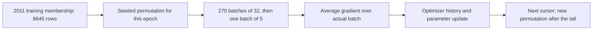
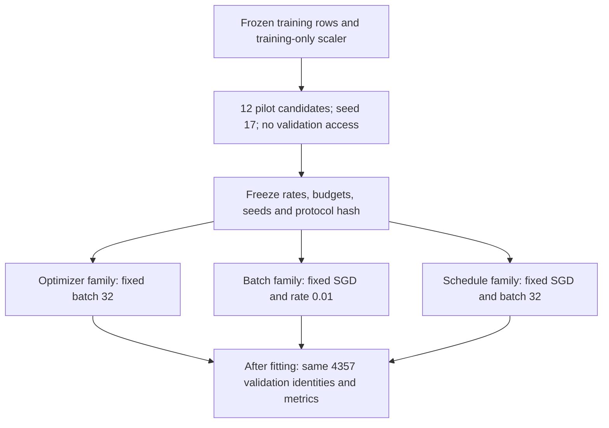
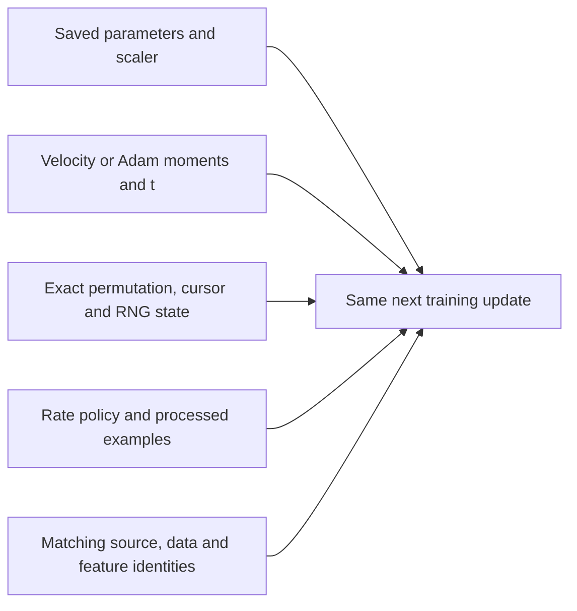

## Compare batches, momentum and Adam

The additive model has a full-batch reference solution. We can now change how it approaches that solution without changing the task. Follow the same training hour through SGD, momentum and Adam, then compare the complete runs using their actual work budgets.

### Follow the same hour through SGD and momentum

```video
{
  "title": "Follow the same hour through SGD and momentum",
  "duration": 255.708333,
  "src": "media/bike-optimizer-sgd-momentum/video.mp4",
  "poster": "media/bike-optimizer-sgd-momentum/poster.jpg",
  "captions": "media/bike-optimizer-sgd-momentum/captions.vtt",
  "transcript": "media/bike-optimizer-sgd-momentum/transcript.md"
}
```


Return to **Monday, 3 January 2011 at 08:00**, training record **54**. The request is issued at 07:00 under our retained interval-start convention; its outcome is **154 observed rentals** in 08:00–09:00. Calendar values are known in advance. The outcome joins the calculation when we calculate a training residual, after remaining separate from the inputs.

The parameters in this probe use the completed 2011 training window. We are inspecting a training calculation; we do not claim that these fitted values were available on 3 January.

The raw vector activates hour 8, Monday, January and the working-day flag. We reuse means and population scales fitted only on the 8,645 training rows. The standardized hour-8 value is **4.7765496959**. The other centered columns participate too, including columns whose raw indicators were zero. For this calculation, append the bias to the 45 weights so the optimizer receives a 46-element parameter vector, called theta. The bias gradient becomes its last entry.

We start at zero weights and bias **143.7944476576**, the training target mean. That gives this hour residual `143.7944476576 − 154 = −10.2055523424`. Its hour-8 gradient is residual times the standardized feature:

$$
g_{08}=-10.2055523424\times4.7765496959=-48.7473279374.
$$

For this opening probe, repeat **this one real row twice**, with learning rate **0.01**. This is an intentionally small arithmetic experiment. The later dataset study draws batches from all training rows, and its results must be read separately.

Plain SGD subtracts the current gradient times the rate. The first hour-8 weight becomes `0 − 0.01×(−48.7473279374) = 0.4874732794`. The bias becomes `143.7944476576 − 0.01×(−10.2055523424) = 143.8965031810`. All other weight coordinates also update. Recomputing the whole-vector forecast gives **148.3742989399**. That forecast cannot be obtained from the hour-8 coefficient alone.

The second gradient must be recomputed at the new parameters. The row now has residual **−5.6257010601**, and its hour-8 gradient is **−26.8714406879**. SGD therefore gives hour-8 weight **0.7561876863**, with a full-row forecast of **150.8988927442** after two updates.

Momentum changes what we subtract. We choose a specific convention: start velocity at zero, keep 90% of its previous value, and add the new gradient. The rate is applied after accumulating that velocity:

```python
# optimizers.py: classical momentum, without dampening
first = config.momentum * first + gradient
updated = parameters - learning_rate * first
```

The first velocity equals the first gradient, so its first prediction is identical to SGD: **148.3743**. On the second step, the hour-8 velocity is:

$$
v_{2,08}=0.9(-48.7473279374)-26.8714406879=-70.7440358315.
$$

The second hour-8 coefficient becomes `0.4874732794 − 0.01×(−70.7440358315) = 1.1949136377`. The complete forecast reaches **155.0207588983**, slightly above target 154. The remembered gradient has carried the parameter farther than the current gradient alone would.

| Repeated-row probe, rate 0.01 | Initial prediction | After one update | After two updates |
| --- | --- | --- | --- |
| SGD | 143.7944 | 148.3743 | 150.8989 |
| Momentum, coefficient 0.9 | 143.7944 | 148.3743 | 155.0208 |

The [actual optimizer source](code/src/bike_demand_planner/optimizers.py) and [runnable probe](code/optimization_example.py) use these same calculations. A separate scalar implementation reproduces all shown parameters and forecasts to floating-point precision. A four-row matrix fixture also checks two known SGD and momentum updates independently.

If the momentum coefficient were zero, the velocity would equal the current gradient at every step and this rule would reduce to SGD. With a persistent gradient and coefficient 0.9, the accumulated direction can approach ten times the gradient. This explains why equal numerical rates need not create equal movement. In our dataset pilot, momentum consequently selects a lower base rate than SGD. Overshooting the one-row target is a visible consequence of remembered direction, not evidence that the derivative was calculated incorrectly.

### Let Adam remember gradient direction and size

```video
{
  "title": "Let Adam remember gradient direction and size",
  "duration": 251.583333,
  "src": "media/bike-optimizer-adam-moments/video.mp4",
  "poster": "media/bike-optimizer-adam-moments/poster.jpg",
  "captions": "media/bike-optimizer-adam-moments/captions.vtt",
  "transcript": "media/bike-optimizer-adam-moments/transcript.md"
}
```


Adam keeps two moving averages for each parameter. One tracks the gradient, including its sign. The other tracks the squared gradient, giving a measure of its recent magnitude. That second quantity is an average of squares; it is not the variance obtained by subtracting the gradient mean. The two buffers start at zero, and the optimizer counts completed parameter updates from **t = 1**.

We use beta1 **0.9**, beta2 **0.999**, and epsilon **1e-8**, with no weight decay or AMSGrad. Our convention follows Algorithm 1 of the [original Adam paper](https://arxiv.org/pdf/1412.6980): correct both moments for zero initialization, then place epsilon **outside** the square root of the corrected second moment.

$$
m_t=0.9m_{t-1}+0.1g_t,\qquad v_t=0.999v_{t-1}+0.001g_t^2,
$$
$$
\hat m_t=\frac{m_t}{1-0.9^t},\qquad
\hat v_t=\frac{v_t}{1-0.999^t},\qquad
\theta_t=\theta_{t-1}-\alpha_t\frac{\hat m_t}{\sqrt{\hat v_t}+10^{-8}}.
$$

The short source trace shows where the update index and epsilon enter:

```python
step = state.step + 1
first = beta1 * state.first + (1 - beta1) * gradient
second = beta2 * state.second + (1 - beta2) * gradient ** 2
first_corrected = first / (1 - beta1 ** step)
second_corrected = second / (1 - beta2 ** step)
direction = first_corrected / (np.sqrt(second_corrected) + epsilon)
updated = parameters - learning_rate * direction
```

Those shortened beta/epsilon names correspond to fields of `OptimizerConfig`. The executed source keeps the configuration explicit. One update on a batch of 32 increments t by one, just as one update on a single row does; t is not the number of examples processed.

For the same real hour, the initial hour-8 gradient is still **−48.7473279374**. Its first moment becomes **−4.8747327937** and its second moment becomes **2.3763019810**. Dividing by `1 − 0.9 = 0.1` and `1 − 0.999 = 0.001` restores a corrected gradient of −48.7473 and a corrected squared magnitude of approximately 2376.302. The square root is approximately 48.7473. Their ratio is almost −1, so rate 0.01 moves this coordinate by approximately **+0.01**, rather than SGD's +0.48747.

All 46 coordinates receive their own normalized direction. The full prediction becomes **144.0248813311** after one update. Before the second, this hour's residual is **−9.9751186689**, giving hour-8 gradient **−47.6466500444**. Its new stored moments are **−9.1519245188** and **4.6441289395**. At t=2 the correction denominators are **0.19** and **0.001999**. Applying that corrected ratio moves the hour-8 coefficient from about 0.01 to **0.0199933959**. The second complete forecast is **144.2551628230**.

Adam moves less than SGD in this probe at the same rate because it divides out much of the gradient magnitude. This does not rank the algorithms. Later, the equal-allowance pilot selects Adam rate **1.0** for this unscaled rental target. A useful numerical rate belongs to an update rule and problem scale.

Two changed cases clarify details that are easy to memorize without understanding. With a tiny gradient of **1e-10**, rate 0.1 and corrected moments at the first step, our epsilon placement gives a parameter change of approximately **−0.000990099**. Placing epsilon inside the square root would give a different result. The source check calculates the expected value directly, so that convention cannot change unnoticed.

Also consider a separate one-dimensional fixture with gradients **+2, then −1**. Adam's corrected mean still points positively after the sign reversal, and its parameter moves from about −0.1 to **−0.1266337033**. Restarting its buffers at the second step would change that direction. This fixture and the real-hour calculation check changing history, rather than testing only an unchanging gradient. Stored moments and the update counter are part of the algorithm's state.

### Change the batch while keeping the time boundary intact

```video
{
  "title": "Change the batch while keeping the time boundary intact",
  "duration": 258.125,
  "src": "media/bike-optimizer-batches-work/video.mp4",
  "poster": "media/bike-optimizer-batches-work/poster.jpg",
  "captions": "media/bike-optimizer-batches-work/captions.vtt",
  "transcript": "media/bike-optimizer-batches-work/transcript.md"
}
```


The dataset still has **8,645 training rows from 2011**. Shuffling those rows changes the order of optimization work; it does not change which observations belong to training. Validation remains the frozen January–June 2012 window, and its outcomes enter only later scoring. The current calendar model has no recurrent state or lag window whose internal ordering would be broken by row shuffling.

`BatchStream` uses a NumPy PCG64 generator with an explicit seed. At the start of each epoch, it generates a fresh permutation of all training row positions. Consecutive batches take slices from that permutation without replacement. Each training row appears once per completed epoch, and the smaller final batch is retained.

```python
if self.cursor == self.count:
    self.epoch += 1
    self.order = self.rng.permutation(self.count)
    self.cursor = 0
size = min(self.batch_size, self.count - self.cursor, remaining)
indices = self.order[self.cursor:self.cursor + size].copy()
self.cursor += size
self.examples_seen += size
```

Here `remaining` represents the remaining example budget; the source also handles an unspecified budget. The source is in [optimization.py](code/src/bike_demand_planner/optimization.py). A gradient uses the actual returned rows:

$$
g_w=\frac{Z_{batch}^T e_{batch}}{B_{actual}},\qquad
 g_b=\frac{\sum e_{batch}}{B_{actual}}.
$$

For batch size 32, `8645 = 270×32 + 5`. That gives **271 updates per epoch**, with five rows in the tail. Dividing that last sum by 32 would shrink its intended mean gradient to **5/32** of its value. Dropping the tail would discard five recorded hours each epoch. We keep them and divide by five. A small constant-feature fixture checks this denominator using independent scalar arithmetic.



The arrows show the order of training work. No validation row feeds that loop. A changed seed gives another training order, while repeating a seed reproduces the same order. Independent replay checks the saved final permutation and RNG state against ten direct PCG64 permutations.

We compare batch policies using **ten passes, or 86,450 processed examples**, for every trial. The update counts differ substantially:

| SGD batch policy, rate 0.01 | Examples processed | Parameter updates | Final mean validation MAE | Mean fitting time on this machine |
| --- | --- | --- | --- | --- |
| One row | 86,450 | 86,450 | 118.0924 | 0.9792 s |
| 32 rows | 86,450 | 2,710 | 116.1661 | 0.0352 s |
| All 8,645 rows | 86,450 | 10 | 146.9448 | 0.0047 s |

These averages use paired seeds 17, 29 and 43. Fitting time covers the optimizer loop and its training monitoring, excluding data acquisition, scaler fitting, serialization and validation scoring. Tiny timings on one machine describe this run, rather than a general hardware benchmark.

The full-batch result needs context. Ten updates at 0.01 leave training half-MSE at **7859.9613**. The previous full-batch fit used rate 0.1 and 200 updates to reach approximately **3167.5273**. The full-batch method remains capable of fitting this model; our new fixed-work comparison gives it only ten small steps. Conversely, single-row SGD makes many noisy updates and has more variation across seeds: validation MAE sample standard deviation is **6.0390**, versus **0.5594** for batches of 32. Equal examples, equal updates and equal wall time are three different comparison questions.

### Freeze a fair comparison and read what it says

```video
{
  "title": "Freeze a fair comparison and read what it says",
  "duration": 298.416667,
  "src": "media/bike-optimizer-controlled-comparison/video.mp4",
  "poster": "media/bike-optimizer-controlled-comparison/poster.jpg",
  "captions": "media/bike-optimizer-controlled-comparison/captions.vtt",
  "transcript": "media/bike-optimizer-controlled-comparison/transcript.md"
}
```


We separate changes rather than making one large cross-product experiment. The optimizer comparison fixes batch size at 32, the batching comparison fixes plain SGD and rate 0.01, and the schedule comparison fixes SGD, batch 32 and its selected initial rate. Model, target, scaling, initialization, split identities and error definitions are shared throughout.

Before the main comparisons, a **single-seed training-only pilot** gives each optimizer the same four rates, **0.001, 0.01, 0.1 and 1.0**, and at most **200 updates**. It selects the lowest final **full-training half-MSE** among candidates that complete that allowance. Validation MAE does not choose a rate. We deliberately include 1.0 because normalized Adam updates need useful movement on this target scale, while the same grid also exposes excessive SGD/momentum steps.

| Pilot result at batch 32 | Selected rate | Training half-MSE after 200 updates |
| --- | --- | --- |
| SGD | 0.01 | 3271.57 |
| Momentum | 0.001 | 3254.55 |
| Adam | 1.0 | 3256.37 |

The pilot resets weights, bias and optimizer buffers for every candidate. Its rate-1.0 SGD and momentum candidates diverge and are retained as failures. The guard checks for nonfinite calculations or batch/monitored training loss above 100 times the initial full-training half-MSE, with a floor of one for that reference. SGD completes **11 updates** before the failed attempt has visited **384 examples**; momentum completes **8**, with **288 examples visited**. A failed attempt consumes work even when it does not apply another parameter update. Failed state is marked unsuitable for successful continuation, and no validation score is presented for those pilot failures.

The earlier update-cap proposal was 10,000. A ten-pass single-row trial needs 86,450 updates, so that cap would stop it after about one pass and defeat the equal-example comparison. Before the main runs, we freeze a **100,000-update safety cap**, the **300-second limit**, the ten-pass exposure budget and the three paired seeds. The pilot's measured fitting costs are only a few milliseconds per candidate, making this bounded local study feasible.

The protocol is written and hashed before any main trial or validation load:

```python
selected[kind] = min(completed_pilots,
                     key=lambda row: (row['training_half_mse'], row['rate']))['rate']
write_frozen_protocol(selected, seeds, budgets)
# Fit paired main trials using those fixed choices.
# Load validation only after the main fits have finished.
```

This shortened trace describes [optimizer_evaluation.py](code/src/bike_demand_planner/optimizer_evaluation.py); its actual JSON writing and hashing are explicit in the source. Identical configurations share a retained trial. In this run, the selected SGD rate is already 0.01, so SGD/batch-32/constant-schedule entries reuse the same per-seed result. There are **12 pilot runs and 18 unique main runs**, rather than pretending reused entries are additional independent repetitions.



The branch point prevents an apparent optimizer improvement from quietly including a new batch size or feature set. Changing validation outcomes in a small integration fixture leaves pilot choices and every saved model unchanged. Independent checks also recalculate the protocol hash, rate selection, artifact hashes, prediction identities and scalar metrics.

At batch 32, the main results after the same ten passes are:

| Rule | Base rate | Validation MAE, mean ± sample SD | Mean training half-MSE |
| --- | --- | --- | --- |
| SGD | 0.01 | 116.1661 ± 0.5594 | 3177.8966 |
| Momentum | 0.001 | 116.6027 ± 0.6582 | 3174.3066 |
| Adam | 1.0 | 114.3608 ± 2.3676 | 3297.8450 |

Adam has the lowest observed mean validation MAE in this bounded comparison, while its training objective and seed variation are larger. The model family is unchanged, and none beats the retained hour/working-day baseline's **91.5729**. Three seeded orderings provide a small reproducibility comparison; their spread is not a population confidence interval. Pilot seed 17 is also one of the three main seeds, a declared design choice rather than three entirely new tuning holdouts. We retain all results instead of picking the most flattering seed.

The hourly examples remain useful. For seed 17, SGD predicts **168.9081** for Monday 9 January 2012 at 08:00, against target **420**. Adam predicts **153.2071** for that same hour, even though it has lower validation MAE overall. At 02:00, target 5, both still produce negative forecasts. A lower average error does not promise improvement on each row. Changing the optimizer has also left the additive model's absent interaction and negative-count behavior visible.

### Reduce the rate using work already processed

```video
{
  "title": "Reduce the rate using work already processed",
  "duration": 250.833333,
  "src": "media/bike-optimizer-rate-decay/video.mp4",
  "poster": "media/bike-optimizer-rate-decay/poster.jpg",
  "captions": "media/bike-optimizer-rate-decay/captions.vtt",
  "transcript": "media/bike-optimizer-rate-decay/transcript.md"
}
```


A fixed rate keeps reacting to the noise in later batches. We compare it with one declared inverse-time schedule, holding SGD, batch size 32, initial rate **0.01**, paired orders and ten-pass budgets fixed. The schedule uses the number of examples already processed **before the next update**:

$$
\alpha(s)=\frac{0.01}{1+s/43225},\qquad43225=5\times8645.
$$

At the start, s=0 and the rate is 0.01. After five passes, s=43,225 and it becomes **0.005**. After ten passes, it would be **0.0033333333** for the next update. The saved `next_learning_rate` describes that next step; it is not a claim that another update was performed after the budget ended.

```python
rate = base_rate / (1 + examples_seen / decay_examples)
indices = stream.next_indices(remaining_examples)
# Calculate the mean gradient on indices, then apply rate.
```

Using examples keeps the progress measure explicit. A counter of 100 updates could mean 100 single observations, 3,200 mini-batch observations or 864,500 full-batch observations. The chosen schedule decays after a declared amount of training exposure. We do not sweep several schedule families or tune the decay point using validation.

| SGD at batch 32 | Mean training half-MSE | Validation MAE mean | Validation MAE sample SD |
| --- | --- | --- | --- |
| Constant rate 0.01 | 3177.8966 | 116.1661 | 0.5594 |
| Inverse-time decay | 3168.3497 | 116.5579 | 0.1221 |

Decay settles closer to the full-batch training optimum of **3167.5273** and reduces the observed seed spread. Its mean validation MAE is about **0.3919 worse** in this comparison. The three paired validation MAEs are 115.5840/116.4198 for seed 17, 116.6995/116.6515 for seed 29, and 116.2147/116.6024 for seed 43, listed constant/decayed. The direction of the change is visible without relying on a single mean.

This is a useful separation between optimization and forecasting. A smoother fit to training squared error need not improve later absolute error. The fitting loop stops at the declared example budget; it does not declare convergence because a curve looks flatter. The records also distinguish update-budget, time-budget, divergence and nonfinite stops. A different decay interval would be a new comparison, rather than an explanation added after looking at the answers.

### Save what determines the next update

```video
{
  "title": "Save what determines the next update",
  "duration": 275.75,
  "src": "media/bike-optimizer-continuation-state/video.mp4",
  "poster": "media/bike-optimizer-continuation-state/poster.jpg",
  "captions": "media/bike-optimizer-continuation-state/captions.vtt",
  "transcript": "media/bike-optimizer-continuation-state/transcript.md"
}
```


The optimizer is now a stateful calculation. A saved coefficient vector is enough to make the same forward prediction, together with the scaler and feature order, but it is insufficient to reproduce the next training step. Momentum needs its velocity. Adam needs both moment buffers and its one-based update counter. The stream needs its exact current permutation and cursor, because regenerating an epoch from its beginning would choose a different next batch.

For a concrete pause, take the four-row numerical fixture with batch size three. After one update, three examples have been visited and **one row remains in the current epoch**. The next update must use that tail row with denominator one. It must also use the optimizer history accumulated from the first batch and the saved schedule progress. Starting another random permutation immediately would silently skip the intended remainder of the epoch.

The saved state contains the coupled pieces:

```text
parameters: 45 weights plus the intercept
optimizer: rule/configuration, first buffer, second buffer, update index
batch_stream: epoch permutation, cursor, epoch count, examples seen, PCG64 state
schedule: base/decay configuration and next rate derived from examples seen
identity: source, lock/data/schema identities, scaler and feature order
```

The actual source writes [a representative state.json](evidence/05-batches-momentum-and-adam/state.json), alongside model parameters, training history, aligned predictions and the run receipt. The state header declares its version and whether the trial is suitable for continuation. Failed numerical trials remain separate from valid paused runs.



Every incoming arrow represents information that can change the next result. We test this by pausing after one update, passing the state through JSON, and continuing with the same configuration. For SGD, momentum and Adam, the resulting parameters, moment buffers, epoch order and RNG state match the uninterrupted numerical run **exactly**. Elapsed wall time naturally differs. The fitting function checks its configuration and stream dimensions; a production recovery caller must also enforce the saved source/data/scaler identities.

The changing-gradient Adam example makes a reset error visible: after gradients +2 and −1, preserved history produces parameter −0.1266337033. Treating the second step as a new optimizer would move it in another direction. Resetting only the update index while retaining the old buffers would be inconsistent with their correction factors as well.

These checks establish local algorithm-state continuation. The later application/recovery work still needs a real saved run restored in a fresh process and its supported prediction interface. We have saved the required pieces now without claiming that later integration is already complete.

### Run it and inspect the retained evidence

From the project directory:

```bash
uv sync --frozen
OPENBLAS_NUM_THREADS=1 uv run --frozen python optimization_example.py
uv run --frozen python -m unittest discover -s tests -v
```

The example writes the real-hour probe to `updates.json`, a twelve-run pilot, the hashed protocol and eighteen unique main trial folders. All inputs are declared in the script's main block. Existing run directories cannot be overwritten. The reviewed study is [optimization-20261019T234355414391Z](evidence/05-batches-momentum-and-adam/study.json); its protocol and per-trial receipts retain source/lock/data identities, task and transform policy, hardware/thread environment, optimizer settings, budgets, work counts, timings and stopping status.

The [independent verification](evidence/05-batches-momentum-and-adam/independent-study-verification.json) recomputes every saved prediction metric, checks row identities and artifact hashes, replays epoch/RNG state independently and verifies the training-only rate choices and protocol hash. It also confirms unchanged frozen non-test bytes and repository indexes. Population feature scales agree with an independent binary-column calculation within **6.91e-14**, and the real-hour probe agrees with scalar arithmetic within **1.1e-17**. All **60 source checks** pass. Personal notes, data and generated media remain ignored and excluded from source/wheel exports; isolated installed-package checks exercise the optimizer and continuation path.

The useful next discussion is why Adam's larger training squared error can coexist with lower observed validation MAE, while the group baseline remains stronger. The objective/feature studies remain in their later overview. No new learner answer or final-test outcome is inferred from the implementation or videos.

### Keep the reasoning beside the result

[Learning points](project/learning-points/05-batches-and-optimizers.md) explain what this calculation changes in our understanding. [Comparisons](project/comparisons/05-batches-and-optimizers.md) put the alternatives side by side. [Setup and commands](project/setup.md) and the [current completion record](project/implementation.md) give the executable project context.

[[practice:batches-and-optimizers-check]]

Update rules do not remove the loss and representation choices. Continue to [the next lesson](lessons/06-losses-and-calendar-structure.md) when this step is clear.
