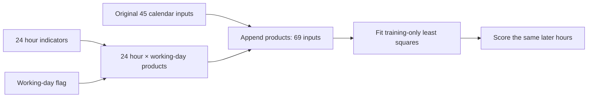
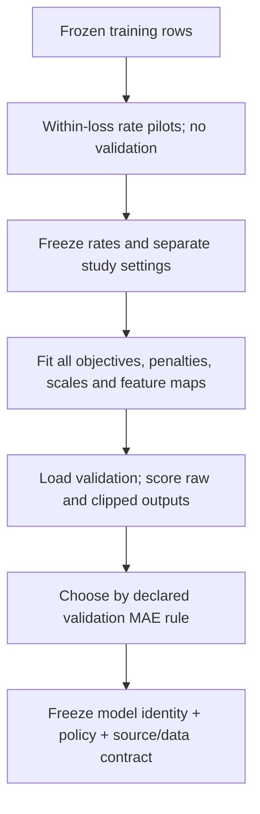
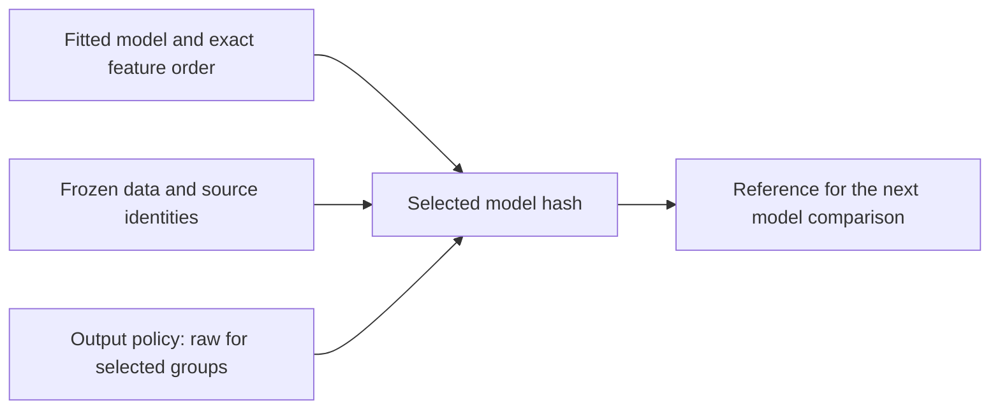

## Change the loss, regularization and calendar structure

An optimizer can only optimize the objective and representation it receives. Keep the hourly problem fixed while changing one of those choices at a time. The worked errors show why a different slope, coordinate system or calendar interaction changes the calculation.

### Follow the same hourly error through three losses

```video
{
  "title": "Follow the same hourly error through three losses",
  "duration": 246.0,
  "src": "media/bike-objectives-loss-influence/video.mp4",
  "poster": "media/bike-objectives-loss-influence/poster.jpg",
  "captions": "media/bike-objectives-loss-influence/captions.vtt",
  "transcript": "media/bike-objectives-loss-influence/transcript.md"
}
```


Return to **Monday, 3 January 2011 at 08:00**, training record **54**, whose observed target is **154 rentals** during 08:00–09:00. The request is issued at 07:00 under the retained convention. Calendar inputs are available in advance; the outcome joins a training residual afterward. The starting bias **143.7944476576** uses the completed 2011 training window. This is a training calculation, rather than a claim that those fitted statistics existed on 3 January.

With zero weights, the prediction equals that bias. Our residual convention stays prediction minus target:

$$
e=143.7944476576-154=-10.2055523424.
$$

The model is too low. A negative loss slope tells gradient descent to move its prediction upward, subject to the feature values and the other observations in the batch. The loss changes how strongly this particular miss contributes.

| Per-example calculation | Loss value | Slope with respect to prediction |
| --- | --- | --- |
| Half squared error, e²/2 | 52.0766493 | −10.2055523 |
| Absolute error, abs(e) | 10.2055523 | −1 |
| Huber, delta = 10 | 52.0555234 | −10 |

Half squared error has slope e, so a larger error contributes a proportionally larger pull. Absolute error has slope −1 or +1 away from zero; our implementation chooses **zero at an exact match**. That is a declared subgradient policy at its corner, rather than a derivative that exists there.

Huber uses a squared region near zero and a linear region beyond a threshold. Delta has the same units as the residual: rentals/hour. At delta 10, this error lies just beyond the transition. Its loss is `10 × (10.2055523424 − 5) = 52.055523424`, while its slope is capped at −10.

$$
\ell_\delta(e)=
\begin{cases}
e^2/2,& |e|\leq\delta,\\
\delta(|e|-\delta/2),& |e|>\delta.
\end{cases}
$$

The corresponding source in [objectives.py](code/src/bike_demand_planner/objectives.py) keeps the consequential branches visible:

```python
if config.kind == "half_mse":
    values, slopes = .5 * e ** 2, e.copy()
elif config.kind == "mae":
    values, slopes = np.abs(e), np.sign(e)
else:
    quadratic = np.minimum(np.abs(e), config.delta)
    values = .5 * quadratic ** 2 + config.delta * (np.abs(e) - quadratic)
    slopes = np.clip(e, -config.delta, config.delta)
```

The batch objective averages these values. Its weight gradient is `Z.T @ slopes / N`, and its intercept gradient is the slope mean. Our earlier hour-8 standardized value was 4.7765497. In a one-row calculation, multiply each shown slope by that feature to obtain the hour-8 weight gradient. Absolute error therefore pulls that coordinate about one tenth as strongly as squared error at this starting residual. A full training update combines all 8,645 rows, whose contributions can oppose one another.

Now change only the target to **454 as an illustrative counterfactual**, keeping the same prediction and vector. The residual becomes −310.2056. Squared error's slope becomes −310.2056, while MAE stays −1 and Huber10 stays −10. This is the mechanism behind reduced sensitivity to very large residuals. It does not say which objective will forecast the later period best, or identify a recorded observation as a corrupt outlier.

We compare half-MSE, MAE, Huber10 and Huber50 using the same 45 inputs, training-fitted standardization, initialization and full-batch Adam convention. Each gets rates **0.01, 0.1 and 1.0**, with **200 training-only pilot updates** per candidate. Selection is by final full-training objective **within that loss**, never by comparing MAE's numerical loss with Huber's differently scaled loss. Every loss selects rate 1.0 here. Main fits reset all state and run **2,000 updates**, with a 60-second safety limit. All finish their update allowance.

| Objective | Training data loss in its own units | Raw validation MAE | Nonnegative validation MAE |
| --- | --- | --- | --- |
| Half-MSE | 3167.5275 | 116.7294 | 109.1418 |
| MAE | 56.7591 | 117.5594 | 110.8203 |
| Huber10 | 520.6173 | 117.2829 | 110.5990 |
| Huber50 | 1899.5263 | 116.7405 | 110.5935 |

The MAE fit has lower training absolute error than the squared-error reference's **59.2294**, yet worse later absolute error. At the later Monday 08:00 example, target 420, MAE predicts **218.3283** and Huber10 **219.2912**, versus squared error's **174.7737**. Those improvements on one hour coexist with a weaker aggregate result. Raw negative quiet-hour predictions remain under all four losses.

These are bounded fits. Fixed-step Adam is not guaranteed to improve the objective monotonically: MAE's pilot ends at about 56.7566, slightly below its 2,000-step result. We do not claim an exact global MAE solution or silently choose a flattering earlier checkpoint. Finite-difference checks away from corners, explicit boundary checks and the independent study audit establish what was calculated. The [Huber definition](https://docs.pytorch.org/docs/2.14/generated/torch.nn.modules.loss.HuberLoss.html) is a useful reference for the delta-scaled linear region; this implementation uses NumPy and is not a PyTorch training wrapper or normalized Smooth L1 loss.

### Shrink weights without pulling the intercept toward zero

```video
{
  "title": "Shrink weights without pulling the intercept toward zero",
  "duration": 244.291667,
  "src": "media/bike-objectives-l2-weights/video.mp4",
  "poster": "media/bike-objectives-l2-weights/poster.jpg",
  "captions": "media/bike-objectives-l2-weights/captions.vtt",
  "transcript": "media/bike-objectives-l2-weights/transcript.md"
}
```


A different loss changes how a miss is valued. L2 changes the preference among parameter vectors, adding a cost for large weights. We isolate that question using the same standardized 45-column design and half squared error:

$$
J(w,b)=\frac{1}{N}\sum_i\frac{(z_i^Tw+b-y_i)^2}{2}
+\frac{\lambda}{2}\sum_j w_j^2.
$$

The intercept b is excluded. The data loss is a **mean**, and the penalty is **lambda/2 times the squared weight norm**, with no additional division by N. Consequently the gradient adds `lambda * weights`; the intercept gradient remains the residual mean.

For a small independent example, weights `[2, −3]` and lambda 0.2 contribute `0.2 × (4 + 9) / 2 = 1.3` to the objective. Their penalty gradients are `[0.4, −0.6]`. An intercept of 100 contributes nothing to the penalty. At zero data residuals, a rate-0.1 step shrinks the weights to `[1.96, −2.94]` while that intercept stays 100. This illustrates the penalty contribution in isolation, not a new fitted Bike model.

```python
penalty = .5 * config.l2 * float(w @ w)
total = float(values.mean()) + penalty
dw = X.T @ slopes / len(X) + config.l2 * w
db = float(slopes.mean())
```

Duplicating every training row should leave this objective unchanged: its mean data term stays the same, as does its penalty. Both the numerical-gradient checks and a duplicated-data fit check this normalization. Penalizing the bias would instead pull the overall level toward zero rentals, which is a different model preference.

To make regularization the main change, these fits use an exact training-only least-squares construction. Append penalty rows `sqrt(N*lambda) * I` for weights and zero for the intercept, then solve the augmented system stably. Dividing the augmented sum of squares by 2N yields precisely the declared objective. There is no inverse of a potentially singular normal matrix, and no extra optimizer-rate choice in this family.

| Lambda | Training half-MSE without penalty | Standardized weight norm | Raw validation MAE | Nonnegative validation MAE |
| --- | --- | --- | --- | --- |
| 0 | 3167.5273 | 105.5410 | 116.7312 | 109.1436 |
| 0.1 | 3212.1764 | 96.2645 | 115.4056 | 110.4199 |
| 1 | 4559.2240 | 53.7555 | 120.9063 | 120.9063 |
| 10 | 7912.7777 | 9.9291 | 147.3114 | 147.3114 |

Lambda 0.1 slightly improves raw MAE, but loses to lambda 0 after the declared nonnegative policy. That reversal is why output policy must accompany a model comparison. Strong penalties remove negative forecasts here while sacrificing the hourly pattern: lambda 10 predicts **123.6588** at the quiet target-5 hour and **146.7258** at the target-420 commute hour. Positive outputs alone do not establish useful demand forecasts.

The centered, unpenalized intercept remains near the training mean. As the weights are forced toward zero, this model approaches a constant prediction. Its behavior becomes understandable without treating regularization as a universal improvement. Also, this penalty is defined in **standardized coordinates**. Applying the same lambda to raw coefficients would change its meaning. We keep that alternative outside this comparison.

### Change coordinates without adding a new pattern

```video
{
  "title": "Change coordinates without adding a new pattern",
  "duration": 256.75,
  "src": "media/bike-objectives-scaling-coordinates/video.mp4",
  "poster": "media/bike-objectives-scaling-coordinates/poster.jpg",
  "captions": "media/bike-objectives-scaling-coordinates/captions.vtt",
  "transcript": "media/bike-objectives-scaling-coordinates/transcript.md"
}
```


Standardization can accelerate movement through a parameter space while leaving the unpenalized representable function unchanged. To see that distinction, keep half-MSE, no penalty, zero weights, the training-mean intercept and full-batch SGD fixed. Both raw and standardized versions get rate **0.1** and exactly **200 updates**.

The raw input for the real Monday hour has four active indicators. Standardization maps its hour-8 entry to **4.7765497** and its inactive entries to centered negative values. Weights now measure adjustment per standardized unit. The source fits these coordinates using training only and saves them beside the model; prediction reuses them without adapting to a request batch.

```python
fitted = fit_standardizer(training_features)
scaler = fitted if scaling == "standardized" else identity_scaler
Z = scaler.transform(training_features)
# Apply the same full-batch SGD rule and rate in either coordinate system.
```

Here `identity_scaler` describes the executed raw branch: stored means are zero and scales one. Constant training columns in the standardized branch use scale one. Both branches retain the same feature order and target units.

| After 200 SGD updates | Training half-MSE | Gradient norm in that coordinate system | Raw validation MAE |
| --- | --- | --- | --- |
| Raw indicators | 4114.4970 | 9.0162 | 120.6604 |
| Standardized indicators | 3167.5273 | about 9.7e-8 | 116.7312 |

At this fixed work allowance, the standardized fit is much closer to the training optimum. Gradient norms themselves depend on coordinates, so they are not an invariant distance between the two predictors. The configured stopping rule is still the update budget; a very small final gradient does not retroactively make it an early-convergence run.

We also solve training least squares in both coordinate systems. Their predictions on every observed training and validation input agree within **2.3e-12 rentals/hour**. That independent comparison shows that the raw model's weak 200-step result comes from its trajectory, rather than lost representational capacity. Dependent columns mean coefficients need not match, and coordinate-dependent minimum-norm solutions can disagree on unsupported inputs; the agreement claim here is for the checked observed inputs.

The quiet Monday example is a useful changed perspective. The unfinished raw fit predicts **4.3946**, close to target 5, while the nearly optimized standardized function predicts **−70.6779**. One hour improves under the less optimized function even though its training objective and aggregate validation MAE are worse. That reinforces the earlier distinction between an individual residual, the fitting objective and later forecast quality.

### Give the calendar a circle and inspect what it loses

```video
{
  "title": "Give the calendar a circle and inspect what it loses",
  "duration": 239.041667,
  "src": "media/bike-objectives-cyclic-calendar/video.mp4",
  "poster": "media/bike-objectives-cyclic-calendar/poster.jpg",
  "captions": "media/bike-objectives-cyclic-calendar/captions.vtt",
  "transcript": "media/bike-objectives-cyclic-calendar/transcript.md"
}
```


Hour 23 and hour 0 are adjacent on a clock. A sine/cosine pair encodes that relation without a jump at midnight:

$$
x_{\sin}=\sin(2\pi h/24),\qquad x_{\cos}=\cos(2\pi h/24).
$$

For hour 8, the values are approximately **0.8660254 and −0.5**. For hour 0 they are 0 and 1; for hour 23 they are approximately −0.2588190 and 0.9659258. The last two hours are close in this two-dimensional space. We similarly use weekday period 7 and month period 12, indexing January at zero. Three pairs plus holiday and working-day flags give **eight columns**.

```python
angle = 2 * np.pi * calendar_index / period
values.extend((np.sin(angle), np.cos(angle)))
```

The indices are recovered from the already frozen one-hot calendar vector, so this transformation needs no labels or future observations. Feature order and periods are explicit model state. Training-fitted standardization follows the transformation.

There is a subtle capacity change. The pair still distinguishes the 24 hourly positions, but a **linear** model of that pair can express only a constant plus a single sinusoidal hourly wave. It cannot assign 24 independent hourly effects. Two sharp commuting peaks are difficult to express with one wave. More harmonics or a different nonlinear learner would be another model; they are not included silently.

Both cyclic and one-hot fits use stable training least squares, no L2 and the same split:

| Representation | Inputs plus intercept | Training half-MSE | Raw validation MAE | Nonnegative validation MAE |
| --- | --- | --- | --- | --- |
| One-hot | 46 | 3167.5273 | 116.7312 | 109.1436 |
| Cyclic pairs | 9 | 4810.5088 | 115.8388 | 113.7926 |

The cyclic fit has slightly better raw MAE but worse clipped MAE and worse RMSE. At Monday 08:00, it predicts only **52.0365** against target 420. Smooth calendar geometry did not produce a useful commuting shape in this linear family. A lower dimension or a visually pleasing circle is not enough to choose it. The [scikit-learn calendar example](https://scikit-learn.org/stable/auto_examples/applications/plot_cyclical_feature_engineering.html) is an additional conceptual reference; its full pipeline and numerical benchmark differ from this frozen calendar-only experiment.

### Give working days their own hourly shape

```video
{
  "title": "Give working days their own hourly shape",
  "duration": 241.416667,
  "src": "media/bike-objectives-hour-interactions/video.mp4",
  "poster": "media/bike-objectives-hour-interactions/poster.jpg",
  "captions": "media/bike-objectives-hour-interactions/captions.vtt",
  "transcript": "media/bike-objectives-hour-interactions/transcript.md"
}
```


The earlier additive model shares one working-day adjustment across hours. Its raw-coordinate structure is an intercept, an hour effect, a weekday effect, a month effect and two flags. It cannot make the working-day difference particularly large at 08:00 and small overnight unless the inputs explicitly express that relationship.

We append **24 products**, one for each hour indicator times the working-day flag. The 45 original columns remain in place, giving 69 inputs. For the real Monday at 08:00, the new `hr_08_workingday` column at index 53 equals one; the other new products are zero.

```python
interaction_columns = X[:, :24] * X[:, 44:45]
expanded = np.column_stack((X, interaction_columns))
```

In raw coordinates, hour h can now receive `hour_effect[h] + workingday * interaction[h]`, alongside the other main effects. The working-day contrast contains the shared flag coefficient **plus an hour-specific term**. This changes which functions are representable, whereas changing Adam or scaling did not add this term. The coefficients remain dependent, so that decomposition is a representation of the function rather than a unique causal account of working days.



The arrows describe feature construction followed by fitting and evaluation. Outcomes do not feed the feature products. We use the same exact-solve policy as the one-hot and cyclic comparisons, so incomplete gradient optimization cannot explain a representational difference.

Training half-MSE falls from **3167.5273 to 1932.2748**. Raw validation MAE improves from **116.7312 to 108.6937**, and nonnegative MAE from **109.1436 to 100.5164**. At the busy Monday hour, the forecast rises from **174.7785 to 260.3130**, closer to 420. At the quiet hour it becomes **−83.6927**, worse than the original raw −70.6779. The additional flexibility does not improve every row or enforce count constraints.

The hour/working-day group baseline remains better at **91.5729 MAE**. The expanded model can represent group means, but its extra calendar main effects and fitting preferences can still generalize less well to the later period. The observed result does not prove one omitted factor caused the remaining gap. We keep the stronger reference rather than declaring the newest implementation the winner.

### Score nonnegative forecasts and freeze the next reference

```video
{
  "title": "Score nonnegative forecasts and freeze the next reference",
  "duration": 249.5,
  "src": "media/bike-objectives-output-selection/video.mp4",
  "poster": "media/bike-objectives-output-selection/poster.jpg",
  "captions": "media/bike-objectives-output-selection/captions.vtt",
  "transcript": "media/bike-objectives-output-selection/transcript.md"
}
```


All targets are nonnegative hourly counts, but an unconstrained linear function can produce negative estimates. We retain each raw output and separately score one declared policy: **max(0, prediction)**. No rounding is applied.

For the exact one-hot model at Monday 9 January 2012, 02:00, the raw prediction is **−70.6779**, against target **5**. Its absolute error is **75.6779**. Clipping gives prediction zero and error five. For the 08:00 prediction **174.7785**, clipping changes nothing, so the large target-420 deficit remains.

```python
if policy == "raw":
    return predictions.copy()
if policy == "nonnegative":
    return np.maximum(predictions, 0)
```

This improvement has a direct arithmetic reason. For p < 0 and y ≥ 0, raw absolute error is `y − p`, while the clipped error is y. Clipping reduces that row's error by −p and also cannot increase squared error. That result concerns MAE/RMSE against nonnegative targets; it does not repair the model's learned shape or reveal unobserved unmet demand.

The exact one-hot model has **724 negative validation forecasts**. Clipping reduces its MAE **116.7312 → 109.1436**. The interaction model has **751**, with MAE **108.6937 → 100.5164**. Their raw and clipped predictions have separate aligned CSVs. The same policy is applied to every row during scoring, rather than changing only a displayed chart.



Validation is deliberately used for the final development selection after all model fitting. It does not choose scaler statistics, gradients or pilot rates. We keep every candidate's score, including both policies, and use a deterministic tie rule: raw policy first, then model name. The group baseline's outputs are already nonnegative, so its policies tie and **groups/raw** wins. Its saved model hash and the protocol hash are included in [selection.json](evidence/06-losses-regularization-and-calendar-structure/selection.json).



This freezes a reference to carry forward, not an implemented serving API or an externally validated winner. The same development window has now informed several comparisons, so its scores are not an unbiased final-test claim. At this point in the build, final assessment and the saved application are still ahead; lessons 9 and 10 complete them without revising these development choices. The next review is to explain why changing a loss, shrinking weights, reparameterizing inputs and adding an interaction answer four different questions.

### Run it and inspect the retained evidence

From the project directory, `uv run --frozen python objective_example.py` prints the real-hour loss probe and creates a new versioned study. `OPENBLAS_NUM_THREADS=1 OMP_NUM_THREADS=1` fixes the BLAS thread setting used for the reviewed local run. The new code adds no dependencies. [objective_evaluation.py](code/src/bike_demand_planner/objective_evaluation.py) owns the pilot/fitting/scoring order; [objective_example.py](code/objective_example.py) owns its runnable inputs.

Each comparison retains its model, scaler/feature order, objective configuration, update or direct-solve work, stop reason, histories, raw/clipped predictions and source/config/data identities. The pilot artifacts are hashed. All 72 checks pass, including independent finite differences, corner conventions, penalty normalization, representation values, changed-validation isolation and failure/no-overwrite behavior. [Independent verification](evidence/06-losses-regularization-and-calendar-structure/independent-study-verification.json) reproduces every saved prediction and metric, the direct-solve stationarity checks and selection, while confirming frozen non-test files and all repository indexes. Passing these checks does not supply a new learner explanation or hosted recovery result.

### Keep the reasoning beside the result

[Learning points](project/learning-points/06-losses-and-calendar-structure.md) explain what this calculation changes in our understanding. [Comparisons](project/comparisons/06-losses-and-calendar-structure.md) put the alternatives side by side. [Setup and commands](project/setup.md) and the [current completion record](project/implementation.md) give the executable project context.

[[practice:losses-and-calendar-structure-check]]

Try a fitted piecewise function on the same frozen contract. Continue to [the next lesson](lessons/07-trees-and-ensembles.md) when this step is clear.
