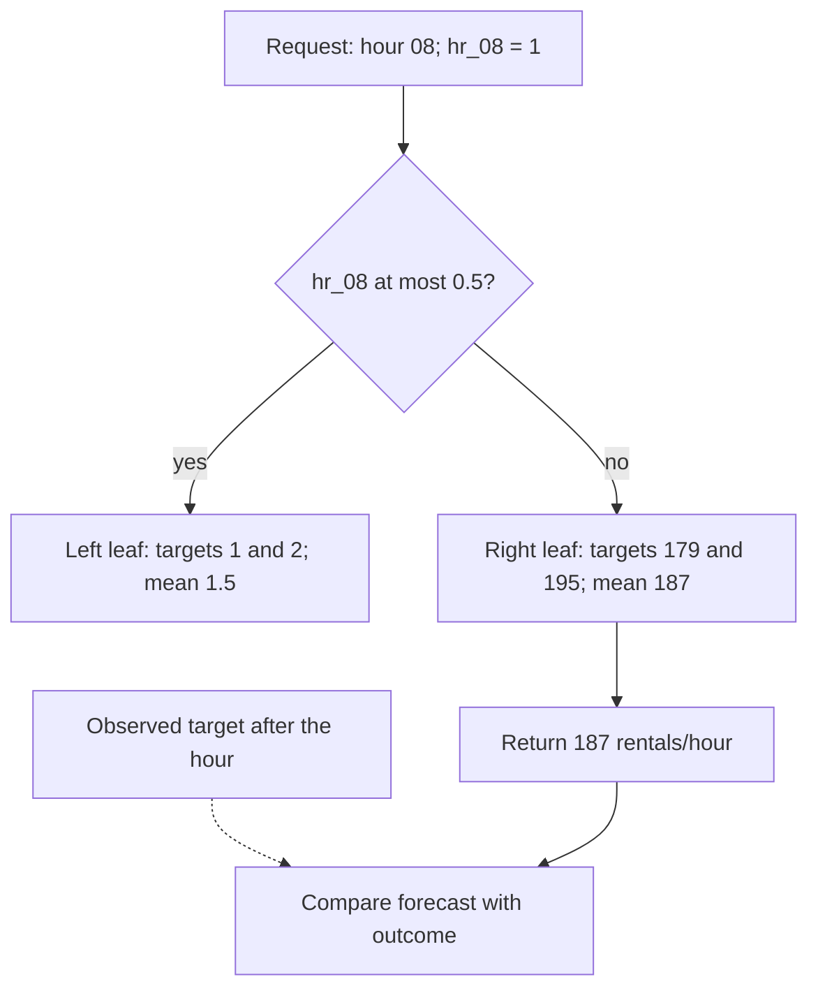
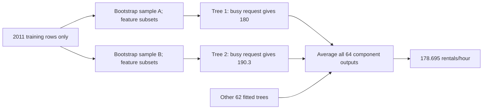

## Follow tree leaves, forests and boosted corrections

The earlier comparisons exposed an additive model’s structural limits. Trees offer a different kind of function: successive calendar questions ending at a mean. Trace a real leaf, then see what averaging trees and adding residual corrections change in the saved comparisons.

### Follow one hourly request to a leaf mean

```video
{
  "title": "Follow one hourly request to a leaf mean",
  "duration": 224.958333,
  "src": "media/bike-trees-leaf-prediction/video.mp4",
  "poster": "media/bike-trees-leaf-prediction/poster.jpg",
  "captions": "media/bike-trees-leaf-prediction/captions.vtt",
  "transcript": "media/bike-trees-leaf-prediction/transcript.md"
}
```


Begin with four real training observations. On **4 January 2011**, record 72 at **02:00** has target **1**, and record 77 at **08:00** has target **179**. On **5 January**, record 95 at 02:00 has target **2**, and record 100 at 08:00 has target **195**. These outcomes are known after their intervals. The corresponding calendar hours can be known in advance. This tiny probe uses only the declared `hr_08` indicator; the later benchmark uses all 45 frozen calendar columns.

A constant fitted on these four targets predicts their mean, **94.25 rentals/hour**, for both quiet and commuting hours. A one-split regression tree can instead ask whether `hr_08` is at most 0.5. Binary value zero takes the left branch, while one takes the right branch. For the shown observations, the two leaf means are **1.5** and **187**:

$$
\hat y_{\text{leaf}}=\frac{1}{n_{\text{leaf}}}\sum_{i\in\text{leaf}}y_i,
\qquad \hat y_{08}=\frac{179+195}{2}=187.
$$

The mean is the constant that minimizes squared error inside a fixed leaf. A tree searches candidate feature thresholds for useful reductions of that error, makes a split and continues within its resulting regions until its configured stopping conditions apply. This is a greedy construction of regions and leaf values. It is different from updating a fixed linear weight vector by SGD. The library owns that construction; our source keeps the input contract, fitted state and prediction arithmetic visible.

```python
# tree_example.py: a four-row teaching probe with one named input.
X = np.asarray([[r.features[8]] for r in chosen])
y = np.asarray([r.target for r in chosen])
stump = DecisionTreeRegressor(max_depth=1, random_state=17).fit(X, y)
quiet, busy = stump.predict([[0], [1]])  # 1.5, 187.0
```

The first output does not mean every hour other than 08:00 truly has demand 1.5. It means this deliberately restricted model sends every other hour to the leaf whose only supporting examples were 02:00 observations. Asking for 09:00 also sets this one indicator to zero and therefore returns 1.5. That changed case exposes the boundary of the tiny probe immediately. It is a mechanism demonstration, not the project's selected predictor.



The solid branches are the prediction path. The dashed outcome arrow belongs to later scoring; the target is absent from a prediction request. Fitting used historical targets to learn those leaf values, but prediction only follows saved tests and reads a saved value.

$$
\mathrm{SSE}=\sum_{L\in\mathrm{leaves}}\sum_{i\in L}(y_i-\bar y_L)^2.
$$

The total squared error over these four fitting rows falls from **34,538.75** for the constant to **128.5** for the stump. That is a training reduction on this probe, not evidence about later hours. The two busy observations still differ around their mean: each contributes 64 squared rentals, and the two quiet observations contribute 0.25 each. The [decision-tree reference](https://scikit-learn.org/stable/modules/generated/sklearn.tree.DecisionTreeRegressor.html) describes the squared-error mean-leaf convention used here.

### Let the tree grow and inspect what its smaller leaves remember

```video
{
  "title": "Let the tree grow and inspect what its smaller leaves remember",
  "duration": 243.958333,
  "src": "media/bike-trees-depth-and-support/video.mp4",
  "poster": "media/bike-trees-depth-and-support/poster.jpg",
  "captions": "media/bike-trees-depth-and-support/captions.vtt",
  "transcript": "media/bike-trees-depth-and-support/transcript.md"
}
```


The full decision-tree family receives all 45 raw binary calendar columns. It can test an hour, then a working-day flag, then a month, so a path can express interactions without us appending every product explicitly. A leaf represents the intersection of the tests on that path. This increases flexibility, but also divides the available examples among more regions.

We compare three predeclared settings: depth 3 with minimum leaf support 20; depth 8 with minimum support 10; and no explicit depth limit with minimum support 1. **Every tree is capped at 1,024 leaves**, including the last setting. That cap still bounds size when depth is unrestricted. With one-hot features, a tree can peel individual hours away through a long sequence of binary questions; depth is not a count of independent calendar variables.

```python
common = dict(max_depth=spec.max_depth,
              min_samples_leaf=spec.min_samples_leaf,
              max_leaf_nodes=1024, random_state=seed)
estimator = DecisionTreeRegressor(criterion="squared_error", **common)
estimator.fit(X, y)
```

Training sees only the frozen training vectors and targets. Trees need no learned standardizer in this comparison. sklearn uses float32 feature inputs internally; our binary zero/one values are exact in that format, while targets and retained leaf values use floating-point rental units. Snapshots save the exact feature order and thresholds. Changing the numerical representation would be another comparison, so we do not substitute ordinal hour values halfway through this one.

| Tree setting | Training MAE, seed 17 | Mean validation MAE over three seeds | Nodes, seed 17 |
| --- | --- | --- | --- |
| Depth 3, leaf support 20 | 93.7008 | 140.7420 | 13 |
| Depth 8, leaf support 10 | 67.6150 | 121.1000 | 105 |
| Up to 1,024 leaves, support 1 | 25.8294 | 99.9993 | 2,047 |

The deeper configuration improves both training and validation relative to the shallow trees. Calling that depth sweep alone proof of overfitting would be incorrect. The more revealing comparison is with the group baseline: its training MAE is **55.4280**, but its later MAE is **91.5729**, better than the much more flexible deep tree. Lower training error did not settle which function transfers better to the later period.

Follow the actual deep tree, seed 17, for **Monday, 9 January 2012 at 08:00**, whose later target is **420**. The path tests hour 17 and hour 18 first, then takes the hour-8 branch. It continues through working-day, January and weekday tests. Its reached leaf contains eight training targets: **154, 210, 188, 158, 217, 177, 157 and 185**. Their sum is **1,446**, so the stored leaf mean is **180.75**. The independent audit reconstructs that membership and arithmetic from training rows.

This is a real fitted forecast under the retained offline contract, unlike the earlier four-row probe. It misses the later busy hour by **239.25 rentals**. The broader hour/working-day mean predicts **349.5040**, missing by about **70.4960**. The finer January/weekday partition is a concrete example of fitting historical detail that does not help this later observation. It does not prove which omitted factor caused the change in demand.

Change only the requested hour to 02:00 on that same Monday. The saved tree follows another path and returns **6.5503**, close to the observed **5**. That good quiet-hour result coexists with the poor commute result and with a worse aggregate score than the group baseline. We retain both rather than selecting whichever hour supports a preferred story.

### Average varied trees without assuming their shared errors disappear

```video
{
  "title": "Average varied trees without assuming their shared errors disappear",
  "duration": 247.958333,
  "src": "media/bike-trees-forest-averaging/video.mp4",
  "poster": "media/bike-trees-forest-averaging/poster.jpg",
  "captions": "media/bike-trees-forest-averaging/captions.vtt",
  "transcript": "media/bike-trees-forest-averaging/transcript.md"
}
```


A random forest fits many trees, gives them varied training views and averages their predictions. Our forest uses **64 trees**, bootstrap sampling of training rows, **70% of features considered at each split**, and one fitting job. Each bootstrap draw has the training row count but can repeat observations and omit others. In a saved component tree, distinct supporting rows and bootstrap-weighted support are therefore different quantities.

```python
estimator = RandomForestRegressor(
    n_estimators=64, bootstrap=True, max_features=.7, n_jobs=1,
    max_depth=spec.max_depth, min_samples_leaf=spec.min_samples_leaf,
    max_leaf_nodes=1024, random_state=seed,
)
estimator.fit(X, y)
```

At the real Monday 08:00 request, the first three trees of the deepest seed-17 forest return **180.0, 190.3 and 187.5**. Those are three actual components, not the whole ensemble. All 64 leaf predictions sum to **11,436.4819**, giving the complete forest forecast:

$$
\hat y(x)=\frac{1}{64}\sum_{t=1}^{64}T_t(x)
=\frac{11436.4819}{64}\approx178.6950.
$$

The forest is slightly lower than the single tree's 180.75 for this hour and still far below target 420. Averaging different models can reduce variation due to their individual training samples and splits. It cannot guarantee removal of errors they share. As a changed case, if every tree returned 187, their mean would still be 187 regardless of whether there were three trees or sixty-four. More copies of a shared miss provide no new information.



The branches show varied fitted trees; the final arrows mean averaging, not sequential correction. None of these fitting samples includes validation outcomes. The [forest reference](https://scikit-learn.org/stable/modules/generated/sklearn.ensemble.RandomForestRegressor.html) documents the bootstrap and feature-sampling controls.

| Forest setting | Mean validation MAE | Seed MAE population SD | Training MAE, seed 17 |
| --- | --- | --- | --- |
| Depth 8, leaf support 10 | 116.6008 | 0.3355 | 67.0199 |
| Depth 16, leaf support 5 | 103.6533 | 0.1566 | 42.7665 |
| Up to 1,024 leaves/tree, support 1 | 99.7549 | 0.0553 | 26.0368 |

These are descriptive results for seeds 17, 29 and 43 on the same validation hours. The standard deviation describes algorithm variation, not a confidence interval over future dates. Seed 17's deepest forest has MAE **99.8324**; **99.7549** is the configuration's mean across all three seeds. We keep that distinction visible and retain seed 17 by prior declaration rather than selecting a lucky artifact.

A tree fitted with squared-error leaf means stays within the range of its fitting targets, and averaging such trees preserves that range. Thus these particular plain-tree and forest outputs are already nonnegative. Raw and clipped policies tie. This fact does not extend automatically to an additive boosting model whose correction leaves can be negative.

### Add successive residual corrections instead of averaging forecasts

```video
{
  "title": "Add successive residual corrections instead of averaging forecasts",
  "duration": 254.375,
  "src": "media/bike-trees-boosting-corrections/video.mp4",
  "poster": "media/bike-trees-boosting-corrections/poster.jpg",
  "captions": "media/bike-trees-boosting-corrections/captions.vtt",
  "transcript": "media/bike-trees-boosting-corrections/transcript.md"
}
```


Gradient boosting begins with an initial constant and adds fitted correction trees one at a time. For squared error, the next tree learns the residual **target minus current prediction**, which is the negative of our scoring residual convention. The direction matters: a target above the current forecast needs a positive correction.

Return to the four-row probe. Its initial constant is **94.25**. Busy-hour residuals are **84.75** and **100.75**, whose mean is **92.75**. The first residual tree stores that correction for the hour-8 branch; the quiet branch stores **−92.75**. At learning rate 0.1, the first busy prediction becomes **103.525**, and the quiet prediction becomes **84.975**:

$$
F_1(08)=94.25+0.1\times92.75=103.525.
$$

A second tree fits residuals relative to the updated forecast. Its busy-leaf correction is **83.475**, moving the result to **111.8725**. It does not keep fitting the original residual forever. The small learning rate deliberately applies part of each correction, and the number of stages determines how many such additions are made.

The actual benchmark fits the library estimator, then saves every component's numerical state. Our replay makes the aggregation rule visible:

```python
result = np.full(len(X), snapshot["initial_prediction"], dtype=np.float64)
for tree in snapshot["trees"]:
    result += snapshot["learning_rate"] * _predict_tree(tree, X)
return result
```

This is the replay of an already fitted model. The library's fitting path constructs the changing residual targets and trees; the replay neither refits them nor receives observed outcomes. Our choice is squared-error loss, full training subsampling, depth-three trees, minimum leaf support 10, learning rate 0.1 and **100, 200 or 300 stages**. Validation-based early stopping is disabled, so the configured stage count is the stopping rule. See the [boosting reference](https://scikit-learn.org/stable/modules/generated/sklearn.ensemble.GradientBoostingRegressor.html) for the stagewise estimator contract.

| Stages | Training MAE, seed 17 | Mean raw validation MAE | Mean nonnegative validation MAE |
| --- | --- | --- | --- |
| 100 | 52.0192 | 107.3085 | 106.6978 |
| 200 | 43.8255 | 106.1417 | 103.8079 |
| 300 | 39.9185 | 104.8376 | 102.2215 |

All three declared seeds give identical scores for this boosting setup. That is an observed absence of variation here, not three new validation datasets or a guarantee that all boosting configurations are deterministic.

The full 300-stage seed-17 model starts at the 2011 training mean **143.7944**. Its correction-tree values for the busy Monday sum to **747.3746**. Applying rate 0.1 gives **218.5319**, closer to target 420 than this tree or forest, but still a substantial underestimate. At 02:00, however, the same model returns **−25.5203**. Its additive corrections can leave the nonnegative target range. The explicitly scored nonnegative policy changes that forecast to zero; it does not alter the positive 08:00 forecast. Individual improvements and failures must therefore be read alongside both aggregate policies.

### Choose a development reference using quality, cost and honest evidence

```video
{
  "title": "Choose a development reference using quality, cost and honest evidence",
  "duration": 265.083333,
  "src": "media/bike-trees-comparison-choice/video.mp4",
  "poster": "media/bike-trees-comparison-choice/poster.jpg",
  "captions": "media/bike-trees-comparison-choice/captions.vtt",
  "transcript": "media/bike-trees-comparison-choice/transcript.md"
}
```


The comparison protocol is saved before any validation targets are loaded. Each tree family receives **three configurations and three declared seeds**, giving nine main fits per family. Four deterministic references—constant, groups, additive linear and interaction linear—receive one fit each. There are **27 main tree-family fits plus four references**, and **26 configuration/policy summaries** after seed aggregation. These counts describe different things and should not be interchanged.

Before the main sweep, the smallest configuration in each family is timed on the first 1,024 training rows. The pilots take about **0.001, 0.043 and 0.044 seconds** locally and only check feasibility. They choose no accuracy setting. The protocol stops expansion if a pilot exceeds five seconds; a main fit exceeding sixty seconds is marked over budget and later fits stop. These checks run after a fit returns, so they are not interruptible timeouts. Structural caps bound the actual trees. All reviewed fits complete within their settings, without warnings or failed trials.


Validation deliberately selects among already fitted candidates. It does not fit the tree splits, preprocessing or boosting residuals. Within each configuration, we average validation MAE across all declared seeds. Exact ties prefer raw outputs, then the declared order, which puts smaller configurations first within a family. The first declared seed supplies a representative model artifact. This is not an average of the three seed models and not selection of the best seed.

| Reference or best family configuration | Mean raw validation MAE | Mean nonnegative validation MAE |
| --- | --- | --- |
| Training mean | 154.2452 | 154.2452 |
| Hour/working-day means | **91.5729** | **91.5729** |
| Additive linear | 116.7312 | 109.1436 |
| Interaction linear | 108.6937 | 100.5164 |
| Deep bounded tree | 99.9993 | 99.9993 |
| Deep bounded forest | 99.7549 | 99.7549 |
| 300-stage boosting | 104.8376 | 102.2215 |

The group model remains selected with raw policy. The nonlinear families improve on the raw additive linear model, but that is not enough to replace the stronger baseline. Keeping the baseline is an actual outcome, not an unfinished experiment. It directs attention to the information and transfer limits before adding complexity again.

Cost makes the choice even clearer on this run. Seed 17's deep tree fits in about **0.023 seconds** and saves **2,047 nodes** in roughly **250 KB of JSON**. The deep forest fits in about **0.676 seconds**, saves **131,008 nodes** in **16.1 MB of JSON**, and replays the 4,357 validation requests in about **0.101 seconds**. The 300-stage booster fits in about **0.816 seconds**, saves **4,268 nodes** in about **664 KB**, and replays that validation batch in about **0.038 seconds**. These are local wall-clock observations, not production latency, peak memory or a universal library-speed ranking. Tree prediction timings measure our inspectable snapshot traversal, including state checks and calendar conversion, rather than sklearn's optimized native prediction. JSON storage bytes are not resident-memory measurements.

The selected group model is simpler and has lower measured validation error here. Repeated use of this same validation window can make development selection optimistic. The final test remains unopened, and deeper error slices belong to the next requested stage. No feature importance or path is treated as a causal explanation. Passing checks, written records and companion media also do not supply the learner's own explanation; the next conversation can examine why more precise historical leaves did not forecast the busy Monday better.

### Run the code and inspect the retained evidence

The consequential source is in [trees.py](code/src/bike_demand_planner/trees.py), [tree_evaluation.py](code/src/bike_demand_planner/tree_evaluation.py), [comparison.py](code/src/bike_demand_planner/comparison.py) and [tree_example.py](code/tree_example.py). From the project directory, run `uv sync --frozen`, then `OPENBLAS_NUM_THREADS=1 OMP_NUM_THREADS=1 uv run --frozen python tree_example.py`. This creates a new immutable run directory rather than overwriting the reviewed one. `uv run --frozen python compare.py` verifies and summarizes the latest compatible saved tree study. `uv run --frozen python -m unittest discover -s tests -v` runs the checks.

The reviewed run is `runs/trees-20261020T010936542440Z`. It retains the protocol, three pilots, all fitted snapshots, configuration/seed states, aligned raw/clipped predictions, sizes, times and selection identity. The [independent audit](evidence/07-tree-forest-and-boosting-comparisons/independent-study-verification.json) reconstructs every prediction within 1e-9, reproduces every scalar metric exactly, verifies all source/dependency/data/artifact identities and refits one representative of each family through the library API to check held-out replay. It also verifies the busy-hour leaf's eight targets and 1,446 sum. [Packaging](evidence/07-tree-forest-and-boosting-comparisons/distribution-verification.json) and [isolated-wheel checks](evidence/07-tree-forest-and-boosting-comparisons/isolated-wheel-verification.json) confirm that the installed package works without the source checkout and that private docs, data, runs and media are absent from distributions.

The earlier exploratory run is retained. Its boosting receipts exposed a deprecated library criterion argument; the final source leaves that obsolete argument at its default, repeats the same declared comparison and emits no warnings. No candidate grid or selection rule was changed in response to validation quality. That run predates the later completion commit. The completed source is now signed as `0b49c0a`; the original run and its content hashes remain unchanged.

### Keep the reasoning beside the result

[Learning points](project/learning-points/07-trees-and-ensembles.md) explain what this calculation changes in our understanding. [Comparisons](project/comparisons/07-trees-and-ensembles.md) put the alternatives side by side. [Setup and commands](project/setup.md) and the [current completion record](project/implementation.md) give the executable project context.

[[practice:trees-and-ensembles-check]]

An overall number must be unpacked into particular hours and supported requests. Continue to [the next lesson](lessons/08-residuals-and-candidate-choice.md) when this step is clear.
