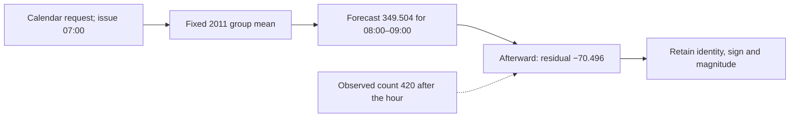
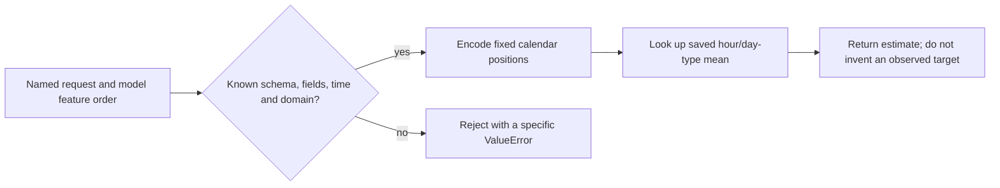
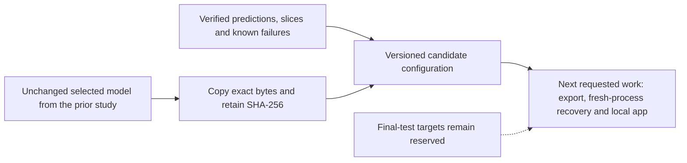

## Read hourly errors and freeze a supported candidate

There are now several fixed predictions for each validation hour. Rather than fitting another candidate, keep those predictions unchanged and inspect their signed errors, counted subsets and time order. This is where the application’s supported request contract becomes concrete.

### Read an hourly miss without losing its sign

```video
{
  "title": "Read an hourly miss without losing its sign",
  "duration": 268.208333,
  "src": "media/bike-errors-residuals/video.mp4",
  "poster": "media/bike-errors-residuals/poster.jpg",
  "captions": "media/bike-errors-residuals/captions.vtt",
  "transcript": "media/bike-errors-residuals/transcript.md"
}
```


Start with **Monday, 9 January 2012 at 08:00**, issued at 07:00 under the retained one-hour convention. The group baseline uses the completed 2011 training history for its hour-8/working-day mean, **349.5040323 rentals/hour**. The later observed count is **420**. Prediction minus target gives **−70.4959677**, an underestimate. The request did not contain the target; that number becomes available after the target interval and belongs to scoring.

Change the requested hour to **02:00** on the same Monday. Its fitted group mean is **7.5146444**, against observed count **5**, giving **+2.5146444**. This one is an overestimate. Keep those signs while also measuring their sizes:

| Real validation hour | Prediction | Observed target | Signed error | Absolute error |
| --- | --- | --- | --- | --- |
| 02:00 | 7.5146 | 5 | +2.5146 | 2.5146 |
| 08:00 | 349.5040 | 420 | −70.4960 | 70.4960 |

Across just these two observations, mean signed error is **−33.9907**, while MAE is **36.5053**. Adding the signed errors allows one direction to cancel the other; adding their magnitudes does not. Neither two-row summary replaces the full validation result. They make the residual convention concrete before we apply it to thousands of hours.

```python
error = prediction - row.target
absolute_error = abs(error)
underprediction = max(-error, 0.0)
```

The saved-result reader in [error_analysis.py](code/src/bike_demand_planner/error_analysis.py) checks record ID, target time, issue time, target value and row order before using these reductions. It also checks the exported error columns against the prediction and target. A checksum identifies a file, but does not establish that its rows belong to the right targets. An integration check deliberately reorders rows and updates the checksum; the identity check still rejects the file.



The dashed outcome arrow belongs to evaluation, not prediction. On the full **4,357 validation hours**, MAE is **91.5729**, RMSE **137.3900** and mean signed error **−72.3422**. The larger RMSE reflects stronger weighting of large misses; it is still in rentals/hour after the square root. The largest retained absolute miss is **23 March 2012 at 17:00**: forecast **394.916**, target **957**, underestimate **562.084**. That row is a real diagnostic example, not a reason to remove a difficult observation from the headline score.

The underprediction summaries answer two different questions. There are **3,143 underpredicted hours**, with total deficit **357,089.089 rentals** across those one-hour records. Dividing by all 4,357 evaluated hours gives **81.9576**; dividing only by the 3,143 underpredicted hours gives **113.6141**. There are also 1,214 overpredicted hours, contributing **9.6154** average excess across all rows. With D as total deficit, O as total excess and N as evaluated count:

$$
\mathrm{MAE}=\frac{D+O}{N}=91.5729,\qquad
\mathrm{mean\ signed\ error}=\frac{O-D}{N}=-72.3422.
$$

These are errors in observed rentals, not measured unmet demand or station shortages. The dataset does not contain enough information to turn a 70-rental underestimate into a verified inventory decision or a financial cost.


Each point is one retained validation hour. The diagonal means a perfect forecast; high-count points below it are underpredictions. Horizontal bands appear because a fixed `(hour, workingday)` pair returns one fitted mean. The picture makes a limitation visible without assigning a cause to every large count.

### Keep the denominator when you split the hours

```video
{
  "title": "Keep the denominator when you split the hours",
  "duration": 258.291667,
  "src": "media/bike-errors-counted-slices/video.mp4",
  "poster": "media/bike-errors-counted-slices/poster.jpg",
  "captions": "media/bike-errors-counted-slices/captions.vtt",
  "transcript": "media/bike-errors-counted-slices/transcript.md"
}
```


The same overall MAE can hide very different behavior during a commute and overnight. We therefore keep a concrete slice definition beside each result. Here **rush clock hours are 07, 08, 09, 16, 17 and 18**. That clock window exists on every day. The narrower **working-day rush** slice additionally requires `workingday = 1`.

There are **1,092 rush-clock observations**, with MAE **161.3814**. Of these, **750 are working-day rush hours**, whose MAE is **178.1954**. The remaining **3,607 observations outside that narrower slice** have MAE **73.5616**. Those last two populations partition the entire validation set:

$$
\mathrm{MAE}_{all}
=\frac{750\times178.1954+3607\times73.5616}{4357}
\approx91.5729.
$$

A simple average of 178.1954 and 73.5616 would give the two populations equal influence despite their different sizes. Reconstructing the full result needs their actual counts. For RMSE, reassemble the squared-error sums first, divide by total count and then take the square root; averaging slice RMSEs is generally wrong too.

```python
subset = [rows[i] for i in indices]
summary = error_summary(subset, predictions[indices])
# Each dimension must preserve the population and every error total.
assert sum(s["count"] for s in dimension.values()) == len(rows)
```

The implementation checks absolute-error, squared-error, residual, deficit and excess totals for each dimension. The independent audit verifies **686 slice summaries** across seven model/policy pairs and both partitions. Hour, day-type, month and demand-band views each partition their own population. They overlap with each other, so their counts should not be added across dimensions as though they were disjoint new observations.

| Validation month | Observed hours | Group MAE | Mean signed error |
| --- | --- | --- | --- |
| January | 740 | 39.6133 | +12.3807 |
| February | 692 | 38.5790 | −5.7006 |
| March | 743 | 88.1317 | −79.1674 |
| April | 718 | 111.6377 | −99.7863 |
| May | 744 | 126.8528 | −120.6563 |
| June | 720 | 142.9952 | −139.1326 |

Working days as a whole have MAE **88.7874** across 2,993 rows; nonworking days have **97.6851** across 1,364. That does not contradict the much larger working-day rush error: most working-day observations are outside its six rush hours. The month table also shows why a single score loses information about when the model is struggling.

Season labels need their actual coverage. In this validation window, winter contains January–February (**1,432 rows**), spring contains March–May (**2,205**) and summer contains only June (**720**). Autumn has **zero rows**, so its metrics are **undefined**, represented by null. Zero error would falsely imply observations were predicted perfectly. The month domain remains twelve positions, with July–December empty in this analysis; no test observations are borrowed to fill them.


We also inspect outcome-defined bands: observed demand below 50 has MAE **11.9504** across 1,093 hours, while demand at least 200 has MAE **168.1371** across 1,938. These bands describe failures retrospectively. The future observed target is unavailable when issuing a request, so it cannot be used to route the forecast to a model. That would turn a legitimate diagnostic into target leakage.

### Keep time order when the demand level changes

```video
{
  "title": "Keep time order when the demand level changes",
  "duration": 263.416667,
  "src": "media/bike-errors-time-and-levels/video.mp4",
  "poster": "media/bike-errors-time-and-levels/poster.jpg",
  "captions": "media/bike-errors-time-and-levels/captions.vtt",
  "transcript": "media/bike-errors-time-and-levels/transcript.md"
}
```


The month results suggest that errors are not scattered uniformly through the window. Keep the daily residual means in chronological order rather than shuffling them into an exchangeable bag. The generated figure shows mostly larger negative errors later in the period, alongside larger daily MAE. Each day uses its actual observation count.


There are **ten unrecorded hourly slots inside this validation window**. We do not insert zero targets or connect a missing observation to the next one as if it were exactly one hour later. Consecutive-hour correlation uses only pairs whose recorded timestamps differ by one hour: **4,346 pairs** here. Their residual correlation is **0.8677**.

For paired residuals a and b, correlation centers each side by its own pair mean and normalizes the cross-product:

$$
\rho=\frac{\sum_i(a_i-\bar a)(b_i-\bar b)}
{\sqrt{\sum_i(a_i-\bar a)^2\sum_i(b_i-\bar b)^2}}.
$$

This is a descriptive calculation of how neighboring errors move together. It is not a calibrated predictive interval, a causal relationship or a proof that the same correlation will persist. The saved weekly summaries similarly retain Monday-start dates and actual counts. There are 27 weekly groups with counts from 23 to 168. Their MAE ranges from **32.7497** in the full week beginning 13 February to **157.2648** in the full week beginning 4 June. The range describes those observed weeks; it is not a confidence interval for the next week.

The previous forest seed standard deviation, about 0.055 MAE units, answers a different question: how that fitting algorithm varied with its declared random seeds on these same held-out dates. Repeated seeds do not generate new future periods. Treating that small number as uncertainty over future hourly errors would discard the time structure visible here. The [time-series evaluation guidance](https://scikit-learn.org/stable/modules/cross_validation.html#time-series-split) explains why temporal order needs a distinct evaluation treatment. This review reports descriptive time summaries and does not manufacture an IID interval.

To examine level differences more carefully, compare matching **month, hour and working-day** cells in Jan–Jun 2011 and Jan–Jun 2012. For each cell, first calculate its mean from 2011 training targets. Then weight that historical mean by the number of validation observations in the same cell. With n2012,k as later cell counts and mu2011,k as historical means:

$$
\mu_{historical\ reweighted}=\frac{\sum_k n_{2012,k}\mu_{2011,k}}{\sum_k n_{2012,k}}.
$$

All **4,357 validation rows** have shared cells here; none are dropped as unmatched. The historical means, weighted to this later calendar membership, average **121.3077**. The observed later target mean is **215.2001**, leaving an observed difference of **93.8925 rentals/hour**. This diagnostic differs from the selected group forecast mean **142.8580**, because it conditions on month as well as hour and day type and uses only Jan–Jun historical cells.

```python
means = {key: math.fsum(targets) / len(targets)
         for key, targets in training_cells.items()}
# For each later row, compare its observed target with its old cell mean.
historical_value = means[(month, hour, workingday)]
```


Matching these calendar variables makes a composition-only explanation less adequate, but it does not isolate a cause. Demand growth, unmodelled weather or other changes could contribute. We have not measured their separate effects. The calendar-cell calculation is also **not another ranked forecasting candidate**: its role is to understand a failure after outcomes are known. We do not move the split, rescale targets or refit the selected predictor in response to this picture.

### Separate a valid calendar change from an unsupported request

```video
{
  "title": "Separate a valid calendar change from an unsupported request",
  "duration": 272.041667,
  "src": "media/bike-errors-input-boundary/video.mp4",
  "poster": "media/bike-errors-input-boundary/poster.jpg",
  "captions": "media/bike-errors-input-boundary/captions.vtt",
  "transcript": "media/bike-errors-input-boundary/transcript.md"
}
```


A model may be insensitive to a valid input change without the request being malformed. The selected predictor uses only hour and working-day status. The real Monday 08:00 request returns **349.5040**, supported by **248 training observations** for that pair. A Monday at the same hour on **4 June 2012** returns exactly the same value. The calendar month changed, but the selected function has no month term. That explains the invariant output; it does not prove January and June should have equal demand.

A valid **Sunday, 8 January at 08:00** uses the nonworking key and returns **76.4348**, supported by 115 training observations. The date, weekday and working-day flag change together consistently. This is a contrast between valid requests, not an estimate of a causal effect of changing one flag while holding an impossible calendar fixed. The quiet Monday request returns 7.5146 from its separate key.

A second large-miss case, identified from the retained error ranking, helps make the distinction sharper. On **Monday, 16 April 2012 at 08:00**, the source marks `holiday = 1` and `workingday = 0`. The group lookup therefore returns **76.4348**, while the observed count is **597**. The source's calendar classification does not guarantee Sunday-like rental behavior. We do not change a trusted flag afterward to get a more favorable prediction. This is a diagnostic case selected after inspecting errors, with no model or metric change.

The request validator in [review_contract.py](code/src/bike_demand_planner/review_contract.py) performs a different job. It accepts exactly four outer fields: schema version, target time, issue time and named calendar inputs. It checks the known feature order, exact hourly timestamps, one-hour lead, calendar/timestamp agreement and the fixed category domains. Holiday metadata must come from a trusted recorded or external calendar; the validator checks structure and working-day consistency, not the authority of the holiday source.

```python
features = encode_calendar(request["calendar"])
if issue != target - timedelta(hours=1):
    raise ValueError("Issue time must be exactly one hour before the target interval.")
if (hour, month, weekday) != expected_calendar_from_target:
    raise ValueError("Calendar values disagree with the target timestamp.")
```

The final tuple comparison is abbreviated here; the source exposes the exact hour, month and UCI weekday mapping. Named input-dictionary order is harmless because encoding follows the declared schema. A reordered **model feature-name list** is not harmless and is rejected: equal dimensions cannot identify a misplaced feature's meaning.



The review retains **four accepted sensitivity cases and fourteen rejected probes**. Missing hour, nonfinite value, hour 24, extra weather or outcome fields, unknown schema, inconsistent weekday/working-day flag, wrong lead, timezone-aware or non-hourly timestamp and reordered features all produce explicit rejection. Reserved-test dates and a future 2013 request are outside this candidate's supported replay domain, even if their calendar values could be encoded numerically.

That domain is the historical validation replay window, **2012-01-01 01:00 through 2012-06-30 23:00**, using the source's naive timestamp convention. The lower boundary preserves the frozen lead-time protocol. Accepting a syntactically valid hour inside the domain does not guarantee it has an observed record: missing-hour coverage is a separate question. We can discuss an estimate without assigning a fabricated zero target or adding that request to benchmark denominators. The application and saved-model serving adapter are still later work.

### Freeze the candidate together with the limits we just found

```video
{
  "title": "Freeze the candidate together with the limits we just found",
  "duration": 280.583333,
  "src": "media/bike-errors-candidate-handoff/video.mp4",
  "poster": "media/bike-errors-candidate-handoff/poster.jpg",
  "captions": "media/bike-errors-candidate-handoff/captions.vtt",
  "transcript": "media/bike-errors-candidate-handoff/transcript.md"
}
```


The original study selected groups/raw by overall validation MAE across the declared configuration comparisons. This review keeps that choice fixed while examining seven representative functions. A representative forest score belongs to one retained seed-17 artifact; it is distinct from the earlier mean across three fitting seeds.

| Retained function and output policy | Overall validation MAE | Working-day rush MAE | June MAE |
| --- | --- | --- | --- |
| Constant, raw | 154.2452 | 301.4966 | 201.1625 |
| Groups, raw | **91.5729** | **178.1954** | 142.9952 |
| Additive linear, nonnegative | 109.1436 | 225.3767 | 123.8178 |
| Interaction linear, nonnegative | 100.5164 | 191.5674 | 111.8167 |
| Deep tree, raw | 99.9829 | 207.5925 | **90.3638** |
| Deep forest, raw | 99.8324 | 207.8724 | 90.8782 |
| Boosting, nonnegative | 102.2215 | 209.9206 | 107.8505 |

This is a tradeoff, not one model winning every view. The forest and tree have much lower June error, while groups is better overall and on the defined working-day rush slice. The project's primary summary currently weights each observed validation hour equally. We have not agreed a separate operational cost function or a June-only objective. We therefore retain the prior candidate and record its later-period weakness, rather than silently changing the selection target or constructing a new slice-routed estimator.

The handoff is a versioned `candidate.json` together with `candidate-model.json`. The model copy is byte-for-byte identical to the original selected group's artifact; this review does not train it again. The configuration records its model hash, fitting source, dataset/split identities, review and source protocols, schema/feature order, used fields, units, input domain, raw floating-point output and absent-group fallback.

```python
shutil.copyfile(groups_dir / "model.json", run_directory / "candidate-model.json")
model_identity = sha256((run_directory / "candidate-model.json").read_bytes())
# candidate.json retains that identity together with its task and policies.
```

The output is neither rounded nor clipped; group means are already nonnegative. A valid group absent from training uses the saved **training-only global mean**, 143.7944 here. All 48 possible pairs are present in the real fitted artifact, so that fallback is not used by these real examples. Its independent fixture check still matters for the declared behavior. Invalid requests are rejected before lookup; fallback is not permission to repair an unknown schema or a missing field.



This original candidate receipt predates serving and recovery, so it explicitly records those as unimplemented and unverified at that point. Lesson 9 adds and checks them while preserving the earlier receipt. Its known limitations include the invariant month response, large rush-hour underprediction, unmeasured unmet demand/inventory and absence of calibrated predictive uncertainty. Those limits travel with the model identity. Passing a request probe or producing a configuration is not evidence that an operational analyst's decisions would improve.

No learner explanation is inferred from the 96 checks, written explanations or requested media. The useful review is to explain why a well-formed June request gets the January hour/day-type mean, why that can coexist with the lowest overall validation MAE, and what evidence would justify changing the intended objective. We stop here before the application/recovery work.

### Run the review and inspect the evidence

The main sources are [error_analysis.py](code/src/bike_demand_planner/error_analysis.py), [error_review.py](code/src/bike_demand_planner/error_review.py), [review_contract.py](code/src/bike_demand_planner/review_contract.py) and [error_plots.py](code/src/bike_demand_planner/error_plots.py). The [entry point](code/error_review_example.py) consumes the latest compatible saved tree study, creates a new immutable review directory and retains failures instead of overwriting existing results.

From the project directory, run `uv sync --frozen`, then `OPENBLAS_NUM_THREADS=1 OMP_NUM_THREADS=1 uv run --frozen python error_review_example.py`. A fresh checkout first needs the documented data and `tree_example.py` run. The analysis command does not refit models. Use `uv run --frozen python -m unittest discover -s tests -v` for the checks. Matplotlib 3.11.2 creates the four standalone PNG/SVG figures; generated data, runs and private records remain ignored.

The [independent audit](evidence/08-residuals-slices-and-candidate-choice/independent-review-verification.json) verifies 14 saved prediction files, all 686 slices, daily/weekly groups, gap-sensitive correlation, largest misses, calendar-level comparisons, candidate bytes and source/dependency/artifact identities. Its largest independent numerical difference is about 3.4e-16, from correlation arithmetic. [Distribution](evidence/08-residuals-slices-and-candidate-choice/distribution-verification.json) and [isolated-wheel](evidence/08-residuals-slices-and-candidate-choice/isolated-wheel-verification.json) checks verify the installed package and exclude private material. Two earlier exploratory renderings are retained; final figure review made the empty autumn category explicit and moved the level-chart legend clear of the data. No model, score or selection rule changed during those layout fixes.

### Keep the reasoning beside the result

[Learning points](project/learning-points/08-residuals-and-candidate-choice.md) explain what this calculation changes in our understanding. [Comparisons](project/comparisons/08-residuals-and-candidate-choice.md) put the alternatives side by side. [Setup and commands](project/setup.md) and the [current completion record](project/implementation.md) give the executable project context.

[[practice:residuals-and-candidate-choice-check]]

A chosen artifact needs safe reloading and a distinct prediction interface. Continue to [the next lesson](lessons/09-saved-predictions-and-recovery.md) when this step is clear.
