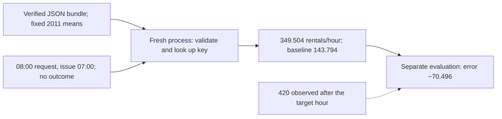
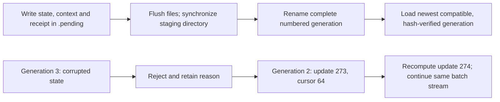
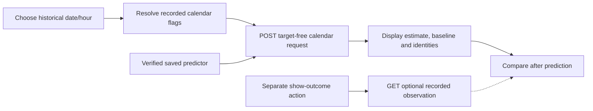

## Reload predictions and recover the next training update

A model choice is useful only if another process can recover the same function and apply the same input rules. Separate that inference problem from resuming training: the latter must also restore what determines the next update. The application keeps a forecast separate from its later recorded outcome.

### Reload the same forecast without carrying the training process

```video
{
  "title": "Reload the same forecast without carrying the training process",
  "duration": 264.375,
  "src": "media/bike-save-prediction-reload/video.mp4",
  "poster": "media/bike-save-prediction-reload/poster.jpg",
  "captions": "media/bike-save-prediction-reload/captions.vtt",
  "transcript": "media/bike-save-prediction-reload/transcript.md"
}
```


Return to **Monday, 9 January 2012 at 08:00**, issued at 07:00. Now imagine closing the Python process that fitted the model. The next process does not have its training lists, local variables or earlier function calls. It still needs to return the same **349.5040323 rentals/hour** from the saved hour-8/working-day group, whose training support is 248 observations:

$$
\widehat y_{8,1}=\frac{86{,}677}{248}=349.5040323\ \text{rentals/hour}.
$$

The later recorded outcome is 420. It explains an error of −70.4959677 when we evaluate the forecast, but it is absent from the request and from the inference bundle. A restart must preserve the fitted function and its interpretation. It must not reconstruct an answer by looking at the later outcome.

The bundle in `models/selected/` contains four JSON files with different jobs. `model.json` retains the original selected group's exact bytes. `candidate.json` retains the original schema, feature order, raw-output/fallback policy, data/protocol identities, supported domain and known limits. `calendar.json` supplies recorded holiday flags by date, without rental outcomes. `manifest.json` hashes those three members and records their producer source/dependency identity. There are **182 supported calendar dates**, from January through June of this leap year; the lower hourly boundary is still 1 January at 01:00.

The recorded calendar completes the trusted-holiday requirement from the earlier review. The request must agree with that authority as well as its own timestamp and weekday. This prevents a caller from changing a real historical working day into a holiday simply to obtain another group mean. The predictor still uses hour and working-day status; the holiday flag helps determine a consistent working-day input rather than adding a newly trained holiday coefficient.

```python
predictor = SavedPredictor(bundle_directory,
                           expected_manifest_sha256=trusted_bundle_hash)
request = predictor.request_for_target("2012-01-09T08:00:00")
result = predictor.predict(request)
```

[SavedPredictor](code/src/bike_demand_planner/saved_predictor.py) checks member hashes and the known candidate/schema contract before using fitted values. Prediction reuses the existing calendar validator and saved lookup. It fits no transform, reads no target file and mutates neither the request nor the fitted groups. The selected group model has no learned scaler to restore; its fixed 45-column schema is nevertheless retained, because matching dimensions alone would not establish matching feature meanings.



The dashed arrow belongs to evaluation. The same model can be loaded without an observations file at all. A fresh subprocess, launched from the run directory with target-free requests, reproduces **all 4,357 validation forecasts exactly**, including support, fallback and model/bundle identities. The independent audit also checks each estimate against the saved group value selected by that row's hour and working-day flag. This is stronger evidence than checking one attractive request after a restart.

Change the request to Monday 02:00 and the answer becomes 7.5146444; change it to Sunday 08:00 and it becomes 76.4347826. A Monday 08:00 request in June remains 349.5040323. Reloading has preserved both useful behavior and the existing lack of month sensitivity. It has not improved forecast quality. A valid absent training key uses the saved global mean, 143.7944477; all 48 real groups are present, so a small fixture establishes that fallback separately. Missing or malformed input is rejected before lookup.

The manifest is an identity check, not a certificate that an arbitrary producer is trustworthy. A caller with a trusted manifest hash can reject a different bundle before loading it. Recomputing checksums after changing a schema does not bypass the semantic checks. These are plain JSON artifacts from the trusted local workflow, with no executable serialized estimator to unpickle.

The original candidate and fitting provenance are preserved as historical evidence. Its earlier `serving_implemented: false` describes the review that created it. The later bundle/application preparation records the implemented adapter and verified parity. Reusing identical bundle members preserves the first export's producer identity; the new application receipt independently records the current executing source. We do not rewrite old fitting or review records to make their history look newer.

### Resume the next update with the same state and next batch

```video
{
  "title": "Resume the next update with the same state and next batch",
  "duration": 280.416667,
  "src": "media/bike-save-next-update/video.mp4",
  "poster": "media/bike-save-next-update/poster.jpg",
  "captions": "media/bike-save-next-update/captions.vtt",
  "transcript": "media/bike-save-next-update/transcript.md"
}
```


Predicting and continuing training require different saved information. The selected group model is already a completed set of means. For a concrete iterative example, use the existing 45-feature linear trainer with an intercept, training-only standardization, Adam, batch size 32 and seed 17. The declared recovery demonstration uses rate 0.01, inverse-time decay by examples and **three training passes**, with a 10,000-update/300-second safety guard. It is a continuation check, with no new validation selection or claim of convergence.

A prediction export needs the fitted parameters and transforms. This training checkpoint also needs Adam's first and second moments, update index, current epoch permutation/cursor, generator state, processed-example count, rate policy, monitoring history and stopping policy. Source/runtime/dependency, training-data, schema/order, scaler and configuration identities travel in its context. A weights-only file cannot tell us which training rows or optimizer direction should come next.

The useful pause is update **273**. The first pass through 8,645 observations requires 271 batches: 270 batches of 32 followed by a tail of 5. Two batches into the next permutation add 64 observations. The saved stream therefore has epoch index 1, cursor 64 and 8,709 processed examples. The next rate follows the saved progress:

$$
\mathrm{seen}=8645+64=8709,\qquad
\eta_{next}=\frac{0.01}{1+8709/8645}=0.004981560447.
$$

The next batch contains 32 **training-row positions**, beginning 3156, 3250, 6488, 2764 and 7957. Those positions are not raw record IDs. Preserving a seed alone would restart random-number consumption and does not identify this cursor or the generator state needed for a later epoch. The saved permutation supplies the current batch; the saved PCG64 state supplies the next shuffle.

```python
saved, receipt = load_generation(generation_directory, expected_context)
scaler = FeatureStandardizer(**expected_context["standardizer"])
Z = scaler.transform(training_features)
continued = fit_trial(Z, targets, configuration,
                      continuation=saved["trainer_state"])
```

The [recovery worker](code/src/bike_demand_planner/recovery.py) loads the frozen training partition, verifies its context and reuses the saved means/scales. It does not fit them again during resume. The same [fit_trial](code/src/bike_demand_planner/optimization.py) performs uninterrupted and resumed updates. The saved state is checked against the expected source/data/schema/config/runtime, rather than accepted because its vectors happen to have 46 positions.

Now inspect the hour-8 coefficient at the first resumed update. These are **standardized-feature parameters**; they are not the group baseline's 349.504 estimate. The old weight is 1.1941539882. The next batch gives gradient −54.0642608931, with saved Adam moments −30.5755004649 and 459.6098165223. Carry the moments into update 274:

$$
m_{274}=0.9(-30.5755004649)+0.1(-54.0642608931)=-32.9243765077,
\qquad v_{274}=0.999(459.6098165223)+0.001(-54.0642608931)^2=462.0731510117.
$$

Correcting by the retained update index gives first moment −32.9243765077 and second moment 1927.1343482999. The first correction is almost unchanged this late because 0.9 to power 274 is tiny; the second correction still matters. With epsilon outside the square root, the actual weight update is:

$$
w'_{8}=1.1941539882-0.004981560447\,
\frac{-32.9243765077}{\sqrt{1927.1343482999}+10^{-8}}
=1.1978901611.
$$

The weight goes up because the carried, corrected direction is negative and the optimizer subtracts it. In another batch, a new gradient can disagree with the momentum history, so the last gradient's sign alone is not a complete account of Adam's move. The independent audit reconstructs this batch gradient, moments, rate and weight update from the saved state and training rows.

After restarting, the demonstration reaches **813 updates and 25,935 examples**, with final training half-MSE **7782.1557832**. Parameters, both moment vectors, update index, permutation/cursor/RNG and schedule match the uninterrupted run exactly. The exact next batch and common monitoring observations match too. Extra pause observations remain in the resumed monitoring history; they did not control early stopping, which is disabled here. Wall-clock fields differ and are excluded from numerical parity. The ample time guard was not the active stopping condition.

For a changed case, zero both Adam moment vectors at the pause while retaining the same parameters, update index, batch order and remaining budget. The final parameters now differ by up to **1.0029187** in standardized parameter coordinates. This is a deliberately altered-state control, not another candidate or a validation result. It shows why retaining only weights and data order fails to reproduce training. Exact continuation also does not make this short run a good forecaster: it is far from the previously solved training optimum and does not replace the selected group baseline.

### Recover from a damaged save without hiding the fallback

```video
{
  "title": "Recover from a damaged save without hiding the fallback",
  "duration": 275.166667,
  "src": "media/bike-save-generation-fallback/video.mp4",
  "poster": "media/bike-save-generation-fallback/poster.jpg",
  "captions": "media/bike-save-generation-fallback/captions.vtt",
  "transcript": "media/bike-save-generation-fallback/transcript.md"
}
```


A complete checkpoint schema is useful only when the bytes can be recovered consistently. Writing a single live file in place risks leaving a partial state if publication is interrupted. Mixing the newest weights with older moments or an unrelated cursor would create a state that never actually existed. The checkpoint store therefore publishes a complete generation and loads all its members together.

[publish_directory](code/src/bike_demand_planner/artifacts.py) writes `state.json`, `context.json` and a receipt into a unique `.pending` directory beside the intended destination. It flushes and synchronizes each file, synchronizes the staging directory, then renames the complete directory into its numbered published name on the same filesystem. The parent directory is synchronized afterward on POSIX. The receipt records hashes of state/context and the optimizer step. The loader scans published generations in descending order; pending directories are not candidates.

```python
durable_write(temporary / name, content)  # flush and fsync in the helper
sync_directory(temporary)
os.rename(temporary, destination)        # publish the complete directory
sync_directory(destination.parent)
```

The full helper also rejects overwriting an existing destination and uses plain member filenames. [Python's filesystem documentation](https://docs.python.org/3.12/library/os.html#os.rename) describes the rename and synchronization primitives. This local design exercises their use; it does not prove every filesystem, storage device or hard power-loss scenario. Save directories assume a single writer. A stale writer lock after an actual process failure needs inspection before further saves; loading a previous generation does not silently discard that evidence.

The executed fault-injection sequence makes the fallback observable:

| Saved item | State or injected condition | Recovery behavior |
| --- | --- | --- |
| generation-000001 | Complete state at update 269 | Retained older fallback |
| generation-000002 | Complete state at update 273 | Loaded for resume |
| generation-000003 | Update 274, then appended corrupt state bytes | Rejected: state hash mismatch |
| .generation-000004.pending | Truncated, unpublished state with no receipt | Ignored as incomplete |



The receipt explicitly names generation 2 as loaded, generation 3 as rejected and the pending directory as ignored. Recovery rolls back the entire state by one update and recomputes that update, which is why the final numerical result still matches the uninterrupted path. The corrupt/incomplete artifacts remain available for inspection. This was deliberate byte-corruption and partial-publication injection; it was not an observed machine crash or hosted-runtime deletion.

Change the expected source, training hash, feature order or configuration instead. An older generation from that incompatible context must not be presented as a successful recovery. The loader keeps looking for a genuinely matching generation and raises an explicit error if none exists. This distinction prevents the word “fallback” from hiding an unintended old model or dataset. Unit checks also simulate a failure before directory publication and confirm that no loadable generation appears.

### Keep the forecast and recorded outcome separate in the application

```video
{
  "title": "Keep the forecast and recorded outcome separate in the application",
  "duration": 271.333333,
  "src": "media/bike-save-replay-application/video.mp4",
  "poster": "media/bike-save-replay-application/poster.jpg",
  "captions": "media/bike-save-replay-application/captions.vtt",
  "transcript": "media/bike-save-replay-application/transcript.md"
}
```


Open the [local replay application](http://127.0.0.1:8503/). Its first request is the same Monday at 08:00. The large estimate is **349.5 rentals/hour**, with the **143.8 global training-mean baseline** beside it and 248 matching training observations underneath. The display rounds for reading; the API retains 349.5040322580645 and 143.79444765760556. Model and bundle hashes, schema identity, used fields and the issue time remain inspectable.


The server holds a separate, validated observation record for the replay view. The predictor can run without that record and its request has no outcome field. The browser first resolves trusted calendar metadata through `/api/request`, then sends that target-free request to `/api/predict`. The forecast response contains the estimate, baseline and identities. It does not contain `target` or a residual.

Only the separate “Show recorded outcome” action calls `/api/observation`. For Monday 08:00 it displays **420**, then calculates **349.5040323 − 420 = −70.4959677**, shown as −70.50. The browser check confirms that no observation request is made before this action. The application can keep outcomes for a historical comparison without making those outcomes an input to the fitted function.



The [HTTP adapter](code/src/bike_demand_planner/application.py) binds to loopback, serves the packaged interface and exposes fixed request/prediction/observation/benchmark routes. It does not fit a model when the server starts or when a button is clicked. Preparation is a separate explicit command, `application_example.py`. The application-data manifest binds its observations and benchmark records to the same predictor and dataset identities before serving them.

```python
request = application.predictor.request_for_target(target_time)
forecast = application.predictor.predict(request)
# A separate action asks for an observation; it never changes forecast.
observed = application.observation(target_time)
```

Change the request to **2 January 2012 at 03:00**, a genuinely unrecorded validation hour. Its calendar can be resolved from the recorded date metadata and the model can return an estimate. The observation endpoint returns `available: false` with no target. The interface says that an actual count and error are unavailable. It does not insert zero rentals or extend any benchmark denominator.

Change it to a future 2013 date, a reserved-test date or a non-hourly timestamp and the backend rejects the request. The browser clears the old estimate when input changes, so a previously valid 349.5 is not left looking like the forecast for the rejected date. Structural schema/feature/order checks are still enforced, and a request carrying an outcome is rejected. The exact same historical domain and source timestamp convention travel from the review into the working interface.

Actual browser checks cover the quiet Monday, Sunday, June invariance, recorded outcome, missing observation, unsupported date and seven-model view. Desktop/mobile screenshots and widths **1440, 768, 390 and 320** pass without document overflow or JavaScript errors. The installed wheel serves its HTML, JavaScript and CSS from a separate environment while an audit hook denies all access to the source project. That checks the application's packaged assets as well as the Python module imports.

### Read the benchmark alongside the candidate's limits

```video
{
  "title": "Read the benchmark alongside the candidate's limits",
  "duration": 289.375,
  "src": "media/bike-save-benchmark-limits/video.mp4",
  "poster": "media/bike-save-benchmark-limits/poster.jpg",
  "captions": "media/bike-save-benchmark-limits/captions.vtt",
  "transcript": "media/bike-save-benchmark-limits/transcript.md"
}
```


The benchmark view reads the prior reviewed artifacts; opening or sorting it runs no new experiment. The candidate stays the hour/working-day model with raw output, selected by overall validation MAE. Sorting by June moves a different model to the top because June answers a narrower question. The view makes that distinction visible without letting row order silently change the active predictor.

| Representative artifact | Overall MAE | Working-day rush MAE | June MAE |
| --- | --- | --- | --- |
| Groups, raw | **91.5729** | **178.1954** | 142.9952 |
| Additive linear, nonnegative | 109.1436 | 225.3767 | 123.8178 |
| Interaction linear, nonnegative | 100.5164 | 191.5674 | 111.8167 |
| Deep tree, raw | 99.9829 | 207.5925 | **90.3638** |
| Seed-17 forest, raw | 99.8324 | 207.8724 | 90.8782 |
| Boosting, nonnegative | 102.2215 | 209.9206 | 107.8505 |

The global reference remains in the full seven-row view at overall MAE 154.2452. All rows describe the same 4,357 validation observations. Working-day rush still means hours 07, 08, 09, 16, 17 and 18 with the working-day flag set; it has 750 observations. June has 720. These are the earlier scores of particular retained artifacts, rather than the previous forest configuration mean across three fitting seeds.


The table also loads actual fitting time, snapshot bytes, fitting/stopping details and source-study failures. The forest's recorded local fit took about **0.676 seconds** and its JSON snapshot is **16,087,600 bytes**, roughly 15,710.5 KiB. The group fit took about 0.0136 seconds. Those are retained observations on this machine and implementation, not universal serving latency or peak-memory measurements. The expandable fitting record distinguishes direct linear solves, training means and structurally bounded tree fits. A direct solver's zero iterative updates does not mean its model was never fitted. A null convergence field means that particular iterative criterion was not applicable.

The practical source study retained zero failed main trials. Earlier excessive-rate optimizer failures remain in their own records, rather than being invented or merged into this study's count. Snapshot prediction timing describes transparent batch replay on the validation rows; reading a stored cost is not a new application performance benchmark. Displayed values keep their original scope and provenance.

What has changed is usability and reproducibility. The same selected candidate now runs after a restart and drives a local interface. Its June/rush weakness, lack of weather or demand history, unmeasured unmet demand/inventory and absence of calibrated predictive uncertainty remain. Application startup and training recovery demonstrate implemented behavior; neither establishes operational usefulness or learner understanding.

The final held-out assessment is still later work. The application rejects test dates, which keeps interactive replay from quietly turning the reserved period into another development set. No hosted run or Colab recovery was added. Before advancing, a useful discussion is why exact recovery can coexist with a poor three-pass linear fit, and why a working saved predictor can still underpredict June while winning the existing overall objective.

### Run the implementation and inspect its evidence

From the project directory, use `uv sync --frozen`, then `OPENBLAS_NUM_THREADS=1 OMP_NUM_THREADS=1 uv run --frozen python application_example.py`. This consumes a completed error-review study, creates/reuses matching inference bundle members, creates a new immutable preparation directory, verifies fresh prediction parity and runs the bounded training-only recovery demonstration in separate processes. It does not overwrite changed exports or quietly use an older failed preparation. The earlier exploratory run is retained beside the final reviewed run.

Run `uv run --frozen python inference.py` for the saved Monday request, and `uv run --frozen python serve_app.py` for the loopback application. The main blocks declare the model/run/input paths and port. If prerequisites are absent, these entry points return a clear `needs_run` result; source preparation, server startup and prediction remain separate actions. `uv run --frozen python -m unittest discover -s tests -v` runs the 109 checks.

The consequential sources are [saved_predictor.py](code/src/bike_demand_planner/saved_predictor.py), [application_data.py](code/src/bike_demand_planner/application_data.py), [checkpoints.py](code/src/bike_demand_planner/checkpoints.py), [recovery.py](code/src/bike_demand_planner/recovery.py), [application.py](code/src/bike_demand_planner/application.py) and [application_run.py](code/src/bike_demand_planner/application_run.py). The existing trainer/optimizer/scaler modules retain their earlier bytes and teaching provenance.

[Independent verification](evidence/09-saved-prediction-recovery-and-replay/independent-application-verification.json) checks all forecasts, seven benchmark artifacts, original candidate/model bytes, next-batch identity, Adam arithmetic, resumed state, fallback, runtime/source context and unchanged frozen non-test inputs/indexes. [Installed-wheel verification](evidence/09-saved-prediction-recovery-and-replay/isolated-wheel-verification.json) denies source-project access while checking inference and packaged HTTP assets. [Browser verification](evidence/09-saved-prediction-recovery-and-replay/application-browser-verification.json) retains the actual UI cases. Personal records, models, checkpoints, data, runs and generated media remain ignored and excluded from ordinary project exports. No assessed learner explanation has been supplied by these checks or notes.

### Keep the reasoning beside the result

[Learning points](project/learning-points/09-saved-predictions-and-recovery.md) explain what this calculation changes in our understanding. [Comparisons](project/comparisons/09-saved-predictions-and-recovery.md) put the alternatives side by side. [Setup and commands](project/setup.md) and the [current completion record](project/implementation.md) give the executable project context.

[[practice:saved-predictions-and-recovery-check]]

The last assessment must preserve the earlier selection and information boundary. Continue to [the next lesson](lessons/10-final-evaluation-and-application.md) when this step is clear.
