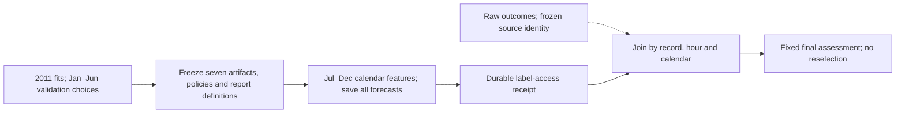
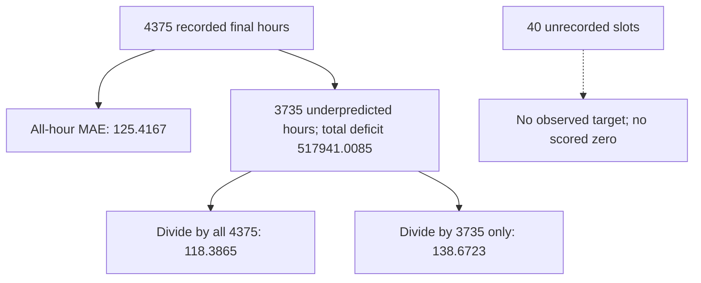
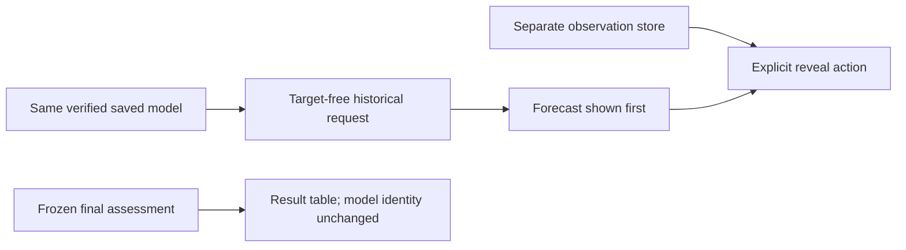

## Evaluate later hours and inspect the completed application

The development decision is already frozen. This lesson follows the last information boundary: save forecasts for the later calendar before exposing its outcomes. Then read the final results, including the forest’s ranking reversal, beside the actual saved application.

### Freeze the question before looking at later outcomes

```video
{
  "title": "Freeze the question before looking at later outcomes",
  "duration": 260.208333,
  "src": "media/bike-final-freeze-boundary/video.mp4",
  "poster": "media/bike-final-freeze-boundary/poster.jpg",
  "captions": "media/bike-final-freeze-boundary/captions.vtt",
  "transcript": "media/bike-final-freeze-boundary/transcript.md"
}
```


Imagine it is **07:00 on Monday, 2 July 2012**, and the request concerns the hour beginning at 08:00. We know the calendar and have a saved hour/working-day model. That model returns **349.5040323 rentals/hour** before July's observed count is opened. The task now is to measure how the function chosen during development behaves on later hours. Changing that function after seeing those outcomes would answer a different question.

The project deliberately keeps its original **2011-only fits**. January–June 2012 was used to compare configurations and output policies; groups/raw won that overall validation objective. We could have designed a new train-plus-validation refit procedure before the final assessment, but we did not. Retaining the exact fitted artifacts makes the measured function identical to the one reviewed and exported. It also makes the claim narrower: this is an assessment of these old calendar-only functions, not the best possible use of every observation available by July.

The freeze contains seven already chosen representatives: global mean, hour/working-day mean, additive linear, interaction linear, decision tree, random forest and boosting. It preserves the validation-chosen raw or nonnegative policy for each. Tree-family representatives use seed 17, the first seed declared in the earlier study. Their final scores describe those exact artifacts; they are not new means over three seeds, and no seed is chosen because it happens to do well on the final hours.

Before final labels were requested, [freeze_assessment](code/src/bike_demand_planner/final_evaluation.py) verified each saved function against all **4,357 retained validation forecasts**. The immutable protocol then bound the candidate/model bytes, feature schema, training transforms, objective/configuration receipts, seeds, output policies, metrics, slices, example timestamps, data membership, source and dependency identities. Its SHA-256 is `cbcb093fd32682e75a2e25486e239197b5702e77c5682613e109c41185ccfe04`. The frozen source records Git parent `b140d58` plus the actual changed source-file hashes, so a parent commit alone is not mistaken for the full running implementation.

```python
protocol_hash = freeze_assessment(project, review, study, destination)
result = run_final_assessment(project, destination / "protocol.json",
                              protocol_hash, new_run_directory)
```

The freeze occurred at **03:10:37 UTC on 20 October**; the final run started at 03:10:44. Local study dates remain 19 October in America/Toronto. Inside that run, every model's target-free forecasts were durably saved before the label-access receipt and raw target join. These files make the intended order inspectable; the independent audit also checks their hashes, identities and timestamps. A hash binds bytes, while the code and retained execution record explain what those bytes mean. Neither a timestamp nor a checksum alone proves that a model is scientifically appropriate.



The normal development loader still rejects `test` before file access. A separate guarded join requires the matching protocol, pre-label prediction file/hash and membership before reading the official raw CSV. It matches record ID, timestamp and encoded calendar, checks the raw source digest, and retains the frozen chronological row order. Two boundary midnight rows remain excluded. Test features still contain no target column; there is no rewrite of prepared data to make the final result easier to obtain.

Change the protocol hash, alter a saved model, reorder a prediction identity or change the raw bytes and the relevant boundary rejects the run. These failure cases are checked with synthetic data. They are different from a poor forecast: a valid but inaccurate estimate belongs in the report. The root example also shows an existing assessment receipt on a repeated invocation; it does not quietly refreeze or reopen outcomes. A failed attempt remains available for inspection.

### Carry one July hour from calendar to counted error

```video
{
  "title": "Carry one July hour from calendar to counted error",
  "duration": 266.0,
  "src": "media/bike-final-hourly-forward/video.mp4",
  "poster": "media/bike-final-hourly-forward/poster.jpg",
  "captions": "media/bike-final-hourly-forward/captions.vtt",
  "transcript": "media/bike-final-hourly-forward/transcript.md"
}
```


The request for **2 July 08:00**, issued at 07:00, activates positions **8, 25, 37 and 44** of the fixed 45-column vector: hour 8, Monday, July and working day. The holiday flag is zero. Calendar encoding uses known definitions rather than categories learned from the final period. Weather measured during that hour, rental components and the final rental count never enter this vector.

The selected model uses only the hour and working-day key. Its saved value is the average of **248 training observations**, whose counts total **86,677**:

$$
\widehat y_{8,1}=\frac{86{,}677}{248}=349.5040323\ \text{rentals/hour}.
$$

In [predict_frozen](code/src/bike_demand_planner/final_evaluation.py), replay loads the saved group values and the global training fallback, then makes predictions from features alone:

```python
values = model.predict([
    (int(row[:24].argmax()), int(row[44])) for row in X
])
```

That line does no fitting. All 48 groups exist in this training data, while synthetic checks still establish the absent-key fallback. The future count is opened only after all seven models' forecasts are persisted. For record **13036**, the later observed count is **568**. The signed residual, defined throughout as prediction minus target, is therefore:

$$
e=349.5040323-568=-218.4959677\ \text{rentals/hour}.
$$

Its absolute error is 218.496 rentals/hour, its underprediction contribution is also 218.496, and its squared error contributes about 47,740.49 squared rental units before averaging. The negative sign says the saved level is too low. This is evaluation, so there is **no gradient update** using the new target. Earlier numerical updates explained training; adding an update here would turn final outcomes into training information.

The additive linear reference follows the same feature vector through its saved training-only scaler. For hour-8 coordinate 8, the training mean is about .0419896 and scale .2005654, so the active value becomes **4.7765497**. Inactive one-hot entries also become nonzero after centering; evaluating only active coordinates after standardization would be wrong.

```python
z = (x - training_means) / training_scales
raw_prediction = z @ saved_weights + saved_bias
prediction = max(raw_prediction, 0.0)  # preselected nonnegative policy
```

For this real July row, the fitted dot product is **171.2404024**, and the intercept is **143.7944477**, giving **315.0348501 rentals/hour**. The nonnegative policy leaves it unchanged. Against 568, its error is −252.9651499, worse than the group estimate for this single hour. The final aggregate comparison can still favor additive regression because it averages thousands of different requests. Neither one row nor one coefficient proves a model's overall usefulness. The full one-hot/intercept system also has dependent columns, so individual fitted coefficients are not unique causal effects.

Now change to **4 July 08:00**, the second example declared before opening outcomes. The recorded holiday flag is 1 and working-day flag is 0, despite the date falling on a Wednesday. The group changes from `(8,1)` to `(8,0)` and the estimate becomes **76.4347826**. The observed count is **153**, so the error is **−76.5652174**. This is a concrete response to a changed valid input, not a new holiday model fitted from test data.

The third predeclared request, **3 December 08:00**, has the ordinary working-day key again. Its estimate returns to **349.5040323**, while the observed count is **731** and the error is **−381.4959677**. July and December have different month coordinates, but the selected function ignores them. That unchanged answer is an implemented property; attributing the actual demand difference to a particular cause would require more evidence.

### Read the final comparison without moving the goalposts

```video
{
  "title": "Read the final comparison without moving the goalposts",
  "duration": 268.75,
  "src": "media/bike-final-ranking-and-error/video.mp4",
  "poster": "media/bike-final-ranking-and-error/poster.jpg",
  "captions": "media/bike-final-ranking-and-error/captions.vtt",
  "transcript": "media/bike-final-ranking-and-error/transcript.md"
}
```


There are **4,375 recorded final hours**. The primary metric remains mean absolute error in rentals/hour. It answers how far the prediction misses by, on average over those recorded hours, without allowing positive and negative errors to cancel. For the selected group model:

$$
\operatorname{MAE}=\frac{\sum_{i=1}^{4375}|e_i|}{4375}
=\frac{548{,}698.1118994}{4375}=125.4167113.
$$

The report also retains RMSE **174.4702175**. Squaring before averaging gives larger misses more influence; the square root returns the result to rental units. Mean signed error is **−111.3563212**, so the dominant tendency is underprediction. These metrics answer different questions and should remain beside one another. A low signed error by itself could hide equally large positive and negative misses.

The aligned reduction reuses the same identity contract as development:

```python
forecasts = [Forecast(row.identity, float(value))
             for row, value in zip(labelled_rows, values, strict=True)]
# score_forecasts rejects missing, duplicated or reordered row identities
summary = error_summary(labelled_rows, values)
```

| Frozen representative / policy | Validation MAE | Final MAE | Final RMSE | Final signed error |
| --- | ---: | ---: | ---: | ---: |
| global / raw | 154.2452 | 182.2549 | 245.8529 | -110.3203 |
| groups / raw | 91.5729 | 125.4167 | 174.4702 | -111.3563 |
| linear-additive / nonnegative | 109.1436 | 121.0569 | 175.6209 | -90.2970 |
| linear-interactions / nonnegative | 100.5164 | 111.3046 | 156.5493 | -90.2197 |
| tree / raw | 99.9829 | 103.7331 | 146.2323 | -90.9492 |
| forest / raw | 99.8324 | 103.6474 | 145.9814 | -90.9088 |
| boosting / nonnegative | 102.2215 | 111.2769 | 157.5660 | -90.8961 |


All rows use the same recorded final hours. The group model's MAE rises from **91.5729** on validation to **125.4167** later. The fixed forest is slightly worse on validation, at **99.8324**, but has lower final MAE, **103.6474**. Interaction regression also scores lower than groups on the final hours, at **111.3046**. These are valid negative findings about the original selection's later transfer. They do not invalidate the implementation or justify hiding the reversal.

The selected badge remains attached to groups/raw. This preserves the distinction between **what development selected** and **what the final assessment revealed**. It does not assert that groups must be used operationally regardless of evidence. If the next decision is to adopt the forest because of this table, the decision is now informed by the test. We should retain that fact and obtain new independent future evidence before making a fresh final-performance claim about the revised process. Another random split of the already inspected outcomes would not restore their original independence.

A comparison also needs its scope. These final numbers describe one retained artifact per row; seed-17 forest MAE is not the earlier three-seed configuration mean. The report preserves original fitting configuration, stopping/failure receipts and storage size. Groups' recorded fit took about **.0136 seconds** and saved **5,640 JSON bytes**. The forest's fit took **.6762 seconds** and saved **16,087,600 bytes**. Final saved-snapshot prediction took **.0288 seconds** for the group batch and **.1842 seconds** for the forest batch on this local run. Those timings include this replay implementation and are not optimized production request latency, peak RAM measurements or a portable speed guarantee.

Change the question from average absolute error to the cost of failing a busy commute and the appropriate decision may change. That operational cost was never supplied, so the report does not invent an acceptance threshold or claim that beating the global mean proves readiness. It presents the fixed measurements needed for that later discussion.

### Find where the later forecasts still fall short

```video
{
  "title": "Find where the later forecasts still fall short",
  "duration": 276.916667,
  "src": "media/bike-final-slices-and-deficits/video.mp4",
  "poster": "media/bike-final-slices-and-deficits/poster.jpg",
  "captions": "media/bike-final-slices-and-deficits/captions.vtt",
  "transcript": "media/bike-final-slices-and-deficits/transcript.md"
}
```


The group model's overall average hides a much harder slice. For **working-day hours 7, 8, 9, 16, 17 and 18**, there are **741 recorded observations** and MAE is **265.4319998 rentals/hour**. Its mean signed error there is **−243.8144204**. This is the same rush definition used before test access, rather than a boundary discovered to make the final model look better or worse. The fixed forest has rush MAE **226.7375077**, which is lower but still large.

The implementation chooses slice membership from each row, retains its actual count, and reduces the aligned error values. Each dimension reconstructs the overall count and error mass. An hour can belong to a month slice and a working-day rush slice at the same time; adding counts across these different dimensions would double-count observations. Within the month dimension, the six observed counts sum to 4,375. January–June entries have count zero and null metrics in the final report, rather than fabricated zero errors.

| Final month | Recorded hours | Group MAE, rentals/hour |
| --- | ---: | ---: |
| July | 743 | 132.1431 |
| August | 744 | 148.0871 |
| September | 720 | 164.3355 |
| October | 708 | 145.5234 |
| November | 718 | 84.9300 |
| December | 742 | 78.1767 |

The **40 unrecorded naive hour slots** between the first and last final observations are excluded from error denominators. They are not assumed to have zero demand. October's count, for example, is 708 rather than a fully populated calendar month's slot count. We can describe that missingness, but the data does not establish how the model would have scored on missing outcomes. Filling them with zeros would change both the question and the result.

Underprediction also has two useful denominators. Across all final hours, the group model's total deficit is **517,941.0084671 rentals**, giving **118.3865162 rentals/hour** when divided by 4,375. Among only the **3,735 underpredicted hours**, the average deficit is **138.6722914**. These numbers differ because one includes every recorded hour and the other conditions on a deficit having occurred. Neither quantity measures unmet demand; the label is observed rental count, not the count of everyone who wanted a bicycle.



The largest retained group miss is **12 September at 18:00**: forecast **367.4538153**, observed **977**, error **−609.5461847**. That is more useful to inspect than an isolated overall score, but it is still an observed example rather than proof of a particular underlying cause. Mean final demand is **254.1147429** while the model's mean forecast is **142.7584217**. Their difference agrees with the signed error. This describes a level gap consistent with the model's old group means; it does not establish why that gap occurred.

Hourly errors are also dependent over time. Among **4,369 consecutive observed-hour pairs**, residual correlation is **.8349**. Gaps are excluded from that adjacency calculation. The daily and Monday-start weekly summaries preserve counts, while the report supplies no confidence interval pretending that thousands of nearby hours are independent future experiments. The slice and time results are descriptive evidence about this one later period. A changed future operating environment remains an unanswered generalization question.

### Connect the saved artifact to the application and an honest handoff

```video
{
  "title": "Connect the saved artifact to the application and an honest handoff",
  "duration": 285.541667,
  "src": "media/bike-final-application-and-handoff/video.mp4",
  "poster": "media/bike-final-application-and-handoff/poster.jpg",
  "captions": "media/bike-final-application-and-handoff/captions.vtt",
  "transcript": "media/bike-final-application-and-handoff/transcript.md"
}
```


The [final application](http://127.0.0.1:8504/) now places the frozen assessment and historical replay in one local page. Its highlighted row identifies the original validation-selected artifact even though the forest's final score is lower. Monthly bars carry actual counts, the three examples were declared before outcomes were opened, and the details retain model/bundle/protocol identities, fit costs and UCI attribution. These visible boundaries help the reader connect a displayed number to the saved function and evaluation procedure behind it.


The predictor's original model hash is unchanged: `803ebf5afbedf6049ff9124b5e5d018b878e018570508ffc20f7443fc07dc354`. The saved bundle hash is still `2cda65e58a8aad7dd40cd152491009e59daa235a8a81d48df122eeebd909f408`. [FinalApplication](code/src/bike_demand_planner/final_application.py) checks the assessment protocol identity, selected model/bundle context and retained artifact hashes before serving. It does not refit a model when the page starts or when a reader inspects a different score.

The interactive request remains a historical **January–June validation replay**. The final batch uses the already frozen July–December calendar features, including source holiday flags. It would be misleading to silently turn those into an unrestricted future holiday authority. A July request is therefore rejected by the interactive adapter even though July is present in the final evaluation table. These are distinct, explicitly named scopes rather than an accidental missing prediction feature.

```python
request = app.predictor.request_for_target("2012-01-09T08:00:00")
forecast = app.predictor.predict(request)  # 349.5040; no observed outcome
observed = app.observation(request["target_time"])  # explicit later action
residual = forecast["prediction"] - observed["target"]  # −70.4960
```

The actual interface first displays 349.5 and the training-mean baseline. Clicking **Show recorded outcome** then reveals 420 and −70.50. A valid request for the unrecorded 2 January 03:00 hour still receives an estimate, but there is no actual count or residual. Changing the input clears the previous forecast; an unsupported date cannot leave an old successful-looking answer on screen. Browser checks exercise these cases at 1440, 768, 390 and 320 pixel widths. The installed-wheel check denies all source-project file access and still loads copied inference/evaluation assets and packaged web files.



The local training-recovery proof remains the earlier separate linear Adam demonstration: full parameters, scaler, moments/index, order/cursor/RNG, schedule, monitoring and context recover the same continuation after a damaged save. Final evaluation adds no new training or recovery result. Exact continuation proves reproducibility of that numerical run, while held-out scores measure later forecasting error. They are related parts of a usable project, but one cannot substitute for the other.

The technical local route is implemented and checked: provenance and splits, model calculations and comparisons, saved inference, recovery, replay and a frozen final assessment. The final results expose substantial deficits; no operational quality threshold was defined, no calibrated predictive uncertainty was implemented, no hosted recovery or external publication occurred, and the learner's changed-condition explanation remains unobserved. E-commerce Purchase Predictor is the next planned application, but this record does not start it or claim its prerequisites are understood merely because code and videos exist.

The useful next conversation is concrete: **the forest is now better on the final hours, so what can we honestly claim if we choose it next?** We can report its already measured result and record a test-informed development choice. We cannot present that choice as if the same test were still untouched. Keeping that distinction connects the maths, the implementation and the practical meaning of the final evidence.

### Run the implementation and inspect its evidence

```bash
uv run --frozen python -m unittest discover -s tests
uv run --frozen python final_evaluation_example.py
uv run --frozen python serve_final.py
```

The evaluation command shows the retained receipt when an assessment already exists; it does not quietly reopen labels. Run directories, models, downloaded source and these personal notes remain ignored. Ordinary distributions include source and packaged web assets, with no private notes, model/run outputs or datasets. Complete attribution is retained in the frozen protocol: Fanaee-T, H. (2013), UCI Bike Sharing, DOI `10.24432/C5W894`, CC BY 4.0, archive/member hashes and acquisition metadata. [Implementation source](code/src/bike_demand_planner/final_evaluation.py), [application source](code/src/bike_demand_planner/final_application.py), [learning points](project/learning-points/10-final-evaluation-and-application.md), [comparisons](project/comparisons/10-final-evaluation-and-application.md) and [tracker](project/implementation.md) provide the connected record.

### Keep the reasoning beside the result

[Learning points](project/learning-points/10-final-evaluation-and-application.md) explain what this calculation changes in our understanding. [Comparisons](project/comparisons/10-final-evaluation-and-application.md) put the alternatives side by side. [Setup and commands](project/setup.md) and the [current completion record](project/implementation.md) give the executable project context.

[[practice:final-evaluation-and-application-check]]

Use the [readiness record](project/readiness.md) to distinguish the completed local application from questions that need new evidence.

### Complete source reference

The [setup record](project/setup.md) explains how to run these in the actual pinned checkout. The files below are exact source downloads.

- [application_example.py](code/application_example.py)
- [baseline_example.py](code/baseline_example.py)
- [calendar_example.py](code/calendar_example.py)
- [check_setup.py](code/check_setup.py)
- [compare.py](code/compare.py)
- [demo.py](code/demo.py)
- [error_review_example.py](code/error_review_example.py)
- [final_evaluation_example.py](code/final_evaluation_example.py)
- [group_baseline_example.py](code/group_baseline_example.py)
- [inference.py](code/inference.py)
- [linear_example.py](code/linear_example.py)
- [objective_example.py](code/objective_example.py)
- [optimization_example.py](code/optimization_example.py)
- [prepare_data.py](code/prepare_data.py)
- [regression_example.py](code/regression_example.py)
- [serve_app.py](code/serve_app.py)
- [serve_final.py](code/serve_final.py)
- [__init__.py](code/src/bike_demand_planner/__init__.py)
- [__main__.py](code/src/bike_demand_planner/__main__.py)
- [application.py](code/src/bike_demand_planner/application.py)
- [application_data.py](code/src/bike_demand_planner/application_data.py)
- [application_run.py](code/src/bike_demand_planner/application_run.py)
- [artifacts.py](code/src/bike_demand_planner/artifacts.py)
- [baselines.py](code/src/bike_demand_planner/baselines.py)
- [checkpoints.py](code/src/bike_demand_planner/checkpoints.py)
- [comparison.py](code/src/bike_demand_planner/comparison.py)
- [data.py](code/src/bike_demand_planner/data.py)
- [error_analysis.py](code/src/bike_demand_planner/error_analysis.py)
- [error_plots.py](code/src/bike_demand_planner/error_plots.py)
- [error_review.py](code/src/bike_demand_planner/error_review.py)
- [evaluation.py](code/src/bike_demand_planner/evaluation.py)
- [features.py](code/src/bike_demand_planner/features.py)
- [final_application.py](code/src/bike_demand_planner/final_application.py)
- [final_evaluation.py](code/src/bike_demand_planner/final_evaluation.py)
- [linear.py](code/src/bike_demand_planner/linear.py)
- [linear_evaluation.py](code/src/bike_demand_planner/linear_evaluation.py)
- [metrics.py](code/src/bike_demand_planner/metrics.py)
- [objective_evaluation.py](code/src/bike_demand_planner/objective_evaluation.py)
- [objectives.py](code/src/bike_demand_planner/objectives.py)
- [optimization.py](code/src/bike_demand_planner/optimization.py)
- [optimizer_evaluation.py](code/src/bike_demand_planner/optimizer_evaluation.py)
- [optimizers.py](code/src/bike_demand_planner/optimizers.py)
- [prediction_worker.py](code/src/bike_demand_planner/prediction_worker.py)
- [project.py](code/src/bike_demand_planner/project.py)
- [recovery.py](code/src/bike_demand_planner/recovery.py)
- [regression.py](code/src/bike_demand_planner/regression.py)
- [review_contract.py](code/src/bike_demand_planner/review_contract.py)
- [saved_predictor.py](code/src/bike_demand_planner/saved_predictor.py)
- [splits.py](code/src/bike_demand_planner/splits.py)
- [tree_evaluation.py](code/src/bike_demand_planner/tree_evaluation.py)
- [trees.py](code/src/bike_demand_planner/trees.py)
- [train.py](code/train.py)
- [tree_example.py](code/tree_example.py)

[Source README and preparation commands](evidence/project-readme.txt)
