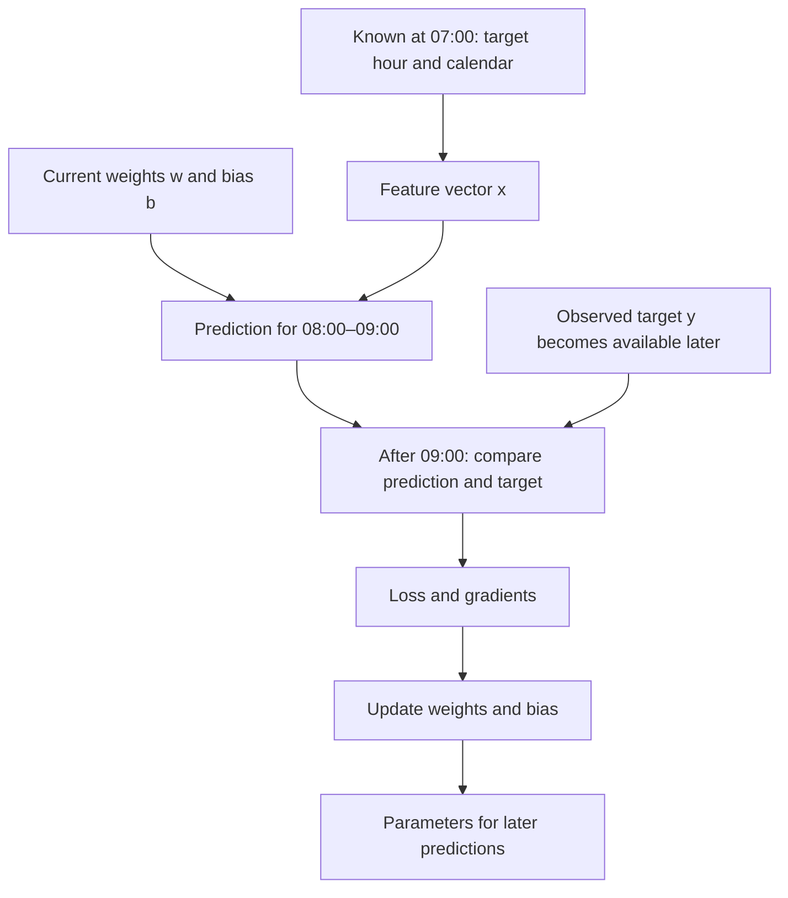

# Learning points: One hourly prediction and one numerical update

This example puts the earlier tutorial and PDF ideas into one concrete forecasting situation. The contract and arithmetic are now written and the numerical code has been checked. Code checks, a learner explanation and the performance of a fitted demand model are separate kinds of evidence; the progress tracker records the actual understanding observation.

## A prediction is about a particular future outcome

At 07:00 on Monday, 17 October 2011, imagine an analyst asking how many rentals the whole system will record between 08:00 and 09:00. The prediction is for that complete one-hour interval. It is not an estimate of bikes available at a station at 08:00, and it does not tell us how many people wanted a bike but could not get one. Those would be different targets and need other information.

The prediction contract makes that question precise: when we issue the forecast, which interval it covers, what inputs we may use, what the output means and how we will later compare it with an observed result. Here the lead time is one hour from the 07:00 issue time to the interval's 08:00 start; the interval itself lasts another hour. Naming both prevents “one-hour prediction” from hiding two different meanings.

## The information boundary matters before the formula

At 07:00 we can know that the target hour is 08:00, that the date is a Monday in October and whether the calendar marks it as a working day. For the illustration we treat it as a nonholiday working day. We have not acquired a dataset row or checked its holiday flag; that assumption is part of the example, not a result from UCI.

The count of rentals during 08:00–09:00 is only known after that interval finishes. Therefore it cannot be an input to the 07:00 forecast. The same reasoning excludes the weather actually observed during that future hour from our calendar-only forecast. A real weather forecast issued before 07:00 could belong to a separately defined task, but an observation recorded after the fact cannot be substituted for it. This is why the target and any target-revealing fields must remain outside the prediction payload.

The arrows show the movement of information and model state. There is deliberately no arrow from the later observed target into the earlier prediction. The target enters the comparison and learning path after it becomes available. Updated weights can then support later predictions; they do not change what was available at the original forecast time.

## Features and parameters play different roles

For the arithmetic we keep two features: the working-day flag is 1, and the target hour divided by four is 2. Thus the vector is `[1, 2]`. Dividing the hour by four is a fixed, deliberately simple encoding that makes the chosen example easy to inspect. It is not a learned statistic, a claim that this is the best hour representation or a final production feature schema. A real calendar feature design will be studied with the dataset later.

These features describe the case. The weights `[10, 5]` and bias `20` describe the current prediction rule. They are hand-chosen starting values, not fitted parameters from bike records. The rule gives `1×10 + 2×5 + 20 = 40`, so its current estimate is 40 rentals for the target hour. Knowing which numbers describe the case and which numbers belong to the model becomes especially useful when following a training update: the case stays fixed, while the parameters change.

## Loss measures the miss; the gradient tells us how parameters affect it

Suppose the completed hour later records 45 rentals. That count is invented for this example. The residual is prediction minus target, so it is `40−45 = −5`. The negative sign says the current rule underpredicts by five. Half squared error turns that miss into `0.5×25 = 12.5`; its squared units are different from the rental-unit error. It is an objective for this arithmetic, not an accuracy percentage or our final validation MAE.

For this objective, the slope with respect to the prediction is the residual. Each weight's gradient also depends on its feature: the gradients are `[-5, -10]`, while the bias gradient is `-5`. The second weight gets twice the gradient magnitude because its feature value is twice as large in this case. This connects feature scale to optimization directly, rather than treating the gradient as a mysterious number produced by a library.

## An update changes the rule, not the input or the observed outcome

With learning rate `0.01`, gradient descent subtracts the scaled gradient. Subtracting these negative gradients increases the weights to `[10.05, 5.10]` and the bias to `20.05`. Reusing the same features now gives 40.30, and its half squared error is 11.045. We can therefore check that this particular small step moved this particular prediction toward 45.

That last statement is deliberately limited. It is a repeated check on the same example, not a test on fresh hours. It does not show that the rule captures rush-hour peaks, generalizes across seasons or is better than a baseline. Those questions need the later data, baseline and chronological validation phases. For now the useful connection is the complete chain: allowed information produces features, features and parameters produce a prediction, the later target produces a loss, and the gradient/update changes the parameters.

## The same loss can require the opposite update

Now change only the hypothetical target from 45 to 35. Keep the features `[1, 2]`, starting weights `[10, 5]`, bias `20` and learning rate `0.01` exactly as before. The prediction is still 40 because the target is not an argument to prediction. The residual becomes `40−35 = +5`, so the current rule overpredicts by five. Squaring removes that sign: half squared error is still 12.5. A scalar loss value tells us the size of the miss under this objective, but it cannot by itself tell us which way to change the parameters.

The gradient preserves the direction we need. Multiplying the residual by the two positive features gives weight gradients `[5, 10]`, and the bias gradient is `5`. Subtracting `0.01` times those gradients gives weights `[9.95, 4.90]` and bias `19.95`. The same input then produces `39.70`, which is closer to 35; its remaining residual is `+4.70` and its loss is 11.045. The target-45 case moves upward by 0.30, while the target-35 case moves downward by 0.30. Their matching loss improvement follows from their equal starting distance on opposite sides of 40, the same linear rule and the same rate.

It is useful to attach the direction statement to this feature vector rather than memorize that overprediction always lowers every weight. Here both features are positive, so lowering either weight lowers the prediction. If a feature were negative, its weight gradient would have the opposite sign to the residual, and increasing that weight could lower the prediction instead. The stable rule is still to subtract each actual gradient. The bias gradient equals the residual directly because the bias enters the prediction with coefficient one.

The complete derivation, selected source, commands and checked results are in [notes to understanding](lessons/01-prediction-contract.md), including the changed-target comparison. Further review can focus on feature scale or whichever connection remains unclear; the two numerical examples do not advance us to data acquisition automatically.

Return to the [worked understanding notes](lessons/01-prediction-contract.md).
