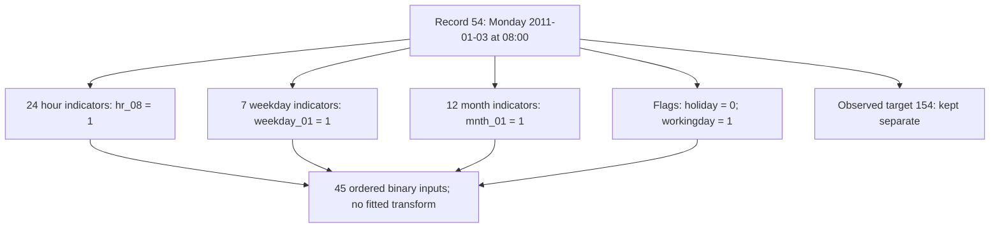

# Learning points: Understand the hourly data, calendar features and time split

Handoff update, 18 October 2026: this page retains the data-preparation explanation. Its implementation is committed as `ad1b870` after 22 checks passed. Current predictions and results continue in the [baseline record](project/implementation.md).

These are the ideas worth returning to after reading the [full walkthrough](lessons/02-hourly-data-and-splits.md). The example is the same throughout: at 07:00 on Monday, 3 January 2011, we want to estimate rentals during 08:00–09:00. The source later records 154 rentals for that hour. We have prepared the observations and their feature representation; we have not fitted a model that predicts that count yet.

## The forecast begins with what was knowable at 07:00

At issue time, the calendar already tells us that the upcoming hour is 08:00 on a Monday in January. The source also marks the date as a working day, with holiday flag zero. Those fields can describe the hour before its rental count is known.

The CSV contains the outcome alongside the calendar because it was assembled after the events. That is convenient for training, but it can hide the original order in time. The presence of `cnt=154` in the same row does not make it information that a 07:00 forecast could have used. This is the reason we keep the prediction inputs and the later target separate in the code.

The target is system-wide rentals during a whole hour. It does not tell us how many bikes remained at an individual station, nor how many people wanted a bike but could not obtain one. Keeping the outcome precise gives later errors a clear meaning: a miss of five means five recorded rentals for that interval, not five bikes of station inventory.

## A field's role matters as much as whether its value is correct

The same Monday row records one casual rental and 153 registered rentals. Their sum is the total: `1 + 153 = 154`. That relationship is useful for checking the source. If the total disagreed with its components, we would want to investigate the row before training on it.

It is also exactly why those component counts cannot be predictors for the same hour. Supplying them would reveal the answer rather than describe what was available in advance. We can use a field to validate an observation without allowing it into the forecast input.

Record ID and source date/hour have another role. They let us find the observation, check duplicates and decide its time partition. They stay with the exported rows as metadata, while the model receives only the explicitly named feature columns. A later loader must preserve that separation instead of treating every CSV column as a numeric predictor.

Observed weather needs an availability check too. A temperature measured during 08:00–09:00 is different from a weather forecast available at 07:00. Our first task therefore uses calendar fields only. A later weather-based comparison needs a clearly stated information set before its results can be compared fairly.

## The representation changes what a simple model can express

A raw hour code is a perfectly valid source value, but a linear model gives it a particular meaning. If its contribution is `hour_weight * hour`, every one-hour increase changes the prediction by the same weight. A single slope cannot describe a morning rise, a midday dip and another rise in the evening.

We chose a separate indicator for each hour, weekday and month. The first representation has `24 + 7 + 12 + 2 = 45` values, including holiday and working-day flags. For our Monday example, `hr_08`, `weekday_01`, `mnth_01` and `workingday` are one; all other values are zero. That gives four ones and 41 zeros.

Each calendar branch contributes a known part of the feature vector. The observed 154 has a separate branch because it will be used later to judge or update a prediction. Saving the column order ensures that a weight for `hr_08` continues to receive the hour-8 indicator when we reload the model.

A future linear calculation for this row will add the bias and the four active coefficients. If only the hour input changes from 8 to 9, the hour-8 coefficient drops out and the hour-9 coefficient enters. The prediction difference would be `weight_for_hour_09 - weight_for_hour_08`, while weekday, month and flags remain unchanged. This describes the effect of changing an input representation; it does not assume that the next real hour has the same outcome of 154.

One-hot encoding gives a separate effect to each category, but it does not preserve clock adjacency. Hour 23 and hour 0 are treated as different categories just like other hour pairs. Sine/cosine features offer a more compact circular representation, with a different set of shapes available to a linear model. We will compare alternatives later using the same evaluation periods, rather than treat this first choice as an established winner. The [comparisons](project/comparisons/02-hourly-data-and-splits.md#choosing-how-to-represent-the-hour) explain the tradeoff in more detail.

Even with separate hour indicators, an additive linear model does not automatically learn a different hourly profile for working days and weekends. The flags can change an offset, but a change in the shape of the daily profile needs an interaction or a more expressive model. That is a useful question for later feature studies, not a reason to mix extra features into this preparation step without recording the change.

## Leaving a field out can reveal what the training data cannot teach

Year is known in advance, but all 2011 training rows have `yr=0`. Remember the earlier gradient formula: a weight gradient contains `residual * feature`. For a raw year feature that is always zero, that product is always zero. These training examples cannot identify the effect of changing the year code to one in 2012.

We therefore leave year out of the first schema. That does not remove the possibility of demand changing between years; it means we are not pretending to have learned that change from a feature that never varies in training. Any real year-to-year shift will still affect validation performance when we eventually measure it.

We also leave out the source's coarser season code while retaining month. The source documents disagree on some season labels, so we avoid attaching names that the current work has not resolved. This is an initial feature choice, not evidence that season could never add useful information or that month exactly determines it.

The two binary flags also deserve their own meanings. Holiday zero does not by itself imply working day one: a Saturday can have both flags zero. The parser checks the flags against the weekday instead of treating them as interchangeable labels.

## Clear input columns do not guarantee unique coefficients

Exactly one hour indicator is active in every row. If we added the same constant to every hour weight and subtracted it from the bias, the prediction would stay unchanged. The full one-hot columns therefore have a dependency with the intercept. The other category groups and some flags can introduce dependencies too.

The calculation and its gradients are still meaningful, but there may be multiple parameter settings that make the same predictions. This matters when interpreting coefficients: a particular fitted weight need not be a unique or causal effect. Reference-category coding and regularization offer other choices; they belong in later controlled comparisons. The current representation stays explicit and unchanged while we learn what those alternatives do.

## Fixed calendar rules are different from statistics learned from data

We know the possible hours, weekdays and months from the calendar. The encoder does not need to look through validation or test observations to discover those domains. Its output is already zero or one, so there is no fitted mean, standard deviation or scaler in this implementation.

The preparation does describe how often each feature is one, using training rows only. A column that is constant in training keeps its saved position. We do not divide by a zero standard deviation, or use later observations to decide which columns disappear. None of the 45 selected columns is constant in the actual training file; a small independent fixture checks the constant-column case.

A defined category can be absent from a small training sample and still have a place in the encoder. That does not give the model evidence to estimate its effect. An invalid category such as hour 24 is different and is rejected. Missing fields, extra fields such as `cnt`, noninteger codes and inconsistent flags are rejected too.

If we later add a learned transform, it must learn from training only. For an invented centering example, values 0 and 2 have mean 1. Including a future value 100 changes the mean to 34, so the representation of the original training values would already contain information from the future. A later time-based fold has its own training portion and must follow the same rule. The present encoder avoids this issue by fitting no statistics at all.

## A chronological split must respect the forecast issue time

The three periods have distinct jobs. Training uses 2011 to estimate parameters. Validation uses January–June 2012 to compare choices. The July–December period is reserved for the final evaluation after those choices. Randomly mixing observations could give fitting access to later hours than the ones being evaluated, which would change the forecasting question.

There is an extra timing detail at the first boundary. The last training interval begins on 31 December at 23:00 and ends on 1 January at 00:00. Under our interval-end availability rule, its completed outcome becomes available at midnight. But a forecast for the hour starting at midnight would have to be issued at 23:00, before that last outcome existed.

We therefore leave out the midnight target and begin validation at 01:00, whose forecast can be issued at 00:00. We apply the same rule at the July boundary after validation-based selection. This gives 8,645 training rows, 4,357 validation rows, 4,375 test rows and two existing observations marked as boundary exclusions.

Those calculations use an explicit offline assumption: hour labels mark interval starts, outcomes arrive at interval end, and reporting/model-build delay is zero at the readiness boundary. The source does not specify timezone or daylight-saving disambiguation. We retain its naive date/hour labels rather than claiming verified UTC instants. The [worked timeline](lessons/02-hourly-data-and-splits.md#let-the-time-split-follow-the-forecasting-question) makes the first boundary concrete.

## An absent hour and a deliberately excluded row are different things

The two boundary exclusions are real observations that remain in the raw file and membership record. Separately, the source has 165 unrecorded slots across 75 gaps against a naive hourly grid. For example, its labels jump from 04:00 to 06:00 on 2 January 2011, with no row for 05:00.

The existing rows have no empty required cells, but that does not make the time grid complete. Filling the absent 05:00 row with a target of zero would assert that no rentals occurred, which the absence of a record does not establish. We leave it absent and record the gap.

This distinction will matter when adding lags: the previous recorded row is not automatically the previous clock hour. It also explains why a timestamp-based boundary rule is more suitable here than dropping an arbitrary number of rows and assuming they represent the same amount of elapsed time.

## Reproducibility lets the later comparison mean something

The manifest records which source bytes, feature order and time memberships produced the prepared files. Repeating preparation must reproduce those choices. Otherwise, a change in a later model result could come from a changed dataset rather than the model or optimizer we meant to compare.

The source review on 16 October found that the landing page listed 17,389 instances while the bundled README and the acquired hourly file agreed on 17,379. We retain the measured file count and local hashes. They identify the acquired bytes; they are not official signed checksums. We also keep the documented uncertainties about season labels, weather normalization and timestamps visible in the [reference section](lessons/02-hourly-data-and-splits.md#reference-source-details-and-saved-evidence).

The saved test export contains identity and features without targets. The raw source still retains the outcomes for the later final evaluation. Structural checks of the full source have not been used for test-target exploration or model selection. A successful audit and a fixed split give us a trustworthy starting point for modelling; predictive accuracy still needs to be measured in the next part of the project.

## Use the second worked case to check what the first one meant

The short videos now sit beside the explanations they support in the [understanding notes](lessons/02-hourly-data-and-splits.md). Watch a section, then read its calculation and code at your own pace. The extra worked cases are useful because they change one part of the original situation while keeping the rest visible: a new requested hour switches two one-hot coordinates, an invented zero changes an average, and a reporting/build delay changes which issue time is feasible. If the new outcome seems surprising, go back to the exact assumption rather than memorising the original result.

The same habit helps interpret the later model. A vector can have the correct shape and still carry the wrong column meanings. Two sets of coefficients can make identical predictions. A chronological partition can still use information too early. These examples connect data preparation to the forecasting question without claiming that preparation checks are model accuracy or that watching the explanation proves understanding.

Return to the [worked understanding notes](lessons/02-hourly-data-and-splits.md).
