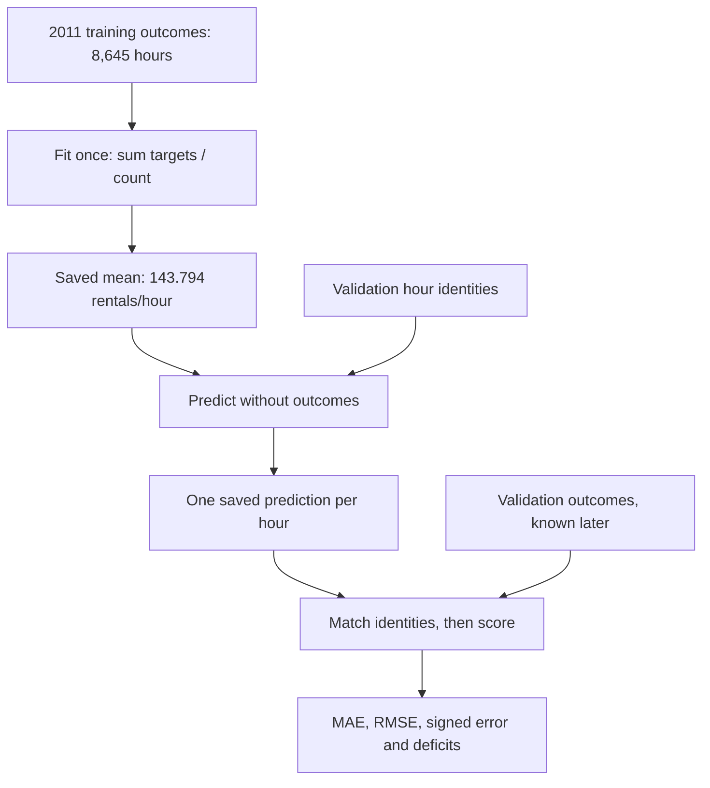

# Learning points: Build and compare simple calendar predictions

The data work gave us hours that we can trust and a clear boundary between training and later evaluation. We can now ask a practical question: how well can we predict demand using only one number learned from the training year? Starting here makes later model results easier to judge. A complicated model earns its place through a useful comparison against something simple whose behavior we can explain completely.

## A fitted model can be just one number

For the 8,645 recorded training hours, the total target is 1,243,103 rentals. Dividing gives 143.79444765760556 rentals per hour. That number is the entire learned state of our first predictor. There are no feature weights, gradient iterations or optimizer settings in this fit. The code calculates a statistic from the permitted training outcomes and saves it for later use.

This is still a fitted predictor. Its value depends on the training data, and changing those training targets would change its predictions. At the same time, changing a validation target must leave the fitted number unchanged. This distinction is the concrete meaning of fit/predict separation here: training outcomes determine the model, while later outcomes let us judge predictions already produced by that model.

The denominator deserves attention. We average the recorded training hours. The earlier audit found missing source hours, and our data preparation left them absent. Adding imagined zero-rental rows would change this average and would make an unsupported claim about those unrecorded hours. The model's simple arithmetic rests on the data decisions we have already made.

## The same forecast can fail in opposite ways during one morning

On Monday, 9 January 2012, the target at 02:00 is 5 rentals and the target at 08:00 is 420. The first forecast is issued at 01:00 and the second at 07:00 under our one-hour-ahead protocol. Both receive 143.794 rentals from the constant model. Once the outcomes are available, we can see an overprediction of 138.794 at 02:00 and an underprediction of 276.206 at 08:00.

Nothing went wrong with the implementation in this example. It did exactly what its model family permits: repeat one saved number. The limitation is that this model family cannot respond to an hour's calendar inputs. We already have those inputs available, so the natural next comparison is whether training-only hour/working-day averages use them profitably. That possibility still needs to be measured on the same held-out hours.

The arrows show the information path. Training outcomes lead to the saved mean. Validation identities tell us which hours need predictions. The later recorded validation outcomes enter at scoring. Keeping these paths separate makes it much harder to accidentally improve the fitted mean using answers from the evaluation period.

## The mean comes from a particular fitting objective

You have already studied losses and gradients. For a constant prediction `c`, the average half squared error is `sum((c - y)²) / (2N)`. Its derivative is `c - mean(y)`, so the stationary point is the training mean. The second derivative is positive, making this the minimum among constant predictions. We can find it directly instead of asking an optimizer to discover the same single number through repeated updates.

Our headline evaluation metric is MAE, however. The constant that minimizes training absolute error is a median. These two statements can both be true: we have chosen a mean-based squared-error reference and we report how that reference performs under MAE as well as RMSE. The mean should never be described as the best possible constant for every metric. A median is an understandable future comparison, while the planned next step remains the calendar baseline.

## Error size and error direction tell us different things

We keep the same residual sign as the earlier gradient example: `prediction - target`. A positive residual means the estimate was too high; a negative residual means it was too low. Averaging those residuals tells us the overall direction. It can also cancel mistakes: predicting 20 for targets 10 and 30 gives errors `+10` and `−10`, whose signed mean is zero.

MAE keeps the size of both mistakes by taking the absolute value before averaging. Those two errors therefore give MAE 10 rentals per hour. RMSE squares the errors, averages them and takes a square root, also giving 10 in this symmetric case. When error magnitudes differ, squaring makes the larger misses matter more. For errors `+2` and `−8`, MAE is 5 while RMSE is approximately 5.831.

The distinction matters in the actual results. Our training signed error is approximately zero because a fitted training mean has cancelling residuals by construction. Training MAE is still 106.5935. A zero average direction gives us no reason to claim the hourly predictions are accurate. The validation RMSE of 208.1723, compared with MAE 154.2452, also shows why we want a second view that gives larger misses more influence.

## An underprediction average needs its denominator written down

If a prediction falls below its target, its deficit is `max(target - prediction, 0)`. We sum these deficits and divide by every evaluated row to obtain `mean_underprediction`. Overpredicted and exact rows contribute zero to that numerator but remain in the denominator. This gives an average hourly deficit across the whole evaluation period.

Sometimes we want a different question: how large was the deficit on the hours where we underpredicted? We therefore report the number of underpredicted rows and a separately named conditional mean. For errors `+2` and `−8`, the total deficit is 8. Across both hours, mean underprediction is 4; across the one underpredicted hour, it is 8. Naming both avoids a quiet denominator change when we compare later models.

In the real validation run, 2,391 of 4,357 hours are underpredicted. The average deficit across all hours is 112.8254 rentals/hour, while the average over those 2,391 underpredicted hours is 205.5962. These describe errors in observed system-wide rentals. Translating them into unmet demand or station stock would require information that this dataset does not supply.

## A metric is meaningful only when each prediction has the right outcome

Two arrays of the same length can still refer to different hours. Our forecast records retain the source record ID, target timestamp and forecast issue timestamp. Before reducing errors, the scoring function requires those identities in exactly the same order as the target rows. It rejects reordered, missing or duplicated forecasts.

For a constant model, swapping two identical predicted values would leave the arithmetic unchanged, which can hide the problem during a first implementation. The identity check matters because later models produce different values for different hours. Establishing it now lets those models use the same evaluation path without relying on accidental array order.

## The first run is a reference, and we can trace where it came from

The validation signed error is −71.4057 rentals/hour. Since the prediction is constant, this equals the training mean minus the validation target mean. The recorded validation mean is about 215.2001, so this constant falls below that later-period average. That describes these partitions; it does not isolate a cause such as year-on-year growth, because their seasonal composition and other conditions also differ.

The saved run includes the fitted mean/count, exact source contents, dependency identities, frozen data/schema/membership identities, metric definitions, timings and aligned prediction files. This lets us distinguish a changed model from a changed dataset or implementation when we compare results later. The original run was recorded before its source commit, so its content hashes preserve the exact running files alongside the parent commit. The completed source is now signed as `0b49c0a`.

The final test has stayed reserved. This run gives us enough information to understand the first predictor and choose the next small comparison. The [detailed notes](lessons/03-calendar-baselines.md) show the actual code and numbers; the next conversation can return to any part of that chain that needs another example.

## A simple model can learn the shape of a day through groups

The new predictor has a separate training mean for each hour and working-day combination. It can therefore distinguish the quiet 02:00 hour from the morning commute without yet fitting a linear model by gradient descent. For the real Monday example, the working-day 08:00 group averages 86,677 rentals across 248 training hours, giving 349.5040. The 02:00 group averages 1,796 across 239, giving 7.5146. Those values are fitted parameters, just as the single global mean was a parameter; using direct arithmetic does not make the model “untrained.”

The two inputs form a pair, so this is an interaction rather than a separate hour adjustment plus a working-day adjustment. Working-day 08:00 can have a very different value from nonworking-day 08:00, whose training mean is 76.4348. The model can learn a different daily profile for each flag value. In exchange, it divides the evidence among at most 48 groups and cannot use month, a particular weekday or other distinctions outside that key. Group support counts help us see how much evidence backs each fitted number.

Prediction only selects a saved parameter. At 07:00, the known calendar produces `(8, 1)` and the model returns 349.5040; the outcome of 420 becomes available afterward for scoring. Repeating a prediction or changing a validation target cannot update the fitted means. This is a frozen historical comparison, with the same issue-time boundary as the data work, rather than an online model that learns from each new answer.

## A missing group calls for a declared model policy

There is a difference between an invalid request and a valid group we did not observe in training. Hour 24 is invalid and rejected. A supported hour/flag pair missing from a small training sample is valid, but its mean is undefined. We chose the global training mean as its fallback before evaluating, preserving the rule that all fitted values come from training outcomes.

The small fixture makes the weighting important. Its group means are 20, 2 and 100, backed by two, one and one rows. The global mean is `(10 + 30 + 2 + 100) / 4 = 35.5`; it is not the equal average of those three group means. We are averaging recorded hours, so a group with two rows contributes two rows of evidence. Returning 35.5 for an absent pair neither inserts a zero-demand observation nor gives permission to borrow a validation answer.

All 48 pairs occur in the real training year, so the measured comparison never uses the fallback. Its behavior is established by a separate known-answer fixture and fit-isolation checks. A zero fallback count is useful coverage information, but it cannot substitute for checking a branch that the dataset does not exercise.

## Improvement needs more than one favorable example or one metric

The group predictor reduces validation MAE from 154.2452 to 91.5729 rentals/hour, a measured reduction of 40.6316% across the same 4,357 hours. RMSE also falls, from 208.1723 to 137.3900. Keeping data identities, ordering and metric definitions fixed makes this a comparison of predictors rather than a mixture of unrelated runs. Both were fitted without validation targets, and the reserved final test remains closed.

The better averages do not mean every forecast improves. On 11 January at 17:00, the group predicts its working-day level of 394.916 against an observed 134; the global constant happens to be much closer. Across validation, the group improves 3,323 hourly absolute errors and worsens 1,034. A group describes an average pattern, not all the differences between days sharing the same key. We have not identified a unique cause for that quiet hour.

The signed error is still about −72.34 rentals/hour, and more hours are underpredicted even though their typical deficit is smaller. That combination makes sense once we distinguish error size, error frequency and aggregate direction. The grouping removes many excessive quiet-hour predictions without fully matching the level of the later period. These are concrete limitations for the next modelling discussion; they are not evidence that the current baseline is ready for an operational application.

Return to the [worked understanding notes](lessons/03-calendar-baselines.md).
