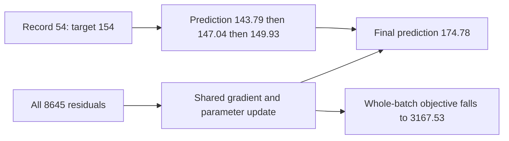

# Learning points: Fit linear regression and follow its gradients

The useful change in this part of the project is that the predictor now learns its parameters through a gradient calculation we can inspect. The group means already fitted parameters too, but each group could be solved directly by averaging its outcomes. Linear regression makes the shared structure explicit: many different calendar hours use the same coefficients, and each full-batch update is a compromise across their errors.

These explanations revisit the important ideas without requiring the source or a run log beside them. The [understanding notes](lessons/04-linear-regression.md) contain the full calculations, short code traces, diagrams and saved evidence.

## A forecast is a function of the information we supply

Monday, 3 January 2011 at 08:00 is a useful anchor because we already know its encoding. The raw vector has 45 columns, with hour 8, Monday, January and the working-day flag active. Its target is 154 rentals. The linear model turns that calendar description into one number by adding contributions from the input features and an intercept. It does not receive the record's outcome when making that prediction.

One consequence becomes very clear in validation. Monday, 9 January 2012 at 08:00 has the same 45 inputs, so the fitted model predicts the same 174.7785 rentals for both records. Their recorded targets are 154 and 420. This is not something more iterations can resolve: a deterministic function cannot return different answers for identical inputs. We would need additional available information or a different contract to distinguish them. The current result therefore tells us something about our representation as well as our fitting algorithm.

## Standardization becomes part of the fitted predictor

Our exported calendar columns remain binary. Inside the linear model, we subtract each training column's mean and divide by its population standard deviation. This puts the numerical coordinates on more comparable scales for gradient descent. For the hour-8 indicator, the training mean is about 0.04199 and the scale is about 0.20057. Its active value becomes about 4.7766 rather than one. An inactive value becomes negative after centering.

That transformation is learned state. We fit it on 2011 training rows, save it with the weights and reuse it for every later prediction. Recomputing means from a validation batch would change the numerical meaning of the same saved coefficient. It could also make the forecast for one request depend on what other requests happened to be in that batch. This is why preprocessing belongs inside the prediction contract, rather than being treated as an interchangeable cleaning step.

Constant columns need a declared policy. We use scale one, so a constant training column maps to zero without division by zero. That makes the computation safe; it does not create evidence about unseen variation in that feature. There are no constant columns in the real training run, but the small check fixtures confirm the policy.

## A gradient combines the residual with the feature

The residual is always prediction minus target. A negative residual means underprediction. For one linear row, the weight gradient is that residual multiplied by the feature value, while the bias gradient is the residual itself. The earlier intuition about positive error pushing a positive-feature weight down still applies. The added detail is that centered features can be negative, so the residual sign alone no longer tells us the sign of every weight gradient.

The four-row fixture makes that visible. Its residuals start at −4, −1, −2 and −7. Despite all four predictions being too low, the second weight gradient is positive: the last row has second feature −1 and contributes +7 to that coordinate. Averaging all contributions gives weight gradients [−5, 1] and bias gradient −3.5. At rate 0.1, the first weight rises, the second falls and the bias rises. Different parameters can move in different directions during a useful update.

We average the contributions rather than summing them. Repeating every row twice therefore leaves the mean gradient unchanged. Without that denominator, changing the number of rows in the batch would change the effective size of the same nominal learning rate. This is a numerical choice that must be retained when comparing later batch strategies.

## One correct update does not make every hour better forever

We initialize the real model at the training mean: zero weights and bias 143.7944. The first two updates move our Monday 08:00 prediction to 147.0363 and 149.9337, closer to its target of 154. It is tempting to expect it to keep approaching that target. The final fitted prediction is actually 174.7785, so this row ends up overpredicted.

The explanation is the shared objective. Every update averages all 8,645 training rows. Adjusting an hour or month coefficient helps some rows and hurts others; the objective rewards the overall reduction in squared error. The final full-training mean half squared error is 3167.5273, much lower than its initial 8949.8975, even though this individual hour was closer after two updates. A single attractive example cannot establish that a model is fitted, and a single worsening example does not establish that the batch objective increased.

The arrows distinguish the hour we are following from the batch that actually determines the update. Record 54 contributes to the batch; it does not own a private set of weights.

## Step size and stopping answer different questions

A correct gradient gives a direction, not an automatically safe distance. In the small fixture, rate 0.1 reduces loss from 8.75 to 5.35625 after one update. Rate 1.0 from the same initial parameters raises it to 13.625. Both use the same analytic derivative. The larger step crosses past the useful region.

For this full-batch quadratic, we can check a training-only curvature bound. The real design gives a strict upper limit of about 0.93942 for the fixed step, so 0.1 is inside the stable range. We still need a stopping rule. Our fit stops when the combined gradient norm reaches 1e-7, with a separate 10,000-update budget as a guard. It converges after 200 updates. Validation outcomes do not decide that stopping point. A budget-limited run is retained as unconverged rather than silently called finished.

## Correct predictions matter more than matching dependent coefficients

The fitted design has 46 columns including the intercept, but rank 42. Full indicator groups and calendar flags create linear dependencies. This means the data cannot uniquely determine every individual coefficient, even though the fitted predictions on supported inputs can be well determined.

For example, adding ten to every raw hour coefficient and subtracting ten from the intercept leaves a valid one-hot hour prediction unchanged. Demanding that two solvers return identical coefficient arrays would mistake a representation choice for a correctness condition. We instead compare their predictions and objectives. Our full-batch result and a stable least-squares solve differ by less than one millionth of a rental on the observed train/validation rows. That is strong numerical evidence for this implementation, while still leaving forecast quality as a separate question.

The equivalent raw-coordinate decomposition is useful for reading Monday's forecast, but it is not a causal explanation of demand. A January coefficient is an adjustment in this fitted representation, influenced by the other columns and the observed training distribution. It does not tell us how many rentals changing the month would cause.

## More features can still leave the wrong structure

The hour/working-day baseline has a different fitted mean for every pair. Its working-day morning can behave very differently from its nonworking-day morning without forcing the same gap at night. The current linear model learns separate hour and working-day main effects. Its working-day contribution is a constant shift across hours, conditional on its other features. Adding month and weekday columns does not give it the missing hour-by-day-type interaction.

That difference helps interpret the measured result. On the same 4,357 validation hours, group MAE is 91.5729 and linear MAE is 116.7312. The stable solver agrees with the iterative fit, so more iterations of this same objective are not a plausible fix for the missing interaction. The model also gives 724 negative validation forecasts, including −70.6779 for a real 02:00 hour with five rentals. We keep those forecasts visible because clipping them would create a new prediction policy.

The linear path is still valuable: it connects our existing maths to a real fitted model, gives a checked gradient implementation for later controlled studies, and exposes what this simple representation cannot express. The group predictor remains the stronger observed validation reference. The next useful discussion is why numerical correctness, training convergence and future forecast usefulness require different evidence.

Return to the [worked understanding notes](lessons/04-linear-regression.md).
