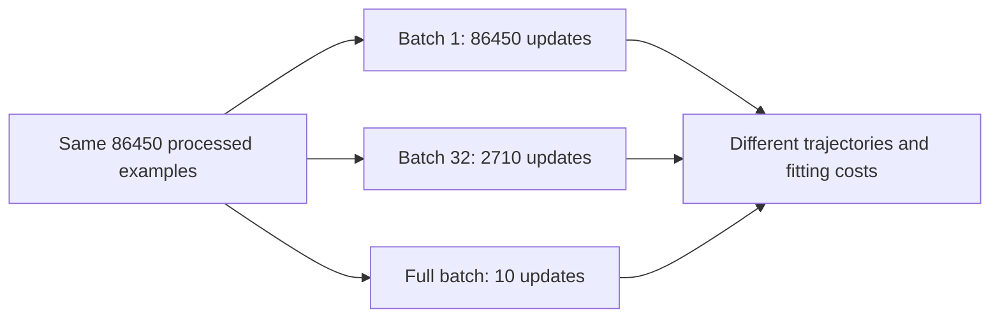

# Learning points: Compare batches, momentum and Adam

The model is still the same calendar-only linear function. The new work changes how we estimate a gradient, how we use its history and how far we move. Keeping those choices separate is what lets the results explain something. A single table combining new batches, rates and optimizers would leave us guessing which change mattered.

The [understanding notes](lessons/05-batches-and-optimizers.md) contain the full real-hour calculations, consequential source blocks, comparison tables and diagrams. These explanations are for returning to the ideas without having to reconstruct them from a run directory.

## One real hour makes optimizer history visible

For Monday 3 January 2011 at 08:00, the observed target is 154 rentals. We start with zero weights and the training-mean intercept, so the prediction is 143.7944. Repeating this one row twice gives a deliberately small calculation in which we can follow every change. It is distinct from the dataset comparison, where batches contain different training rows.

At rate 0.01, plain SGD moves this prediction to 148.3743, then 150.8989. Momentum starts identically because its initial velocity is zero. Its second prediction reaches 155.0208 because the previous gradient is still contributing to the update. That overshoot gives an ordinary meaning to the stored velocity: the next move depends on where the optimizer has been, as well as the current residual.

Our momentum buffer keeps 90% of its old value and adds the new gradient. We apply the rate afterward. Writing that convention explicitly matters because another implementation may store a rate-scaled velocity or use a weighted average instead. The shared word “momentum” is insufficient to reproduce an update. With our convention, a persistent gradient can accumulate to about ten times its current value, helping explain why the pilot chooses momentum rate 0.001 while SGD uses 0.01.

## Adam changes the scale of a coordinate's step

Adam stores a moving average of the gradient and another of its square. The first contains directional history; the second gives a recent squared magnitude. Dividing the corrected first moment by the square root of the corrected second moment makes a large gradient produce a less directly proportional step than plain SGD would.

For the real hour's first hour-8 gradient, about −48.7473, SGD at 0.01 adds about 0.48747 to that weight. Adam adds approximately 0.01. Every coordinate has its own normalization, so the full forecasts differ: Adam predicts 144.0249 after one update and 144.2552 after two. This is a consequence of the update rule at the chosen rate, not a ranking of the algorithms.

The zero-initialized moving averages need a declared correction. We divide the stored moments by one minus their decay factor raised to the update count, starting that count at one. Epsilon is added outside the square root. A tiny-gradient check makes that placement observable, and a changing-gradient check makes remembered direction observable. Those details are easy to omit when an algorithm is treated as a name rather than a calculation.

## A batch is both an estimate and a unit of work

A batch of one gives a gradient from one observed hour. A batch of 32 averages 32 contributions, while a full batch averages all 8,645 training rows. These gradients can point in different directions because individual hours have different residuals and feature values. Our source averages over the rows actually returned, including the five-row tail at the end of a 32-row epoch.

Shuffling changes the training order without changing the chronological split. We permute the fixed 2011 membership and never move a validation row into that loop. Each epoch visits every training row once. Repeating a seed reproduces its order; a new seed changes it. The saved permutation and cursor make the current position concrete rather than relying on a vague idea of having completed “some training.”

The work counts explain a result that initially looks surprising. Ten passes means 86,450 processed examples for all batch policies, but it gives single-row SGD 86,450 updates, mini-batch SGD 2,710 and full-batch SGD only ten. At the fixed rate 0.01, the full-batch run has barely started moving toward the known optimum. Its worse score is not evidence that full-batch fitting lacks the capacity to solve this linear model. The earlier converged run already demonstrates that capacity.

The arrows separate the shared exposure budget from the number of parameter changes it permits. Comparing equal updates would answer a different question because the number of visited examples would then differ.

## A comparison needs its choices frozen before the answers arrive

We give each optimizer the same four-rate pilot allowance at batch 32, using training data only. The selected rates minimize final full-training squared error among candidates that complete the pilot budget. Validation MAE does not choose them. Failed rate-1.0 SGD and momentum candidates remain visible in the pilot records.

The main optimizer study holds batching fixed. The batch study holds SGD and its rate fixed. The schedule study holds both fixed while changing the rate policy. Every main trial processes ten training passes, with explicit safety limits and paired seeds 17, 29 and 43. Identical configurations reuse the same trial, so repeated appearances in different tables do not become extra independent evidence.

The observed optimizer means are 116.1661 MAE for SGD, 116.6027 for momentum and 114.3608 for Adam. Adam has more seed variation and larger training squared error in this run. That result does not make it a universally better optimizer, or change what this calendar model can express. The group baseline remains stronger at 91.5729 MAE. Three seeds show some sensitivity to training order; they do not establish a population-level confidence claim.

## Settling toward the training optimum can leave validation unchanged

A constant rate keeps responding to later batch noise. Our one schedule comparison reduces the SGD rate according to examples already processed, halving it after five training passes. The progress unit is explicit: 100 updates could mean very different amounts of data for different batch policies.

The decayed run finishes closer to the known training optimum. Mean half squared error falls from about 3177.8966 with the constant rate to 3168.3497 with decay, near the converged reference's 3167.5273. Its validation MAE rises slightly, from 116.1661 to 116.5579. The smaller variation across seeds is useful evidence about these final fits, but it does not turn a training improvement into a forecast improvement.

That distinction carries forward from the earlier linear study. We optimize squared error on one period and evaluate absolute error on a later period. An optimizer can fit its stated objective more closely while producing a less favorable value of another metric on other observations. We report both instead of changing the interpretation after seeing which number improved.

## Resuming training requires more than a saved forecast

Weights, intercept, scaler and feature order determine the current forward prediction. The next training update also needs optimizer history, its update count, the rate policy's progress and the next batch. If any of those change, identical current predictions can lead to different later parameters.

A four-row fixture with batch size three gives a concrete pause: after the first update, one row remains in that epoch. Resumption must use that row with denominator one, preserve the optimizer's buffers and continue the saved RNG sequence for the next epoch. Restarting a permutation or resetting Adam's counter changes the algorithm even if the current weights look correct.

Our JSON continuation checks reproduce uninterrupted parameters, moments, ordering and RNG state exactly for all three rules. The run artifacts retain the source/data/scaler identities that a recovery caller must match. This establishes the local algorithm-state path. The later application work still owns restoring a real saved run in a fresh process and exposing its supported inference behavior.

The main learning result is the connection between a gradient estimate, remembered state, work budget and observed trajectory. The assistant handles the routine code; the review can focus on explaining why those choices changed the numbers without changing the model family.

Return to the [worked understanding notes](lessons/05-batches-and-optimizers.md).
