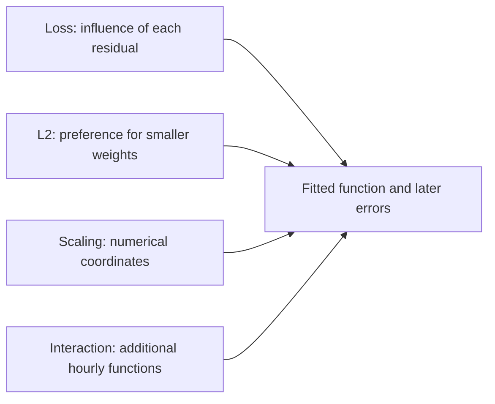

# Learning points: Change the loss, regularization and calendar structure

The useful result of this work is a clearer distinction between four choices that are often grouped together as model tuning. A loss decides how each miss contributes to fitting. A penalty expresses a preference among parameter vectors. Scaling changes numerical coordinates. A feature interaction changes which functions the model can represent. We kept those questions separate so the observed differences have an explanation.

The [understanding notes](lessons/06-losses-and-calendar-structure.md) contain the full calculations, code traces and result tables. These learning points connect the ideas in a form that can be revisited without reconstructing the run files.

## The loss gives an error its influence

The same real training hour has target 154 and starting prediction 143.7944. Its residual is −10.2056. Half squared error gives it slope −10.2056, absolute error gives −1, and Huber with threshold 10 gives −10. The negative sign agrees across them because the forecast is too low. The magnitude changes how much this row pulls the weights when combined with the other training rows.

Huber's threshold is measured in rentals per hour, just like the residual. Below it, the slope follows the error; beyond it, the slope is capped. Absolute error has a corner at zero, where we explicitly choose subgradient zero. These are operational definitions in the code, rather than interchangeable names for a generic loss.

Changing an illustrative target from 154 to 454 makes the contrast clearer. Squared error's pull grows sharply, while MAE and Huber keep their bounded slopes. That helps explain robustness to large residuals without identifying every large real rental count as an error that should be ignored. A busy commute can be exactly the behavior the application needs to estimate.

The fitted results also prevent a tempting shortcut. MAE lowers training absolute error from about 59.23 for the squared-error reference to 56.76, yet its later MAE is worse. Its busy Monday forecast is closer to 420, while other hours collectively offset that improvement. A loss that matches the name of the reporting metric does not automatically generalize best to a different period.

The pilot compares rates within each objective, not numerical loss values between objectives. Huber loss and MAE have different scales and units. All four losses select rate 1.0 under the declared allowance, and their main Adam fits stop after 2,000 updates. We keep the final iterate rather than inventing a convergence claim or choosing a favorable checkpoint after seeing validation.

## L2 trades a closer training fit for smaller weights

Our penalty is lambda divided by two times the squared weight norm. It leaves the intercept unpenalized. For weights 2 and −3 with lambda 0.2, the penalty is 1.3 and its gradient is 0.4 and −0.6. That small example explains exactly which part of the next step tries to shrink the weights.

The normalization matters. Data loss is a mean, so duplicating all rows leaves both that term and the penalty unchanged. We check the same property in a fitted fixture. If a penalty were accidentally divided by the sample count again, changing dataset size would silently change the intended preference.

The real runs show a progressive reduction in standardized weight norm, from 105.54 without L2 to 9.93 at lambda 10. At that strong setting, forecasts approach the training mean and lose the useful hourly variation. Eliminating negative forecasts through strong shrinkage does not make the model accurate: the quiet hour is predicted near 124 and the busy hour near 147.

A small penalty improves raw validation MAE slightly, but loses to no penalty after nonnegative postprocessing. Output policy therefore belongs in the comparison. The penalty is also defined in standardized coordinates; assigning the same lambda to raw weights would mean a different preference. We isolated regularization with a stable augmented solve so an unfinished optimizer cannot explain its result.

## Numerical conditioning and expressive power are different

Standardization uses the same input information in different coordinates. At fixed rate 0.1 and 200 full-batch SGD updates, training half-MSE is about 4114.50 for raw indicators and 3167.53 for standardized indicators. That is evidence about the optimization trajectory under this allowance.

A direct training least-squares solve in both coordinate systems predicts the checked training and validation inputs almost identically, within 2.3e-12 rentals per hour. The model family did not become more expressive because a feature was divided by its training scale. Coefficients can differ under dependent columns, so equality of individual weights is the wrong test.

The quiet-hour example is especially useful here. The less optimized raw fit happens to predict about 4.39 against target 5, while the nearly optimized function predicts a negative value. One row can improve under a model whose overall objective and later MAE are worse. Understanding optimization requires keeping those three levels apart.

## A circular feature still needs a learner that can use its geometry

Sine and cosine place hour 23 close to hour 0, matching clock adjacency. At hour 8 the two values are approximately 0.866 and −0.5. Similar weekday and month pairs, plus the two flags, give eight inputs instead of 45.

The calendar position remains distinguishable, but a linear function of one pair has only a single sinusoidal shape for that cycle. It cannot freely assign each hour its own effect. Two sharp commute peaks are therefore a representational challenge, even though the input diagram looks natural. Additional harmonics would be another feature study.

The cyclic model's training error is higher, and its busy Monday forecast is only about 52 against 420. Raw MAE looks slightly better than the one-hot model, while clipped MAE and RMSE are worse. Those different summaries are a reason to retain the full evidence, rather than choose a representation because it has fewer columns or an attractive visual interpretation.

## Interactions let one calendar effect depend on another

The additive model has one working-day shift shared across hours. Appending hour-indicator times working-day products lets the contrast change by hour. Monday at eight activates the new hour-8 working-day product, while the other 23 products stay zero.

That change improves training half-MSE to 1932.27, raw validation MAE to 108.69 and clipped MAE to 100.52. Its busy Monday forecast rises to about 260.31, closer to 420. The quiet-hour raw prediction becomes more negative, showing that greater flexibility has no automatic count constraint or per-row improvement guarantee.

These arrows identify different causes of a changed fitted result. Our separate study families hold the other choices fixed where needed, rather than changing all four and attributing the outcome to one favorite technique.

## Postprocessing and selection are part of the saved contract

For a nonnegative target, clipping a negative forecast to zero cannot increase its absolute or squared error. The quiet-hour error falls from 75.68 to 5 when −70.68 becomes zero. A positive forecast at the busy hour stays unchanged, so clipping does not solve the main peak deficit.

We retain raw and clipped outputs separately and apply each policy consistently to every evaluated row. The selection then uses validation MAE under the declared rule, including the established baselines. All models and pilot-rate choices were fitted before validation was loaded; validation is deliberately used afterward to choose a development reference.

The group baseline still wins at 91.57 MAE. Its raw and clipped policies tie because its predictions are already nonnegative, so the tie rule keeps raw output. The saved selection records the model hash, policy, protocol identity and score. It is a reference for the next comparison, not a completed application or final-test result.

Passing 72 code checks and independent audits establishes implemented behavior. The remaining learning discussion is to explain why these different changes affected the numbers, and why the newest model need not become the selected reference. No new learner answer has been assumed.

Return to the [worked understanding notes](lessons/06-losses-and-calendar-structure.md).
