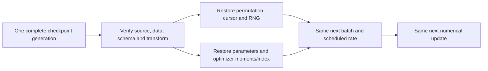

# Learning points: Reload predictions and recover the next training update

The central distinction is between preserving an answer-producing function and preserving an unfinished computation. The saved hour/working-day predictor needs its historical group values, the input contract and the rules for interpreting its output. The unfinished Adam run needs those kinds of identities plus enough state to know exactly which computation comes next. They can both be called “saved models” casually, but treating them as interchangeable is how a successful load becomes a different experiment.

Our Monday example makes inference concrete. At 07:00 we ask for the hour beginning at 08:00. The saved training group returns 349.5040 rentals/hour from 248 supporting observations. A fresh Python process returns exactly the same value without the original training lists or a target file. The later count of 420 explains the negative residual after the forecast. It does not help recover or choose the forecast. Preserving that boundary is more important than the mechanics of reading JSON.

The surrounding contract gives the numbers their meaning. Forty-five feature positions with the wrong order could still pass a superficial length check. A valid floating-point answer could still describe an unsupported date or a different output policy. The bundle therefore carries schema/order, raw-output/fallback behavior, the historical date domain, model/data identities and recorded holiday metadata. That metadata resolves a consistent calendar request; it does not introduce later rental counts or a newly trained holiday effect.

There are two useful notions of identity here. Member hashes detect changed bytes, and a trusted manifest hash identifies the bundle the caller intended to load. Neither makes an unknown producer trustworthy. Semantic checks still reject an incompatible schema even if someone recomputes file checksums. Keeping the original candidate and producer records also matters: the application is new, while the selected function and its original fitting history are unchanged. New execution evidence should extend that history rather than rewrite it.

The same idea explains why reloading can faithfully preserve a limitation. A June Monday at 08:00 still selects the January request's hour/day-type key and receives 349.5040. The absence of month sensitivity survives a perfect export. Reproducible inference establishes which function is running. Its quality remains a separate empirical question, and the earlier June and rush-hour failures remain relevant in the working application.

For training, the paused state points to an exact next action. At update 273, the stream has processed one full set of 8,645 rows plus 64 from the next permutation. The next batch starts at cursor 64 of that saved order; the next learning rate follows 8,709 processed examples. Restarting the same seed would not identify this cursor, the already drawn permutation or the generator state needed by a later shuffle. Matching the actual training file matters too, because positions select different observations if the data order changes.

Adam adds another dependency on history. Its first and second moments summarize earlier gradients, while the retained update index determines bias correction. The first resumed hour-8 gradient is about −54.0643, but the actual move also uses saved moments and the decayed rate. Together they move the standardized weight from 1.194154 to 1.197890. Keeping only the weights would lose part of the rule that generated this update. Zeroing moments while keeping the same future batch sequence produces a different final parameter vector in the executed control.

The scaler belongs in that checkpoint as well. Its training means and population deviations define the coordinates in which the weights and moments were learned. Reusing those saved statistics is part of resuming the same computation. Refitting a transform on a changed population could make equal-looking weight arrays describe a different function. The context check binds source, runtime, dependency lock, data, feature order, configuration and training-fitted transform before continuation is allowed.

Monitoring deserves a precise scope. This recovery run retains training observations and the best observed training objective, but early stopping is disabled and the fixed example budget controls completion. A pause adds an extra monitoring observation without changing gradients. The uninterrupted and resumed runs therefore need matching common observations and exact final numerical state; they do not need identical wall-clock timings or identical numbers of diagnostic entries. Exact local parity is a result under the declared CPU/runtime conditions, not a promise across arbitrary hardware and libraries.

Each arrow carries a real dependency. The stream chooses which residuals contribute to the next gradient, the saved transform defines their coordinates, and the optimizer state turns that gradient into a parameter move. If one of those inputs changes, we are continuing from a different computation even when the program still runs successfully.

A robust save path has a publication boundary. The writer prepares a complete state/context/receipt generation in a pending directory, flushes it, and publishes the directory together. The loader ignores unfinished directories and verifies each published member before accepting the generation. That prevents a half-written file or a mixture of weights and moments from becoming an apparently successful checkpoint. Single-writer assumptions and platform/storage limits should remain explicit rather than being hidden behind the word “atomic.”

Fallback is observable rollback. In the deliberate damage probe, generation 3 fails its state checksum, the pending generation is ignored, and generation 2 restores update 273. The next update is recomputed from that complete state. The receipt names what was rejected and what was loaded. A different source/data/schema context is another matter: the loader must find a matching generation or fail, rather than quietly call an unrelated old checkpoint a recovery.

The application carries the prediction/evaluation distinction into something we can use. It first displays the saved estimate, simple baseline, issue time and identities. A separate action asks for the recorded outcome. The server can hold that observation store for historical replay while the predictor remains independent of it. The browser check confirms that the client does not request the outcome before the explicit comparison action. This is an architectural boundary with visible user behavior, not merely a comment about avoiding leakage.

A missing observation should stay missing all the way through that interface. The real 2 January 03:00 hour can receive an estimate from valid calendar inputs, yet has no recorded target or residual to display. An unsupported 2013 request instead produces a clear error and clears the previous forecast. Those outcomes distinguish an available estimate, unavailable evidence and an invalid request. Turning all three into a successful-looking number would erase information the user needs.

The benchmark view is a reader of earlier evidence. Its June sort changes table order while the active saved candidate remains fixed by the original overall-MAE choice. That makes the forest's stronger June result visible without silently introducing a new selection objective. Fit/stopping records and storage/timing measurements also retain their original meaning. A direct solver has no iterative updates to count; JSON size is not peak RAM; a local batch replay time is not optimized production latency.

The completed application and exact recovery make this project more usable and reproducible. They do not settle whether its forecasts are useful for an operator, demonstrate learner understanding or produce a final-test result. The three-pass linear recovery run is intentionally short and does not replace the stronger group candidate. The useful review is to explain how the computation can resume perfectly while model quality remains limited. The [worked notes](lessons/09-saved-predictions-and-recovery.md) keep the actual values, source blocks, state trace and application checks together for that discussion.

Return to the [worked understanding notes](lessons/09-saved-predictions-and-recovery.md).
