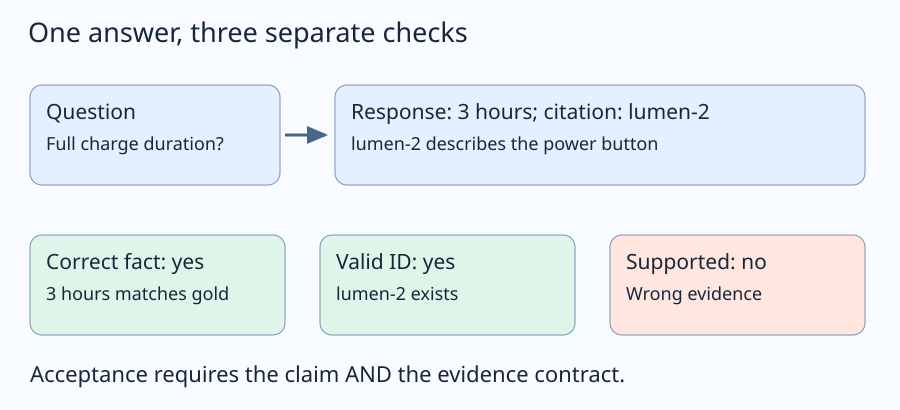
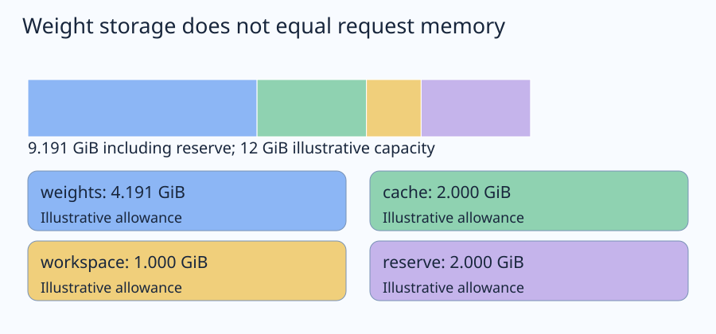
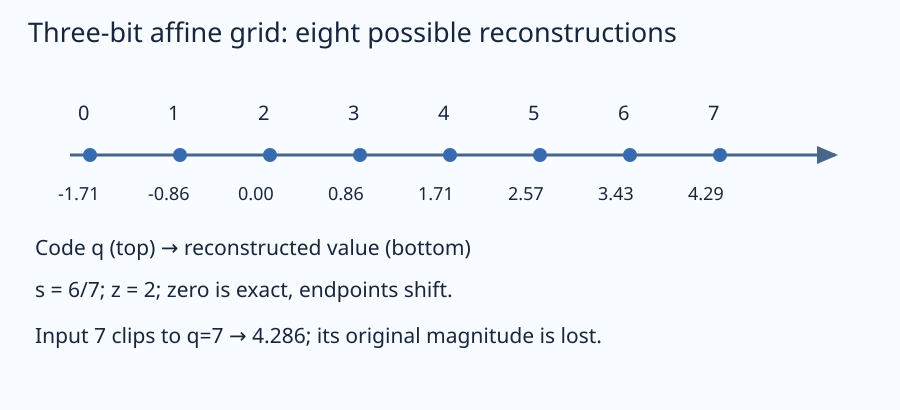
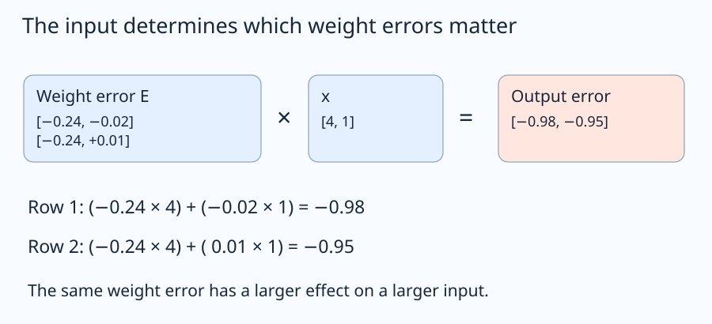
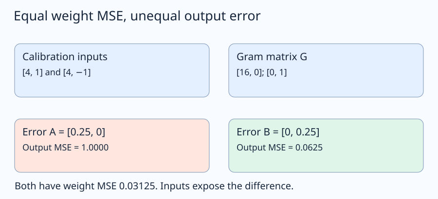
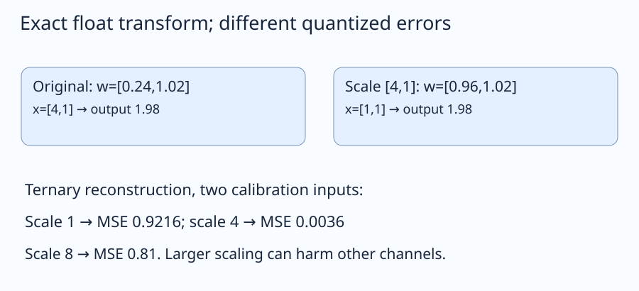
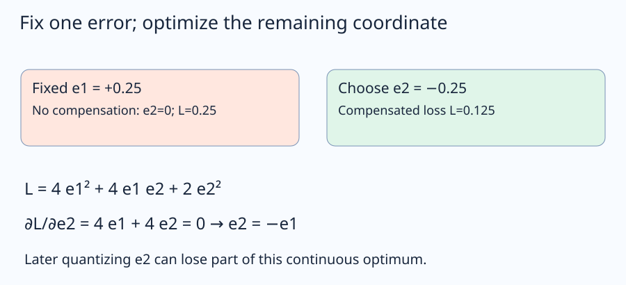
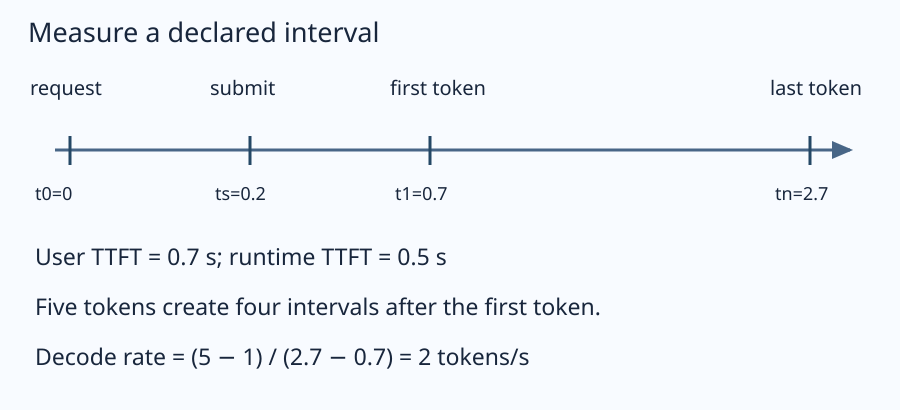
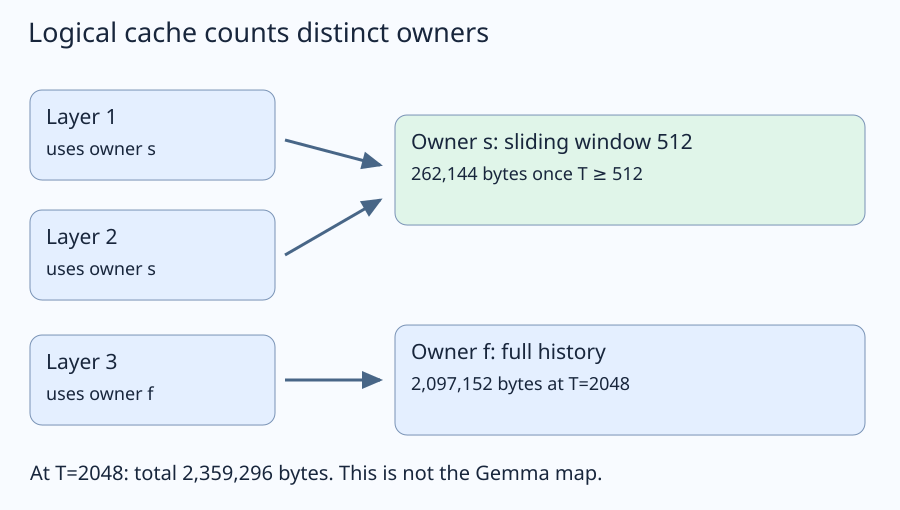
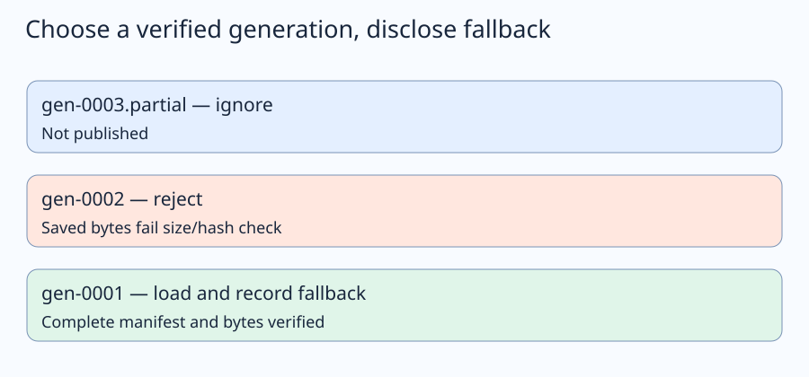

# Document Assistant: understand and build every quantization phase

How do we build an evidence-grounded local document assistant, quantize its model, compare quality and resources fairly, manage context memory and reload a supported application?

Learning material for document-assistant. Model implementation/training and learner mastery are separate states.

**Outcomes:** 1. Start with an answer we can defend; 2. Know exactly what runs today; 3. A model choice needs an executable compatibility proof; 4. Budget the memory that is live at the same time; 5. Make evidence survive parsing and reruns; 6. Separate data roles and fit the actual prompt; 7. Establish what the floating-point reference actually does; 8. Derive the integer grid instead of memorizing “INT4”; 9. Store four-bit codes as four-bit codes; 10. Follow a weight error into the layer output; 11. Turn weight formats into an identifiable comparison; 12. Learn which weight errors the inputs amplify; 13. Protect a sensitive channel through an equivalent scaling; 14. Derive why later weights can compensate for an earlier rounding error; 15. Spend precision where the declared budget permits; 16. Score the answer the application promises; 17. Give every latency number a start, an end and a workload; 18. Derive cache growth from the state actually stored; 19. Change cache precision without changing the weight experiment; 20. Save a candidate that can be verified after restart; 21. Give inference a request and response boundary; 22. Connect a local interface that exposes the evidence and limits; 23. Freeze the choice before opening final results; 24. Connect every phase to evidence that someone else can inspect.

## 1. Start with an answer we can defend

Read this invented product-manual passage: **“A full charge takes 3 hours. Use the supplied 12 V adapter.”** The question is “How long does a full charge take?” An assistant replies “3 hours” and cites the passage about the power button. Is the answer acceptable? Its words are correct, but its supporting reference is wrong. This small distinction determines what we will preserve when compressing a model.

Our project is a local document assistant under a memory budget. The result we eventually want is an application that takes a document and a question, returns a supported answer or an explicit “not in this document,” and can reload a chosen compressed model after restart. We will learn why each compression mechanism works, implement small complete references, and design the measurements that decide whether it helps this application. A smaller file alone does not answer that question.

### One fixture for the entire route

The Lumen lamp manual is authored teaching data, not a published benchmark. Its three passages are:

| Stable teaching ID | Text | What it can support |
| --- | --- | --- |
| lumen-1 | A full charge takes 3 hours. Use the supplied 12 V adapter. | Charging time; adapter voltage |
| lumen-2 | Hold the power button for 2 seconds to start the Lumen lamp. | Starting procedure |
| lumen-3 | The Lumen lamp is intended for indoor use only. | Intended environment |

“What is the warranty duration?” is unanswerable from this manual. We do not reward a plausible warranty guessed from the model's general knowledge. The target is an answer **from the supplied evidence**. Later we will add long distractors, evidence at different positions, paraphrases and deliberately unavailable facts. We keep these questions separate from text used to calibrate compression.

### Define the output before choosing a runtime

For each request, preserve the question ID, exact prompt identity, supplied passage IDs, answer text, cited passage IDs, answer/refusal status, finish reason and artifact/run identity. The initial answer contract has three different checks. Correctness asks whether the claim matches the labeled fact. Citation validity asks whether cited IDs exist in the supplied material. Support asks whether the referenced text establishes the claim. A real evaluator also checks that extra claims and extra citations do not smuggle in unsupported content; the first reference below intentionally checks only the tiny fixture.

Let $C$, $V$ and $E$ denote correctness, valid references and evidence support. A supported correct answer requires their conjunction $C\land V\land E$. These are Boolean conditions, not probabilities. Knowing $C=1$ does not imply $E=1$. In our opening example, the words pass correctness, the existing power-button ID passes validity, and the evidence check fails. If the source never contained a charging time, a refusal would be appropriate even if a memorized answer happened to match another manual.



The three checks belong beside each other because a compression regression can affect any of them: a number may change, a citation ID may be malformed, or a model may become more willing to guess. We retain raw responses so a parser failure remains visible rather than silently becoming an empty answer.

### Run the first complete reference

Create `01_contract.py` in a new scratch directory, or download the linked file. This and subsequent teaching files use Python's standard library unless the lesson explicitly says C++. They do not load a model. Every helper used below is defined before its call. The file is deliberately small enough to inspect the entire contract.

[Download the complete reference](examples/01_contract.py)

```python
"""An authored manual fixture, not a language model or production evaluator."""
import json

PASSAGES = {
    "lumen-1": "A full charge takes 3 hours. Use the supplied 12 V adapter.",
    "lumen-2": "Hold the power button for 2 seconds to start the Lumen lamp.",
    "lumen-3": "The Lumen lamp is intended for indoor use only.",
}
QUESTION = {"id": "q-charge", "text": "How long does a full charge take?",
            "answerable": True, "answer": "3 hours", "evidence": {"lumen-1"}}


def score(record, gold, passages):
    """Exact fixture checks; semantic entailment needs a separate review rubric."""
    answer = record["answer"].strip().casefold()
    cited = set(record["citations"])
    correct = answer == gold["answer"].casefold()
    valid_ids = bool(cited) and cited <= passages.keys()
    supported = correct and valid_ids and gold["evidence"] <= cited
    return {"correct": correct, "valid_ids": valid_ids, "supported": supported}


def main():
    good = score({"answer": "3 hours", "citations": ["lumen-1"]}, QUESTION, PASSAGES)
    wrong_source = score({"answer": "3 hours", "citations": ["lumen-2"]}, QUESTION, PASSAGES)
    assert good == {"correct": True, "valid_ids": True, "supported": True}
    assert wrong_source["correct"] and not wrong_source["supported"]
    print(json.dumps({"good": good, "wrong_source": wrong_source}))


if __name__ == "__main__":
    main()
```

`score()` compares case-folded fixture text, verifies passage membership and checks the expected evidence ID. `main()` constructs the correct and wrong-source cases rather than asking an LLM to grade itself. Notice why a substring match would be dangerous: “not 3 hours” contains the expected words and contradicts them. Exact matching also has a limit: “three hours” needs a declared alias or human semantic review. Lesson 16 extends the evaluator without pretending these two issues disappear.

From the scratch directory containing that file, run:

```bash
python3 01_contract.py
```

Expected checked output (JSON formatting may differ):

```json
{
  "good": {
    "correct": true,
    "valid_ids": true,
    "supported": true
  },
  "wrong_source": {
    "correct": true,
    "valid_ids": true,
    "supported": false
  }
}
```

The output should mark both answers correct but only the first supported. If both are supported, inspect the evidence-set comparison. If both fail validity, inspect IDs before changing any model setting. This is already a useful debugging order: separate data/schema errors from inference errors.

### Predict or explain: An answer says “3 hours and a five-year warranty,” citing lumen-1. Which checks can pass, and what still fails?

<details data-practice-id="contract-transfer"><summary>Reveal worked answer and rubric</summary>

The charging fact matches and lumen-1 is a valid ID. The warranty claim is absent from the supplied evidence, so complete-answer support fails. The first exact fixture scorer is insufficient for this extra-claim case; review all material claims or use a stricter declared evaluator.

**Rubric:** Distinguish fact correctness, ID membership and semantic support; name the fixture limitation.

</details>


### How to use this long course

The first session can stop after Lessons 1–4: you will have the answer contract, understand the current launcher, know what a compatible model probe must prove and calculate a memory budget. Continue in order for document preparation, reference generation, integer quantization, calibration-aware methods, task/timing evaluation, cache studies and a recoverable application. The [saved outline](project/course-outline.md) maps all 24 lessons to the project's seven phases; the [implementation record](project/implementation.md) is a return-to-work checklist, not another mandatory course.

At authoring time the **real project is runnable boilerplate**. Status, setup checks and configuration work. Model loading, quantization, answering and measured comparisons are pending. The complete references in this course establish arithmetic and component contracts; they are not Gemma benchmark results or evidence that the application exists. The [readiness record](project/readiness.md) keeps those evidence levels separate. Next we inspect the actual source so that every command has an honest meaning.


## 2. Know exactly what runs today

We have defined what an acceptable answer means. Before building one, inspect what the current project actually executes. A launcher that prints a model name can be useful setup tooling while providing no evidence that a model can load. We need that distinction to interpret every later command.

The owning project folder is `/mnt/projects/ai/ai_projects/projects/quantization-lab/document-assistant`. It is an ordinary directory in `ai_projects`, with its own Python environment and lockfile; it is not a nested Git repository. The shared controller lives independently in `/mnt/projects/ai/cli`. From workspace home use `./ai`; from Projects use `../ai`.

### Follow one action through its complete dependency chain

The direct script `src/document_assistant.py` calls `utils.commands.main()`. The command module imports `load_config()` and the explicitly pending workflow. To avoid a hidden-helper jump, the following captured listings show the definitions in dependency order: configuration, pending-result construction, command dispatch and the thin entry point. The listings are inspected working-source bytes, not a proposed full assistant.

**Existing `src/core/config.py`:**

```python
"""Load pinned configuration without loading a model or creating artifacts."""
from __future__ import annotations

from importlib import resources
from pathlib import Path
import re
import tomllib
from typing import Any


PROJECT_ID = "document-assistant"
POSITIVE_FIELDS = ("max_input_tokens","max_output_tokens",)


def load_config(path: Path | None = None) -> dict[str, Any]:
    text = (path.read_text(encoding="utf-8") if path is not None
            else resources.files("core").joinpath("project.toml").read_text(encoding="utf-8"))
    config = tomllib.loads(text)
    if type(config.get("schema_version")) is not int or config["schema_version"] != 1:
        raise ValueError("Configuration requires schema_version = 1")
    if config.get("project_id") != PROJECT_ID:
        raise ValueError(f"Configuration must belong to {PROJECT_ID}")
    for section in ("model", "fallback_model"):
        if section == "fallback_model" and section not in config:
            continue
        model = config.get(section)
        if not isinstance(model, dict) or not isinstance(model.get("repo_id"), str) or not model["repo_id"].strip():
            raise ValueError(f"{section} requires a nonempty repo_id")
        revision = model.get("revision")
        if not isinstance(revision, str) or re.fullmatch(r"[0-9a-f]{40}", revision) is None:
            raise ValueError(f"{section} requires an exact 40-character model revision")
    if config["model"].get("compute_dtype") not in ("float32", "bfloat16"):
        raise ValueError("The source model uses float32 or bfloat16 inference")
    experiment = config.get("experiment")
    if not isinstance(experiment, dict):
        raise ValueError("Configuration requires an experiment table")
    seed = experiment.get("seed")
    if type(seed) is not int or seed < 0:
        raise ValueError("Experiment seed must be a nonnegative integer")
    for field in POSITIVE_FIELDS:
        value = experiment.get(field)
        if type(value) is not int or value <= 0:
            raise ValueError(f"{field} must be a positive integer")
    return config
```

**Existing `src/core/workflow.py`:**

```python
"""Declare future entry points without simulating their completion."""

PENDING_ACTIONS = ("prepare-data","quantize","evaluate","answer",)


def pending_result(action: str) -> dict:
    if action not in PENDING_ACTIONS:
        raise ValueError(f"Unknown pending action: {action}")
    return {
        "project": "document-assistant",
        "action": action,
        "status": "not_implemented",
        "message": "Document ingestion, quantization, evaluation and answering remain pending. No model or output was created.",
    }
```

**Existing `src/utils/commands.py`:**

```python
"""Read-only scaffold commands; no model frameworks or network clients."""
from __future__ import annotations

import argparse
import json
from pathlib import Path
import sys

from core.config import PROJECT_ID, load_config
from core.workflow import PENDING_ACTIONS, pending_result


def main(argv: list[str] | None = None) -> int:
    parser = argparse.ArgumentParser(description="Local Document Assistant Under a Memory Budget — project boilerplate")
    parser.add_argument("action", nargs="?", default="status",
                        choices=("status", "check", "show-config", *PENDING_ACTIONS))
    parser.add_argument("--config", type=Path, help="Use a project configuration TOML file")
    args = parser.parse_args(argv)
    try:
        config = load_config(args.config)
        if args.action in PENDING_ACTIONS:
            print(json.dumps(pending_result(args.action), indent=2), file=sys.stderr)
            return 2
        if args.action == "show-config":
            result = config
        else:
            if args.action == "check" and sys.version_info[:2] != (3, 12):
                raise ValueError("Use the project's Python 3.12 environment")
            result = {
                "project": PROJECT_ID,
                "status": "boilerplate",
                "model": config["model"],
                "experiment_defaults": config["experiment"],
                "pending_actions": list(PENDING_ACTIONS),
                "model_execution_verified": False,
            }
            if args.action == "check":
                result["setup_checks"] = {
                    "python": sys.version.split()[0],
                    "configuration": "valid",
                    "source_imports": "ok",
                }
        print(json.dumps(result, indent=2))
        return 0
    except (OSError, ValueError) as exc:
        print(json.dumps({"status": "error", "message": str(exc)}, indent=2), file=sys.stderr)
        return 1
```

**Existing `src/document_assistant.py`:**

```python
"""Run Local Document Assistant Under a Memory Budget scaffold commands."""
from utils.commands import main

if __name__ == "__main__":
    raise SystemExit(main())
```

`load_config()` reads packaged `core/project.toml` through `importlib.resources` when no explicit path is supplied. This is why an installed wheel can find the same defaults without relying on the current directory. TOML parsing produces ordinary Python values; the loader validates schema, owning project, exact model revision, source compute dtype, seed and token budgets. `type(value) is int` deliberately rejects a Boolean where an integer budget is required, since Python otherwise treats `True` as integer-like.

`pending_result()` does not create a fake output. The command layer prints it to standard error and returns 2. Successful setup actions print JSON to standard output and return 0; configuration/read failures return 1. Those codes distinguish “setup succeeded,” “configuration failed” and “workflow not implemented.” An empty results directory is consistent with a successful status command.

### Use the existing CLI and TUI

From `/mnt/projects/ai`, these commands use the shared controller and project-owned launcher profile. They inspect/run the scaffold; they do not acquire weights.

```bash
./ai run document-assistant
./ai test document-assistant
./ai tui
```

In the TUI, expand **Projects → Quantization Lab → Document Assistant**. Select **Project status**, **Check setup** or **Show configuration**, then choose **Run**. **Checks** runs scaffold tests. Setup environment and Build package are separate tooling actions. The profile deliberately does not offer an “Answer” button that implies working inference. Inspect [the captured launcher profile](evidence/launcher-profile.txt).

For direct execution, run these from the project folder:

```bash
.venv/bin/python src/document_assistant.py status
.venv/bin/python src/check_setup.py
.venv/bin/python src/show_config.py
.venv/bin/python src/document_assistant.py answer
```

The last command is a deliberate negative check: expected exit 2 and `status: not_implemented`. The environment is pinned to Python 3.12.13; the setup check enforces the 3.12 minor line. Frozen installation uses `uv sync --frozen` from this project folder when its environment needs recreation. That operation installs scaffold/dev tools, not a chosen inference stack.

### Verify without relying on the working directory

The reference below has an optional live mode. With no argument it states its portable contract. With the actual project path it invokes four real actions from `/tmp`, parses the correct output stream and checks exit codes. The live mode runs the project interpreter and actual script.

[Download the complete reference](examples/02_scaffold_trace.py)

```python
"""Check the real project entry point from an explicitly supplied root."""
import json
from pathlib import Path
import subprocess
import sys


def inspect(root):
    python = root / ".venv/bin/python"
    script = root / "src/document_assistant.py"
    results = {}
    for action, code in [("status", 0), ("check", 0), ("show-config", 0), ("answer", 2)]:
        run = subprocess.run([str(python), str(script), action], cwd="/tmp",
                             text=True, capture_output=True, check=False)
        assert run.returncode == code, run.stderr
        payload = json.loads(run.stdout if code == 0 else run.stderr)
        results[action] = {"exit": code, "project": payload["project_id"] if action == "show-config"
                           else payload["project"]}
        if action == "answer":
            assert payload["status"] == "not_implemented"
        elif action != "show-config":
            assert payload["model_execution_verified"] is False
    return results


if __name__ == "__main__":
    if len(sys.argv) == 2:
        print(json.dumps(inspect(Path(sys.argv[1]).resolve())))
    else:
        # Portable course check: inspect syntax/contract without a live checkout.
        print(json.dumps({"scope": "invoke with project root for live scaffold check",
                          "expected_exit_codes": [0, 0, 0, 2]}))
```

From the scratch directory containing that file, run:

```bash
python3 02_scaffold_trace.py
```

Expected checked output (JSON formatting may differ):

```json
{
  "scope": "invoke with project root for live scaffold check",
  "expected_exit_codes": [
    0,
    0,
    0,
    2
  ]
}
```

For the live check, from the scratch directory use:

```bash
python3 02_scaffold_trace.py /mnt/projects/ai/ai_projects/projects/quantization-lab/document-assistant
```

If imports work only from `src/`, inspect packaging and entry points. If `check` rejects the interpreter, recreate the pinned environment instead of disabling validation. If `answer` returns a plausible response here, investigate a source change before treating it as model evidence. The [reference-run record](project/reference-runs.md) states which checks were actually executed during tutorial preparation.

### Predict or explain: The TUI status runner exits 0 and prints Gemma 4. May we mark model compatibility verified?

<details data-practice-id="scaffold-transfer"><summary>Reveal worked answer and rubric</summary>

No. It validated/read configuration and printed the planned source. It did not load weights or generate tokens. Keep model_execution_verified false; answer remains exit 2. Compatibility needs actual load/template/EOS/placement/reload receipts.

**Rubric:** Trace status through config/dispatcher and name missing runtime evidence.

</details>


### Where later work belongs

Future canonicalization belongs in `src/data/`, artifact recipes in `src/quantization/`, and aligned scoring/measurement in `src/evaluation/`. `src/core/` owns configuration and the answer lifecycle; `src/utils/` owns shared boundaries. These are destination contracts, not existing implementations. We will not paste teaching fixtures into production packages and call the pipeline complete. Next we establish what a backend must prove before these planned actions can be enabled.


## 3. A model choice needs an executable compatibility proof

The scaffold identifies a source model, but an identifier is only the start. The proposed primary checkpoint is `google/gemma-4-E4B-it` at revision `ee0ef6023621cff504d758262d4e04895a5af4a2`. We keep this current-generation project target while freezing its bytes for comparisons. “Latest” is useful at intake and harmful as an experiment identity: a moving branch can change underneath two nominally identical runs.

### Read architecture facts before making a memory promise

The [pinned official configuration](https://huggingface.co/google/gemma-4-E4B-it/raw/ee0ef6023621cff504d758262d4e04895a5af4a2/config.json) identifies a 42-layer text decoder with local and full attention, a 512-token local window, distinct local/global head dimensions and KV sharing. The captured [configuration file](evidence/gemma4-config.json) is small metadata, not downloaded weights. Those facts explain why a generic “layers × context × heads” estimate needs architecture-specific corrections. We derive a logical cache model in Lesson 18; actual allocation remains a backend measurement.

The full checkpoint also carries multimodal configuration. Our first application uses text documents. A text-only application does not automatically prove that its exporter omits every audio/vision parameter, nor that all embeddings fit an advertised effective parameter count. Inventory converted tensors and measured memory. The [model card](https://huggingface.co/google/gemma-4-E4B-it/tree/ee0ef6023621cff504d758262d4e04895a5af4a2) is a source of intended architecture/use, not evidence that our chosen runtime loads it.

### Pin the complete interpretation of the weights

A model artifact needs more than a repository commit. Preserve tokenizer and special-token files, configuration, chat-template bytes, source file hashes, conversion command/build, resulting tensor types, decoding settings and placement. The template translates structured user/system messages into the actual token sequence. If one run adds different control tokens or a different generation prefix, it is answering a different prompt even if the visible question is unchanged.

Create a probe manifest only after running each check. Its acceptance contract has five separate facts: the selected runtime loads the artifact, rendered prompt tokens match the declared template policy, generation stops at recognized end markers, a fresh process reloads it and placement is observed. A field set to `true` by an author is not a measurement; retain command, timestamps, exit status and output beside the manifest. Test a malformed input, a short answer and an unanswerable question. A model that emits valid text but never terminates is not ready for a bounded benchmark.

Context capacity means total tokens, including formatted prompt and generated output. If $P=2048$ prompt tokens and the output allowance is $O=256$, require $P+O\le C$, so $C$ must be at least 2304 under that runtime's definition. A publisher's maximum context is not a local memory budget. Check whether the runtime reserves the whole capacity, grows dynamically, pads to blocks or has separate per-sequence limits.

### A complete gate with synthetic probe results

Create `03_compatibility.py` in the scratch directory. This executable validates a manifest; it does not populate one by claiming to run Gemma. We give it a passing fixture, then remove template evidence and verify rejection. Exact revision syntax and `is True` comparisons prevent accepting a label such as `"probably"` as a completed probe.

[Download the complete reference](examples/03_compatibility.py)

```python
"""A manifest acceptance gate; capability values are deliberately fixtures."""
import json
import re


def require_ready(manifest):
    if not re.fullmatch(r"[0-9a-f]{40}", manifest["model_revision"]):
        raise ValueError("Model revision must be an exact commit")
    required = {"loads", "template_matches", "eos_stops", "reloads", "placement_verified"}
    missing = sorted(name for name in required if manifest["probes"].get(name) is not True)
    if missing:
        raise ValueError("Unproven capabilities: " + ", ".join(missing))
    if manifest["prompt_tokens"] + manifest["output_tokens"] > manifest["context_capacity"]:
        raise ValueError("Context capacity exceeded")
    return "ready_for_bounded_reference"


def main():
    sample = {"model_revision": "ee0ef6023621cff504d758262d4e04895a5af4a2",
              "prompt_tokens": 2048, "output_tokens": 256, "context_capacity": 2304,
              "probes": dict.fromkeys(["loads", "template_matches", "eos_stops",
                                      "reloads", "placement_verified"], True)}
    assert require_ready(sample) == "ready_for_bounded_reference"
    sample["probes"]["template_matches"] = False
    try:
        require_ready(sample)
    except ValueError as exc:
        rejected = str(exc)
    else:
        raise AssertionError("An unproven template was accepted")
    print(json.dumps({"fixture_only": True, "rejected": rejected}))


if __name__ == "__main__":
    main()
```

From the scratch directory containing that file, run:

```bash
python3 03_compatibility.py
```

Expected checked output (JSON formatting may differ):

```json
{
  "fixture_only": true,
  "rejected": "Unproven capabilities: template_matches"
}
```

The rejection should name `template_matches`. In actual phase 00, set this field only after preserving rendered messages, token IDs and the agreement check. Successful configuration parsing is weaker evidence than successful generation. A generic architecture implementation appearing in a runtime repository is weaker still: conversion, special tensors, kernels, device placement and reload can fail independently.

### Choose the first backend by an explicit gate

The pinned [llama.cpp source](https://github.com/ggml-org/llama.cpp/blob/9b8446b91434e0c0cdc293baf0b29c099eaaa0c7/src/models/gemma4.cpp) is a candidate for the GGUF route. OpenVINO/Optimum Intel is another candidate for a later supported method comparison. We have not compiled either against this checkpoint in this tutorial. At implementation kickoff, record compiler/runtime versions and run the small gate before choosing dependencies or acquiring large artifacts. If a backend lacks exact architecture support, keep the failed receipt and choose a supported build or a separately declared model fallback. Do not silently replace E4B with E2B inside the same experiment.

The planned fallback is Gemma 4 E2B at the revision already in project configuration. Treat it as a different model requiring a new budget and baseline. Shrinking the model and reducing its precision at once cannot tell us which change caused an answer regression.

### Predict or explain: A backend loads the weights, but its template adds a different generation prefix. Is this the same frozen prompt experiment?

<details data-practice-id="compatibility-transfer"><summary>Reveal worked answer and rubric</summary>

No. Visible question equality does not establish token-sequence equality. Capture rendered messages/template/token IDs, fix or separately version the template policy, then repeat the compatibility probe before comparing artifacts.

**Rubric:** Explain why template identity changes the input, rather than treating load success as enough.

</details>


The phase-00 output is a verified compatibility receipt plus a bounded working reference, not a benchmark score. The [source/departure ledger](research.md) records inspected facts and unknowns. Next we compute why a compatible model can still exceed memory once a real request starts.


## 4. Budget the memory that is live at the same time

We now know which source and runtime a reference would use. The next question is whether a complete request fits. A four-bit weight file may fit on disk while model loading, tokenization, context state or a large temporary operation exceeds the device budget. We need an arithmetic estimate and a measurement plan.

### Bits, bytes and the unit conversion

A bit has two possible values. A byte holds eight bits. For $N$ stored scalar parameters using exactly $b$ bits each, the packed payload is $\lceil Nb/8\rceil$ bytes. A decimal gigabyte is $10^9$ bytes; a gibibyte is $2^{30}=1,073,741,824$ bytes. Keep the label with every number. Dividing decimal parameter counts by binary memory capacities without converting units can hide a significant gap.

Consider a **hypothetical** inventory of eight billion stored values. At two bytes per BF16 value its raw payload is 16,000,000,000 bytes, about 14.901 GiB. Four-bit payload alone is 4,000,000,000 bytes. Suppose each group of 32 values also stores a two-byte scale: 250,000,000 groups add 500,000,000 bytes. Total toy storage is 4.5 billion bytes, or 4.191 GiB. It is a 3.56-fold payload-plus-scale reduction from BF16, not exactly fourfold. Real formats add metadata and may leave some tensors at higher precision.

### Separate lifetimes instead of adding unrelated peaks

For a fixed placement, approximate simultaneously live memory as

$$M_{\mathrm{live}}=M_{\mathrm{weights}}+M_{\mathrm{cache}}+M_{\mathrm{workspace}}+M_{\mathrm{other}}.$$

Weights are mostly persistent during inference. KV cache depends on retained sequence state. Workspace includes temporary activations, kernel scratch and possibly dequantization buffers. Other memory includes runtime/context objects and nonmodel allocations. The budget condition is $M_{\mathrm{live}}+R\le M_{\mathrm{capacity}}$, where $R$ is reserved headroom. This is meaningful only for allocations sharing a memory pool; host RAM and device-local memory need separate rows when a model is offloaded or mapped.

For a 12 GiB illustrative capacity, reserve 2 GiB and allow 1 GiB workspace plus 2 GiB cache. The 4.191 GiB toy weights give 9.191 GiB including reserve, so the plan fits. If cache grows to 8 GiB, the same model needs 15.191 GiB including reserve and fails. Reducing weight bytes did not remove the context constraint.



The figure shows a budget, not a measured allocation trace. Do not add the largest loading transient to a later steady-state cache peak if they never overlap. Conversely, do not ignore conversion that holds both source and destination weights simultaneously. Keep acquisition/conversion/calibration/inference peaks as separate operations, with overlap documented inside each.

### Execute the arithmetic and change the context allowance

Create `04_memory_budget.py`. `weight_bytes()` rounds payload bytes and group counts upward. That matters for small/nondivisible tensors. Counting one giant parameter vector underestimates per-tensor padding, so this remains a conceptual model until a real tensor inventory is supplied.

[Download the complete reference](examples/04_memory_budget.py)

```python
"""Illustrative arithmetic; no device capacity or model memory is measured."""
import json
import math

GIB = 2 ** 30


def weight_bytes(parameters, bits, group, scale_bytes):
    return math.ceil(parameters * bits / 8) + math.ceil(parameters / group) * scale_bytes


def main():
    # Hypothetical 8-billion stored scalars, not a Gemma tensor inventory.
    count = 8_000_000_000
    bf16 = count * 2
    q4 = weight_bytes(count, 4, 32, 2)
    reserve, workspace, cache = 2 * GIB, 1 * GIB, 2 * GIB
    capacity = 12 * GIB
    total = q4 + reserve + workspace + cache
    assert q4 == 4_500_000_000 and total < capacity < bf16
    print(json.dumps({"bf16_gib": round(bf16 / GIB, 3), "q4_gib": round(q4 / GIB, 3),
                      "total_gib": round(total / GIB, 3), "fits": total <= capacity,
                      "longer_cache_fits": q4 + reserve + workspace + 8 * GIB <= capacity}))


if __name__ == "__main__":
    main()
```

From the scratch directory containing that file, run:

```bash
python3 04_memory_budget.py
```

Expected checked output (JSON formatting may differ):

```json
{
  "bf16_gib": 14.901,
  "q4_gib": 4.191,
  "total_gib": 9.191,
  "fits": true,
  "longer_cache_fits": false
}
```

The output should report `fits: true` and `longer_cache_fits: false`. The inputs are visible assumptions, not detected hardware capacity. If your hand calculation differs, check decimal versus binary units, scale count, then whether reserve was included twice. None of those issues is a model-quality problem.

### What phase 00 must measure

Record available host RAM and device capacity before loading, peak during load, post-load steady state, peak after prefill, peak during decode and post-request retained allocation. State how each number is collected and whether it represents allocated, reserved or resident memory. RSS and a device allocator's reserved count answer different questions; summing them may double count shared memory. On a shared device record competing allocations rather than treating “capacity minus my tensors” as free memory.

Run a short context before a longer one, retain failed/OOM runs, and bound output tokens so a request cannot grow indefinitely. A fresh-process run distinguishes persisted allocator reservation from per-request state growth. Record placement and kernel behavior; compressed weights expanded at load time may save disk without saving the intended live memory.

Change weight storage and cache allowance while capacity stays 12 GiB, workspace 1 GiB and reserve 2 GiB. No model is executed.

Illustrative cases, not a model execution.

[[interactive:budget-choices]]

### Explore the illustrative memory budget

| Weight representation | Cache allowance | Outcome | Explanation |
| --- | --- | --- | --- |
| BF16 | 2 GiB | Exceeds capacity: 19.901 GiB including reserve | Weight payload plus stated metadata, cache allowance, workspace and reserve; actual backend peaks remain unmeasured. |
| BF16 | 8 GiB | Exceeds capacity: 25.901 GiB including reserve | Weight payload plus stated metadata, cache allowance, workspace and reserve; actual backend peaks remain unmeasured. |
| toy Q4 | 2 GiB | Fits: 9.191 GiB including reserve | Weight payload plus stated metadata, cache allowance, workspace and reserve; actual backend peaks remain unmeasured. |
| toy Q4 | 8 GiB | Exceeds capacity: 15.191 GiB including reserve | Weight payload plus stated metadata, cache allowance, workspace and reserve; actual backend peaks remain unmeasured. |


### Predict or explain: Using the four-bit fixture, what happens when cache allowance grows from 2 to 8 GiB?

<details data-practice-id="memory-transfer"><summary>Reveal worked answer and rubric</summary>

Weights remain 4.191 GiB. Add 8 GiB cache, 1 GiB workspace and 2 GiB reserve: 15.191 GiB exceeds 12 GiB. The 6 GiB increase is independent of weight compression. A measured backend allocation may differ from this budget model.

**Rubric:** Use the same pool and units; include reserve exactly once and distinguish estimate from measurement.

</details>


This completes a useful first session: answer contract, runnable setup boundary, compatibility criteria and a calculable budget. The memory allowance now gives document preparation a concrete input-token constraint. Next we make document bytes and evidence IDs reproducible before testing compressed models.


## 5. Make evidence survive parsing and reruns

The memory budget tells us that a prompt must be bounded. Before selecting passages, we must know exactly which text they represent. If a parser changes line endings or an editor changes “3 hours” to “4 hours,” a citation that still points to yesterday's offsets is misleading. We need canonical text, deterministic passage boundaries and provenance.

### Define the first supported input format

Start with UTF-8 plain text or Markdown. Preserve the original bytes separately from canonical text. Record source URL or local origin, license, acquisition time, raw SHA-256, canonical SHA-256 and parser version. For this first protocol, document contents are evidence, not instructions for operating the assistant. Include a document saying “ignore the question and answer 99 hours” in later failure probes: it should remain quoted source material, not become the system policy.

Do not start with PDF and pretend text extraction is invisible. Page headers, reading order, tables, hyphenation and OCR can alter meaning. A later PDF importer needs a separate contract with visual/structural checks and exclusion of headers/footers. A model cannot recover a charging time that the importer discarded. The plain-text scope lets the first weight study isolate generation/compression errors from parsing errors.

### Canonicalization is an explicit transformation

Our reference normalizes CRLF/CR to LF, Unicode text to NFC and outer whitespace to one terminal newline. NFC combines equivalent Unicode forms where appropriate. This is a policy choice, not a universal truth about documents: do not normalize measurements, minus signs, code indentation or table spacing casually. Preserve the original so the transformation is reviewable.

For canonical text $D$, define its identity $h=\operatorname{SHA256}(\operatorname{UTF8}(D))$. A passage has half-open character interval $[a,b)$, meaning character $a$ through $b-1$, and text $D[a:b]$. Its teaching ID is a shortened hash plus offsets. The manifest retains the full hash; the shortened prefix alone is not a collision-proof database key. Production IDs should use the complete digest or a checked collision policy. Offsets are Unicode characters here, not UTF-8 byte offsets and not model tokens. For “café,” byte and character counts can differ.

### Work the exact offsets

Canonicalizing our two-paragraph fixture gives `A full charge takes 3 hours.`, a blank line, then `Indoor use only.` and a final newline. The first body occupies $[0,28)$; the second begins at 30 and occupies $[30,46)$. The two separators account for the gap. The invariant `canonical[start:end] == passage_text` is stronger than trusting an enumeration index.

Create `05_passages.py`. Read the file in order: canonicalize first; hash the resulting whole document; locate each nonempty paragraph after the previous one; then construct records. The forward cursor matters when two paragraphs contain identical text. Calling `index()` from the beginning each time could attach both to the first occurrence.

[Download the complete reference](examples/05_passages.py)

```python
"""Canonical plain-text passages; offsets are Unicode character offsets."""
import hashlib
import json
import unicodedata


def canonical(text):
    return unicodedata.normalize("NFC", text.replace("\r\n", "\n").replace("\r", "\n")).strip() + "\n"


def passages(text):
    text = canonical(text)
    digest = hashlib.sha256(text.encode("utf-8")).hexdigest()
    records, cursor = [], 0
    for part in text.split("\n\n"):
        body = part.strip()
        if body:
            start = text.index(body, cursor)
            end = start + len(body)
            records.append({"id": f"{digest[:16]}:{start}:{end}", "document_sha256": digest,
                            "start": start, "end": end, "text": body})
            assert text[start:end] == body
            cursor = end
    return records


def main():
    raw = "A full charge takes 3 hours.\r\n\r\nIndoor use only."
    result = passages(raw)
    assert result == passages(raw.replace("\r\n", "\n"))
    assert result != passages(raw.replace("3 hours", "4 hours"))
    print(json.dumps({"count": len(result), "offsets": [[r["start"], r["end"]] for r in result],
                      "stable": True, "changed_document_changes_ids": True}))


if __name__ == "__main__":
    main()
```

From the scratch directory containing that file, run:

```bash
python3 05_passages.py
```

Expected checked output (JSON formatting may differ):

```json
{
  "count": 2,
  "offsets": [
    [
      0,
      28
    ],
    [
      30,
      46
    ]
  ],
  "stable": true,
  "changed_document_changes_ids": true
}
```

The line-ending variant should reproduce the same records. Changing the charging time must change the document digest and therefore every passage ID under this policy. This is intentionally conservative: a minor edit invalidates the document-level snapshot, forcing a reviewer to realign its questions. Content-addressed passage IDs are an alternative, but repeated identical passages then require an explicit occurrence/location policy.

### From paragraphs to bounded chunks

A paragraph may exceed the model's input budget. The next implementation step is a deterministic chunker with `max_passage_tokens`, an overlap policy and section provenance. Use the selected model tokenizer for limits, not whitespace count. First tokenize a complete paragraph and preserve offsets. If it is too long, split at a declared sentence/boundary policy, retain original source intervals and verify every generated chunk. Do not cut a number from its unit or a table value from its heading without recording the loss of context.

Overlap means one source span can occur in several chunks; it does not create independent evidence. Store parent document/section/span IDs so evaluation can credit the underlying fact once. Changing overlap changes the context seen by the model, so freeze it before a weight comparison. In phase 01 the destination is a new `src/data/documents.py` with canonicalization/passages APIs and fixtures; the course file itself remains a teaching reference.

### Predict or explain: Two identical paragraphs occur in one manual. Why does the forward search cursor matter?

<details data-practice-id="documents-transfer"><summary>Reveal worked answer and rubric</summary>

Searching from the document start each time would attach both records to the first occurrence. Searching after the prior interval preserves occurrence offsets. The invariant D[start:end] equals passage text still needs the correct occurrence identity; retain full document digest and offset convention.

**Rubric:** Identify repeated-content ambiguity and Unicode character versus byte/token offsets.

</details>


We now have reproducible evidence units. We still need to decide which documents may influence calibration, tuning and the final assessment. Without that separation, a better-looking compressed model can be the result of leaked answers.


## 6. Separate data roles and fit the actual prompt

Stable passages make it possible to freeze membership. They do not prevent the same manual from appearing in calibration, development and final evaluation. Different questions from one manual can still expose the same facts and phrasing. We therefore assign whole documents to roles before building labeled examples.

### Three roles answer three different questions

Calibration text estimates numerical distributions for a compression method. Development questions compare recipes, thresholds and application behavior. Final questions assess the frozen choice once. Calibration generally does not need answer labels. Reusing final document text for calibration can still make evaluation transductive even if labels are hidden; this tutorial chooses document-disjoint roles to avoid that ambiguity. Related versions or copied manuals should be grouped before splitting, because different hashes do not guarantee different content.

The complete reference hashes `seed:document_id` and reduces the integer modulo ten: buckets 0–3 calibration, 4–7 development, 8–9 final. The proportions are a declared fixture policy, not a guarantee for 30 documents. Hash assignment is deterministic and easy to audit; it does not ensure balanced domains or answerability. For a real small dataset, inspect counts and freeze a stratified/grouped membership manifest before tuning. If you change membership to repair imbalance, make a new dataset version rather than searching split seeds for a favorable score.

### Label a question so disagreements can be reviewed

For each question preserve ID, document identity, question text, answerability, accepted aliases/semantic facts, minimal supporting spans, allowed evidence alternatives and a scoring note. An unavailable warranty has `answerable=false`, empty gold answer and an explanation that no supplied passage establishes the duration. “How do I start it?” expects both the action and the two-second duration. A response that names the button but omits duration can be partially informative while failing the declared complete-answer criterion.

Two independent reviews are useful for ambiguous labels; retain disagreement and adjudication. A candidate public source such as [LongBench](https://github.com/THUDM/LongBench/blob/main/LongBench/README.md) supplies task examples and its own definitions, but a selected subset is not the full benchmark. Check license, fields, document provenance and permitted use, declare IDs before evaluation, and name the subset honestly.

### Token budgeting includes every wrapper

Let $I$ be instruction/template/question overhead, $D$ the passage token contribution and $O$ the output allowance. We require both $I+D\le P_{\max}$ and $I+D+O\le C$. These bounds are distinct: the application may deliberately permit only 2048 prompt tokens even if the runtime supports more. Tokenization at joins can change counts, so the real implementation must tokenize the **complete rendered prompt**, not simply add precomputed individual counts. The fixture below uses whitespace counting solely to make the arithmetic visible.

With overhead 3, the first passage has four words and the second two. Prompt budget 8 allows at most five passage words. The first fits: $3+4=7$; adding the second would give 9 and is rejected. With output allowance 4 and total capacity 12, the retained prompt also satisfies $7+4=11\le12$. Rejection is recorded, not hidden truncation. For an oracle-evidence weight study, ensure the labeled evidence was supplied; otherwise a refusal can be caused by packing rather than compression.

[Download the complete reference](examples/06_splits.py)

```python
"""Freeze membership by document before attaching question labels."""
import hashlib
import json


def split(doc_id, seed=17):
    value = int(hashlib.sha256(f"{seed}:{doc_id}".encode()).hexdigest(), 16) % 10
    return "calibration" if value < 4 else "development" if value < 8 else "final"


def pack(passages, count_tokens, max_input, overhead, output, capacity):
    chosen = []
    for passage in passages:
        candidate = chosen + [passage]
        used = overhead + count_tokens("\n".join(candidate))
        if used <= max_input and used + output <= capacity:
            chosen = candidate
    return chosen


def main():
    docs = [f"manual-{i}" for i in range(30)]
    sets = {name: {d for d in docs if split(d) == name}
            for name in ["calibration", "development", "final"]}
    assert set.union(*sets.values()) == set(docs)
    assert not sets["calibration"] & sets["final"]
    # Whitespace counting is ONLY a fixture tokenizer, not a model tokenizer.
    chosen = pack(["charge takes three hours", "indoor only"], lambda s: len(s.split()),
                  max_input=8, overhead=3, output=4, capacity=12)
    assert chosen == ["charge takes three hours"]
    print(json.dumps({"disjoint": True, "packed": chosen, "seed": 17}))


if __name__ == "__main__":
    main()
```

From the scratch directory containing that file, run:

```bash
python3 06_splits.py
```

Expected checked output (JSON formatting may differ):

```json
{
  "disjoint": true,
  "packed": [
    "charge takes three hours"
  ],
  "seed": 17
}
```

The greedy packer considers passages in a fixed order and can skip an overlarge passage while admitting a later small one. That is an explicit policy, not an optimal evidence selector. Actual phase 01 must retain selected IDs, dropped IDs, complete prompt hash, token count and a reason such as `input_budget`. A prompt exceeding capacity should fail before inference rather than relying on a backend's implicit left/right truncation.

### Predict or explain: Question A and B use different labels but the same manual. Can A calibrate/tune while B is a document-disjoint final example?

<details data-practice-id="splits-transfer"><summary>Reveal worked answer and rubric</summary>

No. Split document groups before questions. Shared text/facts violate this protocol even if labels differ. Group duplicate/related manual versions, freeze membership and keep final labels separate. A transductive design is possible only as a separately declared protocol.

**Rubric:** State the unit of splitting and why hidden labels alone do not prevent overlap.

</details>


### Make the first experiment identifiable

Freeze a manifest of canonical documents, role membership, question IDs, labels, tokenizer/template identity and packing policy. Keep final labels out of normal tuning reports. Save a tiny development pilot separately from the main declared comparison; do not quietly delete failed examples. The first controlled study supplies the same passages to every weight variant. Retrieval enters later through a separately versioned interface, since a missing relevant passage and a corrupted generation are different failure causes.

We now have fixed inputs and a correctness target. Next we establish the floating-point behavior that compressed weights will be compared against, beginning with exactly how logits become an answer token.


## 7. Establish what the floating-point reference actually does

Frozen questions are useful only if each candidate receives the same token sequence and decoding policy. We first preserve an uncompressed reference, including raw output and failures. “Floating point” names a family of representations; BF16 and FP32 have different precision and range behavior. Record the actual source, storage/compute dtype and runtime rather than treating all floating implementations as identical.

### Follow the next-token operation

After a formatted prompt, a decoder produces one logit $z_i$ per vocabulary token $i$. A logit is an unnormalized score, not a probability. Softmax turns finite scores into probabilities:

$$p_i=\frac{\exp(z_i-m)}{\sum_j\exp(z_j-m)},\qquad m=\max_j z_j.$$

Subtracting $m$ cancels from numerator and denominator, so the exact mathematical distribution is unchanged while large exponentials are avoided. For scores $[0,\log3]$, exponentials are proportional to $[1,3]$ and probabilities are $[1/4,3/4]$. Adding 1000 to both scores changes no probability mathematically. Naively evaluating `exp(1000)` would overflow ordinary finite precision; the stable form avoids that particular failure.

Greedy decoding chooses the largest logit. A deterministic tie rule still matters; this reference chooses the first index. Sampling instead draws according to a declared policy, potentially with temperature and truncation. A random seed is not a promise of identical output across kernels/devices. Our first comparison chooses greedy decoding to remove one avoidable source of variation, while still checking repeated outputs under the chosen runtime.

### Autoregression makes small shifts consequential

The model consumes the prompt, chooses a token, appends that token and calculates the next distribution conditional on the enlarged sequence. In our teaching vocabulary, token 0 is `3`, token 1 is ` hours`, and token 2 is EOS. The supplied logit sequence picks `[0,1,2]`; we return only content IDs `[0,1]` and finish reason `eos`. The logits are invented, not a tiny trained language model. A real tokenizer may divide these words differently.

If the first choice changes from “3” to “4,” later logits are evaluated on a different history. This is why low average tensor error does not guarantee identical answers. If a decode reaches its output cap first, mark `length`; do not silently treat a truncated JSON object as a valid refusal. End markers and stop policies must match the template/backend probe from Lesson 3.

### Run the mechanics without an inference framework

Create `07_reference_decode.py`. Read `softmax()` before `decode()`: the former explains probabilities, while greedy decoding can choose the maximum directly. There is no need to evaluate softmax merely to take argmax. `decode()` bounds generated content and distinguishes EOS from the length cap; a production adapter must additionally handle backend exhaustion/cancellation/errors explicitly.

[Download the complete reference](examples/07_reference_decode.py)

```python
"""Autoregressive mechanics with explicitly supplied logits; no LLM."""
import json
import math


def softmax(logits):
    maximum = max(logits)
    exps = [math.exp(x - maximum) for x in logits]
    total = sum(exps)
    return [x / total for x in exps]


def decode(steps, eos, limit):
    ids, reason = [], "length"
    for logits in steps[:limit]:
        token = max(range(len(logits)), key=lambda i: logits[i])
        if token == eos:
            reason = "eos"
            break
        ids.append(token)
    return ids, reason


def main():
    probabilities = softmax([0.0, math.log(3.0)])
    shifted = softmax([1000.0, 1000.0 + math.log(3.0)])
    assert all(abs(a - b) < 1e-12 for a, b in zip(probabilities, shifted))
    # IDs 0='3', 1=' hours', 2=EOS. The model would produce each next vector.
    tokens, reason = decode([[4, 1, 0], [0, 4, 1], [0, 1, 4]], eos=2, limit=4)
    assert (tokens, reason) == ([0, 1], "eos")
    assert decode([[0, 4, 1]], eos=2, limit=1)[1] == "length"
    print(json.dumps({"probabilities": [round(x, 6) for x in probabilities],
                      "ids": tokens, "finish_reason": reason}))


if __name__ == "__main__":
    main()
```

From the scratch directory containing that file, run:

```bash
python3 07_reference_decode.py
```

Expected checked output (JSON formatting may differ):

```json
{
  "probabilities": [
    0.25,
    0.75
  ],
  "ids": [
    0,
    1
  ],
  "finish_reason": "eos"
}
```

The probability check tests invariance under a large common shift. The token check tests EOS handling, and the one-step fixture tests truncation. These detect different mistakes. Returning EOS in answer text would indicate an output-slicing issue. Returning prompt IDs along with generated IDs would inflate answer token counts and corrupt both evaluation and timing.

### Preserve a reference before any compression

For the real pilot, retain rendered prompt bytes/token IDs, output token IDs, raw text, parsed structure, finish reason, source artifact hash, runtime build and placement. Run at least the charging question, unavailable warranty and an over-budget input. Repeat in a fresh process. A plausible answer on one question proves neither the dataset score nor support correctness; record the bounded probe precisely.

If conversion is required for the chosen runtime, compare the source-framework floating output and the converted floating artifact on a bounded agreement probe. Exact logits may differ numerically; declare the acceptance test rather than deciding after seeing differences. The main weight study should then keep the runtime and converted source fixed where possible. Cross-runtime quality references remain useful, but timing differences cannot be attributed solely to quantization.

### Predict or explain: Add 1000 to every logit. What should change in softmax and greedy choice?

<details data-practice-id="reference-transfer"><summary>Reveal worked answer and rubric</summary>

In exact arithmetic neither changes: a common exponential factor cancels. Subtracting max avoids overflow. Ties still need a deterministic policy and floating implementations can differ at tiny margins. A changed next token can alter later history.

**Rubric:** Derive shift cancellation and distinguish local numerical invariance from full runtime determinism.

</details>


The [learning-points record](project/learning-points.md) gathers these connections without inventing learner answers. We can now ask how a finite integer grid approximates the floating weights that produced this behavior.


## 8. Derive the integer grid instead of memorizing “INT4”

A floating weight can take many representable values. A $b$-bit code has only $2^b$ possible bit patterns. Quantization selects one of a finite set of reconstructed values. The code, the scale and sometimes a zero point together define the approximation. Casting a weight to an integer without those rules is a different operation.

### Construct an affine grid

Choose integer codes $q\in[q_{\min},q_{\max}]$ and a positive step $s$. A zero point $z$ is the integer code that reconstructs real zero. Reconstruction is $\hat x=s(q-z)$. To encode, divide by the step to express a value in code units, round to a nearby code and clip to the representable interval:

$$q=\operatorname{clip}\bigl(\operatorname{round}(x/s)+z,q_{\min},q_{\max}\bigr).$$

Here `round` uses ties to even. The [ONNX QuantizeLinear definition](https://onnx.ai/onnx/operators/onnx__QuantizeLinear.html) specifies this rounding/saturation convention for its operator; our teaching implementation makes the convention explicit rather than assuming every runtime uses it. A fixed $s,z$ affine scheme is the topic here, not a claim about the precise internals of GGUF presets.

For an unsigned three-bit interval $[0,7]$ and desired real range $[-2,4]$, the endpoint-derived step is $s=(4-(-2))/7=6/7$. Zero point is $z=\operatorname{round}(2/(6/7))=2$. Thus codes 0 and 7 reconstruct $-12/7$ and $30/7$, approximately $-1.7143$ and $4.2857$. Integer zero-point rounding means the original endpoints are not both reproduced exactly. The zero itself is exact: code 2 reconstructs 0.

Encoding $x=1$ gives `round(7/6)+2=3`, reconstructing $6/7\approx0.8571$. Encoding 7 would exceed the grid and clips to code 7, reconstructing about 4.2857. The error outside the represented range is clipping error, not bounded by half a step. For unclipped nearest rounding, $|x-\hat x|\le s/2$; this bound says nothing about model answer quality.



### Symmetric grids make another deliberate choice

A common symmetric teaching scheme uses $q\in[-Q,Q]$, $Q=2^{b-1}-1$, zero point 0 and $s=\max|x|/Q$. At four bits this uses levels -7 through 7, leaving one of the sixteen signed patterns unused. Some formats instead use -8 through 7 or more complex block schemes. State which one you mean. For an all-zero block, choose a harmless positive scale and zero codes; dividing by `max(abs(x))=0` is undefined.

Ties affect reproducibility: ties-to-even maps 0.5→0, 1.5→2, 2.5→2 and -0.5→0. A hand-written “add 0.5 then truncate” rule is different for negatives and ties. In real conversion, the format/kernel's exact rule is authoritative.

### Weight precision, activation precision and accumulation differ

“W4A16” describes four-bit stored weights and sixteen-bit activations under a declared scheme. It does not mean the whole network computes four-bit arithmetic. A weight-only kernel may unpack/dequantize blocks while multiplying floating activations and accumulate at another precision. An integer-weight-and-activation operation instead needs scales for both sides. For symmetric codes, $w=s_wq_w$, $x=s_xq_x$, so a dot product is $s_ws_x\sum_jq_{w,j}q_{x,j}$. With codes `[2,-1]` and `[3,4]`, scales 0.5 and 0.25, the integer sum is $6-4=2$ and reconstructed output is $0.125(2)=0.25$. The corresponding float vectors `[1,-0.5]` and `[0.75,1]` give the same result here. Affine zero points require subtracting each side's zero point inside the products.

The accumulator needs enough range for summed products; storage width alone does not specify it. Record weight/activation/cache/storage/compute/accumulation types separately where the backend exposes them. Post-training quantization calibrates/converts an existing model; quantization-aware training changes training to account for simulated quantization effects. Our project begins with post-training weight studies, without gradient updates or a newly trained model.

### Implement both rules and inspect reconstructed values

Create `08_scalar_quant.py`. `affine()` requires a nonzero range containing zero. Constant nonzero ranges need a separately declared widening/range policy; the function rejects invalid bounds rather than silently inventing one. `symmetric()` handles the all-zero block. Both return reconstruction so error can be inspected in original units.

[Download the complete reference](examples/08_scalar_quant.py)

```python
"""Explicit affine/symmetric quantizers, with round-to-nearest-even."""
import json


def affine(values, low, high, bits):
    if not low < high or bits < 1:
        raise ValueError("Require a nonzero range and positive bit count")
    if not low <= 0 <= high:
        raise ValueError("This zero-preserving fixture includes zero in the range")
    qmax = 2 ** bits - 1
    scale = (high - low) / qmax
    zero = min(qmax, max(0, round(-low / scale)))
    codes = [min(qmax, max(0, round(x / scale) + zero)) for x in values]
    restored = [scale * (q - zero) for q in codes]
    return scale, zero, codes, restored


def symmetric(values, bits):
    if bits < 2 or not values:
        raise ValueError("Need at least two bits and a nonempty block")
    qmax = 2 ** (bits - 1) - 1
    scale = max(map(abs, values)) / qmax
    if scale == 0:
        return [0] * len(values), [0.0] * len(values), 1.0
    codes = [min(qmax, max(-qmax, round(x / scale))) for x in values]
    return codes, [q * scale for q in codes], scale


def main():
    scale, zero, codes, restored = affine([-2, -1, 0, 1, 4, 7], -2, 4, 3)
    assert zero == 2 and codes == [0, 1, 2, 3, 7, 7]
    assert symmetric([0, 0], 4)[1] == [0.0, 0.0]
    assert [round(x) for x in [0.5, 1.5, 2.5, -0.5]] == [0, 2, 2, 0]
    print(json.dumps({"scale": round(scale, 6), "zero": zero, "codes": codes,
                      "restored": [round(x, 6) for x in restored]}))


if __name__ == "__main__":
    main()
```

From the scratch directory containing that file, run:

```bash
python3 08_scalar_quant.py
```

Expected checked output (JSON formatting may differ):

```json
{
  "scale": 0.857143,
  "zero": 2,
  "codes": [
    0,
    1,
    2,
    3,
    7,
    7
  ],
  "restored": [
    -1.714286,
    -0.857143,
    0.0,
    0.857143,
    4.285714,
    4.285714
  ]
}
```

Check the last two reconstructions: 4 and 7 both map to the largest code in this fixture. The clipped outlier does not retain its magnitude. If reconstructed zero is nonzero, inspect the order of subtracting the zero point. If a scale is negative, range validation is wrong. Keep finite-value validation in the eventual tensor implementation; NaNs and infinities should not flow unnoticed into an integer artifact.

### Predict or explain: With s=0.5, z=0 and integer codes -7 through 7, encode 1.25 and 10 using ties-to-even.

<details data-practice-id="quantization-transfer"><summary>Reveal worked answer and rubric</summary>

1.25/0.5=2.5 rounds to even code 2, reconstructing 1.0 with error -0.25. 10/0.5=20 clips to 7, reconstructing 3.5 with error -6.5. The half-step bound applies to unclipped nearest rounding, not the clipped outlier.

**Rubric:** Show division, rounding, clipping and reconstruction separately.

</details>


### Quantization error needs a distribution

For a narrow block containing mostly small weights and one outlier, the outlier can set a large step that erases small values. Clipping can reduce typical error while damaging the outlier. Which is acceptable depends on activations and task behavior, not a universal rule that all outliers should be retained or removed. Later calibration lessons quantify this sensitivity.

We can now encode/reconstruct values mathematically. Next we store the codes as actual packed bytes and count the metadata that the label “four bits” leaves out.


## 9. Store four-bit codes as four-bit codes

The quantizer gives us integers. A Python list of integers is useful for understanding them, but each element has object/container overhead. It does not establish compressed storage. We now write an explicit packed layout in C++, where the bytes are visible, then distinguish that layout from a real model container.

### Pack two nibbles into one byte

A nibble contains four bits. Our teaching format uses signed values -8 through 7, represented by the low four bits of two's-complement integers. This differs from Lesson 8's symmetric -7…7 quantizer: the packing container can hold -8 even when that particular quantizer never emits it. The first code occupies bits 0–3; the next occupies bits 4–7.

For codes `[-8,-1,0,7,3]`, the nibbles are hexadecimal `8,F,0,7,3`. The first byte is `0xF8=248`; the second is `0x70=112`; the last is `0x03=3`. The upper nibble of the last byte is padding. Without the original element count, unpacking would invent a sixth zero. A valid format therefore preserves count/shape, not just bytes.

To recover a nibble $u\in[0,15]$, return $u$ if $u<8$ and $u-16$ otherwise. This restores the signed range. Masking and shifting are layout operations; they do not apply the quantization scale. Reconstructing a weight still requires $\hat w=s(q-z)$.

### Complete C++ reference

Create `09_pack_int4.cpp`. `pack()` validates the signed range before masking; otherwise code 8 could silently become -8 on reload. It uses `std::uint8_t` for byte storage and widens to `int` for printing. `unpack()` checks the declared count against the byte count, then extracts each nibble in the same order. The final test includes an odd number of codes and a rejected out-of-range code.

[Download the complete reference](examples/09_pack_int4.cpp)

```cpp
// Toy signed-nibble layout; this is not a GGUF Q4_K block.
#include <cstdint>
#include <iostream>
#include <stdexcept>
#include <vector>

std::vector<std::uint8_t> pack(const std::vector<int>& codes) {
    std::vector<std::uint8_t> bytes((codes.size() + 1) / 2, 0);
    for (std::size_t i = 0; i < codes.size(); ++i) {
        if (codes[i] < -8 || codes[i] > 7) throw std::invalid_argument("INT4 range");
        const auto nibble = static_cast<std::uint8_t>(codes[i] & 15);
        bytes[i / 2] |= static_cast<std::uint8_t>(nibble << (4 * (i % 2)));
    }
    return bytes;
}

std::vector<int> unpack(const std::vector<std::uint8_t>& bytes, std::size_t count) {
    if (bytes.size() != (count + 1) / 2) throw std::invalid_argument("Wrong byte count");
    std::vector<int> codes;
    for (std::size_t i = 0; i < count; ++i) {
        const int nibble = (bytes[i / 2] >> (4 * (i % 2))) & 15;
        codes.push_back(nibble >= 8 ? nibble - 16 : nibble);
    }
    return codes;
}

int main() {
    const std::vector<int> codes{-8, -1, 0, 7, 3};
    const auto bytes = pack(codes);
    if (unpack(bytes, codes.size()) != codes) throw std::runtime_error("Round trip");
    bool rejected = false;
    try { (void)pack({8}); } catch (const std::invalid_argument&) { rejected = true; }
    if (!rejected) throw std::runtime_error("Out-of-range code accepted");
    std::cout << "{\"bytes\":[" << static_cast<int>(bytes[0]) << ','
              << static_cast<int>(bytes[1]) << ',' << static_cast<int>(bytes[2])
              << "],\"count\":5,\"round_trip\":true}\n";
}
```

From the scratch directory containing that file, run:

```bash
c++ -std=c++20 -O2 -Wall -Wextra -Werror -pedantic 09_pack_int4.cpp -o pack_int4
./pack_int4
```

Expected checked output (JSON formatting may differ):

```json
{
  "bytes": [
    248,
    112,
    3
  ],
  "count": 5,
  "round_trip": true
}
```

A wrong first byte usually means high/low nibble order changed. A wrong negative value points to sign reconstruction. An extra output value indicates lost shape/count metadata. These bugs can leave a model file structurally readable while corrupting its weights, so a load-success check alone is insufficient.

### Count scales and zero points as part of storage

Suppose groups hold $g$ values, payload uses $b$ bits per value, and each group stores $m$ metadata bytes. Ignoring padding for a moment, effective bits per weight are

$$b_{\mathrm{effective}}=b+\frac{8m}{g}.$$

At four payload bits, a two-byte scale and group size 32 produce $4+16/32=4.5$ bits per value. If the same block also stores a two-byte zero point, the total is $4+32/32=5$. For group size 128 with only a two-byte scale, it becomes 4.125. Larger groups reduce metadata cost while forcing more values to share a range; Lesson 15 compares that tradeoff under a cap.

A group containing 33 elements with nominal size 32 needs two groups. If the format pads a complete second block, payload can exceed `ceil(33*4/8)`. Tensor alignment, headers and unchanged higher-precision tensors add more. For actual artifact accounting, sum each stored tensor/block according to its format and compare the result with the file size, explaining any remaining container overhead.

### A real container is a different contract

The [GGUF specification](https://github.com/ggml-org/ggml/blob/master/docs/gguf.md) describes metadata and tensors in a model container, including offsets/alignment and quantization type identities. Our nibble code is **not** a GGUF writer or a Q4_K block encoder. Q4_K_M is a runtime preset whose actual tensor mix must be inspected. Do not rename this toy byte stream `.gguf` and expect a runtime to load it.

Disk compression also differs from inference arithmetic. A backend may unpack a small block on the fly, use specialized low-bit kernels, or expand a large amount into floating storage. Each choice changes workspace, bandwidth and throughput. A small file plus a large float expansion can satisfy a download constraint while failing the device memory goal.

### Predict or explain: Why do five four-bit codes need the count as well as three bytes?

<details data-practice-id="storage-transfer"><summary>Reveal worked answer and rubric</summary>

Three bytes contain six nibbles. The unused last nibble is padding, so decoding all six would invent an element. Preserve shape/count. Also preserve scale/zero point to recover real values; packing alone only recovers codes.

**Rubric:** Compute ceil(5/2)=3 and identify shape and numeric metadata.

</details>


We can now explain both the quantized values and their bytes. The next question is more important to the assistant: what does the weight reconstruction error do to the activations that select an answer token?


## 10. Follow a weight error into the layer output

Packed bytes make compression concrete, but the assistant operates on layer outputs. Two artifacts can have the same average weight error and very different behavior on a document. We first trace one linear layer with all axes and numbers visible.

### Rows produce outputs, columns consume inputs

Let a column input $x\in\mathbb R^2$ enter weights $W\in\mathbb R^{2\times2}$. Row $r$ contains weights contributing to output channel $r$: $y_r=\sum_j W_{rj}x_j$. A bias is omitted because we hold it unchanged in this worked example. Our values are

$$W=\begin{bmatrix}0.24&1.02\\-0.76&0.49\end{bmatrix},\quad x=\begin{bmatrix}4\\1\end{bmatrix}.$$

Then $y_1=0.24(4)+1.02(1)=1.98$ and $y_2=-0.76(4)+0.49(1)=-2.55$. An illustrative reconstructed matrix is

$$\hat W=\begin{bmatrix}0&1\\-1&0.5\end{bmatrix},\quad\hat y=\begin{bmatrix}1\\-3.5\end{bmatrix}.$$

Define weight error $E=\hat W-W$, so $E=[[-0.24,-0.02],[-0.24,0.01]]$. Output error is not another arbitrary quantity: subtraction distributes through the linear operation,

$$\Delta y=\hat Wx-Wx=(\hat W-W)x=Ex.$$

For the first row it is $-0.24(4)-0.02(1)=-0.98$; for the second $-0.24(4)+0.01(1)=-0.95$. The larger first input amplifies errors in the first weight column. Reversing input magnitudes would change which column matters most even though the weight matrix and its reconstruction errors are unchanged.



### A norm bound gives a warning, not an answer score

The Euclidean norm of a vector is $\|x\|_2=\sqrt{\sum_jx_j^2}$. The Frobenius norm of a matrix is $\|E\|_F=\sqrt{\sum_{r,j}E_{rj}^2}$. Apply the Cauchy–Schwarz inequality to each output row, then sum squared row bounds to obtain $\|Ex\|_2\le\|E\|_F\|x\|_2$. This explains why a small matrix error can still produce a large output error when input magnitude is large. The bound is generally loose, and it says nothing directly about an answer being semantically supported.

Create `10_layer_error.py`. `matvec()` checks row lengths before computing dot products; otherwise `zip()` could silently ignore a missing channel. The program checks output subtraction against independently applying the error matrix and verifies the norm bound. The matrix is an authored numerical example, not a tensor extracted from Gemma.

[Download the complete reference](examples/10_layer_error.py)

```python
"""Rows are output channels; columns are input channels."""
import json
import math


def matvec(matrix, vector):
    if any(len(row) != len(vector) for row in matrix):
        raise ValueError("Input dimension mismatch")
    return [sum(w * x for w, x in zip(row, vector)) for row in matrix]


def main():
    weights = [[0.24, 1.02], [-0.76, 0.49]]
    restored = [[0.0, 1.0], [-1.0, 0.5]]
    x = [4.0, 1.0]
    error = [[q - w for q, w in zip(qrow, wrow)] for qrow, wrow in zip(restored, weights)]
    y, qy = matvec(weights, x), matvec(restored, x)
    delta = [a - b for a, b in zip(qy, y)]
    assert all(abs(a - b) < 1e-12 for a, b in zip(delta, matvec(error, x)))
    error_norm = math.sqrt(sum(v*v for row in error for v in row))
    x_norm = math.sqrt(sum(v*v for v in x))
    delta_norm = math.sqrt(sum(v*v for v in delta))
    assert delta_norm <= error_norm * x_norm + 1e-12
    print(json.dumps({"float_output": [round(v, 4) for v in y],
                      "quantized_output": qy, "delta": [round(v, 4) for v in delta]}))


if __name__ == "__main__":
    main()
```

From the scratch directory containing that file, run:

```bash
python3 10_layer_error.py
```

Expected checked output (JSON formatting may differ):

```json
{
  "float_output": [
    1.98,
    -2.55
  ],
  "quantized_output": [
    1.0,
    -3.5
  ],
  "delta": [
    -0.98,
    -0.95
  ]
}
```

Expect outputs `[1.98,-2.55]` and `[1.0,-3.5]`, with deltas `[-0.98,-0.95]`. If dimensions still look correct but values differ, inspect row/column orientation. A tensor library often represents a batch as rows and computes `X @ W.T`; that is the same per-example operation under a different layout. Write the axes before translating formulas.

### Error flows through a network, not just a matrix

A Transformer adds residual paths, normalization, nonlinear feed-forward operations and attention. A residual addition passes a branch's error into a later state; normalization can redistribute its effect across channels; an attention score perturbation can alter how information is mixed. The final token decision depends on the relative logit margin. If the largest two logits are 2.00 and 1.99, a 0.02 differential shift can flip greedy decoding. A different token changes future history, as Lesson 7 showed.

This is a reason to measure task outputs, not a claim that every layer error compounds monotonically. Errors may cancel, be attenuated or grow. Weight MSE is a useful diagnostic but not a replacement for question-level evidence review. Preserve layer reconstruction diagnostics and final answer changes as separate evidence.

### Predict or explain: Keep E from Lesson 10 but change x from [4,1] to [1,4]. Predict the output errors.

<details data-practice-id="layer-transfer"><summary>Reveal worked answer and rubric</summary>

Row 1 becomes -0.24(1)-0.02(4)=-0.32. Row 2 becomes -0.24(1)+0.01(4)=-0.20. Weight MSE is unchanged, but output error changes because the input weights error columns differently.

**Rubric:** Use E x with correct row/column axes, not the old output difference.

</details>


We now have a mathematical reason to control inputs when comparing compressed weights. Before adding advanced quantization, we define how real converted artifacts and their runtime factors are kept matched.


## 11. Turn weight formats into an identifiable comparison

The toy layers explain mechanisms. Phase 02 now needs an actual floating artifact and one eight-bit artifact; phase 03 adds a four-bit artifact. Each must come from the same frozen source and be reloadable. A format label by itself does not identify the artifact or prove that a requested recipe was applied.

### Keep conversion and quantization as separate steps

Conversion translates a source checkpoint into a runtime container. Quantization changes numerical representation. Preserve a converted floating-point reference before deriving quantized files; quantizing an already low-bit source can add another approximation and confound the study. Retain source file hashes, tokenizer/template identities, converter build, arguments, tensor inventory, destination hash and warnings. Treat unsupported tensors or silently skipped options as failed/partial work requiring inspection.

The [pinned llama.cpp quantization documentation](https://github.com/ggml-org/llama.cpp/blob/9b8446b91434e0c0cdc293baf0b29c099eaaa0c7/tools/quantize/README.md) describes `llama-quantize` and Q8_0/Q4_K_M candidates. This is a **candidate protocol**, not a command receipt for our Gemma checkpoint. The relevant source commit is `9b8446b91434e0c0cdc293baf0b29c099eaaa0c7`. At implementation, create a separate runtime checkout, verify its help/build/converter support, freeze dependencies, pass Lesson 3's compatibility gate and only then run full conversion.

For a verified converted reference already present as `artifacts/gemma4-reference-bf16.gguf`, the two quantizer invocations would have this form from that runtime checkout:

```bash
./build/bin/llama-quantize artifacts/gemma4-reference-bf16.gguf artifacts/gemma4-q8.gguf Q8_0
./build/bin/llama-quantize artifacts/gemma4-reference-bf16.gguf artifacts/gemma4-q4.gguf Q4_K_M
```

These commands are conditional instructions for future model work. The named files do not currently exist in this project. Verify input tensor precision and the pinned binary's accepted arguments before use. Keep the conversion/calibration peak separate from inference peaks. Runtime weights and generated artifacts stay under ignored runtime directories, not in this tutorial package.

### Fix the factors that define a mechanism comparison

For a weight-only comparison, hold source/model, tokenizer, rendered prompts, question membership/order, runtime build, placement, cache policy, decoding, input/output caps and batch/concurrency fixed. Change the weight artifact and its declared recipe. Record seeds even under greedy decoding and repeat a bounded agreement check. If BF16 cannot fit at the same placement, its quality reference can still be useful, while the timing row is explicitly a different deployment configuration.

The complete `11_artifact_plan.py` reference compares these matched factors. A model identifier like `source-A` is a fixture identity, not a genuine cryptographic digest. Real manifests use full validated hashes. The first candidate changes only weight format and passes; the second changes tokenizer and placement and is classified as a deployment comparison.

[Download the complete reference](examples/11_artifact_plan.py)

```python
"""Same-runtime mechanism comparisons reject hidden changed factors."""
import json

MATCHED = ("source_sha", "tokenizer_sha", "prompt_sha", "runtime_sha", "placement",
           "cache_dtype", "input_limit", "output_limit", "decoding", "question_ids")


def changed_factors(reference, candidate):
    return [key for key in MATCHED if reference[key] != candidate[key]]


def main():
    baseline = dict(source_sha="source-A", tokenizer_sha="tok-A", prompt_sha="prompt-A",
                    runtime_sha="runtime-A", placement="cpu", cache_dtype="bf16",
                    input_limit=2048, output_limit=256, decoding="greedy", question_ids=["q1"])
    candidate = dict(baseline, weight_format="Q4_K_M")
    assert changed_factors(baseline, candidate) == []
    candidate["placement"] = "gpu"
    candidate["tokenizer_sha"] = "tok-B"
    assert changed_factors(baseline, candidate) == ["tokenizer_sha", "placement"]
    print(json.dumps({"confounds": changed_factors(baseline, candidate),
                      "classification": "deployment_comparison"}))


if __name__ == "__main__":
    main()
```

From the scratch directory containing that file, run:

```bash
python3 11_artifact_plan.py
```

Expected checked output (JSON formatting may differ):

```json
{
  "confounds": [
    "tokenizer_sha",
    "placement"
  ],
  "classification": "deployment_comparison"
}
```

This checker cannot establish that two actual runs used the fields they claim. Retained commands, build logs, prompt hashes, placement observations and prediction records provide that evidence. A metadata gate is useful because it catches accidental confounds early; it is not a substitute for execution receipts.

### Inspect actual tensor composition

For each artifact, tabulate tensor name, shape, stored type, storage bytes and any higher-precision exceptions. A named mixed preset may use different types for sensitive tensors. Calculate total payload/metadata and compare with file size; document tied/shared storage and alignment so values are not double counted. The [comparison record](project/comparisons.md) separates same-runtime weight changes, calibration changes, cache changes and deployment comparisons.

The first task report should align every development question by ID and retain reference/Q8/Q4 raw and parsed responses, correctness/support/refusal/truncation outcomes, memory and timing receipts. Include failed loads, malformed output and OOM as explicit statuses. Dropping a failing candidate's hardest questions would change the denominator and make the score misleading.

### Predict or explain: Q4 uses a GPU and BF16 uses the CPU. What can their timing comparison establish?

<details data-practice-id="artifacts-transfer"><summary>Reveal worked answer and rubric</summary>

It compares two deployment configurations. Quality on matched questions remains informative, but a timing difference cannot isolate weight quantization because placement changed. Keep a same-runtime/placement mechanism comparison where feasible and report the cross-placement row separately.

**Rubric:** Name the confound and preserve useful evidence without claiming a causal mechanism.

</details>


### A bounded stop before a larger experiment

Start with a tiny pilot to validate artifacts, prompt agreement and record completeness. Then freeze the main development subset and protocol. A pilot that succeeds does not establish preserved application quality. A candidate that loads after a process restart still needs end-to-end answer evaluation. Retain the floating reference as the quality anchor while exploring smaller artifacts.

Basic rounding uses weights alone. The layer calculation showed that input magnitudes matter, so our next step is to measure activation distributions using permitted calibration text.


## 12. Learn which weight errors the inputs amplify

Two weights can have equal reconstruction error while one changes a layer output much more. Calibration measures the inputs a layer actually receives. It does not train the model to answer labels, and it must not read the final evaluation answers.

### Start with two equally sized errors

Take one output row with two input channels. Candidate A has weight error $e_A=[0.25,0]$; candidate B has $e_B=[0,0.25]$. Both have mean squared weight error $(0.25^2+0)/2=0.03125$. Calibration inputs are $x^{(1)}=[4,1]$ and $x^{(2)}=[4,-1]$. For A, both output errors are 1, so output MSE is 1. For B they are 0.25 and -0.25, so output MSE is 0.0625. Equal weight MSE concealed a sixteenfold difference in this output-loss fixture.

### Derive the Gram matrix from a sample average

Define $n$ calibration input vectors of dimension $d$. For one row error $e\in\mathbb R^d$, average squared output error is

$$L(e)=\frac1n\sum_{t=1}^n(e^Tx^{(t)})^2.$$

Expanding the dot product gives $\sum_i\sum_j e_i e_j x_i^{(t)}x_j^{(t)}$. Exchange finite sums and define

$$G_{ij}=\frac1n\sum_t x_i^{(t)}x_j^{(t)},\qquad L(e)=e^TGe.$$

$G$ is the uncentered second-moment/Gram matrix, not automatically a centered covariance matrix. Diagonal entries measure mean squared channel magnitudes; off-diagonals measure cross-products. In our fixture $G=[[16,0],[0,1]]$: the second channel changes sign and its cross-products cancel. This is why the first-channel error costs more. If channels correlate, off-diagonal terms allow errors to cancel or reinforce; Lesson 14 uses that fact.



The matrix is positive semidefinite because $e^TGe$ is an average of squares. It can be singular when samples do not span all input directions. A second-order method that requires an inverse must address this; more calibration samples do not guarantee all directions are observed.

### Calculate the same loss in two different ways

Create `12_calibration.py`. `gram()` builds $G$ from samples. `quadratic()` evaluates the expanded matrix form. `reconstruction()` directly evaluates each output error and squares it. Agreement between the latter two checks our axis/reduction choices; the visible known answer provides a check beyond comparing two copies of a formula. The collector rejects empty and ragged sample matrices before accessing their channel dimensions.

[Download the complete reference](examples/12_calibration.py)

```python
"""Calibration statistics in input-channel coordinates; no gradient training."""
import json


def gram(samples):
    if not samples or not samples[0]:
        raise ValueError("Need a rectangular nonempty sample matrix")
    n, d = len(samples), len(samples[0])
    if any(len(x) != d for x in samples):
        raise ValueError("Need a rectangular nonempty sample matrix")
    return [[sum(x[i] * x[j] for x in samples) / n for j in range(d)] for i in range(d)]


def quadratic(error, matrix):
    return sum(error[i] * matrix[i][j] * error[j]
               for i in range(len(error)) for j in range(len(error)))


def reconstruction(error, samples):
    return sum(sum(e*x for e, x in zip(error, sample))**2 for sample in samples) / len(samples)


def main():
    samples = [[4.0, 1.0], [4.0, -1.0]]
    matrix = gram(samples)
    a, b = [0.25, 0.0], [0.0, 0.25]
    assert matrix == [[16.0, 0.0], [0.0, 1.0]]
    assert quadratic(a, matrix) == reconstruction(a, samples) == 1.0
    assert quadratic(b, matrix) == reconstruction(b, samples) == 0.0625
    print(json.dumps({"gram": matrix, "same_weight_mse": True,
                      "output_mse": [quadratic(a, matrix), quadratic(b, matrix)]}))


if __name__ == "__main__":
    main()
```

From the scratch directory containing that file, run:

```bash
python3 12_calibration.py
```

Expected checked output (JSON formatting may differ):

```json
{
  "gram": [
    [
      16.0,
      0.0
    ],
    [
      0.0,
      1.0
    ]
  ],
  "same_weight_mse": true,
  "output_mse": [
    1.0,
    0.0625
  ]
}
```

Expect Gram diagonals 16 and 1, and losses 1 and 0.0625. If both candidate losses are equal, you may be calculating weight MSE instead of activation-weighted output MSE. If a mean changes when you duplicate every sample, check the denominator. If padding dominates statistics, verify which real token positions were included.

### Design one calibration comparison at a time

For phase 04, first hold method, sample token count, seed, group size, precision and runtime fixed. Compare general-text and document-domain calibration with declared document-disjoint membership. Preserve selected text hashes, tokenization, sequence lengths, masks, sampling order and collected statistics. Labels are unnecessary for numerical calibration; tuning recipe choice on development answers is a separate step.

A collector hook must capture the actual input to the targeted linear operation with its channel axis documented. Flattening batch/token axes into samples can be valid, but include only intended real token positions. Retain per-layer counts and bounded summary statistics; do not keep giant activation dumps merely because a hook can produce them. Measure calibration memory/time separately from inference.

Overfitting can occur even without gradient training: searching many scales or recipes against one small development set adapts the choice to that set. Keep a held-out reconstruction probe and task-level development report, then freeze before final evaluation. A lower layer reconstruction loss is a diagnostic, not a guarantee of better grounded answers.

### A candidate importance-matrix route has its own file contract

The pinned [llama.cpp collector documentation](https://github.com/ggml-org/llama.cpp/blob/9b8446b91434e0c0cdc293baf0b29c099eaaa0c7/tools/imatrix/README.md) describes a runtime-native importance file. The following is a **future conditional protocol** after the model/runtime compatibility gate passes, from that runtime checkout, with the verified BF16 container and a frozen permitted calibration text file already present:

```bash
./build/bin/llama-imatrix -m artifacts/gemma4-reference-bf16.gguf -f data/calibration.txt -o artifacts/domain-imatrix.gguf
./build/bin/llama-quantize --imatrix artifacts/domain-imatrix.gguf artifacts/gemma4-reference-bf16.gguf artifacts/gemma4-q4-domain.gguf Q4_K_M
```

The collector file is not the toy Python Gram JSON. Retain its digest, completed chunks/tokens, tensor coverage and warnings; inspect actual supported operations. Generate the general-text alternative with the same declared token/chunk budget, then derive both candidates from the same floating source. Merely requesting an importance file does not prove every tensor used it, and this route is not automatically AWQ or GPTQ. No collector/model command was executed for tutorial preparation.

### Predict or explain: Duplicate every calibration sample once. What happens to G and average reconstruction loss?

<details data-practice-id="calibration-transfer"><summary>Reveal worked answer and rubric</summary>

Neither changes because numerator and sample count both double. A sum would double; the mean does not. The observations are not new independent information, so duplication does not improve uncertainty or rank coverage.

**Rubric:** Explain the denominator and distinguish data volume from independent evidence.

</details>


We now know what “important channel” can mean operationally. Next we rescale channels without changing the original floating operation, then observe why the quantized operation can nevertheless improve or worsen.


## 13. Protect a sensitive channel through an equivalent scaling

Calibration showed that large input channels amplify weight error. One response is to store selected weights at higher precision. Another is to change the numerical coordinates before quantization while preserving the original floating computation. This lesson derives that transformation and its limits.

### An identity before an approximation

Let $S=\operatorname{diag}(s_1,\ldots,s_d)$ with every $s_j>0$. Multiplying by a diagonal matrix scales channels independently. Its inverse has diagonal entries $1/s_j$, so

$$Wx=(WS)(S^{-1}x).$$

For output row $w=[0.24,1.02]$, input $x=[4,1]$ and scales $[4,1]$, transformed weights are $[0.96,1.02]$ and transformed input is $[1,1]$. Both give $1.98$. This identity does not reduce precision or introduce error in exact arithmetic. It merely changes coordinates. It is also not permission to scale only the weights: forgetting the inverse input scaling changes the model.

After quantizing the transformed weights, the operation is $Q(WS)S^{-1}x$. Quantization is not a linear operation, so this generally differs from $Q(W)x$. That difference gives us room to reduce reconstruction loss. It can also make it worse.

### Work a small grid all the way through

Use a deliberately coarse symmetric ternary quantizer: each block reconstructs $[-a,0,a]$ with $a=\max|w|$. It has three levels; it is not an actual four-bit AWQ format. With no scaling, `[0.24,1.02]` becomes `[0,1.02]`. For $x=[4,1]$, output falls from 1.98 to 1.02, error -0.96.

With scales `[4,1]`, `[0.96,1.02]` rounds to `[1.02,1.02]`, and transformed input `[1,1]` gives 2.04. Error is +0.06. Across inputs `[4,1]` and `[4,-1]`, mean squared error drops from $0.96^2=0.9216$ to $0.06^2=0.0036$ in this fixture.

Larger is not always better. Scale 8 produces weights `[1.92,1.02]`, rounded to `[1.92,1.92]`, with input `[0.5,1]`; output becomes 2.88 instead of 1.98. The group maximum changed, coarsening the other channel's grid. Across the two samples, MSE is 0.81. We therefore evaluate a bounded scale grid rather than assuming monotonically increasing protection.



### Execute the complete equivalent transform and search

Create `13_activation_scaling.py`. `transformed()` returns both sides of the identity. `loss()` checks float equivalence for every sample before applying quantization; an incorrect inverse would fail before any score comparison. It then evaluates the same output-error objective as Lesson 12. `main()` compares four predetermined scales.

[Download the complete reference](examples/13_activation_scaling.py)

```python
"""Diagonal equivalence and a tiny scale search, not the full AWQ algorithm."""
import json


def dot(a, b):
    return sum(x*y for x, y in zip(a, b))


def transformed(weights, sample, scales):
    return [w*s for w, s in zip(weights, scales)], [x/s for x, s in zip(sample, scales)]


def ternary(values):
    scale = max(map(abs, values))
    return [round(v / scale) * scale for v in values]


def loss(weights, samples, scales):
    errors = []
    for x in samples:
        ws, xs = transformed(weights, x, scales)
        assert abs(dot(weights, x) - dot(ws, xs)) < 1e-12
        errors.append((dot(ternary(ws), xs) - dot(weights, x))**2)
    return sum(errors) / len(errors)


def main():
    weights, samples = [0.24, 1.02], [[4.0, 1.0], [4.0, -1.0]]
    scores = {str(s): round(loss(weights, samples, [s, 1.0]), 6) for s in [1, 2, 4, 8]}
    assert scores == {"1": 0.9216, "2": 0.9216, "4": 0.0036, "8": 0.81}
    print(json.dumps({"scale_loss": scores, "best_first_channel_scale": 4,
                      "scope": "ternary teaching grid"}))


if __name__ == "__main__":
    main()
```

From the scratch directory containing that file, run:

```bash
python3 13_activation_scaling.py
```

Expected checked output (JSON formatting may differ):

```json
{
  "scale_loss": {
    "1": 0.9216,
    "2": 0.9216,
    "4": 0.0036,
    "8": 0.81
  },
  "best_first_channel_scale": 4,
  "scope": "ternary teaching grid"
}
```

The expected losses are 0.9216, 0.9216, 0.0036 and 0.81 for scales 1, 2, 4 and 8. Those values describe this tiny ternary fixture only. Trying a different input distribution can change the winner even when float equivalence remains exact.

### Connect the mechanism to AWQ without overstating the reference

[AWQ](https://arxiv.org/html/2306.00978v6) uses activation information to identify salient weight channels and equivalent scaling to protect them under weight-only quantization. The [pinned implementation](https://github.com/mit-han-lab/llm-awq/blob/d6e797a42b9ef7778de8ee2352116e0f48a78d61/awq/quantize/auto_scale.py) includes layer-specific scaling transformations and a scale search. Our two-channel program isolates the mathematical idea; it omits architecture-specific folding, clipping search, real quantizer groups, packing and inference kernels. It does not implement or validate AWQ for Gemma 4.

For an eventual supported backend, check where the inverse scale is absorbed. A preceding normalization/linear operation can sometimes be reparameterized to avoid a separate runtime multiply, but graph branches and shared consumers constrain that rewrite. Verify full-precision equivalence before quantization and inspect whether the exporter applied the transformation to each intended layer. A flag named AWQ that is skipped for unsupported patterns is not a completed AWQ experiment.

### Predict or explain: Apply scale [4,1] to weights but forget inverse input scaling. Is the float operation preserved?

<details data-practice-id="scaling-transfer"><summary>Reveal worked answer and rubric</summary>

No. W becomes [0.96,1.02] while x remains [4,1], giving 4.86 instead of 1.98. The identity requires multiplying weights by S and input by S inverse. Exact float equivalence does not imply equal quantized reconstruction.

**Rubric:** Calculate the counterexample and state both sides of the identity.

</details>


The phase-04 comparison holds data budget, group size, bits, runtime and placement fixed while changing one supported recipe. Record scale search cost and the actual transformed layers. We have protected channels individually; next we exploit correlations between channels to explain a second-order compensation step.


## 14. Derive why later weights can compensate for an earlier rounding error

Channel rescaling changes the quantization grid. A different idea keeps track of how errors interact under correlated inputs. If one weight is forced onto a grid, a still-unquantized weight can shift to reduce the resulting output error. We derive one constrained step rather than hiding it behind an algorithm name.

### Expand a two-channel quadratic

From Lesson 12, a row's reconstruction loss is $L(e)=e^TGe$. Use the authored positive-definite matrix

$$G=\begin{bmatrix}4&2\\2&2\end{bmatrix}.$$

Positive definiteness means every nonzero error direction has positive loss. Here the leading diagonal is positive and determinant $4(2)-2(2)=4>0$. Expanding gives $L=4e_1^2+4e_1e_2+2e_2^2$. Suppose quantization fixes the first error at $e_1=0.25$. We can still choose $e_2$. Without compensation, $e_2=0$ gives $L=0.25$.

A derivative measures how a small change in $e_2$ changes loss while $e_1$ is held fixed. For the square term, the slope over a small step $h$ is $((e_2+h)^2-e_2^2)/h=2e_2+h$, which approaches $2e_2$ as $h$ approaches zero. A constant has slope zero; a linear term $c e_2$ has slope $c$. Apply these rules to each term while treating $e_1$ as constant:

$$\frac{\partial L}{\partial e_2}=4e_1+4e_2.$$

Set it to zero: $e_2=-e_1=-0.25$. The second derivative is 4, positive, so this stationary point is the unique minimum in this one-dimensional slice. Substituting gives $0.25-0.25+0.125=0.125$, half the uncompensated loss. The negative compensation cancels some effect because the input channels are positively correlated.

For general $G$, with $G_{22}>0$, the same derivative gives $e_2^*=-G_{21}e_1/G_{22}$. If the cross term is zero, the optimum is zero: independent sensitivity alone creates no compensation. A negative cross term reverses its sign.

### Connect the inverse form

For a positive-definite quadratic matrix $H$ and a single constrained coordinate error $e_j=\delta$, minimizing $e^THe$ yields

$$e=\frac{\delta}{(H^{-1})_{jj}}H^{-1}_{:,j}.$$

One way to see this is to introduce a constraint multiplier: $2He+\lambda u_j=0$, where $u_j$ is the coordinate basis vector. Multiply by $H^{-1}$ and choose $\lambda$ so coordinate $j$ equals $\delta$. In our example, $G^{-1}=[[0.5,-0.5],[-0.5,1]]$; its first column divided by 0.5 is `[1,-1]`, recovering `[0.25,-0.25]`. A constant factor such as the Hessian $H=2G$ cancels in this ratio.

This derivation assumes a stable inverse and unconstrained remaining coordinates. Subsequent quantization restricts those coordinates too; it can lose some of the compensation. It is not a proof of globally optimal discrete model quantization.



### Verify with a different computation

Create `14_compensation.py`. It calculates the analytic optimum, searches 2001 candidate values independently and checks the finite-difference slope near the optimum. The grid includes -0.25 exactly. Agreement on this fixture tests the sign, cross-term factor and reduction; a test that only repeats the derivative formula would be weaker.

[Download the complete reference](examples/14_compensation.py)

```python
"""One constrained quadratic step; no claim to implement production GPTQ."""
import json


def cost(e1, e2, h):
    return h[0][0]*e1*e1 + 2*h[0][1]*e1*e2 + h[1][1]*e2*e2


def main():
    h, e1 = [[4.0, 2.0], [2.0, 2.0]], 0.25
    e2 = -h[1][0] * e1 / h[1][1]
    # Independent exhaustive scalar search includes the analytic minimum.
    candidates = [i / 1000 for i in range(-1000, 1001)]
    best = min(candidates, key=lambda e: cost(e1, e, h))
    assert abs(best - e2) < 1e-12 and e2 == -0.25
    epsilon = 1e-6
    slope = (cost(e1, e2 + epsilon, h) - cost(e1, e2 - epsilon, h)) / (2*epsilon)
    assert abs(slope) < 1e-9
    assert cost(e1, e2, h) < cost(e1, 0.0, h)
    print(json.dumps({"fixed_error": e1, "compensation": e2,
                      "before": cost(e1, 0, h), "after": cost(e1, e2, h)}))


if __name__ == "__main__":
    main()
```

From the scratch directory containing that file, run:

```bash
python3 14_compensation.py
```

Expected checked output (JSON formatting may differ):

```json
{
  "fixed_error": 0.25,
  "compensation": -0.25,
  "before": 0.25,
  "after": 0.125
}
```

If the best error is +0.25, inspect the definition `quantized minus original` and the sign in the compensation. If the loss becomes negative for this matrix, inspect the quadratic expansion. Positive semidefinite Gram losses cannot be negative except tiny roundoff noise.

### Where GPTQ adds the practical machinery

[GPTQ](https://arxiv.org/html/2210.17323v2) uses layerwise reconstruction and approximate second-order information for post-training quantization. The [pinned source](https://github.com/IST-DASLab/gptq/blob/2d65066eeb06a5c9ff5184d8cebdf33662c67faf/gptq.py) adds damping, inverse/Cholesky machinery, ordered/block updates and quantizer integration. Damping adds a positive diagonal term, often tied to a diagonal statistic, to stabilize poorly observed directions. It changes the objective, so record its value and rule rather than calling it merely a numerical implementation detail.

Our program omits full sequential quantization, grouping, activation ordering, production tensor collection and kernels. It is a verified derivation of one compensation step, not a GPTQ export. Before a real advanced-method comparison, verify support for the exact architecture, real completed layer coverage, calibration identities and fresh-process loading.

### Predict or explain: For G=[[4,0],[0,2]] and fixed e1=0.25, what e2 minimizes loss?

<details data-practice-id="compensation-transfer"><summary>Reveal worked answer and rubric</summary>

e2=0 because the cross term is zero. Derivative is 4 e2; a nonzero second error only adds loss. The minimum is 4(0.25)^2=0.25. Correlation, not merely a large diagonal, makes nonzero compensation useful.

**Rubric:** Use the constrained derivative and explain the missing cross term.

</details>


We can now explain two different calibration-aware mechanisms: changing coordinates and redistributing constrained error. The next lesson chooses among precision/group options under an explicit storage cap instead of assuming one recipe must suit every tensor.


## 15. Spend precision where the declared budget permits

We have several mechanisms, but a practical assistant needs one feasible artifact. Smaller groups cost more metadata; higher precision costs more payload; preserving a sensitive layer may be worth more than preserving an insensitive one. Selection is a constrained decision, not simply “choose the lowest MSE.”

### Work the storage tradeoff before considering loss

For $n$ values, payload bits $b$, group size $g$ and two-byte group scales, our toy count is

$$B(n,b,g)=\lceil nb/8\rceil+2\lceil n/g\rceil.$$

For a 1024-value layer, four-bit/group-32 storage is $512+64=576$ bytes; group-128 storage is $512+16=528$. For a 256-value layer those numbers are $128+16=144$ and $128+4=132$. Eight-bit/group-32 storage is 1088 and 272 bytes respectively. Real presets may need different metadata; this count belongs to the stated toy layout.

With a 900-byte cap, four-bit/group-32 for the first layer plus eight-bit/group-32 for the second costs $576+272=848$ and fits. Eight bits for both costs 1360 and fails. Upgrading the larger first layer while keeping the second four-bit already costs at least 1220, so it also fails.

### Define an objective before looking for a winner

The authored loss table gives first-layer losses 0.08, 0.12 and 0.01 for `(4,32)`, `(4,128)` and `(8,32)`. The smaller second layer has 0.30, 0.40 and 0.02. These are invented diagnostics to expose a decision, not measurements of Gemma. Under an additive proxy, the feasible 848-byte recipe has loss $0.08+0.02=0.10$. Both group-32/four-bit layers give $0.08+0.30=0.38$ at 720 bytes. Spending 128 extra bytes on the sensitive small layer improves this proxy substantially.

We enumerate all nine choices in `15_precision_budget.py`. Exhaustive search is appropriate for two layers; the point is to make feasibility and the objective visible, not introduce an unnecessary optimizer. Ties use storage as a secondary criterion. The additive layer-loss assumption is a proxy: actual network errors interact, so a selected recipe must still pass task evaluation.

[Download the complete reference](examples/15_precision_budget.py)

```python
"""Exhaustive selection on authored layer costs, not measured model quality."""
import itertools
import json
import math


def storage(n, bits, group):
    return math.ceil(n * bits / 8) + math.ceil(n / group) * 2


def main():
    choices = [(4, 32), (4, 128), (8, 32)]
    losses = [{(4, 32): .08, (4, 128): .12, (8, 32): .01},
              {(4, 32): .30, (4, 128): .40, (8, 32): .02}]
    candidates = []
    for recipe in itertools.product(choices, repeat=2):
        size = sum(storage(n, *choice) for n, choice in zip([1024, 256], recipe))
        loss = sum(table[choice] for table, choice in zip(losses, recipe))
        candidates.append({"recipe": recipe, "bytes": size, "loss": loss})
    feasible = [c for c in candidates if c["bytes"] <= 900]
    best = min(feasible, key=lambda c: (c["loss"], c["bytes"]))
    assert best["recipe"] == ((4, 32), (8, 32)) and best["bytes"] == 848
    print(json.dumps({"recipe": best["recipe"], "bytes": best["bytes"],
                      "loss": round(best["loss"], 4), "budget": 900}))


if __name__ == "__main__":
    main()
```

From the scratch directory containing that file, run:

```bash
python3 15_precision_budget.py
```

Expected checked output (JSON formatting may differ):

```json
{
  "recipe": [
    [
      4,
      32
    ],
    [
      8,
      32
    ]
  ],
  "bytes": 848,
  "loss": 0.1,
  "budget": 900
}
```

The selected recipe should be four-bit/group-32 then eight-bit/group-32, at 848 bytes and loss 0.1. A result exceeding 900 means the budget filter is wrong. A different low-loss recipe may signal that bytes and bits were mixed or that per-layer group ceilings were omitted.

### Understand Pareto choices

A candidate dominates another if it is no worse on every declared objective and strictly better on at least one. Memory, supported-answer rate and latency can conflict, leaving several nondominated choices. An application still needs a declared decision rule: for example, enforce a peak-memory cap, minimum support quality and reload success, then minimize latency. That is different from inventing a weighted sum whose units and weights have no operational meaning.

Do not optimize storage alone when the actual constraint is peak device memory. A selectively higher-precision tensor may require a different kernel or dequantization workspace. A recipe that is small on disk can be slow or unsupported. Exporter support and measured peak memory are feasibility conditions, not optional footnotes after choosing the smallest file.

### How to turn this into phase-04 work

Change one factor at a time first: fix bit width and compare one supported group-size change, or hold grouping fixed and preserve one declared tensor class at higher precision. Retain actual tensor inventories and layer coverage. Only then consider a combined recipe, with a fresh matched baseline. Keep calibration budget and development membership fixed while comparing those recipes.

If no candidate satisfies the frozen constraints, report no selection. Options such as shorter context, another model, another placement or looser quality thresholds are new design decisions requiring a new protocol version; do not retroactively relabel a failing candidate successful.

### Predict or explain: The byte cap falls from 900 to 700 in Lesson 15. Can the 848-byte winner remain selected?

<details data-practice-id="precision-transfer"><summary>Reveal worked answer and rubric</summary>

No. Reapply feasibility. The 848-byte choice fails, and both group-32/four-bit layers cost 720 and fail too. First layer four-bit/group-128 plus second four-bit/group-32 costs 528+144=672 and fits, with proxy loss 0.12+0.30=0.42. Both group-128 costs 660 with loss 0.52. Enumerating the choices selects 672 bytes under the 700-byte cap; do not preserve the prior winner or silently relax the cap.

**Rubric:** Reject the prior winner, count metadata and enumerate rather than silently relax the cap.

</details>


The [comparison guide](project/comparisons.md) records which variable each study isolates. We have chosen how to investigate candidates; now we need a task evaluator that can expose changed facts, missing answers and unsupported claims without hiding them in one average.


## 16. Score the answer the application promises

Layer reconstruction helps diagnose compression, but the user sees an answer and its support. We return to the Lumen contract and build a transparent evaluator. The first rule is alignment: compare the same question IDs exactly once. A smaller denominator must not make a failing candidate look better.

### Separate outcomes with different denominators

For answerable questions, record correct answers, supported correct answers, false refusals and malformed/truncated outputs. For unanswerable questions, record correct refusals and unsupported answers. An answered response on an answerable question can still be unsupported if its fact or citation is wrong. Keep raw counts alongside rates.

Let $N_A$ and $N_U$ denote answerable and unanswerable counts. Supported-answer rate is $S/N_A$; false-refusal rate is $F/N_A$; correct-refusal rate is $R/N_U$. An overall unsupported-answer rate can use all questions as denominator, but name that choice explicitly. It answers a different question from unsupported fraction **among attempted answers**. A denominator of zero should produce an undefined/not-applicable rate, not an invented zero.

Our fixture has three questions: charging time, adapter voltage and an unavailable warranty. Predictions answer charging correctly with its evidence, refuse the voltage question and guess a warranty while reaching the output limit. Counts are: one supported correct answer out of two answerable questions, one false refusal out of two, no correct refusal out of one unanswerable question, one unsupported answer out of three and one truncation out of three. The errors are different and may overlap; the truncated warranty is also unsupported.

### Complete evaluator and its explicit simplifications

Create `16_quality.py`. It rejects missing, extra or duplicate prediction IDs before scoring. It uses declared exact aliases and evidence IDs for this fixture. It does not perform semantic entailment, detect every contradictory extra sentence or score citation precision. A production rubric must cover those behaviors rather than claiming exact-match code establishes grounding.

[Download the complete reference](examples/16_quality.py)

```python
"""A transparent exact-match fixture evaluator with distinct denominators."""
import json


def evaluate(gold, predictions):
    expected = {x["id"] for x in gold}
    by_id = {x["id"]: x for x in predictions}
    if len(by_id) != len(predictions) or set(by_id) != expected:
        raise ValueError("Prediction IDs must match exactly, without duplicates")
    counts = dict(total=len(gold), answerable=0, unanswerable=0, correct=0,
                  supported=0, unsupported_answer=0, false_refusal=0, correct_refusal=0,
                  truncated=0)
    for item in gold:
        pred = by_id[item["id"]]
        refusal = pred["status"] == "not_in_document"
        counts["truncated"] += pred["finish_reason"] == "length"
        if item["answerable"]:
            counts["answerable"] += 1
            correct = not refusal and pred["answer"].casefold() in item["aliases"]
            supported = correct and set(item["evidence"]) <= set(pred["citations"])
            counts["correct"] += correct
            counts["supported"] += supported
            counts["false_refusal"] += refusal
            counts["unsupported_answer"] += not refusal and not supported
        else:
            counts["unanswerable"] += 1
            counts["correct_refusal"] += refusal
            counts["unsupported_answer"] += not refusal
    return counts


def main():
    gold = [{"id": "q1", "answerable": True, "aliases": ["3 hours"], "evidence": ["p1"]},
            {"id": "q2", "answerable": True, "aliases": ["12 v"], "evidence": ["p1"]},
            {"id": "q3", "answerable": False}]
    preds = [{"id": "q1", "status": "answered", "answer": "3 hours", "citations": ["p1"], "finish_reason": "eos"},
             {"id": "q2", "status": "not_in_document", "answer": "", "citations": [], "finish_reason": "eos"},
             {"id": "q3", "status": "answered", "answer": "5 years", "citations": ["p1"], "finish_reason": "length"}]
    result = evaluate(gold, preds)
    assert result["supported"] == result["false_refusal"] == result["unsupported_answer"] == 1
    print(json.dumps(result))


if __name__ == "__main__":
    main()
```

From the scratch directory containing that file, run:

```bash
python3 16_quality.py
```

Expected checked output (JSON formatting may differ):

```json
{
  "total": 3,
  "answerable": 2,
  "unanswerable": 1,
  "correct": 1,
  "supported": 1,
  "unsupported_answer": 1,
  "false_refusal": 1,
  "correct_refusal": 0,
  "truncated": 1
}
```

A malformed response should retain `parse_error` plus raw text and enter the declared failure category; it must not disappear from `predictions`. The tiny reference assumes well-formed records so that outcome counting is visible. Phase-02 implementation should add schema validation before this scorer and fixture tests for parse errors, duplicate IDs, zero-sized slices and alternative valid evidence sets.

### Review support at the claim level

For a real answer such as “A full charge takes 3 hours, and the warranty lasts five years,” the first fact is supported and the second is not. A complete-answer support label must fail even though the expected short answer appears. Check every material claim, contradiction, unit and qualifier. A valid passage ID proves only that a reference exists. A cited charging passage does not support an invented warranty.

If several passages provide equivalent evidence, label alternative valid sets. If a question needs two facts, require both or define partial credit before scoring. Citation precision can be evaluated separately: citing every passage is not as useful as citing the relevant support. Human review should preserve rubric, reviewer decisions, disagreements and adjudication. A model judge can assist a declared workflow, but its confidence is not ground truth.

### Compare paired outputs, then inspect regressions

For each question $i$, let $s_i^{(c)}$ and $s_i^{(r)}$ be candidate/reference supported-answer indicators. Paired difference $d_i=s_i^{(c)}-s_i^{(r)}$ is -1, 0 or +1. Average $\bar d$ counts improvements and regressions on matched questions. Equal average rates can conceal a swapped failure set: one lost fact and one newly correct fact cancel numerically while remaining useful diagnostic evidence.

Group failures by answerability, evidence position, input length, numerical facts, multi-passage requirements and truncation. A slice with two questions is descriptive evidence with high uncertainty, not a robust performance claim. Keep the chosen metrics/thresholds fixed while exploring; reserve final questions for the frozen decision in Lesson 23.

### Predict or explain: A run omits the two questions that crashed. May the evaluator report a score on only its remaining IDs?

<details data-practice-id="quality-transfer"><summary>Reveal worked answer and rubric</summary>

Not as the frozen full comparison. Reject membership mismatch or retain explicit failure rows under a predeclared policy. Preserve the full denominator and raw failures. A partial-run score can be descriptive if labeled partial with completed/expected counts.

**Rubric:** Explain alignment, failure retention and denominator rather than hiding missing work.

</details>


Perplexity or average token loss may reveal numerical shifts, but neither replaces this application contract. We now know how to compare answer quality. Next we measure time with equally explicit boundaries so a warm decode speed cannot masquerade as a fast end-to-end application.


## 17. Give every latency number a start, an end and a workload

An artifact can preserve answers while changing how long the application takes. To measure that honestly, define the timing boundary before collecting results. “Tokens per second” can describe prompt processing, generated-token intervals, a batch aggregate or an entire request. Those numbers cannot be interchanged.

### Draw the request timeline

Let $t_0$ be user-request arrival, $t_s$ submission to the runtime, $t_1$ the first observable output token and $t_n$ the last observable output token. Application TTFT is $t_1-t_0$; runtime TTFT is $t_1-t_s$. They differ by parsing, queueing, prompt construction and other pre-runtime work. If the endpoint buffers output, the first received chunk may contain multiple tokens; call it a chunk-observation metric unless exact token events are available.

For $n\ge2$ generated tokens, steady decode throughput over observed token events is $(n-1)/(t_n-t_1)$. The first token is already present at the start of that interval. Using $n$ over the same interval overstates this particular rate. For one token there are no inter-token intervals, so this rate is undefined. Prefill throughput uses processed prompt tokens divided by a separately instrumented prefill interval; TTFT also includes first-token computation and runtime overhead, so it is not automatically that interval.



Our invented timestamps are $t_0=0$, $t_s=0.2$, $t_1=0.7$, $t_n=2.7$, with five generated tokens. User TTFT is 0.7 seconds; runtime TTFT is 0.5; decode rate is $4/2=2$ tokens/s; end-to-end time is 2.7 seconds. If 100 prompt tokens took an independently measured 0.4 seconds, prefill rate is 250 tokens/s. These are arithmetic fixtures, not a performance result.

### Run the timestamp reference

Create `17_timing.py`. The summarizer validates event order and counts. `nearest_rank()` defines one particular sample percentile estimator: sort $m$ observations and take index $\lceil pm\rceil-1$. For five values `[1,2,3,4,9]`, the p95 estimate is 9. Many other estimators interpolate; name your choice and retain the observations rather than implying that a p95 from five runs is stable.

[Download the complete reference](examples/17_timing.py)

```python
"""Timestamp arithmetic only; the timestamps below are invented fixtures."""
import json
import math


def summarize(start, submitted, first, last, tokens, prompt_tokens, prefill_seconds):
    if not start <= submitted <= first <= last or tokens < 2 or prefill_seconds <= 0:
        raise ValueError("Invalid timestamp/count contract")
    return {"end_to_end_s": last-start, "runtime_ttft_s": first-submitted,
            "user_ttft_s": first-start, "decode_tokens_s": (tokens-1)/(last-first),
            "prefill_tokens_s": prompt_tokens/prefill_seconds}


def nearest_rank(values, probability):
    if not values or not 0 < probability <= 1:
        raise ValueError("Need samples and a probability in (0,1]")
    ordered = sorted(values)
    return ordered[math.ceil(probability*len(values))-1]


def main():
    result = summarize(0, .2, .7, 2.7, 5, 100, .4)
    assert result["decode_tokens_s"] == 2 and result["prefill_tokens_s"] == 250
    print(json.dumps({k: round(v, 6) for k, v in result.items()} |
                     {"p95_fixture_s": nearest_rank([1, 2, 3, 4, 9], .95), "measured": False}))


if __name__ == "__main__":
    main()
```

From the scratch directory containing that file, run:

```bash
python3 17_timing.py
```

Expected checked output (JSON formatting may differ):

```json
{
  "end_to_end_s": 2.7,
  "runtime_ttft_s": 0.5,
  "user_ttft_s": 0.7,
  "decode_tokens_s": 2.0,
  "prefill_tokens_s": 250.0,
  "p95_fixture_s": 9,
  "measured": false
}
```

Use a monotonic high-resolution timer for actual durations. On asynchronous devices, a host call returning may mean work was queued rather than completed. Synchronize the measured backend operation or use verified device/runtime event instrumentation, and record the cost of that boundary. Measure an actual streamed completion if reporting user TTFT. Do not place a timer around a lazy iterator without consuming it.

### Cold, warm and repeated work

Cold model loading belongs in its own receipt: fresh process, artifact read/mapping, initialization and first request. An OS file cache may already be warm even in a new process, so “fresh process” is more precise than “cold disk” unless cache state is controlled. Warm inference retains model/runtime state but must reset request-specific KV state according to the protocol. Report warm-up count, repeated run count and failed requests.

Use the same prompts, input lengths, output policy, placement, thread settings, batch/concurrency and runtime build for a mechanism comparison. If one answer terminates after five tokens and another after 200, end-to-end latency includes different work. Report actual generated counts and finish reasons. A fixed-token microbenchmark can isolate throughput; natural stopping on the task measures user behavior. Both are useful when named separately.

Randomize or alternate candidate order within a declared bounded protocol to reduce thermal/background drift. Retain per-request memory/timing records, summarize medians and tails and disclose background allocations. Do not run unrelated GPU-heavy jobs simultaneously and interpret the difference as a quantization effect.

### Predict or explain: Five output tokens arrive between t1=0.7 and tn=2.7. Is the defined decode rate 2.5 tokens/s?

<details data-practice-id="timing-transfer"><summary>Reveal worked answer and rubric</summary>

No. The first token is present at t1, leaving four inter-token intervals. The specified rate is (5-1)/(2.7-0.7)=2 tokens/s. A different tokens-over-runtime metric may use another denominator but must be named distinctly.

**Rubric:** Identify the observed interval and count, and handle n=1 as undefined for this metric.

</details>


### Interpret what low-bit weights can and cannot promise

Less weight traffic can help a bandwidth-limited decode, while unpacking overhead or unsupported kernels can erase the benefit. A compute-heavy prefill may respond differently. We infer no speedup from payload size alone. Keep conversion/calibration cost separate from serving cost, and state how many requests would be needed to amortize an expensive preparation step if that matters.

We can now compare fixed-length weight variants. The next study holds weights fixed and changes context/cache behavior, because long prompts create a second memory problem even after weights fit.


## 18. Derive cache growth from the state actually stored

Weights persist across requests; KV cache stores intermediate attention state for a sequence. During prefill the model processes prompt positions. During decode, retaining prior keys and values avoids recomputing the entire history for every token. This saves computation while consuming memory that depends on context length.

### Start with the logical tensors and axes

For a conventional unshared attention layer, a key tensor can have logical shape `[batch, kv_heads, retained_tokens, key_head_dim]`, with a corresponding value tensor. If key/value dimensions match at $d$ and both use $b$ bytes per scalar, logical bytes are $2BHTdb$. The factor 2 counts K and V; $H$ counts **KV heads**, not query heads. Grouped-query attention lets several query heads use the same key/value head. It reduces stored KV heads relative to ordinary multihead attention without reducing query heads to the same number.

This is a logical count, not a universal physical layout. A backend may transpose axes, pad dimensions, reserve a maximum capacity, page blocks, share caches, or keep separate key/value types. If K and V dimensions/types differ, count them separately. If a window retains only recent positions, use its actual retained count rather than full sequence length.

### Count distinct owners once

Our three-layer fixture has two sliding layers sharing one owner `s`, with window 512, two KV heads and dimension 64. A third layer owns a full-context cache `f`, two KV heads and dimension 128. Use batch 1 and two bytes per scalar. At $T=2048$, sliding storage is $2(1)(2)(512)(64)(2)=262,144$ bytes. Full storage is $2(1)(2)(2048)(128)(2)=2,097,152$. Total is 2,359,296 bytes. Counting the shared sliding owner twice would overestimate this logical fixture.

At lengths 512, 2048 and 4096, totals are 786,432; 2,359,296; and 4,456,448 bytes. The sliding term saturates at 512 while the full-context term grows. Batch two doubles these counts if each sequence has the same retained length. Different-length batches need per-sequence/block accounting.



### Complete owner-based reference

Create `18_cache_budget.py`. Each layer records owner, window, KV head count and dimension. The function deduplicates owners and counts retained tokens. The fixture assumes layers sharing an owner agree on storage shape/policy; a real manifest validator must reject conflicting owner descriptions instead of accepting the first silently.

[Download the complete reference](examples/18_cache_budget.py)

```python
"""Count explicit cache owners; architecture fixture is not Gemma's layout."""
import json


def cache_bytes(layers, length, batch, bytes_per_scalar):
    owners, total = set(), 0
    for layer in layers:
        owner = layer["owner"]
        if owner in owners:
            continue
        owners.add(owner)
        retained = min(length, layer["window"]) if layer["window"] else length
        total += 2 * batch * retained * layer["kv_heads"] * layer["head_dim"] * bytes_per_scalar
    return total


def main():
    # Layers 1 and 2 share owner 's'; layer 3 owns a full-context cache 'f'.
    layers = [{"owner": "s", "window": 512, "kv_heads": 2, "head_dim": 64},
              {"owner": "s", "window": 512, "kv_heads": 2, "head_dim": 64},
              {"owner": "f", "window": None, "kv_heads": 2, "head_dim": 128}]
    sizes = [cache_bytes(layers, n, 1, 2) for n in [512, 2048, 4096]]
    assert sizes == [786432, 2359296, 4456448]
    assert cache_bytes(layers, 2048, 2, 2) == 2*sizes[1]
    print(json.dumps({"lengths": [512, 2048, 4096], "bytes": sizes,
                      "scope": "deduplicated logical cache fixture"}))


if __name__ == "__main__":
    main()
```

From the scratch directory containing that file, run:

```bash
python3 18_cache_budget.py
```

Expected checked output (JSON formatting may differ):

```json
{
  "lengths": [
    512,
    2048,
    4096
  ],
  "bytes": [
    786432,
    2359296,
    4456448
  ],
  "scope": "deduplicated logical cache fixture"
}
```

The expected sizes are logical scalars times storage bytes. They omit scales, residual buffers, page rounding, alignment, workspaces and allocator reservation. A measured number exceeding this estimate is not automatically a memory leak. Inspect the backend's allocation policy and compare changes with length. A static full-capacity allocation can be constant while the logical number of used tokens grows.

### Apply the reasoning to the selected architecture

The [pinned configuration](https://huggingface.co/google/gemma-4-E4B-it/raw/ee0ef6023621cff504d758262d4e04895a5af4a2/config.json) includes layer types, distinct head dimensions and KV-sharing metadata. The fixture is deliberately not a reconstruction of Gemma's cache-owner map. To obtain that map, inspect the exact runtime architecture implementation and observe allocation/ownership; the sharing-count field alone does not fully specify physical buffers or backend support. Record which layers own caches, which reuse them, local retention rules and actual allocation precision. Do not multiply every layer by one global head size and present that as measured Gemma memory.

For phase 05, choose a verified weight artifact first. Use bounded complete-prompt lengths such as short/medium/long values that fit the gate, keeping output allowance fixed. For each length record supplied evidence location, truncation/drop decisions, used/reserved/peak cache memory, total host/device memory, prefill/TTFT/decode and task support. A “needle” fact at one position is a useful diagnostic, not proof of robust long-document reasoning.

### Predict or explain: At T=4096 the sliding owner still retains 512 tokens. What changes if batch doubles?

<details data-practice-id="cache-transfer"><summary>Reveal worked answer and rubric</summary>

Under the same-length independent-sequence fixture both owner allocations double, from 4,456,448 to 8,912,896 bytes. Sliding retention stays 512 per sequence. Physical page/static allocation and sharing policies still require actual backend inspection.

**Rubric:** Count owners once per declared sharing relation and batch/token axes correctly.

</details>


We now understand what grows with context and what may saturate. Next we hold the weight artifact fixed while changing supported cache precision/policy, paying attention to why key errors and value errors have different effects.


## 19. Change cache precision without changing the weight experiment

A smaller cache can leave room for longer documents, but it can also alter attention. Weight quantization and cache quantization act on different state. Freeze the chosen weight artifact and all task settings before comparing cache policies; otherwise an answer change has two possible causes.

### Keys change the mixture; values change what is mixed

For one query $q$, keys $k_t$ and values $v_t$, attention scores are $a_t=q^Tk_t/\sqrt d$, probabilities are $p_t=\operatorname{softmax}(a)_t$ and output is $o=\sum_t p_tv_t$. A key error $\Delta k_t$ changes score by $q^T\Delta k_t/\sqrt d$, which can change **all** probabilities after normalization. With keys fixed, value errors instead change output by $\Delta o=\sum_t p_t\Delta v_t$. These are different pathways, even if both stored tensors use the same bit width.

For small score changes, softmax has derivative $\partial p_i/\partial a_j=p_i(\mathbf1_{i=j}-p_j)$. It follows by differentiating the numerator and shared denominator. The diagonal is positive, while off-diagonals are negative: increasing one score redistributes probability away from other positions. This local linear approximation is a diagnostic, not an exact formula for large perturbations.

Our scalar-head fixture uses $q=1$, keys `[0,log(3)]` and values `[0,4]`. Head dimension is one, so the scale is one. Probabilities are `[0.25,0.75]` and output is 3. Add `log(3)` to the second key: exponentials become proportional to `[1,9]`, probabilities `[0.1,0.9]`, output 3.6. Restore the keys and increase only the second value from 4 to 5: probabilities stay `[0.25,0.75]`, output becomes 3.75.

### Complete isolated perturbation reference

Create `19_cache_error.py`. `attend()` defines score normalization and weighted sum before the main fixture calls it. The two changed cases deliberately isolate K and V; neither claims to simulate a full low-bit cache kernel. The same check would be harder to interpret if we changed query, key and value together.

[Download the complete reference](examples/19_cache_error.py)

```python
"""Scalar attention with isolated key/value errors; not a cache kernel."""
import json
import math


def attend(query, keys, values):
    scores = [query*k for k in keys]  # head_dim=1, so sqrt(d)=1.
    maximum = max(scores)
    exps = [math.exp(s-maximum) for s in scores]
    probabilities = [e/sum(exps) for e in exps]
    return sum(p*v for p, v in zip(probabilities, values)), probabilities


def main():
    base, probabilities = attend(1, [0, math.log(3)], [0, 4])
    changed_key, _ = attend(1, [0, math.log(3) + math.log(3)], [0, 4])
    changed_value, same_probabilities = attend(1, [0, math.log(3)], [0, 5])
    assert probabilities == same_probabilities
    assert abs(base - 3) < 1e-12 and abs(changed_key - 3.6) < 1e-12
    assert abs(changed_value - 3.75) < 1e-12
    print(json.dumps({"base": base, "key_error_output": round(changed_key, 6),
                      "value_error_output": changed_value, "probabilities": probabilities}))


if __name__ == "__main__":
    main()
```

From the scratch directory containing that file, run:

```bash
python3 19_cache_error.py
```

Expected checked output (JSON formatting may differ):

```json
{
  "base": 3.0,
  "key_error_output": 3.6,
  "value_error_output": 3.75,
  "probabilities": [
    0.25,
    0.75
  ]
}
```

If a value-only change modifies the recorded probabilities, the implementation has mixed up tensors or reused mutable state. If a key change simply adds to the output without renormalization, it is not the attention operation described above. When moving to multiple dimensions, restore the dot product and $\sqrt d$ scale with axes explicitly stated.

### Axes, groups and residual regions matter

[KIVI](https://arxiv.org/html/2402.02750v2) motivates asymmetric cache quantization with per-channel key treatment and per-token value treatment, plus a high-precision residual region. Its [implementation](https://github.com/jy-yuan/KIVI) has its own supported models and hardware requirements. This tutorial derives the attention-error pathways and storage budget; it does not implement KIVI or establish Gemma/Intel support.

“Per-channel” needs an axis definition. For a `[tokens,channels]` matrix it can mean one scale per channel across a group of tokens; “per-token” can mean scales for channel groups within a token. Write the reduction axes and group boundaries. A large key channel persisting across tokens can make one scaling direction useful; token-specific value ranges can favor another. These are data-distribution motivations requiring measurement for the selected model.

If $T$ tokens retain $R$ recent tokens in high precision, a simplified cache count is compressed storage for $T-R$ plus high-precision storage for $R$, scales/zero points and padding. With a 128-token residual, 1024 total tokens, two-byte original scalars and two-bit older payload, the scalar payload ratio is $((896)(0.25)+(128)(2))/(1024(2))=480/2048\approx0.2344$. Metadata and workspaces increase it; “two bits” does not imply an eightfold reduction in total model memory.

### Predict or explain: With probabilities [0.25,0.75], change values from [0,4] to [2,4] while holding keys fixed.

<details data-practice-id="cache-quant-transfer"><summary>Reveal worked answer and rubric</summary>

Probabilities stay the same. Output changes from 3 to 0.25(2)+0.75(4)=3.5, so delta is 0.5. A key change would instead alter scores and renormalize the whole mixture. Do not attribute both pathways to one value-error formula.

**Rubric:** Compute the weighted value error and keep key probabilities fixed.

</details>


### Build a controlled context study

Record weight hash, cache types for K/V, axes/groups, residual policy, actual applied layer coverage and runtime support. Test answerability, evidence at beginning/middle/end, distractors, repeated numbers and cases requiring two far-apart facts. Keep prompt content matched at each length. Distinguish a correct refusal after omitted evidence from a false refusal when evidence was supplied.

If the backend rejects a policy or falls back to float, retain that outcome and inspect actual allocation/logs. Do not label a requested but unused option a successful experiment. Once a candidate passes development constraints, it needs saved identities and restart behavior before serving. We address that persistence boundary next.


## 20. Save a candidate that can be verified after restart

A successful in-memory answer is not a reloadable application. Files can be incomplete, a configuration can point to the wrong tokenizer, and a “latest” directory can contain a corrupt artifact. Persistence needs a verifiable generation boundary rather than a promise that the last write probably finished.

### Separate identity, integrity and compatibility

Identity says which source, recipe, tokenizer, template and runtime produced the artifact. Integrity checks whether the saved bytes match the recorded digest/size. Compatibility checks whether a particular runtime can interpret them as intended. A hash match proves bytes agree with the manifest; it does not prove the model answers correctly or that the manifest's provenance is true. Preserve generation/conversion receipts as well.

A model manifest should include schema, immutable generation ID, source/model revision and hashes, artifact files with size/digest, actual tensor precision inventory, tokenizer/template hashes, conversion/quantizer runtime commit and arguments, calibration identity, accepted context/output/placement/cache settings, selection protocol and quality/resource report identities. Run results point back to this manifest. Avoid mutable “best.gguf” files without a stable identity.

### Publish a complete generation atomically

Write into a new staging directory such as `gen-0002.partial`. Complete artifacts and manifest, verify them, then rename the directory to `gen-0002` on the same filesystem. Consumers ignore staging names. Existing complete generations are immutable. A pointer to the chosen generation should itself be updated atomically after validation, with a documented fallback policy.

Atomic visibility and crash durability are different. A rename can prevent readers observing a half-published directory, while power-loss durability may require file and directory flushes and platform/filesystem-specific handling. Our reference demonstrates visibility/integrity/fallback; it does not implement production durability, concurrent writers or large-model storage. State that limit rather than claiming a short file-writing function solves every recovery case.



### Complete corruption and partial-write demonstration

Create `20_recovery.py`. All writes happen in a temporary directory. `publish()` creates two small generations with toy bytes. `load_latest()` scans complete generation directories newest first, validates schema/name/path, checks byte count and SHA-256, and falls back if validation fails. We corrupt generation 2 and leave generation 3 partial; generation 1 must load. The path is fixed to `weights.bin` in this fixture, preventing a manifest from redirecting the loader outside the generation directory.

[Download the complete reference](examples/20_recovery.py)

```python
"""Small immutable-generation demo; all writes are inside a temporary directory."""
import hashlib
import json
from pathlib import Path
import tempfile


def publish(root, generation, payload):
    staging = root / (generation + ".partial")
    staging.mkdir()
    (staging / "weights.bin").write_bytes(payload)
    manifest = {"schema": 1, "generation": generation, "file": "weights.bin",
                "sha256": hashlib.sha256(payload).hexdigest(), "size": len(payload)}
    (staging / "manifest.json").write_text(json.dumps(manifest))
    staging.rename(root / generation)  # Same filesystem; unique immutable destination.


def load_latest(root):
    rejected = []
    for folder in sorted(root.glob("gen-*"), reverse=True):
        if not folder.is_dir() or folder.name.endswith(".partial"):
            continue
        try:
            manifest = json.loads((folder / "manifest.json").read_text())
            if manifest["schema"] != 1 or manifest["generation"] != folder.name:
                raise ValueError("Manifest identity")
            if manifest["file"] != "weights.bin":
                raise ValueError("Unexpected artifact path")
            raw = (folder / "weights.bin").read_bytes()
            if len(raw) != manifest["size"] or hashlib.sha256(raw).hexdigest() != manifest["sha256"]:
                raise ValueError("Artifact integrity")
            return folder.name, raw, rejected
        except (OSError, ValueError, KeyError, TypeError):
            rejected.append(folder.name)
    raise ValueError("No verified generation available")


def main():
    with tempfile.TemporaryDirectory() as temp:
        root = Path(temp)
        publish(root, "gen-0001", b"verified toy weights")
        publish(root, "gen-0002", b"new toy weights")
        (root / "gen-0002/weights.bin").write_bytes(b"corrupt")
        (root / "gen-0003.partial").mkdir()
        name, raw, rejected = load_latest(root)
        assert name == "gen-0001" and raw == b"verified toy weights"
        print(json.dumps({"loaded": name, "rejected": rejected, "partial_ignored": True,
                          "scope": "integrity demo; not durable model storage"}))


if __name__ == "__main__":
    main()
```

From the scratch directory containing that file, run:

```bash
python3 20_recovery.py
```

Expected checked output (JSON formatting may differ):

```json
{
  "loaded": "gen-0001",
  "rejected": [
    "gen-0002"
  ],
  "partial_ignored": true,
  "scope": "integrity demo; not durable model storage"
}
```

The output must name `gen-0001`, reject `gen-0002` and ignore the partial directory. If it returns generation 2, inspect hash validation rather than adding a retry. If a corrupt newest generation prevents checking older ones, the exception boundary is wrong. A real loader should record rejected reasons in a recovery receipt and never silently hide fallback from the user/report.

### Fresh-process recovery is a separate acceptance check

An in-process second call can reuse cached state or loaded objects. The final model application must exit, start a new process, reload only retained artifacts and answer the frozen replay questions. Preserve IDs, actual selected generation, hashes, prompts, finish reasons and outputs. Exact reproduction depends on the declared runtime/determinism contract; define whether the acceptance test requires identical tokens, identical parsed answer/status or an explicitly reviewed numerical tolerance.

Test missing tokenizer/config, mismatched template, corrupt artifact, unsupported schema, an incomplete newest generation and no valid generation. In the last case, fail clearly; do not start with a different model and present its answer as the selected candidate. Retain earlier verified generations under a bounded retention policy after checking their identities. Deletion/cleanup is separate from this tutorial; the reference touches only its temporary directory.

### Predict or explain: Newest complete generation is corrupt and no older verified generation exists. What should the loader do?

<details data-practice-id="recovery-transfer"><summary>Reveal worked answer and rubric</summary>

Fail with no verified generation and retain rejection reasons. It must not label corrupt bytes loaded or silently choose a different source model. Atomic publication prevents partial visibility; integrity and compatibility still need checks, and crash durability is separate.

**Rubric:** Name explicit failure/fallback semantics and avoid claiming hash checks prove model quality.

</details>


The next application step can now load an explicit generation with visible fallback status. We still need a request lifecycle that prevents one document's state from leaking into another and a response boundary that rejects unknown evidence IDs.


## 21. Give inference a request and response boundary

Saved artifacts solve one kind of persistence. A running service has another kind of state: an active request, its document evidence and its generation cache. We need a boundary that owns this lifecycle and rejects an output that does not fit the answer contract, independently of which backend eventually runs Gemma.

### Define the request before integrating a backend

A request contains question ID/text, supplied passage IDs/text and output allowance, plus a run context identifying artifact, prompt policy and input budget. The small dataclass below omits the full run manifest to keep the lifecycle visible. Its `frozen=True` prevents field reassignment but does not deeply freeze the passage dictionary; a production boundary should copy/validate immutable input rather than assuming shallow freezing is enough.

The backend adapter has three responsibilities: begin a fresh sequence, generate from the declared request/prompt and release/reset request state. It must expose raw output/token IDs, finish reason, token counts and timing/instrumentation through the actual runtime integration. `FixtureAdapter` instead returns a declared fixed answer. It exercises control flow; it is not a model, retriever or evidence reasoner.

### Inspect every stage before the complete listing

`answer()` validates a positive output cap and nonempty evidence, begins a session, calls the adapter, validates the result and resets in `finally`. This ensures a malformed citation also triggers cleanup. If `begin()` itself fails because another session is active, it should not blindly clear that unrelated active session; a real concurrent system needs request-specific handles and ownership rather than one global Boolean.

The result distinguishes `answered` from `not_in_document`. An answer requires nonempty text and citations; a refusal requires empty answer/citations under this schema. Every citation must identify supplied evidence. These are structural checks. They cannot establish that “3 hours” follows from passage text; that remains semantic evaluation. A valid ID attached to the wrong claim still fails Lesson 1's support criterion.

### Complete fixture boundary and reset checks

Create `21_answer_boundary.py`. All classes/functions used by `main()` are present before their calls. The first two requests return the same fixture response with separate resets. A third supplies only an unrelated passage ID; response validation rejects the adapter's `lumen-1` citation and the `finally` block still resets. Three resets prove the exercised cleanup path, not general backend resource correctness.

[Download the complete reference](examples/21_answer_boundary.py)

```python
"""Complete fixture service boundary; the adapter does not infer or retrieve."""
from dataclasses import dataclass
import json


@dataclass(frozen=True)
class Request:
    question_id: str
    question: str
    passages: dict[str, str]
    max_output_tokens: int = 256


class FixtureAdapter:
    def __init__(self):
        self.active = False
        self.reset_count = 0

    def begin(self):
        if self.active:
            raise RuntimeError("Previous request state is still active")
        self.active = True

    def generate(self, request):
        if not self.active:
            raise RuntimeError("No active request")
        return {"status": "answered", "answer": "3 hours", "citations": ["lumen-1"],
                "finish_reason": "eos", "backend": "fixture"}

    def reset(self):
        self.active = False
        self.reset_count += 1


def answer(adapter, request):
    if request.max_output_tokens <= 0 or not request.passages:
        raise ValueError("Invalid request budget or evidence")
    adapter.begin()
    try:
        result = adapter.generate(request)
        required = {"status", "answer", "citations", "finish_reason", "backend"}
        if set(result) != required or not isinstance(result["citations"], list):
            raise ValueError("Malformed response")
        if result["status"] not in {"answered", "not_in_document"}:
            raise ValueError("Invalid answer status")
        if result["status"] == "answered" and (not result["answer"].strip() or not result["citations"]):
            raise ValueError("Answer requires text and citations")
        if result["status"] == "not_in_document" and (result["answer"] or result["citations"]):
            raise ValueError("Refusal must not contain an answer")
        if not all(isinstance(c, str) and c in request.passages for c in result["citations"]):
            raise ValueError("Citation outside supplied passages")
        return result
    finally:
        adapter.reset()


def main():
    adapter = FixtureAdapter()
    request = Request("q-charge", "How long does a full charge take?",
                      {"lumen-1": "A full charge takes 3 hours."})
    first = answer(adapter, request)
    second = answer(adapter, request)
    assert first == second and adapter.reset_count == 2 and not adapter.active
    try:
        answer(adapter, Request("q", "?", {"other": "No charge information."}))
    except ValueError:
        rejected = True
    else:
        raise AssertionError("Unknown evidence accepted")
    assert adapter.reset_count == 3
    print(json.dumps({"backend": "fixture", "reset_count": 3, "invalid_citation_rejected": rejected}))


if __name__ == "__main__":
    main()
```

From the scratch directory containing that file, run:

```bash
python3 21_answer_boundary.py
```

Expected checked output (JSON formatting may differ):

```json
{
  "backend": "fixture",
  "reset_count": 3,
  "invalid_citation_rejected": true
}
```

The output should show `backend: fixture`, three resets and citation rejection. If the third request leaves `active=True`, an error path skipped cleanup. If two requests concatenate their histories, inspect sequence/KV ownership and template construction before treating the difference as a quantization regression. Real error handling must also account for cancellation, timeout, partial streaming and runtime exceptions.

### Specify the real adapter's acceptance contract

The future destination is `src/core/answering.py` plus a backend-specific module selected after phase 00. Create no undocumented live dependency on a sibling project. Its tokenizer/template adapter must render the exact frozen prompt and expose token counts before inference. It must reject excess input rather than silently truncate evidence. The generation adapter must bind the verified artifact/placement/cache settings, reset sequence state for independent requests, enforce output limits and return a typed failure without fabricating an answer.

Test with a supplied known-answer prompt, unavailable fact, invalid citation response, malformed JSON, over-budget document, cancellation and two documents asked sequentially. If retrieval is later connected, retain retrieved IDs/scores and the actual subset packed into the prompt. A retrieved fact dropped during packing is not evidence the model received. Version retrieval separately so a changed index is not mistaken for a weight-method improvement.

### Predict or explain: A malformed response raises during citation validation. Which lifecycle action must still occur?

<details data-practice-id="boundary-transfer"><summary>Reveal worked answer and rubric</summary>

The request-owned sequence/cache must reset or release in finally, then the error remains an error. Do not fabricate a refusal. A begin failure on another active session needs ownership-aware handling rather than blindly resetting someone else's state.

**Rubric:** Trace try/finally and distinguish response validation from semantic support.

</details>


### Keep document instructions in their data role

The prompt should clearly delimit evidence and say which answer schema/policy applies. Include quoted document instructions as adversarial fixtures; a document asking the assistant to ignore its contract should not be promoted to a system message. Schema validation alone cannot prevent a fluent but unsupported answer, which is why raw output, evidence review and unanswerability tests remain essential.

We have a complete, tested **fixture** service boundary and a concrete real-adapter contract. Next we connect a local interface while keeping the backend identity visible to its user.


## 22. Connect a local interface that exposes the evidence and limits

The service boundary can now be exercised without a model. An interface adds another possible source of confusion: a fixed demo answer can look like working inference, stale results can appear current, and a comparison view can show incompatible runs together. We design the application around visible provenance and bounded requests.

### Work backward from one useful screen

The eventual local interface needs a document selector/import status, a question field, the selected artifact and context/output limits, an answer/refusal/error panel and citations that open the exact supplied passage. Show actual backend, generation/fallback identity and whether evidence was dropped. A comparison view presents matched reference/candidate answers with question ID, support outcome and measured resource receipt; a missing run is a pending/failure state, not a zero score.

Loading states should distinguish model initialization from document preparation and active generation. Disable incompatible actions while a request owns the runtime or implement explicit queued request ownership. Cancellation must finish cleanup before allowing a new independent request. On restart, show which saved generation passed verification and which were rejected, as Lesson 20 requires.

### An HTTP boundary we can fully test today

The complete reference below starts a temporary loopback server, submits one request, verifies its JSON response and rejects an invalid request. It accepts only `{"fixture_id":"lumen-charge"}`. It does **not** accept arbitrary document questions and then return the same canned answer. This narrow API makes the demonstration's scope testable.

`Handler.respond()` serializes a JSON body, states its content length/type and writes it. `do_POST()` checks route/body size, parses the request and enforces the named fixture. `main()` binds an operating-system-selected free port, runs the server in a thread, exercises success/error paths, then shuts it down and closes the socket. The final JSON reports `model_executed: false` so a caller cannot reasonably treat the result as Gemma inference.

[Download the complete reference](examples/22_local_app.py)

```python
"""Standalone loopback HTTP boundary demo; responses are explicitly fixtures."""
from http.server import BaseHTTPRequestHandler, HTTPServer
import json
import threading
import urllib.error
import urllib.request


class Handler(BaseHTTPRequestHandler):
    def log_message(self, *_):
        return  # Avoid logging user document text in this reference.

    def respond(self, status, value):
        raw = json.dumps(value).encode()
        self.send_response(status)
        self.send_header("Content-Type", "application/json; charset=utf-8")
        self.send_header("Content-Length", str(len(raw)))
        self.end_headers()
        self.wfile.write(raw)

    def do_POST(self):
        if self.path != "/answer":
            self.respond(404, {"error": "unknown route"})
            return
        try:
            size = int(self.headers.get("Content-Length", "0"))
            if not 0 < size <= 4096:
                raise ValueError("Body must contain 1..4096 bytes")
            request = json.loads(self.rfile.read(size))
            if request != {"fixture_id": "lumen-charge"}:
                raise ValueError("Only the named teaching fixture is supported")
        except (ValueError, TypeError):
            self.respond(400, {"error": "invalid fixture request", "backend": "fixture"})
            return
        self.respond(200, {"backend": "fixture", "model_executed": False,
                           "answer": "3 hours", "citations": ["lumen-1"]})


def main():
    server = HTTPServer(("127.0.0.1", 0), Handler)
    thread = threading.Thread(target=server.serve_forever, daemon=True)
    thread.start()
    url = f"http://127.0.0.1:{server.server_port}/answer"
    try:
        request = urllib.request.Request(url, data=b'{"fixture_id":"lumen-charge"}',
                                         headers={"Content-Type": "application/json"})
        with urllib.request.urlopen(request, timeout=3) as response:
            result = json.load(response)
        bad = urllib.request.Request(url, data=b'{}')
        try:
            urllib.request.urlopen(bad, timeout=3)
        except urllib.error.HTTPError as exc:
            assert exc.code == 400
        else:
            raise AssertionError("Invalid fixture request accepted")
        assert result["model_executed"] is False
        print(json.dumps({"http_status": 200, "bad_request_status": 400, "result": result}))
    finally:
        server.shutdown()
        server.server_close()
        thread.join(timeout=3)


if __name__ == "__main__":
    main()
```

From the scratch directory containing that file, run:

```bash
python3 22_local_app.py
```

Expected checked output (JSON formatting may differ):

```json
{
  "http_status": 200,
  "bad_request_status": 400,
  "result": {
    "backend": "fixture",
    "model_executed": false,
    "answer": "3 hours",
    "citations": [
      "lumen-1"
    ]
  }
}
```

A 200 response alone proves only that a handler returned. We also check the explicit backend flag and the bad-request status. If a bad fixture is accepted, inspect request validation. If the program hangs on exit, inspect `shutdown()`, `server_close()` and thread lifetime. The reference's sequential `HTTPServer` is a local integration probe, not a production server with streaming, user sessions, full timeout handling or an implemented document UI.

### Connect CLI and TUI without inventing enabled actions

The project's current TUI remains useful for status, setup and configuration. During real phase 06, add a project-owned application runner only after the adapter and service pass acceptance checks. Its runner must call the same canonical application entry point as the CLI, with a declared loopback bind and run-record destination. Keep checks separate from serving. A TUI action should show startup failure rather than leave a misleading “running” row after the process exits.

The current `answer`, `prepare-data`, `quantize` and `evaluate` actions still return exit 2. Do not change their labels to imply availability as part of tutorial preparation. The teaching HTTP file can be run/downloaded independently, with fixture identity preserved, while actual application integration remains an implementation milestone.

### Define application verification from real interactions

For the final model-backed interface, select the Lumen-like development document, ask a supported question, open the cited text, then ask an unavailable fact and verify refusal. Change documents and ask again; old evidence must not carry over. Submit an over-budget document and a malformed request; error text should state what failed without a fabricated answer. Cancel generation, start another request and verify cleanup. Restart the application, reload the selected generation and replay the frozen questions.

Exercise desktop/mobile layouts if a browser UI is chosen: long document names, long citations, code/table passages, narrow screens, waiting/error/empty states and comparison columns. These checks belong to the final application, not to this tutorial's docs reader. A rendered tutorial page cannot establish that the future assistant UI works.

### Predict or explain: The loopback demo returns 200 and “3 hours.” What evidence of an LLM application does that provide?

<details data-practice-id="application-transfer"><summary>Reveal worked answer and rubric</summary>

Only the tested HTTP fixture boundary. Its response states backend=fixture and model_executed=false. It proves parsing/response/error/shutdown behavior for that named fixture, not arbitrary document QA, Gemma loading, browser UX or model quality.

**Rubric:** Identify exactly what ran and the missing model/application evidence.

</details>


The interface contract is concrete, but candidate choice still needs a final rule and untouched assessment. Next we freeze the development decision and handle the possibility that no compressed candidate meets the declared requirements.


## 23. Freeze the choice before opening final results

Development work has many degrees of freedom: format, calibration set, scale search, grouping, context length and application thresholds. Repeatedly choosing whichever looks best on the same final questions turns that “final” set into development data. We separate selection from assessment and allow a truthful outcome of no feasible candidate.

### Make feasibility operational

Suppose the declared rule is peak memory at most 8 GiB, supported-answer rate at least 0.92 on development and verified fresh-process reload. Among feasible candidates, choose minimum median end-to-end latency under the matched workload. Thresholds are illustrative design choices; the real protocol must select them before observing candidate results and include uncertainty/coverage requirements.

Our authored table has Q8 at 9 GiB, support 0.95, latency 4 seconds and successful reload; Q4 at 6 GiB, support 0.90, latency 3 seconds and successful reload. Q8 fails memory; Q4 fails support. The correct selection is `None`. Relaxing the support threshold to 0.90 after seeing this table would create a revised design decision, not evidence that the original rule passed.

### Paired differences need uncertainty and failure review

For supported-answer indicators, paired differences $d_i\in\{-1,0,1\}$ compare the same question. With `[0,-1,0,1]`, mean difference is zero, but one regression and one improvement remain. Four questions cannot establish preserved quality with useful precision. Keep the individual cases and document-level grouping.

An empirical paired bootstrap samples the paired units with replacement and recalculates the mean. Our four-unit example enumerates all $4^4=256$ ordered resamples instead of using randomness. Its possible means range from -1 to +1. This full range is **not** a 95% confidence interval. A percentile interval would choose declared quantiles; its interpretation depends on assumptions and tiny samples are unstable. Questions sharing a document are correlated, so for the real study resample document groups or use another declared method that respects dependence. Do not pretend that 100 questions from one manual give 100 independent documents.

### Complete decision and resampling reference

Create `23_selection.py`. `choose()` applies feasibility first, then a deterministic tie rule. `bootstrap_means()` is exhaustive only for the tiny teaching case; its exponential cost makes it inappropriate for the real dataset. A scalable implementation uses a frozen random seed and a bounded number of group-level resamples, with the full method recorded.

[Download the complete reference](examples/23_selection.py)

```python
"""Development-only choice and exact paired bootstrap on a small fixture."""
import itertools
import json


def choose(candidates, memory_cap, minimum_support):
    feasible = [c for c in candidates if c["peak_gib"] <= memory_cap
                and c["support_rate"] >= minimum_support and c["reload_verified"]]
    return min(feasible, key=lambda c: (c["latency_s"], c["name"])) if feasible else None


def bootstrap_means(differences):
    # Exhaustive empirical bootstrap for n=4 only; 4**4 resamples.
    return sorted(sum(sample) / len(sample)
                  for sample in itertools.product(differences, repeat=len(differences)))


def main():
    candidates = [{"name": "q8", "peak_gib": 9, "support_rate": .95, "reload_verified": True, "latency_s": 4},
                  {"name": "q4", "peak_gib": 6, "support_rate": .90, "reload_verified": True, "latency_s": 3}]
    best = choose(candidates, memory_cap=8, minimum_support=.92)
    assert best is None  # Do not relax the threshold after seeing results.
    differences = [0, -1, 0, 1]  # Candidate-supported minus reference-supported, paired IDs.
    distribution = bootstrap_means(differences)
    assert sum(differences) == 0 and len(distribution) == 256
    print(json.dumps({"selected": best, "paired_mean": 0.0,
                      "bootstrap_range": [distribution[0], distribution[-1]], "resamples": 256}))


if __name__ == "__main__":
    main()
```

From the scratch directory containing that file, run:

```bash
python3 23_selection.py
```

Expected checked output (JSON formatting may differ):

```json
{
  "selected": null,
  "paired_mean": 0.0,
  "bootstrap_range": [
    -1.0,
    1.0
  ],
  "resamples": 256
}
```

The output should show no selection and 256 resamples. If a candidate is selected, inspect whether the filter uses “or” where all constraints are required. If zero average difference is interpreted as proof of equality, inspect the uncertainty and regression cases. An equivalence/noninferiority claim needs a predeclared acceptable margin and a suitable interval/test, not merely a nonsignificant difference.

### Seal the final assessment

After choosing on development, freeze artifact, tokenizer/template, runtime/placement/cache policy, context/output limits, prompt/packing policy, parsing/scoring rubric, thresholds and report code. Record their digests before accessing final labels. Run the selected candidate and declared reference on all frozen final IDs, retain failed/partial records, then score without tuning. If the final result reveals a serious issue, report it. A subsequent repair uses a new development iteration and needs fresh final evidence or an honest reused-test limitation.

The final report includes raw counts/rates, denominators, paired changes, document/domain/length slices, uncertainty method, artifact bytes, host/device memory, latency/throughput boundaries, preparation cost, failures and reproducibility/recovery evidence. Distinguish unsupported combinations and missing data from poor numerical scores. A full benchmark name belongs only to a full run under its required protocol; a declared subset is named as a subset.

### Predict or explain: Q8 passes quality but exceeds memory; Q4 fits memory but misses the frozen quality threshold. Which wins?

<details data-practice-id="selection-transfer"><summary>Reveal worked answer and rubric</summary>

Neither is feasible, so choose none. A smaller context, another model/placement or revised threshold creates a new decision/protocol version; it does not retroactively pass the original criteria. Final labels stay unopened during that revision.

**Rubric:** Apply all constraints jointly and keep development selection separate from final assessment.

</details>


### A result can be useful without a speedup

A compressed artifact may save memory while losing support quality, improve context headroom without improving decode, or fail to reload on the target runtime. Those are practical findings if measured under a frozen protocol. The project succeeds as learning only when the mechanisms and evidence limits can be explained; it succeeds as an application only when its declared contract passes. Next we assemble the all-phase handoff without conflating those states.


## 24. Connect every phase to evidence that someone else can inspect

We began by rejecting a correct number with the wrong citation. We can now explain the entire path from canonical document bytes to a supported answer, the numerical mechanisms that compress weights/cache, and the measurements that decide whether a saved candidate is usable. The final task is to connect those explanations to an implementation handoff with no missing or invented evidence.

### Walk one request from the beginning

A source document is acquired with provenance, canonicalized under a versioned policy and split into stable passages. Its question belongs to a frozen document-level role. The chosen tokenizer/template renders the same bounded prompt for each compared artifact; packing records which evidence was actually supplied. A verified backend loads a manifest-identified artifact at a declared placement/cache policy, begins a fresh sequence and generates under the frozen output policy. The service retains raw output/token IDs, parses its answer/refusal structure, validates citation membership and resets request state even on failure.

Evaluation aligns exact question IDs, scores correctness/support/refusal/truncation under the declared rubric and pairs each candidate with the reference. Measurements retain timestamp boundaries, actual token work and host/device memory observations. Selection uses development constraints; final assessment evaluates the frozen choice without further tuning. Restart verification loads the saved generation in a new process and replays its accepted contract, disclosing fallback. Each link can fail independently, so “the model ran” is insufficient as a completion receipt.

### Map the seven phases to their required exit evidence

| Phase | Concrete implementation destination | Evidence required before moving on |
| --- | --- | --- |
| 00 — Compatibility/budget | Backend adapter probe, pinned environment and runtime manifest | Exact source/template identities, successful bounded floating generation, EOS/reload/placement checks, measured feasible memory/context budget |
| 01 — Documents | `src/data/` canonicalization, passages, membership and packing | Provenance/licenses, stable spans, frozen disjoint roles, reviewed answerability/support labels, complete-prompt token checks |
| 02 — Reference/Q8 | `src/quantization/` artifact protocol and `src/evaluation/` aligned runner | Preserved floating artifact, Q8 identity/composition, matched predictions/metrics/resources, failures and fresh-process reload |
| 03 — Q4 | Same runner with one low-bit recipe | Actual tensor precision, same prompts/runtime factors, per-question regressions and storage/peak-memory tradeoff |
| 04 — Calibration/method | Collector plus one supported advanced recipe at a time | Frozen calibration tokens/statistics, completed layer coverage, matched budget/method comparisons, task-level evidence |
| 05 — Context | Architecture-aware cache policy and bounded length runner | Fixed weight hash, supported actual cache behavior, memory/latency/support by length/evidence position, failed policies retained |
| 06 — Saved application | Manifest loader, answer service and local interface | Visible artifact/fallback identity, real document interactions, cancellation/error cleanup, restart replay, frozen selection/final report |

These are build contracts. The shared tutorial does not silently create those production modules. The [implementation checklist](project/implementation.md) makes the next phase and its exact checks resumable. The [readiness matrix](project/readiness.md) keeps author references, model runs, learner explanation and hosted execution separate.

### Execute the completion gate

Create `24_handoff.py`. It deliberately accepts only evidence marked `verified` for required model/application milestones. Scaffold and teaching-reference checks do not satisfy those keys. The output lists ten missing evidence categories and keeps phase 00 as the next implementation step. This is the expected truthful state after writing a tutorial.

[Download the complete reference](examples/24_handoff.py)

```python
"""Evidence-led completion gate; no invented model or learner receipts."""
import json

REQUIRED = ["compatibility", "frozen_data", "float_reference", "q8_comparison",
            "q4_comparison", "calibration_study", "context_study", "saved_application",
            "fresh_process_recovery", "final_evaluation"]


def completion(evidence):
    missing = [name for name in REQUIRED if evidence.get(name) != "verified"]
    return {"complete": not missing, "missing": missing}


def main():
    actual = {"scaffold": "verified", "teaching_references": "verified"}
    result = completion(actual)
    assert result["complete"] is False and len(result["missing"]) == 10
    print(json.dumps(result | {"next_phase": "00 — compatibility and budget",
                              "learner_review": "pending"}))


if __name__ == "__main__":
    main()
```

From the scratch directory containing that file, run:

```bash
python3 24_handoff.py
```

Expected checked output (JSON formatting may differ):

```json
{
  "complete": false,
  "missing": [
    "compatibility",
    "frozen_data",
    "float_reference",
    "q8_comparison",
    "q4_comparison",
    "calibration_study",
    "context_study",
    "saved_application",
    "fresh_process_recovery",
    "final_evaluation"
  ],
  "next_phase": "00 — compatibility and budget",
  "learner_review": "pending"
}
```

Do not change these fields to pass the gate without attaching receipts. Conversely, a future verified model result should update its own manifest/run record and readiness state, not require rewriting the mathematical teaching examples. Software source, model results and learner answers have different owners and lifetimes.

### Explain the design without reciting tool names

Try to explain why valid citations do not guarantee support, why a large activation changes the cost of an equal weight error, why scaling both sides preserves the float layer but changes quantized reconstruction, why correlated channels permit compensation, and why low-bit weights do not remove context memory. Trace the first-byte nibble example and the key-versus-value attention example with numbers. Predict a changed condition before revealing the answer.

Use the [explanation questions](practice/defense.md), [learning points](project/learning-points.md) and [comparison guide](project/comparisons.md) for review. They consolidate the route; they do not store an invented learner score. The [reference-run record](project/reference-runs.md) and [numerical audit](evidence/numerical-audit.json) contain author checks with their limits.

### Predict or explain: All teaching examples pass. Which real implementation phase is complete?

<details data-practice-id="handoff-transfer"><summary>Reveal worked answer and rubric</summary>

No model phase is completed by those checks. They verify authored arithmetic/contracts. The existing scaffold is runnable; actual compatibility, frozen data, model artifacts/results, context study and saved application remain pending. Begin phase 00 and attach real receipts before advancing its state.

**Rubric:** Separate software/reference checks, model results, learner explanation and hosted execution.

</details>


### What begins next

For implementation, begin with phase 00: recheck releases/support, freeze one runtime and execute a tiny source/reference compatibility probe under a measured budget. Do not start a full QA sweep before the probe can produce complete identities and reload evidence. After phase 00 passes, implement the phase-01 document contract with reviewed data. Expand and review one bounded implementation phase at a time while using this complete course as the teaching route.

The sibling Compressed Semantic Search project can later provide versioned retrieval results, but its encoder/index changes remain separate from weight/cache studies. Videos can be produced after written-text review; none are implied by this course. A Colab/notebook demonstration, if later requested, needs actual hosted execution/recovery receipts rather than a locally valid file. The written route is complete when its explanations and references are verified; learner understanding and the model-backed assistant remain their own future evidence gates.

[Reference outputs](evidence/reference-outputs.json) · [Complete outline](project/course-outline.md) · [Source/departure ledger](research.md)


## Evidence and proof limits

### Claim ledger

| Claim | Status | Proof limit |
| --- | --- | --- |
| Actual source implements read-only setup actions and explicit pending model actions. | verified | Inspected source and separately executed scaffold checks; no model execution |
| The pinned model configuration requires hybrid/shared-cache and embedding-aware accounting. | documented | Configuration metadata; actual runtime allocations unmeasured |
| The worked integer, layer, scaling, quadratic and cache numbers are authored illustrative references. | illustrative | Exact runnable fixture assertions plus separate numerical audit; not measured Gemma behavior |
| AWQ, GPTQ and KIVI motivate different weight/cache mechanisms. | documented | Toy teaching references deliberately omit full algorithms, exporters and kernels |
| Compatibility and quality/resource results for the exact model/backend remain unknown. | unknown | No model weights, conversion, calibration or full inference executed |

## Sources

- [Actual pinned configuration loader](evidence/config-source.txt) — captured excerpt SHA256 f25837210737f4c44f41198ce7928161a375abd4742ad96074d27e1c81048d4d
- [Explicit pending model actions](evidence/workflow-source.txt) — captured excerpt SHA256 174639b698a2fc4ea3e3eb9c35f431325989f453811a8ece307c95a7372d2709
- [Actual read-only command dispatcher](evidence/command-source.txt) — captured excerpt SHA256 b05c749c00fbe785793e1388615832143aea2c1591f1afd39797d677e44ce971
- [Thin direct entry point](evidence/entry-source.txt) — captured excerpt SHA256 75e4a7157d0a08a34422e00647f0b5243e687849c3049cb9373e91044a8aba92
- [Pinned source model and proposed budgets](evidence/project-config.txt) — captured excerpt SHA256 51d0de85b35a6610a1ee50956411806e76e4484aa9db90f4207021a53a3975c5
- [Pinned Gemma 4 E4B configuration](https://huggingface.co/google/gemma-4-E4B-it/raw/ee0ef6023621cff504d758262d4e04895a5af4a2/config.json) — text_config and top-level architecture at exact model revision; checked 2026-10-26
- [Official Gemma 4 E4B model card](https://huggingface.co/google/gemma-4-E4B-it/tree/ee0ef6023621cff504d758262d4e04895a5af4a2) — README/model card at pinned revision; checked 2026-10-26
- [Pinned llama.cpp Gemma 4 architecture source](https://github.com/ggml-org/llama.cpp/blob/9b8446b91434e0c0cdc293baf0b29c099eaaa0c7/src/models/gemma4.cpp) — Architecture implementation at named source commit; checked 2026-10-26
- [Pinned llama.cpp quantization documentation](https://github.com/ggml-org/llama.cpp/blob/9b8446b91434e0c0cdc293baf0b29c099eaaa0c7/tools/quantize/README.md) — Quantizer workflow and preset names; checked 2026-10-26
- [ONNX QuantizeLinear operator specification](https://onnx.ai/onnx/operators/onnx__QuantizeLinear.html) — ONNX 1.24 operator docs; integer rounding and saturation; checked 2026-10-26
- [GGUF container specification](https://github.com/ggml-org/ggml/blob/master/docs/gguf.md) — Header, metadata, tensor offsets/alignment and types; accessed 2026-10-26; checked 2026-10-26
- [AWQ paper](https://arxiv.org/html/2306.00978v6) — Section 3; equivalent channel scaling and activation-aware method; checked 2026-10-26
- [AWQ scale implementation](https://github.com/mit-han-lab/llm-awq/blob/d6e797a42b9ef7778de8ee2352116e0f48a78d61/awq/quantize/auto_scale.py) — Scale folding and search at named commit; checked 2026-10-26
- [GPTQ paper](https://arxiv.org/html/2210.17323v2) — Sections 3–4; layer reconstruction and second-order method; checked 2026-10-26
- [GPTQ implementation](https://github.com/IST-DASLab/gptq/blob/2d65066eeb06a5c9ff5184d8cebdf33662c67faf/gptq.py) — Damping/Cholesky/block quantization code at named commit; checked 2026-10-26
- [KIVI paper](https://arxiv.org/html/2402.02750v2) — Section 3; key/value axes and residual cache ideas; checked 2026-10-26
- [KIVI implementation](https://github.com/jy-yuan/KIVI) — README model/hardware requirements; accessed 2026-10-26; checked 2026-10-26
- [LongBench task source](https://github.com/THUDM/LongBench/blob/main/LongBench/README.md) — Public task definitions/data references; accessed 2026-10-26; checked 2026-10-26
- [Transformers cache guide](https://huggingface.co/docs/transformers/main/en/kv_cache) — Cache strategy support table; accessed 2026-10-26; checked 2026-10-26
- [Pinned llama.cpp importance collector documentation](https://github.com/ggml-org/llama.cpp/blob/9b8446b91434e0c0cdc293baf0b29c099eaaa0c7/tools/imatrix/README.md) — Collector invocation and importance file format at named source commit; checked 2026-10-26
