# Course 1 — Transformer Foundations: Translation and RoBERTa

How do we derive, implement, train, inspect and recover a complete translation Transformer and a RoBERTa encoder for MLM and extractive QA?

Learning material for P00. Model implementation/training and learner mastery are separate states.

**Outcomes:** Model specifications and task contracts; Reproducible source and implementation workspace; Model tensor interfaces and resource budgets; Translation likelihood and supervised losses; Source and target tokenizers; Corpus splits and task visibility; Translation embeddings and vocabulary projection; Sinusoidal position implementation; Learned Q/K/V and scaled attention; Multi-head attention implementation; Padding, causal and cross-attention masks; Bilingual batches and teacher-forced alignment; Position-wise FFN and activation choice; Residual and normalization blocks; Encoder stack and contextual source memory; Decoder stack, source retrieval and information flow; Assemble the complete translation model; Translation optimization and complete training updates; Autoregressive generation, completion and decoding scores; Translation evaluation, source controls and error analysis; Full-state continuation, verified generations and Colab; BERT-to-RoBERTa design and bidirectional objectives; RoBERTa byte tokens, pair layout and learned positions; dynamic MLM corruption and selected-target supervision; bidirectional encoder and tied MLM head; MLM pretraining, counted updates and measurement; backbone transfer and stage identity; QA character offsets and overlapping context windows; QA endpoint head, loss and fine-tuning; constrained span decoding and QA metrics; integrated debugging and profiling; explain the complete models and prepare the Small GPT handoff.

## Lesson 1 — Model specifications and task contracts

**Goal:** define what the two model builds compute, what trains them and what counts as a complete implementation. Prerequisite: Tutorial 0’s mathematical and model foundations. Advanced Python is assumed. This course develops the model-specific mathematics and implementation; the [32-topic outline](project/course-outline.md) is the reading order, and [my study notes](project/study-notes.md) will follow the same topics.

### Three tasks require three different prediction contracts

Translation predicts target tokens given a source sequence and target prefix. A masked language model predicts selected original tokens from a corrupted, bidirectionally visible sequence. Extractive QA predicts two positions in a packed question/context sequence, then returns a span of original context text. These outputs are respectively vocabulary classes, vocabulary classes, and sequence positions. Similar tensor dimensions do not make their objectives interchangeable.

Let x be source text, y₁…yₜ target IDs including EOS, and θ learned parameters. Translation models

$$p_\theta(y\mid x)=\prod_{t=1}^{T}p_\theta(y_t\mid x,y_{<t}).$$

Teacher forcing supplies the observed earlier target tokens during training. If the correct-token probabilities for a three-token target are `.5,.25,.8`, its conditional probability is `.1`, total NLL is log10≈2.302585 and token mean NLL≈.767528. At inference, earlier target tokens are the model's own generated outputs. That distinction explains why a good teacher-forced loss alone does not establish correct generation.

For MLM, let C(x) be corrupted IDs and S the selected target positions. The sampled objective is

$$L_{MLM}=-\frac1{|S|}\sum_{i\in S}\log p_\theta(x_i\mid C(x)).$$

The encoder can use tokens on both sides. Selection S decides supervision; replacement decides the observed input. An unchanged selected token still has a label. A batch with |S|=0 needs an explicit skip/reduction policy. It is not an autoregressive sequence-likelihood model merely because its output head uses a vocabulary softmax.

For QA, hidden states produce start and end logits of width T, the packed sequence length. The reference trains two endpoint cross-entropies and combines them; decoding adds context-only, order and length constraints. Its source training denominator includes all packed positions, while the allowed decoded answer domain is narrower. Missing-window labels are ignored; this does not teach an unanswerable-question classifier.

### A complete build includes more than attention

| Build path | Required state and behavior |
|---|---|
| Translation | exact source/target vocabularies, collation/shift/masks, embeddings/positions, encoder and decoder stacks, vocabulary logits/loss/backward, optimizer/schedule, generation, evaluation and recovery |
| RoBERTa MLM | exact byte-token artifact and packing/position rules, dynamic corruption/RNG, bidirectional encoder, tied MLM head, selected-only loss/update/evaluation and compatible backbone export |
| QA fine-tuning | checked backbone/tokenizer identity, context offsets/windows/labels, new endpoint head/optimizer, endpoint losses, constrained span decoding, original-text extraction, EM/F1 and recovery |

A component forward smoke test and an end-to-end learning run answer different questions. A code file called `model.py` is not evidence that all these paths work. Each later topic gives an independent invariant or changed-input check in addition to the reference implementation.

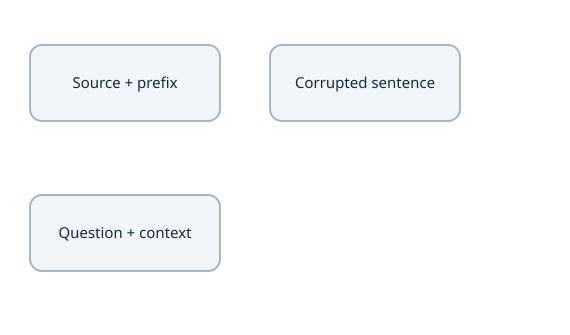

Compare three distinct input, visibility, target and inference contracts.


### Paper, inspected source and miniature reference

The original Transformer paper specifies post-norm, ReLU FFNs, scaled embeddings and an Adam/inverse-square-root training recipe. The inspected video source uses some different choices: GELU, unscaled separate embeddings, AdamW/cosine and plain CE. This course keeps those source-shaped choices visible instead of silently calling them exact paper reproduction. RoBERTa has its own recipe and artifact details; a small byte-BPE encoder with similar blocks is not automatically compatible with official pretrained weights.

[The source map](project/source-map.md) records the five video/code routes, corrections and deliberate departures. We retain its pinned source/license/caption metadata while authoring original explanations and probes. The full original model source is available separately from prose; essential reasoning belongs here.

### Verify the existing forward contracts

Run this standalone probe from the course's `examples/` folder with the reference interpreter selected in Lesson 2:

```python
import torch
from translation_data import make_fixture
from translation_model import Transformer, TransformerConfig
source, target, batch = make_fixture()
torch.manual_seed(7)
model = Transformer(TransformerConfig(src_vocab_size=source.vocab_size,
                                      tgt_vocab_size=target.vocab_size))
logits = model(batch['src_input_ids'], batch['tgt_input_ids'],
               batch['src_pad_mask'], batch['tgt_pad_mask'])
assert logits.shape == (*batch['tgt_input_ids'].shape, target.vocab_size)
assert sum(p.numel() for p in model.parameters()) == 30796
assert torch.isfinite(logits).all()
```

This is a full untrained forward reference, not a request to overwrite your learner project. The existing foundations child still resumes `linear()`. Later bounded reference runs exercise learning, source-use controls and recovery separately.

### Predict or explain: A model receives an uncorrupted sentence, attends bidirectionally and predicts every original token. Is that the masked-language objective? Explain the leakage path.

<details data-practice-id="start-practice-1"><summary>Reveal worked answer and rubric</summary>

No. At each supervised position the input contains the same target ID. A self-attention/residual path can copy it. MLM supplies a deliberately corrupted input and supervises original IDs only at selected positions; a bidirectional mask is legal under that corruption contract.

**Rubric:** Give the changed numerical or graph result, define its axes/state boundary, and identify a source assertion or perturbation that could falsify it.

</details>


### Predict or explain: Translation and QA both return logits. Give their different class axes, target objects and inference constraints for a seven-token context and a vocabulary of 20.

<details data-practice-id="start-transfer"><summary>Reveal worked answer and rubric</summary>

Translation logits classify 20 vocabulary IDs at each decoder slot, conditioned on source and a causal prefix. QA supplies start/end scores over seven packed positions (or the complete packed length if question/special tokens are included); gold objects are endpoint positions and decoding must restrict ordered context spans. Equal use of cross-entropy does not make the target domains interchangeable.

**Rubric:** Give the changed numerical or graph result, define its axes/state boundary, and identify a source assertion or perturbation that could falsify it.

</details>


### Notes and stopping check

In my notes: draw the translation, MLM and QA input–visibility–target paths. Calculate the three-token likelihood, then change one conditional probability and predict its loss effect. State which source/paper choices I will implement and which observation would demonstrate each complete path. Continue with [source and workspace identity](lessons/02-workspace.md).


## Lesson 2 — Reproducible source and implementation workspace

**Goal:** run an inspectable reference and keep source, environment, artifacts and learner work distinct. Prerequisite: task contracts. Python syntax and virtual-environment basics are assumed; these instructions name the actual runtime rather than recreate a general programming course.

### The reference is one self-contained source package

From workspace home, the course directory is `ai_projects/docs/tutorials/projects/p00/transformer-course/v1/`, with model/helper files under `examples/`. Its code has local imports between those files; copying only a model class loses data, masks, training and recovery contracts.

| Source group | Files and responsibility |
|---|---|
| Translation data/model | `translation_data.py`, `translation_attention.py`, `translation_model.py` |
| Translation learning/quality | `translation_train.py`, `translation_metrics.py`, `translation_checks.py` |
| RoBERTa and QA | `roberta_data.py`, `roberta_model.py`, `roberta_train.py`, `roberta_checks.py` |
| Complete sessions/recovery | `course_checkpoint.py`, `course_session.py`, their checks and `course_recovery_checks.py` |
| Arithmetic/source delivery | `foundation_math.py/.cpp`, independent tests and `course_source_export.py` |

Model Python remains the implementation asset. A notebook calls it; notebook cell ordering must not supply hidden definitions needed by a standalone model. Plotting, study questions and inspection should not become imports that a trainer unexpectedly requires.

### Select the checked reference interpreter

The existing attention child's frozen environment supplies Python 3.12.13, Torch 2.14.1+cpu and NumPy 2.5.4 for these local references. From workspace home:

```bash
source ai_projects/projects/transformer-labs/attention-is-all-you-need/.venv/bin/activate
cd ai_projects/docs/tutorials/projects/p00/transformer-course/v1/examples
python -c 'import sys, torch, numpy; print(sys.version, torch.__version__, numpy.__version__)'
python translation_model.py
```

The model command reports logits `(6,5,12)`, 30,796 parameters, a finite loss and a head gradient. Here and in later shell blocks, `python` means this selected interpreter, and the working directory is `examples/` unless stated otherwise. Do not change the existing learner repository or install a second environment there to make an author reference command work.

When recreating an environment elsewhere, pin and verify its actual versions. [CPU source/Colab export](examples/course_source_export.py) records the exporting runtime. An installed package and an already-imported package can differ until a kernel restart; inspect the loaded version. Keep environments, downloaded datasets, model weights and generated runs outside Git.

### Preserve existing implementation work

The current learner child `ai_projects/projects/transformer-labs/transformer-foundations-lab` already contains setup and a saved first prediction. Inspect its source/checkpoint and the owning Projects Git state before any learner edit; its next exercise remains `linear()`. Course authoring does not create a new model child, reset it or replace that work.

For a reference reconstruction, use a fresh disposable directory and copy the complete source export into it. For actual learner implementation, use the child and its checkpoint when those tasks begin. The topic lessons identify the reference file/class/method and a specific exercise or check; copying all completed sources is not the same evidence as implementing and explaining them.

### Configurations and artifacts define compatibility

A run's identity includes source bytes, architectural configuration, tokenizer vocabulary/rules/special IDs, preprocessing/split identity, optimizer/schedule settings and precision/runtime assumptions. A count such as V=12 does not identify which token each row means. Matching state-dict shapes does not prove semantic compatibility.

A complete checkpoint also contains evolving state: optimizer moments, update/schedule position, shuffle/data cursor and RNG/corruption generators. Static configuration and evolving state are different. The source exporter pins the source ZIP; recovery later verifies both identity and state before accepting a generation.

A backend/library change can alter numerical behavior. Use FP64 for small derivative comparisons and recorded tolerances; use the same FP32 CPU source for controlled training/recovery. Neither a CPU success nor a configured `device` string demonstrates GPU throughput or deleted-hosted-runtime survival.

### Run a targeted check before a large experiment

```bash
python -m unittest discover -s . -p test_foundation_math.py
python translation_checks.py
```

The second command includes a bounded six-pair learning test. Read the [reference record](project/reference-runs.md) for its exact domain before interpreting its scores. These are local author checks; later chapters explain each path and offer independent probes. The [implementation record](project/implementation.md) is where I keep my actual files/checks/next action.

### Predict or explain: Two source ZIPs have matching filenames and tensor shapes, but one tokenizer swaps two ordinary IDs. Is a checkpoint compatible? What evidence establishes compatibility?

<details data-practice-id="workspace-boundaries"><summary>Reveal worked answer and rubric</summary>

Not from shapes. The embedding/head rows now refer to different symbols. Verify source/config/runtime and the exact serialized tokenizer vocabulary/processing identity against the checkpoint before loading; matching byte hashes or a deliberately validated remapping establishes the required identity.

**Rubric:** Give the changed numerical or graph result, define its axes/state boundary, and identify a source assertion or perturbation that could falsify it.

</details>


### Predict or explain: I want to experiment with another head width. Where should I make that change, and what distinguishes a reference run from learner completion?

<details data-practice-id="workspace-transfer"><summary>Reveal worked answer and rubric</summary>

Use a separate scratch/reference copy with its own recorded config and artifacts, preserving the existing learner child. Passing a reference import or author check verifies source behavior. Learner completion requires the learner implementation, explanation and task/recovery evidence specified by the milestone.

**Rubric:** Give the changed numerical or graph result, define its axes/state boundary, and identify a source assertion or perturbation that could falsify it.

</details>


### Notes and failure cases

In my notes: draw the model/helper/trainer/artifact boundaries and record the interpreter/source identity. Explain why changing tokenizer row meanings with identical tensor shapes breaks compatibility. Diagnose a local import failure, wrong loaded Torch version and a weights-only restart as separate problems. Continue with [tensor interfaces and budgets](lessons/03-tensors.md).


## Lesson 3 — Model tensor interfaces and resource budgets

**Goal:** trace the complete architecture's axes and distinguish learned parameters from runtime work/memory. Prerequisites: Tutorial 0 tensor/matrix contracts and this course's source layout. Use unequal dimensions while checking interfaces; the equal lengths in a tiny fixture can hide errors.

### A shape is a typed coordinate contract

Let B=batch, S=source positions, T=decoder positions, D=model features, H=heads, d=D/H, F=FFN hidden width and Vₛ/Vₜ=separate vocabulary sizes. Translation IDs are integer `[B,S]` and `[B,T]`; hidden states are floating `[B,S,D]` and `[B,T,D]`. Cross-attention scores are `[B,H,T,S]`. Vocabulary logits are `[B,T,Vt]`. QA endpoint logits are `[B,L]`, where L is its packed length, not a vocabulary size.

### Name the axes before computing

| Object | Shape | Meaning |
| --- | --- | --- |
| Token IDs | [B,T] | Integers select embedding rows; T is position count. |
| Hidden states | [B,T,D] | D is features per token. |
| Head scores | [B,H,T,S] | T queries compare with S source keys. |
| Vocabulary logits | [B,T,V] | V candidate IDs at each query. |
| QA endpoints | [B,T] each | Start and end normalize over positions, not vocabulary. |


For B=2,S=3,T=4,D=8,H=2, query heads have shape `[2,2,4,4]`, source keys/values `[2,2,3,4]`, and cross scores `[2,2,4,3]`. Dot products contract the last feature axis; softmax normalizes the last key-position axis; weighted sums return one value vector per query/head. Reshape and transpose are distinct, as developed in Tutorial 0.

An affine layer mathematically uses X[N,D]W[D,F]+b[F], while PyTorch stores its weight `[F,D]`. Bias is shared across positions/examples. The indexed forward and backward contracts are

$$\begin{aligned}
Y_{nf}&=\sum_iX_{ni}W_{if}+b_f,\\
\nabla W&=X^TG,\quad \nabla b=\sum_nG_{n,:},\quad\nabla X=GW^T.
\end{aligned}$$

These rules also determine projection and FFN parameter counts. For sequence tensors, the shared bias gradient sums batch and position uses; it does not average automatically.

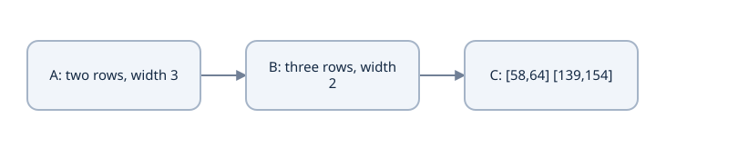

A [2,3] times B [3,2] produces C [2,2]. C[0,0]=1×7+2×9+3×11=58. The contracted dimension is 3.


### Derive the actual reference's parameter budget

For D=32,F=128, each biased attention module has `4D²+4D=4224` entries, and each biased FFN has `2DF+F+D=8352`. A LayerNorm has2D=64 parameters. One encoder has1 attention,1FFN,2norms:12704. One decoder has2attentions,1FFN,3norms:16992.

Separate source/target tables at Vₛ=10,Vₜ=12 contain `(10+12)×32=704` entries. The separate target output head adds `32×12+12=396`. Therefore

$$\begin{aligned}
P&=12704+16992+704+396\\
 &=30796.
\end{aligned}$$

Fixed sinusoidal buffers are state-dict tensors, not learned parameters. Tying the target output matrix would remove384 independent entries, but the actual reference leaves it separate. Do not subtract parameters for a tying feature that has not been implemented.

### Parameters do not count activations or total process memory

In FP32,30796 parameters occupy123184 bytes. Gradients add storage, Adam's two moment arrays add about twice the parameter elements, and optimizer/scalar/runtime overhead adds more. Activations/saved backward values depend on B,S,T and depth. Whole-process RAM includes Python/PyTorch and allocation behavior, not just tensor payloads.

With the unequal miniature dimensions above, explicit encoder/decoder-self/cross score arrays contain

$$BH(S^2+T^2+TS)=2\cdot2(9+16+12)=148$$

scalars,592FP32 bytes for those arrays alone. Softmax weights, gradients and saved values may coexist. Optimized SDPA can avoid full score materialization; do not count an explicit array as a guaranteed allocation in every kernel.

At fixed D,H, doubling sequence length approximately quadruples self-attention score elements. FFN work grows linearly with length. Projection work is order sequence×D²; attention score/value work is order TSD; FFN work is order sequence×DF. Operation order is not a measured runtime or a promise that the attention component dominates every short sequence.

### Verify interfaces and counts against the source

```python
import torch
from translation_model import Transformer, TransformerConfig
m = Transformer(TransformerConfig())
assert sum(p.numel() for p in m.parameters()) == 30796
buffers = dict(m.named_buffers())
assert any('encodings' in name for name in buffers)
batch, source_len, target_len = 2,3,4
src = torch.tensor([[2,4,3],[2,5,3]])
tgt = torch.tensor([[2,4,5,3],[2,6,7,3]])
logits = m(src,tgt)
assert logits.shape == (batch,target_len,12)
```

Run from `examples/` with the Lesson 2 interpreter. This is a contract probe, not a trained-quality test. [foundation_math.py](examples/foundation_math.py) has independent matrix/backward calculations, including different rectangular dimensions.

### Predict or explain: For B=3,T=5,S=8,D=12,H=3, state Q/K/score/context/output shapes and FP32 score bytes for one cross-attention layer.

<details data-practice-id="tensors-practice-1"><summary>Reveal worked answer and rubric</summary>

Head width is 4. Q [3,3,5,4], K/V [3,3,8,4], scores [3,3,5,8], head context [3,3,5,4], final output [3,5,12]. Scores contain 360 entries or 1440 FP32 bytes; this is not total training memory.

**Rubric:** Give the changed numerical or graph result, define its axes/state boundary, and identify a source assertion or perturbation that could falsify it.

</details>


### Predict or explain: At fixed D=16, change H from two to four. Does a four-projection attention layer gain parameters? Does its conceptual score tensor gain entries?

<details data-practice-id="tensors-transfer"><summary>Reveal worked answer and rubric</summary>

Biased projection count remains 4*16^2+4*16=1088. Head width halves from eight to four. BHTS conceptual entries double for the same lengths, while the total dot-product feature work remains proportional to BTSD. Backend memory and wall time require measurement.

**Rubric:** Give the changed numerical or graph result, define its axes/state boundary, and identify a source assertion or perturbation that could falsify it.

</details>


### Notes and checks

In my notes: label every tensor in the unequal-length path, derive30796 from component terms and calculate parameter/score bytes separately. Predict changing H at fixed D and changing T at fixed model parameters. Identify a same-shape wrong-axis operation that a naive shape assertion would miss. Continue with [translation likelihood](lessons/04-learning.md).


## Lesson 4 — Translation likelihood and supervised losses

**Goal:** derive the actual sequence objective and its gradients before connecting them to a trainer. Prerequisites: probability/logits/chain rule from Tutorial 0 and the model tensor interfaces. Loss choice and reduction are part of the specification, not incidental arguments to a library call.

### Autoregressive likelihood does not assume independent tokens

For source x and target y₁…yₜ including EOS,

$$\begin{aligned}
p_\theta(y\mid x)&=\prod_{t=1}^{T}p_\theta(y_t\mid x,y_{<t}),\\
-\log p_\theta(y\mid x)&=\sum_{t=1}^{T}-\log p_\theta(y_t\mid x,y_{<t}).
\end{aligned}$$

The conditional factors include the prefix, so target tokens are not declared independent. During teacher forcing, decoder input is `[BOS,y1,...,y(T−1)]` and labels `[y1,...,EOS]`. A causal mask and that one-token shift enforce the factorization while permitting parallel training. A decoder that reads its own unshifted target can minimize an easier leaked problem.

Suppose a target has probabilities `.5,.25,.8`. Its sequence NLL is log10≈2.302585; its mean over three labels is≈.767528. A second target has one label with probability `.5`, loss log2≈.693147. A combined token mean is `(log10+log2)/4≈.748933`; averaging the two record means gives≈.730338. Both are mathematically defined, but weight records differently. The reference chooses an unweighted valid-token mean.

### Stable cross-entropy and its exact gradient

For vocabulary logits z and hard target k,

$$\begin{aligned}
\ell(z,k)&=\operatorname{LSE}(z)-z_k,\\
\operatorname{LSE}(z)&=m+\log\sum_j e^{z_j-m},\qquad m=\max_jz_j,\\
\frac{\partial\ell}{\partial z_j}&=\operatorname{softmax}(z)_j-\mathbf1[j=k].
\end{aligned}$$

With logits `[0,log3]` and target1, loss log(4/3)≈.287682 and gradient `[.25,−.25]`. Adding1000 to both logits leaves the loss/distribution unchanged. Passing probabilities into `cross_entropy` is a different operation: it interprets them as logits and applies another log-softmax.

For valid labels across a batch, total L=Σℓ/K gives each logit row gradient `(p−one_hot)/K`. Ignored rows have zero loss contribution and zero logit gradient. This is exclusion from supervision, not exclusion of a token's representation from attention.

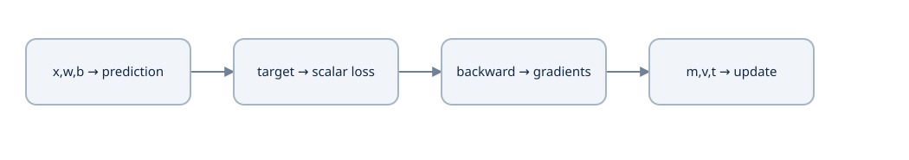

Prediction enters a loss; the chain rule sends a gradient to each parameter. Adam carries moments forward between completed updates.


### Trace the source implementation

In [translation_train.py](examples/translation_train.py), `token_statistics(logits,labels)` flattens `[B,T,V]` to `[B*T,V]`, flattens labels in the same order, computes sum CE with ignore_index−100 and returns `(loss_sum,count,correct)`. It rejects zero valid targets rather than dividing by zero. Training normalizes by the total valid count across all micro-batches; evaluation accumulates totals before division.

```python
import math, torch
from translation_train import token_statistics
z = torch.tensor([[[0.,math.log(3)],[1000.,1000.]]],
                 dtype=torch.float64, requires_grad=True)
y = torch.tensor([[1,-100]])
loss_sum, count, correct = token_statistics(z,y)
(loss_sum/count).backward()
assert count.item() == 1 and correct.item() == 1
assert abs(loss_sum.item()-math.log(4/3)) < 1e-12
assert torch.allclose(z.grad[0,0], torch.tensor([.25,-.25], dtype=z.dtype))
assert torch.equal(z.grad[0,1], torch.zeros(2,dtype=z.dtype))
```

Run from `examples/` with the recorded Torch interpreter. The padded logit row can be arbitrarily wrong and still have zero supervised gradient; this does not prove the model hides padded keys or future tokens. Those require separate perturbation tests.

### Smoothing is an explicit alternative target

A uniform-mixture smoothing convention uses q=(1−ε)one_hot(k)+ε/V. Its CE gradient is p−q. For V=4,ε=.1,k=2, q=`[.025,.025,.925,.025]`. Excluding the gold class or PAD from the smoothing distribution gives another formula and must be declared. The original Transformer reports smoothing; the inspected translation reference here uses plain hard-label CE. Do not silently reinterpret its training loss as a smoothed objective.

Training-smoothed CE is not the same quantity as held-out hard-target NLL used for perplexity. Perplexity is exp(mean token NLL) under a fixed tokenizer/corpus/conditioning contract. A lower training mean caused by changing the valid count or evaluation corruption is not evidence of a better model.

### Connect output gradients to learned state

With vocabulary head z=hU+c, ∇U=hᵀδ, ∇c sums δ across uses, and ∇h=δUᵀ. That signal then traverses decoder FFN/self/cross-attention and encoder memory. A nonzero head gradient alone does not prove source embeddings or encoder projections receive a gradient; inspect those paths separately in the complete-model lesson.

### Predict or explain: Two records contain two valid losses summing to 4 and four valid losses summing to 4. Compute token mean versus mean of record means.

<details data-practice-id="learning-practice-1"><summary>Reveal worked answer and rubric</summary>

Token mean is (4+4)/(2+4)=4/3. Record means are 2 and 1, whose mean is 1.5. The first weights every token equally; the second weights each record equally. Padding contributes to neither valid count.

**Rubric:** Give the changed numerical or graph result, define its axes/state boundary, and identify a source assertion or perturbation that could falsify it.

</details>


### Predict or explain: For probabilities [.2,.5,.3], gold class zero and a batch denominator of five, derive the logit-row gradient. What is the gradient of an ignored row?

<details data-practice-id="learning-transfer"><summary>Reveal worked answer and rubric</summary>

The hard-target gradient is ([.2,.5,.3]-[1,0,0])/5=[-.16,.10,.06]. It sums to zero. An ignored label row contributes zero loss and zero logit gradient under the reference CE contract; that does not establish its attention visibility.

**Rubric:** Give the changed numerical or graph result, define its axes/state boundary, and identify a source assertion or perturbation that could falsify it.

</details>


### Notes and checks

In my notes: derive the conditional factorization, p−one_hot and the valid-token denominator. Work the two different record/token means, then change one target length and predict weighting. Draw which tensor rows are ignored and which learned modules must receive gradients. Continue with [source/target tokenizers](lessons/05-tokenization.md). API references: [CE](https://docs.pytorch.org/docs/2.14/generated/torch.nn.CrossEntropyLoss.html) and [the original paper](https://arxiv.org/abs/1706.03762).


## Lesson 5 — Source and target tokenizers

**Goal:** build a reproducible text-to-ID interface for two languages and understand how subword choices change model contracts. Prerequisites: Tutorial 0 encoding/BPE and this course's source/target vocabulary axes. Tokenization chooses rows; embeddings learn their continuous values.

### Separate vocabularies can have separate special IDs

The offline translation fixture uses [Vocabulary](examples/translation_data.py), an inspectable word/punctuation tokenizer. `words()` normalizes NFC, lowercases and splits with a word-or-punctuation regex. `Vocabulary.fit` sorts observed training pieces and prepends a special-token tuple. Source order is `[PAD],[UNK],[BOS],[EOS]`, while target order is `[UNK],[PAD],[BOS],[EOS]`. Hence source PAD=0 and target PAD=1; BOS/EOS are2/3 in these artifacts.

On training text `I like cats.`, normalized pieces are `['i','like','cats','.']`; sorted ordinary tokens are `['.','cats','i','like']`. Source IDs are BOS2, i6, like7, cats5, period4, EOS3. The target would have the same ordinary indices in this particular single-text example but a different meaning for IDs0/1. Do not infer identical mappings from an accidental matching suffix.

```python
from translation_data import Vocabulary, words
src = Vocabulary.fit(['I like cats.'],source=True)
tgt = Vocabulary.fit(['I like cats.'])
assert words('I like cats.') == ['i','like','cats','.']
assert src.encode('I like cats.') == [2,6,7,5,4,3]
assert src.pad_token_id == 0 and tgt.pad_token_id == 1
assert src.decode(src.encode('I like cats.')) == 'i like cats .'
```

This decode is normalized token text, not exact original typography/case. New words use the artifact's UNK. Length bounds include BOS/EOS; the encoder rejects overlength sequences instead of silently truncating a paired record. The full batch constructor later uses each tokenizer's actual PAD ID.

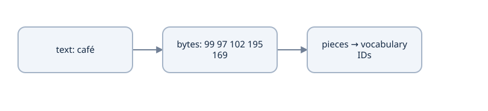

The original character coordinate system must remain available for QA. IDs are vocabulary references, not character meanings.


### Bytes, code points and subword pieces remain distinct

`café` has4 composed code points and UTF-8 bytes `[99,97,102,195,169]`. A multibyte character can span byte-level pieces; decoding a whole valid sequence can round-trip even if a single piece cannot decode alone. NFC and lowercasing can change original coordinates, so translation's normalized word decoder is not an offset-aware QA tokenizer.

The original word-BPE arithmetic in [foundation_math.py](examples/foundation_math.py) remains available. For training frequencies `low:5, lower:2, lowest:1`, adjacent `(l,o)` and `(o,w)` each have count8; lexical tie-breaking selects `(l,o)`. After that merge, `(lo,w)` has count8 and wins. Then `(low,</w>)` count5 wins over `(low,e)` count3. The saved merges are `(l,o)`, `(lo,w)`, `(low,</w>)`; encoding `lower` yields `('low','e','r','</w>')`, while `low` becomes one full-word piece.

```python
from foundation_math import fit_word_bpe, encode_word_bpe, merge_pair
merges = fit_word_bpe({'low':5,'lower':2,'lowest':1},3)
assert merges == [('l','o'),('lo','w'),('low','</w>')]
assert encode_word_bpe('lower',merges) == ('low','e','r','</w>')
assert merge_pair(('a','a','a'),('a','a')) == ('aa','a')
```

A merge pass consumes nonoverlapping occurrences, even when pair counts see overlapping neighbors. Encoding applies saved merge rank, not new-input frequency training. This word-boundary format is pedagogical; it is not RoBERTa's byte-BPE artifact or WordPiece.

### WordPiece is a separate source-style exercise

The inspected translation route uses an English BERT tokenizer and a French-trained WordPiece tokenizer. `train_french_wordpiece(training_texts,output_path,vocab_size=...)` constructs a Tokenizers WordPiece model with UNK, whitespace/punctuation preprocessing, `##` continuation decoding and a postprocessor adding BOS/EOS. It trains on permitted training text, persists JSON and reloads the exact artifact.

Use that adapter only with the optional pinned Tokenizers dependency installed and recorded; the default miniature run is offline and does not download an English pretrained model. A pretrained English artifact must have its model/revision, special IDs and preprocessing identity documented. Its vocabulary width and normalization can differ from our word fixture. Replacing one tokenizer requires a new compatible embedding/model contract, not only a changed filename.

WordPiece and BPE both provide subword pieces, but their training/rank/scoring procedures and segmentation conventions differ. A `##` continuation marker is an artifact convention, not a real character inserted in the original source sentence. The native tokenizers perform their configured postprocessing; do not append BOS/EOS twice in a separate data function.

### Persist meaning, not only size

Record ordered token-to-ID mapping, special IDs, normalization/pretokenization, saved merges/model JSON, training-text identity and version/revision. A remapped artifact can have the same V while swapping embedding/head row meanings. A strict run identity should detect it before loading optimizer/model state. Keep source and target identities separate unless a declared joint-vocabulary architecture really shares them.

A larger subword vocabulary grows embedding/output parameters but can shorten sequences; a smaller one can increase quadratic attention work. The budget must use measured token-length distributions under the actual artifact, not the number of whitespace words in raw data.

### Predict or explain: A saved target vocabulary contains BOS/EOS but an adapter adds them again after tokenizer post-processing. What does this change and how should it be checked?

<details data-practice-id="tokenization-practice-1"><summary>Reveal worked answer and rubric</summary>

It duplicates boundaries, creates incorrect prefixes/labels and consumes extra position capacity. Establish whether encode already supplies specials, add them exactly once, then assert the first/last IDs and a full shifted batch under the saved tokenizer identity.

**Rubric:** Give the changed numerical or graph result, define its axes/state boundary, and identify a source assertion or perturbation that could falsify it.

</details>


### Predict or explain: The strings é and e plus a combining accent look alike. Why may character/byte offsets differ even if an NFC-normalized tokenizer gives equal IDs?

<details data-practice-id="tokenization-transfer"><summary>Reveal worked answer and rubric</summary>

They use different original code-point sequences and UTF-8 bytes. NFC may make modeled strings equal, but offsets for extractive answers must still address the original text through an explicit mapping. Equal normalized token IDs do not justify copying normalized offsets into the original string.

**Rubric:** Give the changed numerical or graph result, define its axes/state boundary, and identify a source assertion or perturbation that could falsify it.

</details>


### Notes and implementation check

In my notes: hand-encode the sentence, work all three BPE merges and label code-point/byte/token coordinates. Explain which transformations prevent exact-text decode. Draw the tokenizer→embedding/output row compatibility boundary and predict swapping PAD/UNK or ordinary rows. Continue with [corpus ownership and visibility](lessons/06-objectives.md). Sources: [Tokenizers API](https://huggingface.co/docs/tokenizers/index), [pinned translation code](https://github.com/priyammaz/PyTorch-Adventures/tree/2f18a5470c4ef0a3d413dd7b18d07941f45779e9/PyTorch%20for%20NLP/Seq2Seq%20for%20Neural%20Machine%20Translation).


## Lesson 6 — Corpus splits and task visibility

**Goal:** define the information each task may use and the corpus identities that make evaluation meaningful. Prerequisites: tokenizer artifacts and supervised objective. A correct network can still train on leaked or misaligned data; architecture correctness and experimental validity need separate checks.

### Preserve paired records as one unit

A bilingual corpus is a sequence of aligned `(source,target)` records. The reference's `aligned_lines` uses `zip_longest`, detects unequal file lengths and filters an empty pair together. Plain `zip` silently drops the extra side. Independently removing empty lines or overlength sentences can pair a source with a different translation while both files still look valid.

If sources are `['one','', 'three']` and targets `['un','deux','trois']`, filtering source first pairs `three` with `deux`. Paired filtering instead retains `(one,un)` and `(three,trois)`. Record original pair IDs and preprocessing decisions so a later shuffle or rebuild cannot change alignment unnoticed.

Fit learned tokenization/normalization using the permitted training corpus. Split by document/group and check duplicates when closely related sentences could share information. Development data chooses settings; a final test set estimates quality after choices are frozen. A randomly selected holdout is not automatically a named WMT test set.

The offline trainer has six training pairs and two held-out combinations under one small vocabulary. Training fit and held-out compositional behavior are useful diagnostics; neither estimates large-corpus translation quality. The source route has different data/tokenization/scale, recorded in [the source map](project/source-map.md).

### Visibility and target ownership differ by task

| Task | Visible model input | Supervised output |
|---|---|---|
| Translation | full real source and shifted causal target prefix | next target ID, including EOS |
| MLM | corrupted sequence, with real tokens visible bidirectionally | original ID only at selected positions |
| QA | packed question and context, bidirectionally visible | start/end positions for available answer windows |

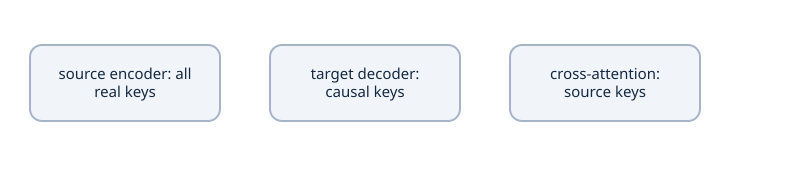

Translation has three visibility patterns. MLM reads both directions at real positions; GPT permits only a prefix. Loss masks select supervision separately.


For translation, an encoder source position can see later source tokens because the complete source is supplied. A decoder's prediction may not see later target tokens. Cross-attention queries come from the decoder but keys/values cover real source positions; applying a target triangle to those source columns changes the task.

For MLM, the encoder sees both neighbors around a masked input. Selected unchanged tokens still contribute supervision under the corruption scheme. Dynamic corruption changes the observed input/selected labels; it must not replace an original label with the random replacement ID. MLM accuracy over all unselected tokens would mostly reward positions that were never targets.

For QA, the question can influence context representations, but an answer is extracted from original context. A context-only decoding constraint is different from the endpoint training CE's actual normalization domain. A missing answer in a truncated window is not proof the original question is unanswerable; our reference ignores that window's unavailable target rather than using it as a SQuAD2 negative.

### Data boundaries also determine loss weighting

Longer translation targets contribute more terms under a token mean. MLM uses selected-target counts, which vary with stochastic corruption. QA uses endpoint labels/windows; overlapping windows can repeat supervision for one original record. All are legitimate choices only when named. Do not call every returned value a comparable “average loss.”

Persist corpus/split IDs and hashes, tokenizer fitting corpus, preprocessing version and sampling/bucketing rules. A seed does not identify data whose contents later change. The recovery identity includes such artifacts; exact continuation also needs actual next-record/random state.

### A tiny paired-record check

```python
from pathlib import Path
from tempfile import TemporaryDirectory
from translation_data import aligned_lines
with TemporaryDirectory() as folder:
    src, tgt = Path(folder)/'src.txt', Path(folder)/'tgt.txt'
    src.write_text('one\n\nthree\n')
    tgt.write_text('un\ndeux\ntrois\n')
    assert list(aligned_lines(src,tgt)) == [('one','un'),('three','trois')]
    tgt.write_text('un\ndeux\n')
    try:
        list(aligned_lines(src,tgt))
    except ValueError:
        pass
    else:
        raise AssertionError('Misaligned parallel files were accepted')
```

Run from `examples/`; the temporary files do not alter a real dataset. A passing check establishes this collation/preprocessing behavior, not the quality of unknown corpus annotations. Later checks perturb future targets, padded source content and question/context ownership to test information flow directly.

### Predict or explain: A source file contains a blank line while the paired target is nonblank. Why does dropping blanks independently create a wrong dataset?

<details data-practice-id="objectives-practice-1"><summary>Reveal worked answer and rubric</summary>

Independent filtering shifts subsequent row alignment. Traverse both columns together, reject unequal file lengths, and apply acceptance/rejection to the pair. A complete traversal is needed to establish that no later mismatch exists.

**Rubric:** Give the changed numerical or graph result, define its axes/state boundary, and identify a source assertion or perturbation that could falsify it.

</details>


### Predict or explain: A validation sentence is absent from training records, but its text was included when fitting the tokenizer. Which boundary was crossed, and what can the tiny two-combination validation fixture prove?

<details data-practice-id="objectives-transfer"><summary>Reveal worked answer and rubric</summary>

The declared training-only tokenizer-fit boundary was crossed: validation text influenced vocabulary/processing. The tiny fixture can diagnose specific composition behavior and pipeline invariants; it cannot establish general translation quality or official WMT performance.

**Rubric:** Give the changed numerical or graph result, define its axes/state boundary, and identify a source assertion or perturbation that could falsify it.

</details>


### Notes and checks

In my notes: draw the three visibility/label domains and work the empty-line alignment counterexample. Define the split unit, tokenizer fitting data, sampled denominator and held-out question for each build. State which perturbation would reveal a leaked target, mixed-up pair or invalid QA window. Continue with [translation embeddings](lessons/07-translation-embeddings.md).


## Lesson 7 — Translation embeddings and vocabulary projection

**Goal:** explain how integer symbols become learned vectors and how a decoder vector becomes vocabulary logits. Prerequisites: token IDs, matrix derivatives and the translation loss. Input and output tables have different roles even when their dimensions happen to match.

### Lookup is a sparse linear operation

Let E be a vocabulary table with shape [V,D]. A token ID i retrieves row Eᵢ; a batch of IDs [B,T] produces [B,T,D]. The integer itself is an address, not a magnitude the model should compare. Equivalently, one-hot row uᵢ multiplied by E gives the same vector. A lookup avoids constructing the large one-hot tensor.

For E=`[[0,0],[1,2],[-1,3],[4,1]]` and IDs `[1,2,1]`, the vectors are `[[1,2],[-1,3],[1,2]]`. If upstream gradients at those positions are `[2,1]`, `[3,-2]`, `[4,5]`, the table gradient is zero at unused rows, `[6,6]` at row 1 and `[3,-2]` at row 2. Repeated IDs **sum** their contributions because they use the same parameter.

$$
\frac{\partial L}{\partial E_{i,:}}
=\sum_{b,t:\,\mathrm{id}_{bt}=i}\frac{\partial L}{\partial X_{bt,:}}.
$$

This sparsity describes the lookup gradient. Other uses of the same parameter, regularization or optimizer state can alter the update. In particular, a table tied to an output classifier receives a dense output gradient as well.

### Translation owns two symbol systems

The reference [Transformer](examples/translation_model.py) owns `src_embeddings` [Vₛ,D] and `tgt_embeddings` [Vₜ,D]. Source ID 4 and target ID 4 need not represent the same token. In the fixture, source PAD is 0 and target PAD is 1. Equal vocabulary sizes do not establish equal row meanings.

`padding_idx` suppresses the lookup gradient for the designated row. The model initializes that row to zero. Position vectors are then added, so a padded position's hidden vector need not remain zero. Key masks prevent valid queries from reading it; loss masks exclude padded target labels. Those are three separate contracts.

Run this exact gradient check from the reference `examples/` folder:

```python
import torch
embedding = torch.nn.Embedding(4, 2, padding_idx=0)
with torch.no_grad():
    embedding.weight.copy_(torch.tensor([[0.,0.],[1.,2.],[-1.,3.],[4.,1.]]))
ids = torch.tensor([0,1,2,1])
upstream = torch.tensor([[9.,9.],[2.,1.],[3.,-2.],[4.,5.]])
(embedding(ids) * upstream).sum().backward()
expected = torch.tensor([[0.,0.],[6.,6.],[3.,-2.],[0.,0.]])
assert torch.equal(embedding.weight.grad, expected)
```

### The output table scores every target symbol

For decoder hidden states H [B,T,D], the independent head has stored weight U [Vₜ,D] and bias c [Vₜ]: Z=HUᵀ+c. A vocabulary row acts as a class vector. All classes appear in the softmax denominator, including classes that are never a gold label in this batch.

With hidden row h=`[2,-1]`, U=`[[1,0],[0,1],[1,1]]`, and zero bias, logits are `[2,-1,1]`. Their probabilities are approximately `[.7054,.0351,.2595]`. For gold class 2, δ=p−one_hot(2); each output row receives δⱼh. Unlike a lookup, this generally changes every row. The hidden gradient is δU. Trace this signal back through decoder layers and cross-attention to the source; the output head does not perform that whole computation itself.

### Weight tying requires semantic compatibility

Tying input and output tables can save VₜD parameters, but it means assigning **the same Parameter object**, not copying equal values. Tied target input/output rows share vocabulary identity and width; source–target tying additionally requires a compatible shared tokenizer. A tied PAD row can receive output-head gradients even if its lookup gradient is suppressed. A policy that keeps that row fixed needs an additional explicit mechanism.

The miniature uses separate tables and a separate vocabulary head. Its default counts are source 10×32=320, target 12×32=384, and head 12×32+12=396: 1,100 parameters altogether. Target tying would save 384; it would also change parameter ownership and gradients. Count unique parameters rather than duplicated state-dict entries.

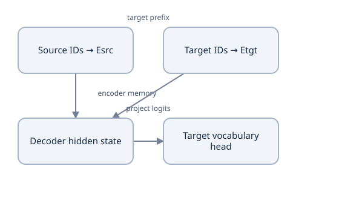

Separate source and target symbols meet through the encoder–decoder; a separate head classifies the target vocabulary.


### Scaling and initialization are declared choices

The original Transformer multiplies token embeddings by √D before adding sinusoidal positions. This source adds unscaled embeddings, initialized with standard deviation .02, to those positions. It also has no embedding-plus-position dropout module. These choices affect the relative initial scale of content and position; attention's separate √dₖ score scaling does not compensate for them. An exact paper reproduction would explicitly change and test the recipe.

### Predict or explain: With Vsrc=9,Vtgt=11,D=8, count source/target input tables plus a separate biased target head. How many unique parameters would target input/output tying save?

<details data-practice-id="translation-embeddings-transfer"><summary>Reveal worked answer and rubric</summary>

Tables have 72 and 88 parameters; the head has 88+11=99, totaling 259. Tying target table and head saves 88, leaving 171, provided the target row meaning and width match. Sharing one Parameter is required; copying values does not tie gradients.

**Rubric:** Give the changed numerical or graph result, define its axes/state boundary, and identify a source assertion or perturbation that could falsify it.

</details>


### Predict or explain: IDs [2,2,3] use a table with PAD=0. Their upstream rows are [1,-2], [4,5], [-3,6]. Give the lookup gradient and explain what changes if the same table is an output head.

<details data-practice-id="translation-embeddings-gradient"><summary>Reveal worked answer and rubric</summary>

Lookup row 2 receives [5,3], row 3 [-3,6], and unused/PAD rows receive zero lookup gradient. A tied output head adds class-logit gradients across vocabulary rows, potentially including PAD; padding_idx suppresses only the embedding-lookup route.

**Rubric:** Give the changed numerical or graph result, define its axes/state boundary, and identify a source assertion or perturbation that could falsify it.

</details>


### Notes and implementation

Derive repeated-ID and output-table gradients in my notes. Draw separate source/target row meanings, mark the PAD lookup rule, and count tied versus untied unique parameters. Inspect `translation_model._init_weights` and the head declaration; verify the table and head identities without changing the learner repository. Continue to [sinusoidal positions](lessons/08-translation-positions.md). References: [Embedding API](https://docs.pytorch.org/docs/2.14/generated/torch.nn.Embedding.html), [original architecture](https://arxiv.org/abs/1706.03762).


## Lesson 8 — Sinusoidal position implementation

**Goal:** derive the position table, explain why the model needs it and check its indexing/state contract. Prerequisites: embeddings and basic trigonometry. Source and target sequences each start their own position coordinates.

### Attention alone does not assign an order

Without positions, shared token projections and pointwise FFNs treat permutations consistently. If P permutes rows, self-attention on PX produces P times the original output, provided the mask is permuted with the same rows and columns. This is permutation **equivariance**. The network can recognize the same set of vectors but lacks an explicit absolute order. A causal mask imposes a visibility order; it does not by itself supply the positional representation used in this encoder–decoder recipe.

Positions enter as addition Xᵢ=E[tokenᵢ]+PE(i). Addition keeps width D and permits learned projections to combine content with position. Concatenation would change the interface and parameter count. The source encoder and target decoder use different token tables but the same sinusoidal formula at their own indices.

### Derive the frequency pairs

For even feature width D and frequency-pair index j=0,…,D/2−1,

$$
\begin{aligned}
\omega_j&=10000^{-2j/D},\\
PE(p,2j)&=\sin(p\omega_j),\\
PE(p,2j+1)&=\cos(p\omega_j).
\end{aligned}
$$

Here p is a zero-based token position. With D=4, the two angular frequencies are 1 and .01. Position 0 is `[0,1,0,1]`; position 1 is approximately `[.841471,.540302,.00999983,.999950]`. Pair j=1 varies much more slowly. The numbers encode coordinates, not hand-assigned meanings for words.

For a fixed offset k, trigonometric addition gives a fixed rotation within each pair:

$$
\begin{bmatrix}\sin((p+k)\omega)\\\cos((p+k)\omega)\end{bmatrix}
=\begin{bmatrix}\cos(k\omega)&\sin(k\omega)\\-\sin(k\omega)&\cos(k\omega)\end{bmatrix}
\begin{bmatrix}\sin(p\omega)\\\cos(p\omega)\end{bmatrix}.
$$

That linear relation motivates learning relative shifts from the representation. It does not prove a trained model generalizes to arbitrary sequence lengths. The code's allocated table and training distribution remain real limits.

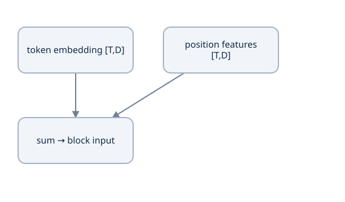

At position 0, sine coordinates are 0 and cosine coordinates 1. Different frequencies change with position; token identity and order remain separate inputs.


### Read the actual module and its state

[PositionalEncoding](examples/translation_model.py) builds the FP32 table once and registers `encodings` as a **buffer**. It is saved in `state_dict` and moves with the module's device, but is absent from `model.parameters()` and receives no optimizer updates. Forward slices the first T rows and converts them to the input dtype before adding them. A learned position embedding, used later by RoBERTa, is a Parameter table with a different indexing and gradient contract.

```python
import math, torch
from translation_model import PositionalEncoding
positions = PositionalEncoding(max_len=4, embed_dim=4)
actual = positions(torch.zeros(1,2,4))
expected = torch.tensor([[[0.,1.,0.,1.],
    [math.sin(1),math.cos(1),math.sin(.01),math.cos(.01)]]])
assert torch.allclose(actual, expected, atol=1e-7)
assert "encodings" in positions.state_dict()
assert list(positions.parameters()) == []
try:
    positions(torch.zeros(1,5,4))
except ValueError:
    pass
else:
    raise AssertionError("position capacity was not enforced")
```

The model validates even D because this implementation fills sine/cosine pairs. The mathematical idea can be adapted for odd widths, but this particular source does not implement that extension. A maximum source length of 32 and target length of 32 are separate capacities; a source length of 7 and decoder length of 4 both slice from zero.

### Incremental decoding needs an offset contract

The reference module has no position-offset argument. Its greedy decoder recomputes the complete target prefix each time, so the newest token receives its true prefix index. Feeding only the newest token through this module would repeatedly assign position 0. A KV cache extension must pass the absolute prefix offset, align causal key visibility with that offset and respect table capacity. A square lower-triangle mask alone cannot establish those rectangular cached semantics.

### Detect an indexing failure

Zero token embeddings do not produce zero hidden states: at position 0 the cosine coordinates are one. A padded source position also receives a position vector; masking keys, rather than expecting zero hidden rows, establishes padding invariance for valid queries. Reordering tokens while leaving positions fixed should usually change valid outputs, whereas changing a masked padded payload should not affect real positions under the declared mask.

### Predict or explain: For D=6, give the three frequencies and the entire position-zero vector. Are these values learned parameters in this reference?

<details data-practice-id="translation-positions-transfer"><summary>Reveal worked answer and rubric</summary>

Frequencies are 1, 10000^(-1/3) and 10000^(-2/3). Position zero is [0,1,0,1,0,1]. The table is a registered buffer, saved/moved with the model but excluded from optimizer parameters.

**Rubric:** Give the changed numerical or graph result, define its axes/state boundary, and identify a source assertion or perturbation that could falsify it.

</details>


### Predict or explain: After decoding six prefix tokens, I pass only the next token to the existing position module. Which position does it receive and what cache interface is missing?

<details data-practice-id="translation-positions-offset"><summary>Reveal worked answer and rubric</summary>

It receives position zero because the module always slices from the beginning. Correct incremental execution needs the absolute offset six, aligned cached key coordinates/masks, capacity checks and identical parameter state. The existing reference instead recomputes the whole prefix.

**Rubric:** Give the changed numerical or graph result, define its axes/state boundary, and identify a source assertion or perturbation that could falsify it.

</details>


### Notes and implementation

Write the D=4 table and offset rotation in my notes. Mark buffer versus Parameter state, source versus target indices, capacity and the missing cache-offset interface. Predict the error from using only the newest token, then inspect the actual full-prefix generation path in Lesson 19. Continue to [learned Q/K/V](lessons/07-qkv.md). Source: [position representation](https://arxiv.org/abs/1706.03762).


## Lesson 9 — Learned Q/K/V and scaled attention

**Goal:** calculate learned attention and derive the gradient paths for matching and payload transport. Prerequisites: embeddings, position coordinates and matrix gradients. Attention does not directly assign English meanings to features; task loss learns which comparisons and payloads help prediction.

The reference [translation_attention.py](examples/translation_attention.py) uses row vectors. We will first retain a fully worked three-token example, then distinguish rectangular cross-attention and its backward paths. [Inspected source](https://github.com/priyammaz/PyTorch-Adventures/tree/2f18a5470c4ef0a3d413dd7b18d07941f45779e9/PyTorch%20for%20Transformers/Attention%20Mechanisms/Attention).

### Start with attention without learned projections

Let each row of a matrix be one token and each column one feature:

$$X=\begin{bmatrix}1&0\\0&1\\1&1\end{bmatrix}.$$

If we use the same matrix as queries, keys and values, attention is

$$C=\operatorname{softmax}_{\text{row}}\!\left(\frac{XX^T}{\sqrt{2}}\right)X.$$

The square root is two's square root because the query and key vectors have two features. The transpose turns the three key rows into three columns. Consequently `X @ X.T` is a three-by-three table of dot products. A row asks how strongly one token matches all three tokens. The softmax converts that row into weights; multiplying those weights by `X` forms a weighted sum of input vectors.

In the downloaded course `examples/` folder, run this small probe with the Python environment from Lesson 2:

```python
import torch
from translation_attention import attention_math

x = torch.tensor([[[1., 0.], [0., 1.], [1., 1.]]])
context, weights = attention_math(x, x, x)
print(weights[0, 0].round(decimals=3).tolist())
print(context[0, 0].round(decimals=3).tolist())
```

The first row is `[0.401, 0.198, 0.401]`; its context is `[0.802, 0.599]`. Both coordinates are combinations of actual input coordinates. This already retrieves information, but the model cannot learn *which representation* should be compared and which representation should be carried onward. It treats the raw input as all three.

### Queries, keys and values have separate jobs

A **query** is the representation used by the receiving position to select information. A **key** is the representation used by a candidate source position to offer a match. A **value** is the payload combined after those matches become weights. These are roles in a calculation. They are not three lists of English words, and a feature has no fixed interpretation such as “plural” before training.

We learn three different linear maps, applied to every token with shared parameters:

$$Q=XW_Q+b_Q,\qquad K=XW_K+b_K,\qquad V=XW_V+b_V.$$

Here `X` is `[T,D]`; each map is `[D,D]` for this example; each bias has `D` entries and is added to every row. The source vectors, not the attention probabilities, feed these projections. Training changes the maps through the final task loss.

For our example use zero biases and these matrices in the *mathematical input-by-output orientation*:

$$W_Q=\begin{bmatrix}1&0\\1&1\end{bmatrix},\quad
W_K=\begin{bmatrix}1&1\\0&-1\end{bmatrix},\quad
W_V=\begin{bmatrix}2&0\\0&3\end{bmatrix}.$$

Then all three products are visible:

$$
\begin{aligned}
Q&=\begin{bmatrix}1&0\\0&1\\1&1\end{bmatrix}
\begin{bmatrix}1&0\\1&1\end{bmatrix}
=\begin{bmatrix}1&0\\1&1\\2&1\end{bmatrix},\\
K&=\begin{bmatrix}1&0\\0&1\\1&1\end{bmatrix}
\begin{bmatrix}1&1\\0&-1\end{bmatrix}
=\begin{bmatrix}1&1\\0&-1\\1&0\end{bmatrix},\\
V&=\begin{bmatrix}1&0\\0&1\\1&1\end{bmatrix}
\begin{bmatrix}2&0\\0&3\end{bmatrix}
=\begin{bmatrix}2&0\\0&3\\2&3\end{bmatrix}.
\end{aligned}
$$

PyTorch stores `nn.Linear.weight` as `[out_features,in_features]` and computes `X @ weight.T + bias`. For example the stored query weight is `[[1,1],[0,1]]`. Transposing it produces the `W_Q` printed above. Mixing those two conventions is a common source of apparently reasonable but wrong results. [Linear contract](https://docs.pytorch.org/docs/2.14/generated/torch.nn.Linear.html).

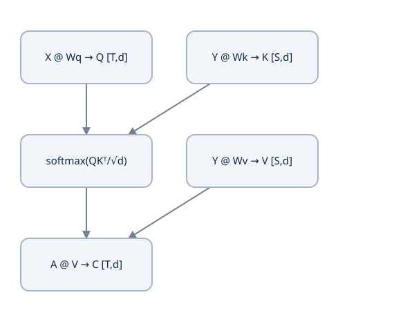

Three learned affine maps retain the token axis. Q [T,d] times Kᵀ [d,S] creates comparisons; row-softmax weights mix V [S,d].


### Read the score table one cell at a time

The transpose of the key matrix and the product are

$$K^T=\begin{bmatrix}1&0&1\\1&-1&0\end{bmatrix},\qquad
R=QK^T=\begin{bmatrix}1&0&1\\2&-1&1\\3&-1&2\end{bmatrix}.$$

For example `R[1,1]` pairs query row `[1,1]` with key row `[0,-1]`: `1×0 + 1×(-1) = -1`. The output's row still identifies the receiving token; its column identifies the source token. A negative score is valid. It becomes a smaller positive probability after softmax.

Divide every score by `sqrt(2)`. The first row becomes approximately `[0.707,0,0.707]`. Exponentiation gives `[2.028,1,2.028]`; dividing by their sum `5.056` gives `[0.401,0.198,0.401]`. Softmax runs across **source keys**, the last dimension. It does not normalize across receiving tokens.

Scaling has a statistical motivation. If each query/key coordinate is independent with mean zero and variance one, each coordinate product has variance one and the sum of `d_k` such products has variance `d_k`. Dividing the sum by `sqrt(d_k)` returns variance near one under those assumptions. It limits a tendency toward extreme logits and saturated softmax. It does not force every trained query to have unit norm. When heads are introduced next, `d_k` becomes the width of one head. [Attention derivation](https://arxiv.org/abs/1706.03762).

### The values supply the output coordinates

The first context row is the probability row times the value matrix:

$$[0.401,0.198,0.401]
\begin{bmatrix}2&0\\0&3\\2&3\end{bmatrix}
\approx[1.604,1.797].$$

The first coordinate is `0.401×2 + 0.198×0 + 0.401×2`; the second is `0.401×0 + 0.198×3 + 0.401×3`. These are payload mixtures. Scores decide where to read; values determine what is read.

Without dropout, an allowed attention row sums to one, so its context lies in the convex hull of its value rows. That statement concerns the intermediate context. A subsequent learned output projection can place the final output elsewhere. Attention weights also need not be symmetric: the second query's preference for the first key can differ from the first query's preference for the second key.

### Implement and inspect the core operation

Open `translation_attention.py`. Its `attention_math` is the complete explicit operation. Keep `math` and `torch` imported at the top:

```python
def attention_math(q, k, v, allowed=None):
    scores = (q @ k.transpose(-2, -1)) / math.sqrt(q.shape[-1])
    if allowed is None:
        weights = scores.softmax(dim=-1)
    else:
        scores = scores.masked_fill(~allowed, -torch.inf)
        nonempty = allowed.any(dim=-1, keepdim=True)
        safe_scores = torch.where(nonempty, scores, torch.zeros_like(scores))
        weights = safe_scores.softmax(dim=-1).masked_fill(~allowed, 0)
    return weights @ v, weights
```

The last two branches reserve a safe convention for a wholly blocked row: zero probabilities and zero context, rather than softmax of only negative infinities. We will explain actual masks in Lesson 11. For today's unmasked call, only the first branch is used. `transpose(-2,-1)` swaps the final two axes and preserves any batch/head axes.

Run the module's controlled learned example:

```bash
python translation_attention.py
```

It prints `Q`, `K`, `V`, `Q @ K.T`, `A`, and `A @ V`. The three context rows round to `[[1.604,1.797],[1.851,1.140],[1.924,1.067]]`. All the fixed projections and the identity output projection are set inside `main()` for this inspection. Real training initializes them and updates them; it does not replace them with these numbers.

To verify the independent known-answer case without running the later training checks:

```bash
python translation_checks.py TranslationChecks.test_dot_product_and_weighted_value_known_answer
```

That case computes the two-key softmax by hand with `math.exp`, then checks the weighted payload against the attention function. A wrong softmax axis, missing scale or elementwise multiply fails it.

### Rectangular attention preserves the receiving positions

For cross-attention, receiving states Y have T rows and source memory X has S rows. Queries Q=YW_Q have shape [T,d], while K=XW_K and V=XW_V have [S,d]. Scores and probabilities have [T,S]; context has [T,d]. The output follows the query axis even when T≠S. A changed source value affects transported payloads without changing weights if Q/K are held fixed. Changing the source representation normally changes both K and V, so it can alter both paths.

### Derive the backward operation

Let C=AV and let G=∂L/∂C be an upstream [T,d] gradient. Matrix multiplication first gives ∇V=AᵀG and ∇A=GVᵀ. For one probability row a with upstream row gₐ, the softmax Jacobian is diag(a)−aaᵀ. Therefore each score derivative is aⱼ(gₐⱼ−Σₖaₖgₐₖ). This subtraction couples the keys competing in a row.

$$
\begin{aligned}
R&=QK^T/\sqrt d,\\
\nabla_Q L&=(\nabla_R L)K/\sqrt d,\\
\nabla_K L&=(\nabla_R L)^TQ/\sqrt d.
\end{aligned}
$$

Continue through the learned projections: ∇W_Q=Yᵀ∇Q and ∇W_K=Xᵀ∇K, with analogous value gradients. The source-state gradient contains **both** the key and value routes; the receiving state has the query route and a residual route in the full block. This explains why treating attention weights as detached constants trains only part of the intended model.

A two-key example makes the competing gradients visible. Take d=1, q=0, keys [1,−1], values [2,6], and L equal to the scalar context. Both weights are .5; context is 4. The probability upstream gradient is [2,6], so score gradients are [−1,1]. The query gradient is −2; key gradients are zero because q=0; value gradients are [.5,.5]. A zero query gradient is not implied by equal weights.

```python
import torch
from translation_attention import attention_math
q = torch.tensor([[0.]], dtype=torch.float64, requires_grad=True)
k = torch.tensor([[1.],[-1.]], dtype=torch.float64, requires_grad=True)
v = torch.tensor([[2.],[6.]], dtype=torch.float64, requires_grad=True)
context, weights = attention_math(q,k,v)
context.sum().backward()
assert context.item() == 4 and q.grad.item() == -2
assert torch.equal(k.grad, torch.zeros_like(k))
assert torch.equal(v.grad, torch.full_like(v,.5))
```

Masked entries have zero probability and score derivative under the reference convention. Dropout and the output projection add their own backward operations; the formulas above describe the undropped core. The new [applied probes](examples/model_learning_probes.py) compare analytic projected gradients with autograd and finite differences.

### Predict or explain: Hold Q/K fixed with weights [.25,.75]. Change values [2,6] to [2,10]. Which weights change, and what is the new scalar context?

<details data-practice-id="qkv-practice-1"><summary>Reveal worked answer and rubric</summary>

No weights change because scores depend on Q/K. New context is .25*2+.75*10=8, versus 5 previously. Changing the underlying source state would generally alter K and V together, so the controlled payload-only claim would not apply.

**Rubric:** Give the changed numerical or graph result, define its axes/state boundary, and identify a source assertion or perturbation that could falsify it.

</details>


### Predict or explain: For d=1, q=0, keys [2,-1], values [1,5], and loss equal to context, derive context, query gradient, key gradients and value gradients.

<details data-practice-id="qkv-transfer"><summary>Reveal worked answer and rubric</summary>

Weights are [.5,.5], context 3. Probability upstream [1,5] gives score gradients [-1,1]. Query gradient is -1*2+1*(-1)=-3. Both key gradients are zero since q=0. Value gradients are [.5,.5]. Equal weights do not imply a zero query gradient.

**Rubric:** Give the changed numerical or graph result, define its axes/state boundary, and identify a source assertion or perturbation that could falsify it.

</details>


### Notes and implementation

In my notes, reproduce Q/K/V, scores, probabilities and context from the worked matrices. Define the row/column meaning for unequal lengths, then derive the two key/value gradient routes. Change a payload and a key separately before running a probe. Continue with [multi-head implementation](lessons/08-heads.md).


## Lesson 10 — Multi-head attention implementation

**Goal:** implement independent retrieval patterns with correct feature ownership, verify explicit/SDPA parity and account for cost. Prerequisite: single-head attention and its projection gradients. Head meanings emerge from training; the architecture does not assign a grammatical label to each one.

Use [translation_attention.py](examples/translation_attention.py). Its packed projections, shape rearrangements and output projection constitute the actual operation. [Source](https://github.com/priyammaz/PyTorch-Adventures/tree/2f18a5470c4ef0a3d413dd7b18d07941f45779e9/PyTorch%20for%20Transformers/Attention%20Mechanisms/Attention), [SDPA contract](https://docs.pytorch.org/docs/2.14/generated/torch.nn.functional.scaled_dot_product_attention.html).

### Keep the total width fixed

Let `B` be batch size, `T` query length, `S` source length, `D` total model width, `H` heads and `d=D/H` features per head. Choose `D` divisible by `H`. For `D=8,H=2`, each head has four features. Four heads at the same `D` would have two features each; it would not create four eight-feature heads.

Project the input to `[B,T,D]`, reshape it to `[B,T,H,d]`, then swap the token and head axes to `[B,H,T,d]`. This ensures the attention operation treats a whole head as one independent sequence computation. Multiplication produces `[B,H,T,S]` scores and `[B,H,T,d]` context.

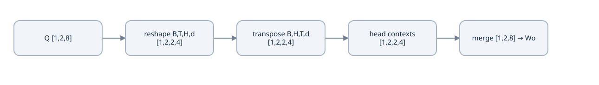

Example B=1,T=2,D=8,H=2,d=4: each token keeps eight coordinates, divided into two learned head subspaces. Merge in the inverse order.


For one batch with two tokens, make the feature identities impossible to confuse:

```text
projected [1,2,8]
token0:  0  1  2  3 |  4  5  6  7
token1:  8  9 10 11 | 12 13 14 15

head0 [2,4]: [[0,1,2,3], [8,9,10,11]]
head1 [2,4]: [[4,5,6,7], [12,13,14,15]]
```

Calling `reshape(B,H,T,d)` directly would group a different set of values. A tensor can have the right shape and still describe the wrong tokens. `transpose` changes the interpretation of axes; it is not an arbitrary cleanup step.

Open the two complete helper functions:

```python
def split_heads(x, num_heads):
    batch, length, width = x.shape
    if width % num_heads:
        raise ValueError("feature width must be divisible by num_heads")
    return x.reshape(batch, length, num_heads, width // num_heads).transpose(1, 2)

def merge_heads(x):
    return x.transpose(1, 2).contiguous().flatten(2)
```

The merge reverses the swap and combines only `H` and `d`. `contiguous()` gives a regular storage layout after the swap; `flatten(2)` joins all axes from axis two onward. Batch and token identity remain separate.

Run this inspection now:

```python
import torch
from translation_attention import split_heads, merge_heads

x = torch.arange(16).reshape(1, 2, 8)
heads = split_heads(x, 2)
print(heads.shape, heads[0, 1].tolist())
print(torch.equal(merge_heads(heads), x))
```

It prints `torch.Size([1,2,2,4])`, head one's two rows `[[4,5,6,7],[12,13,14,15]]`, and `True`. The values establish correctness more strongly than a shape assertion alone.

### Each head is learned through the projections

It is possible to write a loop with a separate `Linear(D,d)` for every head. The packed implementation instead uses one `Linear(D,D)` for all queries, another for keys and another for values. Each projected feature still depends on all `D` input features; only the resulting output columns are split into heads. Those groups of columns have separate learned parameters, so the packed version represents the same family of linear maps.

For head `h`, calculate

$$A_h=\operatorname{softmax}_{\text{source}}\!\left(\frac{Q_hK_h^T}{\sqrt d}\right),\qquad C_h=A_hV_h.$$

If `D=8,H=2`, the denominator is `sqrt(4)=2`. Using `sqrt(8)` would reduce scores too far. Concatenate each token's contexts:

$$C_{\mathrm{joined}}=[C_0\;\Vert\;C_1]\in\mathbb R^{B\times T\times D}.$$

Finally apply `out_proj`, a `Linear(D,D)`. The heads perform separate retrievals, but that output map can combine information from their feature groups. Concatenation alone puts their features side by side; the projection learns how to mix them.

### The class state and the path through it

The `Attention` constructor in `translation_attention.py` owns four projections:

```text
self.q_proj = nn.Linear(embedding_dimension, embedding_dimension)
self.k_proj = nn.Linear(embedding_dimension, embedding_dimension)
self.v_proj = nn.Linear(embedding_dimension, embedding_dimension)
self.out_proj = nn.Linear(embedding_dimension, embedding_dimension)
```

They are `nn.Module` members, so PyTorch registers their parameters, moves them with the model and includes them in the state dictionary. Creating new `Linear` layers inside `forward` would create new parameters on every call and destroy the intended learning state.

The computational spine of `forward` is:

```text
query_input = src if tgt is None else tgt
q = split_heads(self.q_proj(query_input), self.num_heads)
k = split_heads(self.k_proj(src), self.num_heads)
v = split_heads(self.v_proj(src), self.num_heads)
# Build the allowed-key mask as explained in Lesson 11.
context = F.scaled_dot_product_attention(
    q, k, v, attn_mask=allowed, dropout_p=drop, is_causal=False
)
output = self.out_proj(merge_heads(context))
```

The complete callable class is in the linked file, including dimension checks, the explicit inspection path, mask validation and dropout handling. The constructor accepts `fused_attn=False` to use `attention_math`; `need_weights=True` selects that inspection path even when efficient execution is enabled.

### Efficient SDPA preserves the operation

`torch.nn.functional.scaled_dot_product_attention` accepts the packed `q`, `k`, `v` and performs the same scaled, normalized weighted sum. PyTorch chooses an eligible backend according to device, tensor type, dimensions and other constraints. CPU execution or an unsupported GPU shape can use a mathematical backend. Calling SDPA does **not** prove that a FlashAttention kernel ran, and speed is a separate measurement.

The fused implementations can avoid explicitly retaining a full probability matrix. That can improve memory use, but attention still has interactions between every relevant query and key. With self-attention length `T`, the conceptual score tensor contains `B×H×T²` entries. For `B=2,H=4,T=128`, that is `131072` entries, roughly `0.5 MiB` in float32 for one such tensor. Activations, gradients, other layers and backend workspaces add more memory. Doubling `T` quadruples this count.

Evaluation requires a deliberate dropout choice. The SDPA function follows its `dropout_p` argument; it does not inspect the surrounding module's `.eval()` flag. The class therefore passes `self.attn_dropout if self.training else 0.0`. In the explicit path, dropout is applied to probabilities during training. Dropped weights are rescaled, so the retained probability row need not sum to one in an individual training call.

### Verify both execution paths with the same parameters

Run this from `examples/`:

```python
import torch
from translation_attention import Attention

torch.manual_seed(7)
manual = Attention(8, 2, fused_attn=False).double().eval()
efficient = Attention(8, 2, fused_attn=True).double().eval()
efficient.load_state_dict(manual.state_dict())
x = torch.randn(2, 3, 8, dtype=torch.double)
a = manual(x)
b = efficient(x)
torch.testing.assert_close(a, b, atol=1e-10, rtol=1e-10)
print(a.shape, "paths agree")
```

Expected: `torch.Size([2,3,8]) paths agree`. Matching parameter state and disabled dropout are necessary: two separately initialized layers should not have matching outputs.

The dedicated test includes unequal query/source lengths and a padding mask:

```bash
python translation_checks.py TranslationChecks.test_manual_and_sdpa_match_for_rectangular_mask
python translation_checks.py TranslationChecks.test_head_layout_round_trip_and_identity
```

If layout round-trip fails, inspect the reshape and swap. If parity fails only with masks, inspect the mask convention and key axis before changing tolerances.

### Separate parameter cost from activation cost

At fixed D, four biased D→D projections own 4D²+4D parameters regardless of H. Increasing H changes head width and the conceptual probability count BHTS; it does not multiply projection parameters by H. Query-key and probability-value products each require roughly BTSD multiply-accumulates across all heads. Projection work instead scales with sequence lengths and D². These estimates describe operations, not measured wall time or backend memory allocation.

For D=8 and H=2, there are 288 projection parameters. With B=2,T=4,S=7, scores contain 112 entries. Replacing two heads by four keeps 288 parameters but produces 224 conceptual score entries with width 2 per head. A fused kernel may avoid materializing that full probability array; requesting weights selects the explicit path and changes the inspection cost.

`need_weights=True` returns **pre-dropout** probabilities. With training dropout enabled, those displayed weights are not exactly the weights used to form context. Check both the module mode and what the returned tensor represents before interpreting a plot. Probability plots alone do not establish a linguistic explanation or causal importance.

### Extend parity to gradients and rectangular inputs

An implementation that matches one forward pass can still detach or reuse the wrong parameter during backward. Compare identical parameter states on unequal source/query lengths, valid Boolean masks and deterministic mode. Backpropagate the same scalar function of the output, then compare input and projection gradients. Floating-point kernels can differ slightly; use tolerances appropriate to dtype and backend rather than insisting on bit equality across devices.

For a manual head loop, slice **output rows of the stored projection weights** for each head. All heads read the full input feature vector. Slicing input columns would create a different map in which each head sees only part of the input. Concatenate each token's contexts, then apply the common output projection.

### Predict or explain: With B=2,D=12,H=3,S=7,T=4, give head width, Q/K/scores/context/final output shapes and scaling.

<details data-practice-id="heads-practice-1"><summary>Reveal worked answer and rubric</summary>

d=4 and scale denominator sqrt(4)=2. Q [2,3,4,4], K/V [2,3,7,4], scores [2,3,4,7], context [2,3,4,4], merged/projected output [2,4,12].

**Rubric:** Give the changed numerical or graph result, define its axes/state boundary, and identify a source assertion or perturbation that could falsify it.

</details>


### Predict or explain: A loop implementation slices each head’s input-feature columns rather than projection output rows. Is it equivalent to packed projections? What should be compared besides outputs?

<details data-practice-id="heads-transfer"><summary>Reveal worked answer and rubric</summary>

No. Packed heads each read all D input features through their own output-column map (stored weight rows). Input slicing restricts each head to a subset. Use correct stored-row slices, identical parameters and masks, then compare forward outputs, input gradients and all projection gradients under deterministic mode.

**Rubric:** Give the changed numerical or graph result, define its axes/state boundary, and identify a source assertion or perturbation that could falsify it.

</details>


### Notes and implementation

Draw the two reshape/transposition directions in my notes using numbered features. Count parameters and rectangular score entries for a changed H, then explain the stored-weight slices of a loop implementation. Run the two named parity/layout checks and the applied gradient probes. Continue to [attention masks](lessons/09-masks.md).


## Lesson 11 — Padding, causal and cross-attention masks

**Goal:** specify legal information for encoder self-attention, decoder self-attention and source cross-attention, then test isolation. Prerequisites: attention axes and teacher-forced likelihood. A valid loss denominator cannot repair information leakage in the forward graph.

[translation_attention.py](examples/translation_attention.py) uses **True = allowed source key**, matching functional SDPA. Other APIs can reverse Boolean meaning; establish semantics at each boundary. [Official contract](https://docs.pytorch.org/docs/2.14/generated/torch.nn.functional.scaled_dot_product_attention.html).

### A padding mask describes source keys

Suppose two English samples become this batch after padding:

```text
sample0: [BOS] i see cats [EOS]
sample1: [BOS] cats [EOS] [PAD] [PAD]

key_mask:
[1,1,1,1,1]
[1,1,1,0,0]
```

A pad token makes the rectangular batch possible; it is not extra sentence information. Each query must give a padded **key column** zero weight. For sample one, the unmasked probability for the last two columns would read representations that arose only from padding. An embedding with a zero pad row is insufficient because positional encodings, projection biases and later operations can make its representation nonzero.

If keys have length `S`, begin with `[B,S]`. Insert dummy head and query axes to produce `[B,1,1,S]`; broadcast over heads and query rows. This creates no need to physically copy the mask with `repeat`. For encoder attention, queries also have length `S`. For cross-attention, the query length may be different.

### The causal mask protects a prediction from its answer

Imagine French decoder inputs `[BOS,je,vois,les]`. At the position holding `je`, the model is predicting `vois`. It may read `[BOS,je]`, but not the later input `vois`, which already contains the answer. A four-position causal table is

$$M_{\mathrm{causal}}=\begin{bmatrix}
1&0&0&0\\1&1&0&0\\1&1&1&0\\1&1&1&1
\end{bmatrix}.$$

The diagonal is allowed: the current decoder input predicts the *next* label. Position `i` may read key `j` when `j≤i`. That rule makes it possible to calculate all teacher-forced predictions in parallel while preserving the dependency on only a prefix.

Padding and causality answer separate questions and must be combined. If the last input is padding, its key column is blocked even when the triangular rule permits it. The allowed table is the logical intersection:

$$M_{b,i,j}=M_{\mathrm{key},b,j}\land(j\le i).$$

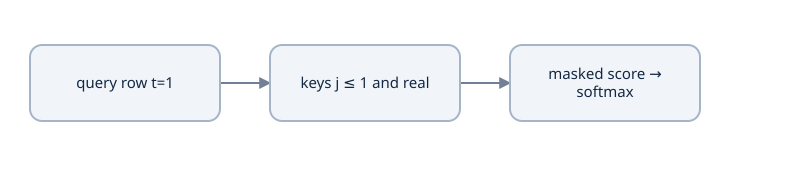

A score at [query,key] is usable only when its key is real and the objective permits it. Hide before softmax; zero score still receives probability.


### Build the entire allowed table

The complete function in `translation_attention.py` is:

```python
def allowed_keys(key_mask, query_length, *, causal=False):
    if key_mask.ndim != 2 or key_mask.dtype != torch.bool:
        raise ValueError("key_mask must be a Boolean [batch, source_length] tensor")
    source_length = key_mask.shape[-1]
    allowed = key_mask[:, None, None, :].expand(-1, 1, query_length, -1)
    if causal:
        if query_length != source_length:
            raise ValueError("causal self-attention requires equal query/key lengths")
        history = torch.ones(query_length, source_length, dtype=torch.bool,
                             device=key_mask.device).tril()
        allowed = allowed & history[None, None]
    return allowed
```

`None` in tensor indexing inserts an axis; `expand(-1,1,T,-1)` keeps batch/source lengths and presents the same key mask to all `T` queries. `tril()` keeps the lower triangle. The self-attention contract requires matching query/key lengths when causality is requested; this function does not implement cached decoding with different query/key offsets.

Run a direct numeric check:

```python
import torch
from translation_attention import allowed_keys

mask = torch.tensor([[True, True, False]])
print(allowed_keys(mask, 3, causal=True)[0, 0].int().tolist())
```

Expected: `[[1,0,0],[1,1,0],[1,1,0]]`. The final row does not gain access to the pad column.

In the explicit path, illegal scores are replaced with negative infinity **before** softmax. Since `exp(-∞)=0`, they receive no mass and the allowed scores are renormalized. Masking probabilities *after* an ordinary softmax without renormalizing would leave the retained weights summing to less than one and reduce the context magnitude incorrectly.

A wholly blocked row has no valid probability distribution. The reference's explicit operation returns zero weights and zero context for that row, matching the tested efficient operation. Once `out_proj` is applied, its bias can still make the final output nonzero. We reject an entire empty source sequence in the complete translation model because it has no translation context.

### Cross-attention is a rectangular retrieval

The encoder turns English into contextual source vectors, called **memory**. The decoder's current French vectors ask questions of that memory:

$$Q=Y_{\mathrm{French}}W_Q,\quad
K=Z_{\mathrm{English}}W_K,\quad
V=Z_{\mathrm{English}}W_V.$$

With three French query positions and five English source positions, each head's score matrix is `[3,5]`. Rows are French positions; columns are English positions. After multiplying by English values, output length is three. The output updates French, so it follows the query length.

Pass the English padding mask to this computation. A French mask has the wrong key meaning and often the wrong shape. Cross-attention has no French-future table: all English words are already supplied before translating. In this task a triangle across English/French indices would incorrectly equate positions in different languages. Other tasks can define their own cross-attention visibility rules; this translation class deliberately rejects `causal=True` with a separate target.

The final interface handles all three cases:

```text
encoder_update = layer(english, attention_mask=english_mask)
decoder_update = layer(french, attention_mask=french_mask, causal=True)
cross_update = layer(english_memory, tgt=french, attention_mask=english_mask)
```

Each call uses the same *interface*, but the complete model creates separate learned attention modules for these jobs. Reusing one layer's weights for all three would be an additional architectural choice we are not making.

### Change illegal inputs and demand identical legal outputs

A mask test should check behavior, not only print a triangle. For causality, change a future input and compare the earlier outputs:

```python
import torch
from translation_attention import Attention

torch.manual_seed(7)
layer = Attention(8, 2).eval()
x = torch.randn(1, 4, 8)
changed = x.clone()
changed[:, 2:] += 500
before = layer(x, causal=True)
after = layer(changed, causal=True)
torch.testing.assert_close(before[:, :2], after[:, :2])
print("future positions cannot change earlier outputs")
```

Without the causal table this fails. To test padding, perturb only padded key vectors while preserving the mask and compare all valid receiving positions. To test cross-attention, use different French/English lengths and ensure its output uses the French length.

Run the independent cases:

```bash
python translation_checks.py TranslationChecks.test_causal_attention_future_isolation
python translation_checks.py TranslationChecks.test_padding_key_perturbation_does_not_affect_valid_queries
python translation_checks.py TranslationChecks.test_manual_and_sdpa_match_for_rectangular_mask
```

These checks use evaluation mode so dropout cannot introduce unrelated differences. A decoder can pass a triangle-shape check while still leaking answers through another layer; Lesson 17 repeats the future-change test against the whole model.

### Distinguish padded queries from padded keys

The mask above prevents *reading padded keys*. It does not necessarily zero a padded query's output. For a right-padded training target, a query at a padded position can read real prefix tokens and produce a vector. That is acceptable when its corresponding label is excluded from loss. There are therefore two obligations: the attention mask excludes illegal context, and the loss mask excludes targets we are not supervising. Neither replaces the other.

For an ordinary right-padded target, the last `EOS` input may itself have an ignored next label. It is still a valid input key. Ignore flags belong to labels, not automatically to input tokens. This detail becomes visible when we shift targets next.

### Cached causality requires absolute positions

The square table uses query/key indices measured from the same start. For a cache containing keys at absolute positions 0…4 and a new query at position 4, the legal row is `[1,1,1,1,1]`. Applying a fresh 1×5 lower triangle would allow only key 0. The general condition is key_position≤query_position, intersected with key validity. This source rejects rectangular causal calls rather than pretending that it implements a cache.

When adding a cache, maintain the position offset, key order, per-row finished state and source-mask identity together. A cached implementation must match full-prefix logits under evaluation with identical parameters; a faster call with a shifted position table is not equivalent.

### Design controls that can actually falsify a claim

Change future **target inputs**, preserving the earlier prefix and source, to test decoder causality. Change padded source payloads while preserving their mask to test key isolation. Change a real source token to verify that the decoder can use source information; invariance there would suggest an ignored source path or an insensitive fixture. Keep mode, RNG and positional addresses fixed so a comparison isolates the intended condition.

An all-blocked row has no legal categorical distribution. The explicit zero-context convention is useful for a component test, but complete translation rejects an entirely empty source. Do not infer that zero context makes a whole residual block or projected output zero.

### Predict or explain: Target queries have [2,4,D] and source memory [2,7,D]. What does passing a [2,4] target mask to cross-attention mean, and what should happen?

<details data-practice-id="masks-practice-1"><summary>Reveal worked answer and rubric</summary>

It describes the wrong key domain and must be rejected by shape validation. Supply the source validity mask [2,7], broadcasting over target query rows and heads; output length remains four.

**Rubric:** Give the changed numerical or graph result, define its axes/state boundary, and identify a source assertion or perturbation that could falsify it.

</details>


### Predict or explain: For a new query at absolute position 5 and cached keys 0…5, the last key is padding. Give the legal row and explain why a fresh 1x6 lower triangle is wrong.

<details data-practice-id="masks-transfer"><summary>Reveal worked answer and rubric</summary>

The legal row is [1,1,1,1,1,0]: compare absolute key/query positions and intersect padding validity. A fresh lower triangle permits only key zero because its local query index is zero, incorrectly discarding past keys.

**Rubric:** Give the changed numerical or graph result, define its axes/state boundary, and identify a source assertion or perturbation that could falsify it.

</details>


Select an objective and predict permitted key columns before choosing a library mask.

Illustrative cases, not a model execution.

[[interactive:visibility]]

### Change the prediction task

| Objective | Outcome | Explanation |
| --- | --- | --- |
| source encoder | All real source keys | Each source position may use left and right real context. |
| target decoder | Real target keys up to query t | Future target labels must not be visible. |
| cross attention | All real source keys | Target queries read source columns; [T,S] may be rectangular. |
| MLM | All real corrupted-input keys | The selected label remains an original ID; right context is intended. |


### Notes and implementation

Draw the three tables and identify receiving rows, source columns, allowed meaning and ignored labels in my notes. Give the cached one-query counterexample. Run component isolation checks now, then whole-model controls after assembly. Continue with [bilingual batches](lessons/10-bilingual-batches.md).


## Lesson 12 — Bilingual batches and teacher-forced alignment

**Goal:** build the exact source, decoder-input, label and mask tensors for unequal-length examples. Prerequisites: separate tokenizers, conditional likelihood and the three attention masks. A batch can have plausible shapes while its labels are shifted incorrectly.

### Derive prediction slots from a complete target

A full target `[BOS,a,b,EOS]` creates decoder inputs `[BOS,a,b]` and labels `[a,b,EOS]`. Position 0 predicts a from BOS and source memory; position 1 predicts b from BOS/a; position 2 predicts EOS from the complete content prefix. EOS is supervised. BOS is supplied as an input rather than predicted in this objective.

The reference [collate_translation](examples/translation_data.py) first right-pads complete targets and then slices. This order leaves the shorter example's EOS in the decoder input when another row is longer. Its corresponding next label is padding and is ignored. EOS remains a valid input key: validity of an input and validity of its next label are different facts.

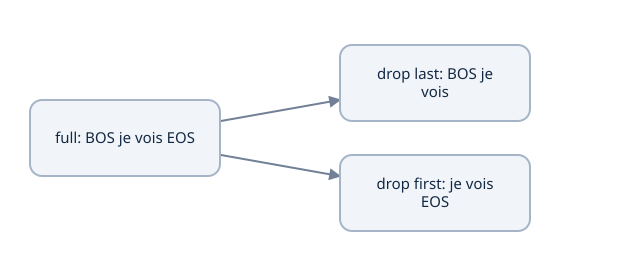

For BOS je vois EOS, decoder inputs are BOS je vois and labels are je vois EOS. EOS is learned; padded label positions use −100.


### Work a ragged batch completely

Use source PAD=0, target PAD=1, BOS=2, EOS=3, and arbitrary ordinary IDs 4/5/6/7. Two records are:

```text
source A [2,4,5,3]     full target A [2,6,7,3]
source B [2,5,3]       full target B [2,7,3]

padded source:        source key validity:
[2,4,5,3]             [1,1,1,1]
[2,5,3,0]             [1,1,1,0]

decoder input:        target key validity:       labels:
[2,6,7]               [1,1,1]                    [6,7,3]
[2,7,3]               [1,1,1]                    [7,3,-100]
```

There are five supervised token slots, not six. Both decoder rows have three valid input keys, but causality still prevents early queries from reading later keys. The shorter row's last EOS query can produce a hidden vector without contributing loss. For target B at query 1, legal self-attention keys are BOS and token 7; cross-attention can read all three real source tokens.

```python
import torch
from translation_data import collate_translation
records = [dict(src_ids=[2,4,5,3],tgt_ids=[2,6,7,3]),
           dict(src_ids=[2,5,3],tgt_ids=[2,7,3])]
batch = collate_translation(records,src_pad_id=0,tgt_pad_id=1)
assert batch['src_input_ids'].tolist() == [[2,4,5,3],[2,5,3,0]]
assert batch['tgt_input_ids'].tolist() == [[2,6,7],[2,7,3]]
assert batch['tgt_outputs'].tolist() == [[6,7,3],[7,3,-100]]
assert batch['tgt_pad_mask'].all()
assert (batch['tgt_outputs'] != -100).sum().item() == 5
assert batch['tgt_outputs'].dtype == torch.long
```

### Keep storage ownership explicit

The source clones input and label slices before replacing target PAD labels with −100. A view that shares storage with the padded target can make an in-place label replacement corrupt input IDs. Negative ignore values belong to supervision only: sending −100 into an embedding lookup is invalid.

The five returned fields are `src_input_ids`/`src_pad_mask` [B,S], `tgt_input_ids`/`tgt_pad_mask` [B,T], and `tgt_outputs` [B,T]. IDs and labels are integer tensors; masks are Boolean. Move the complete batch to the model device while retaining those dtypes. Padding both languages to one common length wastes work and has no mathematical requirement: S and T are independent.

### Treat lengths and denominators as data contracts

Capacity includes special tokens. With target capacity 6, four ordinary tokens plus BOS/EOS fit; five ordinary tokens do not. The reference rejects overlong pairs through `encode_pairs`. Silently truncating one language can remove a meaning or EOS, changing the objective. A deliberate chunking policy must preserve alignment and declare its evaluation meaning.

Length bucketing can reduce padding but changes batch/sampler state that recovery must preserve. Valid counts can differ across micro-batches. Suppose one contains losses summing to 6 over three tokens and another sums to 2 over one token. Backpropagating each sum divided by the shared count 4 gives the true token-mean update. If counts instead differ as 3 and 2, the denominator is 5; averaging two batch means gives another weighting. A pad-heavy batch must not acquire extra weight solely from its rectangular size.

### Check behavior beyond printed tensors

Run `python translation_checks.py TranslationChecks.test_collator_shift_ignore_and_no_alias` and the loss/unequal-accumulation checks. Deliberately change an ignored logit row and verify unchanged loss; change a gold EOS row and expect a change. Keep source and target vocabulary identity with the batch artifact. The larger WordPiece adapter from Lesson 5 must return the same five tensor contracts while using its saved special IDs.

### Predict or explain: Batch full targets [2,4,3] and [2,5,6,7,3], with PAD=1. Give shifted inputs, labels and valid count.

<details data-practice-id="bilingual-batches-practice-1"><summary>Reveal worked answer and rubric</summary>

Padded rows are [2,4,3,1,1] and [2,5,6,7,3]. Inputs are [2,4,3,1] and [2,5,6,7]. Labels are [4,3,-100,-100] and [5,6,7,3]. There are six supervised tokens. The first row’s EOS input is valid but has an ignored next label.

**Rubric:** Give the changed numerical or graph result, define its axes/state boundary, and identify a source assertion or perturbation that could falsify it.

</details>


### Predict or explain: Why clone label/input slices before replacing PAD labels with -100? Can label ignore values be used as embedding IDs?

<details data-practice-id="bilingual-batches-transfer"><summary>Reveal worked answer and rubric</summary>

Sliced views can alias the full target or one another; an in-place replacement can corrupt input IDs. Clones establish separate ownership. -100 is an objective sentinel and is not a valid vocabulary address; input IDs retain tokenizer PAD and their own key-validity mask.

**Rubric:** Give the changed numerical or graph result, define its axes/state boundary, and identify a source assertion or perturbation that could falsify it.

</details>


### Notes and implementation

Draw a different unequal-length batch in my notes, including each query's next label, self/cross key domains and valid-token count. Explain why a valid EOS input can have an ignored label and why `.clone()` matters. Continue with [position-wise FFNs](lessons/13-translation-ffn.md).


## Lesson 13 — Position-wise FFN and activation choice

**Goal:** derive the shared nonlinear feature map, its gradients and cost, then inspect the source's activation/dropout recipe. Prerequisites: affine maps, chain rule and attention. Attention mixes positions; this FFN mixes features independently within each receiving position.

### Expansion followed by nonlinear contraction

For row vector x of width D and hidden width F=rD,

$$
\begin{aligned}
a&=xW_1+b_1,\quad a\in\mathbb R^F,\\
z&=\operatorname{GELU}(a),\\
f(x)&=zW_2+b_2,\quad f(x)\in\mathbb R^D.
\end{aligned}
$$

W₁ has mathematical shape [D,F], W₂ [F,D]. PyTorch stores their transposes. Applying the same map to [B,T,D] retains B/T and shares all parameters across positions. Expansion creates a larger nonlinear feature basis; contraction returns to the residual width. Without a nonlinearity, `(xW₁+b₁)W₂+b₂` collapses to one affine map, although a narrow intermediate factor could still constrain rank.

### GELU supplies a smooth gate

For the standard normal cumulative distribution Φ and density φ,

$$
\operatorname{GELU}(a)=a\Phi(a),\qquad
\operatorname{GELU}'(a)=\Phi(a)+a\phi(a).
$$

Φ is a cumulative probability, not a distribution learned by this layer. GELU(1)≈.841345, GELU(−1)≈−.158655 and GELU(0)=0. Its derivative at 1 is approximately 1.083315, at −1 approximately −.083315, and at 0 exactly .5. A negative output or derivative is possible; this is not ReLU with a different name. The source uses the default exact GELU, rather than explicitly selecting its optional tanh approximation. [GELU contract](https://docs.pytorch.org/docs/2.14/generated/torch.nn.GELU.html).

The original Transformer used ReLU, `max(0,a)`. Changing to GELU changes the function and gradient even if dimensions/parameters match. Neither is an automatic quality guarantee.

### Work one map and its backward signal

Choose x=`[1,-1]`, W₁=`[[1,0,1],[0,1,1]]`, b₁=`[0,0,1]`, W₂=`[[1,0],[0,1],[1,-1]]`, b₂ zero. The intermediate a is `[1,-1,1]`; activation is `[.841345,-.158655,.841345]`; output is approximately `[1.682689,-1]`.

If L is the first output coordinate, ∂L/∂z=`[1,0,1]`. Multiplying by GELU′ gives ∂L/∂a≈`[1.083315,0,1.083315]`. Consequently ∂L/∂x≈`[2.166631,1.083315]`. Parameter derivatives are outer products: ∇W₂=zᵀg, ∇W₁=xᵀ∇a; biases receive the summed corresponding gradients across all positions.

```python
import torch
x = torch.tensor([1.,-1.],dtype=torch.float64,requires_grad=True)
w1 = torch.tensor([[1.,0.,1.],[0.,1.,1.]],dtype=x.dtype)
w2 = torch.tensor([[1.,0.],[0.,1.],[1.,-1.]],dtype=x.dtype)
a = x@w1 + torch.tensor([0.,0.,1.],dtype=x.dtype)
y = torch.nn.functional.gelu(a)@w2
y[0].backward()
assert abs(y[0].item()-1.682689492) < 1e-8
assert abs(y[1].item()+1) < 1e-12
assert torch.allclose(x.grad,torch.tensor([2.16663094,1.08331547],dtype=x.dtype))
```

The worked hidden width 3 demonstrates the map; the reference configuration instead expresses F as an integer multiple of D. Its default D=32,r=4 gives F=128.


Read alongside the worked calculation and explicit implementation boundaries in its lesson.


### Source placement and parameter accounting

[FeedForward.forward](examples/translation_model.py) executes `intermediate_dense → GELU → intermediate_dropout → output_dense → output_dropout`. Both dropout modules use `hidden_dropout_p` and obey train/eval mode. The surrounding block adds the residual and normalizes. There is no second outer FFN dropout in that block: output dropout is already inside the FFN.

The parameter count is DF+F+FD+D=2DF+F+D. At D=32,F=128, weights contain 8,192 entries and biases 160, totaling 8,352. Approximately 2B T D F multiply-accumulates are needed per FFN, plus activation/dropout work. This scales linearly with token count, whereas self-attention's score/value work scales quadratically in sequence length. A long-sequence memory problem can coexist with most learned parameters residing in FFNs.

Initialization and normalization affect activation/gradient scale; expansion alone does not fix instability. The source initializes linear weights with std .02 and biases zero. Its mathematical choice is part of the saved configuration, not an explanation of trained feature meanings.

### Test the position-wise claim

Under evaluation, perturb only token row 1 before this FFN. Other token outputs must remain identical because no token-axis operation exists inside it. Perturbing a token before attention can affect other receiving positions. Use these two controls to distinguish feature transformation from communication. Random training dropout would need identical masks or a statistical comparison; a naïve equality check across two random calls is invalid.

### Predict or explain: For D=16 and expansion ratio three, count a biased two-layer FFN. Does perturbing token 2 change token 0 at this module’s output under evaluation?

<details data-practice-id="translation-ffn-transfer"><summary>Reveal worked answer and rubric</summary>

Hidden width is 48. Count is 2*16*48+48+16=1600. Token 0 is unchanged because the same feature map acts independently at each position; attention elsewhere can mix positions. Disable dropout or hold masks fixed to isolate this claim.

**Rubric:** Give the changed numerical or graph result, define its axes/state boundary, and identify a source assertion or perturbation that could falsify it.

</details>


### Predict or explain: Remove GELU from a two-affine-layer FFN. Derive the resulting single map and explain why preserving dimensions does not preserve the nonlinear model.

<details data-practice-id="translation-ffn-gradient"><summary>Reveal worked answer and rubric</summary>

Output becomes x(W1W2)+(b1W2+b2). This is one affine map, possibly rank-constrained by intermediate width. Removing GELU removes input-dependent gating and its derivative, changing the represented function despite matching input/output widths.

**Rubric:** Give the changed numerical or graph result, define its axes/state boundary, and identify a source assertion or perturbation that could falsify it.

</details>


### Notes and implementation

Derive the output and backward rows in my notes, count a changed expansion ratio and mark both dropout locations. Recreate the independent-token perturbation on `FeedForward`, then explain where the model mixes positions. Continue with [residuals and LayerNorm](lessons/11-transformer-blocks.md).


## Lesson 14 — Residual and normalization blocks

**Goal:** derive the exact post-norm residual computation, normalization gradient and dropout ownership. Prerequisites: attention and the FFN. Correct sublayers connected in the wrong order implement a different architecture.

### Addition creates a direct gradient route

A residual operation is u=x+f(x), requiring equal shapes. Its Jacobian is I+J_f, so an upstream gradient travels through both the identity route and the sublayer. This helps optimization by preserving a direct route; it does not guarantee healthy gradients through arbitrary subsequent normalization or depth.

The source uses post-norm:

$$
 y=\operatorname{LN}(x+\operatorname{Dropout}(f(x))).
$$

Pre-norm instead uses `x + Dropout(f(LN(x)))` and commonly has an additional final normalization after the stack. These graphs have different gradients and saved normalization locations. The Small GPT course later uses its own stated pre-norm graph; swapping orders here is an architectural change.

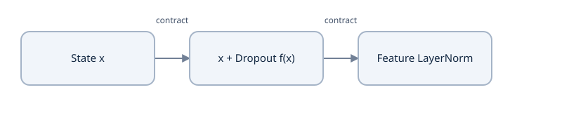

Read alongside the worked calculation and explicit implementation boundaries in its lesson.


### LayerNorm operates on one token's features

For u∈ℝᴰ,

$$
\begin{aligned}
\mu&=D^{-1}\sum_j u_j,\\
\sigma^2&=D^{-1}\sum_j(u_j-\mu)^2,\\
\hat u_j&=(u_j-\mu)/\sqrt{\sigma^2+\epsilon},\\
y_j&=\gamma_j\hat u_j+\beta_j.
\end{aligned}
$$

The variance denominator is D. With u=`[1,3]`, μ=2, variance 1 and ε=10⁻⁵, initial γ=1/β=0 gives approximately `[-.999995,.999995]`. Normalizing over the token axis would couple different positions and could leak future information. `nn.LayerNorm(D)` uses the last D features separately for each batch/token row; it behaves consistently with batch size one. It differs from BatchNorm and from clipping parameter gradients after backward. [Official LayerNorm definition](https://docs.pytorch.org/docs/2.14/generated/torch.nn.LayerNorm.html).

Equal-feature u has zero centered values and produces β. Epsilon prevents division by zero, but is not a switch that skips the operation. Learned γ/β provide per-feature scale and shift; they add 2D parameters for each separate normalization module.

### Follow its backward signal

Given upstream g=∂L/∂y, define r=g⊙γ and s=√(σ²+ε). Differentiating the centering and variance gives

$$
\nabla_u L=\frac{r-\operatorname{mean}(r)-\hat u\operatorname{mean}(r\odot\hat u)}{s}.
$$

Means are over features of that token. The parameter gradients sum over uses: ∇γ=Σ(g⊙û), ∇β=Σg. The derivative is not merely division by s: every input coordinate influences mean and variance. For u=`[1,2,3]`, g=`[1,0,0]`, γ=1 and the ε→0 limit, the input gradient is approximately `[.204124,-.408248,.204124]`. Its entries sum to zero, reflecting invariance to a constant input shift.

```python
import torch
u = torch.tensor([1.,2.,3.],dtype=torch.float64,requires_grad=True)
norm = torch.nn.LayerNorm(3,eps=1e-5).double()
y = norm(u)
g = torch.tensor([1.,0.,0.],dtype=u.dtype)
(y*g).sum().backward()
centered = u.detach()-u.detach().mean()
s = (centered.square().mean()+norm.eps).sqrt()
hat = centered/s
expected = (g-g.mean()-hat*(g*hat).mean())/s
assert torch.allclose(u.grad,expected,atol=1e-12,rtol=1e-12)
assert abs(u.grad.sum().item()) < 1e-12
```

In a post-norm block, even f(x)=0 leaves y=LN(x), which is usually not x. The direct route passes through LayerNorm. A pre-norm block with a zero sublayer update retains x exactly, before any final stack normalization. This is a useful changed-condition diagnosis of the graph.

### Trace dropout and module ownership

An encoder block executes:

```text
source x
  → self-attention(x, source-key mask)
  → attention-output dropout
  → add x → LayerNorm
  → FFN (including its two dropout sites)
  → add current state → final LayerNorm
```

The decoder has three separate additions/norms: causal self-attention, source cross-attention and FFN. Cross-attention keys/values use encoder memory, but every decoder residual adds to the current **target** stream. Source and target lengths can differ, so adding memory directly would violate that interface.

Inverted dropout uses m/(1−p), with Bernoulli mask m, to preserve an activation's conditional expectation. It does not preserve each sample or make nonlinear normalized outputs equal in expectation. Attention-probability dropout, attention-output dropout and FFN dropout are distinct sites. The reference has no embedding dropout; defaults set the existing dropout probabilities to zero for its deterministic miniature.

The block constructors register unique attention, FFN and norm modules. `ModuleList` later registers each block in the stack; repeating the same object would share weights. Equal initialization values do not imply shared parameters. Do not instantiate trainable modules inside forward or keep them in an unregistered plain list.

### Verify the assembled block

Inspect [TransformerEncoderLayer and TransformerDecoderLayer](examples/translation_model.py). Count two LayerNorm modules (128 default parameters) in an encoder layer and three (192) in a decoder layer. Run the source gradient/future/padding controls once the complete model is assembled. Check `.eval()` disables registered dropout while autograd can remain enabled; `no_grad()` alone does not select evaluation behavior.

### Predict or explain: Set a post-norm block’s sublayer update to zero for input [2,6], with gamma=1,beta=0,epsilon=1e-5. Is it identity?

<details data-practice-id="transformer-blocks-practice-1"><summary>Reveal worked answer and rubric</summary>

No. Mean is four and variance four; output is [-2,2]/sqrt(4+1e-5), approximately [-.99999875,.99999875]. The post-norm identity route still passes through normalization. A pre-norm residual with a zero update retains the original input before any final normalization.

**Rubric:** Give the changed numerical or graph result, define its axes/state boundary, and identify a source assertion or perturbation that could falsify it.

</details>


### Predict or explain: Someone normalizes [B,T,D] over T instead of D in a causal decoder. Why can this invalidate future isolation even if attention masks are correct?

<details data-practice-id="transformer-blocks-transfer"><summary>Reveal worked answer and rubric</summary>

Statistics for an earlier position can include later token representations, creating another future-information path. LayerNorm(D) normalizes each token’s feature axis independently. Verify the normalized_shape and run whole-model future perturbations rather than trusting only attention-mask shape.

**Rubric:** Give the changed numerical or graph result, define its axes/state boundary, and identify a source assertion or perturbation that could falsify it.

</details>


### Notes and implementation

Draw post-norm versus pre-norm graphs in my notes, derive the three-feature gradient and mark all dropout/norm sites and unique parameter owners. Predict a zero-sublayer output before calculating it. Continue with the [encoder stack](lessons/15-encoder-stack.md).


## Lesson 15 — Encoder stack and contextual source memory

**Goal:** implement the whole source-side computation, explain what its memory contains, and verify padding isolation through multiple layers. Prerequisites: learned attention, positions and the post-norm blocks in [Lesson 14](lessons/11-transformer-blocks.md). Work in your disposable source copy's `examples/`; use the compatible PyTorch interpreter established in Lesson 2. The reference implementation is [translation_model.py](examples/translation_model.py), not a replacement for your existing learner repository.

### Memory contains contextual vectors, not predicted English tokens

Let source IDs be $I_s[B,S]$, with batch size B, padded source length S and feature width D. `encodings.forward_src` looks up a separate source table and adds fixed positional features, producing $X^{(0)}[B,S,D]$. This inspected-source design does **not** multiply its embeddings by sqrt(D). The original paper's scaling is a different declared choice, rather than a correction to apply silently.

An encoder layer reads every permitted source position, then transforms features at each position. For layer l, write

$$\begin{aligned}
U^{(l)}&=\operatorname{LN}_{l,a}\!\left(X^{(l-1)}+\operatorname{Dropout}(\operatorname{MHA}_l(X^{(l-1)},K_s))\right),\\
X^{(l)}&=\operatorname{LN}_{l,f}\!\left(U^{(l)}+\operatorname{FFN}_l(U^{(l)})\right),\\
M&=X^{(L_e)}\quad[B,S,D].
\end{aligned}$$

Here $K_s[B,S]$ is a Boolean **valid-key** mask. Both normalizations reduce D independently for each token; no pooling removes the S axis. `FeedForward` already includes its hidden/output dropout and GELU. Adding another output dropout outside it would change the inspected computation. The decoder later projects M into keys and values; the encoder does not choose English vocabulary IDs or produce one vector per sentence.

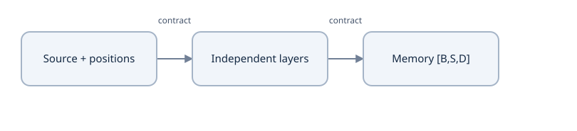

Read alongside the worked calculation and explicit implementation boundaries in its lesson.


### Full-source attention is appropriate to this task

At training and inference, the complete English source is available. An encoder query can use a later English token: `bank` can be disambiguated by a later phrase. This is legal conditioning, not target leakage. Applying a target-style triangle would change the source representation and restrict an operation that is meant to be bidirectional.

For valid keys `[True,True,False]`, the allowed matrix for three source queries is

$$A_{\mathrm{allowed}}=\begin{bmatrix}1&1&0\\1&1&0\\1&1&0\end{bmatrix}.$$

Take one query's scores `[0,log(3),large]` and values `[[2,0],[0,4],[100,100]]`. Masking the third score **before** softmax gives weights `[.25,.75,0]` and output `[.5,3]`; the arbitrary padded value is irrelevant. If the second key instead becomes invalid, only the first remains and the output becomes `[2,0]`. A mask change is a changed conditioning set, not a harmless storage rearrangement.

The mask describes keys, not query outputs. A padded query can read real keys, and its positional features/residual/LayerNorm bias can produce a nonzero vector. The reference does not promise zero padded memory rows. It promises that later operations exclude them as keys. Preserve the original validity mask when memory goes to cross-attention.

### Padding isolation must survive the entire stack

Suppose padded input IDs change while the original mask stays fixed. At layer one, every real query receives the same real Q/K/V and excludes the changed padded keys. Its attention output is therefore unchanged. Residual addition, feature normalization and the position-wise FFN do not mix positions, so its final real vector is unchanged. Apply the same reasoning inductively to every layer. Changed padded rows remain excluded at the next layer and at decoder cross-attention.

This argument assumes matching parameters, evaluation mode or matched randomness, the same real positions, and an unchanged supplied mask. Recomputing a mask from the deliberately changed PAD IDs would declare those positions real and invalidate the test. Dropout differences can also hide an otherwise correct invariance.

### Construct distinct layers and preserve the source API

The constructor uses `nn.ModuleList([TransformerEncoderLayer(config) for _ in range(config.encoder_depth)])`. Each call creates new attention, FFN and normalization parameters. `[one_layer] * depth` registers repeated references to the same layer and ties parameters across depth. Repeated architecture does not mean shared weights.

`Transformer.encode(src_ids, src_attention_mask=None)` derives a mask if absent, rejects a source with no usable key, creates embeddings/positions, then calls each layer with the same source mask. Its return remains `[B,S,D]`. The complete registered methods live in `translation_model.py`; implement the source route there in your scratch copy after the earlier blocks, rather than adding notebook-global memory.

Run this complete two-layer probe from `examples/`:

```python
import torch
from translation_model import Transformer, TransformerConfig

torch.set_num_threads(1)
torch.manual_seed(7)
model = Transformer(TransformerConfig(embedding_dimension=8,
    num_attention_heads=2, encoder_depth=2, fused_attn=False)).eval()
ids = torch.tensor([[2,4,3,0],[2,5,6,3]])
valid = ids.ne(0)
changed = ids.clone(); changed[0,-1] = 7
with torch.no_grad():
    memory = model.encode(ids, valid)
    altered = model.encode(changed, valid)
assert memory.shape == (2,4,8)
torch.testing.assert_close(memory[valid], altered[valid], atol=1e-6, rtol=0)
assert model.encoder[0].enc_attention.q_proj.weight is not model.encoder[1].enc_attention.q_proj.weight
assert 'encoder.1.enc_attention.q_proj.weight' in model.state_dict()
print('memory:', tuple(memory.shape), 'real-token padding isolation: passed')
```

Expected shape is `(2,4,8)` and all assertions pass. Also test all-masked input rejection, a source beyond `max_src_len`, and the full-model isolation test: `python translation_checks.py TranslationChecks.test_full_model_source_padding_isolation`. Encoder-only parity does not by itself verify the decoder uses its mask.

### Review practice and notes

### Predict or explain: Change valid source keys to [True,False,True], scores to [0,log(3),log(2)] and values to [[2,0],[0,4],[6,3]]. Calculate one attention output. What if the masked input ID changes but the supplied mask stays fixed across two encoder layers?

<details data-practice-id="encoder-stack-transfer"><summary>Reveal worked answer and rubric</summary>

Allowed exponentials are 1 and 2, so weights are [1/3,0,2/3] and the value output is [14/3,2]. Changing the blocked key/value cannot affect real-query outputs. Attention excludes that key, and residual/feature LayerNorm/position-wise FFN preserve real-row equality inductively through depth. Padded query rows may remain nonzero; they must still be excluded as decoder keys.

**Rubric:** Renormalize only legal keys, work both output coordinates, state the fixed-mask/evaluation assumptions and distinguish key exclusion from zero query outputs.

</details>


### Predict or explain: At D=8 and FFN width 32 with biases and two affine LayerNorms, change encoder depth 1 to 3. How many extra parameters should appear? What happens if a list repeats one layer object three times?

<details data-practice-id="encoder-stack-sharing-transfer"><summary>Reveal worked answer and rubric</summary>

One layer has MHA 4*8^2+4*8=288, FFN 2*8*32+32+8=552 and norms 2*(2*8)=32, total 872. Two new independent layers add 1744 learned scalars. Repeating one object ties the same 872 scalars across all calls; object identity and registered parameter count expose it. A ModuleList registers ownership but does not itself create independent copies.

**Rubric:** Derive each component count and verify actual distinct Parameter objects rather than equating repeated architecture with repeated parameters.

</details>


In my notes, draw two source layers with separate parameter boxes and one persistent validity mask. Work the changed-key calculation above, then write the induction argument for real-token invariance. Record which padded outputs are allowed to remain nonzero and where the decoder must exclude them. Explain why detaching or caching memory is safe for some inference calls but would cut the encoder's training gradient path.

Source structure: [pinned translation implementation](https://github.com/priyammaz/PyTorch-Adventures/tree/2f18a5470c4ef0a3d413dd7b18d07941f45779e9/PyTorch%20for%20NLP/Seq2Seq%20for%20Neural%20Machine%20Translation); [original encoder architecture](https://arxiv.org/abs/1706.03762). The custom layer is not implicitly interchangeable with `nn.TransformerEncoderLayer` defaults. Continue with [decoder stacks and retrieval](lessons/16-decoder-stack.md).


## Lesson 16 — Decoder stack, source retrieval and information flow

**Goal:** implement each decoder layer's three sublayers and verify which source/prefix information can reach a prediction. Prerequisites: [encoder memory](lessons/15-encoder-stack.md), shifted bilingual batches and post-norm residual blocks. Use your scratch copy's `examples/` with the compatible interpreter from Lesson 2. The authoritative reference methods are `TransformerDecoderLayer.forward` and `Transformer.decode` in [translation_model.py](examples/translation_model.py).

### The residual stream always belongs to the target queries

Let encoder memory be $M[B,S,D]$ and the current decoder representation $Z[B,T,D]$. With source-valid mask $K_s[B,S]$ and decoder-key validity $K_t[B,T]$, one layer performs

$$\begin{aligned}
U&=\operatorname{LN}_{d}\!\left(Z+\operatorname{Dropout}(\operatorname{MHA}_{d}(Z,K_t,\mathrm{causal}))\right),\\
V&=\operatorname{LN}_{c}\!\left(U+\operatorname{Dropout}(\operatorname{MHA}_{c}(M,U,K_s))\right),\\
Z'&=\operatorname{LN}_{f}\!\left(V+\operatorname{FFN}(V)\right).
\end{aligned}$$

All residual sums preserve `[B,T,D]`. Cross-attention transports information from S source positions into T query positions; it does not change the target sequence into an S-length array. Adding memory M directly to U is therefore wrong. Equal toy lengths can conceal that error.

The source-style block is post-norm with GELU inside its FFN. The FFN owns its output dropout, while self/cross-attention have their own residual dropout modules. Three distinct LayerNorms have independently learned scale/offset. Sharing one accidentally changes parameters and coupling. The original paper uses the same ordering with a ReLU FFN; swapping to pre-norm changes the function even when every shape stays legal.

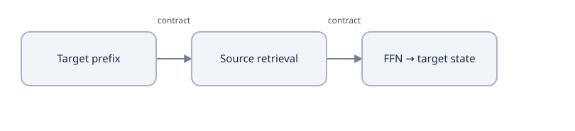

Read alongside the worked calculation and explicit implementation boundaries in its lesson.


### Read the custom Attention arguments carefully

The reference call is `cross_attention(src, tgt, attention_mask=src_mask)`. In [translation_attention.py](examples/translation_attention.py), `src` supplies K and V; `tgt`, when present, supplies Q. Thus `cross_attention(memory, target_states, ...)` is correct. This argument order is not the three-tensor signature of PyTorch's built-in MHA. Copying another API's positional argument order can reverse retrieval without an obvious error when S=T.

For B=2,S=5,T=3,D=8,H=2, cross Q has shape `[2,2,3,4]`, K/V `[2,2,5,4]`, weights `[2,2,3,5]`, and the projected result `[2,3,8]`. Source-valid mask `[2,5]` expands over heads and queries. Cross-attention can read any real source key; no target-style triangle belongs on that rectangle. Each decoder layer applies its own K/V projections to the same final encoder memory, not a matching intermediate encoder layer.

### Causality follows the shifted prefix, including the current input

For target content `[a,b,c]`, the teacher-forced decoder input is `[BOS,a,b,c]` and labels are `[a,b,c,EOS]`. Query index 1 sees BOS and a, and predicts b. Allowing the diagonal is legal because the current input is an earlier target token. An unshifted input would reveal its label through the embedding/residual path even with a triangular mask.

The first two predictions cannot depend on input IDs at positions 2 or 3. This restriction must survive every decoder layer. Causal self-attention cannot introduce future prefix information; cross-attention reads target-independent source memory; per-token FFN and feature LayerNorm do not mix positions. Induction then preserves causality through depth. Encoder memory may depend on every source token because the complete source is available.

Padded target queries can still produce logits. Exclude their labels with `-100`; key masking and loss exclusion are different operations. An all-masked source is rejected at the model's encode boundary. Do not infer zero padded outputs from a padding embedding or a mask that only describes keys.

### Retrieval sends gradients into both streams

For one cross-attention head, $R=QK^T/\sqrt d$, $A=\operatorname{softmax}_{\mathrm{keys}}R$, and $O=AV$. Given upstream $G=\partial L/\partial O$,

$$\begin{aligned}
\nabla_V L&=A^TG,\qquad U_A=GV^T,\\
(\nabla_R L)_{ij}&=A_{ij}\left((U_A)_{ij}-\sum_k A_{ik}(U_A)_{ik}\right),\\
\nabla_K L&=(\nabla_R L)^TQ/\sqrt d.
\end{aligned}$$

The memory receives both key and value projection paths; the target stream receives the Q path and its residual path. Contributions from all decoder layers add into the shared memory graph. Detaching M allows decoder projection/head gradients while disconnecting the encoder, so a head-gradient check is insufficient.

For d=1,q=1, keys `[0,log3]`, values `[[2,0],[0,4]]`, weights are `[.25,.75]` and O=`[.5,3]`. With G=`[2,−1]`, value gradients are `[[.5,−.25],[1.5,−.75]]`; score gradients are `[1.5,−1.5]`. Even though the first key is zero, its score derivative need not be zero. The gradient depends on retrieval and on what is transported.

### Verify depth, rectangles and the encoder gradient path

Run this complete probe from `examples/`:

```python
import torch
from translation_model import Transformer, TransformerConfig

torch.set_num_threads(1)
torch.manual_seed(7)
model = Transformer(TransformerConfig(embedding_dimension=8,
    num_attention_heads=2, decoder_depth=2, fused_attn=False)).eval()
src = torch.tensor([[2,4,3,0,0]])
mask = src.ne(0)
prefix = torch.tensor([[2,5,6,7]])
changed = prefix.clone(); changed[:,2:] = 8
with torch.no_grad():
    original = model(src,prefix,mask)
    altered = model(src,changed,mask)
torch.testing.assert_close(original[:,:2],altered[:,:2],atol=1e-6,rtol=0)
memory = model.encode(src,mask)
memory.retain_grad()
logits = model.decode(memory,prefix,mask)
labels = torch.tensor([[5,6,7,3]])
torch.nn.functional.cross_entropy(logits.flatten(0,1),labels.flatten()).backward()
assert logits.shape == (1,4,12)
assert torch.isfinite(memory.grad).all() and memory.grad[mask].abs().sum() > 0
assert model.encodings.src_embeddings.weight.grad.abs().sum() > 0
print('rectangular decoding, future isolation and encoder gradients: passed')
```

The test establishes computation paths under this fixture, not useful source-conditioned translation. After training, a model can still learn to ignore source information; Lesson 20 adds behavioral source controls. Also run `python translation_checks.py TranslationChecks.test_full_model_future_target_isolation` and the encoder/decoder/head gradient test named in Lesson 17.

### Practice and personal notes

### Predict or explain: Use T=2 decoder positions and S=5 memory positions with source-valid [True,True,False,True,False]. Draw self/cross permission matrices and identify the residual operand around cross-attention. May the encoder read a later source token?

<details data-practice-id="decoder-stack-transfer"><summary>Reveal worked answer and rubric</summary>

Decoder self permission is [[1,0],[1,1]] for its two valid shifted inputs. Cross rows both equal [1,1,0,1,0], shape 2 x 5; no target triangle is imposed on source memory. Q comes from target states, K/V from memory, and the residual operand is the target [B,2,D] stream. Complete-source encoder attention can read later source tokens because they are available conditioning information.

**Rubric:** Name every mask domain and stream, preserve the rectangular output length and connect diagonal permission to the shifted target contract.

</details>


### Predict or explain: Keep q=1, keys [0,log(3)], values [[2,0],[0,4]] but change upstream G to [1,1]. Calculate value/score gradients. If memory is detached, which model path disappears?

<details data-practice-id="decoder-stack-gradient-transfer"><summary>Reveal worked answer and rubric</summary>

A=[.25,.75]. Value gradients are [[.25,.25],[.75,.75]]. Upstream attention-weight derivatives are [2,4], weighted mean 3.5, so score gradients are [-.375,.375]. Memory normally receives key and value projection paths, summed across decoder layers. Detach cuts their continuation into encoder parameters; decoder cross-projection and head gradients can remain, so a head gradient is insufficient.

**Rubric:** Compute the coupled row-softmax derivative and distinguish gradients into the stored memory from gradients into decoder projection parameters.

</details>


In my notes, draw one layer with the three target residual sums, label the actual `Attention(src,tgt)` roles, and calculate the two-stream gradient example. Mark where a future token could leak if a single later layer omitted its triangle. Explain why cached inference needs absolute prefix positions whereas the current reference simply recomputes the prefix.

Source structure: [pinned translation model](https://github.com/priyammaz/PyTorch-Adventures/tree/2f18a5470c4ef0a3d413dd7b18d07941f45779e9/PyTorch%20for%20NLP/Seq2Seq%20for%20Neural%20Machine%20Translation); [original decoder roles](https://arxiv.org/abs/1706.03762). Continue with [the complete model](lessons/12-translation-model.md).


## Lesson 17 — Assemble the complete translation model

**Goal:** reconstruct the actual reference configuration, route bilingual IDs to target logits, count its state and verify gradients throughout the complete model. Prerequisites: the [encoder](lessons/15-encoder-stack.md) and [decoder](lessons/16-decoder-stack.md) stacks. Work in your disposable copy's `examples/` using Lesson 2's compatible interpreter. [translation_model.py](examples/translation_model.py) owns model classes; [translation_data.py](examples/translation_data.py) owns vocabulary/collation; training and persistence remain separate modules.

### Configuration describes a specific function

`TransformerConfig` is a frozen dataclass. Frozen fields prevent accidental configuration assignment; model Parameters remain trainable. Its miniature defaults are:

| Configuration | Reference choice and consequence |
|---|---|
| Source/target vocabulary sizes | 10/12 in the fitted six-pair fixture; sizes and row meanings come from separate artifacts |
| `embedding_dimension`, `num_attention_heads` | 32/4; each head has width 8 |
| `encoder_depth`, `decoder_depth` | One independently parameterized layer each |
| `mlp_ratio` | Four; FFN expands 32→128→32 with GELU |
| `max_src_len`, `max_tgt_len` | 32 each; two fixed sine/cosine buffers |
| `src_pad_id`, `tgt_pad_id` | 0/1, respectively; never infer one from the other |
| Attention/hidden dropout | Both 0 in the controlled reference fit |
| `fused_attn` | True by default; false gives the explicit inspection path |

Validation requires positive even width, divisibility by positive head count, positive depths/expansion/capacities and padding IDs inside the correct vocabularies. This does not replace checking ID ranges, device/dtype or artifact identity at data boundaries. Matching vocabulary sizes cannot detect permuted token meanings.

The inspected large source uses width 512 and six layers per side; the reference reduces capacity while preserving its post-norm/GELU structure. Its separate embeddings feed an untied target head. Lookup and position are added without sqrt(D) scaling or an extra input-dropout module. Those differ from the original paper's shared vocabulary weights, input scaling/dropout and ReLU FFN. [Pinned structure](https://github.com/priyammaz/PyTorch-Adventures/tree/2f18a5470c4ef0a3d413dd7b18d07941f45779e9/PyTorch%20for%20NLP/Seq2Seq%20for%20Neural%20Machine%20Translation), [paper specification](https://arxiv.org/abs/1706.03762).

### Follow all axes through the actual fixture

The six English sequences contain BOS, three content IDs and EOS, so source shape is `[6,5]`. Each full French target contains BOS, four words and EOS; shifting gives decoder inputs and labels `[6,5]`. The accidental equality of these lengths is not an architectural requirement.

| Stage | Output | Meaning |
|---|---|---|
| Source embedding plus positions | `[6,5,32]` | Initial continuous source states |
| Encoder stack | `[6,5,32]` | Contextual memory; source position axis retained |
| Decoder embedding plus positions | `[6,5,32]` | Teacher-forced prefix states |
| Causal self/cross/FFN stack | `[6,5,32]` | Prefix-and-source-conditioned representations |
| `head = Linear(32,12)` | `[6,5,12]` | Unnormalized target-vocabulary scores |
| Flatten batch/position for loss | `[30,12]` plus labels`[30]` | Thirty valid categorical decisions, including EOS |

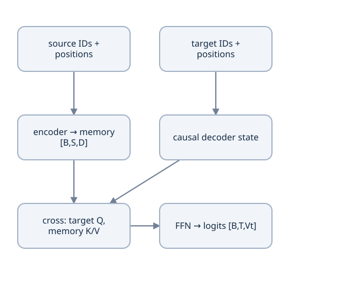

Source representations feed cross-attention as K/V; the evolving target representation supplies Q. Target self-attention remains causal.


`Transformer.forward` derives the source-valid mask if absent, calls `encode`, then passes memory and the **same source mask** to `decode`. `decode` derives target-key validity if absent, applies every decoder layer to the same memory, and returns `head(hidden)`. During inference, `encode` runs once for the fixed request and `decode` receives a growing prefix. Returning only the last memory position or mixing target PAD into source masking changes this contract.

### Derive the complete parameter count

Let D=32,F=128, source vocabulary $V_s=10$ and target vocabulary $V_t=12$. One four-projection MHA has $4D^2+4D=4224$ parameters with biases. One FFN has $2DF+F+D=8352$. Each affine LayerNorm has 2 D=64 parameters. Therefore

$$\begin{aligned}
P_{\mathrm{encoder}}&=4224+8352+2(64)=12704,\\
P_{\mathrm{decoder}}&=2(4224)+8352+3(64)=16992,\\
P_{\mathrm{interface}}&=V_sD+V_tD+DV_t+V_t=1100,\\
P_{\mathrm{total}}&=12704+16992+1100=30796.
\end{aligned}$$

Two 32×32 position buffers add 2048 stored scalars but no learned parameters. FP32 parameter values alone occupy 123184 bytes; gradients, optimizer moments, buffers, saved activations and the runtime consume more. A full checkpoint is not a 30796×4-byte file. Adding one encoder layer adds 12704 parameters; increasing target capacity changes buffers/configuration but not these learned counts.

### Register and initialize the same ownership structure

`Transformer` owns `encodings`, an encoder `ModuleList`, a decoder `ModuleList`, `head`, and `config`. The lists create new modules per layer. These names determine state-dict keys such as `decoder.0.cross_attention.v_proj.weight`; rebuilding with unrelated key names requires an explicit migration.

`self.apply(_init_weights)` initializes all registered linear/embedding weights from Normal(0,.02²), linear biases to 0, LayerNorm scales to 1 and offsets to 0. It resets each embedding's padding row to zero. This is a source convention, not an assertion that every deep architecture should use this scale. A zero lookup row still acquires positions and contextual values; masks continue to matter.

In a scratch implementation, assemble the earlier `Embeddings`, `TransformerEncoderLayer` and `TransformerDecoderLayer` classes before implementing `Transformer.__init__/encode/decode/forward`. Preserve the established method arguments; then compare state names, parameter count and controlled outputs with the downloaded reference. Do not place model definitions inside a training notebook or replace your existing learner child with this completed source.

### A full forward/backward probe

Run the complete block from `examples/`:

```python
import torch
from translation_data import make_fixture
from translation_model import Transformer, TransformerConfig

torch.set_num_threads(1)
source, target, batch = make_fixture()
torch.manual_seed(7)
model = Transformer(TransformerConfig(src_vocab_size=source.vocab_size,
    tgt_vocab_size=target.vocab_size,src_pad_id=source.pad_token_id,
    tgt_pad_id=target.pad_token_id))
logits = model(batch['src_input_ids'],batch['tgt_input_ids'],
               batch['src_pad_mask'],batch['tgt_pad_mask'])
labels = batch['tgt_outputs']
loss = torch.nn.functional.cross_entropy(logits.flatten(0,1),labels.flatten(),ignore_index=-100)
loss.backward()
assert logits.shape == (6,5,12) and int(labels.ne(-100).sum()) == 30
assert sum(p.numel() for p in model.parameters()) == 30796
assert sum(b.numel() for b in model.buffers()) == 2048
assert all(p.grad is not None and torch.isfinite(p.grad).all() for p in model.parameters())
for p in (model.encodings.src_embeddings.weight,
          model.encoder[0].enc_attention.v_proj.weight,
          model.decoder[0].cross_attention.v_proj.weight,model.head.weight):
    assert p.grad.abs().sum() > 0
print('logits:',tuple(logits.shape),'parameters:30796','targets:30')
```

A connected parameter can have zero gradient in a particular fixture; do not require every scalar derivative to be nonzero. For example, a common key-projection bias adds the same score offset across allowed keys and cancels in row softmax. We require finite gradients throughout and nonzero representative encoder, retrieval and head paths. Backward computes derivatives; it does not apply an optimizer update or prove useful translation.

Also run `python translation_model.py` and `python translation_checks.py TranslationChecks.test_gradients_reach_encoder_decoder_and_head`. Preserve complete-model future-target and source-padding isolation checks, not just component parity. Decode an unequal S/T case before accepting a shape contract that only exercised equal fixture lengths.

### Practice and notes

### Predict or explain: Keep the reference D 32/source vocabulary 10 and add three French vocabulary entries, changing Vt 12 to 15. Which arrays and counts change? Is an unchanged shape enough to prove compatible token meanings?

<details data-practice-id="translation-model-practice-1"><summary>Reveal worked answer and rubric</summary>

Target embeddings gain 3*32=96 entries; target head gains 3*32 weights plus 3 biases=99. Total grows 195 from 30796 to 30991. Source table, encoder/decoder blocks and fixed positions remain the same shapes. The affected target arrays require an explicit migration; equal sizes in another artifact still do not prove the same token-to-row mapping.

**Rubric:** Count lookup/output/bias terms separately, identify the unchanged owners and include vocabulary meaning in compatibility.

</details>


### Predict or explain: Instead change only max_src_len 32 to 64 at D 32. What learned count and buffer count result, and can the old complete state dict load strictly?

<details data-practice-id="translation-model-state-transfer"><summary>Reveal worked answer and rubric</summary>

Learned count stays 30796. The source position table gains 32*32=1024 fixed scalars, so total buffers grow 2048 to 3072 (4096 extra FP32 bytes). The full state includes that buffer and its changed shape; strict loading the old [32,32] table into [64,32] fails without an explicit compatible migration. Equal learned parameter count does not establish equal serialized state/configuration.

**Rubric:** Separate trainable and fixed state, calculate additional storage and explain strict state/config compatibility.

</details>


In my notes, derive 30796 from the exact module owners, list buffers separately, and draw IDs→memory→prefix states→logits→labels with mask domains. Calculate how adding three French vocabulary entries changes only the target table/head, then explain why a position-buffer change can reject a full state load even when learned parameter count is unchanged. Continue with [translation updates](lessons/13-translation-training.md).


## Lesson 18 — Translation optimization and complete training updates

**Goal:** implement the reference's token-weighted objective, accumulation, AdamW groups, schedule and update boundaries, then measure a bounded fit. Prerequisites: [complete translation model](lessons/12-translation-model.md) and the earlier supervised-loss lesson. Work in your source copy's `examples/` with Lesson 2's compatible interpreter. [translation_train.py](examples/translation_train.py) owns `token_statistics`, `train_update`, `make_state`, `update` and `evaluate`.

### Define the supervised objective before reducing a batch

For valid shifted label $y_{bt}$ and logits $z_{bt}[V_t]$, the token loss is $\ell_{bt}=\operatorname{logsumexp}(z_{bt})-z_{bt,y_{bt}}$. Its logit derivative is softmax(z)−one_hot(y). The reference uses ordinary unweighted cross-entropy, includes EOS and ignores−100 labels:

$$L=\frac{\sum_{b,t:y_{bt}\ne-100}\ell_{bt}}{N},\qquad N=\sum_{b,t}\mathbf1[y_{bt}\ne-100].$$

The six-pair fixture has thirty labels, so uniform logits over twelve classes yield mean NLL log 12 ≈ 2.484907. This is a baseline, not the exact random model's loss. A valid token has gradient `(p−one_hot)/N`; an ignored position has zero supervised contribution. Target-key padding exclusion remains a separate attention contract.

`token_statistics` flattens B,T in logits and labels consistently, requests `reduction='sum'`, and returns sum/count/correct count. It rejects a microbatch with no supervised target. Aggregating counts once is essential: adding padding cannot improve the objective by enlarging its denominator. Accuracy uses argmax and discards confidence, so a falling NLL need not immediately change the number correct.

### One accumulation group produces one update

Suppose microbatch A contains two valid targets and summed loss 4; B contains five targets and summed loss 5. The token objective is 9/7 ≈ 1.285714. Equal averaging of their means gives `(2+1)/2=1.5`, overweights A, and produces another gradient. Backpropagate S_A/7 then S_B/7; derivatives add to the intended combined mean before changing parameters.

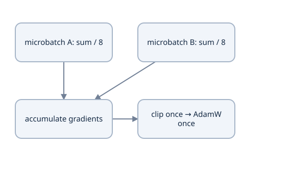

Microbatch A has two labels and B has six. Summing their loss sums and dividing by eight agrees with a full batch; averaging two means gives unequal target weights.


The source's `train_update(model,optimizer,batches,scheduler=...,max_grad_norm=1)` follows this order:

| Boundary | Actual operation and reason |
|---|---|
| Start group | `model.train()` and `optimizer.zero_grad(set_to_none=True)` once |
| Each microbatch | `logits_for` passes source/prefix IDs and both key masks; sum loss divided by the group's valid count calls backward |
| After accumulation | Global gradient norm clipping; abort nonfinite norms before parameter or scheduler changes |
| Commit update | One `optimizer.step()`, then one `scheduler.step()` when supplied |
| Reporting | Detached sum/count, argmax accuracy, valid-token count and **preclip** norm |

Clearing between microbatches loses earlier contributions. Stepping between them changes the parameters inside the intended group. The helper leaves completed gradients present; the next update clears them. Saving mid-group would require those partial gradients and its denominator, whereas the session protocol saves after complete updates.

Without dropout and with controlled batch-dependent behavior, accumulated and combined gradients agree up to floating-point ordering. Run `python translation_checks.py TranslationChecks.test_unequal_microbatch_accumulation_matches_full_batch`: it uses unequal target lengths and compares every parameter after one SGD update. A low loss alone cannot expose this weighting error.

### AdamW groups and the exact protocol

`adamw_groups` decays trainable parameters with rank≥ 2, including embeddings and matrix weights, and excludes lower-rank biases/LayerNorm scales. The grouping is dimensional, not a substring search for a particular normalization spelling. `make_state` uses base rate .01, betas(.9,.98), epsilon 1 e−6 and matrix decay .001.

For one decayed coordinate θ=2, gradient 2 and an initial Adam state, m=.2,v=.08; corrected moments are 2 and 4. The adaptive movement is approximately−.01. Decay separately shrinks θ by `(1−.01×.001)`, yielding approximately 1.98998 after both operations. Injecting λθ into the gradient would alter the moments instead, so it is not the same adaptive update. [AdamW API](https://docs.pytorch.org/docs/2.14/generated/torch.optim.AdamW.html).

The paper's Adam/inverse-square-root schedule and smoothing differ from both this reference and the pinned source's AdamW/cosine/plain-CE recipe. The reference's rate .01 and short duration are chosen for its miniature diagnostic task; the pinned large training script uses rate 1 e−4 and warmup 2000. Retain those source/scale distinctions rather than calling this a WMT reproduction.

### The schedule is indexed by completed optimizer updates

Let U be the fixed total goal, w warmup and k the LambdaLR index. The source multiplier is

$$\alpha(k)=\begin{cases}(k+1)/w,&k<w,\ w>0,\\
\tfrac12[1+\cos(\pi\min(1,(k-w)/(U-w)))],&k\ge w.
\end{cases}$$

For U=8,w=2, indices 0,1,2,5,8 give multipliers .5,1,1,.5,0. The `(k+1)` convention reaches the peak at index 1 and again at index 2; state it rather than hiding an off-by-one comparison. With the default 400-update goal, w=20 and the **first used** rate is .01/20=.0005.

`LambdaLR` is initialized before training and advanced after optimizer steps. Session JSON lists `get_last_lr()` after that advance, describing the next scheduled rate, not necessarily the rate just used. Record the optimizer rate before `update` if comparing used rates. A reconstructed LambdaLR closure needs the same total/warmup settings; loading only its index does not restore a different schedule function.

### Inspect real update state before a longer run

Run this standalone probe from `examples/`:

```python
import math
import torch
from translation_train import make_state,update,adamw_groups,warmup_cosine

torch.set_num_threads(1)
state = make_state(seed=7,steps=400)
used = state.optimizer.param_groups[0]['lr']
old = state.model.head.weight.detach().clone()
result = update(state)
assert math.isclose(used,.0005)
assert result['tokens'] == 30 and state.step == 1
assert torch.isfinite(state.model.head.weight).all()
assert not torch.equal(old,state.model.head.weight)
assert math.isclose(state.scheduler.get_last_lr()[0],.001)
groups = adamw_groups(state.model)
assert all(p.ndim>=2 for p in groups[0]['params'])
assert all(p.ndim<2 for p in groups[1]['params'])
for k,expected in [(0,.5),(1,1.),(2,1.),(5,.5),(8,0.)]:
    assert math.isclose(warmup_cosine(k,total_steps=8,warmup_steps=2),expected,abs_tol=1e-12)
print('used rate:',used,'next rate:',state.scheduler.get_last_lr()[0],'targets:',result['tokens'])
```

Then run `python translation_train.py --steps 400 --seed 7`, optionally with `--report-json /tmp/tutorial1-translation-fit.json`. This command executes one fixed six-pair batch per update:400 updates mean 2400 pair presentations and 12000 supervised labels, not 2400 unique sentences. `evaluate` disables dropout/graphs, aggregates totals and restores caller mode. The reference checks require sharply reduced training loss and exact generation of the six training sentences; two held-out recombinations remain a narrow diagnostic, not a benchmark-quality estimate. Lesson 20 evaluates those distinctions and source controls.

The direct `update` helper does not enforce the total budget itself; the CLI's fixed loop and `course_session` stop at the recorded goal. Use the session wrapper for resumable work. The inspected source also discusses distributed training: if R DDP ranks average gradients, each rank's token-loss sum scaled by R/N_global yields a global token mean under a shared reduced count. Accumulation wrappers can add scaling; this successful CPU reference does not establish a distributed execution result.

### Practice and notes

### Predict or explain: Microbatches now have 3 and 9 valid labels with loss sums 6 and 9. Calculate the token objective and the equal-microbatch alternative, then place gradient clearing, backward, clipping and optimizer/scheduler steps.

<details data-practice-id="translation-training-practice-1"><summary>Reveal worked answer and rubric</summary>

Correct token loss is (6+9)/12=1.25. Equal averaging of means gives (2+1)/2=1.5 and another gradient. Backpropagate each sum divided by 12, accumulate both under unchanged parameters, clip the complete gradient, step optimizer/scheduler once and clear at the start of the next group. Every source microbatch must have at least one target because token_statistics rejects zero-target chunks.

**Rubric:** Derive the actual denominator and specify one commit boundary, including the source helper's zero-target and retained-gradient behavior.

</details>


### Predict or explain: Change a schedule to total 12,warmup 3,base rate .03. What rates do indices 0,1,2,3 produce? After the first optimizer/scheduler update, is the logged get_last_lr rate the one just used?

<details data-practice-id="translation-training-schedule-transfer"><summary>Reveal worked answer and rubric</summary>

Multipliers are 1/3,2/3,1,1, so rates are .01,.02,.03,.03. LambdaLR initializes index 0 before the first update; that update uses .01, then the scheduler advances to index 1 and get_last_lr returns .02 for the next update. Restore both schedule state and the same defining total/warmup closure; changing total 12 to another value changes the experiment.

**Rubric:** Calculate all four rates, distinguish used/next indices and identify scheduler-defining identity fields.

</details>


In my notes, derive the 2-versus 5 token weighting, calculate the first used/next rates, annotate where gradients remain after commit, and list every optimizer-group/schedule field recovery must preserve. Record actual loss, token accuracy, free-running outputs and protocol identity; do not paste an author's threshold as my result. Continue with [autoregressive decoding](lessons/14-translation-generation.md).


## Lesson 19 — Autoregressive generation, completion and decoding scores

**Goal:** implement the actual batched greedy path, explain its bounds and compare it with beam scoring without attributing a beam implementation to this source. Prerequisites: the [trained update protocol](lessons/13-translation-training.md), target shifting and rectangular retrieval. Use your scratch `examples/` folder and Lesson 2's compatible interpreter. `Transformer.inference` lives in [translation_model.py](examples/translation_model.py); it calls the same `encode/decode` methods used in training.

### At inference the next prefix must be constructed

The learned conditional distribution is $p(y_t\mid x,y_{<t})$. Teacher forcing supplied recorded previous tokens; generation supplies the tokens actually selected so far. Encode x once to memory M, initialize the decoder prefix with target BOS, run the decoder, take its **last position's logits**, choose a token, append it and repeat.

For target `je vois les chats`, the intended prefix trace is `BOS`→`BOS je`→`BOS je vois`→`BOS je vois les`→`BOS je vois les chats`→EOS. At prefix length 3, decoder row 2 predicts the next token; row 0 still predicts the first token. Selecting row 0 every time repeatedly answers the wrong question.

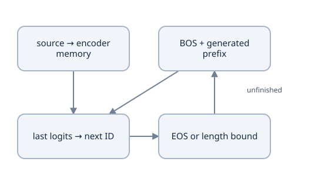

Encode the source once. Recompute target-prefix states, use the last query logits, append one chosen ID, and track EOS separately for every row.


EOS is a learned output factor, not an oracle for the reference sentence length. Including it in training supervision permits learned stopping, but a hard capacity/budget remains necessary. Greedy argmax can operate on logits directly: softmax preserves their ordering. The reference masks the target PAD and BOS output logits to−∞ for active rows, so its greedy selection is over an explicitly restricted domain. EOS and UNK remain possible.

### Keep batch completion separate from batch termination

For B rows, maintain `finished[B]`. Suppose row 0 predicts EOS immediately while row 1 predicts token 5 then EOS. With target BOS 2,EOS 3,PAD 1, output is `[[2,3,1],[2,5,3]]`. The first EOS remains in its row; subsequent shared steps append PAD to that completed row. Stop when `finished.all()` or the budget ends. `any()` would truncate still-active rows.

`max_len` counts the **whole returned sequence**, including BOS and any EOS/PAD positions. A budget 4 permits at most three appended tokens. It must satisfy 2≤max_len≤max_tgt_len. The prefix stays `[B,length]`, even for B=1; unrestricted squeezing would destroy a predictable interface.

The reference's target PAD is 1, unlike source PAD 0. Generation derives prefix-key validity using target PAD; encoding and retrieval use the source mask. Finished rows do not attend to other batch rows. Masking PAD outputs for active rows prevents filler tokens from becoming meaningful prefix content before completion.

### Follow the actual control flow

Inside `Transformer.inference`, the source code performs:

1. Validate budget, target vocabulary ranges and distinct BOS/EOS/PAD IDs.
2. Remember `was_training`, switch to `eval()`, derive or accept the source-valid mask and call `encode` once.
3. Allocate BOS prefixes and `finished` on the source device.
4. Call `decode(memory,generated,source_mask)`, clone the final logits and forbid PAD/BOS.
5. Select argmax, replace selections for already finished rows with PAD, append, update finished flags and test all-completed.
6. Return the ID tensor; `finally` restores caller mode even if an exception occurs.

The method is decorated with `no_grad()`. That disables graph recording; eval independently disables dropout. Both matter for deterministic inference comparisons. Memory reuse here is per request, not a global object whose contents survive into a new sentence. The reference recomputes the entire target prefix each step and has **no decoder K/V cache**.

### A deterministic test isolates the loop from model quality

Run this complete probe from `examples/`. It changes only the local object's decoder method, so the fixture tests completion logic independently of learned weights.

```python
import types
import torch
from translation_model import Transformer,TransformerConfig

torch.set_num_threads(1)
model = Transformer(TransformerConfig(embedding_dimension=8,num_attention_heads=2))
model.train()
def controlled_decode(self,memory,ids,source_mask,target_mask=None):
    logits = torch.zeros(ids.shape[0],ids.shape[1],self.config.tgt_vocab_size,device=ids.device)
    logits[0,-1,3] = 10
    logits[1,-1,5 if ids.shape[1]==1 else 3] = 10
    return logits
model.decode = types.MethodType(controlled_decode,model)
result = model.inference(torch.tensor([[2,4,3],[2,5,3]]),max_len=8)
assert result.tolist() == [[2,3,1],[2,5,3]]
assert model.training  # caller mode restored
budgeted = Transformer(TransformerConfig(embedding_dimension=8,num_attention_heads=2))
with torch.no_grad():
    budgeted.head.weight.zero_(); budgeted.head.bias.zero_(); budgeted.head.bias[5]=10
assert budgeted.inference(torch.tensor([[2,4,3]]),max_len=4).tolist() == [[2,5,5,5]]
print('independent completion and BOS-inclusive budget: passed')
```

Also run `python translation_checks.py TranslationChecks.test_batched_generation_finishes_rows_independently` and `TranslationChecks.test_generation_budget_includes_bos`. These cases can pass for an untrained model and establish no linguistic quality. For a trained path, `python translation_train.py --steps 400 --seed 7` decodes training and held-out fixtures using each actual tokenizer's BOS/EOS IDs.

`Vocabulary.decode` skips BOS/PAD and stops at the first EOS. It can return a plausible string when the ID tensor exhausted its budget without EOS. Inspect IDs/finished status and label such a row truncated; removing structural symbols is not proof of successful completion.

### Greedy is a local choice, beam is a search policy

Suppose the first-token probabilities are P(A)=.55,P(B)=.45, with P(EOS|A)=.6 and P(EOS|B)=.95. Greedy chooses `[A,EOS]`, probability .33. `[B,EOS]` has probability .4275. A width-two beam can retain both prefixes and select the latter; width one reproduces the greedy preference here.

Keep prefix scores as summed log probabilities: `score(A,EOS)=log(.55)+log(.6)≈−1.108663`; the B path scores ≈ −.849801. Products of many small probabilities underflow, while log scores remain comparable. Beam width limits the candidates explored and does not guarantee the globally best sequence. Handle completed candidates separately; stopping on the first EOS found can discard a better completion.

A length penalty explicitly changes ranking. For a declared rule $s(y)=\log p(y)/((5+L)/6)^\alpha$, say whether L counts EOS/BOS. For L=2 and α=.6, the denominator is about 1.096903; for L=4 it is about 1.275425. Negative log scores become less negative when divided by a larger denominator, altering the short-sequence preference. This is a comparison exercise, not code implemented by `Transformer.inference`. The original paper reports beam 4/α=.6; the inspected source and miniature reference use greedy generation. [Original inference settings](https://arxiv.org/abs/1706.03762).

### Caching is a separate implementation experiment

The current prefix decoder repeatedly projects earlier target tokens and repeats their attention work. With growing prefix length, recomputation adds substantial work even though encoder memory is reused. A future K/V cache could preserve previous per-layer self-attention projections and source K/V, but it must record absolute positions, layer ownership, key validity, per-row finished state and request identity. The current `allowed_keys(...,causal=True)` requires equal query/key lengths; a one-query cached rectangle needs a different explicit alignment contract.

Do not claim speed from asymptotic reasoning alone. Compare cached and uncached final logits with dropout off, including unequal source lengths and independently finished rows, before measuring actual time/memory. Lesson 20 separates those runtime measurements from translation quality.

### Practice and notes

### Predict or explain: Three rows use BOS 2,EOS 3,PAD 1. At successive steps, active rows select [3,5,6], then [irrelevant,3,7], then [irrelevant,irrelevant,3]. What IDs are returned with max_len 4? What does an any-EOS stop lose?

<details data-practice-id="translation-generation-practice-1"><summary>Reveal worked answer and rubric</summary>

Returned rows are [[2,3,1,1],[2,5,3,1],[2,6,7,3]]. Finished rows retain their first EOS and receive PAD on later steps. All three can finish at the third appended token, within a total length 4 including BOS. Stopping on any EOS after the first step truncates the latter rows before their completions; completion must be tracked per row.

**Rubric:** Trace each prefix and finished flag independently, preserve BOS/EOS/PAD ownership and apply the whole-sequence budget.

</details>


### Predict or explain: Change probabilities to P(A)=.6,P(B)=.4,P(EOS|A)=.6,P(EOS|B)=.99. Compare greedy and a width-two beam for these short completions. Does the source implement this beam or cache earlier decoder K/V?

<details data-practice-id="translation-generation-search-transfer"><summary>Reveal worked answer and rubric</summary>

Greedy picks A then EOS, probability .36 and log score about -1.021651. The B/EOS completion has probability .396 and log score about -.926341, so a width-two search can retain it and prefer it. The actual source implements batched restricted greedy decoding, reuses encoder memory once and recomputes target prefixes; it has neither this beam search nor a decoder K/V cache.

**Rubric:** Compute complete sequence scores rather than first-token rankings and keep comparisons separate from implemented algorithms.

</details>


In my notes, trace two rows with different EOS times and a budget shorter than one desired output. Compute the greedy/beam scores, state the ranking length convention, and explain which computations are reused by this exact method versus a proposed cache. Record a source/reference/generated-ID example, including whether EOS was observed. Continue with [translation evaluation](lessons/20-translation-evaluation.md).


## Lesson 20 — Translation evaluation, source controls and error analysis

**Goal:** evaluate conditional likelihood and free-running translations under a declared protocol, calculate BLEU's intermediate counts, and test useful source dependence separately from a successful fit. Prerequisites: [training](lessons/13-translation-training.md) and [generation](lessons/14-translation-generation.md). Use the source copy's `examples/` with Lesson 2's interpreter. [translation_train.py](examples/translation_train.py) owns evaluation/reporting and [translation_metrics.py](examples/translation_metrics.py) owns the metric arithmetic and optional SacreBLEU adapter.

### Write down which population the evidence concerns

The reference fits six sentence pairs. Its two held-out pairs recombine familiar words and relations: `i see dogs` and `you see cats`. Their exact strings differ from training records, but the vocabulary, domain and template are highly constrained. These are valuable debugging/composition probes; two successful sentences cannot estimate general English–French translation quality. There is no independent benchmark test split in this miniature experiment.

For a larger experiment, fit tokenizers on the permitted training material, deduplicate related records before assigning groups/splits, select settings on validation, and evaluate the frozen model once on the declared final test. Save corpus identity, language direction, preprocessing, tokenizer artifacts, checkpoint and decoding policy with every score. A random holdout of a combined corpus is not automatically the official WMT test. [Task protocol](https://www.statmt.org/wmt14/translation-task.html).

### Token accuracy, NLL and generation measure different behavior

For valid teacher-forced targets, sum NLLs and counts over all batches, then divide once. If two batches have two/five labels and mean losses 2/1, the corpus mean is 9/7, not 1.5. Token accuracy similarly uses total correct divided by total labels. `evaluate` runs without graphs in evaluation mode and restores the caller's previous mode.

Perplexity is exp(mean **ordinary hard-target** NLL). For target probabilities `[.5,.25,.8]`, sequence NLL is log 10 ≈ 2.302585, token mean ≈ .767528 and perplexity ≈ 2.154435. The conditioning, token units and EOS/padding rules must match before comparing it. Exponentiating a smoothed objective is not that likelihood measure. Raw probabilities are also not calibrated merely because argmax accuracy is high.

Free generation uses its own preceding mistakes. `translation_report` decodes ID rows and reports exact string match plus the explicit fixture BLEU. Inspect EOS/budget completion from IDs when needed; decoded strings alone can hide truncation. Exact match is appropriate for these controlled targets but is too strict as a complete metric when several phrasings are correct. The fixture references already match the vocabulary's NFC/lowercase policy; broader reference preparation must be declared explicitly.

### Derive the metric before trusting a scalar

For each n-gram g in a sentence, clip proposed count by the reference count: $m_g=\min(c_g,r_g)$. Sum matched and proposed counts **across the corpus**, then calculate $p_n=M_n/C_n$. With one reference stream, let c be total candidate length and r total reference length:

$$\begin{aligned}
BP&=\begin{cases}0,&c=0,\\\min(1,\exp(1-r/c)),&c>0,\end{cases}\\
\mathrm{BLEU}_N&=100\,BP\,\exp\left(\frac1N\sum_{n=1}^{N}\log p_n\right).
\end{aligned}$$

For candidate `a a b c` and reference `a b b c`, unigram matches are 3/4: the two a occurrences receive only one a match. Bigrams match `a b` and `b c`, giving 2/3. No trigram matches, so unsmoothed four-order BLEU is 0 despite useful lower-order overlap. Two-order BLEU is $100\sqrt{(3/4)(2/3)}≈70.710678$, with BP=1. Counting every candidate word that appears anywhere in the reference would falsely give perfect unigram precision.

For candidate `a b c` against `a b c d`, one/two-gram precisions are 1, but c=3,r=4 gives BP=exp(−1/3)≈ .716531. Two-order BLEU is ≈ 71.653131. A perfect two-word candidate still has no third/four-order n-grams and gets 0 under this reference's fixed-four-order/no-smoothing rule. Effective-order and smoothing choices change that behavior and must be reported.

Run this standalone metric probe from `examples/`:

```python
import math
from translation_metrics import corpus_bleu_tokens

candidates = [['a','a','b','c']]
references = [['a','b','b','c']]
two = corpus_bleu_tokens(candidates,references,max_order=2)
four = corpus_bleu_tokens(candidates,references)
assert two['matches']==[3,2] and two['totals']==[4,3]
assert math.isclose(two['score'],100*math.sqrt(.5))
assert four['score']==0
short = corpus_bleu_tokens([['a','b','c']],[['a','b','c','d']],max_order=2)
assert math.isclose(short['score'],100*math.exp(-1/3))
print('two-order:',two['score'],'four-order:',four['score'],'short:',short['score'])
```

`corpus_bleu_tokens` returns counts, lengths, precisions, BP and `one-reference|tokenized|order:N|smooth:none`. It is an educational arithmetic metric, not percentage semantic correctness and not an average of sentence BLEUs. [Original metric](https://aclanthology.org/P02-1040/).

### A reproducible library score needs its signature

The optional `sacrebleu_corpus(predictions,references)` uses raw decoded strings, `BLEU(tokenize='13a',lowercase=False,smooth_method='exp')`, one nested reference stream, and returns the library's signature. This differs from the hand-tokenized unsmoothed fixture metric and from the pinned source's Hugging Face `evaluate` BLEU path. An optional dependency must be present in the recorded environment before using that adapter; its absence does not change the meaning of the core fixture result.

Save version/signature, references, casing/normalization and decoding settings. Beam width, length penalty and greedy restrictions alter candidates before scoring. Do not compare a normalized tiny-corpus number with an official case-sensitive published test result without their protocol differences. [SacreBLEU source/documentation](https://github.com/mjpost/sacrebleu).

### Check behavior with correct and deliberately mismatched sources

A finite encoder gradient proves a graph path, not that the trained model uses it well. Keep target prefixes/labels fixed and replace the source with another valid sentence, moving its source mask too. Compare NLL and free-running outputs. Swapping source rows can reveal reliance on prefix/template regularities; an unchanged output may indicate ignored source, but ambiguous or equivalent sources also need consideration.

This complete controlled fixture probe trains the actual reference, then measures a mismatch:

```python
import torch
from translation_train import make_state,update,evaluate

torch.set_num_threads(1)
state = make_state(seed=7,steps=400)
for _ in range(400):
    update(state)
right = evaluate(state.model,[state.train_batch])
wrong = dict(state.train_batch)
wrong['src_input_ids'] = wrong['src_input_ids'].roll(1,0)
wrong['src_pad_mask'] = wrong['src_pad_mask'].roll(1,0)
mismatch = evaluate(state.model,[wrong])
assert mismatch['loss'] > right['loss']
print('correct source:',right,'mismatched source:',mismatch)
```

This establishes a behavior difference on the controlled pairs, not broad source grounding. Also inspect paired lexical changes, such as cats→dogs, and source-only perturbations with the same target prefix. Keep the future-target/padded-source invariance tests: permitted semantic dependence and forbidden information flow are complementary checks.

### Read errors and resource measurements together

| Observation | Falsifiable next check |
|---|---|
| Immediate EOS | Inspect EOS labels, target lengths and valid-token counts |
| Repetition until capacity | Check last-position selection, prefix update and learned EOS |
| Fluent-looking output with wrong meaning | Compare correct/mismatched source and verify cross-attention arguments/encoder gradients |
| Good teacher forcing, bad generation | Trace the first wrong generated token and its later prefix |
| Excellent tiny holdout, poor new examples | Inspect domain/templates, duplicates and held-out coverage |

Measure update time, generation time and peak process/device memory under fixed lengths, batch size, modes, thread count and warmup. Parameter bytes, allocator peak and whole-process RAM are different quantities. For the one-layer fixture,400 full-batch updates consume 2400 pair presentations,24000 nonpadding input-token presentations and 12000 supervised target labels. They are not unique data counts or GPU throughput evidence. An optimized attention kernel may reduce score materialization; measure the actual backend rather than equating theoretical quadratic storage with observed peak allocation.

### Practice and notes

### Predict or explain: Candidate a a a b c is compared with reference a b c d. Compute clipped unigram/bigram counts and two-order BLEU. Separately score an exact three-token prefix against a five-token reference under the same order/no-smoothing rule.

<details data-practice-id="translation-evaluation-transfer"><summary>Reveal worked answer and rubric</summary>

The repeated candidate has 3 matching unigrams out of 5 and 2 matching bigrams out of 4. With c 5,r 4, BP 1, BLEU 2=100*sqrt((3/5)*(2/4)) about 54.772256. The three-token exact prefix has both precisions 1 but BP=exp(1-5/3)=exp(-2/3), so score about 51.341712. Corpus counts aggregate before division; four-order/smoothing settings would change these numbers.

**Rubric:** Show count clipping and denominators, derive the length penalty and declare order/reference/smoothing settings.

</details>


### Predict or explain: Encoder gradients are finite and the six training translations are exact. Is useful source conditioning established? Specify a changed-source control while target prefixes/labels stay fixed and explain the two-pair holdout limit.

<details data-practice-id="translation-evaluation-source-transfer"><summary>Reveal worked answer and rubric</summary>

A graph gradient and a training fit are insufficient. Replace source IDs with another valid sentence and move its source mask together, keeping target prefix/labels/parameters/modes fixed. Compare NLL and generated lexical changes, then inspect controlled equivalent/contradictory sources to interpret the difference. Two held-out recombinations test a narrow template/domain; they do not estimate benchmark translation quality or calibration.

**Rubric:** Separate connectivity from behavior, define the controlled intervention and avoid overgeneralizing a small fixture or metric.

</details>


In my notes, reproduce all n-gram counts/BP before reporting a score, state the fixture and final-test populations, and record one correctly conditioned/mismatched-source comparison with generated examples. Keep a failed or budget-truncated case instead of reporting only successes. Continue with [complete-state recovery and Colab](lessons/15-checkpoints-and-colab.md).


## Lesson 21 — Full-state continuation, verified generations and Colab

**Goal:** preserve the exact state needed for the next translation update, prove local new-process continuation and perform an honest persistent-storage drill. Prerequisites: translation optimizer/schedule, evaluation and update boundaries. Work in a disposable `examples/` copy with Lesson 2's compatible runtime. [course_checkpoint.py](examples/course_checkpoint.py) owns snapshots/recovery; [course_session.py](examples/course_session.py) wraps the existing trainers with bounded sessions. Neither introduces a different model or optimizer.

### Reconstruct a state transition, not just its weights

Let the completed training state include the parameters, optimizer moments, schedule, data/random state, identity and update index:

$$
S_t=(\theta,m,v,\mathrm{schedule},\mathrm{data},\mathrm{RNG},\mathrm{identity},t).
$$

An update applies $S_{t+1}=U(S_t)$. Equal θ alone is insufficient because U also consumes optimizer history, the next rate and the next data/random choices.

For Adam with both betas .5 and gradients 2 then−1, first moments are 1 then 0; second moments are 2 then 1.5. The second corrected numerator is 0. Resetting Adam at the same θ makes the new gradient−1 a first step with a nonzero numerator. Weight-only reload is therefore a new optimization trajectory. A LambdaLR state also cannot recreate an arbitrary changed Python closure: restore its position under the same defining warmup/total schedule.

| Saved owner | Required state/identity |
|---|---|
| Model | Parameters, buffers, model class, mode and shapes |
| Optimizer | Moments, step counters, parameter mapping, group rates/decay |
| Scheduler/optional scaler | Position and state; defining function/precision contract |
| Data | Corpus/tokenizer meanings and consumed position or explicit sampling generator |
| Randomness | Python, NumPy, Torch CPU, applicable CUDA and named generator states |
| Progress | Completed updates, attempts, examples/input-token/supervised-target counts |
| Compatibility | Source/config/protocol, package/runtime/device/dtype/thread semantics |

This translation reference uses a fixed full batch, so it has no shuffled permutation/cursor to restore. Its corpus/tokenizer identity and global update count describe that order. A real shuffled loader must add its actual permutation/cursor or a verified reconstruction rule. The later MLM/QA trainers use named `mask`/`batch` generators; the shared session supplies them automatically. [Checkpoint guidance](https://docs.pytorch.org/tutorials/beginner/saving_loading_models.html), [runtime limits](https://docs.pytorch.org/docs/2.14/notes/randomness.html).

### Save only at a declared completed-update boundary

The reference saves after optimizer and scheduler steps and the counter advance. Completed gradients can still be present; the next update clears them. They are not pending accumulation work. Saving halfway through a group would additionally require partial gradients, its total denominator, microbatch cursor and consumed RNG state. The low-level saver does not infer or enforce that boundary for you; the session runner supplies it by construction.

Construct fresh model/optimizer/scheduler objects before restoration. Model initialization consumes random draws. Load component state, then restore saved RNG immediately before the next random/data operation. Restoring RNG before building a random model disturbs the recovered stream.

### A generation becomes acceptable only after verification

`save_generation` creates a new numbered directory with a random suffix; it never overwrites a prior generation. It clones model/optimizer tensors to CPU, serializes `state.pt`, reads it back and checks deserialization, then writes byte count/hash/runtime identity into `manifest.json`. Finally it writes `complete.json`, containing the manifest hash, and runs `_verified` before rotating older copies.


Write state and its hash manifest, verify them, then write completion metadata. Loading checks newest compatible complete generations and falls back when necessary.


Recovery checks completion→manifest hash/schema→state bytes/size/hash, then payload identity and model key/shape compatibility. It scans newest first, reports incomplete/corrupt/incompatible entries and restores the newest compatible verified generation. Keep at least two verified generations of the same identity; foreign/incomplete entries are not promoted into good backups.

This is logical acceptance of complete generations. The checkpoint writer does not implement an fsync/atomic-rename durability transaction. The session's separate read/write preflight calls fsync on its small probe, which does not prove every checkpoint survives a storage/server failure. Mounted Drive durability needs actual runtime deletion and successful reread; hashes establish byte integrity, not independent origin or service availability.

Compatibility checks precede applying the declared model state. A later optimizer/RNG restoration failure is still an error: discard those newly built objects, rather than continuing a partly restored session. Resume never implicitly falls back to starting a new experiment. A deliberate warm start or MLM→QA transfer loads appropriate weights under a new stage identity and creates task-specific optimizer state.

### Compare the same next update and a corrupt-newest fallback

Run this complete probe from `examples/`; all generated files live in an automatically removed temporary directory:

```python
from pathlib import Path
from copy import deepcopy
import tempfile
import torch
from translation_train import make_state,update
from course_checkpoint import save_generation,load_latest
from course_recovery_checks import compare,random_draws

torch.set_num_threads(1)
def fields(state):
    return dict(model=state.model,optimizer=state.optimizer,scheduler=state.scheduler,identity=state.identity)
with tempfile.TemporaryDirectory(prefix='tutorial1-recovery-') as temporary:
    directory = Path(temporary)
    a = make_state(seed=7,steps=32)
    for _ in range(3): update(a)
    save_generation(directory,step=a.step,data_state={'completed_updates':a.step},**fields(a))
    draws = random_draws()
    expected = update(a)
    weights = deepcopy(a.model.state_dict())
    optimizer = deepcopy(a.optimizer.state_dict())
    b = make_state(seed=7,steps=32)
    restored = load_latest(directory,**fields(b)); b.step = restored['step']
    assert b.step==3 and random_draws()==draws
    compare(expected,update(b)); compare(weights,b.model.state_dict())
    compare(optimizer,b.optimizer.state_dict()); compare(a.scheduler.state_dict(),b.scheduler.state_dict())
    newest = save_generation(directory,step=b.step,**fields(b))
    with (newest/'state.pt').open('ab') as stream: stream.write(b'broken')
    c = make_state(seed=7,steps=32)
    fallback = load_latest(directory,**fields(c))
    assert fallback['step']==3 and fallback['skipped'][0]['reason']=='incomplete or corrupt'
    print('same next update:',b.step,'fallback:',fallback['step'])
```

Expected updates are 4 and 3. This proves a new-object replay, not yet a separate process. Run `python course_recovery_checks.py --project translation` for the stronger three-updates/save/new-interpreter/five-updates comparison. It checks exact parameters, optimizer/scheduler, update 8 and future random draws, plus incomplete/corrupt fallback, source/schedule/tokenizer rejection and two-good-copy retention. An unexplained CPU→GPU, precision or package change is rejected by strict runtime identity; it is not evidence of universal bitwise reproducibility.

### Slice one fixed experiment into bounded sessions

From `examples/`, choose a fresh run path:

```bash
python course_session.py --task translation --mode new --run-directory /tmp/tutorial1-translation-run --total-steps 32 --additional-updates 3 --save-updates 1
python course_session.py --task translation --mode resume --run-directory /tmp/tutorial1-translation-run --total-steps 32 --additional-updates 2 --save-updates 1
```

The first finishes at 3; the second restores 3 and finishes at 5. `new` refuses even an empty existing directory; resume requires `run.json` and compatible verified state. Total steps 32 is the unchanged experiment/schedule, while 3/2 are process allowances. A failed newer generation may restore an earlier durable update and replay lost work; printed progress is not durable progress.

Session defaults are 1000 additional updates or 3600 seconds, saves after 100 updates or 300 seconds and at normal end, `keep=2`, a 256 MiB run budget and 64 MiB free-space reserve. Estimate enough storage for retained copies **plus** the new write before rotation; actual saves are read back. An update or storage operation can cross a wall-time threshold. Persistence failure records the last good generation and stops before another update.

For translation, one batch consumes six examples, sixty nonpadding source/prefix input tokens and thirty labels. A three-update slice counts 18/180/90 presentations. MLM counts selected clean labels; QA counts supervised span examples, so those denominators are not interchangeable. `input_counts` copies sampling-generator state to inspect a future batch without consuming its RNG. `python course_session_checks.py` checks shared task/refusal/accounting/budget/failure boundaries when those later task implementations are understood.

### Run the same source after deleting the hosted runtime

`python course_source_export.py /tmp/tutorial1-course-source.zip` exports safe source/runtime identities and an output-cleared thin Colab notebook. Upload the matching notebook and ZIP; its upload checks pinned archive/member hashes, safe flat names and identical existing source. It installs/inspects the exporting CPU Torch/NumPy versions and calls the same checks/trainers/session code. Keep personal notes separate and choose fresh export destinations. [Colab resource contract](https://research.google.com/colaboratory/faq.html).

The notebook mounts Drive, chooses task/run ID and starts a short persistent slice. Use translation first, CPU/FP32/one thread, and retain the same source/configuration/total schedule. Then record a verified generation, choose **Disconnect and delete runtime**, recreate source/dependencies, remount the same Drive run and explicitly select resume. Record restored/advanced updates, skipped generations, byte counts, actual environment and persistence latency. A local temporary-directory replay, cell restart or syntax-valid notebook does not perform this drill. Hosted recovery remains pending until those observations exist.

Later, MLM can export `backbone.pt` and a **new** QA run can accept that compatible initializer. QA resume restores its own full state and rejects another initializer; a random-initialized QA run is a debugging baseline. The next lessons define those stage contracts rather than treating every reload as continuation.

### Practice and notes

### Predict or explain: Verified update 12 exists, a newer update 20 generation is corrupt, and printed progress reached 23 before failure. Restore the older valid generation and perform 3 translation updates. What final update and presentation counters follow?

<details data-practice-id="checkpoints-and-colab-practice-1"><summary>Reveal worked answer and rubric</summary>

Restore 12, report the rejected newer generation and replay from the saved sampler/RNG/optimizer/schedule position. Three additional updates finish 15. For this fixed six-pair batch, cumulative counts are 90 example presentations,900 nonpadding input-token presentations and 450 supervised labels. Printed progress 23 does not survive without a verified compatible generation; replayed work is not new unique data.

**Rubric:** Identify the accepted durable boundary, calculate rollback and all task-specific counters, and include skipped-generation reporting.

</details>


### Predict or explain: Model weights fit the same shapes, but a resumed translation run changes its total schedule from 100 to 120. Is it exact continuation? Contrast it with new QA initialization from a compatible MLM backbone and with deleted-runtime proof.

<details data-practice-id="full-state-resume"><summary>Reveal worked answer and rubric</summary>

Strict run/protocol identity rejects the changed schedule; loaded index alone cannot restore a new LambdaLR closure. A deliberate changed-duration run can be a recorded warm start, not the same trajectory. MLM-to-QA initialization is a new stage with matching backbone/tokenizer/configuration and new task optimizer/head state; QA resume restores its own full checkpoint and refuses a new initializer. Hosted proof additionally deletes the runtime and recreates exact source/runtime before resuming persistent verified state.

**Rubric:** Distinguish shape compatibility, full-state continuation, stage transfer and actual hosted survival evidence.

</details>


In my notes, draw complete-update→write→verify→complete→rotate, calculate the rollback/presentation counters, and compare weight-only reload, exact resume and a new task's warm start. Record which local process/storage and hosted deletion checks I actually performed. Continue with [BERT-to-RoBERTa design](lessons/16-bert-to-roberta.md).


## Lesson 22 — BERT-to-RoBERTa design and bidirectional objectives

**Goal:** distinguish a contextual encoder's architecture from its pretraining recipe, derive the masked-token objective, and specify what this miniature RoBERTa-style build actually implements. Prerequisites: Tutorial 0's attention/loss foundations and this course's visibility and data contracts. The second build reuses encoder mechanisms, but its targets and permitted information differ from translation.

### Contextual vectors differ from vocabulary rows

A token embedding $E[i]\in\mathbb R^D$ is a learned row associated with vocabulary ID $i$. The encoder output $h_t=f_\theta(\widetilde x)_t$ is a contextual vector that also depends on other permitted tokens, positions and all encoder layers. The same token ID for “bank” can enter with the same embedding in two sentences while its final contextual representation differs. A downstream head receives those contextual vectors, not a permanently meaningful dictionary of word senses.

With batch size $B$, input length $T$, width $D$ and vocabulary size $V$, the backbone outputs $H[B,T,D]$. The MLM head outputs logits $Z[B,T,V]$, classifying vocabulary identity separately at each position. Extractive QA later produces start/end logits $[B,T]$, classifying **positions**. At $V=341,T=64$, the two classification spaces have 341 and 64 classes respectively; they are not interchangeable merely because both use cross-entropy.

### Derive the objective and its visibility

Let $x$ be original token IDs, $M$ a sampled set of selected ordinary positions, and $\widetilde x$ the corrupted input. The selected-target loss is

$$
L_{\mathrm{MLM}}=-\frac{1}{|M|}\sum_{t\in M}\log p_\theta(x_t\mid\widetilde x),\qquad
p_\theta(j\mid\widetilde x,t)=\frac{e^{Z_{t,j}}}{\sum_{k=0}^{V-1}e^{Z_{t,k}}}.
$$

For selected target probabilities 0.7 and 0.2, the loss sum is $-\log0.7-\log0.2≈1.966113$ and the selected mean is $≈0.983056$. Unselected positions supply context but do not add independent vocabulary-classification terms. They can still receive gradients through attention when they influence a selected position.

This objective is not the causal likelihood $\prod_t p(x_t\mid x_{<t})$. Selected conditionals use both left and right context and depend on a sampled corruption process; multiplying them does not automatically define an ordinary left-to-right sequence likelihood. A fixed-corruption loss can measure this reconstruction experiment without being directly comparable to GPT perplexity.

For three real tokens, an encoder permits the all-ones query/key matrix; a causal decoder permits only the lower triangle. Padding still excludes invalid keys in both. A real token to the right of an MLM target is permitted context. The same access would leak future information for next-token generation. Selected tokens follow explicit corruption branches, including an intentional unchanged-input branch; that branch is part of the declared denoising recipe rather than an accidental replacement of every target with its answer.

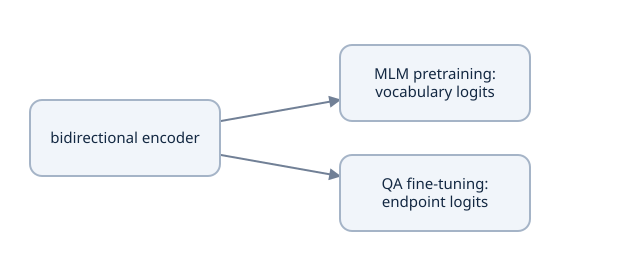

MLM predicts original IDs only at selected locations. QA reuses encoder representations to locate an answer in a supplied context; it does not generate arbitrary text.


### Separate the original designs from recipe changes

BERT pretraining combines a deeply bidirectional encoder, masked-token prediction and next-sentence prediction (NSP). Its input uses token, position and segment embeddings; the NSP classifier distinguishes adjacent versus sampled unrelated segment pairs. RoBERTa studies a revised training recipe including removal of NSP, dynamic corruption, different sequence construction, byte-level BPE, larger batches/more text and longer training. These are empirical choices about data/objective/optimization; they do not follow mathematically from the attention equation. [BERT](https://arxiv.org/abs/1810.04805), [RoBERTa](https://arxiv.org/abs/1907.11692).

This course implements MLM, then extractive QA. It has no NSP classifier and no conversational generation objective. Pair separators later mark question/context boundaries without creating an NSP task. Our token and position embeddings are summed, normalized and dropped out; the tiny model omits a token-type embedding table. An official implementation may retain a token-type lookup with IDs fixed to zero, which still affects checkpoint mapping.

The inspected instructional source and the authored reference also differ. Our reference uses padding-aware cumulative positions, consistent artifact PAD IDs, corrected masks and a tied MLM decoder; the pinned demonstration uses simpler position/head choices. Read [the source map](project/source-map.md) with those corrections rather than treating either as an exact official pretrained-library checkpoint.

### Specify the miniature build before allocating it

`RobertaConfig` in [roberta_model.py](examples/roberta_model.py) owns vocabulary size, width, depth, heads, FFN ratio, context capacity, PAD identity, two dropout rates, LayerNorm epsilon and initialization scale. The default trainer resolves $V=341,D=32,L=2,H=4,F=4D=128,T\leq64$. It initializes linear/embedding weights with normal standard deviation 0.02, linear biases with zero, and LayerNorm scale/shift with one/zero. Head width is $D/H=8$.

`vocab_size=301` in the standalone configuration is a constructor default, not the trainer's actual artifact size. Always derive it from the tokenizer used for that run. Context length counts all input tokens including specials; it is not a word count. Zero default dropout is a deliberate CPU inspection profile rather than a claim about the original RoBERTa training recipe.

The tiny corpus is eight authored training documents plus QA training questions for vocabulary fitting; two validation documents are excluded. That is a small combined training fixture. It does not reproduce the source's Wikipedia/BookCorpus pipeline or the paper's broader training corpora and budget. Architecture execution, a local loss decrease and broad language understanding are separate evidence.

### Run an objective/interface probe

Work in the course `examples/` directory using the frozen interpreter from Lesson 2. This complete probe imports the unchanged model rather than writing into your implementation child.

```python
import torch
from roberta_model import RobertaConfig, RobertaForMaskedLM, RobertaForQuestionAnswering

torch.set_num_threads(1)
torch.manual_seed(10)
c = RobertaConfig(vocab_size=30, embedding_dimension=8,
    num_transformer_blocks=1, num_attention_heads=2, context_length=8)
mlm = RobertaForMaskedLM(c).eval()
qa = RobertaForQuestionAnswering(c).eval()
ids = torch.tensor([[0, 4, 8, 2]])
changed = ids.clone()
changed[0, 2] = 20
with torch.no_grad():
    original = mlm(ids)
    alternate = mlm(changed)
    spans = qa(ids)
assert original['hidden_states'].shape == (1, 4, 8)
assert original['logits'].shape == (1, 4, 30)
assert spans['start_logits'].shape == spans['end_logits'].shape == (1, 4)
assert (original['logits'][0, 1] - alternate['logits'][0, 1]).abs().max() > 1e-7
print('head width:', c.embedding_dimension // c.num_attention_heads)
print('MLM vocabulary axis:', original['logits'].shape[-1])
```

Expect head width 4 and vocabulary axis 30. The changed right-context token can alter the earlier masked-position scores under this seed. This verifies permitted information flow and interfaces, not trained semantic understanding. An accidental causal triangle would change the intended objective.

### Changed-condition practice and notes

### Predict or explain: Change a real token to the right of an MLM target. Can the earlier prediction change? Compare this with next-token generation, and explain the intentional unchanged-input corruption branch.

<details data-practice-id="bert-to-roberta-practice-1"><summary>Reveal worked answer and rubric</summary>

Right context is legal for the bidirectional MLM encoder, so its earlier prediction can change. The same future access violates a causal next-token contract. Selected unchanged inputs retain original labels by an explicit denoising branch; they do not justify exposing every hidden target or treating MLM as an ordinary left-to-right sequence likelihood.

**Rubric:** Draw both visibility matrices; identify the objective and distinguish an intentional corruption branch from accidental target exposure.

</details>


### Predict or explain: A tiny encoder has the same hidden width as a pretrained RoBERTa model. Does changing the configuration name make it a compatible official checkpoint or reproduce the pretraining recipe?

<details data-practice-id="bert-to-roberta-transfer"><summary>Reveal worked answer and rubric</summary>

No. Tokenizer row meanings, special IDs, position rules, parameter names/tables and configuration must match; hidden width alone is insufficient. Corpus, corruption, optimization and training budget define the measured recipe separately. The course's own-format tiny fixture establishes mechanics rather than official checkpoint interoperability or paper-scale quality.

**Rubric:** List at least two architecture/artifact contracts and two training-recipe contracts, with a concrete compatibility check.

</details>


In [my study notes](project/study-notes.md), derive the two-target loss above, draw encoder versus causal visibility, and name the output class axis for MLM and QA. List three recipe changes separately from architecture changes, then explain why a same-width miniature model cannot consume arbitrary official token IDs or weights. Next, [byte tokens and learned positions](lessons/17-roberta-tokens-and-positions.md) make those identities concrete.


## Lesson 23 — RoBERTa byte tokens, pair layout and learned positions

**Goal:** trace text into frozen byte-BPE IDs, distinguish character offsets from bytes, and derive padding-aware learned position addresses and capacities. Prerequisites: Tutorial 0's encoding/embedding concepts and Lesson 22's encoder contract. Vocabulary and position identity are part of the model function, not interchangeable preprocessing details.

### Own-format byte-BPE preserves a byte alphabet

[ByteBPETokenizer](examples/roberta_data.py) starts with 256 one-byte symbols and five reserved IDs. An ordinary byte value $b$ initially receives ID $b+5$. Training counts adjacent symbol pairs inside regex pretokenization chunks, weighted by their corpus frequencies. It chooses the most frequent pair, breaks ties lexicographically by byte tuples, merges non-overlapping occurrences left to right and repeats until its merge budget or exhaustion of pairs. Encoding replays the **saved merge order**; it never recomputes frequencies from the input being encoded.

For `café`, UTF-8 bytes are `[99,97,102,195,169]`; initial IDs are `[104,102,107,200,174]`. There are four Unicode code points and five bytes. With no merges, token offsets are `[(0,1),(1,2),(2,3),(3,4),(3,4)]`: both byte tokens for `é` belong to its original half-open character interval. Merging them changes token boundaries while preserving their character ownership.

The regex groups Unicode word, punctuation and whitespace chunks, including possible leading whitespace. Merges do not cross those chunk boundaries. The decoded byte stream retains whitespace; offset construction trims leading whitespace from each token's answer-coordinate interval. Consequently whitespace-only tokens may have empty offsets, and token offsets need not be a partition into disjoint intervals. Those distinctions matter when extracting an answer from the original string.

The artifact stores `kind='course-byte-bpe-v1'` and ordered byte-tuple merges; its SHA-256 fingerprint fixes that mapping. The trainer's 80 merges yield 341 vocabulary rows in this fixture. This pretokenizer/artifact is deliberately simpler than official RoBERTa byte-BPE, and model names/embedding details also differ. A byte alphabet supports unseen valid Unicode input; it does not make arbitrary generated single-byte tokens independently valid UTF-8. `decode` uses replacement characters for invalid byte sequences.

### Reserve IDs and specify every sequence boundary

| Meaning | Course ID | Required operation |
| --- | --- | --- |
| BOS / `<s>` | 0 | Begin single and paired encoder inputs |
| PAD | 1 | Fill short rows; exclude keys; keep reserved position row |
| EOS / `</s>` | 2 | End a text or separate paired segments |
| UNK | 3 | Reserved; complete byte coverage avoids ordinary unseen-character lookup failure |
| MASK | 4 | Explicit corruption replacement, not an ignored target |

Single text is `<s> text </s>`. A question/context pair is `<s> question </s> </s> context </s>`: four special tokens, with two adjacent separators at the boundary. For capacity 64 and question length 10, the context budget is $64-10-4=50$ tokens. Those are token counts after encoding, not word counts. Literal special-token spellings in ordinary text are encoded as text unless a specific helper, such as `fill_mask`, supplies structural handling.

The pinned official `roberta-base` artifact has 50,265 vocabulary entries and MASK ID 50,264; its first four special IDs match the small convention. Its configuration has 514 position rows and a token-type vocabulary of size one. Our training fixture has 341 vocabulary entries, MASK ID 4, 66 position rows and no token-type table. Those are inspected artifact values, not assumptions from moving library defaults. Equal special-number prefixes or equal table sizes cannot establish checkpoint compatibility. Train vocabulary on declared training material before packing and record its exact identity; changing merge ranks under old weights changes the function without changing tensor shapes.

### Derive padding-aware positions and table size

Let $r_{b,t}=\mathbf1[i_{b,t}\ne p]$ with PAD ID $p=1$. The actual function computes

$$P_{b,t}=p+r_{b,t}\sum_{u=0}^{t}r_{b,u}.$$

For input `[0,7,2,1,1]`, real flags are `[1,1,1,0,0]`, cumulative counts `[1,2,3,3,3]`, and position IDs `[2,3,4,1,1]`. Leading padding `[1,1,0,7,2]` gives `[1,1,2,3,4]`: the real tokens keep their addresses. All nonpad IDs, including BOS/EOS/MASK, increment the count.

For $C$ real positions, the maximum address is $C+p$. An embedding table therefore needs $C+p+1$ rows indexed through that maximum: at $C=64,p=1$, 66 rows. Row 0 is unused by this convention. The model also rejects a physical sequence width greater than `context_length`, even if many entries are PAD; available real positions alone do not bypass that shape guard.

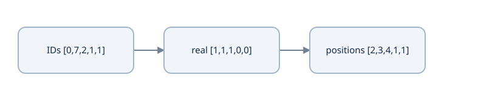

With PAD=1, IDs [0,7,2,1,1] map to positions [2,3,4,1,1]. Left padding does not shift the real-token position count.


Input vectors are $X_{b,t}=\operatorname{Dropout}(\operatorname{LayerNorm}(E[i_{b,t}]+R[P_{b,t}]))$, with token/position tables of width $D$. This model has learned positions rather than the translation model's fixed sinusoids. Its position function derives validity from IDs, **not** an independently supplied attention mask. Changing an interior PAD ID to an ordinary ID while keeping a false key mask changes subsequent position addresses. That perturbation is not a clean key-padding invariance test. Keep real-token positions unchanged when isolating mask behavior.

`padding_idx=1` suppresses ordinary input-lookup gradients for that row. It does not make every padded output vector zero after normalization/projection, nor globally freeze the row when tied vocabulary scoring supplies another gradient path. Key masks and ignored supervised labels remain separate contracts.

### Check bytes, artifact round trip and positions

From `examples/` with the frozen interpreter:

```python
import torch
from roberta_data import ByteBPETokenizer
from roberta_model import position_ids, RobertaConfig, RobertaEmbeddings

plain = ByteBPETokenizer()
ids, offsets = plain.encode_with_offsets('café')
assert ids == [104, 102, 107, 200, 174]
assert offsets == [(0,1), (1,2), (2,3), (3,4), (3,4)]
assert plain.decode(ids) == 'café'
trained = ByteBPETokenizer.train(['café café', 'two  spaces'], merge_count=8)
restored = ByteBPETokenizer.from_dict(trained.to_dict())
assert restored.fingerprint() == trained.fingerprint()
assert restored.decode(restored.encode('🙂 café')) == '🙂 café'
x = torch.tensor([[0,7,2,1,1], [1,1,0,7,2]])
assert position_ids(x).tolist() == [[2,3,4,1,1], [1,1,2,3,4]]
c = RobertaConfig(vocab_size=30, embedding_dimension=8,
    num_transformer_blocks=1, num_attention_heads=2, context_length=5)
assert RobertaEmbeddings(c).position_embeddings.num_embeddings == 7
print(ids, offsets, position_ids(x).tolist())
```

The checks preserve exact original text and the same frozen artifact after reload. Inventing consecutive byte offsets for `é` would corrupt later QA supervision. Using `arange(T)` instead of this cumulative rule changes learned position rows and compatibility.

### Keep official-tokenizer experiments separate

The retained source profile inspected `FacebookAI/roberta-base` at revision `e2da8e2f811d1448a5b465c236feacd80ffbac7b`. In a separate optional online environment with `transformers`, acquire **tokenizer files only**, retain their digests/revision, and inspect `all_special_ids`, prefix-space policy and actual offsets. This optional recipe was not executed by offline source checks:

```text
from pathlib import Path
from transformers import RobertaTokenizerFast
revision = 'e2da8e2f811d1448a5b465c236feacd80ffbac7b'
tokenizer = RobertaTokenizerFast.from_pretrained(
    'FacebookAI/roberta-base', revision=revision)
tokenizer.save_pretrained(Path('/tmp/course-official-roberta-tokenizer'))
print(tokenizer.pad_token_id, tokenizer.mask_token_id, tokenizer.all_special_ids)
print(tokenizer('café', return_offsets_mapping=True))
```

This creates a separately declared source profile; it must not replace our tokenizer under existing weights. The online instructional pipeline uses libraries/datasets beyond the self-contained reference. [Official RoBERTa](https://huggingface.co/docs/transformers/model_doc/roberta), [tokenizer mechanics](https://huggingface.co/docs/tokenizers/index), [source differences](project/source-map.md).

### Changed-condition practice and notes

### Predict or explain: Predict positions for [1,1,0,7,2] with PAD 1. For capacity 64, how many position-table rows are needed, and does a wider padded physical row bypass the model's capacity guard?

<details data-practice-id="roberta-tokens-and-positions-practice-1"><summary>Reveal worked answer and rubric</summary>

Positions are [1,1,2,3,4]. Real tokens count cumulatively while pads retain1. The largest address for 64 real tokens is65, requiring66 rows. The current model also rejects physical width greater than 64; padding does not bypass that guard. This numbering belongs to the declared artifact/model profile.

**Rubric:** Derive real flags/cumulative counts, maximum address and row count; distinguish real counts from physical tensor width.

</details>


### Predict or explain: Keep an interior key blocked but replace its PAD ID with an ordinary ID: [0,7,1,8,2] becomes [0,7,9,8,2]. Must later real outputs stay fixed? What does the byte tokenizer imply for café offsets?

<details data-practice-id="roberta-tokens-and-positions-transfer"><summary>Reveal worked answer and rubric</summary>

Not necessarily: position_ids reads token IDs, so [2,3,1,4,5] becomes [2,3,4,5,6]. Later real position rows changed despite the false key mask. A clean mask-only test preserves position addresses. Byte-only café has five symbols but four code points; its two é symbols share [3,4). This own-format mapping is not an official tokenizer conversion.

**Rubric:** Calculate both position rows and name the confound; distinguish character/byte intervals and the artifact identity.

</details>


In [my study notes](project/study-notes.md), trace one multibyte character through bytes, IDs and repeated character offsets; derive table capacity from PAD identity; then predict an interior-padding mutation. Name which artifact details must match before reusing learned weights. Next, [dynamic corruption](lessons/18-dynamic-mlm-corruption.md) separates input changes from supervised labels.


## Lesson 24 — dynamic MLM corruption and selected-target supervision

**Goal:** derive the selection/replacement distribution, preserve original labels across all branches, and handle zero-target presentations without inventing optimizer progress. Prerequisites: byte-token identity, categorical loss and independent RNG state. “Masked token” is an informal name: the supervised set includes mask, random and unchanged inputs.

### Assign three masks to three different operations

The attention mask says which input keys are real. The eligibility mask identifies ordinary tokens that may be selected, excluding BOS/PAD/EOS/UNK/MASK IDs. The selected-target mask says which positions contribute vocabulary loss. A real unselected token can be an attention key and receive indirect gradients without supplying its own classifier label.

For original IDs $x_t$, define eligibility $e_t$, independent selection draw $u_t$, rate $q$ and selection $m_t=e_t\mathbf1[u_t<q]$. Labels are $x_t$ where $m_t=1$ and `-100` elsewhere. Clone the input before corruption; do not mutate the originals used to construct labels. `-100` belongs only to supervision—it is not a vocabulary ID that can enter an embedding.

### Work the conditional 80/10/10 distribution

For each selected position draw $v_t\sim U[0,1)$:

| Condition | Corrupted input | Original label |
| --- | --- | --- |
| $v_t<0.8$ | MASK ID | $x_t$ |
| $0.8\leq v_t<0.9$ | Random ordinary vocabulary ID | $x_t$ |
| $v_t\geq0.9$ | Unchanged $x_t$ | $x_t$ |

The 80/10/10 fractions are conditional on selection. With $N=1,000$ eligible tokens and $q=0.15$, expected selected count is 150, mask replacements 120, random replacements 15 and unchanged selected inputs 15. These are expectations, not exact batch quotas. Selection count $K$ has mean $Nq$ and variance $Nq(1-q)$ under independent Bernoulli selection. The reference trainer deliberately uses $q=0.35$ for the tiny fixture, giving expected counts 350/280/35/35 on the same hypothetical $N$.

A random replacement can equal the original token. With 256 ordinary tokens, that happens with probability $1/256$ inside the random branch. Thus visibly unchanged selected inputs have probability $0.1+0.1/256$, not exactly 0.1, even though the branch probabilities remain 80/10/10. Counting visually changed cells cannot recover the supervised count.

[BERT's corruption objective](https://arxiv.org/abs/1810.04805) motivates these branches; [the RoBERTa study](https://arxiv.org/abs/1907.11692) examines dynamic resampling. The actual course [corrupt_mlm](examples/roberta_data.py) excludes all five specials and samples random replacements only from ordinary IDs. Those explicit choices, its higher tiny-training rate and its own tokenizer distinguish this fixture from an unspecified official collator.

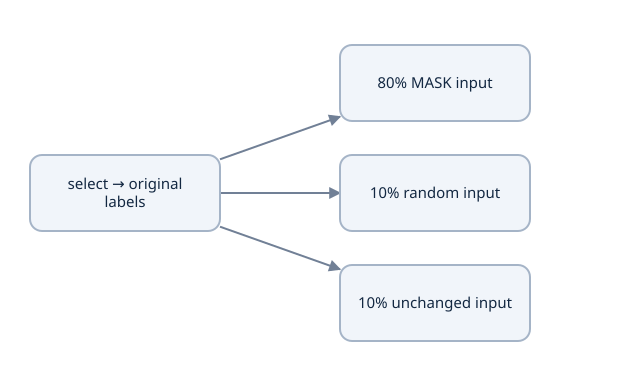

Select 15% of eligible ordinary real tokens and retain their original IDs. The figure branches after selection: exactly one corruption choice applies to each selected token; branches do not run sequentially.


### Dynamic means redraw on presentation

Store original sequences and invoke the collator each time they are sampled. Dynamic corruption changes selected positions/replacements across presentations, but two draws may coincide. Forcing every new mask to differ introduces a new distribution. The trainer has separate CPU `mask_generator` and `batch_generator` objects; source selection, branch sampling and random replacement consume the mask stream, while example sampling consumes the other stream.

Even positions that do not ultimately become random replacements have generated random-token candidates in this implementation. Restoring only the seed or the selected-label matrix does not restore the next corruption draw. Complete checkpoints save the named generator states and sampling/progress identity. Fixed evaluation uses a separate known generator so validation does not consume the training corruption stream.

### Selected-only logits do not mean selected-only backbone gradients

For selected count $K>0$, the mean loss derivative is

$$\frac{\partial L}{\partial Z_{t,j}}=\frac{m_t}{K}\left(p_{t,j}-\mathbf1[j=x_t]\right).$$

At an unselected output position, this derivative is zero. At a selected position with probabilities `[0.2,0.7,0.1]` and target class 1, its contribution is `[0.2,-0.3,0.1]/K`. The encoder's attention routes its upstream signal into context keys/values and earlier layers; those input positions need not be selected. Restricting every backbone gradient to mask-replaced cells would sever useful context learning.

`masked_token_loss` in [roberta_model.py](examples/roberta_model.py) returns a loss sum and count. The wrapper divides by `max(count,1)` to return finite zero when all labels are ignored. That is a defined zero-target interface, not a zero-valued empirical mean over observations.

### Zero targets are a real outcome, not an error to hide

For $N$ eligible positions, $P(K=0)=(1-q)^N$. At $N=3,q=0.15$, this is $0.85^3=0.614125$. The reference does **not** force at least one selection. A policy that adds one target whenever $K=0$ would change the expected count from 0.45 to $0.45+0.614125=1.064125$ under that particular rule; it is a different objective distribution.

The actual `training_step` samples its complete microbatch group first. If total selected count is zero, it reports `updated=False`, leaves the optimizer/scheduler/global-update counter unchanged, and preserves the consumed RNG progression. The session distinguishes attempts/examples/input tokens from completed updates and supervised targets. A zero-target attempt must not become a fictitious training step or a scheduler tick. Valid-target microbatches in another group use their true common denominator.

### Probe all branches and the zero-target case

From `examples/` using the frozen interpreter:

```python
import torch
from roberta_data import ByteBPETokenizer, corrupt_mlm
from roberta_train import build_training_bundle, training_step

torch.set_num_threads(1)
tok = ByteBPETokenizer()
original = torch.tensor([[0,5,6,7,1,2]])
branches = torch.tensor([[0.,.1,.85,.95,0.,0.]])
corrupted, labels = corrupt_mlm(original, tok, torch.Generator().manual_seed(4),
    probability=1., selection_draws=torch.zeros_like(branches), replacement_draws=branches)
assert original.tolist() == [[0,5,6,7,1,2]]
assert labels.tolist() == [[-100,5,6,7,-100,-100]]
assert corrupted[0,1] == 4 and corrupted[0,3] == 7
assert 5 <= int(corrupted[0,2]) < tok.vocab_size
bundle = build_training_bundle('mlm', total_steps=10)
bundle.protocol['masking_probability'] = 0.0  # Separate diagnostic, not resume identity.
weights = [p.detach().clone() for p in bundle.model.parameters()]
epoch = bundle.scheduler.last_epoch
rng = bundle.mask_generator.get_state().clone()
report = training_step(bundle)
assert not report['updated'] and report['target_count'] == bundle.step == 0
assert bundle.scheduler.last_epoch == epoch
assert all(torch.equal(old,p) for old,p in zip(weights,bundle.model.parameters()))
assert not torch.equal(rng,bundle.mask_generator.get_state())
print('selected labels:', labels.tolist(), 'zero-target update:', report)
```

The labels preserve three targets despite only one explicit MASK in this row. The zero-target diagnostic proves no parameter movement while the corruption stream advances. It does not modify source or a saved run. The tests in [roberta_checks.py](examples/roberta_checks.py) also exercise random replacement counts larger than vocabulary size, excluding an accidental sampling-without-replacement limit.

One ordinary token has already been selected; the original ID is 17. Change what appears in the input.

Illustrative cases, not a model execution.

[[interactive:corruption-branch]]

### Change the selected-token branch

| Selected branch | Outcome | Explanation |
| --- | --- | --- |
| MASK | input MASK; label 17 | The hidden ID is reconstructed. |
| random ordinary | input drawn ordinary ID; label 17 | Random replacement is not a new target. With replacement permits repeats. |
| unchanged | input 17; label 17 | Unchanged selected tokens still contribute to the MLM objective. |


### Changed-condition practice and notes

### Predict or explain: Twelve selected positions contain9 MASK replacements,1 random replacement and2 unchanged inputs. What labels/count are used, and can unselected context positions receive gradients?

<details data-practice-id="dynamic-mlm-corruption-practice-1"><summary>Reveal worked answer and rubric</summary>

All12 positions retain their original IDs as supervised labels, including random and unchanged branches; denominator 12. Unselected direct vocabulary-logit gradients are zero, but contextual attention can carry selected-loss gradients into unselected keys/values and embedding rows. Visible MASK count is not the supervised count.

**Rubric:** Separate original labels, corrupted inputs, selected-logit derivatives and upstream contextual gradients.

</details>


### Predict or explain: With3 eligible tokens and rate 0.15, calculate zero-target probability. Does the reference force a target? What changes if a policy adds one whenever selection is empty?

<details data-practice-id="dynamic-mlm-corruption-transfer"><summary>Reveal worked answer and rubric</summary>

P(K=0)=.85³=.614125. The reference does not force a target; zero-target groups consume RNG draws but do not advance optimizer/scheduler/global update. Adding one only when empty raises expected count from 0.45 to 1.064125, a changed distribution. The actual tiny trainer uses rate 0.35 and ordinary-only random replacements; those are declared departures.

**Rubric:** Work the probability and expected-count change, then identify the unchanged optimization state and advanced RNG state.

</details>


In [my study notes](project/study-notes.md), draw original IDs, eligibility, selection, branch action, labels and attention visibility as separate rows. Calculate expected counts and zero-target probability for a short sentence; predict what restoring only the seed loses. Explain the course's .35 rate and ordinary-only replacement policy without attributing them to every official RoBERTa run. Next, [the encoder and tied head](lessons/19-roberta-encoder-and-mlm-head.md) implement the vocabulary distribution used by those labels.


## Lesson 25 — bidirectional encoder and tied MLM head

**Goal:** trace the full embedding–encoder–vocabulary path, derive the MLM head and its shared gradient paths, and count a complete miniature model. Prerequisites: learned positions, dynamic corruption, post-norm blocks and GELU. The reference classes remain in [roberta_model.py](examples/roberta_model.py); helper/data logic stays outside the model.

### Trace registered modules and their tensor contracts

`RobertaModel` owns `RobertaEmbeddings` and a `ModuleList` of distinct `RobertaEncoderLayer` objects. Each layer has learned `q_proj/k_proj/v_proj/out_proj`, an attention dropout/normalization branch, and a two-map `RobertaFeedForward` branch. Registered ownership makes parameters visible to optimizers, device movement and state serialization. Equal layer specifications do not mean the layers share weights.

For $X[B,T,D]$ and $H$ heads, projected Q/K/V become $[B,H,T,D/H]$. `attention_mask[B,T]` expands to permitted-key shape $[B,1,1,T]`; SDPA Boolean `True` means allowed. There is no target-style causal triangle. The mask excludes keys, not the computation of padded query vectors. The attention call explicitly sets dropout probability to zero when the module is in evaluation mode; a functional SDPA call does not infer that mode itself. [SDPA contract](https://docs.pytorch.org/docs/2.14/generated/torch.nn.functional.scaled_dot_product_attention.html).

After merging heads and output projection, the actual block computes

$$
\begin{aligned}
U&=\operatorname{LN}_1(X+\operatorname{Dropout}(\operatorname{Attention}(X))),\\
Y&=\operatorname{LN}_2(U+\operatorname{Dropout}(W_2\operatorname{GELU}(W_1U+b_1)+b_2)).
\end{aligned}
$$

These formulas use column-map notation inside the FFN; source PyTorch weights are stored as output-by-input matrices. Both residual tensors preserve $[B,T,D]$. Each LayerNorm reduces the last feature axis independently for each token; it does not average token positions. The original hidden dropout is placed after the FFN output, before residual addition. Substituting pre-norm changes this forward map and checkpoint semantics.

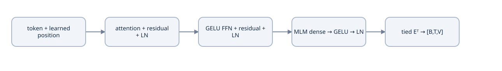

Post-norm attention and FFN blocks retain [B,T,D]. The MLM transform returns width D, then the input embedding table projects to the vocabulary.


### Develop GELU's value and derivative

The default `F.gelu` here uses $g(x)=x\Phi(x)$, where $\Phi$ is the standard normal CDF and $\phi(x)=e^{-x^2/2}/\sqrt{2\pi}$ its density. Product rule gives $g'(x)=\Phi(x)+x\phi(x)$. At $x=1$, $\Phi(1)≈0.841345$, $\phi(1)≈0.241971$, so $g(1)≈0.841345$ and $g'(1)≈1.083315$. At $x=-1$, $g(-1)≈-0.158655$ and $g'(-1)≈-0.083315$.

GELU is a smooth gating transform, not ReLU's exact zeroing of all negative values; its local derivative can be negative. An optional tanh approximation is another numerical specification. The FFN expands $D\to F=4D$ and contracts back, applying the same feature maps independently at every position. Earlier attention mixes contextual information; the FFN itself does not mix positions. [GELU](https://docs.pytorch.org/docs/2.14/generated/torch.nn.GELU.html).

### The MLM head is more than a vocabulary matrix

For a contextual row $h\in\mathbb R^D$, the source head applies a $D\to D$ affine map, GELU, feature LayerNorm, then a $D\to V$ vocabulary map:

$$u=\operatorname{LN}(\operatorname{GELU}(hA+a)),\qquad z=uE^\top+c.$$

Here $E[V,D]$ is the **same Parameter object** as the input token table; $c[V]$ is a separate learned vocabulary bias. Two equal-valued tensors are not tying. `RobertaMLMHead` assigns `decoder.weight = word_embeddings.weight`, so optimization accumulates both uses into one table and serialization preserves a compatible mapping.

For illustrative transformed vector $u=[1,1]$ and table $E=[[1,0],[0,2]]$, logits are `[1,2]`; probabilities are `[0.268941,0.731059]`. With target class 1, output-table gradients are $0.268941[1,1]$ for row 0 and $-0.268941[1,1]$ for row 1 before any averaging denominator. This toy starts **after** the head transform; it does not claim a raw hidden vector bypasses GELU/LayerNorm.

More generally the classifier contribution is

$$\frac{\partial L}{\partial E_j}\bigg|_{\mathrm{output}}=\sum_{t\in M}\frac{p_{t,j}-\mathbf1[j=x_t]}{|M|}\,u_t.$$

Add the input-lookup/contextual contribution to obtain the complete tied gradient. Even an unselected vocabulary row can receive output-softmax gradient. In particular `padding_idx=1` suppresses lookup contributions but does not suppress the tied output-classifier contribution or an explicit matrix-decay update. A PAD row initialized to zero is not globally frozen forever.

### Count the complete model under explicit dimensions

Let vocabulary $V=30$, width $D=8$, context capacity $C=8$, one layer, two heads and $F=32$. Include biases and affine LayerNorm parameters:

| Component | Formula | Count |
| --- | --- | --- |
| Token, position tables and embedding LayerNorm | $VD+(C+2)D+2D$ | $240+80+16=336$ |
| One attention module | $4D^2+4D$ | 288 |
| One FFN | $2DF+F+D$ | 552 |
| Two block LayerNorms | $4D$ | 32 |
| Additional tied MLM head parameters | $D^2+D+2D+V$ | $72+16+30=118$ |

Backbone count is $336+288+552+32=1208$; MLM total is 1,326. The tied decoder does not allocate a second $VD$ weight matrix. Heads divide attention width but do not create extra full-width Q/K/V matrices beyond these projections. Changing $V$ or $C$ changes different parameter groups, while changing batch/sequence length affects working tensors rather than learned count.

### Run full forward, loss and backward checks

From `examples/` with the frozen interpreter:

```python
import torch
from roberta_model import RobertaConfig, RobertaForMaskedLM

torch.set_num_threads(1)
torch.manual_seed(10)
c = RobertaConfig(vocab_size=30, embedding_dimension=8,
    num_transformer_blocks=1, num_attention_heads=2, context_length=8)
m = RobertaForMaskedLM(c)
assert sum(p.numel() for p in m.parameters()) == 1326
assert m.mlm_head.decoder.weight is m.roberta.embeddings.word_embeddings.weight
ids = torch.tensor([[0,4,8,2]])
labels = torch.tensor([[-100,6,-100,-100]])
r = m(ids, labels=labels)
assert r['logits'].shape == (1,4,30) and r['target_count'] == 1
r['loss'].backward()
assert all(p.grad is not None and torch.isfinite(p.grad).all() for p in m.parameters())
assert m.roberta.embeddings.word_embeddings.weight.grad[1].abs().sum() > 0
print('parameters:', sum(p.numel() for p in m.parameters()), 'selected:', r['target_count'])
```

Expect 1,326 parameters and one supervised target, with a nonzero PAD-row tied gradient. This does not mean PAD is a correct label; it arises through the softmax vocabulary denominator. The separate numerical suite compares attention with an explicit float64 score/value computation, checks permitted right context and tests trailing blocked keys. Preserve real position IDs when constructing the latter perturbation.

### Changed-condition practice and notes

### Predict or explain: Why can a tied PAD embedding row receive gradient even though padding_idx suppresses lookup gradients? Does selected-only vocabulary loss restrict all backbone gradients to selected positions?

<details data-practice-id="roberta-encoder-and-mlm-head-practice-1"><summary>Reveal worked answer and rubric</summary>

The shared table also scores every vocabulary class. Its output contribution sums (p_j−target_j) times transformed hidden vectors over selected targets, including the PAD class. Lookup suppression affects only that path. Attention carries selected-loss signals into unselected context. Tying must be the same Parameter object, not two equal-valued tables.

**Rubric:** Derive both gradient paths and distinguish selected output positions from vocabulary rows and contextual input positions.

</details>


### Predict or explain: The V=30, D=8, C=8, one-layer model has 1326 parameters with a tied decoder. What count results if the vocabulary matrix is untied? Does this enable an official RoBERTa checkpoint to load?

<details data-practice-id="roberta-encoder-and-mlm-head-transfer"><summary>Reveal worked answer and rubric</summary>

Untying adds VD=240 independent scalars, giving 1566 under the same biases/norms. It changes parameter ownership and gradient paths, not just count. Official compatibility still requires matching vocabulary/positions/configuration/names and any embedding details; an untied table alone is not a conversion.

**Rubric:** Count the added table, explain ownership/gradients and identify the remaining artifact contracts.

</details>


In [my study notes](project/study-notes.md), trace one selected-position gradient through vocabulary bias, tied table, head transform and encoder. Derive the count when the decoder is untied, and explain how that differs from the inspected demonstration and official checkpoint mapping. Next, [MLM pretraining and measurement](lessons/20-mlm-training-and-counting.md) connects this complete model to sampled presentations and counted updates.


## Lesson 26 — MLM pretraining, counted updates and measurement

**Goal:** connect sampled corruption to a correctly weighted optimizer update, inspect the actual training recipe, and measure a fixed reconstruction protocol without overstating language quality. Prerequisites: selected-target loss, tied head, optimizer/schedule state and corpus boundaries. [roberta_train.py](examples/roberta_train.py) owns this complete experiment; [course_session.py](examples/course_session.py) adds bounded persistence.

### Declare data construction and sampling

`build_training_bundle('mlm')` learns 80 byte merges from eight authored `TRAIN_TEXTS` documents **plus the training QA questions**. `VALIDATION_TEXTS` is excluded. This shared fixture makes tokenizer identity consistent for the downstream demonstration; it is not an independently isolated pretraining-only corpus experiment. Do not carry that convenience into a benchmark while hiding task-data exposure.

The default MLM data keeps each document as one encoded sequence, including BOS/EOS, and rejects sequences longer than context capacity. `next_batch` samples four indices independently with replacement; it is not one shuffled epoch traversal. A repeated document is a new presentation with a new corruption draw. Count presentations, input tokens and supervised selected tokens separately from unique documents and completed optimizer updates.

An optional `pack_documents` helper concatenates already-split encoded documents and divides the stream into bounded chunks, retaining the final tail. For byte-only texts `['ab','c']` and capacity four it produces `[[0,102,103,2],[0,104,2]]`. Flattening recovers the entire original stream. BOS/EOS boundaries remain, but attention can cross them inside a chunk and chunks can cut a document. The default trainer does not silently use this packing path. Split/deduplicate records before fitting or packing; separator IDs do not prevent data leakage.

### Derive one group denominator

For microbatch $r$ with selected count $K_r$ and loss sum $S_r$, the intended token-mean objective is

$$L=\frac{\sum_r S_r}{K},\qquad K=\sum_r K_r.$$

Backpropagate each $S_r/K$, accumulate, then step once. Suppose selected counts are 2 and 6 and batch means are 1 and 3: $S_1=2,S_2=18$, combined mean $20/8=2.5$. Equal averaging of batch means gives 2 and overweights the smaller selected set. Averaging by input length or visible MASK count defines yet another objective.

For $K=0$, this reference consumes the sampled/corruption RNG draws and reports no update. A nonzero group can contain a zero-target microbatch; its sum is zero and the common denominator remains the valid targets in other microbatches. `accumulation_steps` belongs to run identity because changing it changes effective examples, corruption and update semantics.

### Inspect the actual optimizer and schedule

The source uses AdamW with rate 0.003, betas `(0.9,0.98)`, epsilon `1e-6`, global norm clipping at 1.0, and weight decay 0.01 for parameters of rank at least two. Rank-one parameters—including biases and LayerNorm scale/shift—have zero decay. Embedding and position matrices belong to the decay group; tying does not justify adding the same parameter twice. [Optimizer reference](https://docs.pytorch.org/docs/2.14/generated/torch.optim.Adam.html).

Let $U$ be total updates, $w=\min(10,U-1)$ warmup indices and $k$ the scheduler index. The source factor is

$$f(k)=\begin{cases}(k+1)/w,&k<w,\\(U-k)/(U-w),&k\geq w,\end{cases}$$

with a floor at zero after the planned goal. `LambdaLR` initializes the rate using index zero: for $U=120,w=10$, the first update uses $0.003/10=0.0003$. The factor equals one at both indices 9 and 10, then decreases linearly to zero at index 120. Log the rate **before** the optimizer step to identify the rate used, and advance the scheduler once per completed update. This is warmup plus linear decay, not the original Transformer's inverse-square-root schedule or generic Adam defaults.

`training_step` sets training mode, clears existing gradients, divides each loss sum by the common target count, backpropagates, clips, updates AdamW, advances the schedule and increments `step`. Unlike the translation reference, it currently lacks an explicit finite-loss/finite-gradient rejection before stepping. Inspect finiteness during development; do not claim clipping alone prevents nonfinite parameter corruption. The bounded session protects persistence and update/time limits, which are separate safeguards.

### Fix evaluation corruption independently of training

`fixed_mlm_evaluation` encodes two declared validation documents, uses a separate generator seeded 900 and corruption probability 0.35, selects evaluation mode and disables autograd. Repeating it under identical weights/data produces the same reconstruction targets, enabling a meaningful before/after loss comparison. It reports selected count and correct selected predictions; accuracy is `correct/target_count`, not divided by all padded cells.

For uniform vocabulary scores, baseline selected NLL is $\log V$; at $V=341$, approximately 5.831882. A lower fixed-corruption NLL indicates improvement on those particular targets. It does not average all possible corruption patterns or establish general-text likelihood. Report additional mask seeds and separate held-out documents for a broader assessment. This helper leaves `model.eval()` active; the next `training_step` explicitly returns to training mode. Do not silently assume every evaluation helper restores prior mode.

### Probe a real update and repeatable evaluation

From `examples/` using the frozen interpreter:

```python
import math
import torch
from roberta_train import build_training_bundle, training_step, fixed_mlm_evaluation

torch.set_num_threads(1)
b = build_training_bundle('mlm', seed=7, total_steps=20)
assert b.tokenizer.vocab_size == 341
assert sum(p.numel() for p in b.model.parameters()) == 39957
first = fixed_mlm_evaluation(b)
again = fixed_mlm_evaluation(b)
assert first == again and not b.model.training
rate_used = b.optimizer.param_groups[0]['lr']
r = training_step(b, accumulation_steps=2)
assert r['updated'] and b.step == 1 and b.model.training
assert r['target_count'] > 0 and math.isfinite(r['loss'])
assert math.isclose(rate_used, 0.0003)
assert all(p.grad is not None and torch.isfinite(p.grad).all() for p in b.model.parameters())
print('fixed targets:', first['target_count'], 'group targets:', r['target_count'], 'rate used:', rate_used)
```

The default complete model has 39,957 unique parameters; the selected group count is an actual corruption measurement, not a planned fraction rounded from sequence length. The probe's two-microbatch configuration is a separate diagnostic profile, so it must not be inserted into an existing run with another accumulation identity.

For a complete nonpersistent mechanics demo, run `python roberta_train.py --task mlm --steps 120`. For resumable pretraining, use the common session and choose a new run directory:

```bash
python course_session.py --task mlm --mode new --run-directory /tmp/course-mlm-study \
  --total-steps 120 --additional-updates 25 --export-backbone
```

The latter writes verified full-state generations and a separate `backbone.pt` transfer artifact. Existing run directories are rejected in `new` mode. Later slices use explicit `resume` with the same total goal/source/runtime; a weight-only backbone export is not a recovery checkpoint. [Reference runs](project/reference-runs.md) labels actual author outcomes separately from learner evidence.

### Inspect fill-mask output as a token ranking

`fill_mask` requires exactly one literal `<mask>` marker, inserts one structural MASK ID, predicts that slot, and returns highest-scoring ordinary token candidates with their vocabulary probabilities. It excludes special candidates without renormalizing their remaining mass. A candidate may be a byte/subword fragment rather than a whole word; arbitrary single-byte decoding can show a replacement character. A single-token ranking is not a general multiword fill or generated QA answer.

### Changed-condition practice and notes

### Predict or explain: Two microbatches have selected counts 2 and 6 and mean losses 1 and 3. Calculate the combined objective and place optimizer/scheduler steps. What if one has zero targets?

<details data-practice-id="mlm-training-and-counting-practice-1"><summary>Reveal worked answer and rubric</summary>

The sums are 2 and 18, so combined mean 20/8=2.5; equal mean averaging gives 2 and the wrong weighting. Backpropagate each sum/common count, accumulate and step optimizer/scheduler once. A zero-target microbatch contributes zero sum; if the whole group is empty, skip both steps while retaining consumed RNG/progress attempts.

**Rubric:** Calculate sums/counts and distinguish one update group from microbatch count and input-token count.

</details>


### Predict or explain: A fill_mask call returns five ordinary-token probabilities totaling 0.6. Must you renormalize them or call each candidate a complete word? Does repeating fixed-corruption evaluation cover all possible masks?

<details data-practice-id="mlm-training-and-counting-transfer"><summary>Reveal worked answer and rubric</summary>

No. Returned probabilities retain the full-vocabulary normalization; omitted specials and unreturned ordinary classes hold remaining mass. Candidates may be byte/subword fragments, not whole words. The seed900 evaluation fixes a small corruption fixture, not an expectation over all patterns. Additional seeds/documents and an explicit official-source profile require separate measurements.

**Rubric:** Identify both omitted probability masses, token granularity and the scope of a fixed-mask measurement.

</details>


In [my study notes](project/study-notes.md), work unequal selected counts, draw the scheduler index before/after one update, and distinguish document sampling, input-token budget and supervised-token budget. Record the exact corruption/data protocol beside every result and compare it with the original RoBERTa recipe without claiming an official pretrained artifact. Next, [backbone transfer](lessons/27-backbone-transfer.md) starts a new supervised stage with compatible contextual weights.


## Lesson 27 — backbone transfer and stage identity

**Goal:** move compatible pretrained contextual weights into a new QA model, verify the copy independently, and distinguish task transfer from exact training resume. Prerequisites: the complete MLM model, vocabulary identity, training state and the recovery lesson. Pretraining supplies an initialization; it does not supply a ready-trained span classifier or its optimizer history.

### Separate reusable representation from task-specific heads

The MLM model contains `roberta` (embeddings and contextual encoder layers) and `mlm_head` (dense–GELU–LayerNorm–vocabulary scoring). The QA model contains the same backbone architecture plus `qa_head: Linear(D,2)`. Transfer copies only the backbone. The MLM head's transform and vocabulary bias are not QA endpoint parameters; discard them from the downstream model rather than inventing a conversion.

For hidden state $h_t\in\mathbb R^D$, MLM produces $V$ token scores, while QA produces two scores $[s_t,e_t]$. With $D=32$, the new QA head has $2D+2=66$ scalars. Its output-column meaning is start/end endpoint, not two vocabulary entries. The default backbone contains 38,496 parameters; the QA model therefore contains 38,562. Those counts describe this own-format reference, not an official RoBERTa checkpoint.

A pretrained encoder's useful contextual features are an empirical transfer premise. Backbone equality after copying proves the operation, not improvement on a held-out QA task. Test a new random-backbone baseline under the same QA data/budget if you want to measure the benefit of pretraining.

### Specify what the transfer artifact contains

`export_backbone` in [roberta_train.py](examples/roberta_train.py) requires an MLM bundle and writes:

| Artifact field | Meaning | Compatibility role |
| --- | --- | --- |
| `format` | `course-roberta-backbone-v1` | Names this schema rather than an official library format |
| `config` | Resolved full `RobertaConfig` | Width/depth/heads/positions/dropout/PAD and related architecture |
| `tokenizer` | Frozen ordered own-format byte merges | Defines every vocabulary row's meaning |
| `backbone` | `model.roberta.state_dict()` | Registered embedding/normalization/encoder tensors |

It deliberately has no optimizer, scheduler, mask/batch RNG, sampler/progress counter or MLM head. It is a weight-transfer artifact, not a full recovery generation. Do not label a successful `torch.load` as a demonstration of the next optimizer update.

`load_backbone_for_qa` checks the format, exact configuration and tokenizer fingerprint, then uses strict backbone loading. Matching vocabulary **size** is insufficient. If IDs 6 and 7 exchange meanings, equal-shaped tables still send the wrong vectors into every downstream operation. Position rules and PAD identity also address different learned rows. Official RoBERTa preprocessing, token-type handling, parameter names and weights have another mapping; this function provides no automatic conversion path. [Official contract](https://huggingface.co/docs/transformers/model_doc/roberta), [source map](project/source-map.md).

The in-memory `model.load_mlm_backbone(pretrained)` convenience checks configuration and copies a model's backbone, but receives no tokenizer artifact. It cannot independently validate tokenizer semantics. The default demonstration constructs both models from the same deterministic fixture tokenizer; general artifact transfer should use the checked loader or a separate explicit tokenizer check.

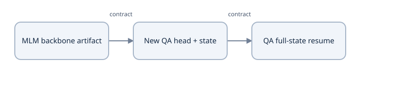

Read alongside the worked calculation and explicit implementation boundaries in its lesson.


### Start a new objective with new optimization state

Let pretrained weights be $\theta_{\mathrm{MLM}}$ and new head parameters $\psi_0$. Fine-tuning initializes $\theta_0^{\mathrm{QA}}=\theta_{\mathrm{MLM}}$, samples/initializes $\psi_0$, then optimizes the QA objective. The reference constructs a new AdamW instance, a QA schedule starting at index zero, new named generators and QA progress `step=0`.

By contrast, exact QA resume restores $(\theta_t,\psi_t)$ together with Adam moments/step, scheduler position, generators, source/data/config identity and counters. Copying only $\theta_t$ and resetting the optimizer defines a changed experiment. Keeping MLM optimizer moments under the new task also differs from the declared fresh QA protocol; shared parameter shapes cannot supply a justification for that choice.

A simple adaptive-update example shows the distinction: Adam with a nonzero first moment can move a weight even when its current gradient is zero, while a new optimizer with zero history makes no data-gradient move. Resetting history therefore changes the next update without changing initial parameter values. Tutorial 0's optimizer/recovery derivations develop that calculation.

`course_session.py` records the SHA-256 of an initialization backbone in the new run contract. It rejects `--backbone` during `resume`, because a resumed QA run restores its own state rather than taking new initialization. Keep a separate run ID for each stage and retain the source/data/tokenizer identities that made the artifact compatible.

### Prove equality, fresh state and head ownership

From `examples/` using the frozen interpreter:

```python
from pathlib import Path
import tempfile
import torch
from roberta_data import ByteBPETokenizer
from roberta_train import build_training_bundle, training_step, export_backbone, load_backbone_for_qa

torch.set_num_threads(1)
mlm = build_training_bundle('mlm', total_steps=10)
training_step(mlm)
qa = build_training_bundle('qa', total_steps=10)
head_before = {n:t.detach().clone() for n,t in qa.model.qa_head.state_dict().items()}
with tempfile.TemporaryDirectory(prefix='course-transfer-') as folder:
    artifact = Path(folder) / 'backbone.pt'
    export_backbone(mlm, artifact)
    load_backbone_for_qa(qa, artifact)
    for name, tensor in mlm.model.roberta.state_dict().items():
        torch.testing.assert_close(qa.model.roberta.state_dict()[name], tensor, atol=0, rtol=0)
    for name, tensor in head_before.items():
        torch.testing.assert_close(qa.model.qa_head.state_dict()[name], tensor, atol=0, rtol=0)
    assert mlm.step == 1 and len(mlm.optimizer.state) > 0
    assert qa.step == 0 and len(qa.optimizer.state) == 0 and qa.scheduler.last_epoch == 0
    qa.tokenizer = ByteBPETokenizer()
    try:
        load_backbone_for_qa(qa, artifact)
    except ValueError as error:
        assert 'Tokenizer identity differs' in str(error)
    else:
        raise AssertionError('Mismatched tokenizer must be rejected')
print('exact backbone copy; fresh QA optimization state; incompatible tokenizer rejected')
```

The checks compare every registered backbone tensor, retain the newly initialized head and inspect the actual optimizer history. All files are temporary diagnostics; no learner run is overwritten. Copying values into existing registered parameters preserves the parameter objects to which the new optimizer refers.

### Use separate stage commands

After a completed/persisted MLM session exports `backbone.pt`, start QA in a fresh run directory:

```bash
python course_session.py --task qa --mode new --run-directory /tmp/course-qa-study \
  --total-steps 120 --additional-updates 25 --backbone /tmp/course-mlm-study/backbone.pt
```

That example requires the MLM artifact from Lesson 26. On a later QA session, choose `--mode resume` with the same QA run directory and total goal, and omit `--backbone`. A path existing on disk does not establish that its contents match the required artifact; loading must perform the compatibility checks.

### Changed-condition practice and notes

### Predict or explain: After one MLM update, copy its backbone into QA. Which tensors should match, which parameters/state should remain new, and how does this differ from QA resume?

<details data-practice-id="backbone-transfer-transfer"><summary>Reveal worked answer and rubric</summary>

Every backbone embedding/norm/encoder tensor must match exactly under the declared compatible CPU profile. The new 66-parameter D=32 QA head remains its own initialization; QA AdamW moments/schedule/counters start fresh. Resume instead restores QA backbone/head plus optimizer/schedule/generators/progress and identity. Transfer equality is not proof of downstream quality improvement.

**Rubric:** Compare all registered tensors and inspect head ownership, optimizer state and stage counters.

</details>


### Predict or explain: Two byte-BPE artifacts have 341 IDs but different merges. Can a backbone transfer use them interchangeably? What does the direct in-memory loader check, and can resume accept another --backbone?

<details data-practice-id="backbone-transfer-resume-case"><summary>Reveal worked answer and rubric</summary>

No: equal size does not preserve row meanings. The checked artifact loader compares format/configuration/tokenizer fingerprint before strict backbone loading. load_mlm_backbone receives models only, so it checks architecture but cannot independently inspect tokenizer identity. The session rejects a new backbone during resume; its own full state is authoritative. Official artifacts need a separate compatible mapping.

**Rubric:** Distinguish size versus semantic identity, the two loader scopes and fresh initialization versus full-state continuation.

</details>


In [my study notes](project/study-notes.md), draw the tensors copied and the state reset, derive the 66-parameter QA head, and explain why equal vocabulary size is insufficient. Write the separate acceptance evidence for transfer equality, downstream improvement and exact QA continuation. Next, [offsets and windows](lessons/21-qa-offsets-and-windows.md) construct valid supervised spans for that new task.


## Lesson 28 — QA character offsets and overlapping context windows

**Goal:** map annotated answers in original text to inclusive token endpoints, construct question/context windows, and distinguish unavailable-window labels from a learned no-answer decision. Prerequisites: byte/character coordinates, pair layout and backbone transfer. Extractive QA predicts a substring of the supplied context; annotation alignment is part of the supervised task.

### Name every coordinate system

An answer annotation supplies original context string $c$, start character $a$ and nonempty answer text $r$. Its half-open interval is $[a,b)$ with $b=a+|r|$, and the consistency check is `c[a:b] == r`. Here “character” means Python Unicode code-point indexing, not UTF-8 byte indexing or displayed grapheme clusters. Preserve the original context rather than stripping, normalizing or rebuilding it from decoded tokens.

For `a café b`, `café` occupies character interval `[2,6)` and UTF-8 byte interval `[2,7)`. Its final `é` occupies character interval `[5,6)` but two bytes. The unmerged byte tokenizer therefore produces two token offsets `(5,6)`. A token offset maps to original characters; it is not necessarily one byte or a disjoint piece of the text.

The course trims leading whitespace from token answer offsets while preserving whitespace in encoded bytes. Empty intervals may arise for whitespace-only symbols. They are not valid answer endpoints. Question, special and PAD positions carry `None` offsets, explicitly excluding them from context-span ownership.

### Derive inclusive token endpoints from half-open characters

Let token $i$ have nonempty context interval $[l_i,r_i)$. It contains answer start $a$ when $l_i\leq a<r_i$. It contains the exclusive answer end $b$ when $l_i<b\leq r_i$. The asymmetric inequalities keep an answer beginning exactly at a boundary out of the preceding token.

For offsets `[(0,4),(4,8),(8,12)]` and answer `[4,8)`, start and end are both token 1. Token 0 ends where the answer begins, so it is not a valid start. Inclusive token span `[s,e]` then maps back to `context[offsets[s][0]:offsets[e][1]]`.

`character_span_to_tokens` selects the **first** matching start and **last** matching end. Repeated character offsets from multibyte symbols therefore keep the full matching token range when both byte symbols are present. It returns no span if the annotated interval is outside the retained context coverage or cannot be aligned to available endpoints. Record the answer's coordinate convention before calling it; shape checks cannot identify a byte start mistakenly supplied as a character start.

### Allocate question and context space explicitly

`qa_features` independently encodes a stripped question and the unchanged original context. Its pair is `<s> question </s> </s> context-window </s>`. With capacity $C$, question token count $Q$ and four specials, context budget is $W=C-Q-4$. It rejects $W\leq0$ rather than silently removing the question or truncating both streams.

For $C=16,Q=1$, $W=11$. Overlap $O=5$ gives window-start stride $W-O=6$, so context token starts are 0,6,12,… . Each feature preserves the original context offsets; its window start is a global context-token index, while head endpoints are local packed indices. The packed context prefix length is $Q+3$; the final separator occupies another position after the context.

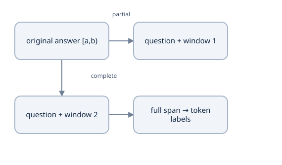

Use [start,end) character offsets. A window has a supervised answer only if it contains the entire span. Overlapping partial windows use ignored labels; they are not impossible-question examples.


Overlap is counted in **tokens**, not characters. A span crossing a boundary can appear completely in a later overlapping window. For fixed token windows, a length-$L$ answer can be guaranteed to fit some window for all start positions when $O\geq L-1$, subject to ordinary coverage at the sequence ends. Derive it: the worst start lies $W-O-1$ positions after a window start, requiring $(W-O-1)+(L-1)\leq W-1$. Answers longer than $W$ cannot fit under any overlap. Inspect actual answer token lengths after the frozen tokenizer; character length alone is insufficient.

### Label unavailable windows without inventing negative QA examples

If the answer maps into the current window, store inclusive start/end indices. Otherwise both labels are `-100`. An ignored feature is not labeled BOS, zero or another fake endpoint. It is unavailable supervision for this positive-answer task; it does not teach an abstention classifier.

The tiny QA builder retains answer-containing training features and requires at least one such feature per training question. Inference still evaluates all context windows. This filtering policy and its positive-only data differ from a full SQuAD 2.0 system with unanswerable examples and a null-score decision. [QA preprocessing](https://huggingface.co/docs/transformers/tasks/question_answering), [source departures](project/source-map.md).

Byte-level windows introduce another explicit limitation: a cut can split symbols representing one Unicode character. Duplicate offsets can still identify original character coverage even though decoding that window's token bytes independently yields a replacement character. Offset extraction from the **original** context remains the authoritative answer rendering. The current mapper checks character-boundary coverage, not independent UTF-8 decodability of every window. A byte/character-aligned window policy would be a separate tested extension; do not claim this reference implements it.

### Probe an accented answer and a later-window answer

From `examples/` using the frozen interpreter:

```python
from roberta_data import ByteBPETokenizer, qa_features

tok = ByteBPETokenizer()
context = 'a café b'
features = qa_features('?', context, tok, context_length=24, overlap=2,
    answer_start=2, answer_text='café')
f = next(f for f in features if f.start_position != -100)
s, e = f.start_position, f.end_position
assert context[f.offsets[s][0]:f.offsets[e][1]] == 'café'
assert sum(span == (5,6) for span in f.offsets) == 2
assert all(span is None for span in f.offsets[:4])
long = 'alpha beta gamma delta'
windows = qa_features('?', long, tok, context_length=16, overlap=5,
    answer_start=long.index('gamma'), answer_text='gamma')
assert windows[0].start_position == windows[0].end_position == -100
valid = [w for w in windows if w.start_position != -100]
assert valid
for w in valid:
    assert long[w.offsets[w.start_position][0]:w.offsets[w.end_position][1]] == 'gamma'
assert all(w.input_ids[:4] == [0,68,2,2] for w in windows)
print('accented endpoints:', (s,e), 'answer-containing window starts:', [w.window_start for w in valid])
```

The first window of the long case cannot contain `gamma`; at least one later feature can. Labeling its first feature with a fabricated span would train the wrong task. Reconstructing `café` from a byte-index annotation would fail the coordinate contract.

### Recognize the corresponding official fast-tokenizer fields

A separate official-tokenizer profile uses `return_offsets_mapping=True`, `return_overflowing_tokens=True`, a declared `stride`, and `truncation='only_second'`. `sequence_ids(feature_index)` distinguishes question from context positions, while `overflow_to_sample_mapping` links features back to original record IDs. Keep only context-owned offsets as answer candidates and preserve every feature's record identity. These APIs expose the same alignment problem; they do not make the own-format course tokenizer compatible with official weights automatically. [Official QA guide](https://huggingface.co/docs/transformers/tasks/question_answering).

### Changed-condition practice and notes

### Predict or explain: Offsets are[(0,4),(4,8),(8,12)] and the answer interval is[4,8). Which inclusive token endpoints result? What label applies when a window contains only the first token?

<details data-practice-id="qa-offsets-and-windows-practice-1"><summary>Reveal worked answer and rubric</summary>

Both endpoints are token 1: start uses left≤4<right, end uses left<8≤right. The first token ends at4 and cannot contain the start. A first-token-only window has both labels −100, not a fabricated token 0 or a learned no-answer target. Original context slicing remains half-open.

**Rubric:** Work both boundary inequalities and distinguish unavailable supervision from an answerability label.

</details>


### Predict or explain: For context a café b, compare character/byte answer coordinates and duplicate offsets. With budget 11 and overlap 5, give the window stride and guaranteed maximum answer-token length under fixed-window coverage.

<details data-practice-id="qa-offsets-and-windows-transfer"><summary>Reveal worked answer and rubric</summary>

café is character[2,6) and byte[2,7); the two é bytes share character[5,6). Original slicing is authoritative; a window split between those byte symbols need not decode independently as valid UTF8. Stride 11−5=6. Worst-case containment requires L≤overlap+1=6, assuming ordinary end coverage; longer spans need another policy. Official-tokenizer offsets require their own profile checks.

**Rubric:** Name all coordinates and derive the stride/overlap condition without conflating tokens and characters.

</details>


In [my study notes](project/study-notes.md), trace `café` through character, byte, token and packed-window coordinates. Derive an overlap requirement from the actual longest answer, and show one ignored window. Explain why missing coverage is different from a no-answer label. Next, [QA head and fine-tuning](lessons/22-qa-head-and-fine-tuning.md) trains the endpoints that this alignment produces.


## Lesson 29 — QA endpoint head, loss and fine-tuning

**Goal:** derive both endpoint losses/gradients, distinguish the current loss's classification domain from constrained decoding, and train the transferred backbone with a new QA objective. Prerequisites: checked backbone transfer, question/context features and original character alignment. The complete `RobertaForQuestionAnswering` implementation stays in [roberta_model.py](examples/roberta_model.py).

### A shared contextual vector produces two endpoint scores

The backbone returns $H[B,T,D]$ for the complete packed question/context window. A single `Linear(D,2)` maps every row to start and end scores:

$$s_{b,t}=h_{b,t}\cdot w_s+b_s,\qquad e_{b,t}=h_{b,t}\cdot w_e+b_e.$$

These are unnormalized **position logits**, not probabilities or character offsets. `unbind(-1)` separates two $[B,T]$ arrays. At $D=32$, the head has $2D+2=66$ scalars, shared across all positions and records.

For rows $h_0=[1,0],h_1=[0,1],h_2=[1,1]$, choose $w_s=[1,2],b_s=0.5$ and $w_e=[-1,1],b_e=-0.5$. Start scores are `[1.5,2.5,3.5]`; end scores are `[-1.5,0.5,-0.5]`. Separate argmax picks start 2 and end 1, a reversed pair. Training marginal classifiers does not itself impose ordering; Lesson 30's decoder imposes joint span constraints.

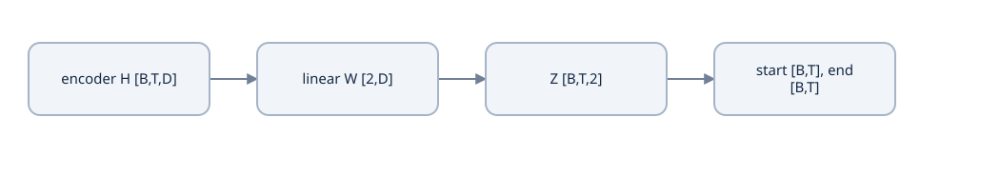

The QA linear head maps H [B,T,D] to Z [B,T,2]. Channel 0 supplies start logits, channel 1 end logits. Each endpoint normalizes over token positions.


### Derive the counted two-endpoint objective

Let supervised window $b$ have inclusive token endpoints $(a_b,z_b)$ and let $N$ count windows with both valid labels. The reference computes summed start/end cross-entropies, averages the two tasks, then divides by $N$:

$$
L=-\frac{1}{2N}\sum_{b\ \mathrm{valid}}\left(\log p^s_{b,a_b}+\log p^e_{b,z_b}\right),\qquad
p^s_{b,t}=\frac{e^{s_{b,t}}}{\sum_{u=0}^{T-1}e^{s_{b,u}}}.
$$

End probabilities normalize analogously. With four equiprobable positions and both correct endpoints assigned 0.25, $L=(-\log0.25-\log0.25)/2=\log4≈1.386294$. `target_count` is one valid window, not four sequence tokens or two endpoints. For unequal microbatch window counts, sum the already half-averaged endpoint losses and divide by their combined count.

The derivatives are $(p^s_{b,t}-\mathbf1[t=a_b])/(2N)$ and $(p^e_{b,t}-\mathbf1[t=z_b])/(2N)$ on valid windows, zero on ignored windows. For one uniform four-position example with start 1/end 2, start derivatives are `[.125,-.375,.125,.125]`; end derivatives are `[.125,.125,-.375,.125]`. The hidden gradient combines both learned columns, $\partial L/\partial h_t=w_s\,\partial L/\partial s_t+w_e\,\partial L/\partial e_t$, then continues into every used backbone layer.

### Name the current endpoint domain accurately

The present loss normalizes across **all packed positions**, including question, special and padded query positions. The attention key mask does not remove their endpoint logits from this denominator. Context-only label construction chooses correct gold endpoints, and loss discourages competing wrong endpoints, but this is different from structurally restricting the endpoint softmax to context.

At uniform scores on a 64-position packed window, baseline loss is $\log64$, even if only 20 positions are context candidates. A context-only-normalized objective would instead have baseline $\log20$ and different gradients. That alternative requires an explicit tested loss change; it is not something the unchanged source already does. Inference uses context-only ordered spans via offsets, as the next lesson explains.

Both targets must be supplied together with shape $[B]$. Missing-window labels are `(-100,-100)`, and the model rejects only-one-ignored endpoint or a valid target that is reversed/out of sequence bounds. An all-ignored batch returns count zero and finite zero loss; `training_step` skips optimizer/scheduler progress. Ignored windows are not negative/no-answer examples.

### Probe the derivatives and an actual backbone backward pass

From `examples/` using the frozen interpreter:

```python
import math
import torch
from torch.nn import functional as F
from roberta_model import RobertaConfig, RobertaForQuestionAnswering

torch.set_num_threads(1)
s = torch.zeros(1,4, dtype=torch.float64, requires_grad=True)
e = torch.zeros(1,4, dtype=torch.float64, requires_grad=True)
loss = (F.cross_entropy(s,torch.tensor([1])) + F.cross_entropy(e,torch.tensor([2]))) / 2
loss.backward()
assert math.isclose(float(loss.detach()), math.log(4))
torch.testing.assert_close(s.grad,torch.tensor([[.125,-.375,.125,.125]],dtype=torch.float64))
torch.testing.assert_close(e.grad,torch.tensor([[.125,.125,-.375,.125]],dtype=torch.float64))

torch.manual_seed(10)
c = RobertaConfig(vocab_size=30, embedding_dimension=8,
    num_transformer_blocks=1, num_attention_heads=2, context_length=8)
model = RobertaForQuestionAnswering(c)
ids = torch.tensor([[0,6,7,2], [0,9,2,1]])
r = model(ids, start_positions=torch.tensor([1,-100]), end_positions=torch.tensor([2,-100]))
r['start_logits'].retain_grad()
r['end_logits'].retain_grad()
r['loss'].backward()
assert r['target_count'] == 1
assert torch.equal(r['start_logits'].grad[1],torch.zeros(4))
assert model.roberta.layers[0].attention.q_proj.weight.grad.abs().sum() > 0
assert all(p.grad is not None and torch.isfinite(p.grad).all() for p in model.parameters())
print('uniform endpoint loss:', float(loss.detach()), 'supervised windows:', r['target_count'])
```

The ignored row has no direct endpoint derivative, while the supervised row supplies gradients to the encoder, not only its head. The same parameter objects are shared across windows, so parameter gradients accumulate across valid examples.

### Complete the fine-tuning stage deliberately

The QA branch of `build_training_bundle` builds features for eight authored training questions, keeps answer-containing windows, verifies coverage, optionally copies a compatible MLM backbone and creates fresh AdamW/schedule state. Default fine-tuning trains the entire backbone and head. Freezing the backbone would require `requires_grad`/optimizer-group changes and a separate protocol; calling it “transfer” does not imply automatic freezing.

For a checked artifact initialized in Lesson 27, continue that new QA stage through `course_session.py` and use its full-state resume procedure. For the independent nonpersistent mechanics demonstration, `python roberta_train.py --task both --steps 120` runs MLM, copies its contextual weights, fine-tunes QA and decodes the eight training questions. A falling training loss and correct answers on those **seen** questions demonstrate fitting and decoding; they do not supply held-out SQuAD evidence. [Reference outcomes](project/reference-runs.md).

The source retains separate helpers `qa_batch`, `to_model_device`, `training_step` and `predict_qa`, so a notebook calls the same source rather than hiding model/training definitions in cell state. The GPU path is a declared option whose actual environment/fit/recovery needs measurement; the current evidence is CPU. [QA source](https://github.com/priyammaz/PyTorch-Adventures/tree/2f18a5470c4ef0a3d413dd7b18d07941f45779e9/PyTorch%20for%20NLP/RoBERTa%20for%20Masked%20Language%20Models), [official task preprocessing](https://huggingface.co/docs/transformers/tasks/question_answering).

### Changed-condition practice and notes

### Predict or explain: One four-position window has uniform start/end scores and gold endpoints1 and2. Calculate the loss and both logit gradients. If only two positions belong to context, is the current loss log 2?

<details data-practice-id="qa-head-and-fine-tuning-practice-1"><summary>Reveal worked answer and rubric</summary>

Loss is log 4≈1.386294. Start derivatives[.125,−.375,.125,.125], end[.125,.125,−.375,.125]. The current QA CE normalizes over all four packed positions, so it remains log 4; context-only restriction is decoding. A context-only loss is a distinct implementation/objective. Both endpoint contributions backpropagate into the shared backbone.

**Rubric:** Derive the half-averaged losses/gradients and identify current training versus decoding domains.

</details>


### Predict or explain: A QA batch has one supervised window and one unavailable window. What count/loss weighting applies, and does setting unavailable labels to BOS train the same objective? Can an official tokenizer be substituted under these weights?

<details data-practice-id="qa-head-and-fine-tuning-transfer"><summary>Reveal worked answer and rubric</summary>

Count 1, with the supervised start/end sums averaged by 2; the ignored window has zero direct endpoint derivative. BOS labels invent a different target and do not implement the declared ignored-window or no-answer policy. Tokenizer substitution requires matching row/position/layout identity or a separately tested conversion; the own-format weights are not automatically official-compatible.

**Rubric:** Show the denominator and ignored row derivative, then state the annotation/compatibility invariants.

</details>


In [my study notes](project/study-notes.md), derive the uniform endpoint gradients, explain what the current denominator contains, and draw gradient flow from both heads into one contextual vector. Predict what freezing the backbone changes and identify the separate artifact checks needed for an official-tokenizer experiment. Next, [constrained decoding and metrics](lessons/23-span-decoding-and-metrics.md) turns those scores into a legal original-text answer.


## Lesson 30 — constrained span decoding and QA metrics

**Goal:** choose an ordered context span jointly, recover original text, and calculate normalized exact match/token F1 with explicit window and no-answer limits. Prerequisites: packed offsets, endpoint logits and positive-answer QA training. A high endpoint score is not yet a valid answer.

### Derive joint constrained ranking

For start logits $s_i$ and end logits $e_j$, independent endpoint distributions give a fixed-window pair score

$$\log p_s(i)+\log p_e(j)=s_i+e_j-\log\sum_u e^{s_u}-\log\sum_v e^{e_v}.$$

The two normalization terms are constant across pairs **within one window**, so ranking valid pairs by $s_i+e_j$ is equivalent there. The valid set requires context-owned nonempty endpoint offsets, $i\leq j$, no noncontext position inside the span, and length $j-i+1\leq L_{\max}$. A probability factorization does not make independent argmax obey those constraints.

Consider a question/special position 0 with scores 100/100, followed by context `a b c` with start `[5,1,9]` and end `[8,7,1]`. Global independent argmax selects noncontext position 0. Even after restricting endpoints to context, it selects start 3/end 1, reversed. With maximum length two, valid scores include `(1,1):13`, `(1,2):12`, `(2,2):8`, `(2,3):2`, `(3,3):10`. The joint best span is `(1,1)` and answer `a`.

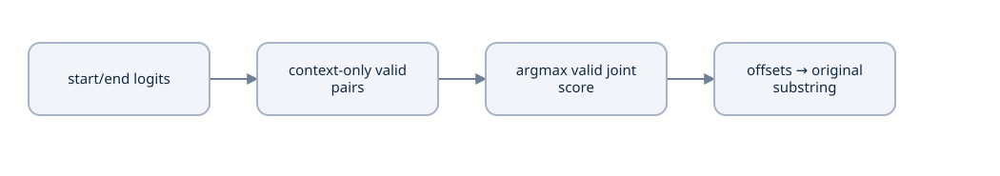

Search only context tokens, require start ≤ end and bounded length, score the pair jointly, and compare candidates across windows of the same example.


[best_span](examples/roberta_data.py) enumerates starts and ends subject to that maximum, excludes `None` endpoint/interior offsets, and chooses the first encountered maximum under its strict `>` comparison. This bounded search costs order $T L_{\max}$ candidate inspections; its current interior-ownership check adds work proportional to candidate span length. It returns `None` when no valid context candidate exists. It does not add a trained null-answer score.

### Slice original characters rather than reconstructed tokens

For selected inclusive token span $(i,j)$ with endpoint offsets $[l_i,r_i),[l_j,r_j)$, return `context[l_i:r_j]`. The end character remains exclusive even though the token end index is inclusive. This preserves original casing, accents and interior whitespace. Token decoding may normalize spacing in another tokenizer or show invalid single-byte fragments in this byte tokenizer; it is not the authoritative original answer rendering.

Repeated character offsets from UTF-8 byte symbols are legitimate. They can make multiple token pairs extract the same original substring. Context whitespace symbols may have empty offsets inside a span but cannot be chosen as endpoints. Question, separator and PAD offsets are `None`; a predicted high score there cannot override context ownership.

A 20-token gold answer is impossible when the declared decoder cap is 16, regardless of training quality. Report coverage lost to window capacity and length constraints separately from model scoring errors. Changing the cap or window construction changes the evaluated system and requires rerunning the measurement.

### Preserve record ownership and acknowledge cross-window scores

`predict_qa` constructs all features for one original question/context record, evaluates each, decodes its best valid span and chooses the greatest raw start-plus-end score. When batching multiple records, retain a record ID or official `overflow_to_sample_mapping`; do not compare a window belonging to one question with another's candidates. Evaluate one final prediction per original question, not one metric per overflow feature.

The fixed-window ranking equivalence does **not** establish cross-window calibration. Adding constant $c_s$ to every start logit and $c_e$ to every end logit leaves each endpoint distribution unchanged but shifts every raw pair score by $c_s+c_e$. For example window A's uniform `[0,0]`/`[0,0]` has pair score 0; window B's uniform `[0.5,0.5]` twice has score 1 although both distributions are identical. Shifting A's two arrays by 2 makes its score 4 and reverses raw ranking without changing its probabilities.

This reference uses that raw-score heuristic explicitly. Normalized scores, maximum-context heuristics or other aggregation/calibration rules are different policies to test, not guarantees that every window then becomes directly comparable. Inspect repeated-answer and boundary cases before attributing cross-window failures entirely to the backbone.

### Calculate normalized EM and multiset F1

`normalize_answer` lowercases, removes ASCII punctuation, removes English articles `a/an/the`, and collapses whitespace. It does not stem words or remove accents. Exact match is equality after this normalization. Thus `The RED apple!` and `red apple` have EM one; a semantically plausible paraphrase with different normalized tokens need not.

For prediction token multiset $P$ and gold multiset $G$, overlap is $C=\sum_w\min(\operatorname{count}_P(w),\operatorname{count}_G(w))$. Then precision is $C/|P|$, recall $C/|G|$, and, for nonempty multisets, $F1=2C/(|P|+|G|)$. Prediction `red red blue` versus gold `red blue blue` has overlap two, precision/recall $2/3$, F1 $2/3$ and EM zero. Using set intersection would incorrectly ignore repeated-token counts.

With multiple gold answers, the helper takes the best EM and best F1 over supplied alternatives. Its per-question values lie in `[0,1]`; report their dataset means or explicitly multiply by 100 for percentage scores. Do not average overflow-window metrics as if they were separate questions. The declared normalization/scale and gold corpus remain part of the evaluation contract. [Maintained SQuAD metric implementation](https://github.com/huggingface/transformers/blob/main/src/transformers/data/metrics/squad_metrics.py).

### Probe legal pairs, normalization and the score-shift limit

From `examples/` with the frozen interpreter:

```python
import math
import torch
from roberta_data import best_span, answer_metrics

result = best_span([100,5,1,9], [100,8,7,1],
    [None,(0,1),(2,3),(4,5)], 'a b c', max_answer_tokens=2)
assert result['text'] == 'a' and (result['start_token'],result['end_token']) == (1,1)
assert answer_metrics('The RED apple!', ['red apple']) == {'exact_match':1.,'f1':1.}
r = answer_metrics('red red blue',['red blue blue'])
assert r['exact_match'] == 0 and math.isclose(r['f1'],2/3)
a = torch.tensor([0.,0.])
b = torch.tensor([.5,.5])
assert torch.equal(a.softmax(-1),b.softmax(-1))
assert torch.equal(a.softmax(-1),(a+2).softmax(-1))
assert float(2*a[0]) < float(2*b[0]) < float(2*(a+2)[0])
print('legal answer:', result['text'], 'multiset F1:', r['f1'])
```

The probe has no trained model; it independently verifies decoding/metric arithmetic and demonstrates why probability-invariant shifts matter across windows. The complete reference's `predict_qa` calls the same decoder and obtains original-text answers after full QA fine-tuning.

### Keep positive-only QA separate from abstention

The metric helper defines sensible empty-string comparison behavior, but the model has no trained answerability score or calibrated no-answer threshold. Ignoring an unavailable window is not a negative training example, and returning no valid candidate due to missing context is not learned abstention. A SQuAD 2.0-style system needs its own data, null/answerability objective, decision rule and held-out calibration/evaluation.

The tiny run reports predictions on eight **training** questions. Perfect seen-fixture EM tests fitting/alignment/decoding mechanics, not unseen QA quality. Keep errors by type: missing coverage, wrong coordinates, special-token peak, reversed pair, length exclusion, cross-window choice and lexical metric mismatch. Those distinctions lead to different fixes.

Suppose the highest separate endpoint scores suggest the following pair. Prediction must satisfy the context span contract.

Illustrative cases, not a model execution.

[[interactive:span-validity]]

### Reject an attractive invalid answer

| Candidate | Outcome | Explanation |
| --- | --- | --- |
| start 8, end 5 | Reject reversed span | A substring requires start≤end. |
| question token, context token | Reject non-context endpoint | Answer text comes from context only. |
| context 5..8, max length 3 | Reject length 4 | Length is end−start+1, including both endpoint tokens. |
| context 5..7, max length 3 | Accept as a candidate | Compare its joint score with other valid pairs before selecting it. |


### Changed-condition practice and notes

### Predict or explain: A gold span contains 20 tokens but the decoder permits16. Can better weights recover it? How do unseen QA quality and perfect seen-fixture EM differ?

<details data-practice-id="span-decoding-and-metrics-practice-1"><summary>Reveal worked answer and rubric</summary>

No allowed candidate contains the full 20-token span. Change and report the cap/window policy, then rerun evaluation; separate coverage exclusion from learned scoring errors. Perfect EM on the eight training questions demonstrates fitting/decoding mechanics, not held-out or official SQuAD quality.

**Rubric:** Identify the excluded search set and separate task coverage, scoring and held-out evidence.

</details>


### Predict or explain: Why can adding a constant to all endpoint logits change the chosen overflow window without changing its endpoint probabilities? Compute F1 for red red blue versus red blue blue.

<details data-practice-id="span-decoding-and-metrics-transfer"><summary>Reveal worked answer and rubric</summary>

Within a window, softmax and pair ranking are invariant to endpoint-wide constants. The reference compares raw start+end scores across windows, which shift by both constants and can reorder candidates; calibration is not guaranteed. Multiset overlap2 over lengths3/3 gives precision/recall/F1=2/3 and EM 0 under the declared normalization. Official metric/data signatures remain separate.

**Rubric:** Prove the normalization cancellation only within a window and count duplicate tokens with multiset intersection.

</details>


In [my study notes](project/study-notes.md), list all valid pairs for the toy case, derive EM/F1 with duplicate tokens, and show a window-wide constant shift. Explain which guarantees come from offsets/constraints and which need learned evidence. Compare the own-format positive-only task with an official dataset/answerability profile. Next, [integrated debugging and profiling](lessons/31-debugging-and-profiling.md) tests these contracts across all three task paths.


## Lesson 31 — integrated debugging and profiling

**Goal:** diagnose translation, MLM and QA with task-specific invariant probes, inspect gradients/activations and measure an explicit resource profile. Prerequisites: the complete models, losses, data contracts and decoding rules. A falling scalar loss does not locate a bug; a reproducible changed-condition test can isolate the operation that failed.

### Trace the first incorrect boundary

Start with a tiny record whose IDs, positions, labels and expected legal information you can inspect. Check the input contract before investigating optimizer scale: a wrong label shift, answer offset or corruption target can produce apparently successful fitting of the wrong task. Log shapes **and axis meaning**, relevant IDs, dtype/device, source/config/tokenizer identity and counts.

For translation, inspect source/target tokenization, shifted decoder input/labels, source padding, target causality, cross-attention, vocabulary loss and autoregressive stopping. For MLM, inspect original IDs, eligibility, selected labels, corruption branches, bidirectional visibility and selected counts. For QA, inspect original answer characters, window ownership, token endpoints, full-packed loss and constrained original-text extraction. The same attention kernel appears in all paths; those task boundaries do not become interchangeable.


Read alongside the worked calculation and explicit implementation boundaries in its lesson.


### Make hypotheses falsifiable

| Observation | Candidate boundary | Distinguishing small probe |
| --- | --- | --- |
| Translation training is suspiciously easy | Unshifted labels or future visibility | Change a future decoder token with dropout off; earlier logits must stay unchanged |
| Generated translations ignore the source | Cross-attention/source use or memorized targets | Compare aligned versus changed/shuffled sources on controlled held-out inputs; retain generation and NLL |
| MLM loss counts do not match visible MASKs | Selected-target versus corruption branch confusion | Supply controlled 80/10/10 draws; count labels including unchanged/random targets |
| MLM earlier logits change with right context | Expected bidirectional visibility | Compare with the intended encoder contract; right context is allowed here |
| Real outputs change after PAD perturbation | Key masking or shifted learned positions | Hold mask **and real position addresses** fixed; mutate only a trailing blocked region first |
| QA training loss is low but answer is wrong | Alignment, domain, ordering, length or window choice | Extract gold from offsets, enumerate legal pairs and check cross-window scores separately |
| Resume diverges after reload | Optimizer/schedule/generator/identity state | Compare the same next batch/corruption/rate/update in another process |

A source perturbation can prove a computational dependence while still failing to show that a trained model uses source information helpfully. Assess the change against the task's expected behavior. A future-target perturbation proves a causality invariant only for tested inputs/settings; broad component checks and independent numerical comparisons strengthen that evidence.

### Distinguish mode, graph and parameter trainability

`model.eval()` changes dropout behavior; `torch.no_grad()` disables graph recording; `requires_grad=False` changes whether a parameter participates in autograd. They answer different questions. A training-mode model inside `no_grad()` can still apply random dropout. An evaluation-mode model can still backpropagate if graph recording and parameter gradients are enabled.

RoBERTa SDPA receives an explicit dropout probability based on `self.training`. `fixed_mlm_evaluation`, `fill_mask` and `predict_qa` leave the model in evaluation mode; `training_step` switches it back to training. The translation evaluation helper restores its previous mode. Check the actual helper rather than assuming one universal convention. The checkpoint stores model mode, and the trainer's next step must select its intended mode explicitly.

The MLM/QA update currently has no explicit finite-loss or finite-gradient rejection before stepping, unlike the translation update. Gradient clipping limits a finite vector's norm; it does not repair NaNs. Inspect loss, activations and gradients **before** changing parameters. If a learner adds a fail-closed finite guard, test its counter/schedule/persistence behavior as part of that implementation; do not describe it as already present in the unchanged reference.

### Use gradients and activations to localize numerical problems

Record per-layer activation mean/variance, finite fraction and relevant gradient norms. A single global norm can conceal an inactive layer or an exploding subbranch. For squared norm $\lVert g\rVert_2=(\sum_i g_i^2)^{1/2}$, clipping with limit $c$ scales by $\min(1,c/\lVert g\rVert_2)$, preserving direction when finite. With gradient `[3,4]` and limit 2.5, the result is `[1.5,2]`; its reported preclip norm remains 5.

For a residual branch, gradients add through the identity and learned paths; their existence does not guarantee good conditioning. For selected MLM logits, unselected direct output derivatives are zero while context/embedding gradients can remain nonzero. For QA, both endpoint tasks contribute to the shared contextual row. These mechanisms tell you which zeros are expected before you label them a disconnected model.

Overfit a small consistent fixture with dropout disabled and a fixed target construction before expanding data or capacity. For MLM that can mean one fixed-corruption batch; redrawing masks changes the target experiment. For QA use one fully covered answer span. For translation compare teacher-forced loss with actual free-running outputs. Successful tiny fitting tests machinery; it does not establish held-out quality or official benchmark reproduction.

### Profile defined tensors and actual execution separately

For $B=1,T=5,D=8,H=2,V=30$, FP32 hidden storage is $BTD×4=160$ bytes. One explicit attention-score array would contain $BHT^2=50$ scalars, or 200 bytes. Vocabulary logits need $BTV×4=600$ bytes. Those are tensor-size calculations, not whole-model peak RAM; SDPA may avoid materializing the full score array.

Parameter storage counts unique tensors, so tied output weights are not double-counted. Adam moments, gradients, saved activations, allocator/runtime overhead and checkpoints add different costs. Doubling $T$ quadruples explicit self-attention score storage while leaving parameter count fixed. For a CPU timing, state threads, batch/context, dtype, warmup and whether forward-only or backward/update was measured. GPU timing additionally requires synchronization and its own peak-memory accounting; CPU numbers cannot be relabeled GPU measurements.

### Run a clean invariant/gradient/profile probe

From `examples/` with the frozen interpreter:

```python
import time
import torch
from roberta_model import RobertaConfig, RobertaForMaskedLM

torch.set_num_threads(1)
torch.manual_seed(10)
c = RobertaConfig(vocab_size=30, embedding_dimension=8,
    num_transformer_blocks=1, num_attention_heads=2, context_length=8,
    hidden_dropout_p=.2, attention_dropout_p=.2)
m = RobertaForMaskedLM(c).eval()
ids = torch.tensor([[0,4,8,2,1]])
mask = ids.ne(1)
changed = ids.clone(); changed[0,-1] = 20
stats = {}
def inspect_layer(module, inputs, output):
    stats['mean'] = float(output.detach().mean())
    stats['variance'] = float(output.detach().var(unbiased=False))
hook = m.roberta.layers[0].register_forward_hook(inspect_layer)
with torch.no_grad():
    original = m(ids,mask)['logits']
    alternate = m(changed,mask)['logits']
    torch.testing.assert_close(original[:,:4],alternate[:,:4])
    for _ in range(3): m(ids,mask)
    started = time.perf_counter()
    for _ in range(25): m(ids,mask)
    milliseconds = 1000*(time.perf_counter()-started)/25
r = m(ids,mask,labels=torch.tensor([[-100,6,-100,-100,-100]]))
r['loss'].backward()  # eval mode still permits gradients.
assert all(p.grad is not None and torch.isfinite(p.grad).all() for p in m.parameters())
hook.remove()
print('CPU eval-forward milliseconds:',milliseconds,'layer stats:',stats)
print('hidden bytes:',1*5*8*4,'explicit score bytes:',1*2*5*5*4)
```

The timing is a local measured observation, not a required speed threshold. The trailing perturbation preserves all earlier real position addresses and excludes the changed key, isolating the intended invariant. Do not copy this assertion to an interior-padding mutation without accounting for the position rule.

### Changed-condition practice and notes

### Predict or explain: Evaluation changes when a trailing blocked key is perturbed. Which conditions must be fixed before concluding a mask bug? Does no_grad disable dropout, and does clipping repair NaNs?

<details data-practice-id="diagnosis-transfer"><summary>Reveal worked answer and rubric</summary>

Fix source/config/weights, evaluation mode, masks and real-token position addresses; trailing tests avoid the interior PAD-to-real position confound. no_grad controls graph recording, not dropout mode. Clipping a finite vector limits norm but does not repair NaNs; the MLM/QA step lacks translation's explicit finite guard. Inspect the first invalid tensor before stepping.

**Rubric:** Choose an isolating perturbation and distinguish mode/graph/position and finite-gradient behavior.

</details>


### Predict or explain: For B1,T5,D8,H2,V30 FP32, calculate hidden/explicit-score/logit storage. What changes when T doubles, and can these counts establish Colab GPU fit or official-model throughput?

<details data-practice-id="diagnosis-contract-case"><summary>Reveal worked answer and rubric</summary>

Hidden 160 bytes, one explicit score array 200 bytes, logits 600 bytes. DoublingT doubles hidden/logits and quadruples explicit scores while parameters stay fixed. SDPA storage, backward/optimizer/runtime allocations and device peak memory are additional; actual throughput/hosted fit require measured resource/runtime profiles. These miniature counts do not describe official-scale performance.

**Rubric:** Calculate each named tensor and distinguish analytical size from measured peak memory/time.

</details>


In [my study notes](project/study-notes.md), retain one concrete observation, competing hypotheses and the probe that separated them. Calculate a tensor budget independently from process memory, and identify the source/official-profile differences relevant to your failed case. Next, [readiness and the GPT handoff](lessons/24-ready-for-gpt.md) assemble the complete task traces and remaining evidence.


## Lesson 32 — explain the complete models and prepare the Small GPT handoff

**Goal:** explain all three task paths from data to gradient/inference, distinguish the evidence each demonstrates, and identify what changes for a decoder-only language model. Prerequisites: the complete translation and RoBERTa/QA lessons, debugging and full-state recovery. Readiness means concrete implementation/checks and explanation, not simply having visited 32 pages.

### Draw complete task paths with their real class axes

For translation: source text → frozen source IDs → source embeddings/sinusoidal positions → bidirectional encoder memory. Shifted target IDs → target embeddings/positions → causal self-attention → source cross-attention → position-wise FFN/residual blocks → target-vocabulary logits. Training uses recorded earlier target tokens and valid next-target labels; inference feeds back generated tokens, with independent EOS completion and capacity/budget limits.

For MLM: original text → own-format byte IDs → eligible/selected corruption with original labels retained → token plus learned-position embeddings → bidirectional encoder → dense/GELU/LayerNorm transform → tied vocabulary scores. Selected-target loss updates head/table/backbone; real unselected context can receive gradients through attention. It reconstructs selected inputs under a corruption protocol rather than generating an unrestricted continuation.

For extractive QA: original question/context/answer characters → pair layout and overlapping windows → aligned inclusive context endpoints → compatible transferred encoder plus new two-column head → start/end logits → context-only joint constrained span → original-text slicing. Training fine-tunes backbone/head with new optimization state; inference returns supplied-context text, not a new free-form answer or a learned no-answer decision.

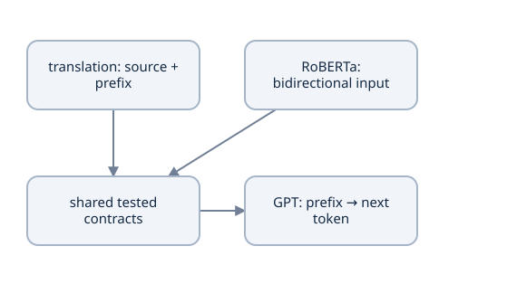

Course 2 is a decoder-only autoregressive model. Tokenizer/split/mask/loss/recovery reasoning transfers; encoder weights do not automatically become a GPT checkpoint.


| Task operation | Output | Classification or reduction axis | Permitted information |
| --- | --- | --- | --- |
| Translation encoder | $[B,S,D]$ memory | Feature transforms, source-key attention | All real source tokens |
| Translation target head | $[B,T,V_t]$ | Target vocabulary | Target prefix plus source memory |
| RoBERTa MLM head | $[B,T,V]$ | Vocabulary; loss only selected labels | Full corrupted real input |
| QA start/end head | Two $[B,T]$ arrays | All packed positions in current CE; context-only constraints in decoding | Question plus context window |
| Small GPT next-token head | $[B,T,V]$ | One text vocabulary | Token prefix under causal visibility |

An identical attention formula or scalar loss does not establish identical tasks, normalization domains or checkpoint compatibility.

### Explain counted loss through a changed numerical example

Suppose translation has loss sum 10 over five valid targets, MLM sum 6 over three selected targets, and QA has start sum 6/end sum 2 over two valid windows. Their mean objectives are respectively $10/5=2$, $6/3=2$, and $(6+2)/(2×2)=2$. The equal numerical value does not make these equally good models: the prediction units, vocabulary/position domains and supervised examples differ.

For each, derive the local class gradient $p-y$ with its correct denominator, then identify how that derivative reaches earlier layers. Translation cross-attention routes target gradients into source memory. MLM selected logits route gradients into contextual keys/values and both tied-table uses. QA combines start/end signals into each shared contextual row. A direct gradient zero at one output position is not necessarily a zero upstream parameter gradient.

In each trace, label integer IDs, floating representations, allowed-key masks, ignored targets and original coordinates separately. Explain one failure concretely: wrong target shift, mistaken Boolean mask, replacement ID used as its own MLM label, changed tokenizer under old weights, byte offset used as a character offset, or independent reversed QA endpoints. Name the check that exposes it.

### Verify the three actual interfaces

From `examples/` using the frozen interpreter:

```python
import torch
from translation_model import Transformer, TransformerConfig
from roberta_model import RobertaConfig, RobertaForMaskedLM, RobertaForQuestionAnswering

torch.set_num_threads(1)
torch.manual_seed(7)
t = Transformer(TransformerConfig(src_vocab_size=10,tgt_vocab_size=12,
    embedding_dimension=8,num_attention_heads=2,max_src_len=4,max_tgt_len=4)).eval()
c = RobertaConfig(vocab_size=30,embedding_dimension=8,
    num_transformer_blocks=1,num_attention_heads=2,context_length=8)
m, q = RobertaForMaskedLM(c).eval(), RobertaForQuestionAnswering(c).eval()
with torch.no_grad():
    translation = t(torch.tensor([[2,4,0]]),torch.tensor([[2,4,3]]))
    ids = torch.tensor([[0,4,8,2]])
    mlm = m(ids)['logits']
    qa = q(ids)
assert translation.shape == (1,3,12)
assert mlm.shape == (1,4,30)
assert qa['start_logits'].shape == qa['end_logits'].shape == (1,4)
assert 10/5 == 6/3 == (6+2)/(2*2) == 2
print('translation:',tuple(translation.shape),'MLM:',tuple(mlm.shape),'QA:',tuple(qa['start_logits'].shape))
```

These independent miniature configurations verify interfaces; they are untrained and do not share compatible vocabularies or weights. The matching width is deliberate for shape inspection, not a conversion scheme.

### Run the reference checks and assess their actual scope

The complete local reference uses these unchanged commands from `examples/`:

```bash
python -m unittest discover -s . -p test_foundation_math.py -v
python translation_checks.py
python roberta_checks.py
python course_recovery_checks.py
python course_session_checks.py
```

They cover independent arithmetic/finite differences, attention parity, visibility/alignment, generation, weighted losses, Unicode offsets, corruption/heads/transfer/spans, fresh-process continuation and persistence/session failures. Complete mechanics demonstrations are `python translation_train.py --steps 400` and `python roberta_train.py --task both --steps 120`. Use common session commands for actual resumable work; demos and weight-only exports do not replace that state.

[Reference runs](project/reference-runs.md) states the corpus, corruption, runtime and outcomes of author runs. Tiny held-out translation combinations, two fixed-corruption MLM documents and eight seen QA questions establish different bounded checks. They do not reproduce WMT/RoBERTa/SQuAD scale or general language quality. A fresh local replay proves a declared compatible continuation, while Drive survival requires a successful **Disconnect and delete runtime** drill with recorded restored/advanced updates. Keep hosted evidence pending until performed.

### Carry specific evidence into the next project

The [implementation record](project/implementation.md) and [readiness](project/readiness.md) distinguish inspected source, your implementation, numerical invariants, measured training, task evaluation, your explanation and local/hosted recovery. For each unresolved item, write an exact file/component, fixture and observable acceptance check. Do not fill learner results from author reference checks.

Use [my study notes](project/study-notes.md) for your derivations; [explanation practice](practice/explain-your-model.md) and [changed-case questions](practice/questions.md) support reviewing a component. [The outline](project/course-outline.md), [translation record](project/translation.md), [RoBERTa record](project/roberta.md), [source map](project/source-map.md) and [research](research.md) retain the source/profile choices without creating another mandatory theory route. Actual learner P00-M1 still resumes `linear()` in the existing foundations child until its own evidence changes.

### Choose the decoder-only changes explicitly

Course 2 develops Small GPT with a next-token objective, one text tokenizer/corpus, causal self-attention, learned positions, pre-norm blocks, GELU FFN and a tied vocabulary head. Removing the translation encoder removes source memory and cross-attention; it does not automatically select all those remaining contracts. RoBERTa's bidirectional visibility would expose future next-token targets if copied unchanged.

Transfer the tested habits: exact tokenizer/split/source identity, shape/axis checks, legal causal information, token-weighted accumulation, optimizer/schedule/generator state, bounded stopping and verified recovery. Recheck them under the new task's position numbering, vocabulary, data and generation behavior. Mutable sibling imports make the new experiment depend on hidden changes; reuse explicit versioned source/artifacts instead.

The own-format contextual encoder and translation weights are not a ready-made official GPT checkpoint. Architecture similarity also does not create official-tokenizer compatibility or a conversational instruction-following system. Instruction data, alignment, serving and their evaluation are later tasks. The useful handoff is a tested model/data/training discipline with clearly named remaining work.

### Predict or explain: Remove the translation encoder and cross-attention. Have you automatically obtained Course2's Small GPT, or a checkpoint compatible with an official GPT tokenizer?

<details data-practice-id="ready-for-gpt-practice-1"><summary>Reveal worked answer and rubric</summary>

No. Specify one text tokenizer/corpus, next-token shift, causal visibility, learned positions, pre-norm/GELU blocks, tying and bounded generation/recovery. Deleting source memory does not select those contracts or map vocabulary/parameter identities. Course2 is a new decoder-only experiment; official artifact conversion and instruction-following stages remain separate.

**Rubric:** Trace what is removed and name the remaining objective/architecture/artifact decisions.

</details>


### Predict or explain: Translation sum 10/count 5, MLM sum 6/selected 3 and QA start sum 6/end sum 2/window count 2 all give loss 2. Does this prove comparable quality? Which evidence advances learner or hosted gates?

<details data-practice-id="ready-for-gpt-transfer"><summary>Reveal worked answer and rubric</summary>

No: objectives and prediction units differ. QA divides (6+2) by 2×2; translation/MLM count their own valid targets. Author source checks and tiny outcomes establish stated local behavior. Learner implementation/explanation and held-out task evidence need their own records; deleted-runtime Drive recovery needs actual hosted restored/advanced updates. Tokenizer/source identity must remain explicit.

**Rubric:** Calculate the three denominators, distinguish evidence classes and name one concrete remaining acceptance check.

</details>


### Keep editable source and attribution available

Model/helper/trainer source is separate from notebooks and personal notes:

- [foundation_math.py](examples/foundation_math.py), [foundation_math.cpp](examples/foundation_math.cpp), [test_foundation_math.py](examples/test_foundation_math.py) and [first_retrieval.py](examples/first_retrieval.py)
- [translation_attention.py](examples/translation_attention.py), [translation_data.py](examples/translation_data.py), [translation_model.py](examples/translation_model.py), [translation_metrics.py](examples/translation_metrics.py), [translation_train.py](examples/translation_train.py) and [translation_checks.py](examples/translation_checks.py)
- [roberta_data.py](examples/roberta_data.py), [roberta_model.py](examples/roberta_model.py), [roberta_train.py](examples/roberta_train.py) and [roberta_checks.py](examples/roberta_checks.py)
- [course_checkpoint.py](examples/course_checkpoint.py), [course_recovery_checks.py](examples/course_recovery_checks.py), [course_session.py](examples/course_session.py), [course_session_checks.py](examples/course_session_checks.py) and [course_source_export.py](examples/course_source_export.py)

Retain [the MIT license](examples/LICENSE.txt), [source acquisition provenance](source-provenance.json) and [selected reference verification](reference-verification.json). New source/study exports need their own digests and must preserve existing personal notes. Local authoring/checks remain separate from commits or external publication.

In [my study notes](project/study-notes.md), draw all three full paths, compare their loss denominators, and identify one unresolved implementation with its independent fixture. State what changes for Small GPT and what your present evidence does not establish. Use that concrete next action to continue rather than a generic completion label.

### Study and source tools

Use [the study notebook generator](examples/course_study_notebook.py), [source export generator](examples/course_source_export.py), [applied numerical probes](examples/model_learning_probes.py) and [independent probe checks](examples/test_model_learning_probes.py). The export includes a cleared study notebook and editable topic notes beside all reference modules. [Build record](project/implementation.md) and [author reference results](project/reference-runs.md) state their scope.

[Expanded topic verification](topic-verification.json) and [study/export checks](examples/test_course_study.py) record the current artifact checks.


## Evidence and proof limits

### Claim ledger

| Claim | Status | Proof limit |
| --- | --- | --- |
| Worked matrices, derivatives and optimizer examples are original numerical fixtures. | illustrative | Known answers and finite differences establish these fixtures only. |
| The translation build combines a bidirectional source encoder, causal target decoder and source cross-attention. | documented | The source GELU/plain embedding/AdamW recipe differs from parts of the paper; choices are explicit. |
| Scaled query–key comparison, allowed-key softmax and value mixing are shared by explicit and efficient attention. | documented | No guaranteed FlashAttention backend or speedup; check masks, dropout and rectangular shapes. |
| RoBERTa learns bidirectional representations with selected-token reconstruction; extractive QA predicts context endpoints. | documented | Miniature tokenizer, sizes and parameter names do not provide official checkpoint compatibility. |
| Padding, random replacement, position conventions, half-open spans and constrained QA decoding are made explicit and corrected. | documented | Inspected pinned source is teaching material, not a claim about every release or implementation. |
| Exact continuation requires optimizer, schedule, RNG, data state and compatible model/tokenizer/runtime identity in addition to weights. | documented | Fresh-process CPU continuation is checked locally; hosted, CUDA and cross-runtime parity remain open. |
| Tiny fixture metrics and author verification do not establish learner understanding, WMT/SQuAD quality or Colab recovery. | inference | No learner or hosted gate is advanced by authoring this course. |

## Sources

- [Attention mechanisms](https://www.youtube.com/watch?v=JXY5CmiK3LI) — Attention stages: projections, scores, masks, heads and efficient path; checked 2026-10-12
- [Prepare translation data](https://www.youtube.com/watch?v=UkBggwQsbF8) — Parallel corpora, separate tokenizers, target shifting and collation; checked 2026-10-12
- [Build and train the translation Transformer](https://www.youtube.com/watch?v=DOqg_QxInd8) — Positions, encoder/decoder, training, generation and evaluation; checked 2026-10-12
- [Lets Reproduce RoBERTa from Scratch!](https://www.youtube.com/watch?v=Fzv2lSt0Ing) — Data 1:45–25:00; masking 44:15–1:10:30; model 1:12:25–2:08:14; training 2:08:14–2:58:45; checked 2026-10-12
- [Extractive Question Answering: Getting RoBERTa To Answer Questions](https://www.youtube.com/watch?v=_FVwYFICYuE) — Spans 9:30–44:40; head 44:40–46:20; backbone/forward 46:20–1:13:30; training/inference 1:13:30–1:28:10; checked 2026-10-12
- [Pinned attention source](https://github.com/priyammaz/PyTorch-Adventures/tree/2f18a5470c4ef0a3d413dd7b18d07941f45779e9/PyTorch%20for%20Transformers/Attention%20Mechanisms/Attention) — Attention.ipynb; MIT source; preserved class/projection interfaces; checked 2026-10-12
- [Pinned translation source](https://github.com/priyammaz/PyTorch-Adventures/tree/2f18a5470c4ef0a3d413dd7b18d07941f45779e9/PyTorch%20for%20NLP/Seq2Seq%20for%20Neural%20Machine%20Translation) — model.py, data.py, tokenizer.py, prepare_data.py, train.py, compute_bleu.py; checked 2026-10-12
- [Pinned RoBERTa and QA source](https://github.com/priyammaz/PyTorch-Adventures/tree/2f18a5470c4ef0a3d413dd7b18d07941f45779e9/PyTorch%20for%20NLP/RoBERTa%20for%20Masked%20Language%20Models) — model.py, utils.py, prepare_data.py, pretrain_roberta.py, finetune_roberta_qa.py, inference.py; checked 2026-10-12
- [Attention Is All You Need](https://arxiv.org/abs/1706.03762) — Sections 3 and 5; v7; checked 2026-10-12
- [BERT: Pre-training of Deep Bidirectional Transformers for Language Understanding](https://arxiv.org/abs/1810.04805) — Sections 3–4; v2; checked 2026-10-12
- [RoBERTa: A Robustly Optimized BERT Pretraining Approach](https://arxiv.org/abs/1907.11692) — Sections 3–5; v1; masking, objective, data and training ablations; checked 2026-10-12
- [PyTorch scaled dot product attention](https://docs.pytorch.org/docs/2.14/generated/torch.nn.functional.scaled_dot_product_attention.html) — Allowed Boolean masks, dropout_p, reference equation and backend dispatch; checked 2026-10-12
- [PyTorch Linear](https://docs.pytorch.org/docs/2.14/generated/torch.nn.Linear.html) — Stored weight shape [out_features,in_features]; checked 2026-10-12
- [PyTorch Adam](https://docs.pytorch.org/docs/2.14/generated/torch.optim.Adam.html) — First/second moments, bias correction and optimizer state; checked 2026-10-12
- [PyTorch GELU](https://docs.pytorch.org/docs/2.14/generated/torch.nn.GELU.html) — Gaussian CDF and approximation argument; checked 2026-10-12
- [Hugging Face Tokenizers](https://huggingface.co/docs/tokenizers/index) — Pipeline components, training and offsets; exact pipeline identity matters; checked 2026-10-12
- [Hugging Face RoBERTa model documentation](https://huggingface.co/docs/transformers/model_doc/roberta) — Model/tokenizer interfaces; padding and checkpoint compatibility; checked 2026-10-12
- [Hugging Face extractive question answering](https://huggingface.co/docs/transformers/tasks/question_answering) — Question/context offsets, truncation, span labels and inference; checked 2026-10-12
- [WMT14 translation task](https://www.statmt.org/wmt14/translation-task.html) — Official task, training corpora and evaluation set; checked 2026-10-12
- [SacreBLEU](https://github.com/mjpost/sacrebleu) — Corpus BLEU signatures, tokenization and reproducibility; checked 2026-10-12
- [Official SQuAD 1.1 evaluator](https://github.com/rajpurkar/SQuAD-explorer/blob/master/evaluate-v1.1.py) — Answer normalization, exact match, token overlap F1 and multiple references; checked 2026-10-12
- [PyTorch saving and loading models](https://docs.pytorch.org/tutorials/beginner/saving_loading_models.html) — General training checkpoint; checked 2026-10-12
- [PyTorch reproducibility](https://docs.pytorch.org/docs/2.14/notes/randomness.html) — Platform/release/device reproducibility boundaries; checked 2026-10-12
- [Google Colab FAQ](https://research.google.com/colaboratory/faq.html) — Runtime lifetime, hardware availability and changing Free resources; checked 2026-10-12
- [PyTorch 2.14 CrossEntropyLoss](https://docs.pytorch.org/docs/2.14/generated/torch.nn.CrossEntropyLoss.html) — Definition and actual API/metric implementation used by the worked topic.; checked 2026-10-13
- [PyTorch 2.14 Embedding](https://docs.pytorch.org/docs/2.14/generated/torch.nn.Embedding.html) — Definition and actual API/metric implementation used by the worked topic.; checked 2026-10-13
- [PyTorch 2.14 LayerNorm](https://docs.pytorch.org/docs/2.14/generated/torch.nn.LayerNorm.html) — Definition and actual API/metric implementation used by the worked topic.; checked 2026-10-13
- [PyTorch 2.14 AdamW](https://docs.pytorch.org/docs/2.14/generated/torch.optim.AdamW.html) — Definition and actual API/metric implementation used by the worked topic.; checked 2026-10-13
- [BLEU: a Method for Automatic Evaluation of Machine Translation](https://aclanthology.org/P02-1040/) — Definition and actual API/metric implementation used by the worked topic.; checked 2026-10-13
- [Hugging Face SQuAD normalization, exact match and F1 source](https://github.com/huggingface/transformers/blob/main/src/transformers/data/metrics/squad_metrics.py) — Definition and actual API/metric implementation used by the worked topic.; checked 2026-10-13
