# Tutorial 0 — Deep learning foundations for Attention Is All You Need

Which mathematical, representation, architecture and training foundations explain every core operation in the original Transformer?

Learning material for P00. Model implementation/training and learner mastery are separate states.

**Outcomes:** Explain, calculate and check linear algebra and neural maps.; Explain, calculate and check pytorch tensors, storage and module state.; Explain, calculate and check derivatives, gradients and local descent.; Explain, calculate and check probability, statistics and information.; Explain, calculate and check feedforward networks and nonlinear activations.; Explain, calculate and check initialization, symmetry and signal scale.; Explain, calculate and check backpropagation and automatic differentiation.; Explain, calculate and check loss functions, logits and stable arithmetic.; Explain, calculate and check sgd, momentum, adam and weight decay.; Explain, calculate and check training updates, schedules and gradient scale.; Explain, calculate and check datasets, batching and supervision contracts.; Explain, calculate and check text encoding, tokenization and vocabulary identity.; Explain, calculate and check embeddings, lookup gradients and weight tying.; Explain, calculate and check sequence order and positional encoding.; Explain, calculate and check queries, keys, values and scaled attention.; Explain, calculate and check padding masks, causal masks and empty rows.; Explain, calculate and check multi-head projections, splitting and concatenation.; Explain, calculate and check the position-wise feedforward sublayer.; Explain, calculate and check residual connections, depth and normalization order.; Explain, calculate and check layer normalization and its gradients.; Explain, calculate and check regularization and generalization controls.; Explain, calculate and check encoder–decoder learning and inference.; Explain, calculate and check evaluation, debugging and a complete small training experiment.; Explain, calculate and check checkpointing and reproducible recovery.; Explain, calculate and check read the paper and assemble the foundations..

## Lesson 1 — Linear algebra and neural maps

**Goal:** read and calculate the maps that appear throughout a Transformer. Prerequisite: comfortable Python programming. No previous deep-learning course is assumed. The [course outline](project/course-outline.md) gives the topic order; [study notes](project/study-notes.md) provide a personal workbook. Runnable reference files live in this package's `examples/` directory. Code blocks with imports are standalone probes; blocks labelled as implementation exercises belong in the existing learner lab.

### Arrays, coordinates and notation

A scalar is one number. A vector is an ordered list of coordinates; its order matters. A matrix has two axes, and a tensor generalizes this to any number of axes. Rank counts axes; shape gives their lengths. An array shaped `[2,3,4]` contains 24 numbers. It is not automatically a batch or a sequence: those meanings come from our contract.

We use row vectors. `X[N,D]` means N examples with D features each. In later lessons `X[B,T,D]` means batch, position, feature. A subscript is an index: xᵢ is a coordinate, not multiplication by i. Σ means addition over the stated index. All numerical indices here start at zero.

The dot product of equal-width vectors is

$$x\cdot w=\sum_{i=0}^{D-1}x_iw_i.$$

For `[1,2]` and `[2,3]` it is `1×2+2×3=8`. Multiplying corresponding coordinates gives a vector; summing those products gives a scalar. Dot products can be positive, negative or zero. Their magnitude depends on both vector lengths and direction, so they are not automatically normalized similarity scores.

The Euclidean norm is $\|x\|_2=\sqrt{\sum_i x_i^2}$. For `[3,4]`, it is 5. Cosine similarity divides a dot product by both norms and needs a policy for a zero vector. Transformer attention uses scaled dot products; it does not generally normalize them to cosine similarity.

### Matrix multiplication is a collection of dot products

Let

$$X=\begin{bmatrix}1&2\\3&4\end{bmatrix},\quad
W=\begin{bmatrix}1&0&2\\0&1&3\end{bmatrix},\quad b=[0,0,1].$$

The weights have one column per output recipe. Compute

$$\begin{aligned}
Y_{nf}&=\sum_{d=0}^{D-1}X_{nd}W_{df}+b_f,\\
Y&=XW+b=\begin{bmatrix}1&2&9\\3&4&19\end{bmatrix}.
\end{aligned}$$

For example, `Y[1,2]=3×2+4×3+1=19`. Shapes `[N,D]@[D,F]→[N,F]` name the contracted dimension D. Matrix multiplication is not commutative: W X may be undefined even when X W exists. Transpose exchanges axes: $(XW)^T=W^TX^T$. It does not reverse the order of values within each row.

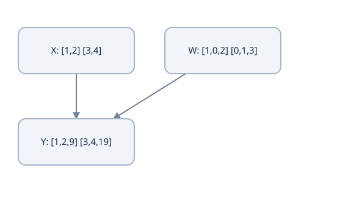

X[2,2] times W[2,3], plus b[3], produces Y[2,3]. The feature axis 2 is contracted; example rows are independent.


One set of weights and biases is reused for all examples. A batch of 10,000 examples does not need 10,000 independent weight matrices. The number of learned parameters here is `D×F+F=9`; the two input rows are data, not parameters. A dense multiply uses about NDF multiply–accumulate operations. When counting FLOPs as separate multiplication and addition, the leading count is approximately 2NDF; state the convention.

### Linear versus affine

A linear map preserves addition and scalar multiplication and sends zero to zero. `xW+b` is affine when b is nonzero. A library's “linear layer” usually includes a bias. That is useful: the targets `x=0→1` and `x=1→3` are fitted by `2x+1`, while `wx` cannot fit the first target.

PyTorch's `nn.Linear(D,F)` stores weights `[F,D]`, and calculates `X @ layer.weight.T + layer.bias`. Our mathematical W is `[D,F]`. Both conventions describe the same map; never transpose twice to make a shape error disappear. Its operation on `[B,T,D]` produces `[B,T,F]`, reusing parameters at each position. This operation transforms features independently; it does not mix tokens.

### Implementation exercise — the existing linear() contract

Work in `ai_projects/projects/transformer-labs/transformer-foundations-lab/`, inspect the existing `src/transformer_foundations_lab/numerics.py`, and preserve any edits. Implement or complete `linear(rows, weights, bias)` using the row convention above. Require nonempty rectangular rows/weights, matching contracted widths, and one bias per output. Raise `ValueError` for an invalid shape rather than silently truncating a `zip`.

A complete reference is [prerequisite_math.py](examples/prerequisite_math.py); attempt the exercise before reading its implementation. From the package directory, the arithmetic reference is runnable without Torch:

```bash
python3 examples/prerequisite_math.py
python3 -m unittest discover -s examples -p test_prerequisite_math.py
```

Known answers are `[[1,2,9],[3,4,19]]`. Replacing the second input row with `[4,4]` changes only the second output row to `[4,4,21]`. A zero input gives b. Do not interpret a passing author reference as completion of your own learner exercise.

### Predict or explain: For X[2,2], W[2,3], b[3], replace the second row [3,4] with [4,4]. What changes? What is the output on a zero input and the parameter count?

<details data-practice-id="linear-transfer"><summary>Reveal worked answer and rubric</summary>

Only the second output row changes, to [4,4,21]; the first stays [1,2,9]. Zero input produces [0,0,1], the bias. There are 2×3+3=9 shared parameters, independent of the number of examples. PyTorch stores the same weight map as [3,2] and transposes it in the operation.

**Rubric:** Calculate the changed cells, identify the shared output-feature bias and separate data size from parameter count.

</details>


### Failure cases and notes

A legal multiply can still join the wrong axes. Using equal dimensions hides mistakes, so debug with unequal values for N, D and F. An elementwise product is not a matrix multiply. Bias belongs to output features; a bias per example would depend on batch organization.

In my notes: write the indexed affine formula, calculate every cell of one result row, and label which numbers are data and which are shared parameters. Explain how the same map will produce Q, K and V in attention. Stop when you can derive the output and parameter count without running the reference.

Source contract: [PyTorch Linear](https://docs.pytorch.org/docs/2.14/generated/torch.nn.Linear.html). The arithmetic, exercise and changed-case checks are original. Continue with [tensor contracts](lessons/02-workspace.md).


## Lesson 2 — PyTorch tensors, storage and module state

**Goal:** distinguish mathematical axes from the runtime's shape, dtype, device and storage contracts. Prerequisite: [linear algebra](lessons/01-prediction.md). The existing learner environment is preserved; this lesson does not ask you to recreate the child or start with Python syntax.

### A tensor needs more than a shape

Write a contract such as `features: float32[B,T,D] on cpu` and `ids: int64[B,T] on cpu`. Shape names the coordinates, dtype the representation of each element, and device where the operation executes. A vocabulary ID is a category index, not a continuous feature. Casting ID 37 to 37.0 does not create an embedding. Integer IDs normally enter `nn.Embedding`; floating features enter `nn.Linear`.

For the runnable reference, use the already configured attention project's environment. From workspace home:

```bash
ai_projects/projects/transformer-labs/attention-is-all-you-need/.venv/bin/python \
  ai_projects/docs/tutorials/projects/p00/transformer-foundations/v1/examples/prerequisite_tensors.py
```

For later shell blocks that use `python`, select this reference interpreter in the terminal first. From workspace home, `source ai_projects/projects/transformer-labs/attention-is-all-you-need/.venv/bin/activate` selects the existing environment; it does not recreate either lab. Then change to the stated examples directory. Alternatively replace `python` with that interpreter’s path. Standalone standard-library blocks can use host `python3`.

The checked reference runtime is Python 3.12 with Torch 2.14.1+cpu. This does not install Torch in the separate learner lab. If you configure another environment, record its versions and use the CPU dependency instructions from [uv's PyTorch guide](https://docs.astral.sh/uv/guides/integration/pytorch/). Keep environments and downloaded packages out of Git.

A module and its inputs must use compatible dtypes/devices. `model.to(device)` moves registered parameters and buffers; moving only the input can leave the weights elsewhere. Floating tensors require an explicit decision about FP32 versus FP64. FP64 is useful for finite-difference checks; it is not automatically the best training precision.

### Broadcasting follows lengths, not meaning

Trailing dimensions align. Lengths must be equal or one of them must be 1; missing leading dimensions behave as 1. For `[B,T,D]`, bias `[D]` repeats across B and T. A token-valid mask `[B,T]` needs `[...,None]` to multiply features `[B,T,D]`. Adding `[T]` to `[B,T,D]` acts on the last axis if T happens to equal D, which is the wrong interpretation.

```python
import torch
x = torch.arange(24).reshape(2, 3, 4).double()
bias = torch.tensor([10., 20., 30., 40.], dtype=x.dtype)
valid = torch.tensor([[True, True, False], [True, False, False]])
y = (x + bias) * valid[..., None]
assert y.shape == (2, 3, 4)
assert torch.equal(y[0, 2], torch.zeros(4, dtype=x.dtype))
```

A mask is not a label and does not inherently alter gradients. This multiply zeroes a representation; later attention masking removes specific query–key connections. The purpose determines the operation.

### Transpose and reshape answer different questions

An array's strides tell us how an index changes its storage offset. In contiguous `[2,3,4]` storage, strides are `(12,4,1)`. Swapping the last two axes gives shape `[2,4,3]`, strides `(12,1,4)`, and a noncontiguous view. Values move logically to different coordinates without necessarily moving physical bytes.

```python
import torch
x = torch.arange(24).reshape(2, 3, 4)
t = x.transpose(1, 2)
assert t[0, 1, 2].item() == x[0, 2, 1].item() == 9
assert t.stride() == (12, 1, 4)
assert not t.is_contiguous()
flat = t.reshape(2, 12)  # may allocate to preserve t's logical order
assert flat[0].tolist() == [0,4,8,1,5,9,2,6,10,3,7,11]
```

`reshape` preserves logical traversal order; it does not exchange semantic axes. `view` requires compatible strides. `contiguous()` creates compatible storage when needed. A copied reshape and a view can have different mutation behavior: do not rely on aliasing unless you establish it. In multi-head attention, reshaping `[B,T,D]` to `[B,T,H,d]` and transposing to `[B,H,T,d]` are separate operations.

### Modules own learnable and persistent state

`nn.Parameter` marks learnable state. Assigning a submodule as an attribute registers it recursively. Use `ModuleList` for a list of layers: a plain Python list does not provide that registration. A buffer is persistent non-parameter state, such as a fixed position table. `state_dict()` includes registered parameters and persistent buffers; it is not the whole training checkpoint.

```python
import torch
from torch import nn
class Probe(nn.Module):
    def __init__(self):
        super().__init__()
        self.map = nn.Linear(2, 3)
        self.register_buffer('offset', torch.zeros(3))
    def forward(self, x):
        return self.map(x) + self.offset
m = Probe()
assert sum(p.numel() for p in m.parameters()) == 9
assert set(m.state_dict()) == {'map.weight', 'map.bias', 'offset'}
```

`train()` and `eval()` control layer behavior such as dropout. `no_grad()` controls graph recording. Neither substitutes for the other, and `eval()` does not freeze parameters.

### Predict or explain: For X[B,T,D] with B=2,T=3,D=4, how do you apply valid[B,T]? Does reshape(2,4,3) perform transpose(1,2)? What enters an embedding?

<details data-practice-id="tensor-transfer"><summary>Reveal worked answer and rubric</summary>

Use valid[...,None] to align token validity with all features. Reshape preserves traversal order and is not the axis permutation; transpose maps coordinates and changes strides. IDs enter a lookup as integer indices, normally int64; learned floating vectors enter affine maps. Shape, dtype, device and axis meaning all require checks.

**Rubric:** Explain coordinates and storage independently; show the mask singleton and distinguish IDs from continuous features.

</details>


### Notes and checks

Write the coordinate, dtype/device and storage contract for an ID tensor, its embeddings and a head-split tensor. Predict the transpose result before running it. Explain why a same-shaped tensor can still have the wrong axes. The runnable tensor checks are [test_prerequisite_tensors.py](examples/test_prerequisite_tensors.py); use the configured Torch interpreter.

Sources: [broadcasting](https://docs.pytorch.org/docs/2.14/notes/broadcasting.html), [views](https://docs.pytorch.org/docs/2.14/tensor_view.html), [Module](https://docs.pytorch.org/docs/2.14/generated/torch.nn.Module.html). Continue with [calculus](lessons/03-numbers.md).


## Lesson 3 — Derivatives, gradients and local descent

**Goal:** calculate how a small parameter change affects a scalar loss, and understand what backpropagation must compute. Prerequisites: [neural maps](lessons/01-prediction.md) and [tensor axes](lessons/02-workspace.md).

**Existing learner continuation:** the old “Lesson 3 part A” destination is preserved. Your next implementation remains `linear()` in `src/transformer_foundations_lab/numerics.py`; its full contract, rectangular fixture and stopping point now appear in [Lesson 1's implementation exercise](lessons/01-prediction.md). Resume that exercise before treating these derivative checks as learner completion.

### A derivative is a local rate of change

For a scalar function f, the derivative at w is

$$f'(w)=\lim_{h\to0}\frac{f(w+h)-f(w)}{h}.$$

The numerator is a change in output and the denominator a change in input. It is not the ratio f(w)/w. For $f(w)=w^2$, expand $(w+h)^2$ to obtain `2w+h`; the limit is 2w. This is a local statement. It does not say the function remains linear for a large step.

In learning, define prediction a=wx+b, target y, error e=a−y and squared loss L=e². Hold x and y fixed; w and b are the adjustable parameters. Applying the chain rule gives

$$\begin{aligned}
\frac{\partial L}{\partial w}&=2e\,x,\\
\frac{\partial L}{\partial b}&=2e.
\end{aligned}$$

At x=3,w=2,b=0,y=1, prediction is 6, error 5, loss 25, and the gradients are 30 and 10. The factor x appears in the weight derivative because changing w changes the prediction by x times the change. Bias changes it one-for-one. If the loss were e²/2, both derivatives would be half as large; define the objective before comparing gradients.

### Chain rule and the functions we will differentiate

If L=f(a) and a=g(w), a small change obeys Δa≈g′(w)Δw, then ΔL≈f′(a)Δa. Combining the two rates gives dL/dw=f′(a)g′(w). The intermediate a must be evaluated at the actual forward value. For a square loss, the local derivative is with respect to the **error**, and the error then depends on the prediction and parameter. Multiplying the rates explains the factors above; shared uses require adding all paths afterward.

| Scalar function | Derivative where defined | First later use |
|---|---|---|
| exp(a)=eᵃ | exp(a) | softmax/BCE |
| log(a), a>0 | 1/a | negative log likelihood |
| sqrt(a), a>0 | 1/(2sqrt(a)) | normalization and scale |
| sin(a) | cos(a) | positions, with angles in radians |
| cos(a) | −sin(a) | positions |

Natural log is the inverse of exp: log(exp(a))=a, and log(xy)=log(x)+log(y) for positive x,y. These identities and derivatives supply the steps used in the loss and normalization derivations; they are not extra learned parameters.

### Partials, gradients and directional change

A partial derivative changes one coordinate while keeping the others fixed. The gradient collects them in a vector, here `[30,10]`. For a small change Δθ, first-order Taylor expansion gives

$$L(\theta+\Delta\theta)\approx L(\theta)+\nabla L(\theta)^T\Delta\theta.$$

Choose Δθ=−η∇L for positive η. The predicted change is $-\eta\|\nabla L\|_2^2$, which is nonpositive. Higher-order curvature terms can invalidate that approximation for a large η. The negative gradient is the steepest local descent direction under a Euclidean step-length constraint; another geometry can give another direction.

Keeping b fixed, η=.01 gives w=1.7 and loss `(5.1−1)²=16.81`. At η=.2, w=−4 and loss `(−12−1)²=169`: correct derivative, bad step size. If both w and b are updated at η=.01, they become `[1.7,−.1]` and loss is 16. These are different updates.

For x=3,w=2,target1, squared loss25 and gradient 30, compare two SGD rates.

Illustrative cases, not a model execution.

[[interactive:gradient-step]]

### Change the update size

| Learning rate | Outcome | Explanation |
| --- | --- | --- |
| 0.01 | w becomes1.7; loss16.81 | A modest step lowers this fixture loss. |
| 0.2 | w becomes−4; loss169 | The same local gradient direction can overshoot with a large step. |


For a direction v, the directional derivative is ∇L·v. At our fixture, direction `[1,−3]` has derivative `30−30=0`; a first-order zero change does not prove the loss stays constant for a finite move.

### Vector outputs require a Jacobian

For a vector-valued map a(θ), Jacobian J has entries Jᵢⱼ=∂aᵢ/∂θⱼ. If a scalar loss sends upstream gradient g=∂L/∂a, the chain rule gives ∂L/∂θ=Jᵀg. This vector–Jacobian product is what reverse-mode differentiation computes efficiently; it need not materialize the whole Jacobian.

For a=wx+b, J with respect to `[w,b]` is the row `[x,1]`. Multiplying its transpose by upstream 2e gives `[2ex,2e]`. For a batch, the same parameter influences many outputs, so the contributions add. A mean loss divides by the chosen number of supervised terms; a sum does not. Broadcasting a shared bias creates many uses and therefore a backward sum.

### Finite differences are an independent check

A central difference estimates the derivative by evaluating the forward function twice:

```python
from math import isclose
w, x, b, y, h = 2., 3., 0., 1., 1e-5
f = lambda weight: (weight*x + b-y)**2
measured = (f(w+h)-f(w-h))/(2*h)
assert isclose(measured, 30., rel_tol=1e-9)
```

This checks the formula independently of an autograd graph. Too-large h measures curvature; too-small h amplifies rounding error. Check several sizes using FP64 and smooth points. At a ReLU kink, an ordinary two-sided derivative does not exist; disagreement there is not necessarily a backward implementation bug.

### Predict or explain: Change the scalar target from1 to2, keeping x3,w2,b0. Derive both gradients and compare a weight-only η.01 step with updating both weight and bias.

<details data-practice-id="calculus-transfer"><summary>Reveal worked answer and rubric</summary>

Prediction6,error4,loss16. dw=2×4×3=24, db=2×4=8. Weight-only update gives w1.76,b0,prediction5.28,loss10.7584. Updating both gives w1.76,b−.08,prediction5.2,loss10.24. The unchanged forward prediction had a different target-dependent loss signal.

**Rubric:** Derive both partials, state the fixed variables and compute both distinct updates.

</details>


### Notes and source

Derive both partials from intermediate quantities, label what is held fixed and calculate the two different SGD updates. Explain how Jᵀg becomes a shared parameter's gradient. Use [prerequisite_math.py](examples/prerequisite_math.py) for central differences, not as a substitute for the derivation.

Written reference: [Nielsen's backpropagation chapter](https://neuralnetworksanddeeplearning.com/chap2); original derivations and numerical fixtures above. Continue with [probability and information](lessons/04-probability.md).


## Lesson 4 — Probability, statistics and information

**Goal:** interpret probabilities, expected values and log likelihood before using softmax or a loss. Prerequisites: sums/dot products and elementary derivatives. Probabilities represent uncertainty under a model; they are not proof that an answer is true.

### Distributions and expectations

For a categorical variable C with V possible outcomes, pᵢ=P(C=i) must be nonnegative and sum to one. A vector of raw scores such as `[0,log(3)]` is not a probability distribution. A model needs a transformation that enforces those conditions.

The expectation of a function is $\mathbb E[f(C)]=\sum_i p_i f(i)$. If values are `[2,6]` with probabilities `[.25,.75]`, their expected value is 5. That weighted sum is the arithmetic attention uses to combine vectors. A convex mixture with nonnegative normalized weights stays within the values' convex hull; subsequent learned projections need not.

For a numeric variable, variance is $\mathbb E[(X-\mu)^2]=\mathbb E[X^2]-\mu^2$, with μ=E[X]. Mean and variance describe location and spread, while norm measures distance from zero. Values `[1,3]` have population mean 2 and variance 1. Values `[101,103]` have mean 102 and the same variance. They have different norms. An unbiased sample-variance estimator divides its centered sum by N−1; feature normalization uses population variance, dividing by N.

When X and Y are independent, Var(X+Y)=Var(X)+Var(Y); otherwise add 2Cov(X,Y). Initialization arguments often assume independent, centered coordinates. Learned activations can violate those assumptions; the derivation is a guide to initial scale, not a theorem about every training step.

### Conditional probability and sequence likelihood

Conditional probability P(A|B)=P(A∩B)/P(B) is defined when P(B)>0. The chain rule of probability yields

$$P(y_1,y_2,y_3\mid x)=P(y_1\mid x)P(y_2\mid y_1,x)P(y_3\mid y_1,y_2,x).$$

This factorization does **not** assume the output tokens are independent. It explicitly conditions each factor on the prefix. An autoregressive decoder models these factors. Independent records are a separate training assumption used when multiplying their likelihoods.

For correct-token probabilities `.5,.25,.8`, the sequence probability is `.1`. Natural-log likelihood is `log(.5)+log(.25)+log(.8)=log(.1)`. Negative log likelihood is log(10)≈2.302585. Logs convert products to sums, avoid multiplying many tiny values, and preserve the ordering of positive likelihoods. A token mean NLL would be about .767528; it is a different reduction from the sequence total.

### Entropy, cross-entropy and KL

Let q be a target distribution and p the model distribution. Using natural logs gives units of nats:

$$\begin{aligned}
H(q)&=-\sum_iq_i\log q_i,\\
H(q,p)&=-\sum_iq_i\log p_i,\\
D_{KL}(q\Vert p)&=\sum_iq_i\log\frac{q_i}{p_i},\\
H(q,p)&=H(q)+D_{KL}(q\Vert p).
\end{aligned}$$

Use the limit `0 log 0=0`. If q assigns positive mass to an outcome for which p=0, cross-entropy and KL are infinite. KL is generally asymmetric, so it is not a distance metric. With fixed q, minimizing cross-entropy also minimizes this KL because H(q) does not depend on model parameters.

For q=`[.25,.75]`, entropy is about .562335. Against p=`[.5,.5]`, cross-entropy is log2≈.693147 and KL≈.130812. A one-hot target `[0,1]` has zero entropy, so its cross-entropy is simply −log p₁. This explains the connection between a categorical loss and likelihood. It does not mean every observed label perfectly describes the unknown population distribution.

### Softmax and its limits

Softmax maps real logits z to pᵢ=exp(zᵢ)/Σⱼexp(zⱼ). With `[0,log3]`, p is `[.25,.75]`. Adding the same constant to every logit changes neither p nor the categorical loss. Softmax is invariant to a shared shift, not to scaling; division by a positive temperature changes sharpness.

```python
import math
q = [.25, .75]
p = [.5, .5]
entropy = -sum(v*math.log(v) for v in q)
cross = -sum(v*math.log(w) for v, w in zip(q, p))
kl = sum(v*math.log(v/w) for v, w in zip(q, p))
assert abs(cross-entropy-kl) < 1e-12
assert abs(math.prod([.5,.25,.8])-.1) < 1e-12
```

Uniform predictions over V tokens have hard-target NLL log V and perplexity V. Perplexity is exp(mean token NLL) and depends on tokenization, conditioning and the evaluation corpus; comparing differently tokenized models directly can mislead.

### Predict or explain: Change the lesson to q=[.5,.5] and p=[.25,.75]. Compute entropy, cross-entropy and KL. If successive conditional probabilities are.6,.5,.2, what is sequence NLL, and does the factorization assert independence?

<details data-practice-id="probability-transfer"><summary>Reveal worked answer and rubric</summary>

H(q)=log2≈.693147; H(q,p)=−.5log(.25)−.5log(.75)≈.836988; KL≈.143841. Conditional product is.06 and total NLL≈2.813411; mean over3 tokens≈.937804. Conditional chain-rule factorization does not assert token independence. Swapping q and p changes KL, so it is not symmetric.

**Rubric:** State the distribution order and log units; distinguish conditional factorization from independent records and sum from mean.

</details>


### Notes and checks

Write the sequence factorization and state where an independence assumption is used. Compute an expectation, a variance and all three information quantities for the same distribution. Explain why an attention row and a vocabulary distribution can both be probabilities yet index different things.

Written reference: [D2L probability](https://d2l.ai/chapter_preliminaries/probability.html). [prerequisite_math.py](examples/prerequisite_math.py) supplies stable arithmetic checks. Continue with [feedforward networks](lessons/08-model.md).


## Lesson 5 — Feedforward networks and nonlinear activations

**Goal:** understand what a hidden layer adds, how nonlinearities change expressiveness, and how to count a network's parameters. Prerequisites: affine maps, derivatives and probabilities. Backpropagation is developed separately in Lesson 7.

### Why two linear layers are not enough

An affine layer transforms feature coordinates with reusable weights. Compose two:

$$\begin{aligned}
a&=xW_1+b_1,\\
z&=aW_2+b_2\\
 &=x(W_1W_2)+(b_1W_2+b_2).
\end{aligned}$$

This is still a single affine map. More layers may change parameterization or constrain rank, but without nonlinearities they cannot represent a general nonlinear decision boundary. A hidden **activation** breaks that collapse:

$$h=\phi(xW_1+b_1),\qquad z=hW_2+b_2.$$

The hidden coordinates are learned features. They need not have names such as “noun” or “sentiment”; useful interpretation requires evidence. Depth and width are capacity choices, not guarantees of generalization.

A two-class affine classifier's decision is based on the sign of one affine logit difference. It cannot classify opposite-sign quadrants perfectly. The positive-class points `(1,−1),(−1,1)` would require their affine scores to be positive, whose average implies b>0. The negative-class points `(1,1),(−1,−1)` would require negative scores, whose average implies b<0. Contradiction. This is why the small trainer needs a nonlinear hidden layer.

### Activation functions and their derivatives

| Activation | Formula | Local derivative and consequence |
|---|---|---|
| ReLU | max(0,a) | 1 at positive a, 0 at negative a; nondifferentiable at zero; inactive units can receive no local signal. |
| Sigmoid | 1/(1+exp(−a)) | s(1−s); maps to (0,1), saturates at large magnitudes. |
| Tanh | (exp(a)−exp(−a))/(exp(a)+exp(−a)) | 1−tanh²(a); centered outputs, but can also saturate. |
| GELU | a Φ(a) | Φ(a)+a φ(a), using the normal CDF and density; smooth gating, not simply a probability output. |

Use a stable library implementation at extreme inputs. An activation's output range and derivative affect forward values and backward signals. Sigmoid is useful for a binary probability, but repeatedly applying saturating activations through a deep chain can shrink gradients. The original Transformer FFN uses ReLU. GELU is a later comparison here, not a substitution for that design.

### A complete two-layer forward calculation

Use row-vector convention with a controlled fixture:

$$\begin{aligned}
x&=[1,2],\quad
W_1=\begin{bmatrix}1&-1\\-\tfrac12&\tfrac12\end{bmatrix},\\
b_1&=[0,\tfrac12\log3],\quad
W_2=\begin{bmatrix}1&-1\\0&2\log3\end{bmatrix},\quad b_2=[0,0].
\end{aligned}$$

First, xW₁=`[0,0]`; adding b₁ gives a=`[0,.5 log3]`. Because tanh(.5 log3)=.5, hidden h=`[0,.5]`. Then z=hW₂=`[0,log3]`. Its softmax is `[.25,.75]`. For supplied target index 1, loss is −log(.75)=log(4/3)≈.287682. The target is chosen for an arithmetic fixture; `(1,2)` has label 0 under the trainer's opposite-sign task. Do not mix the fixture's supplied label with that separate task's rule.

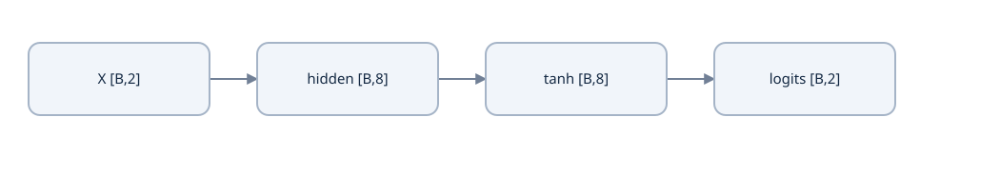

The actual tiny classifier uses Linear2→8, tanh, Linear8→2. Tanh has no learned parameters; the two affine maps contain 42.


The 2→2→2 fixture has `(2×2+2)+(2×2+2)=12` parameters. The reference trainer uses 2→8→2, giving `(2×8+8)+(8×2+2)=42`. Batch size changes activation storage, not either parameter count.

### PyTorch implements the same maps

```python
import torch
from torch import nn
m = nn.Sequential(nn.Linear(2, 8), nn.Tanh(), nn.Linear(8, 2))
x = torch.tensor([[1.,2.],[-1.,2.]])
logits = m(x)
assert logits.shape == (2,2)
assert sum(p.numel() for p in m.parameters()) == 42
```

This block uses random initialization, so it declares shapes/counts rather than a fixed output. The exact fixture is [deep_learning_math.py](examples/deep_learning_math.py); it has an independent Torch comparison and full backward values. Never add a final softmax before a loss that expects logits. A hidden activation and an output probability transform have different jobs.

### Predict or explain: Why can't two affine layers without an activation solve the opposite-sign quadrant task? How many parameters do 2→2→2 and 2→8→2 networks have?

<details data-practice-id="feedforward-transfer"><summary>Reveal worked answer and rubric</summary>

Composition collapses to x(W1W2)+b1W2+b2, still affine. The averages of the two positive quadrant scores require bias>0, while the two negative quadrant scores require bias<0. A nonlinear hidden layer changes the function family. Counts including both biases are12 and42, respectively.

**Rubric:** Derive the collapse and contradiction; count matrix and bias terms rather than using batch size.

</details>


### Notes and implementation

Draw the affine–activation–affine graph and annotate every shape. Derive the affine-collapse identity, reproduce the controlled hidden/logit values and explain the quadrant contradiction. For the existing lab, attempt selected numerical units rather than copying the entire reference network into your learner file.

Sources: [D2L MLP](https://d2l.ai/chapter_multilayer-perceptrons/mlp.html), [PyTorch Tanh](https://docs.pytorch.org/docs/2.14/generated/torch.nn.Tanh.html) and [Linear](https://docs.pytorch.org/docs/2.14/generated/torch.nn.Linear.html). Continue with [initialization](lessons/06-initialization.md).


## Lesson 6 — Initialization, symmetry and signal scale

**Goal:** explain why the starting parameter scale matters before the optimizer takes a step. Prerequisites: feedforward maps, derivatives, mean and variance. Initialization controls a starting distribution; training is still required.

### Symmetry can stop units from becoming different

If two hidden units start with identical weights and biases and are used identically, they produce the same activation and receive the same gradients. Deterministic updates keep them identical. A layer of many cloned units may therefore act like a much smaller layer. All-zero multilayer weights can also block signals through products of zero matrices. This does not mean every parameter must be random: zero biases and LayerNorm bias are common, and a simple convex linear regression can start at zero. State which symmetry matters.

Random initialization breaks identical-unit symmetry. Its scale also controls whether activations and gradients tend to grow or shrink. “Random” alone is not a scale prescription.

### Derive the fan-in variance argument

For one preactivation $a=\sum_{i=1}^D w_ix_i$, assume independent, centered weights, independent inputs, and weights independent of inputs. Let Var(wᵢ)=σ² and E[xᵢ²]=v. Cross terms vanish under these assumptions:

$$\begin{aligned}
\mathbb E[a]&=0,\\
\operatorname{Var}(a)&=\sum_i\mathbb E[w_i^2]\mathbb E[x_i^2]=D\sigma^2v.
\end{aligned}$$

Choosing σ²≈1/D preserves this second moment through the affine operation. With D=4 and v=1, weight standard deviation .5 gives output variance 1; standard deviation 1 gives variance 4. The number of inputs is **fan-in**. In backward propagation, a transposed matrix sums over the output width, bringing **fan-out** into the analysis.

Xavier/Glorot balances both directions with variance approximately `2/(fan_in+fan_out)` for its basic setting. Its uniform form has bounds ±sqrt(6/(fan_in+fan_out)). Activation-specific gains can change that scale. He initialization for ReLU uses variance approximately `2/fan_in`: for a symmetric preactivation, ReLU keeps half of the second moment.

The ReLU statement concerns E[ReLU(a)²], not its centered variance. ReLU's output mean is positive, so its centered variance is less than its second moment. Mixing those two quantities leads to a wrong derivation. Sigmoid/tanh saturation, correlation between inputs and deep architectural choices all limit these simple estimates.

### The same reasoning explains attention scaling

Let q and k have d independent centered coordinates, each with variance 1, and assume independence between q and k. Their dot product s=Σᵢqᵢkᵢ has mean 0 and variance d. Dividing by sqrt(d) gives variance 1. Dividing by d instead gives variance 1/d, which shrinks as width grows.

Without scale control, large score gaps make softmax nearly one-hot. Its Jacobian contains terms pᵢ(δᵢⱼ−pⱼ), so a saturated distribution often has small derivatives with respect to its scores. Scaling is an initial statistical motivation, not a guarantee: learned Q and K are not always independent unit-variance vectors.

### Check the assumptions with an exhaustive small distribution

Use independent ±1 coordinates. Each product qᵢkᵢ is also a centered ±1 variable. For d=2, the dot product distribution is −2 with probability .25, 0 with probability .5 and 2 with probability .25. Its variance is 2. After dividing by sqrt2, the variance is 1.

```python
import itertools, math
vectors = list(itertools.product([-1.,1.], repeat=2))
scores = [sum(a*b for a,b in zip(q,k)) for q in vectors for k in vectors]
assert sum(scores)/len(scores) == 0
assert sum(s*s for s in scores)/len(scores) == 2
assert abs(sum((s/math.sqrt(2))**2 for s in scores)/len(scores)-1) < 1e-12
```

For PyTorch, `nn.init.xavier_uniform_` and `nn.init.kaiming_normal_` make the fan/gain choices explicit. Know whether the stored weights are `[out,in]`; custom row-oriented matrices may need a transpose when applying a fan-based initializer. A library's default linear initialization is not automatically the Xavier/He choice you intended.

### Predict or explain: With D independent centered unit-variance inputs, what variance does Σwi xi have for weight variance σ²? Why divide attention scores by sqrt(d) rather than d?

<details data-practice-id="initialization-transfer"><summary>Reveal worked answer and rubric</summary>

Under the stated independence/centering assumptions, output variance is Dσ². For independent centered unit-variance query/key coordinates, the dot-product variance is d. Dividing by sqrt(d) gives variance1, while dividing by d gives variance1/d. The assumptions describe a scale motivation, not a guarantee about learned coordinates.

**Rubric:** Name every independence/centering assumption and use variance scaling rather than only quoting a formula.

</details>


### Notes and diagnostics

Derive the variance calculation and list every independence/centering assumption. Calculate scales for a 128→512 layer. Inspect activation standard deviations and gradient norms across layers instead of assuming an initializer proves healthy signals. Explain both identical-unit symmetry and attention's sqrt(d) denominator.

Sources: [Glorot and Bengio](https://proceedings.mlr.press/v9/glorot10a.html), [He and colleagues](https://arxiv.org/abs/1502.01852), [PyTorch initialization](https://docs.pytorch.org/docs/2.14/nn.init.html). Continue with [backpropagation](lessons/04-autograd.md).


## Lesson 7 — Backpropagation and automatic differentiation

**Goal:** derive the entire backward pass of a network, then inspect how autograd implements it. Prerequisites: chain rule, affine maps, tanh, softmax and the forward fixture in [Lesson 5](lessons/08-model.md). The categorical loss gradient used below is derived in [Lesson 8](lessons/08-losses.md).

### Reverse the graph, not the program's meaning

A forward graph records intermediate values and dependencies. A backward pass starts with ∂L/∂L=1 and repeatedly multiplies an upstream gradient by each operation's local derivative. Contributions from all uses of a shared variable add. Gradients have the same coordinate shapes as the values they describe.

For $Y=XW+b$ with X `[N,D]`, W `[D,F]`, and upstream G=∂L/∂Y `[N,F]`, differentiating the indexed sum gives

$$\begin{aligned}
\frac{\partial L}{\partial W}&=X^TG\quad[D,F],\\
\frac{\partial L}{\partial b}&=\sum_nG_{n,:}\quad[F],\\
\frac{\partial L}{\partial X}&=GW^T\quad[N,D].
\end{aligned}$$

The bias is used by every row, so its gradient sums over rows. If Y also has a position axis, sum over batch and position. For h=tanh(a), the local derivative is `1−h²`, giving ∂L/∂a=(∂L/∂h)⊙(1−h²), where ⊙ means elementwise multiplication.

### Work every stage of the two-layer network

The 12-parameter fixture has x=`[1,2]`, h=`[0,.5]`, z=`[0,log3]`, p=`[.25,.75]`, target 1 and L=log(4/3). For softmax cross-entropy, output gradient δ₂=p−one_hot(1)=`[.25,−.25]`.

1. Output bias gradient is δ₂. The output weight gradient is outer product hᵀδ₂:

$$\nabla W_2=\begin{bmatrix}0&0\\.125&-.125\end{bmatrix},\qquad
\nabla b_2=[.25,-.25].$$

2. Hidden upstream gradient is δ₂W₂ᵀ=`[.5,−.5 log3]`. Tanh derivatives are `[1,.75]`, so

$$\delta_1=[.5,-.375\log3]\approx[.5,-.411979608].$$

3. Hidden weights again receive an outer product, and the hidden bias receives δ₁:

$$\begin{aligned}
\nabla W_1&=\begin{bmatrix}.5&-.375\log3\\1&-.75\log3\end{bmatrix},\\
\nabla b_1&=[.5,-.375\log3].
\end{aligned}$$

4. Even if the inputs are not learned parameters, we can differentiate them: ∇x=δ₁W₁ᵀ≈`[.911979608,−.455989804]`.

All twelve parameter coordinates and both input coordinates are checked in [test_deep_learning_math.py](examples/test_deep_learning_math.py) against independent forward perturbations. The reference [deep_learning_math.py](examples/deep_learning_math.py) also compares them to FP64 Torch autograd. Changing only the supplied target to 0 leaves h,z,p unchanged and multiplies every derivative in this fixture by −3; it changes which class the loss rewards.

### Shared parameters gather all paths

For L(w)=(2w−1)²+(3w−1)², at w=1 the first use contributes 4 and the second 12, total 16. Recording only the last branch is wrong. At w=.5, total derivative is 3; averaging the two losses gives 1.5. The reduction belongs to the objective, not to a mysterious automatic averaging rule in backpropagation.

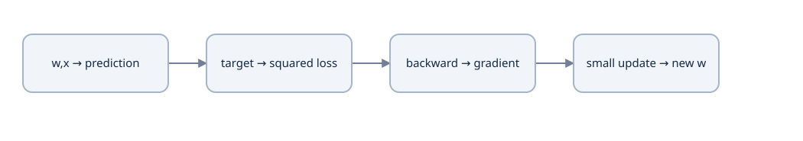

Squared loss L=(wx−y)² has dL/dw=2(wx−y)x. The gradient is local; a large step can overshoot.


### Autograd records the same dependency structure

```python
import torch
w = torch.tensor(1., dtype=torch.float64, requires_grad=True)
loss = (2*w-1)**2 + (3*w-1)**2
loss.backward()
assert w.grad.item() == 16
((2*w-1)**2 + (3*w-1)**2).backward()
assert w.grad.item() == 32  # leaf .grad accumulates
w.grad = None
```

A second forward pass builds a new graph. A backward call usually releases saved intermediates; reusing the same graph can require `retain_graph=True`, but retaining everything is not a normal training-loop fix. Leaf `.grad` accumulates until cleared. Nonleaf intermediates do not ordinarily retain `.grad`; call `retain_grad()` when deliberately inspecting them.

`detach()` breaks a gradient path while sharing underlying data storage; it is not a safe independent copy for arbitrary mutation. `item()` converts to a Python number, so arithmetic using that value is outside the differentiable graph. `no_grad()` avoids recording new graph operations. In-place changes to saved values can invalidate backward. Prefer direct, explicit forward expressions while learning.

### Predict or explain: In the controlled tanh fixture, why is the first row of grad W2 zero? If only the target changes1→0, what changes in the forward/backward trace?

<details data-practice-id="backprop-transfer"><summary>Reveal worked answer and rubric</summary>

The first hidden activation is0, so its outer-product contributions to W2 are0; its local upstream signal and earlier-layer gradients need not be zero. Forward activations/logits/probabilities stay fixed. The logit gradient changes [.25,−.25]→[−.75,.75], multiplying all propagated parameter/input derivatives by−3. Loss changes log(4/3)→log4.

**Rubric:** Distinguish zero activation from zero upstream gradient; derive the target change at the output then propagate it.

</details>


### Notes and stopping check

Derive all four parameter gradients and the input gradient, annotate upstream versus local derivatives, and explain the zero first row of ∇W₂. Compare one coordinate with a central difference before inspecting Torch. Explain how repeated embedding IDs will use the same “sum all paths” rule.

Sources: [Nielsen Chapter 2](https://neuralnetworksanddeeplearning.com/chap2), [D2L computation graphs](https://d2l.ai/chapter_multilayer-perceptrons/backprop.html), [PyTorch autograd](https://docs.pytorch.org/tutorials/beginner/basics/autogradqs_tutorial.html). Continue with [loss functions](lessons/08-losses.md).


## Lesson 8 — Loss functions, logits and stable arithmetic

**Goal:** select the right objective and derive its learning signal, including stable evaluation and reduction. Prerequisites: probability, derivatives and backpropagation. A loss says what is rewarded; an optimizer decides how to update parameters using its gradients.

### Regression and binary classification

For a real-valued target y, squared error `(a−y)²` penalizes the size of the numeric error. Its derivative is 2(a−y). MSE averages those errors over the declared elements. Under a fixed-variance Gaussian observation model, negative log likelihood is proportional to squared error plus constants; this is a modeling assumption, not a reason to use MSE for every target.

For a binary label y∈{0,1}, let p=σ(z). Binary cross-entropy is

$$L=-y\log p-(1-y)\log(1-p).$$

Differentiate with respect to p and multiply by dp/dz=p(1−p), obtaining ∂L/∂z=p−y. At y=1,p=.01, the gradient is −.99. By comparison, half squared error on p has logit derivative `(p−y)p(1−p)=−.009801`. This distinction explains why a confident wrong sigmoid prediction can receive a stronger output signal under BCE. It does not remove hidden-layer saturation.

A stable logit formula is `max(z,0)−zy+log1p(exp(−abs(z)))`. It avoids explicitly taking log(0) after a rounded sigmoid. `BCEWithLogitsLoss` expects floating logits and floating targets of compatible shape. Multilabel classification uses independent binary outputs; it is a different contract from choosing exactly one categorical class.

### Categorical cross-entropy from likelihood

For V mutually exclusive classes and hard target t, let p=softmax(z). Then

$$L=-\log p_t=\log\sum_j e^{z_j}-z_t.$$

Differentiating log-sum-exp gives softmax, so

$$\frac{\partial L}{\partial z_j}=p_j-\mathbf1[j=t].$$

The gradients sum to zero, reflecting invariance to a shared logit shift. The loss does not choose or modify the target; the data supplies it. For `[0,log3]`, target1 gives L≈.287682 and derivative `[.25,−.25]`; target0 gives L≈1.386294 and derivative `[−.75,.75]`.

For a normalized soft target q, cross-entropy is −Σqⱼlog pⱼ and its gradient is p−q. A target that does not sum to one changes the derivation. Label smoothing deliberately replaces one-hot q; its convention is explicit in Lesson 21.

### Stabilize log-sum-exp before exponentiating

Let m=maxⱼzⱼ. Then

$$\log\sum_j e^{z_j}=m+\log\sum_j e^{z_j-m}.$$

Subtracting m keeps exponentials at most 1. With logits `[1000,999]`, the target0 NLL is `log(1+exp(−1))≈.313262`, not infinity. Calculating softmax and then logging a rounded zero still risks underflow; use log-softmax or the fused loss. A common shift cancels analytically even if naive exponentiation overflows.

```python
import torch
from torch.nn import functional as F
z = torch.tensor([[1000.,999.]], dtype=torch.float64, requires_grad=True)
t = torch.tensor([0], dtype=torch.long)
loss = F.cross_entropy(z, t)
assert abs(loss.item()-.31326168751822286) < 1e-12
loss.backward()
assert abs(z.grad.sum().item()) < 1e-12
```

### Shape and denominator are part of the objective

`CrossEntropyLoss` receives raw logits and class IDs. For token logits `[B,T,V]`, flatten to `[B*T,V]` and labels `[B*T]`, or move V to the class axis for the unflattened API. Calling the loss on `[B,T,V]` without rearranging can treat T as the class dimension. Applying softmax first changes the optimization problem by passing probabilities as if they were logits.

For unweighted hard labels and ignored sentinel −100, sum only valid losses and divide by the valid count. If one batch contains 3 valid tokens and another 7, averaging their two means gives equal weight to batches, not to tokens. A weighted hard-label loss uses a different denominator in the native mean: the sum of selected target weights. This course's hand denominator examples are unweighted.

When no valid labels exist, skip that objective/update or reject the batch explicitly; dividing zero by zero is not useful learning. Ignoring the loss at a padded target does not hide padded keys from attention. Conversely, an attention mask does not remove labels from the loss.

### Predict or explain: Change the stable fixture to logits[1002,1000], target1. Calculate NLL without large exponentials. How should batches with2 and8 valid labels combine? Why not pass softmax probabilities to CrossEntropyLoss?

<details data-practice-id="loss-transfer"><summary>Reveal worked answer and rubric</summary>

Subtract1002: target1 NLL=2+log(1+exp(−2))≈2.126928. Sum both unweighted valid-label losses and divide by10; averaging the two means equally overweights the smaller batch. CrossEntropyLoss expects raw logits and applies log-softmax/NLL; passing probabilities as logits changes the objective.

**Rubric:** Show stable arithmetic, declare the denominator and identify the API's class axis/target contract.

</details>


### Notes and runnable checks

Derive p−one_hot from log-sum-exp, compute both target changes and identify the exact denominator for a token batch. Compare BCE and categorical target contracts. The stable references are [prerequisite_tensors.py](examples/prerequisite_tensors.py) and [deep_learning_math.py](examples/deep_learning_math.py), with extreme-value and gradient checks.

Sources: [CrossEntropyLoss](https://docs.pytorch.org/docs/2.14/generated/torch.nn.CrossEntropyLoss.html), [BCEWithLogitsLoss](https://docs.pytorch.org/docs/2.14/generated/torch.nn.BCEWithLogitsLoss.html), [Nielsen's output-loss discussion](https://neuralnetworksanddeeplearning.com/chap3.html#the_cross-entropy_cost_function). Continue with [optimizers](lessons/09-optimizers.md).


## Lesson 9 — SGD, momentum, Adam and weight decay

**Goal:** compute updates and explain which state an optimizer must remember. Prerequisites: gradient, objective/reduction and tensor parameters. Optimizers update parameters; they do not evaluate generalization or fix a wrong target/mask.

### SGD and momentum

For parameters θ and gradient gₜ=∇L(θₜ), SGD takes θₜ₊₁=θₜ−ηₜgₜ. A mini-batch gradient estimates a full training objective's gradient under the sampling/reduction assumptions. “Stochastic” refers to sampling, not random updates without a derivative.

One momentum convention is vₜ=μvₜ₋₁+gₜ, θₜ₊₁=θₜ−ηvₜ. Starting v₀=0, μ=.9 and gradients `[2,0]` gives velocities 2 then 1.8. Even a zero current gradient need not produce zero movement. An alternative convention uses `(1−μ)g`; it rescales the accumulator and therefore must be paired with the intended learning rate. Do not combine formulas from different conventions unnoticed.

Momentum can accumulate a persistent direction and damp oscillation in some problems, but it also adds history and another hyperparameter. Finite loss descent on every stochastic update is not guaranteed.

### Adam tracks first and second moments

For each coordinate, initialize m₀=v₀=0 and use

$$\begin{aligned}
m_t&=\beta_1m_{t-1}+(1-\beta_1)g_t,\\
v_t&=\beta_2v_{t-1}+(1-\beta_2)g_t^2,\\
\hat m_t&=m_t/(1-\beta_1^t),\quad \hat v_t=v_t/(1-\beta_2^t),\\
\theta_{t+1}&=\theta_t-\eta_t\hat m_t/(\sqrt{\hat v_t}+\epsilon).
\end{aligned}$$

These are coordinatewise operations. v tracks an exponential second moment, not centered variance. Bias correction compensates for starting the moving averages at zero; it is not the model's affine bias. ε protects the denominator and affects tiny-gradient behavior.

Use θ=2,η=.01,β₁=.9,β₂=.999,ε=1e−8. At gradient30, m₁=3,v₁=.9, corrected moments30 and900, so θ≈1.99. At the next gradient0, m₂=2.7,v₂=.8991; corrected m₂≈14.210526,v₂≈449.774887. The next parameter is approximately1.983299417. History continues to move it. Resetting Adam before that second step produces a different update.

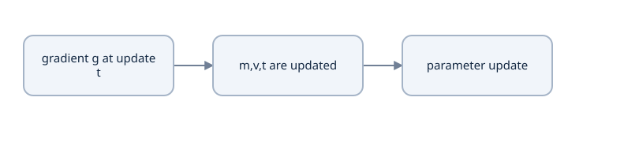

One completed update changes the parameter, first moment m, second moment v and update counter t. Restoring weights alone loses this history.


Adam's normalization makes the first step approximately independent of a large positive gradient's magnitude, but ε, history, sign, schedule and interactions with the objective still matter. It does not make gradient reduction or clipping irrelevant. The original Transformer uses Adam with β₁=.9, β₂=.98 and ε=1e−9, rather than the generic values in this hand fixture.

### L2 penalty and decoupled weight decay

Adding `(λ/2)||θ||²` to a loss adds λθ to its gradient. Under plain SGD, θ−η(g+λθ) equals `(1−ηλ)θ−ηg`. With Adam, putting λθ inside g changes both moment accumulators and passes the penalty through adaptive scaling.

AdamW instead applies a direct decay step separately from moment estimation: roughly `(1−ηλ)θ−η·adam_update(g)`. Therefore coupled L2 and decoupled decay are different under Adam. Decay is often restricted to selected parameters; state whether biases and normalization scales are included. Changing a parameter group changes the objective/update contract. The original paper's optimizer specification is Adam; do not silently label it AdamW.

### Implement and inspect a controlled update

The standard-library [Adam reference](examples/prerequisite_math.py) stores parameters, m, v and step count explicitly. Run its known-answer checks before using a large model. In PyTorch, `optimizer.state_dict()` stores moment state and parameter-group settings, while the model's state dict stores weights. Both are necessary for equivalent continuation.

```python
import torch
p = torch.nn.Parameter(torch.tensor(2., dtype=torch.float64))
o = torch.optim.Adam([p], lr=.01, betas=(.9,.999), eps=1e-8)
p.grad = torch.tensor(30., dtype=p.dtype); o.step()
p.grad = torch.tensor(0., dtype=p.dtype); o.step()
assert abs(p.item()-1.983299417) < 1e-9
assert o.state[p]['step'].item() == 2
```

A missing gradient (`None`) and a zero gradient tensor can differ: some optimizers skip parameters with no gradient, including state/decay behavior. Clearing with `set_to_none=True` is an intentional choice. Never mutate learned tensors with arbitrary `.data` arithmetic to work around autograd; use the optimizer or a deliberate `no_grad()` update for a numerical exercise.

### Predict or explain: Reverse the Adam fixture’s first gradient to−30, then give a zero gradient. What moments and parameter movement arise? Why is AdamW different from an adaptive L2 penalty?

<details data-practice-id="optimizer-transfer"><summary>Reveal worked answer and rubric</summary>

m1=−3,v1=.9; m2=−2.7,v2=.8991. Starting θ2,η.01,β1.9,β2.999,ε1e−8, θ becomes approximately2.01 then2.016700583: history still moves it upward. Coupled L2 enters gradient moments/adaptive scaling, while AdamW applies separate parameter decay. Resetting moments erases this continuation history.

**Rubric:** Calculate stored moments and explain where the penalty enters; include step count in continuation state.

</details>


### Notes and source

Calculate the two moment updates, explain why the zero-gradient step moves and derive the SGD equivalence before explaining AdamW's difference. List which optimizer state a checkpoint needs. Sources: [Adam paper](https://arxiv.org/abs/1412.6980), [PyTorch Adam](https://docs.pytorch.org/docs/2.14/generated/torch.optim.Adam.html), [decoupled decay paper](https://arxiv.org/abs/1711.05101). Continue with [training-step control](lessons/10-training-steps.md).


## Lesson 10 — Training updates, schedules and gradient scale

**Goal:** control exactly one optimizer update and reason about batch size, accumulation, schedule and clipping. Prerequisites: loss gradients and optimizer state. A forward pass alone is not training.

### One update has a defined order

A training step selects records, clears old gradients, computes logits and loss, calls backward, optionally clips gradients, and applies an optimizer update. The step counter and schedule advance once per optimizer update under the convention used here. A different schedule convention is possible, but checkpoint/recovery must preserve it.

```python
import torch
from torch import nn
from torch.nn import functional as F
model = nn.Sequential(nn.Linear(2,8), nn.Tanh(), nn.Linear(8,2))
optimizer = torch.optim.Adam(model.parameters(), lr=.01)
x = torch.tensor([[1.,1.],[1.,-1.]])
y = torch.tensor([0,1])
model.train()
optimizer.zero_grad(set_to_none=True)
loss = F.cross_entropy(model(x), y)
assert torch.isfinite(loss)
loss.backward()
torch.nn.utils.clip_grad_norm_(model.parameters(), max_norm=1.)
optimizer.step()
```

Clipping happens after backward and before the update. Logging `.item()` is fine after the scalar has been used in backward; building the loss from `.item()` values would break the graph. A failed nonfinite check should stop before an optimizer step rather than save corrupted state as successful progress.

### Accumulation must preserve the intended objective

Suppose micro-batch A has 2 valid targets and sum loss S₁, while B has 6 and sum loss S₂. The combined token objective is `(S₁+S₂)/8`. Backward each sum divided by 8, accumulate gradients, then step once. Averaging the two means gives `(S₁/2+S₂/6)/2`, which overweights A. Divide by the total supervised count, not automatically by the number of micro-batches.

For equal-sized batches, dividing each mean by the number of accumulation steps is equivalent. Dropout and other random behavior can still make separate forwards differ from a combined forward even when the algebra matches. The reference accumulation check disables such differences and compares unequal batch sizes. Accumulation does not replicate BatchNorm's combined batch statistics.

### Learning-rate schedules change update scale

A learning rate sets a step size in parameter space after optimizer transformation. Too large can overshoot; too small can make useful progress slow. Warmup gradually raises the rate while initial optimizer/activation behavior settles. It is a chosen training protocol, not a universal proof of stability.

The paper uses positive update index s and warmup w:

$$\eta(s)=D^{-1/2}\min(s^{-1/2},s\,w^{-3/2}).$$

For s≤w, the second branch grows linearly; afterward the first decays as inverse sqrt(s). They meet at s=w with peak `1/sqrt(Dw)`. With D=4,w=4, rates at s=1,4,16 are `.0625,.25,.125`. The paper's D=512,w=4000 are source settings, not a requirement to use that long warmup on our tiny classifier. The classifier reference uses its own explicit short linear warmup then constant learning rate; it is not a reproduction of the paper's schedule.

Avoid s=0 division, off-by-one first steps and calling a per-update scheduler once per micro-batch. Save scheduler state and the exact update index. Changing total planned steps halfway through a resumed cosine schedule changes the future trajectory.

### Global clipping is one shared rescaling

Let g collect all parameter-gradient coordinates and c be a norm limit. Global L2 clipping computes r=||g||₂, then scales every coordinate by `min(1,c/(r+ε))`. With g=`[3,4]` and c=2.5, the result is approximately `[1.5,2]`. Its direction is preserved; coordinatewise clipping to ±2.5 would produce `[2.5,2.5]`, a different direction. The returned norm from PyTorch's clip operation is the preclip norm.

A logged gradient norm detects scale changes, not whether every gradient is correct. A disconnected layer can have `None` gradients while another layer has a healthy global norm. Inspect both.

### Precision and measurement

FP16 has limited exponent range; automatic mixed precision may use loss scaling, requiring unscaling before clipping. BF16 has a different exponent/precision tradeoff. Keep FP32 CPU as the course's controlled training reference and FP64 for small gradient checks. A future mixed-precision run must record its scaler/precision state and measured behavior; GPU use alone does not prove faster or correct execution.

### Predict or explain: Micro-batches have2 and6 valid targets. How do their summed losses produce one combined gradient? Compute the paper-style schedule for D4,w4 at s1,4,16 and clip gradient[3,4] to norm2.5.

<details data-practice-id="training-step-transfer"><summary>Reveal worked answer and rubric</summary>

Backpropagate each sum divided by8, accumulate and step once. Rates are.0625,.25,.125. The global gradient norm is5 and scaling by.5 gives[1.5,2], preserving direction. Clearing/optimizer/schedule steps occur at the defined update boundary; per-micro-batch means averaged equally would change weighting.

**Rubric:** Work all three calculations and place clear/backward/clip/update/schedule in an explicit order.

</details>


In my notes: draw the update boundary, derive the unequal-micro-batch denominator, calculate all three schedule values and compare global with coordinate clipping. The actual loop is [prerequisite_mlp.py](examples/prerequisite_mlp.py), with checks in [prerequisite_mlp_checks.py](examples/prerequisite_mlp_checks.py).

Sources: [original optimizer/schedule](https://arxiv.org/html/1706.03762v7), [gradient clipping](https://docs.pytorch.org/docs/2.14/generated/torch.nn.utils.clip_grad_norm_.html). Continue with [data and supervision](lessons/06-data.md).


## Lesson 11 — Datasets, batching and supervision contracts

**Goal:** construct batches without changing the problem or leaking held-out information. Prerequisites: tensor axes, loss reduction and update order. Data contracts deserve the same precision as model equations.

### Define the question and split before fitting preprocessing

Training data supplies parameter gradients. Validation data supports model/hyperparameter selection. A final test split estimates performance after those choices are frozen. Repeatedly inspecting a test result to choose the next change turns it into a development signal.

Split by the unit that prevents leakage: a document, conversation, person or source group when related records would share information. Near duplicates across splits can make held-out performance misleading. Fit learned normalization statistics, vocabularies and tokenizer merges using the permitted training corpus; record any deliberately broader unsupervised pretraining corpus. A tokenizer fitted on all held-out text changes the experimental contract even if no labels were used.

A split manifest records record/group IDs and hashes, acquisition/preprocessing rules and seed. A seed alone cannot recover which data was used if the source corpus changes.

### Sampling defines what a mini-batch estimates

Uniform record sampling with a record mean estimates equal weight per record. Token-normalized sequence loss weights longer records more heavily. Both can be valid, but answer different questions. Shuffling is useful for order effects; it does not repair leakage. Length bucketing reduces padded work but changes batch composition and needs a reproducible order.

For deterministic continuation, preserve the actual shuffle order, cursor, epoch and generator state. Reconstructing only “epoch 3” may consume a different next batch. Worker/prefetch randomness adds state beyond a simple sequential sampler; the reference keeps that controlled rather than claiming exact arbitrary DataLoader recovery.

### Collation turns ragged records into tensors

For two ID sequences `[4,5,6]` and `[7]` with PAD=0, the batch is

$$I=\begin{bmatrix}4&5&6\\7&0&0\end{bmatrix},\quad
K=\begin{bmatrix}1&1&1\\1&0&0\end{bmatrix},\quad \ell=[3,1].$$

I is integer `[B,T]`; K marks valid positions, and ℓ preserves original lengths. An embedding turns I into floating `[B,T,D]`. A decoder can have different source and target lengths S,T; do not force equality just because the sample sentences are short.

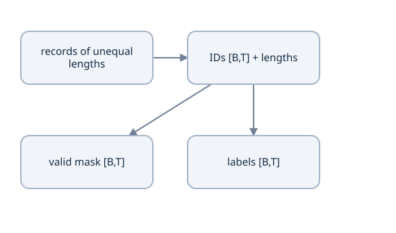

Padding adds positions. The valid mask describes real information; labels/ignore_index describe supervision. Keep both alongside the original lengths.


Keep three roles separate:

| Object | Meaning | Operation it controls |
|---|---|---|
| PAD vocabulary ID | a filler input symbol | lookup/collation; possibly an embedding padding row |
| ignored label, here −100 | no supervised answer at this output position | exclusion from the loss/reduction |
| attention mask | permitted query–key connections | score normalization/information flow |

The ignored-label sentinel is not a vocabulary ID and must never enter an embedding lookup. A padding embedding that begins at zero does not alone exclude that token from attention; projections/biases and positions can make its representation nonzero.

### Aggregate totals, not averages of averages

Suppose valid losses for the first record are `[1,2,3]` and the second `[4]`. Sum is10, valid count4, token mean2.5. Averaging record means gives `(2+4)/2=3`. A large padded array containing zeros cannot use its full element count as a denominator. Keep `(loss_sum,valid_count)` across batches and divide once.

```python
import torch
labels = torch.tensor([[4,5,6],[7,-100,-100]])
losses = torch.tensor([[1.,2.,3.],[4.,0.,0.]])
valid = labels.ne(-100)
total = losses[valid].sum()
count = valid.sum()
assert count.item() == 4
assert (total/count).item() == 2.5
```

A real-token count is not always identical to a supervised-target count: a BOS input may predict the first target, some tasks supervise only selected positions, and EOS may be included while padding is ignored. Derive the target shift before counting.

### Validate at the batch boundary

Assert dtype, device, vocabulary range, target range, lengths and mask shape before expensive model work. Check a short last batch and uneven sequences. A `.reshape` that flattens labels in a different order from logits creates a valid shape with incorrect supervision.

### Predict or explain: Records have token losses[1,2,3] and[4], plus padded labels. Compare token and record means; explain PAD ID, ignored label and attention mask.

<details data-practice-id="data-transfer"><summary>Reveal worked answer and rubric</summary>

Token mean is10/4=2.5. Equal-record mean is(2+4)/2=3. PAD is an input vocabulary filler, ignored label −100 excludes a supervised loss, and an attention mask removes permitted-score connections. None automatically performs the others' job; ignored labels must not enter an embedding.

**Rubric:** Compute both objectives and assign each mask/ID to the operation it controls.

</details>


In my notes: draw two ragged records, their padded IDs, valid-key mask and ignored labels. Calculate both record and token means and say which objective the training code chooses. List the state needed to reproduce the next batch.

The collator and totals are in [prerequisite_tensors.py](examples/prerequisite_tensors.py); independent tests include unequal lengths and all-ignored rejection. Source contract: [CrossEntropyLoss](https://docs.pytorch.org/docs/2.14/generated/torch.nn.CrossEntropyLoss.html). Continue with [encoding and tokenization](lessons/05-tokenizer.md).


## Lesson 12 — Text encoding, tokenization and vocabulary identity

**Goal:** distinguish visible text, Unicode coordinates, bytes and model token IDs, then understand a reproducible subword tokenizer. Prerequisites: integer tensor contracts and split-safe preprocessing. Encoding is representation; embedding is the next learned map.

### Unicode is not a one-byte alphabet

A Python string is a sequence of Unicode code points, not UTF-8 bytes and not necessarily user-perceived grapheme clusters. The composed string `café` has 4 code points and UTF-8 bytes `[99,97,102,195,169]`, length5. The visible é also has a decomposed spelling `e` followed by a combining accent: visually similar text can have different code-point sequences and offsets.

```python
import unicodedata
s = 'café'
assert len(s) == 4 and list(s.encode('utf-8')) == [99,97,102,195,169]
decomposed = 'cafe\u0301'
assert len(decomposed) == 5
assert unicodedata.normalize('NFC', decomposed) == s
```

NFC performs canonical composition; NFKC additionally applies compatibility mappings that may remove meaningful distinctions. Case folding and whitespace changes are other transformations. Choose and record a policy rather than assuming normalization is always lossless. If an application later extracts spans from original text, preserve original text and an alignment map across any transformations.

### IDs refer to a saved vocabulary

A character tokenizer could assign one ID per observed training character, plus special IDs. A byte tokenizer can start with 256 ordinary byte values and round-trip valid UTF-8 by concatenating bytes before decoding. A word tokenizer produces shorter sequences but needs a policy for unseen words. Subword methods balance vocabulary size, sequence length and coverage.

Token ID37 has no inherent numeric closeness to ID38. Relabeling IDs together with the matching embedding/output rows preserves the represented model; changing IDs alone corrupts it. An unknown-token category may discard distinctions. Byte-level coverage avoids ordinary unknown byte values but does not automatically handle arbitrary special-token syntax or pretrained tokenizer compatibility.

The reference [CharacterVocabulary](examples/prerequisite_text.py) sorts training characters deterministically and persists its mapping. Special PAD/UNK/BOS/EOS values must be defined by the tokenizer contract and not inferred from an unrelated model.


café has four code points and five UTF-8 bytes. Original-text offsets remain a separate contract for later QA.


### BPE learns repeated adjacent pieces

Byte-pair encoding starts with basic pieces, counts adjacent pairs within allowed boundaries, replaces a chosen frequent pair with a new ID, and repeats to the chosen vocabulary budget. In this educational byte tokenizer, ordinary bytes are 0–255, reserved special IDs are256–259, and the first learned merge is260.

On the document `abab`, adjacent byte pairs include `(97,98)` twice and `(98,97)` once. Merging `(97,98)` gives `[260,260]`; a second merge gives261. Decoding261 recursively yields bytes `97,98,97,98`, then the string `abab`. Keep documents separate during counts/merges: flattening `['a','b']` would invent a pair across a document boundary.

Training picks merges from frequencies with deterministic tie rules. Encoding new text follows the saved merge ranks; it does not retrain the tokenizer or greedily invent a new pair based on that input's frequency. Persist ordered merges, vocabulary/special mappings, normalization rules and training identity. Reloading an artifact must preserve the same ID sequence. The educational implementation departs from word-boundary/pattern handling in other BPE systems; it is not a drop-in GPT tokenizer.

```bash
python3 examples/byte_bpe.py
python3 examples/prerequisite_text.py
python3 -m unittest discover -s examples -p test_prerequisite_text.py
```

### Coordinates must stay explicit

In `The café is open.`, original code-point interval `[4,8)` extracts the word. Its UTF-8 byte interval is `[4,9)`. Reusing `[4,8)` as byte coordinates cuts the two-byte é in half and strict decoding fails. A token may span several characters; a character may occupy several bytes. Token count, byte count and character count are different.

Use half-open spans `[start,end)` with named coordinate systems. For QA, retain the source-character span used to extract an answer; a tokenizer offset map is an alignment tool, not permission to substitute token indices for characters. Round-trip and span extraction are separate tests.

Keep the visible word café and change the representation you count.

Illustrative cases, not a model execution.

[[interactive:coordinate-system]]

### Change the text coordinate

| Representation | Outcome | Explanation |
| --- | --- | --- |
| Python code points | 4 positions | The composed é is one code point. |
| UTF-8 bytes | 5 positions | é uses two bytes which share one original character interval. |
| saved character IDs | 4 IDs | For a vocabulary retaining all four characters, one ID per character. |
| learned subword IDs | Depends on merge rules | Count the encoded pieces of the saved artifact, not characters or bytes by assumption. |


### Predict or explain: In The café is open., which half-open character and UTF-8 byte intervals extract café? Why must BPE encoding use saved merge ranks and document boundaries?

<details data-practice-id="encoding-transfer"><summary>Reveal worked answer and rubric</summary>

Original code-point interval[4,8) and UTF-8 byte interval[4,9) extract the full word. Reusing[4,8) as bytes cuts é in half. Saved ranks define the trained tokenizer; new-input pair frequency does not retrain it. Counting across document boundaries invents pairs. Normalization can change coordinates, so preserve original spans/alignment.

**Rubric:** Name coordinate systems and show the multibyte boundary; separate training and encoding rules.

</details>


### Notes and sources

Draw `text→normalization→bytes/pieces→IDs` and label every coordinate. Hand-run both BPE merges, state the document-boundary rule and explain why the frozen artifact must travel with a checkpoint. Compute the correct byte and code-point intervals for a changed sentence.

Sources: [Unicode normalization](https://www.unicode.org/reports/tr15/tr15-58.html), [Sennrich et al. subword units](https://aclanthology.org/P16-1162/), [pinned minbpe source](https://github.com/karpathy/minbpe/blob/1acefe89412b20245db5a22d2a02001e547dc602/minbpe/basic.py). Original probes are in [prerequisite_text.py](examples/prerequisite_text.py) and [byte_bpe.py](examples/byte_bpe.py). Continue with [embeddings](lessons/13-embeddings.md).


## Lesson 13 — Embeddings, lookup gradients and weight tying

**Goal:** understand the learned interface between discrete token IDs and continuous model features. Prerequisites: vocabulary identity, matrix maps and shared-gradient sums. An embedding is learned model state; tokenization chooses which row to use.

### Lookup is a special matrix multiplication

Let E have shape `[V,D]`: one learned row per vocabulary ID. For token i, its embedding is Eᵢ. Define one-hot row uᵢ of width V, with a 1 at i. Then uᵢE=Eᵢ. This proves the lookup's relationship to a linear map without suggesting we should allocate `[B,T,V]` one-hot tensors for ordinary training.

For

$$E=\begin{bmatrix}0&0\\1&2\\3&4\\-1&1\end{bmatrix},\qquad I=[2,1,2],$$

lookup yields `[[3,4],[1,2],[3,4]]`. IDs `[B,T]` produce features `[B,T,D]`, and there are VD parameters irrespective of sequence length. Learned geometric relations depend on the training objective; ID number differences do not establish semantic distance.

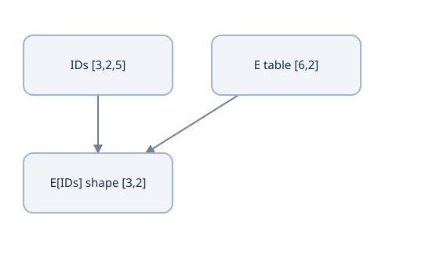

For the declared character vocabulary, cat→[3,2,5]. Lookup preserves three positions and changes each ID into two features.


A static embedding gives the same vector to every occurrence of a token. A Transformer later produces **contextual representations** that depend on neighboring tokens and positions. Calling every contextual hidden vector “the embedding table row” loses this distinction. Pretrained vectors are optional; end-to-end learned embeddings can start from random values.

### Repeated IDs sum their backward contributions

If two occurrences select E₂ and receive upstream gradients `[1,1]` and `[3,3]`, then ∇E₂=`[4,4]`. An occurrence selecting E₁ with gradient `[2,2]` gives ∇E₁=`[2,2]`; an unselected ordinary row receives zero lookup contribution. Indices are integer decisions; autograd differentiates the selected values, not a continuous path through the ID numbers.

```python
import torch
E = torch.tensor([[0.,0.],[1.,2.],[3.,4.],[-1.,1.]], requires_grad=True)
ids = torch.tensor([2,1,2])
upstream = torch.tensor([[1.,1.],[2.,2.],[3.,3.]])
(E[ids]*upstream).sum().backward()
assert E.grad.tolist() == [[0.,0.],[2.,2.],[4.,4.],[0.,0.]]
```

`nn.Embedding(..., padding_idx=0)` suppresses lookup-gradient contributions to that padding row. Its default fresh row is zero, but assigning a custom weight can change its value. A tied output use or explicit regularization can also contribute updates to the same underlying row; padding_idx is not a global freeze on every use. Zero padding features do not replace attention masks.

### Output projection returns to the vocabulary

For decoder hidden h `[B,T,D]`, a separate output matrix U `[D,V]` gives logits hU+c. This is a categorical score for each possible next token. **Weight tying** reuses Eᵀ as U: logits=hEᵀ, optionally plus a separately defined output bias. Input lookup and output projection then send gradients to the same parameter through two distinct paths.

With V=4,D=2, separate source embedding, target embedding and output matrix use 3VD=24 matrix parameters; sharing all three uses VD=8. This requires matching vocabulary row meanings and widths. If source and target vocabularies differ, tying target/output can still be possible while sharing source/target requires a compatible joint mapping. Equal matrix shapes alone are insufficient.

A shared parameter must be genuinely shared, not a one-time copy of equal values. Registering two independent Parameters initialized from the same table will let them diverge. Check parameter identity and whether the optimizer sees the intended shared object once.

### Embedding scale and position

The original design multiplies lookup vectors by sqrt(D), then adds same-width positional features. At D=4, a row `[.1,.2,.3,.4]` becomes `[.2,.4,.6,.8]`. The output projection uses the shared weight table rather than automatically multiplying every output logit by that input scale. The embedding scale and attention's division by sqrt(dₖ) act at different locations and have different purposes.

A vocabulary artifact is part of the model's identity. Suppose IDs1 and2 are swapped while E is unchanged: the same text now selects the wrong rows. If both input/output rows and the tokenizer are permuted consistently, the representation can be preserved. This is why saving only “vocabulary size=4” is not enough.

The reusable [foundation probes](examples/transformer_foundation_probes.py) implement these small calculations; [independent probe checks](examples/test_transformer_foundation_probes.py) test hand answers, gradients and changed conditions. Use the recorded Torch interpreter from Lesson 2.

### Predict or explain: IDs[2,1,2] receive upstream rows[1,1],[2,2],[3,3]. What is each table-row gradient? Does padding_idx globally freeze a row when its table is tied to output weights?

<details data-practice-id="embedding-transfer"><summary>Reveal worked answer and rubric</summary>

Lookup contributions: row2[4,4], row1[2,2], unselected rows0. Repeated selections sum. padding_idx suppresses lookup contributions but does not block an output-projection path or explicit decay acting on the same parameter. With shared vocab V4,D2, three untied tables have24 matrix entries versus8 for one fully shared table.

**Rubric:** Derive gather-backward accumulation and identify both tied gradient paths and vocabulary-identity conditions.

</details>


### Notes and check

Write the one-hot equivalence, calculate the repeated-ID gradients and draw both gradient paths into a tied table. Count tied and untied parameters. Explain the distinction between token ID, lookup row, position-enriched input and contextual representation.

Sources: [Embedding API](https://docs.pytorch.org/docs/2.14/generated/torch.nn.Embedding.html), [original embedding interface](https://arxiv.org/html/1706.03762v7), [weight-tying paper](https://aclanthology.org/E17-2025/). Continue with [position](lessons/14-position.md).


## Lesson 14 — Sequence order and positional encoding

**Goal:** show why content attention needs an order signal and derive the original sinusoidal representation. Prerequisites: embeddings, matrix multiplication, sine/cosine basics. Order and causality are related but distinct: a mask restricts information flow; positions describe location.

### Content operations alone are permutation equivariant

A shared FFN transforms each token independently. Reordering rows then applying it is the same as applying it then reordering. Unmasked self-attention has the same property when Q,K,V all come from the reordered inputs. For permutation matrix P,

$$\begin{aligned}
Q'&=PQ,\ K'=PK,\ V'=PV,\\
S'&=PSP^T,\ A'=PAP^T,\\
O'&=A'V'=PO.
\end{aligned}$$

Row-wise softmax respects the row/column permutation. Thus outputs track the permutation, but the operation has no intrinsic idea of “first” or “third.” Reordering `dog bites person` changes which content occurs at a position, yet content-only attention cannot infer the original arrangement from the unordered set. A causal mask breaks some permutation symmetry, but it is not a substitute for the paper's positional representation. The proof above assumes no position-dependent mask or other positional signal.

### The original sine/cosine table

For position p≥0 and even width D, use coordinate pair i:

$$\begin{aligned}
\omega_i&=10000^{-2i/D},\\
PE(p,2i)&=\sin(p\omega_i),\\
PE(p,2i+1)&=\cos(p\omega_i).
\end{aligned}$$

Sine and cosine are the vertical and horizontal coordinates on a unit circle; an angle of2π radians completes a turn. Each pair changes phase as the position advances. Different pairs have different frequencies. With D=4, ω₀=1 and ω₁=.01. At p=0 the row is `[0,1,0,1]`. At p=1 it is approximately `[.841471,.540302,.010000,.999950]`; at p=2, `[.909297,−.416147,.019999,.999800]`. Angles are in radians. The denominator uses the feature-pair index, not the token position.

```python
import math
D = 4
pe = lambda p: [value for i in range(D//2)
               for value in (math.sin(p*10000**(-2*i/D)),
                             math.cos(p*10000**(-2*i/D)))]
assert pe(0) == [0.,1.,0.,1.]
assert abs(pe(1)[2]-.009999833334166664) < 1e-12
```

For an odd D, define the final unpaired sine coordinate consistently. Do not assume a vectorized assignment of a shorter cosine slice has the same length as its sine slice.

### A fixed shift is a pairwise linear transform

For angle a=pω and shift b=kω, the addition identities give

$$\begin{bmatrix}\sin(a+b)\\\cos(a+b)\end{bmatrix}
=\begin{bmatrix}\cos b&\sin b\\-\sin b&\cos b\end{bmatrix}
\begin{bmatrix}\sin a\\\cos a\end{bmatrix}.$$

For a fixed k, each pair can express the shifted position with a linear transform independent of p. This motivates access to relative offsets; it does not prove the learned model will extrapolate accurately beyond its training lengths. Periodic components, finite precision and training distribution still matter.

### Add position while preserving feature width

The input is `sqrt(D)*E[id]+PE[position]`, shape `[B,T,D]`. Adding preserves D so residual and projection interfaces remain compatible. Concatenation would give width2D and require a different architecture. Position features do not erase token identity; the next learned layers can use both signals, subject to capacity and optimization.

A fixed table can be a registered buffer, moves with the module, and has no learned parameters. A learned absolute table of context length L has LD parameters and needs a rule for unseen positions. Relative biases and rotary encodings are later alternatives with different operations. Recognize them when reading modern models, but implement the original table before substituting a variant.

For padded tokens, adding PE produces nonzero features even if the PAD lookup row is zero. Continue to use proper key and loss masks. At generation time, a new token's position must follow the actual prefix; a cache implementation that restarts every token at position0 changes the model.

The reusable [foundation probes](examples/transformer_foundation_probes.py) implement these small calculations; [independent probe checks](examples/test_transformer_foundation_probes.py) test hand answers, gradients and changed conditions. Use the recorded Torch interpreter from Lesson 2.

### Predict or explain: Change sinusoidal width to D8. What are the four frequencies, the position0 row and the slowest pair at position1? Does content-only self-attention establish order?

<details data-practice-id="position-transfer"><summary>Reveal worked answer and rubric</summary>

Frequencies are1,.1,.01,.001. Position0 is[0,1,0,1,0,1,0,1]; the last pair at position1 is[sin(.001),cos(.001)]≈[.000999999833,.999999500000]. Unmasked content-only self-attention is permutation equivariant when Q/K/V are permuted together; it has no intrinsic original order without position/mask signals. Fixed encoding does not prove long-context extrapolation.

**Rubric:** Calculate frequencies and derive a permutation/shift relationship with its assumptions.

</details>


### Notes and source

Derive the permutation relation and pairwise shift identity, calculate one table row and draw addition versus concatenation. Explain why “fixed” does not imply proven length extrapolation. Source: [original positions](https://arxiv.org/html/1706.03762v7), [D2L position discussion](https://d2l.ai/chapter_attention-mechanisms-and-transformers/self-attention-and-positional-encoding.html). Continue with [attention](lessons/07-attention.md).


## Lesson 15 — Queries, keys, values and scaled attention

**Goal:** calculate attention as a differentiable retrieval operation, with explicit axes and backward paths. Prerequisites: dot products, probabilities, embeddings and variance scaling. Self-attention and cross-attention differ in where their inputs come from, not in the basic weighted-sum formula.

### Separate matching from transported information

A query describes what one output position is looking for. A key provides a matching representation for a candidate input position. A value is the information that candidate contributes. Learned maps create Q=XqWq, K=XkWk and V=XvWv. These descriptions explain roles; they do not imply trained coordinates have human-readable meanings.

For one head, let Q `[T,dₖ]`, K `[S,dₖ]` and V `[S,dᵥ]`. T counts queries, S counts key/value positions. Then

$$\begin{aligned}
R&=QK^T/\sqrt{d_k}\quad[T,S],\\
A_{ts}&=\frac{\exp R_{ts}}{\sum_{j=0}^{S-1}\exp R_{tj}},\\
O&=AV\quad[T,d_v].
\end{aligned}$$

Each row of A is a distribution over **source positions**. It is not a distribution over vocabulary classes. The softmax axis is S. Dot products sum feature coordinates; the subsequent weighted value sum aggregates positions. Conflating those two sums causes incorrect shapes and interpretations.

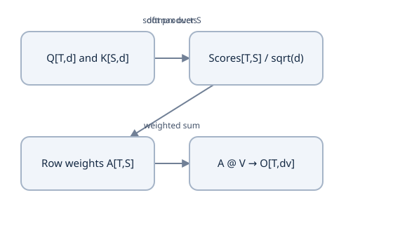

Separate feature contraction, key-position normalization and value aggregation.


### A rectangular hand calculation

Choose one query q=`[1,0]`, dₖ=2 and three keys:

$$K=\begin{bmatrix}0&0\\\sqrt2\log2&0\\\sqrt2\log3&0\end{bmatrix},\quad
V=\begin{bmatrix}6&0\\0&3\\2&2\end{bmatrix}.$$

Raw dot products are `[0,sqrt2 log2,sqrt2 log3]`; scaled scores are `[0,log2,log3]`. Exponentials are `[1,2,3]`, so weights are `[1/6,2/6,3/6]`. The output is

$$\begin{aligned}
O_0&=(1/6)6+(2/6)0+(3/6)2=2,\\
O_1&=(1/6)0+(2/6)3+(3/6)2=2.
\end{aligned}$$

Changing only the third value to `[4,0]` leaves scores and weights unchanged and gives `[3,1]`. Changing its key can change every normalized weight in the row. Removing a candidate requires renormalization over allowed keys; simply zeroing its value leaves probability mass assigned to it and gives a different operation.

The sqrt(dₖ) factor is about score variance; it is not an average over keys or values. dᵥ can differ from dₖ in the mathematical interface. In the common multi-head architecture both are chosen as D/H.

### All the attention operations are differentiable

Let upstream G=∂L/∂O `[T,dᵥ]`. Ignoring masks for this derivation,

$$\begin{aligned}
\nabla V&=A^TG,\qquad U=\nabla A=GV^T,\\
\nabla R_{ts}&=A_{ts}\left(U_{ts}-\sum_jA_{tj}U_{tj}\right),\\
\nabla Q&=(\nabla R)K/\sqrt{d_k},\\
\nabla K&=(\nabla R)^TQ/\sqrt{d_k}.
\end{aligned}$$

The subtraction term couples scores within a softmax row. Increasing one score changes the distribution across all candidates, not only that candidate. Gradients then continue into the projection weights using affine backward rules. If an implementation detaches A, it still transports values but loses the score-learning path.

### A runnable explicit calculation

```python
import math, torch
q = torch.tensor([[1.,0.]], dtype=torch.float64)
k = torch.tensor([[0.,0.],[math.sqrt(2)*math.log(2),0.],
                  [math.sqrt(2)*math.log(3),0.]], dtype=q.dtype)
v = torch.tensor([[6.,0.],[0.,3.],[2.,2.]], dtype=q.dtype)
scores = q @ k.T / math.sqrt(q.shape[-1])
a = scores.softmax(dim=-1)
out = a @ v
assert torch.allclose(a, torch.tensor([[1/6,2/6,3/6]], dtype=q.dtype))
assert torch.allclose(out, torch.tensor([[2.,2.]], dtype=q.dtype))
```

This is a numerical probe, not a complete trained language model. Stable mask handling is added in the next lesson. Optimized SDPA may avoid materializing the full score matrix, but its intended mathematical operation still follows this interface; compare explicit and optimized paths with tolerances.

Passing this lesson’s Q/K/V into `explicit_attention` in the [foundation probes](examples/transformer_foundation_probes.py) reproduces `[2,2]`. The module’s CLI summary uses an **additional independent fixture**, with one-feature Q/K and different values `[[0,0],[6,0],[4,2]]`, whose unmasked output is `[4,1]`; it is not the same hand example. The [independent probe checks](examples/test_transformer_foundation_probes.py) test hand answers, gradients and changed conditions. Use the recorded Torch interpreter from Lesson 2.

### Predict or explain: Keep the lesson’s Q/K scores[0,log2,log3] but change only the third value to[−2,4]. Compute weights/output, then change the third key instead. Which stages and backward paths can change?

<details data-practice-id="attention-transfer"><summary>Reveal worked answer and rubric</summary>

Weights stay[1/6,2/6,3/6]; the value output becomes[0,3]. Changing only V leaves the forward weights fixed, while score-path gradients can change because their upstream derivative depends on V. Changing K can alter all row-normalized weights. Key-position softmax and feature dot products remain separate axes.

**Rubric:** Work the score/normalization/value stages separately and identify which gradients/paths each input influences.

</details>


### Notes and sources

Write all shapes, compute the changed-value output and derive the row-softmax backward rule. Explain which input supplies Q versus K/V in cross-attention. A large attention weight is a model computation, not by itself a causal explanation of a prediction.

Sources: [attention equation](https://arxiv.org/html/1706.03762v7), [PyTorch SDPA](https://docs.pytorch.org/docs/2.14/generated/torch.nn.functional.scaled_dot_product_attention.html), [D2L attention scoring](https://d2l.ai/chapter_attention-mechanisms-and-transformers/attention-scoring-functions.html). Continue with [masking](lessons/16-masks.md).


## Lesson 16 — Padding masks, causal masks and empty rows

**Goal:** define exactly which query can use which key, and test that forbidden information cannot influence an output. Prerequisites: attention and collation. Target shifting is previewed below and developed fully in Lesson 22. Masking is an information-flow contract, not a shape trick.

### Mask scores before normalization

Let allowed `[T,S]` be Boolean, true when a query may attend to a key. Set forbidden scores to −∞ before softmax. Allowed entries are then renormalized to sum1 and forbidden weights are0. Zeroing values instead leaves their scores in the denominator. Zeroing weights after softmax without renormalizing lowers the row sum and is another operation.

For scores `[0,log2,log3]`, allowing only keys0 and2 gives `[1/4,0,3/4]`. With the previous values, output is `[3,1.5]`. Zeroing V₁ while keeping all keys instead gives `[2,1]`. These differ because masked probability mass is removed from normalization.

### Three common mask patterns

For source padding with valid keys `[True,True,False]`, every real encoder query sees the first two keys. Shape `[B,1,1,S]` broadcasts across heads and queries. It does not by itself suppress a padded **query** output.

For target `[a,b,EOS]`, teacher-forced inputs are `[BOS,a,b]` and labels are `[a,b,EOS]`. At input position1 the token is `a`, but the answer being predicted is `b`: the mask may include its diagonal without revealing that answer. If inputs and labels both contained `[a,b,EOS]`, the diagonal would expose the answer. This is the target-shift contract used in the following mask; Lesson 22 develops training and inference in full.

For a decoder prefix of length3, causal allowed is

$$C=\begin{bmatrix}1&0&0\\1&1&0\\1&1&1\end{bmatrix}.$$

Query t may use keys s≤t in its input prefix. The supervised target at t is the next token because inputs are shifted. If labels are unshifted, this diagonal can reveal the answer itself. Combine causality with valid-key masking using Boolean AND, not addition of unrelated integer IDs.

Cross-attention uses T decoder queries and S encoder memory keys, often T≠S. It ordinarily masks source padding but allows each decoder query to inspect every real source token. A triangular T×S mask would incorrectly impose output-prefix causality on the source. When using a cached prefix, rectangular causal alignment requires actual absolute query/key positions; blindly applying a fresh top-left triangle can forbid valid previous keys.

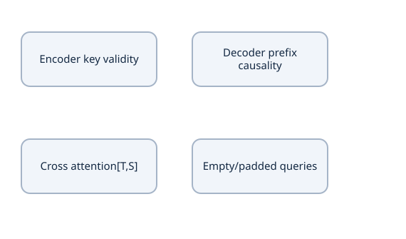

Causality, source padding and query output gates have separate meanings.


### All-masked rows need an explicit policy

Softmax of a row of all −∞ is undefined: subtracting its maximum involves −∞−(−∞), producing NaNs in a naive implementation. Replacing forbidden scores with an arbitrary finite negative number can make an empty row uniform, silently inventing attention to padding.

For these probes, the declared policy is **zero attention and output for an empty row**. Before softmax, temporarily replace an empty row's scores by zeros, then multiply its normalized row by a nonempty-row indicator. This avoids NaNs and gives zero score/value contributions from that row. Another implementation may reject empty rows; define and test its policy rather than assuming a backend's behavior.

```python
import torch
scores = torch.tensor([[0.,1.,2.],[0.,1.,2.]])
allowed = torch.tensor([[True,False,True],[False,False,False]])
nonempty = allowed.any(dim=-1, keepdim=True)
masked = scores.masked_fill(~allowed, -torch.inf)
safe = torch.where(nonempty, masked, torch.zeros_like(masked))
weights = safe.softmax(-1) * nonempty
assert weights[0,1].item() == 0
assert torch.equal(weights[1], torch.zeros(3))
assert torch.isfinite(weights).all()
```

If padded queries should remain zero, gate their outputs at the appropriate boundary too. An output projection bias can turn a zero attended vector into a nonzero result, and a residual input may remain nonzero. State where the invariant is required.

### Library Boolean conventions differ

In functional SDPA, Boolean attention-mask true means allowed. In `nn.MultiheadAttention` Boolean attention-mask true means blocked; its Boolean key-padding-mask true means padding to ignore. Name your own mask `allowed`, then deliberately invert it for the relevant API. `is_causal` is not a substitute for understanding query/key alignment. Functional SDPA's dropout probability must be explicitly0 for deterministic evaluation; it does not read an enclosing module's eval flag.

A causality check changes **future input tokens** while keeping parameters/prefix fixed, then compares earlier outputs in evaluation mode. A padding check changes padded keys/values and checks real-query invariance. Shape checks alone cannot prove either property. Compare a rectangular cross-attention case as well as square self-attention.

The reusable [foundation probes](examples/transformer_foundation_probes.py) implement these small calculations; [independent probe checks](examples/test_transformer_foundation_probes.py) test hand answers, gradients and changed conditions. Use the recorded Torch interpreter from Lesson 2.

### Predict or explain: Mask the middle key in the three-key fixture. What weights/output result? Compare all-masked policy and Boolean masks for SDPA versus MultiheadAttention.

<details data-practice-id="mask-transfer"><summary>Reveal worked answer and rubric</summary>

Allowed keys0,2 renormalize to[1/4,0,3/4], output[3,1.5]. The declared empty-row probe policy is zero weights/output, implemented without softmax of all −inf. SDPA Boolean True means allowed; MultiheadAttention Boolean attention-mask True means blocked and key-padding True means ignored. Source padding and target loss masks remain separate.

**Rubric:** Compute renormalization and explain safe empty rows and deliberate API conversion.

</details>


### Notes and sources

Draw allowed matrices for encoder, decoder and cross-attention for S=4,T=3 with padding. Calculate one renormalized row and explain the empty-row policy. Predict which invariance check exposes an inverted mask.

Sources: [SDPA mask/dropout contracts](https://docs.pytorch.org/docs/2.14/generated/torch.nn.functional.scaled_dot_product_attention.html), [MultiheadAttention masks](https://docs.pytorch.org/docs/2.14/generated/torch.nn.MultiheadAttention.html). Continue with [multi-head attention](lessons/17-multihead.md).


## Lesson 17 — Multi-head projections, splitting and concatenation

**Goal:** derive every axis and learned map in multi-head attention. Prerequisites: learned affine maps, attention and masks. Multiple heads are parallel learned retrieval operations, not a loop that averages arbitrary chunks.

### Each head has its own projection space

Let model width D, number of heads H and per-head key/value width d=D/H. Require D divisible by H for this common design. For head h, maps Wqʰ,Wkʰ,Wvʰ have shape `[D,d]`. Each head computes

$$O_h=\operatorname{softmax}\!\left(\frac{(X_qW_q^h)(X_kW_k^h)^T}{\sqrt d}\right)(X_vW_v^h).$$

Concatenate output features from all heads, shape `[B,T,Hd]=[B,T,D]`, and apply output matrix Wo `[D,D]`. Concatenation keeps the outputs available to the learned mixing map; averaging would discard their separate feature coordinates and define another architecture.

Projections can be represented by one `[D,D]` weight per Q/K/V, then split its output columns into heads. This is algebraically equivalent to separate per-head projections when the parameter values are matched. For self-attention, a fused `[D,3D]` map is another implementation choice; cross-attention Q and K/V come from different input streams.

### Trace unequal dimensions through the operation

Use B=2,T=3,S=5,D=8,H=2,d=4:

| Stage | Query stream | Key/value stream |
|---|---|---|
| inputs | `[2,3,8]` | `[2,5,8]` |
| projected | `[2,3,8]` | `[2,5,8]` |
| split before transpose | `[2,3,2,4]` | `[2,5,2,4]` |
| head-major | `[2,2,3,4]` | `[2,2,5,4]` |
| scores/weights | `[2,2,3,5]` | last axis indexes keys |
| weighted values | `[2,2,3,4]` | one result per query/head |
| merge heads | `[2,3,8]` | transpose before reshape |

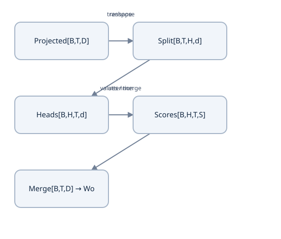

Projection width stays D=H×d; transpose and reshape are distinct.


```python
import torch
B,T,S,D,H = 2,3,5,8,2
d = D//H
q = torch.arange(B*T*D).reshape(B,T,D).double()
k = torch.arange(B*S*D).reshape(B,S,D).double()
v = k + 1
split = lambda x: x.reshape(x.shape[0], x.shape[1], H, d).transpose(1,2)
qh,kh,vh = split(q),split(k),split(v)
a = (qh @ kh.transpose(-2,-1) / d**.5).softmax(-1)
o = a @ vh
merged = o.transpose(1,2).contiguous().reshape(B,T,D)
assert a.shape == (B,H,T,S)
assert merged.shape == (B,T,D)
```

This probe omits learned projections to isolate axis mechanics. It does not demonstrate learned head specialization. Add projections in the full component; verify vectorized heads against a loop using the same weights and masks. Simply reshaping original features creates chunks, while independently learned maps can choose different combinations of all original features.

### Parameter and compute counts

With d=D/H, all Q matrices together have D² entries, likewise K and V. Wo adds D², total4D² without biases, or4D²+4D with one bias per output coordinate of each of the four maps. H does not multiply the D² total when D stays fixed. More heads means narrower per-head features, not automatically more projection parameters.

Projection cost scales with sequence length times D². For attention, query–key and weight–value products cost approximately proportional to BHTSd; summing heads gives BTSD. Score storage in an explicit implementation is BHTS elements. Self-attention has T=S, hence quadratic score storage in length. At fixed D, more heads can increase the explicit score storage even though projection parameter count stays unchanged. Optimized kernels can alter materialization and performance without changing the intended operation.

The original base choice is D=512,H=8,d=64. Our small exercises use smaller values while preserving the contracts. Each head is not guaranteed to correspond to a specific linguistic role; interpret trained heads using evidence.

The reusable [foundation probes](examples/transformer_foundation_probes.py) implement these small calculations; [independent probe checks](examples/test_transformer_foundation_probes.py) test hand answers, gradients and changed conditions. Use the recorded Torch interpreter from Lesson 2.

### Predict or explain: For B2,T3,S5,D8,H2, give score/head-output/merged shapes and projection parameter count without biases. What changes if H4 but D stays8?

<details data-practice-id="multihead-transfer"><summary>Reveal worked answer and rubric</summary>

Scores[2,2,3,5], head output[2,2,3,4], merged[2,3,8]. Q/K/V/O matrices total4×8²=256 entries. At H4, head width2 and scores[2,4,3,5]; projection total stays256, while explicit score storage doubles. Transpose back before merging heads. Splitting alone does not prove specialization.

**Rubric:** Trace all axes and distinguish projection parameters from explicit score storage.

</details>


### Notes and check

Draw the split/transpose/merge path with unequal T,S. Count parameters at D=8,H=2 and compare H=4. Explain why Wo is still needed after concatenation and why a reshape before the inverse transpose scrambles positions and heads.

Source: [original multi-head formulation](https://arxiv.org/html/1706.03762v7), [D2L multi-head attention](https://d2l.ai/chapter_attention-mechanisms-and-transformers/multihead-attention.html). Continue with [position-wise FFN](lessons/18-positionwise-ffn.md).


## Lesson 18 — The position-wise feedforward sublayer

**Goal:** distinguish feature transformation from token mixing and calculate the FFN's capacity/cost. Prerequisites: feedforward networks, shared maps and multi-head attention. Attention and the FFN perform different kinds of computation inside each layer.

### Expand, activate and contract

For one position's row x `[D]`, the original sublayer is

$$\operatorname{FFN}(x)=\operatorname{ReLU}(xW_1+b_1)W_2+b_2,$$

with W₁ `[D,F]`, b₁ `[F]`, W₂ `[F,D]` and b₂ `[D]`. F is the hidden feature width, often called d_ff. The original base model uses D=512,F=2048. The output returns to width D so it can be added to a residual input of width D.

“Position-wise” means the same weights are applied to each token independently. It does not mean a different network is trained for every position. Different Transformer layers generally have their own FFN parameters; sharing across positions does not automatically imply sharing across depth.

### Calculate two positions with one shared network

Choose D=2,F=3:

$$\begin{aligned}
W_1&=\begin{bmatrix}1&-1&0\\0&1&1\end{bmatrix},\quad b_1=[0,0,0],\\
W_2&=\begin{bmatrix}1&0\\0&1\\1&1\end{bmatrix},\quad b_2=[1,-1].
\end{aligned}$$

For x=`[2,−1]`, preactivation=`[2,−3,−1]`, ReLU=`[2,0,0]`, output=`[3,−1]`. For x=`[−1,2]`, preactivation=`[−1,3,2]`, ReLU=`[0,3,2]`, output=`[3,4]`. Modifying only the first input cannot alter the second FFN output. It can alter other token outputs if these inputs are used by an earlier attention operation.

```python
import torch
x = torch.tensor([[2.,-1.],[-1.,2.]])
w1 = torch.tensor([[1.,-1.,0.],[0.,1.,1.]])
w2 = torch.tensor([[1.,0.],[0.,1.],[1.,1.]])
out = torch.relu(x @ w1) @ w2 + torch.tensor([1.,-1.])
assert out.tolist() == [[3.,-1.],[3.,4.]]
changed = x.clone(); changed[0] += 10
assert torch.equal((torch.relu(changed @ w1) @ w2)[1], (out-torch.tensor([1.,-1.]))[1])
```

The FFN supplies nonlinear feature capacity after attention has mixed information across tokens. Replacing it with one affine layer loses this particular nonlinearity even if dimensions match. A much wider hidden layer adds parameters and activation memory; “attention is all you need” does not mean the model contains only attention operations.

### Count parameters and compare work

With biases, the count is DF+F+FD+D=2DF+F+D. At D=2,F=3 it is17. At F=4D it is8D²+5D. For D=512,F=2048, that is2,099,712 parameters. A four-projection attention module has4D² matrix parameters, so the FFN can hold roughly twice the matrix parameters of attention in the same block.

Across B sequences and T positions, the two dense multiplies require about2BTDF multiply–accumulates, or4BTDF FLOPs under separate multiply/add counting. This grows linearly with T, while explicit self-attention's score/value mixing grows quadratically with T. The FFN can dominate compute at shorter lengths; attention can dominate memory at longer lengths. Measure an actual profile rather than assuming “attention” is always the bottleneck.

### Implementation choices and backward behavior

In PyTorch, `Linear(D,F)→ReLU→Linear(F,D)` automatically applies to the last axis of `[B,T,D]`. Do not flatten position into the feature width: a `Linear(T*D,...)` would learn dependence on the fixed sequence layout and mix tokens. A 1×1 convolution can implement an equivalent position-wise map under a compatible axis convention.

GELU and gated FFNs are later choices with different formulas/counts; they are not the original ReLU sublayer. For ReLU, the backward derivative masks nonpositive preactivations under the chosen implementation. A hidden unit inactive for all records may receive no useful gradient; inspect activation and gradient distributions before assuming an optimizer bug.

The reusable [foundation probes](examples/transformer_foundation_probes.py) implement these small calculations; [independent probe checks](examples/test_transformer_foundation_probes.py) test hand answers, gradients and changed conditions. Use the recorded Torch interpreter from Lesson 2.

### Predict or explain: Using the lesson's D2,F3 matrices, work outputs for[2,−1] and[−1,2]. Can changing one position change the other's FFN output? Count parameters at F4D.

<details data-practice-id="ffn-transfer"><summary>Reveal worked answer and rubric</summary>

Outputs[3,−1] and[3,4]. A shared position-wise FFN changes features independently at each position, so the untouched position's FFN output remains fixed. Including biases, count2DF+F+D; at F4D this is8D²+5D. Earlier attention can mix token information, but the FFN itself does not mix positions.

**Rubric:** Show preactivation/ReLU/output and derive count while distinguishing feature and token mixing.

</details>


In my notes: work both positions by hand, show parameter sharing, calculate the count and compare the leading attention/FFN operations. Source: [original FFN equation](https://arxiv.org/html/1706.03762v7), [D2L architecture](https://d2l.ai/chapter_attention-mechanisms-and-transformers/transformer.html). Continue with [residual connections](lessons/19-residual.md).


## Lesson 19 — Residual connections, depth and normalization order

**Goal:** derive the identity path and distinguish the original post-norm layer from a later pre-norm design. Prerequisites: tensor maps, Jacobians, attention and FFNs. A residual connection is an addition with a shape contract, not a special kind of learned weight.

### Learn a change to an existing representation

For sublayer F, a residual map is y=x+F(x). The input and output of F must have the same shape, here `[B,T,D]`. If the sublayer uses an internal different width, its final projection must restore D. Expanding features to F inside an FFN is compatible because the second affine map returns to D.

The identity branch carries x directly. The sublayer learns a change relative to that representation. For x=`[1,3]` and F(x)=`[2,−1]`, y=`[3,2]`. Concatenating x and F(x) would give four features, not a residual sum; broadcasting a width1 output would be legal arithmetic but a different architectural choice.

For row-vector gradients written in column form, differentiating gives

$$J_y=I+J_F,\qquad \nabla_xL=g+J_F^Tg,$$

where g is the upstream gradient of L with respect to y. The direct contribution g avoids requiring every gradient path to multiply through J_F. Across several residual blocks, there are many routes through identity and learned branches. This explains a possible benefit for optimization, not a guarantee that all gradients remain healthy: J_F can amplify or cancel. If F(x)=−x, y=0 and the derivative is0. Residual connections do not eliminate initialization, normalization or optimizer considerations.

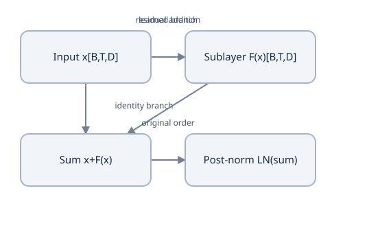

Both branches have the same decoder/encoder stream shape.


### Normalization order changes the function

The original architecture uses post-norm:

$$y=\operatorname{LN}(x+\operatorname{Dropout}(F(x))).$$

A common later pre-norm variant is

$$y=x+\operatorname{Dropout}(F(\operatorname{LN}(x))).$$

LayerNorm is explained fully in the next lesson. In post-norm, even the direct branch then passes through normalization's derivative. In pre-norm, the outer residual path directly adds x. Final stack normalization and other conventions also vary across architectures; “pre-norm” alone does not specify a whole model.

Set F=0 and dropout off. Post-norm produces LN(x), while pre-norm produces x. For x=`[1,3]`, standard LayerNorm with gamma1,beta0 gives approximately `[−1,1]`; the pre-norm result remains `[1,3]`. Thus changing normalization order changes forward outputs even before training, not just the learning rate or implementation efficiency.

```python
import torch
from torch import nn
x = torch.tensor([[1.,3.]], dtype=torch.float64, requires_grad=True)
ln = nn.LayerNorm(2, eps=1e-5).double()
post = ln(x + torch.zeros_like(x))
pre = x + torch.zeros_like(ln(x))
assert torch.equal(pre, x)
assert not torch.allclose(post, x)
(pre * torch.tensor([[2.,4.]])).sum().backward()
assert x.grad.tolist() == [[2.,4.]]
```

This controlled zero-sublayer check distinguishes the contracts. It does not benchmark the two architectures' training stability. Do not reproduce the original paper while silently using pre-norm because another tutorial's code happens to do so.

### Residual dropout has a specific location

Dropping the sublayer output before the addition makes training y=x+M⊙F(x)/(1−p), followed by LN in the original order. Dropping the whole sum also removes part of the identity signal and defines another operation. The original embedding-plus-position input also uses dropout before entering the stack. Attention-weight dropout is another distinct placement; its row sums after random dropping need not remain1 even with inverted scaling.

Training/evaluation controls must consistently disable stochastic dropout during a numerical comparison. A causality test with active dropout can show random differences unrelated to forbidden information. Check modes before drawing an architectural conclusion.

### Layer and stream boundaries

An encoder layer uses residual attention then residual FFN. A decoder layer inserts a separate cross-attention residual sublayer between causal self-attention and FFN. Encoder memory supplies K/V, but the residual added around cross-attention is the decoder query-stream representation, shaped `[B,T,D]`. Adding source memory `[B,S,D]` instead is wrong even if a toy example happens to have T=S.

Do not reuse one normalization module across several sublayers accidentally: each owns learned gamma/beta in the standard design. Module registration and state inspection expose unintended sharing. Sequence padding may need output gating for declared invariants; a key mask alone does not zero a residual query.

The reusable [foundation probes](examples/transformer_foundation_probes.py) implement these small calculations; [independent probe checks](examples/test_transformer_foundation_probes.py) test hand answers, gradients and changed conditions. Use the recorded Torch interpreter from Lesson 2.

### Predict or explain: Derive the residual input gradient. With a zero sublayer, do original post-norm and pre-norm produce the same result? Can an identity path guarantee nonzero gradients?

<details data-practice-id="residual-transfer"><summary>Reveal worked answer and rubric</summary>

For y=x+F(x), upstream g gives g+JFᵀg. Zero F gives LN(x) under post-norm and x under pre-norm, generally different. F=−x cancels both output and derivative, so an identity branch is not a guarantee. Cross-attention adds to the decoder query stream, not encoder memory.

**Rubric:** Derive the two branches and give the cancellation example and shape/stream contract.

</details>


### Notes and sources

Draw both branches, derive I+J_F and produce a cancellation counterexample. Work the zero-sublayer pre/post-norm case and name the residual stream in cross-attention. Sources: [original architecture](https://arxiv.org/html/1706.03762v7), [residual-network paper](https://arxiv.org/abs/1512.03385), [pre/post-norm analysis](https://proceedings.mlr.press/v119/xiong20b.html). Continue with [LayerNorm](lessons/20-normalization.md).


## Lesson 20 — Layer normalization and its gradients

**Goal:** calculate normalization over a token's feature axis and understand the coupling it introduces. Prerequisites: mean/population variance, derivatives and residual maps. Normalization acts on a representation; it does not normalize vocabulary probabilities or replace a loss.

### Normalize one feature vector at a time

For one token x with D features, define

$$\begin{aligned}
\mu&=\frac1D\sum_ix_i,\qquad v=\frac1D\sum_i(x_i-\mu)^2,\\
s&=\sqrt{v+\epsilon},\qquad \hat x_i=(x_i-\mu)/s,\\
y_i&=\gamma_i\hat x_i+\beta_i.
\end{aligned}$$

Gamma and beta are learned featurewise scale and offset, shape `[D]`, shared across positions/examples. Epsilon is inside the square root. D counts features, not valid tokens or batches. PyTorch LayerNorm uses population variance; its normalized_shape defines the last axes being reduced.

For `[B,T,D]` and `LayerNorm(D)`, calculate independent μ,v for each `(b,t)`. Do not reduce across T or B. Choosing `LayerNorm((T,D))` normalizes the whole trailing T×D grid and has a different affine parameter shape; it changes the model and often fixes sequence length unnecessarily.

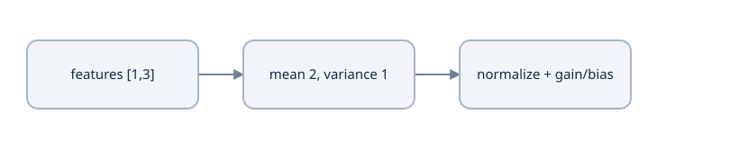

For features[1,3], mean 2 and population variance 1. LayerNorm divides centered features by sqrt(variance+epsilon), then applies learned gain/bias.


### Hand-compute the output

For x=`[1,3]`, μ=2 and v=1. With ε=1e−5, xhat≈`[−.999995000,.999995000]`. With gamma=`[2,1]`, beta=`[0,1]`, output≈`[−1.999990000,1.999995000]`. Ignoring epsilon gives the simplified values `[−2,2]`, useful for intuition but not the exact runtime fixture.

A constant row `[7,7]` has v=0 and xhat=`[0,0]`, so y=beta. Epsilon avoids division by zero; it is not an added constant to the output. Normalized coordinates have mean0; their variance is `v/(v+epsilon)`, slightly below1. Learned gamma/beta further change their mean and variance.

Adding a constant c to all coordinates leaves xhat unchanged. Positive scale invariance is approximate when epsilon>0, because epsilon does not scale with x. These properties hold for the selected axes, not for arbitrary per-coordinate shifts.

### Derive why features interact in backward

Changing xⱼ changes not only its numerator, but also μ and v used by every feature. Let upstream gᵢ=∂L/∂yᵢ and uᵢ=gᵢγᵢ. The chain rule yields

$$\frac{\partial L}{\partial x_i}=
\frac1s\left(u_i-\operatorname{mean}(u)-\hat x_i\operatorname{mean}(u\hat x)\right).$$

The means are over the D features. The formula accounts for epsilon through s and xhat. Gradients for learned affine parameters sum over all batch/position uses:

$$\begin{aligned}
(\nabla\gamma)_i&=\sum_{b,t}g_{bti}\hat x_{bti},\\
(\nabla\beta)_i&=\sum_{b,t}g_{bti}.
\end{aligned}
$$

A manual backward that divides by D−1 or treats μ as a detached constant computes a different gradient.

The input gradients sum to zero over the normalized features, matching shared-shift invariance. A loss that simply sums all normalized outputs with gamma1 is constant, so its zero gradient is expected; use a nonuniform upstream vector for meaningful finite-difference tests.

### A standalone PyTorch comparison

```python
import torch
from torch import nn
x = torch.tensor([[[1.,3.],[7.,7.]]], dtype=torch.float64)
mu = x.mean(-1, keepdim=True)
v = ((x-mu)**2).mean(-1, keepdim=True)
gamma = torch.tensor([2.,1.], dtype=x.dtype)
beta = torch.tensor([0.,1.], dtype=x.dtype)
manual = (x-mu)/torch.sqrt(v+1e-5)*gamma+beta
layer = nn.LayerNorm(2, eps=1e-5).double()
with torch.no_grad():
    layer.weight.copy_(gamma); layer.bias.copy_(beta)
assert torch.allclose(manual, layer(x), atol=1e-12, rtol=1e-12)
assert manual[0,1].tolist() == [0.,1.]
```

### LayerNorm versus BatchNorm

BatchNorm typically estimates feature statistics across batch/spatial examples and maintains running statistics for evaluation. LayerNorm computes its specified per-example trailing-axis statistics in both training and evaluation; it has no default running batch mean/variance. Therefore ordinary LayerNorm's arithmetic does not switch to historical statistics when `eval()` is called. Dropout elsewhere in the same model does change behavior.

Small batches and variable sequence lengths motivate per-token normalization, but an attention mask does not participate in this feature reduction. A padded row can still have a LayerNorm output beta. Mask/gate it if your downstream contract requires zero padding representations. LayerNorm also does not make inputs or output logits categorically normalized probabilities.

The reusable [foundation probes](examples/transformer_foundation_probes.py) implement these small calculations; [independent probe checks](examples/test_transformer_foundation_probes.py) test hand answers, gradients and changed conditions. Use the recorded Torch interpreter from Lesson 2.

### Predict or explain: Shift the lesson’s token[1,3] to[11,13] and use constant[−2,−2]. Compute statistics and outputs for gamma[2,1],beta[0,1],epsilon1e−5. Which B×T×D axes reduce?

<details data-practice-id="normalization-transfer"><summary>Reveal worked answer and rubric</summary>

The shifted token has μ12,v1 and the same normalized coordinates as[1,3], approximately[−.999995,.999995]; affine output[−1.999990,1.999995]. The constant has μ−2,v0 and output beta[0,1]. LayerNorm(D) reduces D independently at each batch/position, using population variance in train/eval. A common shift cancels; epsilon makes scale invariance approximate.

**Rubric:** Calculate epsilon placement and named axes; explain constant rows and gradient coupling.

</details>


### Notes and sources

Calculate both rows, label every reduced axis and derive the two correction terms in ∇x. Compare `LayerNorm(D)` with a whole-sequence normalization and explain train/eval behavior. Reference arithmetic is in [prerequisite_tensors.py](examples/prerequisite_tensors.py).

Sources: [LayerNorm API](https://docs.pytorch.org/docs/2.14/generated/torch.nn.LayerNorm.html), [original Layer Normalization paper](https://arxiv.org/abs/1607.06450). Continue with [regularization](lessons/21-regularization.md).


## Lesson 21 — regularization and generalization controls

**Goal:** explain what dropout, weight decay, label smoothing and early stopping change, calculate their effects, and apply them at explicit locations in a Transformer. Prerequisites: the loss, optimizer, residual and normalization lessons. A regularizer changes a training objective, computation or selection rule; it is not a substitute for a valid held-out split.

### Training loss and generalization answer different questions

For model parameters $\theta$ and a record $z$, write its loss as $\ell(\theta;z)$. Training minimizes an empirical average over the training records. The quantity we ultimately care about is expected loss on future records from the declared task distribution:

$$
\begin{aligned}
\widehat R_{\mathrm{train}}(\theta)&=\frac{1}{N}\sum_{i=1}^{N}\ell(\theta;z_i),\\
R(\theta)&=\mathbb E_{z\sim\mathcal D}[\ell(\theta;z)].
\end{aligned}
$$

We cannot calculate $R$ exactly from a small dataset. A separate validation set estimates behavior and supports choices such as dropout rate or stopping update. Repeatedly selecting settings using that set also adapts the experiment to it; a final untouched test set has a different role. A low training loss and high validation loss can indicate overfitting, but also a distribution mismatch, label problem or evaluation bug. Inspect those before increasing regularization blindly.

### Derive inverted dropout rather than memorizing its scaling

Let $a$ be one fixed activation and let $m\sim\mathrm{Bernoulli}(1-p)$, where $p$ is the probability of dropping it. For $0\leq p<1$, inverted dropout returns $\widetilde a=ma/(1-p)$ during training and returns $a$ during evaluation. The scaling preserves this activation's expectation:

$$
\begin{aligned}
\mathbb E[\widetilde a]&=\frac{a}{1-p}\mathbb E[m]=a,\\
\mathbb E[\widetilde a^2]&=\frac{a^2}{(1-p)^2}(1-p),\\
\operatorname{Var}(\widetilde a)&=a^2\frac{p}{1-p}.
\end{aligned}
$$

With $a=4$ and $p=0.5$, the output is 0 or 8 with equal probability. Its mean is 4 and variance is 16. With $p=0.1$, a retained activation becomes $4/0.9\approx4.4444$. These are random training computations, not a rule to multiply the evaluation output by 0.9. The endpoint $p=1$ must be handled separately; the formula has a zero denominator.

For a fixed sampled mask, the local derivative is also $m/(1-p)$. A dropped branch receives zero gradient through that operation; another residual path can still carry gradient. Expectation preservation at one operation does **not** imply $\mathbb E[f(\widetilde a)]=f(a)$ for a nonlinear network. For example, apply the square: the noisy activation has expected square 32, whereas the mean activation squared is 16. [PyTorch Dropout contract](https://docs.pytorch.org/docs/2.14/generated/torch.nn.Dropout.html).

### Placement changes the computation you regularize

For a post-norm residual block, sublayer dropout gives

$$Y=\operatorname{LayerNorm}(X+\operatorname{Dropout}(F(X))).$$

Here $X,F(X),Y$ all have shape $[B,T,D]$. The identity branch remains present when elements of $F(X)$ are dropped. Dropping the whole sum instead gives different random behavior. Applying dropout to the initial embedding-plus-position tensor perturbs both contributions before the stack. The original paper uses those residual and input locations with base dropout 0.1. [Transformer regularization](https://arxiv.org/html/1706.03762v7).

An attention implementation may also drop entries of the probability tensor $A\in\mathbb R^{B\times H\times T_q\times T_k}$ before computing $AV$. Under inverted element dropout, a sampled row need not sum to one. Its expectation still equals the original row, conditional on that row. Do not silently renormalize it: renormalization creates a different operator. Keep the mask convention from Lesson 16, and distinguish random training dropout from permanently forbidden attention connections. Any additional FFN-internal dropout is another explicit architecture choice.

### Label smoothing changes the target distribution

For $V$ eligible classes, true class $y$ and smoothing $\varepsilon$, define the uniform-mixture convention

$$q_j=(1-\varepsilon)\mathbf 1[j=y]+\frac{\varepsilon}{V}.$$

This convention, used by PyTorch's label-smoothing option, includes the true class in the uniform part. For $V=4$, $\varepsilon=0.2$ and $y=2$, it gives $q=[0.05,0.05,0.85,0.05]$. Another convention puts the entire smoothing mass only on the incorrect classes; it would give $[0.0667,0.0667,0.8,0.0667]$. State which convention you use.

The loss and logit derivative become

$$L=-\sum_jq_j\log p_j,\qquad \frac{\partial L}{\partial z_j}=p_j-q_j.$$

For prediction $p=[0.1,0.1,0.7,0.1]$, ordinary one-hot NLL is $-\log0.7\approx0.356675$. The smoothed loss is $-0.85\log0.7-0.15\log0.1\approx0.648562$. Its derivative is $[0.05,0.05,-0.15,0.05]$. A prediction matching $q$ has zero logit gradient, so the training optimum does not request probability one for the recorded label. Report ordinary held-out NLL separately if you want a comparable perplexity measure. The original paper specifies smoothing 0.1; its main text does not fully specify every padding/vocabulary implementation detail. [Loss API](https://docs.pytorch.org/docs/2.14/generated/torch.nn.CrossEntropyLoss.html), [paper](https://arxiv.org/html/1706.03762v7).

Ignoring a PAD target removes that **position** from loss. It does not automatically remove the PAD output column from the smoothing distribution on other positions. If you exclude PAD, construct and normalize $q$ over the declared eligible classes, then keep that policy consistent with output probabilities and evaluation.

### Decay and stopping are different controls

An L2 objective adds $\lambda\lVert\theta\rVert^2/2$, contributing gradient $\lambda\theta$. Decoupled decay instead shrinks selected parameters by $1-\eta\lambda$ alongside the optimizer update. With $\theta=2$, $\eta=0.1$, $\lambda=0.01$ and zero data gradient, decoupled decay gives 1.998. With adaptive optimization, injecting $\lambda\theta$ into the moments is generally different from that shrinkage. Record parameter groups: excluding biases or normalization scales is a deliberate choice, not an automatic consequence of the formula. Lesson 9 derives this difference.

Early stopping selects a checkpoint using a declared validation metric and patience. If validation losses at updates 100, 200, 300 and 400 are $[0.8,0.5,0.6,0.7]$, patience two without ties selects update 200 and stops after two non-improving evaluations. Retain the **best** state, not merely the final weights. The existing small trainer uses a fixed total-update goal; it records best loss but does not implement automatic early stopping. Do not attribute a stopping rule to it.

### Check modes and the smoothing arithmetic

Run this complete probe from the course `examples/` directory with the frozen PyTorch interpreter. It adds no files to your implementation child.

```python
import math
import torch
from torch import nn

a, p = 4.0, 0.5
outcomes = torch.tensor([0.0, a / (1.0 - p)])
assert float(outcomes.mean()) == a
assert float(outcomes.var(unbiased=False)) == 16.0
q = torch.tensor([0.05, 0.05, 0.85, 0.05], dtype=torch.float64)
prob = torch.tensor([0.1, 0.1, 0.7, 0.1], dtype=torch.float64)
print('smoothed loss:', float(-(q * prob.log()).sum()))
assert math.isclose(float(-(q * prob.log()).sum()), 0.64856146624, abs_tol=1e-10)

layer = nn.Dropout(0.5)
x = torch.ones(32, requires_grad=True)
torch.manual_seed(7)
layer.train()
with torch.no_grad():
    noisy = layer(x)
assert not noisy.requires_grad
assert set(noisy.tolist()) <= {0.0, 2.0}
layer.eval()
identity = layer(x)
assert torch.equal(identity, x)
assert identity.requires_grad
print('evaluation identity and gradient-mode checks passed')
```

`eval()` changes module behavior and propagates to registered children; it does not turn off gradient recording. `no_grad()` disables recording in its context; it does not change the module's training flag. Evaluation usually needs both. A functional dropout call must receive `training=self.training` if it is to follow the enclosing module. [Gradient mode](https://docs.pytorch.org/docs/2.14/generated/torch.no_grad.html).

### Exercise and notes

### Predict or explain: With dropout p=.5 on scalar2, list training outputs/expectation/variance. Does eval disable gradients? What target does uniform-mixture smoothing ε.1,V4 produce for class2?

<details data-practice-id="regularization-transfer"><summary>Reveal worked answer and rubric</summary>

Inverted-dropout outputs0 or4 with equal chance, expectation2, variance4. eval switches dropout to identity but does not disable autograd; no_grad separately controls recording. Uniform-mixture smoothing gives [.025,.025,.925,.025]. An exclude-gold convention gives a different distribution and must be declared; the original paper reports its smoothing value without defining every implementation convention.

**Rubric:** Derive expectation/variance, distinguish modes and declare the smoothing target convention.

</details>


In [my study notes](project/study-notes.md), derive dropout variance for $a=-3,p=0.2$, then explain which residual path remains when the sublayer is dropped. Write both smoothing conventions for a three-class target, and predict whether a `no_grad()` call alone makes a training-mode Transformer deterministic. Connect each proposed regularizer to the validation evidence that would justify it.

Continue with [encoder–decoder learning and inference](lessons/22-encoder-decoder.md), where these controls must operate on precisely shifted sequence streams.


## Lesson 22 — encoder–decoder learning and inference

**Goal:** construct the source stream, shifted decoder stream, supervision and masks for conditional sequence learning; explain why parallel teacher-forced training and sequential generation implement the same factorization. Prerequisites: tokenization, embeddings, positions, attention masks and token loss. This is a sequence contract study; the complete translation implementation belongs to Course 1.

### Define the conditional probability before the architecture

Let $x=(x_1,\ldots,x_S)$ be source token IDs and $y=(y_1,\ldots,y_M)$ the target content. Append an end token $y_{M+1}=\mathrm{EOS}$. A conditional autoregressive model represents

$$
p_\theta(y,\mathrm{EOS}\mid x)
=\prod_{t=1}^{M+1}p_\theta(y_t\mid x,y_{<t}).
$$

This follows the probability chain rule; it does not assume the target tokens are independent. The model uses the complete source and only earlier target tokens for each factor. The negative log-likelihood sums $-\log p_\theta(y_t\mid x,y_{<t})$. EOS contributes a factor because stopping is a learned prediction. BOS supplies an initial decoder input; in this contract it is not an output target. [Encoder–decoder framework](https://d2l.ai/chapter_recurrent-modern/seq2seq.html).

If the three factors for content `[A,B]` followed by EOS are $[0.8,0.5,0.9]$, their product is 0.36 and sequence NLL is $-\log0.36\approx1.021651$. The per-target mean is $1.021651/3\approx0.340550$, counting EOS. Omitting EOS changes both the sequence score and the denominator. A loss averaged over sequences gives a different weighting from one averaged over all valid tokens when lengths differ.

### Two streams, three attention roles

Define batch size $B$, padded source length $S$, padded decoder length $T$, model width $D$, head count $H$ and target vocabulary size $V_t$. Source IDs have shape $[B,S]$; the encoder turns them into contextual memory $E\in\mathbb R^{B\times S\times D}$. Decoder IDs have shape $[B,T]$; the decoder emits hidden vectors $Z\in\mathbb R^{B\times T\times D}$ and logits $[B,T,V_t]$.

| Operation | Query stream | Key/value stream | Required permission rule |
| --- | --- | --- | --- |
| Encoder self-attention | Source states | Source states | Valid source keys; no target-style causal triangle |
| Decoder self-attention | Target-prefix states | Target-prefix states | Valid decoder keys at indices no greater than the query index |
| Decoder cross-attention | Target-prefix states | Encoder memory | Valid source keys; source and target lengths may differ |

For cross-attention, scores have shape $[B,H,T,S]$. Applying a $T\times T$ triangle to that tensor has the wrong meaning even if equal lengths conceal the error. The decoder's queries decide which source information to retrieve; its keys and values are projected from encoder memory. The original Transformer uses those three attention roles in separate sublayers. [Architecture](https://arxiv.org/html/1706.03762v7).

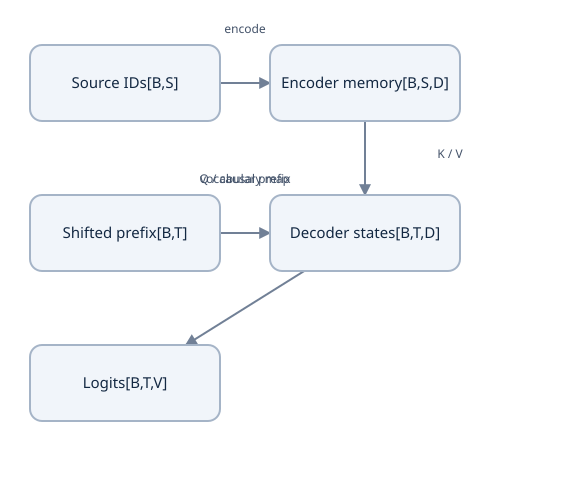

Source memory, shifted target inputs and next-token labels are different streams.


### Shift inputs and labels exactly once

Use a pedagogical target vocabulary with `PAD=0`, `BOS=1`, `EOS=2`, and content IDs starting at 3. These IDs are local to this probe; they do not replace the byte-tokenizer contract from Lesson 12. For target content `[4,5,6]`:

| Decoder index | 0 | 1 | 2 | 3 |
| --- | --- | --- | --- | --- |
| Decoder input | BOS | 4 | 5 | 6 |
| Label predicted at that index | 4 | 5 | 6 | EOS |
| Legal target information | Empty prefix | 4 | 4,5 | 4,5,6 |

A shorter target `[7]` in the same batch becomes decoder input `[BOS,7,PAD,PAD]` and labels `[7,EOS,PAD,PAD]`. The first two positions are supervised. Key-padding exclusion and ignored labels solve different problems: one restricts information flow, the other removes unused positions from the loss. Padded query rows may still have legal keys and produce nonzero outputs. Exclude their labels and apply any declared zero-output policy explicitly.

The following complete probe constructs both examples and checks target alignment, masks and loss accounting. Run it with the frozen interpreter from the course `examples/` directory.

```python
import math
import torch
from torch.nn import functional as F

PAD, BOS, EOS = 0, 1, 2
targets = [[4, 5, 6], [7]]
B, T, V = 2, max(len(row) + 1 for row in targets), 8
decoder = torch.full((B, T), PAD, dtype=torch.long)
labels = torch.full((B, T), PAD, dtype=torch.long)
for b, content in enumerate(targets):
    n = len(content) + 1
    decoder[b, :n] = torch.tensor([BOS] + content)
    labels[b, :n] = torch.tensor(content + [EOS])

source = torch.tensor([[3, 4, 0], [5, 6, 7]])
source_valid = source != PAD
causal = torch.ones(T, T, dtype=torch.bool).tril()
allowed_self = causal[None, None] & (decoder != PAD)[:, None, None, :]
allowed_cross = source_valid[:, None, None, :].expand(B, 1, T, 3)
assert allowed_self.shape == (2, 1, 4, 4)
assert allowed_cross.shape == (2, 1, 4, 3)
assert allowed_self[0, 0, 1].tolist() == [True, True, False, False]
assert allowed_cross[0, 0, 3].tolist() == [True, True, False]
assert labels.tolist() == [[4, 5, 6, 2], [7, 2, 0, 0]]

logits = torch.zeros(B, T, V, requires_grad=True)
loss_sum = F.cross_entropy(
    logits.reshape(-1, V), labels.reshape(-1),
    ignore_index=PAD, reduction='sum')
count = int((labels != PAD).sum())
assert count == 6
assert math.isclose(float(loss_sum.detach()) / count, math.log(V), rel_tol=1e-6)
(loss_sum / count).backward()
assert torch.equal(logits.grad[1, 2:], torch.zeros(2, V))
print('decoder:', decoder.tolist())
print('valid targets:', count, 'uniform mean NLL:', float(loss_sum.detach()) / count)
```

Here `True` explicitly means **allowed**. Translate it when an API uses `True` to mean blocked. The uniform baseline is $\log8\approx2.079442$ per valid target; flattening preserves the matching $B,T$ order. This probe verifies preparation and the loss denominator; it does not execute a trained decoder or prove its causality.

### Teacher forcing permits parallel computation without future leakage

During teacher forcing, the decoder receives the recorded previous target IDs. All shifted inputs are available at once, so masked attention computes the factors in parallel. The causal mask prevents a query from reading later shifted positions. At query index 1, the current input token is the first target token; that row predicts the second target token. It never receives its own label through a legal path.

Using unshifted labels as decoder inputs exposes the answer at the same position through the embedding and residual path. A causal mask including the diagonal cannot fix that. Correct shifting without a causal mask also leaks later labels via later positions. Test both contracts in the full model: with dropout off, replace a future decoder token and require earlier logits to stay unchanged; separately change the source and require output behavior to reflect source conditioning. Shape correctness alone proves neither property.

### Generation constructs the prefix instead of receiving it

At inference, encode the source, initialize the decoder prefix to BOS, calculate next-token logits at its final valid position, select a token and append it. Stop on EOS or a declared maximum generated length. Batch decoding needs one finished flag per record: a finished record must not continue generating meaningful tokens while others run. Reset prefixes and any caches for each new request. Caches are an implementation optimization with their own mask/position contract; they are not needed to understand the factorization.

Greedy decoding chooses the highest-probability token at each step. It need not find the most probable complete sequence. Suppose first-token probabilities are $p(A)=0.6,p(B)=0.4$, while $p(\mathrm{EOS}\mid A)=0.51$ and $p(\mathrm{EOS}\mid B)=0.9$. Greedy chooses `[A,EOS]` with probability $0.306$; `[B,EOS]` has probability $0.36$. A width-two beam retains both initial hypotheses and can recover the latter in this short tree. Keep scores as sums of log probabilities; do not multiply many floating-point probabilities directly. [Beam search](https://d2l.ai/chapter_recurrent-modern/beam-search.html).

Beam search retains a bounded set of candidate prefixes and expands them; finite width remains approximate. EOS-completed hypotheses need separate handling. A length penalty changes the ranking objective, so report its rule and the length being counted. Stopping at the first EOS among all candidates can discard a better completion. Use a defined completion/bound rule and a hard length cap rather than an unbounded loop. Probability score is also not a translation-quality metric: a decoder and an evaluation metric answer different questions.

### Exercise and notes

### Predict or explain: For target[a,b,EOS], create teacher-forced decoder input/labels with BOS. Can all training positions run together? What does inference consume?

<details data-practice-id="seq2seq-transfer"><summary>Reveal worked answer and rubric</summary>

Inputs[BOS,a,b], labels[a,b,EOS]. A causal mask lets each prediction use only its input prefix, so parallel training computes all conditionals without future answers. Inference consumes previously generated tokens, not unknown future ground-truth tokens; append EOS and stop for that sequence. Cross-attention keys/values come from real encoder source positions.

**Rubric:** Draw the shift and mask and distinguish teacher forcing from autoregressive generation and EOS/padding roles.

</details>


In [my study notes](project/study-notes.md), shift the target `[9,8]`, count its supervised positions and draw its legal decoder self-attention matrix. Annotate one cross-attention row when the source has five real tokens plus two PAD positions. Explain why teacher-forced token accuracy and free-running sequence accuracy can diverge: generated mistakes change the later prefixes the model sees.

Continue with [evaluation and debugging](lessons/09-training.md), applying the same discipline to a complete small training experiment before a full translation build.


## Lesson 23 — evaluation, debugging and a complete small training experiment

**Goal:** run a complete nonlinear classification experiment, interpret its measurements, and diagnose learning failures using falsifiable checks. Prerequisites: losses, backpropagation, optimizers, training-step accounting, data splits and evaluation modes. Attention components are already explained; this small experiment isolates the training foundations before Course 1 adds translation architecture and data.

### Write the task, baseline and evidence boundary

The existing [shared trainer](examples/prerequisite_mlp.py) predicts whether two nonzero real numbers have opposite signs. Features $X$ have shape $[N,2]$, dtype FP32 and CPU device. Labels $y$ have shape $[N]$, dtype int64, and class 1 means $x_1x_2<0$. The model is `Linear(2,8) → Tanh → Linear(8,2)`, with $2×8+8+8×2+2=42$ learned scalars. Its logits have shape $[N,2]$; the model contains no output softmax.

The training grid uses coordinates $±0.3,±0.7,±1.1,±1.5$ on both axes: 64 points. Validation uses $±0.5,±0.9,±1.3$: 36 different points. Both are balanced. A constant class prediction gets 50% accuracy. Uniform two-class probabilities give mean NLL $\log2≈0.693147$. These simple baselines establish what a useful fit must beat.

The validation grid checks interpolation in a small structured domain. It does not establish behavior at zero, far outside the grid, on natural-language text, or on translation. This experiment has no independent final test split; its `validation` name is deliberate. If you tune many settings on these 36 points, acquire a separately declared final assessment before claiming broad generalization.

### Aggregate counts before interpreting averages

For valid labeled records $i$, define $\ell_i=-\log p_{i,y_i}$. Report the loss sum $S=\sum_i\ell_i$, count $N$ and number correct $C$; then mean NLL is $S/N$ and accuracy is $C/N$. Two evaluation chunks with counts 2 and 6 and respective mean losses 1 and 3 combine to $(2×1+6×3)/8=2.5$. Averaging the chunk means gives 2 and overweights the smaller chunk. Translation uses valid target-token counts instead of this classifier's record counts.

Accuracy discards confidence after the highest-logit choice. A correct prediction assigning the target probability 0.51 contributes $-\log0.51≈0.673345$; a correct probability 0.99 contributes $≈0.010050$. Both are one correct record. A confident wrong probability 0.01 contributes $≈4.605170$, so a few such mistakes can dominate NLL.

For a fixed tokenizer and ordinary hard-target token likelihood, perplexity is

$$
\operatorname{PPL}=\exp\left(\frac{-\sum_i\log p_{i,y_i}}{N}\right).
$$

It is the inverse geometric mean assigned target probability. If two target probabilities are 0.5 and 0.25, mean NLL is $\log\sqrt8≈1.039721$ and perplexity is $\sqrt8≈2.828427$. Changing vocabulary/tokenization changes the unit being predicted, so perplexities are not directly comparable across those changes. Exponentiating label-smoothed loss yields an objective transformation, not that ordinary hard-target perplexity.

### Inspect one update before asking for a thousand

Work in the course `examples/` directory using the frozen interpreter selected in Lesson 2. `python` below means that interpreter; the source reference does not replace your foundations-lab implementation files. Run this complete probe:

```python
import math
import torch
from prerequisite_mlp import make_training_state, evaluate, update

torch.set_num_threads(1)
state = make_training_state(seed=7, total_steps=1000)
assert sum(p.numel() for p in state.model.parameters()) == 42
train_x, train_y = state.data['train']
valid_x, valid_y = state.data['validation']
assert len(train_y) == 64 and len(valid_y) == 36
assert not (set(map(tuple, train_x.tolist())) & set(map(tuple, valid_x.tolist())))
assert int(train_y.sum()) == 32 and int(valid_y.sum()) == 18
before = evaluate(state)
first = update(state)
assert first['step'] == 1 and first['examples'] == 16
assert math.isclose(first['learning_rate_used'], 0.0015)
assert not any(p.grad is not None for p in state.model.parameters())
while state.step < state.config.total_steps:
    update(state)
after = evaluate(state)
print('validation before:', before)
print('validation after:', after)
print('updates/examples:', state.step, state.examples_seen)
assert state.step == 1000 and state.examples_seen == 16000
assert after['loss'] < before['loss']
assert after['correct'] == 36
```

The seed-7 declared CPU reference reaches 36/36 on the held-out grid after 1,000 updates. Retain your actual loss and runtime identity instead of copying an author's result into your learning record. A failure is evidence to investigate, not a reason to edit the validation labels. The first update uses rate $0.03/20=0.0015$ during linear warmup; this trainer keeps the rate constant after warmup. It is not the paper's inverse-square-root schedule.

The update implementation chooses microbatches, clears gradients, backpropagates loss sums divided by the common record count, clips the global gradient norm, applies Adam, advances the schedule and counters, then clears completed gradients. Its report contains the rate actually used and the norm **before** clipping. A thousand batch-size-16 updates consumes 16,000 record presentations, not 16,000 unique records.

### Use a small overfit probe as a diagnostic

A model with sufficient capacity should fit a tiny consistent fixture when optimization works and regularization is disabled. Before a large experiment, repeatedly train on the four corners `[-1,-1],[-1,1],[1,-1],[1,1]` with labels `[0,1,1,0]`. In this reference, create a separate state with the same total goal and pass the same `(features,labels)` batch to `update(state,batches=[...])`. This bypasses the sampler deliberately; it is a diagnostic experiment, not a resumed version of the sampled run.

If that tiny fit fails, inspect one operation at a time: output axes, labels, stable loss, nonzero finite gradients, trainable parameter registration, actual rate and parameter changes after `step()`. Use the complete known-answer backward trace from Lesson 7 to distinguish an algorithm bug from a hard optimization problem. The reference's [numerical/training checks](examples/prerequisite_mlp_checks.py) also include a hidden-weight finite-difference comparison, unequal-microbatch equivalence and nonfinite-loss rejection.

### Measure errors and confidence separately

For binary labels, construct a confusion matrix $M_{a,b}$ counting true class $a$ and predicted class $b$. Its diagonal sum is $C$; row totals show whether one class is being ignored. Retain failed coordinates and predicted target probabilities. On a sequence task, also inspect length, EOS failures, source perturbations and free-running outputs; teacher-forced accuracy can look good while errors accumulate during generation.

A probability 0.9 is a confidence statement, not proof of calibration. Calibration asks whether many comparable predictions reported near 0.9 are correct near 90% of the time. Thirty-six structured points cannot support strong calibration claims. High validation accuracy, low NLL and calibration are distinct measurements.

BLEU measures clipped n-gram overlap with reference translations, with a brevity penalty; it is not the percentage of sentences correctly translated or a guarantee of semantic accuracy. Corpus BLEU is not the mean of independently scored sentence BLEUs. Record the reference corpus/split, language direction, tokenization and casing, smoothing, metric version/signature and decoding settings. Reference preprocessing can materially change scores. This classifier has no BLEU result, and its 36/36 grid accuracy cannot be compared with a published translation score. [Metric-reporting paper](https://arxiv.org/abs/1804.08771), [SacreBLEU reference](https://github.com/mjpost/sacrebleu).

### Diagnose failures with an explicit observation and probe

| Observation | Candidate causes | Small check that distinguishes them |
| --- | --- | --- |
| Loss does not change | Missing gradients, disconnected tensor, wrong parameter group, zero/tiny rate | Compare a parameter before/after one step; inspect its finite gradient and logged rate |
| Tiny training fixture fits, validation does not | Overfitting, mismatched task distribution or split/label error | Inspect held-out errors and split overlap before changing capacity |
| Sequence training is suspiciously easy | Unshifted targets, future-token leakage or duplicate records | Perturb future target IDs with dropout off; check earlier logits and source/target split hashes |
| Loss becomes nonfinite | Invalid probability calculation, exploding values or all-masked softmax | Find the first nonfinite activation/loss/gradient; test extreme-logit and empty-row fixtures |
| Evaluation varies unexpectedly | Dropout still active, changing samples or preprocessing | Fix data order, use `eval()` and `no_grad()`, compare repeated logits |
| Resume diverges | Lost optimizer/sampler/RNG state or changed identity | Compare the next batch, rate and update in a new process as Lesson 24 requires |

These are hypotheses. Record the observed tensor/metric and the result of the distinguishing probe; do not declare “overfitting” from one curve alone. Layer summaries can include activation means/variances, gradient norms and saturation rates. For Tanh, a hidden output close to ±1 has derivative $1-h^2$ close to zero. A norm alone does not locate which layer or parameter produced the problem.

### Run the complete session and record resources

For training with verified generations, choose a new empty run path and execute:

```bash
python prerequisite_mlp.py --mode new --run-dir /tmp/tutorial0-evaluation-run \
  --total-steps 1000 --max-updates 1000 --max-seconds 3600
python prerequisite_mlp_checks.py
```

The CLI refuses to overwrite a nonempty new-run directory. The final JSON reports identity, before/after evaluation, counters, checkpoint generations, elapsed time and process peak RAM. FP32 parameters occupy $42×4=168$ bytes, but optimizer moments, activations and the Python/PyTorch runtime require additional memory. Whole-process peak RAM is a different measure from parameter storage. Record this CPU measurement; it is not a Colab/GPU throughput result. [Reproducibility limits](https://docs.pytorch.org/docs/2.14/notes/randomness.html).

### Exercise and notes

### Predict or explain: Training loss falls but validation does not improve. What checks come before increasing model size? Does small-grid classification establish translation or calibrated confidence?

<details data-practice-id="evaluation-transfer"><summary>Reveal worked answer and rubric</summary>

Check splits/duplicates, target alignment, mask conventions, token denominators, eval/no_grad mode, gradients, a tiny overfit case and simple baselines. Inspect held-out errors and likelihood separately from accuracy. The structured classifier tests nonlinear learning on its declared grid, not translation/general text or calibrated probabilities. Hard-target perplexity needs fixed tokenizer/data/objective.

**Rubric:** Choose falsifiable probes and separate task evidence from broader claims.

</details>


In [my study notes](project/study-notes.md), write the task/domain/split before recording results, calculate the constant-class and uniform-loss baselines, and retain one failed or deliberately corrupted-case diagnosis. Explain what a completed tiny training run proves and what remains unmeasured for translation. Keep author checks, your implementation, your explanation and hosted capability as separate evidence.

Continue with [checkpointing and reproducible recovery](lessons/10-recovery.md), preserving the exact state that produced the next update.


## Lesson 24 — checkpointing and reproducible recovery

**Goal:** identify the state required for the next optimizer update, explain verified checkpoint generations, and prove continuation under a declared runtime. Prerequisites: optimizer history, schedule position, random sampling, loss accounting and the complete training experiment. Weight export, same-environment continuation and survival of a deleted hosted runtime are different claims.

### Training is a state transition, not a bag of weights

Represent training state at a completed update $t$ as $S_t$, and the next update as $S_{t+1}=U(S_t)$. The state includes more than $\theta_t$: optimizer moments determine the update direction/scale; the schedule determines the rate; the sampler determines the records; RNG states determine future random choices. Model buffers and module mode can affect the forward computation too.

Consider one scalar with Adam rate 0.1, $\beta_1=0.9$, $\beta_2=0.999$, negligible epsilon and first gradient 2. Its corrected moments are 2 and 4, so the first parameter move is approximately -0.1. If the next gradient is zero, the stored moments become $m_2=0.18$ and $v_2=0.003996$. Correcting their bias gives

$$
\begin{aligned}
\widehat m_2&=0.18/(1-0.9^2)≈0.947368,\\
\widehat v_2&=0.003996/(1-0.999^2)≈1.998999,\\
\Delta\theta_2&≈-0.1\frac{0.947368}{\sqrt{1.998999}}≈-0.067006.
\end{aligned}
$$

A fresh optimizer loaded with only the same weights sees zero first gradient and makes zero data-driven movement instead. Identical weights at reload time therefore do not imply identical next weights. [Checkpoint guidance](https://docs.pytorch.org/tutorials/beginner/saving_loading_models.html).

### Define the save boundary and state owners

The [reference snapshot](examples/prerequisite_checkpoint.py) saves only completed FP32 CPU updates with no parameter gradients pending. Saving partway through accumulation would also require partial gradients, loss denominator, microbatch position and consumed data/RNG state. This profile rejects that condition rather than pretending it is resumable.

| State | Why the next update needs it | Reference owner |
| --- | --- | --- |
| Model parameters and buffers | Same forward function and registered state | `model.state_dict()` |
| Adam moments and optimizer step | Same adaptive update, including bias correction | `optimizer.state_dict()` |
| Scheduler position and current rates | Same rate at the next global update | `scheduler.state_dict()` |
| Shuffled order, cursor, epoch and explicit generator | Same next records and future shuffle | `Sampler.state_dict()` |
| Python, NumPy and PyTorch CPU RNG | Same subsequent draws from each used source | `random_state()` |
| Update, examples seen and metric position | Distinguish durable progress and replayed work | `TrainingState` counters |
| Best validation loss and model mode | Preserve declared monitoring and behavior | Snapshot fields |
| Source/config/data/runtime identity and precision | Detect a changed experiment before continuation | `state.identity()` and schema |

This numerical task has no tokenizer. A text model must add the exact vocabulary, merge ranks, special IDs and tokenizer hash, along with split/data identity. Same vocabulary size alone is insufficient: swapping the meanings of two IDs changes every associated embedding/output row without changing a shape. GPU/AMP training must account for device RNG and scaler state as applicable; the current reference explicitly supports FP32 CPU and no scaler.

### A seed describes a start; RNG state describes a position

With 64 training records, batch size 16 and one microbatch per update, update 3 has consumed 48 records in the initial shuffled order. The next update consumes its remaining 16. Restoring just seed 7 and generating a new initial order restarts its cursor at zero. The sampler's explicit generator controls later shuffles; it is distinct from PyTorch's global CPU RNG.

Model initialization itself consumes random draws. Set up fresh objects first, load parameters/optimizer/schedule/sampler, then restore all saved RNG states immediately before the next draw. Restoring RNG before constructing a new random model would consume the saved stream during setup. Worker prefetch and streaming datasets add consumed-versus-queued positions; the first parity drill keeps sampling in one process. [Reproducibility scope](https://docs.pytorch.org/docs/2.14/notes/randomness.html).

### Verify a generation before treating it as a recovery copy

The publisher uses a new numbered directory for each generation and writes `state.pt`, `manifest.json` and `complete.json`. It performs these steps:

1. Clone a stable completed-update snapshot, serialize it in a temporary local directory, and check loadability.
2. Reserve storage for retained good copies plus the new generation; write into a new persistent directory.
3. Re-read state bytes and check them against the serialized bytes; load the persisted file.
4. Write a manifest containing format, byte size, state SHA-256, identity SHA-256 and update position; re-read it.
5. Write a completion marker containing the manifest hash **last**. Verify the entire generation through the same recovery predicate.
6. Only then rotate older compatible verified generations, retaining at least two.

A directory name or presence of `complete.json` is insufficient. Recovery checks the marker's manifest hash, the manifest's size/hash and the payload schema/identity. A partially written marker or state is rejected. This gives logical all-or-nothing **acceptance** of generations. The reference does not implement an fsync/rename durability protocol or prove remote-storage survival by checksums. Mounted storage behavior must be tested through actual runtime deletion; do not infer it from successful local reads.

The 8 MiB reference run budget reserves compatible retained copies plus an in-progress generation and counts foreign/incomplete files. The free-space guard leaves 1 MiB beyond the next write. A failure stops training rather than deleting the only good checkpoint to fit an unverified one. Source hashes and readback checks establish integrity of a known package, not independent proof of its origin.


Save model, optimizer, schedule, sampler, progress and RNG after a completed update. Verify persisted generations, mark completion last and retain good fallback states.


### Restore compatible state and report fallback

Recovery scans newest numbered generations first, rejecting incomplete/corrupt entries and incompatible identity. It loads a compatible verified generation and reports any skipped candidates. A changed total goal, source file, data grid, hidden width or runtime can change identity. Deliberately loading weights into a new experiment is a **warm start** with a separate run identity; it is not exact continuation.

Identity, boundary and model mappings are checked before the reference mutates parameters. If a subsequent restoration operation raises, discard those newly constructed objects rather than continuing from a partly restored session. There is no implicit fallback from `resume` to `new`. Likewise, `new` rejects a nonempty run directory.

If durable update 100 is followed by a crash after update 137, recovery restores 100 and replays 37 updates. Printed progress is not persistent progress. Include the selected generation, skipped generations, restored update, new session ID and advanced update in the report. The sampler and RNG also roll back, so these replayed records must not be counted as previously unseen training evidence.

### Run a complete local restore-and-corruption probe

From the course `examples/` directory with the frozen interpreter:

```python
from pathlib import Path
import tempfile
import torch
from prerequisite_mlp import make_training_state, update
from prerequisite_checkpoint import save_generation, load_latest, snapshot
from prerequisite_mlp_checks import compare

torch.set_num_threads(1)
with tempfile.TemporaryDirectory(prefix='tutorial0-recovery-') as folder:
    directory = Path(folder)
    uninterrupted = make_training_state(seed=7, total_steps=1000)
    for _ in range(3):
        update(uninterrupted)
    saved = save_generation(directory, uninterrupted)
    expected_update = update(uninterrupted)
    expected_state = snapshot(uninterrupted)

    recovered = make_training_state(seed=7, total_steps=1000)
    restored = load_latest(directory, recovered)
    assert restored['step'] == 3
    actual_update = update(recovered)
    compare(expected_update, actual_update)
    compare(expected_state, snapshot(recovered))
    newest = save_generation(directory, recovered)
    (directory / newest['generation'] / 'state.pt').write_bytes(b'broken')
    fallback = make_training_state(seed=7, total_steps=1000)
    report = load_latest(directory, fallback)
    assert report['step'] == 3
    assert report['skipped'][0]['reason'] == 'incomplete or corrupt'
    print('same update:', recovered.step, 'fallback update:', fallback.step)
```

Expect `same update: 4 fallback update: 3`. The compared state includes Adam, scheduler, sampler, counters and RNG, not only parameters. Corruption is confined to an automatically removed temporary fixture. This snippet constructs new objects in one process; the following suite performs the stronger separate-process continuation test:

```bash
python prerequisite_mlp_checks.py
```

Its replay drill saves at update 3, checks subsequent Python/NumPy/PyTorch draws and five updates, then launches a separate interpreter to recover and reproduce update 8 with exact equality under the declared CPU profile. Other checks cover incomplete/corrupt newest generations, pending-gradient and identity rejection, retained fallback copies, storage guards and persistence failure. Inspect their assertions in [the editable checks](examples/prerequisite_mlp_checks.py).

### Keep the experiment goal fixed across session slices

Choose a fresh run name for this two-command drill:

```bash
python prerequisite_mlp.py --mode new --run-dir /tmp/tutorial0-sliced-run \
  --total-steps 1000 --max-updates 25 --checkpoint-updates 10
python prerequisite_mlp.py --mode resume --run-dir /tmp/tutorial0-sliced-run \
  --total-steps 1000 --max-updates 25 --checkpoint-updates 10
```

The second restores update 25 and finishes at 50. `total-steps` is the unchanged experiment goal; `max-updates` caps additional work in this session. Changing the goal to 50 changes the recorded configuration. Local equality is limited to the measured runtime/source/settings; it is not a guarantee across PyTorch releases, platforms, numerical precision or CPU/GPU changes.

### Exercise and notes

### Predict or explain: Why do weights alone not reproduce the next update? What should happen when the newest checkpoint is corrupt or has incompatible source/tokenizer identity?

<details data-practice-id="recovery-transfer"><summary>Reveal worked answer and rubric</summary>

Continuation also needs optimizer moments/step, schedule position, RNG, sampler order/cursor and matching source/config/data/tokenizer/runtime/precision contract. Verify a complete compatible generation before mutating state; fall back to a prior verified generation on corruption and reject incompatibility. Compare the same next batch/update in a new process. Local recovery does not prove deleted Colab runtime/Drive survival.

**Rubric:** List state and update boundary, define fallback/identity checks and distinguish storage durability from verification.

</details>


In [my study notes](project/study-notes.md), list the state needed for the **next** batch and update, then draw the generation's write/verify/complete/rotate order. Predict the restored update after a failed newer save, distinguish warm start from resume, and record which fresh-process comparison you actually performed. Hosted persistence remains pending until Lesson 25's deleted-runtime drill succeeds.

Continue with [paper assembly and the implementation handoff](lessons/11-colab-and-handoff.md).


## Lesson 25 — read the paper and assemble the foundations

**Goal:** map the original Transformer's equations to concrete tensors, trace a complete translation batch, explain its computational comparisons, and carry reproducible source/training evidence into Course 1. Prerequisites: Lessons 1–24. The course now explains the mechanisms needed to read *Attention Is All You Need*; assembling and training the complete translation model is the next implementation task.

### Read each paper equation as a contract

Use the [original paper](https://arxiv.org/html/1706.03762v7), sections 3–5, alongside this table. Let $B$ be batch size, $S$ source length, $T$ decoder length, $D$ model width, $H$ heads, $d_k=d_v=D/H$, $F$ FFN width, and $V_t$ target vocabulary size. The usual equality of head key/value widths is this architecture's choice, not a mathematical requirement of attention.

| Paper operation | Required inputs, operation and output | Foundation lesson |
| --- | --- | --- |
| Scaled attention, Eq. 1 | $Q[B,H,T_q,d_k]$, $K[B,H,T_k,d_k]$, $V[B,H,T_k,d_v]$; permitted scores → key-axis softmax → weighted values $[B,H,T_q,d_v]$ | [Dot-product attention](lessons/07-attention.md), [masks](lessons/16-masks.md) |
| Multiple heads | Separate learned Q/K/V projections, split feature axes into heads, concatenate head outputs, then apply the output projection | [Multi-head attention](lessons/17-multihead.md) |
| Position-wise FFN, Eq. 2 | For each token independently, $\operatorname{ReLU}(xW_1+b_1)W_2+b_2$ with $D\to F\to D$ | [FFN sublayer](lessons/18-positionwise-ffn.md) |
| Residual/normalization | Same-width addition around each sublayer, then feature-axis LayerNorm in the original post-norm order | [Residuals](lessons/19-residual.md), [LayerNorm](lessons/20-normalization.md) |
| Vocabulary interface | Token IDs → learned vectors scaled by $\sqrt D$; decoder states → vocabulary logits, with compatible shared weight identity | [Encoding](lessons/05-tokenizer.md), [embeddings](lessons/13-embeddings.md) |
| Positional encoding | Add sine/cosine features of width $D$ to token embeddings, with a declared position index and frequency rule | [Positions](lessons/14-position.md) |
| Training schedule, Eq. 3 | Positive optimizer-update index, model width and warmup count determine the rate; optimizer history must continue across sessions | [Optimizers](lessons/09-optimizers.md), [training steps](lessons/10-training-steps.md) |

For attention, write the masked score and weighted-value equations with all axes identified:

$$
\begin{aligned}
C_{b,h,i,j}&=\frac{Q_{b,h,i,:}\cdot K_{b,h,j,:}}{\sqrt{d_k}}+M_{b,h,i,j},\\
A_{b,h,i,:}&=\operatorname{softmax}_{j}(C_{b,h,i,:}),\\
O_{b,h,i,:}&=\sum_j A_{b,h,i,j}V_{b,h,j,:}.
\end{aligned}
$$

Here $M$ is zero for allowed keys and negative infinity for forbidden keys, subject to the explicit empty-row policy from Lesson 16. The normalization index $j$ enumerates **key positions**. Vocabulary softmax at the final output enumerates a different axis. Write both on your board; saying “apply softmax” without its axis hides a consequential distinction.

### Keep original settings and later comparisons visible

The paper's base configuration uses six encoder and six decoder layers, $D=512$, $H=8$, $d_k=d_v=64$, and $F=2048$. It uses post-norm, ReLU and sinusoidal positions. Its Adam settings are $(\beta_1,\beta_2,\epsilon)=(0.9,0.98,10^{-9})$, with warmup 4,000; base dropout and label smoothing are 0.1. These are reference choices, not dimensions to allocate implicitly. [Paper settings](https://arxiv.org/html/1706.03762v7).

Pre-norm changes the residual computation; GELU changes the FFN activation; AdamW changes decay semantics; learned or rotary positions change the position contract. They can be valid later designs, but silently substituting them does not implement the same specification. [My source notes](project/source-notes.md) records these distinctions and the implementation details the main paper leaves unspecified. A miniature profile can retain the architecture's operations while reducing layer counts, widths, vocabulary and lengths.

### Trace one complete miniature translation batch

Use $B=2,S=3,T=4,D=8,H=2,F=32,V_t=10$, one encoder layer and one decoder layer. Source IDs are `[[3,4,PAD],[5,6,7]]`; shifted decoder IDs are `[[BOS,4,5,6],[BOS,7,PAD,PAD]]`, with labels `[[4,5,6,EOS],[7,EOS,PAD,PAD]]`. These are pedagogical vocabulary IDs as in Lesson 22.

1. Source/decoder IDs enter their embedding lookup as integers. Scaling and adding positions give floating tensors $[2,3,8]$ and $[2,4,8]$. During evaluation, dropout is disabled.
2. Encoder Q/K/V split into $[2,2,3,4]$. Source self-attention scores are $[2,2,3,3]$; the first record's PAD key is excluded. Merge heads, project, add the residual and normalize features. The position-wise FFN and its residual/normalization produce memory $[2,3,8]$.
3. Decoder masked self-attention scores are $[2,2,4,4]$. Query index $i$ can read legal decoder keys $j\leq i$, never its unknown target label through a future position.
4. Cross-attention takes queries from decoder states and keys/values from encoder memory. Scores are $[2,2,4,3]$; source padding is excluded. Residual addition returns to the decoder stream. The FFN preserves decoder shape $[2,4,8]$.
5. The output projection gives logits $[2,4,10]$. Six valid labels, including two EOS labels, contribute to summed loss. Divide by six for this token-mean objective, backpropagate, then apply the one-update contract from Lesson 10.

At generation time, the labels disappear. Begin with BOS and produce each next prefix token until EOS or the length cap. Source encoding can be reused for that request; it must not leak between requests. Draw the source memory, target prefix, all three masks and the loss boundary before implementing a complete model. The [sequence contract diagram](lessons/22-encoder-decoder.md) supplies the corresponding visual structure.

### Count parameters and working tensors separately

For this miniature design, explicitly choose biases on all Q/K/V/output projections and both FFN maps, five affine LayerNorms, one shared $10\times8$ source/target/output matrix, and a vocabulary output bias. Shared vocabulary identity is a precondition of this choice. Then:

$$
\begin{aligned}
P_{\mathrm{MHA}}&=4D^2+4D=288,\\
P_{\mathrm{FFN}}&=2DF+F+D=552,\\
P_{\mathrm{LN}}&=2D=16,\\
P_{\mathrm{total}}&=3(288)+2(552)+5(16)+80+10=2138.
\end{aligned}
$$

This is an authored count for the stated specification, not the instantiated classifier's 42 parameters or a claim about every library Transformer. Fixed sinusoidal values are buffers rather than learned parameters. Untied or separate-vocabulary embedding tables change the count.

The three explicit attention-score arrays contain $2×2×(3^2+4^2+4×3)=148$ scalars, or 592 bytes in FP32. Scores, probabilities, saved backward values and workspace are additional allocations; optimized attention can avoid retaining full matrices. Doubling length at fixed width approximately quadruples explicit self-attention score storage, while parameter count stays unchanged. A checkpoint, peak device allocation and whole-process RAM are different measurements.

Run this complete arithmetic probe from `examples/` with the frozen interpreter:

```python
from transformer_foundation_probes import parameter_counts, transformer_learning_rate

c = parameter_counts(vocabulary=10, width=8, hidden=32, heads=2)
total = 3*c['multihead'] + 2*c['ffn'] + 5*(2*8) + c['one_tied_vocabulary_matrix'] + 10
assert c['multihead'] == 288 and c['ffn'] == 552 and total == 2138
score_scalars = 2*2*(3*3 + 4*4 + 4*3)
assert score_scalars == 148
rates = [transformer_learning_rate(s, width=4, warmup=4) for s in (1, 4, 16)]
assert rates == [0.0625, 0.25, 0.125]
print('parameters:', total, 'explicit score bytes:', 4*score_scalars, 'schedule:', rates)
```

The schedule uses $D^{-1/2}\min(s^{-1/2},s w^{-3/2})$ at $s\geq1$, with warmup $w$. At $s=w$, both branches meet; $s=0$ is undefined for the inverse-square-root term. The classifier's warmup-then-constant trainer is a simpler separately named schedule.

### Interpret the paper's computational comparison

For equal sequence length $n$ and width $D$, dense attention's score and value products require order $n^2D$ arithmetic, while a recurrent feature update costs order $nD^2$ over the sequence. An attention layer can calculate its legal query rows in parallel; a recurrent state depends on the preceding state, requiring order $n$ sequential operations. Global unmasked attention directly connects two token positions in one layer, whereas a recurrent chain has order $n$ path length. These are operation/dependency comparisons, not a guarantee of constant wall-clock time. [Paper section 4](https://arxiv.org/html/1706.03762v7).

The comparison table also describes convolutional feature work of order $knD^2$ for kernel width $k$. Expanding receptive fields across a suitable stack can give logarithmic path growth; ordinary undilated contiguous kernels may instead need order $n/k$ layers to span the sequence. We need that distinction to read the comparison, not a separate CNN/RNN implementation project.

Include projection and FFN work in actual budgets: Q/K/V/output projections cost order $nD^2$, and the FFN costs order $nDF$. For one length-four, width-eight record with $F=32$, the two attention-core matrix products use 256 multiply-accumulate terms, four projections use 1,024, and two FFN products use 2,048. Counting each multiply plus addition as two FLOPs changes the unit; declare it. Autoregressive inference still generates dependent target tokens sequentially even though teacher-forced training evaluates all masked rows together. Measure actual runtime and memory rather than converting those orders into an unmeasured speed claim.

### Connect the inference model to its reported evaluation

The paper's section 6.1 uses beam width four and length-penalty parameter $\alpha=0.6$. It also averages the last five base-model checkpoints or twenty big-model checkpoints to obtain inference weights. Those choices belong to the evaluated system, alongside its data/tokenization and metric settings. [Inference specification](https://arxiv.org/html/1706.03762v7). Lesson 22 explains beam search; Lesson 23 explains why a BLEU number requires its reference corpus and metric contract.

Parameter averaging forms $\bar\theta=K^{-1}\sum_{k=1}^{K}\theta^{(k)}$ in the same parameter coordinates. Averaging vectors `[1,3]` and `[3,5]` gives `[2,4]`; running a nonlinear model with that vector does not generally equal averaging the two models' predictions. Require compatible source/configuration, vocabulary identities, parameter names/shapes and the intended shared training trajectory. Matching widths alone cannot establish interchangeable learned coordinates.

An averaged inference model is a separate artifact. It does not contain the optimizer moments, schedule/RNG/sampler position or metric history required for the exact next update in Lesson 24. Keep the latest full resumable generation and the chosen averaged evaluation weights distinguishable; do not overwrite the recovery copy with a weight average.

### Carry portable source and personal notes into Colab

The [source exporter](examples/prerequisite_export.py) packages the same classifier/checkpoint sources and numerical/attention probes used locally; it excludes environments, data, weights and generated runs. From `examples/`, choose fresh destination filenames:

```bash
python prerequisite_export.py /tmp/tutorial0-topic-source.zip \
  --notebook /tmp/tutorial0-topic-colab.ipynb \
  --study-notebook /tmp/tutorial0-topic-study.ipynb
```

The report prints archive/member hashes and identifies the actual working-tree source snapshot. The cleared study notebook follows the topic lessons and imports source probes; its explicit export option refuses to overwrite an existing personal notes notebook. Keep your edited copy. The separate thin Colab notebook performs source verification, setup/checks and trainer calls rather than duplicating implementation code.

The hosted reference pins NumPy 2.5.4 and PyTorch 2.14.1+cpu, verifies actual imports and uses FP32 CPU with one thread. An unavailable wheel or changed imported version requires resolving/restarting the environment, not silently relabeling it compatible. Colab hardware/resources are temporary and variable. This CPU reference does not establish GPU compatibility or full translation training capacity. [Colab FAQ](https://research.google.com/colaboratory/faq.html).

The generated notebook requests explicit Drive mounting, verifies a small write/read round trip, and chooses a persistent run root and stable run ID. Its initial slice is 25 additional updates toward an unchanged goal of 1,000; longer slices stay within 1,000 updates/60 minutes, with saves after 100 completed updates or five minutes and at normal end. These are workspace budgets, not guaranteed service limits. Persistence failure stops the trainer.

### Prove hosted recovery by removing hidden runtime state

1. Verify the uploaded source hash, dependencies and source checks. Select `new` for an empty Drive run, finish a short slice and record its verified generation/global update.
2. Choose **Disconnect and delete runtime**. Reconnect and repeat source acquisition, environment checks and tests from the cleared notebook.
3. Mount the same Drive location, retain the same run ID and fixed experiment configuration, and explicitly choose `resume`.
4. Record the selected generation, restored update, any skipped generation/rollback, advanced update, actual runtime/resource identity, save bytes and persistence latency.

A mere cell interruption or local directory round trip does not perform this drill. Source/dependency mismatch is a separate experiment unless compatibility is explicitly demonstrated. Hosted recovery remains pending until those actual observations exist; authoring this procedure does not close it.

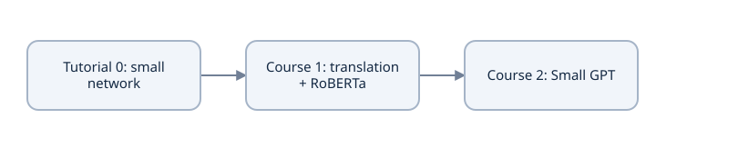

Tutorial 0 establishes tools and numerical/learning contracts. Course 1 adds full translation and RoBERTa mechanisms; Course 2 adds causal next-token GPT.


### Record readiness with concrete evidence

Use the [course outline](project/course-outline.md) and [prerequisite map](project/prerequisite-map.md) to find a missing concept; use [my study notes](project/study-notes.md) for your derivations and changed-input predictions. Keep actual work in the [implementation record](project/implementation.md), compare only the stated conditions in [reference runs](project/reference-runs.md), and record open gates in [readiness](project/p01-readiness.md). [Source notes](project/source-notes.md), [research](research.md) and [local reference evidence](reference-verification.json) distinguish documented facts, authored examples and executed evidence. Use the [native practice collection](practice/questions.md) and [explain-my-model boards](practice/explain-your-model.md) when reviewing the topics. These records support the lessons; they are not a second required theory course.

You should be able to derive a stable loss/gradient, explain embeddings and positions, work through rectangular masked attention and head splitting, distinguish feature mixing from token mixing, and trace a shifted translation batch. Independently demonstrate a complete small training/evaluation run and full-state new-process recovery. Begin Course 1's complete translation/RoBERTa implementations; then Course 2 develops Small GPT. Opening all lessons or passing author tests does not establish your explanation, implemented model or hosted capability. The existing foundations child still resumes its saved `linear()` exercise until actual learner work changes that checkpoint.

### Predict or explain: Map the paper's attention, FFN, position and schedule equations to their required tensors/state. Which original choices must not be silently replaced when beginning Course1?

<details data-practice-id="handoff-transfer"><summary>Reveal worked answer and rubric</summary>

Attention needs Q/K feature widths, allowed key/query connections, head split/merge and value width; FFN needs shared D→F→D maps with ReLU; positions add same-width sine/cosine features; schedule needs positive optimizer-update index/warmup. Original post-norm/Adam/ReLU choices differ from later pre-norm/AdamW/GELU. Readiness requires independent calculations, runnable checks and an honest remaining learner/hosted record, not merely authored source tests.

**Rubric:** Connect equations to concrete contracts and preserve architecture/evidence boundaries.

</details>


In [my study notes](project/study-notes.md), annotate paper equations 1–3 with axes, required saved state and one failure invariant each. Draw the complete batch above with all masks and six loss targets. Name the next component you will implement, its independent check, and the learner/hosted evidence that is still pending. Retain that specific next action in [the implementation record](project/implementation.md).


## Evidence and proof limits

### Claim ledger

| Claim | Status | Proof limit |
| --- | --- | --- |
| Worked arithmetic, matrices, probabilities and gradients are original known-answer fixtures. | illustrative | Fixture results and finite differences do not establish learner understanding. |
| Affine storage, broadcast dimensions, registered module state and evaluation/gradient modes have explicit API contracts. | documented | API contracts are tested on the declared CPU runtime; tensor axes still require task interpretation. |
| Text bytes, original character offsets and saved vocabulary identity are separate coordinate contracts. | documented | Own-format character/byte/BPE probes are not official pretrained tokenizer compatibility. |
| The tiny classifier and full-state continuation are bounded local prerequisites for later models. | documented | Exact local continuation requires matching source/config/data/runtime and all optimizer/sampler/random state. |
| Tutorial authoring/reference runs do not advance learner, complete-model or hosted recovery gates. | inference | The structured grid has a declared narrow domain; deleted-runtime Drive recovery remains unverified. |
| The original post-norm/ReLU/Adam encoder–decoder and its explicit attention/position/training equations are distinguished from later variants. | documented | Original source design; small course fixtures do not reproduce its corpus/scale/results. |
| SDPA allowed-True and MultiheadAttention blocked-True Boolean conventions are different; empty rows require a declared tested policy. | documented | API conventions verified; zero-empty-row behavior is this educational explicit-probe policy, not a universal backend claim. |
| AdamW and pre-norm are comparisons with different update/forward contracts. | documented | Recognition/comparison; no new full variant model or training benchmark. |

## Sources

- [minbpe BasicTokenizer source](https://github.com/karpathy/minbpe/blob/1acefe89412b20245db5a22d2a02001e547dc602/minbpe/basic.py) — BasicTokenizer train/encode/decode at revision 1acefe89412b20245db5a22d2a02001e547dc602; checked 2026-10-09
- [PyTorch 2.14 CrossEntropyLoss](https://docs.pytorch.org/docs/2.14/generated/torch.nn.CrossEntropyLoss.html) — Class-index targets, ignore_index, reduction; checked 2026-10-09
- [PyTorch 2.14 LayerNorm](https://docs.pytorch.org/docs/2.14/generated/torch.nn.LayerNorm.html) — Formula and normalized_shape; checked 2026-10-09
- [PyTorch 2.14 reproducibility guidance](https://docs.pytorch.org/docs/2.14/notes/randomness.html) — Cross-platform/release and device limits; checked 2026-10-09
- [PyTorch saving and loading models](https://docs.pytorch.org/tutorials/beginner/saving_loading_models.html) — General checkpoint for training; checked 2026-10-09
- [Google Colab FAQ](https://research.google.com/colaboratory/faq.html) — Resource limits, runtime and hardware availability; checked 2026-10-09
- [PyTorch 2.14 broadcasting semantics](https://docs.pytorch.org/docs/2.14/notes/broadcasting.html) — General semantics: alignment from trailing dimensions; checked 2026-10-09
- [PyTorch introduction to automatic differentiation](https://docs.pytorch.org/tutorials/beginner/basics/autogradqs_tutorial.html) — requires_grad, computing gradients and accumulation; checked 2026-10-09
- [uv: using a dedicated PyTorch CPU index](https://docs.astral.sh/uv/guides/integration/pytorch/) — Using a PyTorch index: explicit index and torch source mapping; checked 2026-10-09
- [Adam: A Method for Stochastic Optimization](https://arxiv.org/abs/1412.6980) — Algorithm 1: moments and bias correction; checked 2026-10-09
- [PyTorch 2.14 Adam](https://docs.pytorch.org/docs/2.14/generated/torch.optim.Adam.html) — Default betas, epsilon, algorithm and optimizer state; checked 2026-10-09
- [PyTorch 2.14 global gradient norm clipping](https://docs.pytorch.org/docs/2.14/generated/torch.nn.utils.clip_grad_norm_.html) — Global norm, in-place scaling and returned norm; checked 2026-10-09
- [PyTorch 2.14 Dropout](https://docs.pytorch.org/docs/2.14/generated/torch.nn.Dropout.html) — Training scaling and evaluation identity; checked 2026-10-09
- [Python 3.12 built-in types](https://docs.python.org/3.12/library/stdtypes.html) — Sequence indexing/slices and dictionary lookup; checked 2026-10-12
- [PyTorch 2.14 Linear](https://docs.pytorch.org/docs/2.14/generated/torch.nn.Linear.html) — Affine formula and stored weight[out,in]; checked 2026-10-12
- [PyTorch 2.14 Module](https://docs.pytorch.org/docs/2.14/generated/torch.nn.Module.html) — Parameter/buffer/submodule registration; train/eval state; checked 2026-10-12
- [PyTorch 2.14 Embedding](https://docs.pytorch.org/docs/2.14/generated/torch.nn.Embedding.html) — Integer indices select learned rows; padding behavior; checked 2026-10-12
- [PyTorch 2.14 no_grad](https://docs.pytorch.org/docs/2.14/generated/torch.no_grad.html) — Gradient recording is distinct from model evaluation mode; checked 2026-10-12
- [PyTorch 2.14 Tanh](https://docs.pytorch.org/docs/2.14/generated/torch.nn.Tanh.html) — Elementwise smooth nonlinearity; checked 2026-10-12
- [PyTorch 2.14 tensor views](https://docs.pytorch.org/docs/2.14/tensor_view.html) — Views, transpose, contiguity and reshape/view copy semantics; checked 2026-10-12
- [Michael Nielsen: Neural Networks and Deep Learning, Chapter 1](https://neuralnetworksanddeeplearning.com/chap1) — 2015 book / December 2019 site: prediction, learned parameters and gradient descent; checked 2026-10-12
- [Michael Nielsen: Chapter 2, how backpropagation works](https://neuralnetworksanddeeplearning.com/chap2) — Reverse chain rule, shared contributions and matrix orientation; checked 2026-10-12
- [Michael Nielsen: Chapter 3, cross-entropy cost](https://neuralnetworksanddeeplearning.com/chap3.html#the_cross-entropy_cost_function) — Sigmoid/cross-entropy derivative cancellation at the output; checked 2026-10-12
- [Dive into Deep Learning 1.0.3, section 5.3](https://d2l.ai/chapter_multilayer-perceptrons/backprop.html) — Forward values, computational graph and reverse derivative order; checked 2026-10-12
- [Attention Is All You Need, arXiv 1706.03762v7](https://arxiv.org/html/1706.03762v7) — Sections3–5; architecture, embedding/position equations, complexity and training settings; checked 2026-10-12
- [Dive into Deep Learning1.0.3: probability and statistics](https://d2l.ai/chapter_preliminaries/probability.html) — Probability/expectation/variance background; original course calculations; checked 2026-10-12
- [Dive into Deep Learning1.0.3: multilayer perceptrons](https://d2l.ai/chapter_multilayer-perceptrons/mlp.html) — Nonlinear hidden layers and activation definitions; checked 2026-10-12
- [Glorot and Bengio2010: initialization](https://proceedings.mlr.press/v9/glorot10a.html) — Fan-in/fan-out motivation; course variance derivation states its assumptions; checked 2026-10-12
- [He et al.2015: rectifier initialization](https://arxiv.org/abs/1502.01852) — Rectifier initialization; course distinguishes second moment and centered variance; checked 2026-10-12
- [PyTorch2.14 initialization](https://docs.pytorch.org/docs/2.14/nn.init.html) — Xavier/He functions, gains and weight orientation; checked 2026-10-12
- [PyTorch2.14 BCEWithLogitsLoss](https://docs.pytorch.org/docs/2.14/generated/torch.nn.BCEWithLogitsLoss.html) — Binary floating targets and stable fused logits loss; checked 2026-10-12
- [Loshchilov and Hutter: Decoupled Weight Decay Regularization](https://arxiv.org/abs/1711.05101) — Separate decay versus adaptive coupled L2; checked 2026-10-12
- [Unicode UAX15 revision58: normalization](https://www.unicode.org/reports/tr15/tr15-58.html) — NFC/NFKC and canonical/compatibility distinction; Python fixture independently checked; checked 2026-10-12
- [Sennrich et al.2016: subword units](https://aclanthology.org/P16-1162/) — BPE source motivation; own byte-level boundary/special-ID rules depart explicitly; checked 2026-10-12
- [Press and Wolf2017: output embedding](https://aclanthology.org/E17-2025/) — Input/output weight sharing; own gradient/count examples; checked 2026-10-12
- [Dive into Deep Learning1.0.3: positions and self-attention](https://d2l.ai/chapter_attention-mechanisms-and-transformers/self-attention-and-positional-encoding.html) — Permutation/position context; original pairwise shift derivation; checked 2026-10-12
- [Dive into Deep Learning1.0.3: attention scoring](https://d2l.ai/chapter_attention-mechanisms-and-transformers/attention-scoring-functions.html) — Q/K/V and score normalization context; checked 2026-10-12
- [PyTorch2.14 functional SDPA](https://docs.pytorch.org/docs/2.14/generated/torch.nn.functional.scaled_dot_product_attention.html) — Allowed-True Boolean mask, rectangular causality and explicit dropout argument; checked 2026-10-12
- [PyTorch2.14 MultiheadAttention](https://docs.pytorch.org/docs/2.14/generated/torch.nn.MultiheadAttention.html) — Blocked-True Boolean attention mask and ignored-True padding mask; checked 2026-10-12
- [Dive into Deep Learning1.0.3: multi-head attention](https://d2l.ai/chapter_attention-mechanisms-and-transformers/multihead-attention.html) — Parallel projections and head shape context; checked 2026-10-12
- [Dive into Deep Learning1.0.3: Transformer architecture](https://d2l.ai/chapter_attention-mechanisms-and-transformers/transformer.html) — Position-wise FFN and encoder/decoder integration context; checked 2026-10-12
- [He et al.2015: Deep Residual Learning](https://arxiv.org/abs/1512.03385) — Identity/residual formulation; no training-stability guarantee inferred; checked 2026-10-12
- [Xiong et al.2020: Layer Normalization in the Transformer](https://proceedings.mlr.press/v119/xiong20b.html) — Pre-/post-norm distinction; original zero-sublayer counterexample; checked 2026-10-12
- [Ba et al.2016: Layer Normalization](https://arxiv.org/abs/1607.06450) — Per-example normalization background; API/math checks separately recorded; checked 2026-10-12
- [Post2018: A Call for Clarity in Reporting BLEU Scores](https://arxiv.org/abs/1804.08771) — BLEU comparability/tokenization reporting; no translation score asserted; checked 2026-10-12
- [SacreBLEU project README](https://github.com/mjpost/sacrebleu) — Corpus evaluation signatures and reproducible score-reporting context; checked 2026-10-12
- [D2L1.0.3: sequence-to-sequence learning](https://d2l.ai/chapter_recurrent-modern/seq2seq.html) — Teacher forcing and conditional sequence learning; checked 2026-10-12
- [D2L1.0.3: beam search](https://d2l.ai/chapter_recurrent-modern/beam-search.html) — Greedy/beam alternatives and stopping context; checked 2026-10-12
