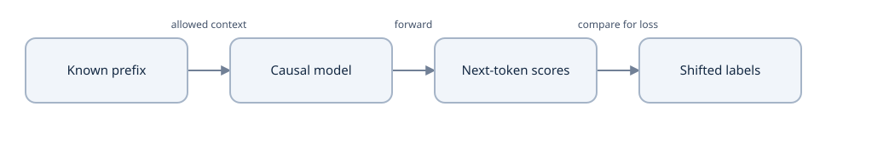
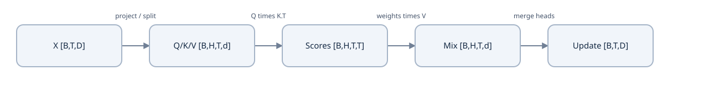
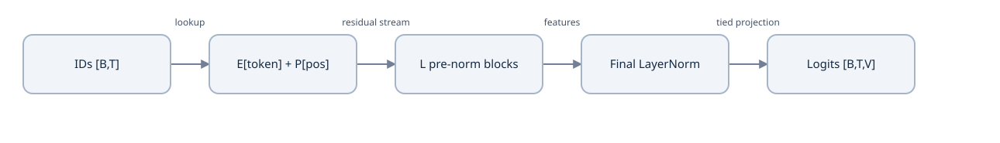
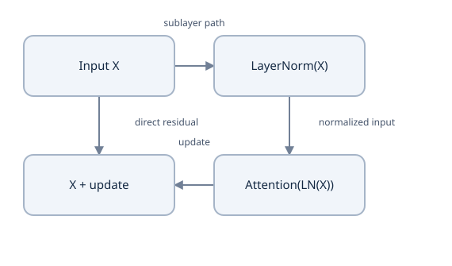
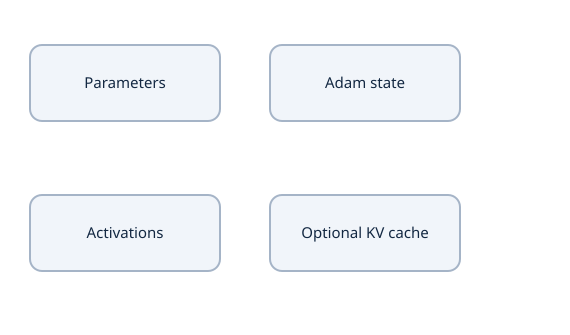

# Course 2 — build a small GPT language model

How do we turn a text prefix into a trainable, recoverable next-token language model?

Learning material for P01. Model implementation/training and learner mastery are separate states.

**Outcomes:** Explain shifted next-token training and conditional probability.; Create a bounded independent project and record its P00 handoff.; Preserve text provenance, split boundaries and frozen tokenizer identity.; Construct document-bounded windows and account for all valid targets.; Implement and independently check causal attention values and gradients.; Explain and build learned positions, pre-norm, GELU and tied output weights.; Derive loss/gradient reductions and a complete optimizer update.; Evaluate held-out likelihood and generate bounded, reproducible requests.; Verify immutable generations, compatible fallback and safe retention.; Train and restore all state using one explicit common trainer.; Prepare and perform a documented deleted-runtime hosted recovery drill.; Count/profile the complete model and assess P01 exit/P02 readiness..

## Lesson 1 — predict the next token

In P00 you gave a model a source sequence and asked its decoder to produce a separate target. For this project, keep only a text prefix. If the prefix is `the cat`, the task is to give each possible next token a probability. There is no second source sequence and no encoder memory. The prefix itself is the context.

Start here with a pencil or Python's standard library. You do not need to create a repository today. Your first stopping point is explaining the three training rows below and calculating one loss. The rest of this course turns that calculation into a complete small language model.

### Turn one string into several questions

Use UTF-8 byte IDs for the first model. The text `hi` has bytes 104 and 105. Our inherited structural IDs are BOS=257, EOS=258 and PAD=256. BOS means “the document begins”; EOS is something the model must learn to predict. PAD is only storage filler.

| Context available at this position | Token to predict |
| --- | --- |
| BOS | `h` = 104 |
| BOS, `h` | `i` = 105 |
| BOS, `h`, `i` | EOS = 258 |

The model receives `x=[257,104,105]` and labels `y=[104,105,258]`. This is a one-position shift. Although training processes all three positions together, the causal mask prevents the first position from reading the later `h` or `i`. The answer is present elsewhere in the batch, but cannot enter the calculation that predicts it.



Prediction and supervision paths; targets never enter their own forward calculation.


The arrows in this board describe information used for a prediction and supervision used to measure it. A label is not fed back into its own prediction during the same forward call. At inference the next chosen token does become part of the next call's prefix.

### Predict or explain: For bytes of ok=[111,107], write x and y including BOS/EOS. Which token does x position zero predict?

<details data-practice-id="shift"><summary>Reveal worked answer and rubric</summary>

x=[257,111,107], y=[111,107,258]. Position zero predicts 111, using BOS only. The causal diagonal is allowed because the input at that position precedes its label.

**Rubric:** Correct shift, end marker and causal explanation.

</details>


### Why next-token prediction defines a language model

Conditional probability means “probability given some information.” Write $p(b\mid a)$ for the probability of b after observing a. For a token sequence, the probability chain rule gives

$$p(t_1,\ldots,t_n\mid BOS)=\prod_{i=1}^{n}p(t_i\mid BOS,t_1,\ldots,t_{i-1}).$$

The chain rule does not assume tokens are independent. Each factor has its own context. Our finite model uses at most its declared context window, so it approximates a distribution with bounded memory. Include EOS if you are scoring the probability of ending the document as well.

Suppose the three correct next-token probabilities are 0.5, 0.25 and 0.125. Their product is 0.015625. Training with that product directly is awkward: long sequences give extremely small products. The natural logarithm turns multiplication into addition: $\log(ab)=\log a+\log b$. Negating the log turns a high correct-token probability into a small loss.

$$L=-\frac{\log(0.5)+\log(0.25)+\log(0.125)}{3}
=\frac{0.693147+1.386294+2.079442}{3}=1.386294.$$

A natural-log loss is measured in **nats per predicted token**. Exponentiating gives perplexity: $\exp(L)=4$. This equals four equally likely choices per prediction in an equivalent constant-uncertainty case. It does not mean the vocabulary contains four tokens, nor that the model literally considered exactly four choices at every step.

### Predict or explain: Correct-token probabilities are 1/2, 1/4 and 1/8. Compute sequence probability, mean NLL and perplexity.

<details data-practice-id="perplexity"><summary>Reveal worked answer and rubric</summary>

Product=1/64. Negative log product=ln(64); divide by 3 to get ln(4). Perplexity=4. Unequal per-position uncertainty can have this same average.

**Rubric:** Use logs and three valid predictions; do not confuse perplexity with vocabulary size.

</details>


Run [the small arithmetic program](examples/math_trace.py) with `python3 math_trace.py` after saving it in a scratch folder. It uses no Torch. Expect the shifted arrays, perplexity 4, weighted loss 2 and colder-sampling probability 0.9. The later lessons explain its GELU and temperature calculations. You can also save [the C++17 trace](examples/math_trace.cpp), compile with `g++ -std=c++17 math_trace.cpp -o math_trace`, and run `./math_trace` to check explicit memory indexing.

### What carries over from P00, and what changes

You retain the tokenizer artifact idea, causal attention, shape/gradient checks and complete-state recovery discipline. You replace the conditional task with text continuation. You remove encoder/cross-attention, use learned position embeddings, put LayerNorm before each sublayer, add a final LayerNorm, and use GELU in the feed-forward network. Those are explicit design choices, not consequences that follow automatically from deleting an encoder.

This required P01 course is an educational GPT-style model. Historical GPT-1 used a different post-norm/classification design; those optional architecture details are outside this required course. The next lessons teach every change beside the file that implements it.

Before starting the implementation, use P00's exit record to confirm its required learner gates. This new tutorial does not mark them complete. If you are previewing P01 early, keep reading this first calculation; return to the first unfinished P00 gate before treating P01 as your active model project.

### Your first session ends here

Without looking back, write x and y for `ok`, explain why position zero cannot read the answer, and say why lowering mean negative log probability lowers perplexity. If those connections are clear, the next lesson gives this calculation a home on disk.

[Continue to Lesson 2](lessons/02-workspace.md) · [Implementation checklist](project/implementation.md) · [Readiness](project/readiness.md) · [Sources](research.md)


## Lesson 2 — make a project you can return to

You already know the first input and label arrays. Now create a small independent project where each new file has one job. We will build it in order. Do not paste an entire finished repository and then try to discover how it works.

### Start only the selected implementation

The tutorial files live in Projects Docs; your implementation will belong in `ai_projects/projects/gpt-lab`. From workspace home, use `./ai new project gpt-lab --title "Small GPT Language Model"` after the P00 exit review. Register it as a Projects child, not Research. If `gpt-lab` already exists, read its AGENTS/checkpoint and Git status and resume it. Do not overwrite it. Use `./ai task new "P01 Small GPT implementation" --owner gpt-lab --domains project` after registration to create the child-owned work record.

For following the code independently, you can instead make an empty practice directory with `mkdir gpt-practice` and `cd gpt-practice`. That disposable folder is sufficient for the examples; it does not replace the registered child when you begin roadmap work. From this point, **working directory means the learner project root** unless a command explicitly says otherwise.

Create folders with `mkdir -p configs docs notebooks`. The first implementation is intentionally a set of clearly named Python modules in the project root. Python finds sibling imports when you run a script from that directory. You can package them later without changing the math.

```text
gpt-lab/
  gpt_config.py        # dimensions and invariants, today
  gpt_tokenizer.py     # a frozen P00 source snapshot, Lesson 3
  gpt_data.py          # split, encode, window, sample, Lessons 3–4
  gpt_attention.py    # Q/K/V and causal attention, Lesson 5
  gpt_model.py        # blocks, positions, tied vocabulary projection, Lesson 6
  gpt_objective.py    # loss, optimizer, evaluation, Lessons 7–8
  gpt_sample.py       # bounded generation, Lesson 8
  gpt_checkpoint.py   # verified persistent generations, Lesson 9
  gpt_trainer.py      # updates and all resumable state, Lesson 10
  gpt_train.py        # explicit new/resume entry, Lesson 10
  configs/            # your resolved profiles
  docs/               # provenance, measurements, exit record
  notebooks/          # the thin Colab notebook, Lesson 11
```

This tree is a destination map, not a list of files you must create now. Each later lesson supplies its files, instructions and checks when their dependencies exist.

### Give Python an isolated runtime

Use Python 3.12 for the checked CPU reference:

```bash
python3.12 -m venv .venv
source .venv/bin/activate
python -m pip install --upgrade pip
python -m pip install torch==2.14.1 --index-url https://download.pytorch.org/whl/cpu
python -c "import torch; print(torch.__version__); print(torch.ones(2,3) @ torch.ones(3,1))"
python -m pip freeze > requirements-cpu-lock.txt
```

The matrix result is a two-row column of 3s. `torch==2.14.1` is the author-tested API version, not a claim that every host has its wheel. Record the Python patch version, package versions, OS and actual CPU in `docs/runtime.md`. Resolve an installation failure before proceeding. The Colab lesson uses a GPU-capable installation separately; do not install this CPU wheel as your GPU training environment.

Create `.gitignore` with `.venv/`, `__pycache__/`, `data/`, `runs/`, `exports/`, `*.pt` and notebook checkpoints. Track source, configs, tests and reports. The raw book and learned weights can be reproduced or restored; they do not belong in Git. This course needs standard library plus Torch, not a tokenizer service, paid API or remote training job.

### Write the model contract first

Create `gpt_config.py` with the following code. A dataclass collects named settings; `frozen=True` prevents accidental changes to this object's fields during a run. `__post_init__` checks invariants immediately after construction.

<!-- file:gpt_config.py mode:write -->
```python
"""The educational P01 model contract; no pretrained compatibility claim."""
from dataclasses import dataclass


@dataclass(frozen=True)
class Config:
    vocab: int = 260
    context: int = 64
    width: int = 64
    heads: int = 4
    layers: int = 2
    hidden: int = 256
    dropout: float = 0.0

    def __post_init__(self):
        if min(self.vocab, self.context, self.width, self.heads,
               self.layers, self.hidden) < 1 or self.vocab < 260:
            raise ValueError("Positive dimensions and the structural vocabulary required")
        if self.width % self.heads or not 0 <= self.dropout < 1:
            raise ValueError("Width must divide into heads; dropout must be in [0,1)")
```

Here B means batch size, T time positions, D model width, H heads, F feed-forward width and V vocabulary size. Defaults are L=2, D=64, H=4, F=256, T≤64, V=260. Each head receives d=D/H=16 features. An invalid division is a configuration error, not something to discover later in a reshape.

Run this now:

```bash
python -c "from gpt_config import Config; c=Config(); print(c); print(c.width//c.heads)"
```

Expect the defaults and 16. Then try `Config(width=63)`: it should fail. Restore the defaults; do not train a different model just to hide a shape error.

### Predict or explain: If D=96 and H=4, what is head width? Why does D=63,H=4 fail?

<details data-practice-id="heads"><summary>Reveal worked answer and rubric</summary>

Head width is 24. D/H must be integral for equal head partitions; 63 cannot be divided into four equal integer feature groups.

**Rubric:** Connect configuration validation to reshape dimensions.

</details>


### Preserve the P00 handoff without a hidden dependency

Create `docs/p00-handoff.md`. Record the P00 source revision plus dirty-file hashes, tokenizer schema/hash and tests, and the learner exit evidence. State which code you copy and why. The next lesson includes a self-contained snapshot of the tutorial's P00 tokenizer for study. If using your own completed tokenizer, check that artifact/API compatibility first. Never import through `../../transformer-foundations-lab` or load P00 encoder–decoder weights as a GPT checkpoint.

Create `docs/p01-exit.md` from the [readiness rows](project/readiness.md). Keep author checks and your own checks separate. There is no need to finish the record today; its first entry is the actual environment and first passing configuration check.

You now have a place to save results and a model size that is small enough to measure. The next unresolved problem is what text the model is allowed to learn from, and how to preserve that decision across runs.

[Continue to Lesson 3](lessons/03-text-and-tokenizer.md) · [Project implementation](project/implementation.md)

### Complete files from this lesson

[gpt_config.py](examples/gpt_config.py)


## Lesson 3 — freeze the text and tokenizer

A language model can appear to improve because the evaluation text leaked into training. Fix the split before tokenization or windows. We will use one small, named corpus and keep its bytes, boundaries and tokenizer identity explicit.

### Choose a bounded text source

The worked corpus is Lewis Carroll's *Alice's Adventures in Wonderland*, Project Gutenberg ebook 11. The [catalog](https://www.gutenberg.org/ebooks/11) labels its copyright status public domain in the USA and provides its usage terms. Record the catalog, retrieval date and terms with the acquisition instructions; a hash records which bytes you used, not usage permission. This is a one-book educational task. Its writing style and vocabulary cannot represent general language ability.

Use chapters I–IX for training, X for validation, and XI–XII for a final untouched test. Validation guides debugging/choices. Test is opened only after those choices are fixed. Splitting chapters keeps adjacent windows of a chapter in one partition; randomly splitting already overlapping windows would allow near-duplicate context across partitions. Exact-document deduplication is necessary but does not prove an absence of near duplicates or shared phrases. Record these limits.


Partition before fitting. Only training chapters fit the tokenizer. Then encode each of the three retained partitions separately with the frozen tokenizer.


The raw file is checked against SHA-256 `01b38ea4c710a84bc18d0bd41271a5a1a92b94e97b2812f4dece97d4a694725e`. SHA-256 maps bytes to a 256-bit digest. If any byte differs, stop and inspect the source/parser before declaring a new data version. Do not edit the expected hash merely to silence the check. We retain the selected chapter text's exact CRLF/newline and Unicode content; no normalization is hidden in preparation.

### Reuse a frozen tokenizer source

Save [gpt_tokenizer.py](examples/gpt_tokenizer.py) as `gpt_tokenizer.py` in the learner root. It is the byte-for-byte P00 `ByteBPE` educational reference snapshot, whose source digest is recorded in the [sources record](research.md). This deliberate reuse is why we do not write BPE again in P01.

Run `python gpt_tokenizer.py`. Expect deterministic merges `[[97,98],[260,260]]`, encoded `abab` as `[261]`, and true Unicode/boundary/rank checks. Open the file at `encode`, `payload` and `load`: encoding uses learned merge rank; payload records boundaries/special IDs; loading rejects altered or unsupported policies. Confirm these match your P00 handoff before replacing the reference with your own implementation.

The baseline uses `ByteBPE.train(train_documents, cap=260)`, so it learns no merges: 256 bytes plus four structural IDs. Even this artifact records the training-document hash. The same API lets you make a separate BPE experiment with cap=512 later. Fit merges on the training chapters only; freeze them before encoding validation/test. Set model V to the artifact's **actual** size, which may be below the cap.

### Predict or explain: You train BPE on all twelve chapters before splitting. Why is a frozen final artifact still insufficient?

<details data-practice-id="tokenizer"><summary>Reveal worked answer and rubric</summary>

The learned merge vocabulary already used validation/test text. Freeze after fitting only on training chapters; preserve a new artifact hash and rerun the experiment. Freezing prevents later drift but does not undo earlier leakage.

**Rubric:** Name both split-before-fit and run identity.

</details>


### Write acquisition and identity checks

Create `gpt_data.py`. First add its imports, source pin and document preparation/load functions below. Later in the lesson route we append windows, sampling and the CLI. The functions are callable already; the full file download includes the later parts too.

<!-- file:gpt_data.py mode:write -->
```python
"""Split documents first; freeze tokenizer; then make bounded next-token windows."""
import argparse
import hashlib
import json
from pathlib import Path
import re
import urllib.request
import torch
from gpt_tokenizer import ByteBPE, BOS, EOS, PAD, digest

URL = "https://www.gutenberg.org/ebooks/11.txt.utf-8"
RAW_SHA = "01b38ea4c710a84bc18d0bd41271a5a1a92b94e97b2812f4dece97d4a694725e"


def alice_splits(raw):
    if hashlib.sha256(raw).hexdigest() != RAW_SHA:
        raise ValueError("Source bytes changed: inspect/re-pin explicitly; do not train")
    text = raw.decode("utf-8-sig")
    body = text.split("*** END OF THE PROJECT GUTENBERG EBOOK", 1)[0]
    starts = list(re.finditer(r"^CHAPTER [IVX]+\.\r?$", body, re.M))
    if len(starts) != 12:
        raise ValueError("Expected twelve chapter headings; parser needs review")
    documents = [body[m.start():starts[i+1].start() if i+1 < 12 else len(body)]
                 for i, m in enumerate(starts)]
    # Keep exact chapter text including CRLF; normalization is part of identity.
    return {"train": documents[:9], "validation": documents[9:10],
            "test": documents[10:]}


def prepare(directory, cap=260):
    directory = Path(directory)
    if directory.exists():
        raise FileExistsError("Use a fresh data directory; never replace a frozen split")
    raw = urllib.request.urlopen(URL, timeout=30).read()
    splits = alice_splits(raw)
    tok = ByteBPE.train(splits["train"], cap=cap)
    directory.mkdir(parents=True)
    (directory / "alice.txt").write_bytes(raw)
    (directory / "splits.json").write_text(json.dumps(splits, ensure_ascii=False))
    tok.save(directory / "tokenizer.json")
    manifest = {"schema": 1, "url": URL, "raw_sha256": RAW_SHA,
                "catalog": "https://www.gutenberg.org/ebooks/11",
                "rights_label": "Public domain in the USA (catalog); retain source terms",
                "partition": "chapters I-IX / X / XI-XII; exact UTF-8; no normalization",
                "split_hashes": {k: digest(v) for k, v in splits.items()},
                "tokenizer_sha256": tok.identity, "vocab": tok.size}
    (directory / "manifest.json").write_text(json.dumps(manifest, indent=2))
    return manifest


def load_data(directory):
    directory = Path(directory)
    splits = json.loads((directory / "splits.json").read_text())
    manifest = json.loads((directory / "manifest.json").read_text())
    tok = ByteBPE.load(directory / "tokenizer.json")
    if manifest["schema"] != 1 or tok.identity != manifest["tokenizer_sha256"]:
        raise ValueError("Data/tokenizer identity mismatch")
    if {k: digest(v) for k, v in splits.items()} != manifest["split_hashes"]:
        raise ValueError("Split bytes changed")
    hashes = [set(digest(doc) for doc in splits[k]) for k in ("train", "validation", "test")]
    if any(hashes[i] & hashes[j] for i in range(3) for j in range(i)):
        raise ValueError("An exact document crosses splits")
    if tok.train_hash != digest(splits["train"]):
        raise ValueError("Tokenizer was fitted on different documents")
    return splits, tok, manifest
```

`alice_splits` verifies bytes before decoding and finds chapter headings anchored to whole lines. `prepare` refuses an existing directory so a new data preparation cannot overwrite a frozen version. `load_data` checks the saved tokenizer, every split hash and the tokenizer's training split. It also rejects exact duplicate documents across partitions.

At this stage call the function directly; `data/alice-byte` must not exist:

```bash
python -c "from gpt_data import prepare; import json; print(json.dumps(prepare('data/alice-byte'), indent=2))"
```

Expect V=260 and three named split hashes. Keep the resulting manifest with the run's provenance. If the network is unavailable, obtain the same file separately, verify its raw hash, then call `alice_splits(raw_bytes)`; do not substitute a different text under the same identity. Raw data stays ignored.

Check a non-ASCII input:

```bash
python -c "from gpt_data import load_data; s,t,m=load_data('data/alice-byte'); text='café 🙂'; print(t.encode(text)); assert t.decode(t.encode(text))==text"
```

The token count exceeds the number of displayed characters because UTF-8 uses several bytes for some characters. This matters later: byte-token perplexity cannot be compared directly with a BPE-token perplexity from a different tokenizer. We will preserve the denominator and compare the same raw held-out text with an explicit boundary/context policy.

### A controlled BPE follow-up

After the byte baseline and window lesson work, use a new data directory: `python gpt_data.py data/alice-bpe --vocab 512`. Read the resulting manifest's actual vocabulary size, put that V in a new configuration and use a new run directory. Never load byte-model weights/optimizer state through strict resume into a different vocabulary. Keep the same chapter split and report tokens per raw byte before comparing model loss. This experiment tests a changed representation and sequence length; it is not GPT-2 tokenizer compatibility.

### Your data record

Create `docs/data.md` with source/terms, raw hash, parser version, split chapter IDs/hashes, exact normalization policy, tokenizer size/hash, and a statement that test chapters have not been used for tuning. Add a small round-trip table for plain ASCII, an emoji, empty text and a literal `<BOS>` spelling. The spelling must encode as ordinary bytes; only the pipeline inserts structural BOS.

The text identities are now fixed. The next lesson converts each chapter into input/label arrays without crossing a boundary or losing its last prediction.

[Continue to Lesson 4](lessons/04-windows.md) · [Sources and choices](research.md)

### Complete files from this lesson

[gpt_data.py](examples/gpt_data.py)


## Lesson 4 — make batches that ask the right question

You now have fixed chapter strings and a fixed token-to-byte mapping. The model cannot consume an entire book at once. Give it bounded windows, and prove which labels each window contributes before building attention.

### Cut targets once, keep document seams intact

For `hi`, form `[BOS,104,105,EOS]`. Take adjacent slices: input drops the last item, labels drop the first. With context four, right-pad both to length four:

```text
x: BOS   h     i    PAD
y:  h    i    EOS   PAD
```

The last row does **not** train the model to output PAD. PAD labels are ignored by the loss. EOS labels count normally. BOS tells the model where a document begins; it is an input here, not a label.

For a longer document and T=3, start the next window at index 3 rather than 4. This shares the boundary token as context and predicts each target exactly once:

```text
stream: BOS a b c d e EOS
x0:     BOS a b       y0: a b c
x1:       c d e       y1: d e EOS
```

The new window cannot see earlier `a,b`; that is a deliberate reset-context approximation. It does not cross into a different document. Evaluating the same way produces a reproducible finite-context metric. A sliding evaluation with more preceding context is a different protocol and may have a different loss.

### Predict or explain: For BOS,a,b,c,d,EOS with T=3, give both x/y windows and count supervised labels.

<details data-practice-id="windows"><summary>Reveal worked answer and rubric</summary>

x0=[BOS,a,b], y0=[a,b,c]; x1=[c,d,PAD], y1=[d,EOS,PAD]. Five supervised labels. c is a label in one window and context in the next; it is not predicted twice.

**Rubric:** Keep tail/EOS and exclude PAD from denominator.

</details>


Append `windows` to `gpt_data.py`. The returned tensors have shape `[number_of_windows,T]` and int64 IDs. A Python list is flexible while constructing rows; the resulting tensor is rectangular storage for the model.

<!-- file:gpt_data.py mode:append -->
```python


def windows(documents, tok, context):
    if context < 1:
        raise ValueError("Positive context required")
    xs, ys = [], []
    for document in documents:
        ids = [BOS] + tok.encode(document) + [EOS]
        # Each target occurs once. Reset context at each window and document.
        for start in range(0, len(ids)-1, context):
            x = ids[start:start+context]
            y = ids[start+1:start+context+1]
            x = x[:len(y)]
            xs.append(x + [PAD] * (context-len(x)))
            ys.append(y + [PAD] * (context-len(y)))
    if not xs:
        raise ValueError("At least one document required")
    return torch.tensor(xs, dtype=torch.long), torch.tensor(ys, dtype=torch.long)
```

Run the smallest fixture immediately:

```bash
python -c "from gpt_data import windows; from gpt_tokenizer import ByteBPE; x,y=windows(['hi'],ByteBPE(),4); print(x.tolist()); print(y.tolist())"
```

Expect `[[257,104,105,256]]` and `[[104,105,258,256]]`. If you get identical x and y, you are training identity copying. If EOS disappears from labels, your stopping behavior has no direct target.

### Select training windows without hiding sampler state

A batch of B=8 contains eight windows. This first reference samples window indices uniformly **with replacement**. A window can appear twice, and an “epoch” has no special meaning. We record draws and global token counts instead. This choice makes the data state small and explicit; an epoch-shuffling loader is a later alternative with different state.

Append the remaining sampler and command-line entry to `gpt_data.py`:

<!-- file:gpt_data.py mode:append -->
```python


class Batches:
    """One explicit CPU generator; random windows with replacement, no workers."""
    def __init__(self, x, y, seed):
        self.x, self.y = x, y
        self.rng = torch.Generator().manual_seed(seed)
        self.draws = 0

    def next(self, size, device="cpu"):
        indices = torch.randint(len(self.x), (size,), generator=self.rng)
        self.draws += size
        return self.x[indices].to(device), self.y[indices].to(device)

    def state(self):
        return {"rng": self.rng.get_state(), "draws": self.draws}

    def restore(self, state):
        self.rng.set_state(state["rng"])
        self.draws = state["draws"]


if __name__ == "__main__":
    parser = argparse.ArgumentParser()
    parser.add_argument("directory")
    parser.add_argument("--vocab", type=int, default=260)
    args = parser.parse_args()
    print(json.dumps(prepare(args.directory, args.vocab), indent=2))
```

The CPU generator belongs to the data sampler. Model dropout uses Torch's model RNG separately. Saving both is necessary: recovering weights while drawing different next windows changes the optimization path. `indices` picks rows before transferring the batch to the selected device, so the entire text corpus need not occupy VRAM.

### Predict or explain: Weights and optimizer restore correctly, but the next random window differs. What is missing?

<details data-practice-id="batch-rng"><summary>Reveal worked answer and rubric</summary>

Restore the dedicated sampler generator state and draw position/contract. A model/dropout seed does not identify the sampler's next draw after many updates.

**Rubric:** Distinguish independent generator state from initial seeds.

</details>


Save [test_gpt_data.py](examples/test_gpt_data.py) as `test_gpt_data.py`. Run `python -m unittest test_gpt_data -v`. Four tests cover the tiny shift/tail, document boundary and one-time target coverage, Unicode/frozen artifact and next-draw restore. Open each fixture and explain what a wrong implementation would return. A test count alone is not the goal.

### Keep all denominators visible

A window may contain fewer than T labels because its document ended. With two windows containing 3 and 1 valid labels, the batch has four supervised tokens, not eight merely because the tensors have eight slots. Store this fact mentally now: the training loss, gradient accumulation and validation metric will all divide by the number of **valid labels**.

Right padding also gives attention a simple contract: the first token is real and real tokens never occur after a PAD. Padded queries may produce unused values, but they can see at least the first real key, so no softmax row is all negative infinity. Valid-token outputs and the loss remain unaffected by appended right padding. We will test that explicitly.

The input/label path is now correct without a model. Next, teach each position how to read its allowed prefix.

[Continue to Lesson 5](lessons/05-causal-attention.md)

### Complete files from this lesson

[gpt_data.py](examples/gpt_data.py)


## Lesson 5 — let each position read its prefix

Each input position now carries an ID and predicts the next ID. Attention turns a position's feature vector into a mixture of earlier feature vectors. P00 supplied the mechanism; here you rebuild the causal-only path and verify that it cannot use future text.

### Read the dimensions before the equation

An embedding will turn IDs `[B,T]` into vectors `X[B,T,D]`. Three learned projections produce queries Q, keys K and values V. A query describes what this position seeks; a key provides features for matching; a value provides the content mixed into the result. These are learned vectors, not linguistic labels you assign by hand.

A linear layer computes `X @ W.T + bias` in PyTorch's stored weight convention. A fused D→3D projection simply puts Q, K and V outputs beside each other, then splits them. It changes how we arrange the calculation, not the causal rule.

With D=64 and H=4, reshape each projection from `[B,T,64]` to `[B,T,4,16]`, then transpose to `[B,4,T,16]`. Each head has its own 16-feature score calculation. Do not reshape directly into `[B,4,T,16]`: that would rearrange which features belong to a time position.



Edges describe tensor calculations, not prerequisite relationships.


### Work one head by hand

For a head with d features,

$$S_{ij}=\frac{\sum_{r=1}^{d}Q_{ir}K_{jr}}{\sqrt d},\qquad
A_{ij}=\frac{\exp S_{ij}}{\sum_{k\;\mathrm{allowed}}\exp S_{ik}},\qquad
O_i=\sum_{j\;\mathrm{allowed}}A_{ij}V_j.$$

Index i is the query position, j the key position, and r the feature being summed. A causal query at i may use keys j≤i. We include the diagonal: position i's input is known, and it predicts the **next** token. Masking the diagonal unnecessarily removes valid context.

The square-root scale comes from a variance argument: if d product terms are independent with unit variance, their sum has variance d and standard deviation √d. Dividing by √d keeps the score's scale roughly stable as d changes. Learned activations do not satisfy those assumptions exactly; this motivates the scaling, not a proof that every observed score has variance one.

Set all allowed scores to zero and values to `[2,4,8]`. Row zero can only see 2; row one averages 2 and 4; row two averages all three. Outputs are `[2,3,14/3]`. Future keys must have zero probability, not a score of zero. Setting forbidden scores to zero would give them positive exponential mass. Use negative infinity before softmax.

Zero scores and values [2,4,8]; inspect query row 1.

Illustrative cases, not a model execution.

[[interactive:visibility]]

### Change the visible keys

| Mask | Outcome | Explanation |
| --- | --- | --- |
| causal | Output 3 | Only keys 0 and 1 are visible: (2+4)/2. |
| unmasked | Output 4.666667 | The future key contributes: (2+4+8)/3. This leaks future input during next-token training. |


### Predict or explain: With all scores zero and values 2,4,8, what is row 1 under a causal mask? What if forbidden scores are set to zero?

<details data-practice-id="mask"><summary>Reveal worked answer and rubric</summary>

Row 1 averages 2 and 4, giving 3. If the forbidden future key gets score zero rather than negative infinity, it receives probability and changes the result toward 14/3.

**Rubric:** Read rows as queries, columns as keys and preserve diagonal.

</details>


### Implement the score-to-mixture operation

Create `gpt_attention.py` with the imports and `attend` function. The explicit path is our reference. The optional library path uses PyTorch SDPA as an independent comparison under matching masks and dropout settings; `True` in its Boolean mask means allowed.

<!-- file:gpt_attention.py mode:write -->
```python
"""Readable causal attention and an independent library comparison path."""
import math
import torch
from torch import nn
from torch.nn import functional as F


def attend(q, k, v, allowed, *, optimized=False, dropout=0.0, training=False):
    probability = dropout if training else 0.0
    if optimized:
        return F.scaled_dot_product_attention(q, k, v, attn_mask=allowed,
                                              dropout_p=probability)
    scores = q @ k.transpose(-2, -1) / math.sqrt(q.size(-1))
    scores = scores.masked_fill(~allowed, float("-inf"))
    weights = scores.softmax(dim=-1)
    weights = F.dropout(weights, p=probability, training=training)
    return weights @ v
```

The score matrix has `[B,H,T,T]` entries. Softmax reduces over its last axis, the keys. `weights @ v` sums those key contributions and returns `[B,H,T,d]`. The library API applies the probability passed in `dropout_p`; evaluation must explicitly pass zero. [The inspected API contract](https://docs.pytorch.org/docs/2.14/generated/torch.nn.functional.scaled_dot_product_attention.html) is why `probability` depends on training mode here.

### Add projections and head layout

Append the attention module:

<!-- file:gpt_attention.py mode:append -->
```python
class CausalAttention(nn.Module):
    def __init__(self, config):
        super().__init__()
        self.heads = config.heads
        self.dropout = config.dropout
        self.qkv = nn.Linear(config.width, 3 * config.width)
        self.output = nn.Linear(config.width, config.width)

    def forward(self, x, valid, *, optimized=False):
        batch, time, width = x.shape
        q, k, v = self.qkv(x).chunk(3, dim=-1)
        def heads(tensor):
            return tensor.reshape(batch, time, self.heads, width // self.heads).transpose(1, 2)
        q, k, v = map(heads, (q, k, v))
        causal = torch.ones(time, time, dtype=torch.bool, device=x.device).tril()
        allowed = causal[None, None] & valid[:, None, None, :]
        # Model input requires a real first token. Even padded queries see it;
        # they are discarded by the loss. No softmax row is entirely masked.
        out = attend(q, k, v, allowed, optimized=optimized,
                     dropout=self.dropout, training=self.training)
        out = out.transpose(1, 2).contiguous().view(batch, time, width)
        return F.dropout(self.output(out), p=self.dropout, training=self.training)
```

`valid[:,None,None,:]` broadcasts a per-example key mask across heads and query rows. `causal[None,None]` broadcasts across batch and heads. Their AND enforces both rules. The model will reject all-PAD and non-right-padded input before this function runs.

After mixing, the transpose puts time before heads again. `.contiguous()` arranges those values in contiguous memory before `.view()` merges head features into width D. The output linear layer lets channels from different heads interact. Residual dropout regularizes that update; it will be disabled during deterministic comparisons.

Check the handwritten average now:

```bash
python - <<'PYCODE'
import torch
from gpt_attention import attend
q=torch.zeros(1,1,3,1)
v=torch.tensor([2.,4.,8.]).reshape(1,1,3,1)
mask=torch.ones(3,3,dtype=torch.bool).tril()
print(attend(q,q,v,mask).flatten())
PYCODE
```

Expect approximately `tensor([2.0000,3.0000,4.6667])`. Change the last value to 80: the first two outputs must stay the same. This tests the direction of information flow, not just output shape.

### Compare gradients, not only outputs

The next lesson's `test_gpt_model.py` compares explicit attention with SDPA in float64, compares Q/K/V gradients, and uses centered finite differences through `gradcheck`. In a centered difference, perturb one value by +ε and −ε and divide the output difference by 2ε. Too large an ε adds approximation error; too small an ε loses precision. Float64 and tiny tensors make this diagnostic more reliable.

### Predict or explain: Outputs match SDPA but Q gradients differ. What must you check before widening the tolerance?

<details data-practice-id="gradient-check"><summary>Reveal worked answer and rubric</summary>

Match dtype, reduction/objective, mask polarity, score scaling, head permutation and dropout=0. Compare K/V gradients too; use a small float64 finite-difference check to distinguish shared mistakes.

**Rubric:** Gradient evidence and controlled settings, not output shape alone.

</details>


Keep dropout off for comparisons. With random dropout, two equally correct calls may choose different masks. Do not loosen tolerance until every mismatch disappears; first compare dtype, mask polarity, scaling and head order.

Attention now provides a causal update. The next lesson adds the residual stream, per-position transformations and vocabulary projection to make a complete model.

[Continue to Lesson 6](lessons/06-complete-gpt.md)

### Complete files from this lesson

[gpt_attention.py](examples/gpt_attention.py)


## Lesson 6 — assemble the whole GPT

Attention can mix an allowed prefix. We now need a complete path from token IDs to V next-token scores. Follow one row: BOS becomes a vector, receives position zero, passes through two blocks, and produces a score for every vocabulary ID. No encoder or cross-attention participates.



The same token matrix is used for lookup and the final bias-free vocabulary projection.


### Learned positions are parameters

Token ID 104 always selects row 104 of the token embedding matrix E[V,D]. That alone cannot tell the model whether `h` occurs first or later. A learned position matrix P[Tmax,D] adds a different trainable vector at each position:

$$X_{b,t,:}=E[x_{b,t},:]+P[t,:].$$

For a toy token vector `[1,2]` and position vector `[0.1,-0.2]`, their sum is `[1.1,1.8]`. It is addition of matching feature axes, not concatenation. Gradients update both selected rows. A token repeated in several positions accumulates gradient contributions into the same E row, whereas those positions may use different P rows.

P00's sinusoidal positions were a fixed formula stored as a buffer. These positions are learned parameters with an explicit maximum index. We do not scale the token embeddings by √D in this design. Both are recorded choices. If T exceeds 64, the model rejects the input; the generation policy later crops a context before calling the model.

### Predict or explain: Does a repeated token at positions 2 and 5 share both embedding rows?

<details data-practice-id="positions"><summary>Reveal worked answer and rubric</summary>

It shares the token row E[id] and accumulates both token-gradient contributions there. It uses different learned position rows P[2] and P[5]. Their sum remains width D.

**Rubric:** Distinguish token identity from location and addition from concatenation.

</details>


### Put normalization before each sublayer

For each `[D]` feature vector, LayerNorm computes the mean and population variance across features, then applies learned scale γ and bias β:

$$\mu=\frac{1}{D}\sum_j x_j,\quad v=\frac{1}{D}\sum_j(x_j-\mu)^2,
\qquad LN(x)_j=\gamma_j\frac{x_j-\mu}{\sqrt{v+\epsilon}}+\beta_j.$$

It does not average over time or across examples. `[1,3]` has mean 2 and variance 1, giving approximately `[-1,1]` with unit γ and zero β. ε avoids division by zero for a constant vector; it is not a sample-variance correction.

A pre-norm block computes

$$U=X+Attention(LN_1(X)),\qquad Y=U+FFN(LN_2(U)).$$

Compare P00's `LN(X+Attention(X))`. If the sublayer outputs zero, the pre-norm residual returns X, while the post-norm form returns LN(X). The derivative of the pre-norm residual contains the direct identity path plus the derivative through the sublayer. This helps explain the ordering; it does not prove training can never have exploding/vanishing gradients. After all blocks we apply a final LayerNorm before the vocabulary projection.



Trace the direct residual and normalized sublayer paths separately. The FFN branch repeats this pattern.


### Predict or explain: Zero both sublayer outputs. What remains of a pre-norm block, and a post-norm block?

<details data-practice-id="prenorm"><summary>Reveal worked answer and rubric</summary>

Pre-norm residual branches leave X unchanged. Post-norm normalizes the residual result, so the overall block is not generally identity. This does not mean the final model lacks its final norm.

**Rubric:** Trace operations rather than relying on names.

</details>


### Why the FFN uses GELU

The FFN transforms each position independently: D→F→D. Without a nonlinear activation, two affine layers collapse into one affine layer. Attention moves information between positions; the FFN transforms the features at each position.

P00 used ReLU, which sets negative inputs to zero. GELU weights the input by a smooth probability curve. For a standard normal random variable Z with mean zero and variance one, Φ(x)=P(Z≤x) is its cumulative probability. Exact GELU is $x\Phi(x)$. At x=0, Φ=0.5 and GELU=0. At x=−1, Φ≈0.158655, so GELU≈−0.158655; it keeps a small negative value.

Our declared tanh approximation is

$$GELU(x)\approx\frac{x}{2}\left[1+\tanh\left(\sqrt{\frac{2}{\pi}}(x+0.044715x^3)\right)\right].$$

Hyperbolic tangent is a smooth function bounded between −1 and 1: $\tanh z=(e^z-e^{-z})/(e^z+e^{-z})$. The bracket scales values smoothly between roughly zero and two. We use the library activation so autograd supplies its derivative; the standard-library trace compares it with the exact Gaussian-CDF result at −1. The [versioned GELU API](https://docs.pytorch.org/docs/2.14/generated/torch.nn.GELU.html) distinguishes these two variants. Do not change the approximation while claiming exact parity with a differently configured reference.

### Predict or explain: Why can GELU(-1) be negative while ReLU(-1)=0?

<details data-practice-id="gelu"><summary>Reveal worked answer and rubric</summary>

GELU multiplies -1 by the positive probability Phi(-1), approximately 0.158655. Result is about -0.158655. It is a smooth gate, not a hard sign threshold. The tanh approximation is close but not identical.

**Rubric:** Connect Gaussian CDF to the activation and declare the variant.

</details>


### Write a block

Create `gpt_model.py` with its imports and Block. `nn.Module` registers child layers and parameters; the module list in the next section registers every repeated block. An ordinary Python list would not provide that registration automatically.

<!-- file:gpt_model.py mode:write -->
```python
"""Complete small pre-norm GPT. Explicit attention, learned positions, tied head."""
import math
import torch
from torch import nn
from torch.nn import functional as F
from gpt_config import Config
from gpt_attention import CausalAttention
from gpt_tokenizer import PAD


class Block(nn.Module):
    def __init__(self, config):
        super().__init__()
        self.norm1 = nn.LayerNorm(config.width)
        self.attention = CausalAttention(config)
        self.norm2 = nn.LayerNorm(config.width)
        self.ffn = nn.Sequential(nn.Linear(config.width, config.hidden),
                                 nn.GELU(approximate="tanh"),
                                 nn.Linear(config.hidden, config.width),
                                 nn.Dropout(config.dropout))

    def forward(self, x, valid, *, optimized=False):
        x = x + self.attention(self.norm1(x), valid, optimized=optimized)
        return x + self.ffn(self.norm2(x))
```

Read the two lines in `forward` against the equations. Both additions preserve `[B,T,D]`. The FFN's hidden width F=256 is temporary; its final layer returns D=64 so the residual shapes agree.

### Connect embeddings, blocks and scores

Append GPT and the parameter formula:

<!-- file:gpt_model.py mode:append -->
```python
class GPT(nn.Module):
    def __init__(self, config=Config()):
        super().__init__()
        self.config = config
        self.token = nn.Embedding(config.vocab, config.width)
        self.position = nn.Embedding(config.context, config.width)
        self.blocks = nn.ModuleList([Block(config) for _ in range(config.layers)])
        self.final_norm = nn.LayerNorm(config.width)
        self.dropout = nn.Dropout(config.dropout)
        # F.linear below uses the SAME embedding parameter; no duplicate head.
        self.apply(self.initialize)
        for block in self.blocks:
            nn.init.normal_(block.attention.output.weight, std=0.02 / math.sqrt(2*config.layers))
            nn.init.normal_(block.ffn[2].weight, std=0.02 / math.sqrt(2*config.layers))

    @staticmethod
    def initialize(module):
        if isinstance(module, (nn.Linear, nn.Embedding)):
            nn.init.normal_(module.weight, std=0.02)
            if isinstance(module, nn.Linear):
                nn.init.zeros_(module.bias)

    def forward(self, ids, *, optimized=False):
        if ids.ndim != 2 or ids.dtype != torch.long:
            raise ValueError("Token IDs must be a [B,T] int64 tensor")
        batch, time = ids.shape
        if batch < 1 or not 1 <= time <= self.config.context:
            raise ValueError("Empty input or context limit exceeded")
        if bool(((ids < 0) | (ids >= self.config.vocab)).any()):
            raise ValueError("Token ID outside frozen vocabulary")
        valid = ids != PAD
        if not bool(valid[:, 0].all()) or bool(((~valid[:, :-1]) & valid[:, 1:]).any()):
            raise ValueError("Use nonempty, right-padded sequences")
        positions = torch.arange(time, device=ids.device)
        x = self.dropout(self.token(ids) + self.position(positions))
        for block in self.blocks:
            x = block(x, valid, optimized=optimized)
        return F.linear(self.final_norm(x), self.token.weight)


def parameter_formula(c):
    # Per block: QKV/output + two FFN matrices + all biases + two norms.
    return c.vocab*c.width + c.context*c.width + c.layers * (
        4*c.width*c.width + 2*c.width*c.hidden + 9*c.width + c.hidden) + 2*c.width
```

`F.linear(features, token.weight)` computes the vocabulary scores using the same E matrix used for input lookups. This is **weight tying**. The input lookup and output projection both contribute gradients to E. There is no second independent V×D head matrix to count. The head has no bias; internal linear layers do have biases.

The code initializes linear/embedding weights near zero and scales each residual branch's final projection by $1/\sqrt{2L}$. This is a declared initialization choice for two residual branches per layer. LayerNorm begins with unit scales and zero biases. The small model is influenced by the inspected [pre-norm implementation](https://github.com/karpathy/build-nanogpt/blob/6104ab1b53920f6e2159749676073ff7d815c1fa/train_gpt2.py), but uses our tokenizer, sizes, explicit attention, dropout and corpus; it is not a GPT-2 weight-compatible reproduction.

The model checks `[B,T]` int64 IDs, vocabulary range, context length and right-padding rules. These errors belong at the boundary. Avoid quietly clamping an unknown ID or truncating a training input: that would change the task without recording it.

### Run a complete forward pass

```bash
python - <<'PYCODE'
import torch
from gpt_model import GPT
from gpt_config import Config
m=GPT(Config())
x=torch.tensor([[257,104,105]])
print(m(x).shape)
print(sum(p.numel() for p in m.parameters()))
PYCODE
```

Expect `[1,3,260]` and 120832 parameters. These are logits, not probabilities yet. Each of the three positions has 260 scores. Generation will choose from the last position; training compares all valid positions with their shifted labels.

Save [test_gpt_model.py](examples/test_gpt_model.py) now, but run its tests after the first loss function in Lesson 7 exists. Its checks cover independent attention values/gradients/finite differences, the hand average, full-model causal perturbations and SDPA parity, padding/context errors, the pre-norm identity case, parameter count/tied gradients, loss gradients and unequal accumulation.

Do one causal probe now without the test file: evaluate `[BOS,1,2,3]`, change the last ID to 9, and compare logits through position 2 with `model.eval()`. They must agree. The last logits may change. If earlier logits change, inspect mask orientation before touching the optimizer.

The whole model computes scores, but its weights still express no learned text behavior. Next make those scores into a training signal and inspect one update.

[Continue to Lesson 7](lessons/07-loss-and-learning.md)

### Complete files from this lesson

[gpt_model.py](examples/gpt_model.py)


## Lesson 7 — make the model learn from its mistakes

You have a full forward path and correctly shifted labels. Now measure how much probability the model gives the right labels, differentiate that measurement and change parameters. Start with one tiny calculation before a training loop.

### Cross-entropy starts with a stable log probability

For logits z and correct index y,

$$\ell(z,y)=-\log p_y=\log\left(\sum_j e^{z_j}\right)-z_y.$$

Subtract the maximum m inside the exponential to avoid overflow:

$$\ell=m+\log\left(\sum_j e^{z_j-m}\right)-z_y.$$

Adding a constant to all logits changes neither the probabilities nor the loss. For logits `[0,log(3)]`, softmax is `[0.25,0.75]`. If class 1 is correct, loss is −log(0.75)≈0.287682. The derivative with respect to each logit is $p_j-\mathbf{1}[j=y]$, giving `[0.25,−0.25]`. Gradient descent lowers the wrong score and raises the right one locally. This derivative is for one example's summed loss; averaging over N valid labels adds division by N.

Create `gpt_objective.py` with the imports, summed loss and schedule/optimizer helpers below. The library cross-entropy already combines stable log-softmax and target selection. Do not feed softmax probabilities into an API expecting logits.

<!-- file:gpt_objective.py mode:write -->
```python
"""Loss sums and denominators stay visible for evaluation and accumulation."""
import math
import torch
from torch.nn import functional as F
from gpt_tokenizer import PAD


def nll_sum(logits, labels):
    count = int((labels != PAD).sum())
    if count == 0:
        raise ValueError("No supervised tokens")
    total = F.cross_entropy(logits.reshape(-1, logits.size(-1)),
                            labels.reshape(-1), ignore_index=PAD, reduction="sum")
    return total, count


def lr_at(update, total, warmup, peak, floor):
    if not 1 <= update <= total or not 1 <= warmup < total or not 0 <= floor <= peak:
        raise ValueError("Invalid fixed learning-rate schedule")
    if update <= warmup:
        return peak * update / warmup
    fraction = (update-warmup) / (total-warmup)
    return floor + 0.5*(peak-floor)*(1+math.cos(math.pi*fraction))


def optimizer_for(model, lr, decay):
    matrices, vectors = [], []
    for parameter in model.parameters():
        (matrices if parameter.ndim >= 2 else vectors).append(parameter)
    return torch.optim.AdamW([{"params": matrices, "weight_decay": decay},
                              {"params": vectors, "weight_decay": 0.0}],
                             lr=lr, betas=(0.9, 0.95), eps=1e-8, foreach=False)
```

`reshape(-1,V)` combines batch and time into one label axis without assuming the input is contiguous. `ignore_index=PAD` removes padded labels from the sum; `count` explicitly removes them from the denominator. If no label is supervised, fail rather than returning a meaningless zero or NaN.

Now run `python -m unittest test_gpt_data test_gpt_model -v`. You should see twelve tests pass. For the logit-gradient fixture, explain why the target entry is negative before looking at the assertion.

### Predict or explain: For logits [0,ln(3)] and correct class 1, compute the two logit derivatives.

<details data-practice-id="loss-gradient"><summary>Reveal worked answer and rubric</summary>

Probabilities are [0.25,0.75]. Subtract the one-hot target [0,1], giving [0.25,-0.25] for summed single-label loss. A mean over N valid labels divides these by N.

**Rubric:** State both sign and reduction.

</details>


### Accumulate the right mean

Suppose microbatch A has two labels, each with loss 1, and B has one label with loss 4. The combined mean is `(2×1+1×4)/3=2`. Averaging the two batch means gives `(1+4)/2=2.5`, which overweights the smaller batch.

For an effective update made from several microbatches, sum their valid-token counts first. Backpropagate each **summed** microbatch loss divided by that same total. Autograd adds contributions to parameter gradients. Only after all microbatches do you clip and apply one optimizer step. Dividing each batch mean by the number of batches is equivalent only when valid-token counts match.

Two labels with summed NLL 2, then one with NLL 4.

Illustrative cases, not a model execution.

[[interactive:denominator]]

### Which average is being optimized?

| Reduction | Outcome | Explanation |
| --- | --- | --- |
| token mean | NLL 2 | (2+4)/(2+1)=2, the required valid-token mean. |
| batch means | NLL 2.5 | (2/2+4/1)/2=2.5, which overweights the shorter microbatch. |


### Predict or explain: Microbatch A has 2 tokens with NLL sum 2; B has 1 with sum 4. How should backward be scaled?

<details data-practice-id="accumulation"><summary>Reveal worked answer and rubric</summary>

Backpropagate 2/3 and 4/3 as the differentiable sums; their gradients add to the mean over 3 labels. The combined NLL is 2. Averaging batch means yields 2.5 and is wrong here.

**Rubric:** Use a common total valid-token denominator.

</details>


### Understand the optimizer state you will later save

Adam tracks a moving average m of gradients and v of squared gradients:

$$m_t=\beta_1m_{t-1}+(1-\beta_1)g_t,\quad
v_t=\beta_2v_{t-1}+(1-\beta_2)g_t^2.$$

Starting both at zero biases early estimates toward zero. Correct with $\hat m_t=m_t/(1-\beta_1^t)$ and $\hat v_t=v_t/(1-\beta_2^t)$. The adaptive update is proportional to $\hat m_t/(\sqrt{\hat v_t}+\epsilon)$. For a first scalar gradient 2 and β1=0.9, β2=0.95, the raw moments are 0.2 and 0.2; corrected moments are 2 and 4, so the normalized update is approximately 1. This is different from plain SGD's update proportional to 2.

AdamW adds decoupled decay: conceptually shrink a weight by `(1−lr×decay)` and apply the adaptive gradient step. Our explicit policy decays matrix parameters, including tied/position embeddings, but excludes bias/norm vectors. Weight tying means the shared matrix must appear in the optimizer once; `model.parameters()` yields that registered parameter once here.

Clip the **global** gradient norm after accumulation. If a two-entry gradient is `[3,4]`, its Euclidean norm is 5. Clipping at 1 approximately rescales it to `[0.6,0.8]`. This preserves direction and bounds magnitude. It is not LayerNorm, which normalizes forward features, and not elementwise clipping. Record the norm returned **before** clipping. A nonfinite gradient should stop the run rather than be saved as valid progress.

### Use a fixed global learning-rate schedule

Warmup slowly raises the learning rate during the first W updates. With peak 0.001 and W=20, update 1 uses 0.00005 and update 20 uses 0.001. After warmup, cosine decay moves smoothly to the floor at the declared total N:

$$lr(t)=lr_{min}+\frac{lr_{max}-lr_{min}}{2}
\left[1+\cos\left(\pi\frac{t-W}{N-W}\right)\right].$$

Cosine starts at 1 and ends at −1 over that interval; the bracket therefore goes from 2 to 0. The schedule's input is the global completed-update count plus one. Resuming a 300-update experiment at update 150 does not start warmup again. A session limit is merely where you pause that fixed experiment.

### Predict or explain: A 300-update run pauses at 150. What schedule step follows, and can --updates 150 change total to 150?

<details data-practice-id="schedule"><summary>Reveal worked answer and rubric</summary>

The next schedule input is 151. --updates limits additional work in this session; the fixed experiment total remains 300. Restarting warmup or changing total is a different schedule/run.

**Rubric:** Separate global experiment from session budget.

</details>


### Fit two strings before the book

Create `fit_tiny.py` with this complete diagnostic. It repeatedly uses two fixed strings, dropout zero and constant LR. These are deliberate differences from the later corpus trainer, so interpret its result as a fitting check only.

<!-- file:fit_tiny.py mode:write -->
```python
"""A fixed-batch fitting diagnostic, deliberately separate from corpus training."""
import json
import torch
from gpt_config import Config
from gpt_data import windows
from gpt_model import GPT
from gpt_objective import nll_sum
from gpt_tokenizer import ByteBPE


def fit(updates=300):
    torch.set_num_threads(1)
    torch.manual_seed(17)
    model = GPT(Config(dropout=0.0))
    x, y = windows(["red cat", "blue dog"], ByteBPE(), 64)
    optimizer = torch.optim.AdamW(model.parameters(), lr=0.003, weight_decay=0.0)
    def loss():
        total, count = nll_sum(model(x), y)
        return total/count
    before = loss().item()
    for _ in range(updates):
        optimizer.zero_grad(set_to_none=True)
        value = loss()
        value.backward()
        torch.nn.utils.clip_grad_norm_(model.parameters(), 1.0, error_if_nonfinite=True)
        optimizer.step()
    after = loss().item()
    return {"updates": updates, "before_nll": before, "after_nll": after,
            "fitting_target": 0.1, "passed": after < 0.1,
            "scope": "two memorized strings, no held-out claim"}


if __name__ == "__main__":
    print(json.dumps(fit(), indent=2))
```

Run `python fit_tiny.py`. The declared target is NLL below 0.1 after 300 updates. Your exact result belongs in your report; the [author run](project/reference-runs.md) records its own result. If it fails, inspect shifts/masks, finite gradients, parameter changes and effective LR first. Do not begin a large run to compensate for a broken tiny one.

The loop's order matters: clear gradients → forward → summed loss/valid count → backward → clip → step. Forgetting `zero_grad` accumulates old updates; calling `step` before backward uses no new gradient. Dropout is disabled here to make memorization a clean diagnostic.

You now have a model that can change its weights to fit a known batch. Next test whether the changes help unseen text, and make the model use its own predictions during generation.

[Continue to Lesson 8](lessons/08-evaluate-and-generate.md)

### Complete files from this lesson

[gpt_objective.py](examples/gpt_objective.py) · [fit_tiny.py](examples/fit_tiny.py)


## Lesson 8 — measure unseen text and generate a continuation

A low loss on two memorized strings proves the optimizer can fit them. It does not show that the model predicts a new chapter well. We need a held-out measure, a simple baseline and visible generated examples. Each answers a different question.

### Evaluate every valid label with dropout off

Append `evaluate` and `unigram_baseline` to `gpt_objective.py`:

<!-- file:gpt_objective.py mode:append -->
```python


@torch.no_grad()
def evaluate(model, x, y, batch=16, device="cpu"):
    training = model.training
    model.eval()
    total, count = 0.0, 0
    try:
        for start in range(0, len(x), batch):
            loss, n = nll_sum(model(x[start:start+batch].to(device)), y[start:start+batch].to(device))
            total += loss.item()
            count += n
    finally:
        model.train(training)
    mean = total/count
    return {"nll": mean, "perplexity": math.exp(mean), "tokens": count}


def unigram_baseline(train_y, valid_y, vocab):
    counts = torch.bincount(train_y[train_y != PAD], minlength=vocab).double() + 1
    log_probs = (counts/counts.sum()).log()
    labels = valid_y[valid_y != PAD]
    return float(-log_probs[labels].mean())
```

`torch.no_grad()` avoids building a backward graph. `model.eval()` disables dropout. Neither substitutes for the other. The `finally` block restores the prior training/evaluation mode even if evaluation fails. The loop covers each validation window once in a fixed order and adds loss sums and token counts; its final value is independent of how a short final batch is grouped, apart from floating-point rounding.

The unigram baseline counts labels in the training partition, adds one to every vocabulary count and normalizes. Add-one smoothing gives every label positive probability. It ignores context completely. Beating it suggests learning useful predictive structure beyond marginal token frequency on this specific split. It does not establish reasoning, broad knowledge or useful prose.

Compute it before corpus training:

```bash
python - <<'PYCODE'
from gpt_data import load_data,windows
from gpt_objective import unigram_baseline
s,t,m=load_data('data/alice-byte')
_,train_y=windows(s['train'],t,64)
_,valid_y=windows(s['validation'],t,64)
print(unigram_baseline(train_y,valid_y,t.size))
PYCODE
```

Record the result with the split and tokenizer hashes. NLL is better when smaller; perplexity `exp(NLL)` is also better when smaller. Doubling perplexity adds ln(2)≈0.693147 nats to mean NLL.

### Predict or explain: Training loss falls but validation rises. Is greedy sample readability enough to call the model improved?

<details data-practice-id="evaluation"><summary>Reveal worked answer and rubric</summary>

No. Preserve the held-out result and investigate overfitting/data shift/selection. Readable samples are qualitative and easy to cherry-pick; likelihood on a fixed split and tokenization measures another property.

**Rubric:** Avoid substituting one observation for another.

</details>


### Compare tokenizations without fooling yourself

An 0.8 loss per byte-token and an 1.4 loss per BPE token have different denominators. A coarse token can represent several bytes. For the same raw held-out document set, a byte-normalized score can be computed as total negative log probability divided by UTF-8 byte count. State whether EOS losses are included and whether truncated-window context resets are used. Differences in that context policy can affect the comparison too.

Do not simply exponentiate a BPE-token average and compare it with byte perplexity. Keep original totals and counts so a report can reconstruct the metric. For this first run, compare only the same frozen byte tokenizer and windows.

### Sampling changes how scores become a choice

Greedy decoding chooses the largest logit. With temperature τ>0, sample from softmax(z/τ). For logits `[0,ln(3)]`, τ=1 gives probability 0.75 for the second item. At τ=0.5, its odds are 9:1, so probability becomes 0.9. Lower temperature concentrates probability; it does not improve the trained likelihood. Implement τ=0 as a separate greedy case to avoid division by zero.

Top-k keeps exactly k candidate logits before softmax. Structural PAD, BOS and SEP are excluded from generation; EOS remains eligible. This sampling restriction is a declared decoding policy, whereas training cross-entropy still normalizes over all V logits.

Scores [0,ln(3)], no top-k restriction.

Illustrative cases, not a model execution.

[[interactive:sampling]]

### Change temperature

| Temperature | Outcome | Explanation |
| --- | --- | --- |
| 1 | Second token probability 0.75 | Odds 3:1. |
| 0.5 | Second token probability 0.90 | Logits double; odds become 9:1. |
| 0 | Always choose second token | Explicit greedy case; never divide by zero. |


### Predict or explain: For logits [0,ln(3)], compare probability of the second token at temperatures 1 and 0.5.

<details data-practice-id="temperature"><summary>Reveal worked answer and rubric</summary>

Odds are 3:1 then 9:1, so probabilities are 0.75 and 0.9. Lowering temperature changes decoding, not learned weights or validation NLL.

**Rubric:** Show scaling before normalization.

</details>


### Write bounded, independent requests

Create `gpt_sample.py`:

<!-- file:gpt_sample.py mode:write -->
```python
"""Bounded uncached generation; positions reset within each cropped context."""
import argparse
import json
import math
from pathlib import Path
import torch
from gpt_config import Config
from gpt_model import GPT
from gpt_tokenizer import ByteBPE, BOS, EOS, PAD, SEP


def choose(logits, temperature, top_k, generator):
    if not math.isfinite(temperature) or temperature < 0:
        raise ValueError("Temperature must be finite and nonnegative")
    scores = logits.clone()
    scores[[PAD, BOS, SEP]] = -float("inf")
    if temperature == 0:
        return int(scores.argmax())
    scores = scores / temperature
    if top_k is not None:
        if not 1 <= top_k <= scores.numel()-3:
            raise ValueError("top_k outside available content/EOS vocabulary")
        # Scatter actual top-k values; a threshold could retain extra tied values.
        values, indices = scores.topk(top_k)
        scores.fill_(-float("inf"))
        scores.scatter_(0, indices, values)
    if not bool(torch.isfinite(scores).any()):
        raise ValueError("No finite candidate")
    return int(torch.multinomial(scores.softmax(-1), 1, generator=generator))


@torch.no_grad()
def generate(model, tok, prompt, new_tokens=80, temperature=0.8, top_k=40, seed=29):
    if new_tokens < 0:
        raise ValueError("Nonnegative token budget required")
    device = next(model.parameters()).device
    rng = torch.Generator(device=device).manual_seed(seed)
    ids = [BOS] + tok.encode(prompt)
    created = []
    training = model.training
    model.eval()
    try:
        for _ in range(new_tokens):
            context = torch.tensor([ids[-model.config.context:]], dtype=torch.long, device=device)
            next_id = choose(model(context)[0, -1], temperature, top_k, rng)
            if next_id == EOS:
                break
            ids.append(next_id)
            created.append(next_id)
    finally:
        model.train(training)
    # Decode prompt and continuation together: a multibyte character can cross the seam.
    return {"text": tok.decode(ids[1:], errors="replace"), "generated_ids": created,
            "stopped_eos": len(created) < new_tokens, "utf8_policy": "replace"}


if __name__ == "__main__":
    from gpt_checkpoint import verified
    p = argparse.ArgumentParser()
    p.add_argument("--run", type=Path, required=True)
    p.add_argument("--data", type=Path, required=True)
    p.add_argument("--prompt", default="Alice ")
    p.add_argument("--temperature", type=float, default=0.8)
    p.add_argument("--top-k", type=int, default=40)
    p.add_argument("--tokens", type=int, default=80)
    args = p.parse_args()
    entries, rejected = verified(args.run)
    if not entries:
        raise ValueError("No verified state")
    state = entries[-1][2]
    tok = ByteBPE.load(args.data / "tokenizer.json")
    if tok.identity != state["identity"]["tokenizer"]:
        raise ValueError("Tokenizer differs from training")
    model = GPT(Config(**state["identity"]["model"]))
    model.load_state_dict(state["model"])
    print(json.dumps({"checkpoint_step": state["step"], "rejected": rejected,
                      **generate(model, tok, args.prompt, args.tokens, args.temperature, args.top_k)},
                     ensure_ascii=False))
```

Each call creates its own seeded generator and prefix. It never retains keys, values or old request state. At each iteration, run the entire most recent context window, take the last position's logits, choose one token, and stop at EOS or the new-token budget. There is no KV cache yet.

When a prefix exceeds T, this implementation crops to its last T tokens and resets learned position IDs to `0…T−1`. That is an explicit rolling-window baseline; it is not exact continuation of an unlimited absolute-position model. A later cache must reproduce the chosen position/window semantics or be compared only within the context bound.

We decode the combined prompt and generated bytes together, because a UTF-8 character can cross a token seam. Invalid generated bytes use replacement characters for display. Preserve generated IDs in evidence; a replacement character hides which byte sequence was invalid. The tokenizer's strict round-trip guarantee for valid input is a different property from arbitrary model output being valid UTF-8.

Before a trained checkpoint exists, call `generate(GPT(Config()),ByteBPE(),'hi',new_tokens=5)` from Python to verify the bound. Random-model text is expected to be poor. After Lesson 10 creates a run, the CLI becomes:

```bash
python gpt_sample.py --data data/alice-byte --run runs/alice-v1 --prompt "Alice " --tokens 80
```

Run three declared seeds and both greedy and temperature sampling after training. Save prompts, seeds, generation parameters, checkpoint identity and raw IDs. Do not keep only the most readable output. Note repeated characters, malformed bytes, broken word boundaries and whether the model stops at EOS.

### Predict or explain: A generated prefix is longer than context 64. What does this baseline do, and why is that relevant to a cache?

<details data-practice-id="request-reset"><summary>Reveal worked answer and rubric</summary>

It crops to the most recent 64 IDs and resets position indices within the new window. Cache parity must reproduce that policy or be restricted to an uncropped prefix; stale positions/state change logits.

**Rubric:** Name both truncation and position semantics.

</details>


### Separate four observations

| Observation | What it supports |
| --- | --- |
| Fixed batch loss falls | The chosen pipeline/optimizer can fit those examples |
| Held-out NLL improves | Better next-token probabilities on the frozen evaluation protocol |
| A sample looks readable | Qualitative behavior for that prompt/seed; susceptible to selection bias |
| Tests establish causal/gradient correctness | The implemented calculation obeys its checked contracts |

All four are useful; none replaces the others. Declare a small experiment before running: total updates, baseline, target, validation schedule and a few prompts. Keep the test chapters untouched until the final selected protocol.

Training now has meaningful outputs. The next problem is preserving progress when a process or runtime disappears.

[Continue to Lesson 9](lessons/09-persistent-checkpoints.md)

### Complete files from this lesson

[gpt_objective.py](examples/gpt_objective.py) · [gpt_sample.py](examples/gpt_sample.py)


## Lesson 9 — save an update you can actually recover

Suppose training has completed update 150. Saving only the model weights lets you generate text later, but it does not let you continue the same optimization path. Adam's moments, the next learning rate, the next batch and the dropout randomness all matter.

### Define the recovery boundary

We save immediately after a completed optimizer update, with gradients cleared and no partially accumulated microbatch. The saved step means “this many updates are complete.” Its next schedule input is step+1. If interrupted in the middle of backward or an optimizer step, discard that partial work and restore the previous verified checkpoint. Do not serialize half-updated weights in a generic shutdown handler.

A state at update 100 followed by a crash at update 137 rolls back up to 37 completed updates, plus any in-progress update. A five-minute save interval does not guarantee five-minute maximum loss: an unusually slow update or storage write can extend it. Measure actual rollback and persistence latency.


The completion record follows verified persistent bytes; recovery validates again.


### Know what belongs in the state

| Saved field | Why weights alone cannot replace it |
| --- | --- |
| Model tensors | Learned parameters and any registered buffers |
| Optimizer state | Adam first/second moments, optimizer step and parameter grouping |
| Global step/tokens | Schedule position, experiment budget and consumed work |
| Sampler generator/draw count | The next randomly selected windows |
| Python, CPU and applicable CUDA RNG | Dropout and other random operations after recovery |
| Config/data/tokenizer/source/runtime identity | Reject incompatible continuation rather than mixing experiments |
| Best metric/step and event position | Preserve evaluation selection and identify replayed metrics |
| Precision/schedule/scaler | This reference has FP32, a pure schedule function and no AMP scaler; these choices are explicit |

The [checkpoint documentation](https://docs.pytorch.org/tutorials/beginner/saving_loading_models.html) motivates preserving optimizer state. The larger identity/RNG/data protocol here follows this workspace's Colab contract. If you add NumPy, worker processes, AMP, early stopping or queued data prefetch, their relevant state must join the protocol and its tests. An absent feature must not be described as saved state.

### Publish a new generation, never overwrite the only good one

Create `gpt_checkpoint.py`. Read its three jobs in this order: identify valid completed generations, select the newest compatible state, and publish/retain a new one.

<!-- file:gpt_checkpoint.py mode:write -->
```python
"""Verified immutable generations. Local tests do not prove Drive durability."""
import hashlib
import json
import pickle
from pathlib import Path
import shutil
import tempfile
import uuid
import torch


def sha(path):
    return hashlib.sha256(Path(path).read_bytes()).hexdigest()


def verified(root):
    good, rejected = [], []
    for folder in sorted(Path(root).glob("step-*")):
        try:
            manifest = json.loads((folder / "manifest.json").read_text())
            if (folder / "COMPLETE").read_text() != sha(folder / "manifest.json"):
                raise ValueError("Completion record mismatch")
            file = folder / "state.pt"
            if file.stat().st_size != manifest["bytes"] or sha(file) != manifest["sha256"]:
                raise ValueError("State checksum mismatch")
            state = torch.load(file, map_location="cpu", weights_only=True)
            if manifest["schema"] != 1 or state["schema"] != 1 or state["step"] != manifest["step"] or state["identity"] != manifest["identity"]:
                raise ValueError("State/manifest mismatch")
            good.append((state["step"], folder, state))
        except (OSError, ValueError, KeyError, TypeError, RuntimeError, EOFError, pickle.UnpicklingError) as error:
            rejected.append({"generation": folder.name, "reason": str(error)})
    return sorted(good, key=lambda entry: (entry[0], entry[1].name)), rejected


def recover(root, identity):
    good, rejected = verified(root)
    if not good:
        raise ValueError("No verified checkpoint; resume cannot become a new run")
    step, folder, state = good[-1]
    if state["identity"] != identity:
        raise ValueError("Incompatible config/source/data/tokenizer/runtime; use an explicit new run")
    return state, {"generation": folder.name, "restored_step": step, "rejected": rejected}


def publish(root, state, budget_bytes=64*1024*1024):
    root = Path(root)
    root.mkdir(parents=True, exist_ok=True)
    with tempfile.TemporaryDirectory() as scratch:
        local = Path(scratch) / "state.pt"
        torch.save(state, local)
        check = torch.load(local, map_location="cpu", weights_only=True)
        if check["step"] != state["step"]:
            raise ValueError("Local serialization failed")
        size = local.stat().st_size
        used = sum(p.stat().st_size for p in root.rglob("*") if p.is_file())
        if used + size + 16384 > budget_bytes or shutil.disk_usage(root).free < 2*size+16384:
            raise OSError("Checkpoint storage budget exhausted; preserve old states and stop")
        folder = root / f'step-{state["step"]:08d}-{uuid.uuid4().hex[:8]}'
        folder.mkdir()
        shutil.copyfile(local, folder / "state.pt")
        if sha(local) != sha(folder / "state.pt"):
            raise OSError("Persistent copy did not verify")
        manifest = {"schema": 1, "step": state["step"], "bytes": size,
                    "sha256": sha(local), "identity": state["identity"]}
        (folder / "manifest.json").write_text(json.dumps(manifest, sort_keys=True))
        # Written last; never depend on mounted-storage rename semantics.
        (folder / "COMPLETE").write_text(sha(folder / "manifest.json"))
    good, rejected = verified(root)
    if not any(path == folder for _, path, _ in good):
        raise OSError("New persistent generation is not loadable")
    keep = {entry[1] for entry in good[-2:]}
    best = [entry for entry in good if entry[2]["best_step"] == entry[0]]
    if best:
        keep.add(min(best, key=lambda entry: entry[2]["best_nll"])[1])
    for _, old, _ in good:
        if old not in keep:
            shutil.rmtree(old)
    return {"generation": folder.name, "step": state["step"], "state_bytes": size,
            "retained": sorted(path.name for path in keep), "rejected": rejected}
```

A generation is a new directory containing `state.pt`, `manifest.json` and `COMPLETE`. First serialize and reload locally. Next copy to the persistent destination, check the copied bytes and write the manifest. Write completion last. Recovery still rechecks hashes and loadability; the completion marker alone does not make a file valid.

The state format contains tensors and primitive containers, so the loader uses `weights_only=True`. Even so, use checkpoints you produced and control. The checksum detects accidental changes relative to the manifest; it is not a signature proving who wrote the manifest.

Mounted storage may not have ordinary local rename semantics. This protocol avoids replacing the last good generation and does not depend on a single atomic rename. An interrupted copy leaves an incomplete folder, which recovery rejects. If the newest completed generation is corrupt, the older verified state remains a candidate and the report names the rejected generation.

### Retention has a space cost

We keep at least the two newest verified full states and the best verified state. Before pruning, the new generation must coexist with the retained ones and successfully verify. Budget enough space for this temporary extra copy, manifests and metrics. The reference checks its configured run-directory budget and available filesystem space and stops when it cannot persist; it does not silently continue training with only local protection.

The budget is a guardrail, not a filesystem quota or a guarantee about a remote account. The generated run stores metrics too; long logs and incomplete generations use space. Record the actual checkpoint size and retained footprint, and inspect failed/incomplete generations before cleanup. Never delete the only valid generation to make room for a speculative save.

Older generation 100 verifies; newest candidate is 150.

Illustrative cases, not a model execution.

[[interactive:recovery-choice]]

### Which generation can resume?

| Newest state | Outcome | Explanation |
| --- | --- | --- |
| valid | Restore 150 | Manifest, bytes, loadability and identity agree. |
| partial | Restore 100 with rejection report | No accepted completion record; ignore partial generation. |
| corrupt | Restore 100 with rollback | Persistent state checksum/loadability fails. |
| incompatible | Stop | A valid latest state belongs to a different identity; do not silently mix runs. |


### Predict or explain: The newest directory has state.pt but no COMPLETE. An older completed generation verifies. What should resume do?

<details data-practice-id="recovery"><summary>Reveal worked answer and rubric</summary>

Reject the incomplete directory, validate and restore the newest remaining compatible completed state, and report rollback/rejection. Never infer completeness from the filename or latest pointer.

**Rubric:** Check bytes, manifest, loadability and compatibility.

</details>


### Four failure fixtures to understand

The Lesson 10 training test file will exercise these cases after a real Trainer state exists:

1. Save several completed updates, corrupt the newest state bytes, and recover an older verified update. Inspect the rollback report.
2. Inject a copy failure after partial bytes are written. Confirm that no completion record is accepted and the previous state still loads.
3. Set the storage budget to one byte. Saving must fail while old verified states remain intact.
4. Change tokenizer/config/source identity. Recovery must reject continuation even if tensor shapes happen to match.

A successful local injected failure tests your code path. It does not establish mounted Drive behavior after a deleted Colab runtime. The hosted drill remains a separate step.

### Keep identity changes explicit

Strict resume in this reference requires the same source bytes, model/training config, data/tokenizer and recorded runtime/device. If Colab provides a different device or version, fail clearly. A deliberately non-identical warm start or cross-device continuation can be a separate protocol with numerical checks, but it must not claim exact deterministic parity. [PyTorch's reproducibility guidance](https://docs.pytorch.org/docs/2.14/notes/randomness.html) explains why matching seeds alone does not promise identical results across platforms or releases.

You can now store and recover a complete state. Next connect this protocol to the real training loop and execute a bounded new-run/resume pair.

[Continue to Lesson 10](lessons/10-train-and-resume.md)

### Complete files from this lesson

[gpt_checkpoint.py](examples/gpt_checkpoint.py)


## Lesson 10 — run one bounded experiment across sessions

The model, loss, sampler, evaluation and persistent store now exist. Join them with one importable trainer. The terminal and Colab notebook will call the same code; the notebook will not grow its own hidden training loop.

### Start with the resolved experiment contract

Create `cpu.json` in the learner root for the first checked run. You may organize later profiles under `configs/`, but the commands below use this exact path. The total budget is 300 optimizer updates, not 300 per session. This config keeps the roadmap's model dimensions and uses dropout 0.1 for corpus training.

<!-- file:cpu.json mode:write -->
```json
{
  "model": {
    "vocab": 260,
    "context": 64,
    "width": 64,
    "heads": 4,
    "layers": 2,
    "hidden": 256,
    "dropout": 0.1
  },
  "train": {
    "total": 300,
    "warmup": 20,
    "peak_lr": 0.001,
    "floor_lr": 0.0001,
    "batch": 8,
    "accumulation": 1,
    "decay": 0.1,
    "clip": 1.0,
    "seed": 17
  }
}
```

Copy it to `colab-free.json` for the first hosted smoke. Using the same small architecture makes recovery easier to diagnose; a Free label is not permission to allocate a larger model. Measure actual throughput/memory before proposing a larger, separately identified run.

Create `docs/experiment-01.md` **before** starting. Record this config, split/tokenizer identities, initial validation and unigram baseline, planned total updates, checkpoint frequency, storage budget and sample prompts. The author's declared demonstration criterion is at least 0.05 nats improvement over initial held-out NLL, with comparison to the unigram baseline reported separately. That modest teaching criterion does not establish a useful general-purpose language model.

### Write the trainer and trace one update

Create `gpt_trainer.py` with this complete implementation. Start reading `TrainConfig`, then construction, then `update`, then validation/state/restore. Stop between methods and connect each to a file you already wrote.

<!-- file:gpt_trainer.py mode:write -->
```python
"""FP32 reference trainer, explicit completed-update boundaries, no hidden notebook loop."""
from dataclasses import asdict, dataclass
import hashlib
import math
from pathlib import Path
import platform
import random
import torch
from gpt_config import Config
from gpt_data import Batches, windows
from gpt_model import GPT
from gpt_objective import nll_sum, lr_at, optimizer_for, evaluate
from gpt_tokenizer import PAD


@dataclass(frozen=True)
class TrainConfig:
    total: int = 300
    warmup: int = 20
    peak_lr: float = 0.001
    floor_lr: float = 0.0001
    batch: int = 8
    accumulation: int = 1
    decay: float = 0.1
    clip: float = 1.0
    seed: int = 17

    def __post_init__(self):
        lr_at(1, self.total, self.warmup, self.peak_lr, self.floor_lr)
        if min(self.batch, self.accumulation) < 1 or self.clip <= 0 or self.decay < 0:
            raise ValueError("Invalid optimizer/batch contract")


def source_identity():
    # Bytes include dirty edits; do not identify a run by Git HEAD alone.
    names = ["gpt_config.py", "gpt_tokenizer.py", "gpt_data.py", "gpt_attention.py",
             "gpt_model.py", "gpt_objective.py", "gpt_checkpoint.py", "gpt_trainer.py",
             "gpt_train.py"]
    root = Path(__file__).resolve().parent
    return {name: hashlib.sha256((root/name).read_bytes()).hexdigest() for name in names}
```

The immutable training settings describe the whole experiment. `source_identity` reads actual source bytes, so a dirty working tree has a specific identity. Finish both trainer files on this page before instantiating the class: the identity list includes the command entry point introduced below.

### Construct the model and bind the data

Append the class declaration and initializer. It owns the model, optimizer, sampler, validation arrays and counters. `self` is the particular trainer instance, like the object reached through `this` in C++. `Config(**dictionary)` unpacks named fields from the recorded configuration.

<!-- file:gpt_trainer.py mode:append -->
```python


class Trainer:
    def __init__(self, model_config, train_config, splits, tok, manifest, device="cpu"):
        if device not in ("cpu", "cuda") or device == "cuda" and not torch.cuda.is_available():
            raise ValueError("Choose an available cpu/cuda device explicitly")
        torch.set_num_threads(1)
        torch.use_deterministic_algorithms(True)
        random.seed(train_config.seed)
        torch.manual_seed(train_config.seed)
        if device == "cuda":
            torch.cuda.manual_seed_all(train_config.seed)
        if model_config.vocab != tok.size:
            raise ValueError("Model vocabulary must equal tokenizer vocabulary")
        self.device, self.config = device, train_config
        self.model = GPT(model_config).to(device)
        self.optimizer = optimizer_for(self.model, train_config.peak_lr, train_config.decay)
        x, y = windows(splits["train"], tok, model_config.context)
        self.batches = Batches(x, y, train_config.seed+1)
        self.valid = windows(splits["validation"], tok, model_config.context)
        self.identity = {"model": asdict(model_config), "train": asdict(train_config),
                         "data": manifest, "tokenizer": tok.identity, "source": source_identity(),
                         "runtime": {"python": platform.python_version(), "torch": str(torch.__version__),
                                     "device": device, "cuda": torch.version.cuda,
                                     "device_name": torch.cuda.get_device_name(0) if device == "cuda" else platform.machine(),
                                     "threads": 1, "deterministic": True, "precision": "float32"}}
        self.step, self.tokens = 0, 0
        self.best_nll, self.best_step = float("inf"), 0
        self.events = 0
```

Check the state on paper: step=0, tokens=0, best loss=infinity, separate sampler seed=18. The first validation establishes a finite baseline; it does not increment the optimizer step. Both model vocabulary and tokenizer size must agree before a run can begin.

### Complete exactly one optimizer update

Append `update`. On a full default batch the denominator is 8×64=512; if a sampled document tail contains padding it is smaller. With accumulation two, the denominator includes valid labels from both microbatches before either backward call.

<!-- file:gpt_trainer.py mode:append -->
```python

    def update(self):
        c = self.config
        if self.step >= c.total:
            raise ValueError("Declared total-update budget is complete")
        self.model.train()
        batches = [self.batches.next(c.batch, self.device) for _ in range(c.accumulation)]
        denominator = sum(int((y != PAD).sum()) for _, y in batches)
        lr = lr_at(self.step+1, c.total, c.warmup, c.peak_lr, c.floor_lr)
        for group in self.optimizer.param_groups:
            group["lr"] = lr
        self.optimizer.zero_grad(set_to_none=True)
        summed = 0.0
        for x, y in batches:
            loss, _ = nll_sum(self.model(x), y)
            (loss / denominator).backward()
            summed += loss.item()
        norm = torch.nn.utils.clip_grad_norm_(self.model.parameters(), c.clip,
                                              error_if_nonfinite=True)
        if not math.isfinite(summed):
            raise FloatingPointError("Nonfinite loss; no checkpoint/update accepted")
        self.optimizer.step()
        self.optimizer.zero_grad(set_to_none=True)
        self.step += 1
        self.tokens += denominator
        self.events += 1
        return {"step": self.step, "tokens": self.tokens, "nll": summed/denominator,
                "lr": lr, "gradient_norm_before_clip": float(norm), "event": self.events}
```

Trace the first update: global step zero selects schedule input one, gradients start empty, each loss sum is scaled by the shared denominator, clipping runs once and AdamW changes the parameters. Counters advance only after the step succeeds. A failed persistence operation later will still require rollback to the previous saved completed update.

### Evaluate, capture and restore

Append the remaining methods. Validation must preserve training mode and leave both sampler/dropout streams untouched. State capture requires cleared gradients; recovery validates the entire identity and restores RNG last.

<!-- file:gpt_trainer.py mode:append -->
```python

    def validation(self):
        result = evaluate(self.model, *self.valid, device=self.device)
        if not math.isfinite(result["nll"]):
            raise FloatingPointError("Nonfinite validation")
        if result["nll"] < self.best_nll:
            self.best_nll, self.best_step = result["nll"], self.step
        return result

    def state(self):
        if any(p.grad is not None for p in self.model.parameters()):
            raise ValueError("Save only after a complete update and cleared gradients")
        return {"schema": 1, "identity": self.identity, "model": self.model.state_dict(),
                "optimizer": self.optimizer.state_dict(), "step": self.step, "tokens": self.tokens,
                "schedule": {"next_update": self.step+1}, "scaler": None,
                "batch": self.batches.state(), "python_rng": random.getstate(),
                "cpu_rng": torch.get_rng_state(),
                "cuda_rng": torch.cuda.get_rng_state_all() if self.device == "cuda" else [],
                "best_nll": self.best_nll, "best_step": self.best_step, "events": self.events}

    def restore(self, state):
        if state["identity"] != self.identity or state["schedule"]["next_update"] != state["step"]+1:
            raise ValueError("Run identity/schedule mismatch")
        self.model.load_state_dict(state["model"])
        self.optimizer.load_state_dict(state["optimizer"])
        self.step, self.tokens = state["step"], state["tokens"]
        self.best_nll, self.best_step = state["best_nll"], state["best_step"]
        self.events = state["events"]
        self.batches.restore(state["batch"])
        # Restore RNG LAST, after construction/loading, before another batch/update.
        random.setstate(state["python_rng"])
        torch.set_rng_state(state["cpu_rng"])
        if self.device == "cuda":
            torch.cuda.set_rng_state_all(state["cuda_rng"])
```

Construction fixes random seeds, builds the model/optimizer and binds text identities. Source identity hashes the relevant source files' actual bytes, including uncommitted edits. This avoids labelling two different working trees as the same run merely because Git HEAD matches.

`update` first draws all microbatches and counts their valid labels. It computes LR for global step+1, clears gradients, accumulates normalized loss gradients, clips once, applies one optimizer step and clears again. Only then does it increase completed-step and token counters. The batch generator belongs to the sampler; the model RNG belongs to dropout. Both survive recovery.

`validation` uses the fixed validation arrays and restores model mode. It updates best loss and the step that produced it. The state includes those fields. `restore` validates identity before loading, then restores RNG **after** construction/loading so setup cannot consume the next saved random draws. No live import from P00 or another workspace is needed.

### Predict or explain: Why restore RNG after constructing and loading the model?

<details data-practice-id="state-order"><summary>Reveal worked answer and rubric</summary>

Construction consumes random numbers for initialization. Restoring RNG before construction would move the saved stream forward before the next training operation. Load all state first, restore RNG last, then draw the next batch/update.

**Rubric:** Explain the effect on dropout and next draws.

</details>


### Add an explicit new/resume command

Create `gpt_train.py`:

<!-- file:gpt_train.py mode:write -->
```python
"""Run from the learner project: python gpt_train.py --help."""
import argparse
from dataclasses import asdict
import json
import os
from pathlib import Path
import time
import uuid
# Required before CUDA context creation for deterministic CUDA matrix products.
os.environ.setdefault("CUBLAS_WORKSPACE_CONFIG", ":4096:8")
from gpt_config import Config
from gpt_data import load_data
from gpt_trainer import Trainer, TrainConfig
from gpt_checkpoint import publish, recover


def main():
    parser = argparse.ArgumentParser()
    parser.add_argument("--data", type=Path, required=True)
    parser.add_argument("--run", type=Path, required=True)
    parser.add_argument("--mode", choices=["new", "resume"], required=True)
    parser.add_argument("--config", type=Path, required=True)
    parser.add_argument("--device", choices=["cpu", "cuda"], default="cpu")
    parser.add_argument("--updates", type=int, default=1000)
    parser.add_argument("--seconds", type=float, default=3600)
    parser.add_argument("--save-every", type=int, default=100)
    parser.add_argument("--save-seconds", type=float, default=300)
    parser.add_argument("--storage-mib", type=int, default=64)
    args = parser.parse_args()
    if min(args.updates, args.seconds, args.save_every, args.save_seconds, args.storage_mib) <= 0:
        parser.error("Session/save/storage budgets must be positive")
    resolved = json.loads(args.config.read_text())
    splits, tok, manifest = load_data(args.data)
    trainer = Trainer(Config(**resolved["model"]), TrainConfig(**resolved["train"]),
                      splits, tok, manifest, args.device)
    if args.mode == "new":
        args.run.mkdir(parents=True, exist_ok=False)
        (args.run / "run.json").write_text(json.dumps(trainer.identity, indent=2))
    else:
        if json.loads((args.run / "run.json").read_text()) != trainer.identity:
            raise ValueError("Run identity differs; source/config/device changes require a new run")
        state, recovery = recover(args.run, trainer.identity)
        trainer.restore(state)
        print(json.dumps({"recovery": recovery}), flush=True)
    session = uuid.uuid4().hex[:8]
    begin, start_step = time.monotonic(), trainer.step
    last_save = begin
    def save():
        result = trainer.validation()
        report = publish(args.run, trainer.state(), args.storage_mib*1024*1024)
        print(json.dumps({"session": session, "validation": result, "persistent": report}), flush=True)
    # Establish a verified starting checkpoint; failures abort before more training.
    if args.mode == "new":
        save()
    try:
        while (trainer.step < trainer.config.total and trainer.step-start_step < args.updates
               and time.monotonic()-begin < args.seconds):
            event = trainer.update()
            event.update(session=session, elapsed_seconds=time.monotonic()-begin)
            print(json.dumps(event), flush=True)
            with (args.run / "metrics.jsonl").open("a") as output:
                output.write(json.dumps(event)+"\n")
            if trainer.step % args.save_every == 0 or time.monotonic()-last_save >= args.save_seconds:
                save()
                last_save = time.monotonic()
        save()
    except KeyboardInterrupt:
        # May be inside backward/step: do not serialize partially applied work.
        print("Interrupted: resume the last verified generation; unsaved updates roll back.", flush=True)
        raise SystemExit(130)
    print(json.dumps({"stopped_at": trainer.step, "run": str(args.run),
                      "session_updates": trainer.step-start_step}), flush=True)


if __name__ == "__main__":
    main()
```

`--mode new` refuses an existing run directory. `--mode resume` requires compatible run metadata and a verified generation; it never becomes a new experiment silently. The session ID distinguishes repeated global event positions after rollback. For analysis, use run/global-step/session together and note which history belongs to the restored branch; counting every appended log row would overcount replayed work.

The process checks update/time limits between updates. Evaluation/save can extend the wall-clock budget; the loop is bounded cooperatively, not a hard real-time timer. A persistence error aborts rather than training ahead unprotected. A keyboard interrupt returns code 130 and leaves the last verified checkpoint; it intentionally avoids saving potentially partial optimizer state.

### Run, stop normally, then resume

Run these from the learner root after the preceding files exist:

```bash
python gpt_train.py --data data/alice-byte --run runs/alice-v1 --config cpu.json --mode new --updates 150 --save-every 50
python gpt_train.py --data data/alice-byte --run runs/alice-v1 --config cpu.json --mode resume --updates 150 --save-every 50
python gpt_sample.py --data data/alice-byte --run runs/alice-v1 --prompt "Alice " --tokens 80
```

The first command should stop at global update 150. The second should report restored update 150, then stop at 300. It continues the original LR curve. The initial save establishes a recoverable starting point before updates. Save output includes generation identity, state bytes, retained copies and rejected folders; metric output includes update, valid-token count, loss, LR and pre-clip norm.

Check one update record manually. With eight full T=64 windows and accumulation one, it adds 512 valid labels; a tail window can make the count smaller. An update with loss decreasing but tokens always zero would reveal a bookkeeping error. Rising validation while training loss falls is a signal to investigate overfitting or split shift, not a reason to print a more flattering metric.

### Test the state contract separately from training quality

Save [test_gpt_training.py](examples/test_gpt_training.py) and run:

```bash
python -m unittest test_gpt_data test_gpt_model test_gpt_training -v
```

The reference has twenty-one tests. Training tests include nonzero-dropout resume, unchanged validation RNG, corrupt-newest fallback, partial-copy/storage failures, incompatible identity rejection, seeded/EOS/bounded generation and token-weighted evaluation. Read the fixtures and change one value to predict a failure.

For your child project add a **fresh-process** drill in `tests/test_fresh_process_resume.py`: run 8 updates uninterrupted, then 4 plus process exit and 4 restored. Use a small fixed corpus, nonzero dropout and matching CPU runtime. Compare model tensors, Adam state, sampler/CPU/Python RNG, global tokens/steps, schedule and monitoring fields. The author has run that drill; your own evidence belongs in the child. Do not compare only the final loss and call all state equal.

### Predict or explain: You load only weights at update 150 and create a new optimizer. Is that a resumed run?

<details data-practice-id="resume-vs-warm-start"><summary>Reveal worked answer and rubric</summary>

It is a warm start/new optimization trajectory. Adam moments, global schedule/data/RNG and monitoring state differ. Label it explicitly and give it a new run identity instead of claiming strict resume.

**Rubric:** Separate inference weights from complete training state.

</details>


### Read the observed reference run honestly

The [reference-run record](project/reference-runs.md) contains the actual initial/final validation, unigram comparison, fitting result, checkpoint sizes, generated samples and remaining limits. Compare your run only under matching source/config/data identities. If it differs, preserve the result and inspect those identities before changing hyperparameters.

Required remaining failure work in your child: abrupt process termination inside accumulation and during persistent writes, a full run-new overwrite test, and any worker/AMP/device transitions you introduce. Use a separate disposable run for injected failures. Do not corrupt the only copy of an active training run.

The same experiment can now span local sessions. Next move its source and persistent run contract into a thin Free notebook.

[Continue to Lesson 11](lessons/11-colab.md) · [Reference results](project/reference-runs.md)

### Complete files from this lesson

[cpu.json](examples/cpu.json) · [gpt_trainer.py](examples/gpt_trainer.py) · [gpt_train.py](examples/gpt_train.py)

[Matching initial Colab Free profile](examples/colab-free.json)


## Lesson 11 — continue the same trainer on Colab Free

A terminal resume proves local persistence. Colab adds a disposable runtime and mounted persistent storage. The crucial question is whether the run can continue after the runtime itself has been deleted, using only recorded source, data and persistent state.

### Keep the notebook thin

Free resources vary; there is no promised GPU model or session duration. Use the small profile first, CPU correctness before GPU training, and measured budgets. The [Colab FAQ](https://research.google.com/colaboratory/faq.html) also advises reducing many small Drive operations. Stage the dataset locally under `/content`; use Drive for infrequent complete recovery generations rather than every batch read.

The notebook will perform setup, call the common trainer, and show its results. It does not implement attention or duplicate the optimizer loop. The current workspace remotes are local snapshots, so the source delivery route is a verified ZIP upload; no GitHub publication is required.

### Export only the files needed to reproduce the run

Save [export_source.py](examples/export_source.py) as `export_source.py` in your learner root. It contains an explicit allowlist of source/test/config files. Read the list first: no raw data, environment, checkpoints, credentials or notebook outputs enter the ZIP. It records the Git revision when available and hashes actual file bytes, so dirty changes remain identifiable.

Run `python export_source.py exports/p01-v1`. The new directory contains `p01-source.zip`, `source_manifest.json` and an output-cleared `colab.ipynb`. Copy the notebook to your project's `notebooks/colab.ipynb` for tracking; keep generated ZIPs ignored. Re-export to a new directory after changing source and record the new archive hash; a changed source identity cannot strictly resume an old run without an explicit reviewed migration.

The generated notebook checks its expected ZIP hash, rejects duplicate/path-escaping/link entries, caps expanded size and verifies each allowlisted file hash before writing source. This prevents an upload with the wrong files from masquerading as the recorded experiment. Notebook source is still inspectable before any execution.

### Walk through the notebook cells

| Cell | Concrete action and result |
| --- | --- |
| Upload | Choose the source ZIP that belongs to this notebook |
| Verify/extract | Check archive/member hashes; create a fresh `/content/p01-source` |
| Install/test | Install the declared Torch version; print actual Python/Torch/CUDA/device; run the twenty-one local correctness tests |
| Mount/acquire | Mount Drive, test read/write, reacquire pinned data on local disk, select a persistent run directory |
| Train/resume | Choose mode explicitly and call `gpt_train.py` with argument arrays, limits and the same profile |
| Sample/report | Call the same sampling program and print the recovery location |

A fresh runtime should execute these cells top to bottom. Re-running extraction/acquisition in the same runtime intentionally refuses existing destinations; resume after deletion begins in a fresh filesystem. If you need to repeat only training in an existing runtime, skip setup cells whose outputs you have already verified rather than erasing a directory blindly.

The source requires the inspected Torch 2.14.1 API. Installation/notebook syntax were checked locally; the actual Free Python/CUDA environment and wheel compatibility must be verified in your hosted session. If the runtime version differs, record and reconcile the difference before creating a run. Strict identity rejection on resume is expected when environment/device changes; do not bypass it and then claim deterministic continuation.

### Choose a real persistent run identity

Use a stable path such as `MyDrive/ai-runs/p01/first-text-run`. The run ID names the experiment across sessions; it is not a disposable timestamp generated every time the notebook opens. The generated notebook defaults to `mode="new"`; after a deleted-runtime restart you must set `mode="resume"` explicitly. A CPU fallback can run a new smoke when no GPU is available. It does not silently convert a saved CUDA run into a different training trajectory.

Keep the declared experiment at 300 total updates for the first example, with a 100-update session slice. The workspace's upper initial session bounds are 60 minutes or 1,000 additional updates, with a save requested after five minutes or 100 updates and on normal stop. A smaller recovery drill can save every 25. Record save duration: copying a large state may dominate a tiny model's work.

### Perform the deleted-runtime drill

1. Run tests and a new bounded session, then inspect a verified Drive generation and its actual update/token counts.
2. Record source archive, data/tokenizer/config hashes, runtime/device, checkpoint bytes and path. Download a compact report, not the model into Git.
3. Use **Disconnect and delete runtime**. Merely rerunning a cell or restarting Python does not remove all runtime-local files.
4. Open a fresh runtime, upload the same source, rerun setup/acquisition, mount the same Drive and choose resume with the same run ID.
5. Confirm the printed restored generation/update, then advance at least one update and verify another persistent generation. Record any rollback or rejected generation.
6. Compare with the appropriate local parity checks. Do not promise bitwise CPU/GPU equality; changes need a separately declared continuation protocol.

### Predict or explain: A local /tmp save/reload and a successful Drive mount passed. What remains before Colab recovery is established?

<details data-practice-id="hosted-proof"><summary>Reveal worked answer and rubric</summary>

Train/save a verified generation on Drive, delete the runtime, reacquire exact source/data/environment, restore the same run in a fresh runtime and advance/save again. Record identities, rollback, resource and persistence evidence.

**Rubric:** Actual destroyed-runtime continuation, not notebook syntax or mount success.

</details>


### Record resource and failure evidence

In `docs/colab-recovery.md`, capture elapsed session time, actual device/RAM/VRAM, peak allocated/reserved GPU memory when available, updates/tokens, checkpoint footprint, save latency, rollback and the recovery command/result. CUDA timings require synchronization around the measured region; an asynchronous launch time is not completed kernel time.

Inject a failed persistence operation in a disposable test run and confirm training stops while an older valid state remains. Keep two recent verified full states plus best within the measured storage budget. Do not mark Colab-ready from the source ZIP, a mounted Drive screenshot or a local-directory round trip. The author has not executed a hosted session for this tutorial.

The final lesson maps these files and measurements back to the project milestones, and gives you a precise boundary for GPT-2.

[Continue to Lesson 12](lessons/12-profile-and-handoff.md) · [Readiness record](project/readiness.md)


## Lesson 12 — explain the cost and prepare for GPT-2

You now have a full small language-model pipeline and a recovery protocol. Finish P01 by showing what it contains, what it costs and which claims the evidence supports. This turns a collection of working scripts into a project you can explain and extend.

### Count actual parameters before estimating memory

For our biased linear layers, two LayerNorms per block and tied vocabulary head:

$$P=VD+T_{max}D+L(4D^2+2DF+9D+F)+2D.$$

Derive it rather than memorizing it:

| Component | Parameters |
| --- | --- |
| Token embedding and tied head together | VD |
| Learned positions | Tmax D |
| QKV plus attention output matrices | 3D² + D² |
| Their biases | 3D + D |
| FFN matrices | DF + FD |
| FFN biases | F + D |
| Two block LayerNorm scale/bias pairs | 4D |
| Final LayerNorm | 2D |

With V=260, Tmax=64, D=64, F=256 and L=2: embedding 16640, positions 4096, each block 49984, final norm 128, total **120832**. Count the model's unique parameters and compare; a second 16640-parameter vocabulary head would indicate accidental untying.

### Predict or explain: What changes in the parameter count if you untie a bias-free vocabulary head?

<details data-practice-id="parameter-count"><summary>Reveal worked answer and rubric</summary>

Add V times D parameters: 260*64=16640 for the default model. The tied model has one shared matrix with two uses; count it once.

**Rubric:** Distinguish unique storage from operations.

</details>


### Separate storage lifetimes

FP32 weights alone occupy 4P=483328 bytes, about 0.461 MiB where 1 MiB=1024² bytes. Weights, gradients and two FP32 Adam moments suggest roughly 16P=1933312 bytes. This omits optimizer step tensors, activations, temporary workspaces, allocator reservation and Python overhead. It is a ledger entry, not a peak-RAM prediction.

An explicit attention score tensor uses BHT² elements. At B=8,H=4,T=64 in FP32 it needs 524288 bytes **per score tensor**. Doubling T quadruples that quantity. An optimized attention implementation may avoid materializing the same full intermediate; its peak behavior must be measured. Do not claim an optimization wins from the formula alone.



These are storage categories, not sequential operations.


Weights and optimizer moments live across updates. Activations needed for backward live during a training step. A KV cache, if added, lives across decoding calls for one request and must be cleared between requests. These are different lifetimes and access patterns; the current uncached model does not secretly contain a KV cache.

### Measure a bounded CPU operation

Save [gpt_profile.py](examples/gpt_profile.py) as `gpt_profile.py` and run `python gpt_profile.py`. It fixes one thread and seed, warms up three times and reports ten forward/backward timings at T=32 and 64. It also checks parameter counts. The T=32 model has fewer position parameters, so record that configuration difference.

The measured region excludes optimizer update, data loading and persistent saving. It uses synthetic IDs. Report median, range, batch, shape, dtype, threads, runtime and the actual CPU model from your environment record. Throughput of the complete trainer needs a separate end-to-end measurement. Repeated tests on one host are not a hardware benchmark across platforms.

Create `docs/parameter-memory-ledger.md` with formulas and measured quantities. Create `docs/error-analysis.md` around one observed failure: for example, a causal-mask bug that changes earlier logits, a tokenization change rejected by resume, or repetitive generated text despite falling loss. State the prediction, evidence, change and what happened afterward. Preserve a failed run before describing an improvement.

### Predict or explain: Doubling context from 32 to 64 does what to explicit attention-score storage? Does step time necessarily quadruple?

<details data-practice-id="profile"><summary>Reveal worked answer and rubric</summary>

The B*H*T*T score storage quadruples at fixed B,H,dtype. Total runtime also includes projections, FFN, backward, launch overhead and implementation choices, so measure rather than assuming a 4x whole-step slowdown.

**Rubric:** Use scope and measured timing together.

</details>


### Review the required route

Use the [project readiness record](project/readiness.md). M1–M3 and M5 are required: provenance/data/config, complete checked model, actual training/generation/recovery, and resource/diagnostic explanation. The reference tests and author runs are available to compare with; they do not mark your own rows passed.

Draw the model from memory using [the explanation practice](practice/explain-your-model.md). Label `[B,T]`, `[B,T,D]`, `[B,H,T,d]`, `[B,H,T,T]` and `[B,T,V]`, then trace one label's gradient to the tied token embedding. Explain why changing a future input cannot change an earlier logit, why PAD labels are excluded from the denominator, and why optimizer/RNG state matters on resume. Use [the question bank](practice/questions.md) when you need targeted review.

### What GPT-2 adds

P02 is not “add pre-norm again”; you already used it. The next project establishes GPT-2-specific tokenizer/preprocessing, configuration and weight-layout compatibility where claimed, reviews source-specific initialization/activation/details, and makes KV-cache parity and resource comparisons required. Your P01 language-model trainer, identity contracts and tests are useful starting artifacts, but reverify them after changes.

For the optional early cache exercise, create a separate `gpt_cache.py` only after uncached correctness. Store each layer's keys/values as `[B,H,t,d]`, append along t, and align new queries to absolute positions `past_length … past_length+q−1`. For a one-token query after a prefix, all cached prefix keys are past; blindly using a top-left triangular `[1,t]` mask would hide almost everything. Require logits parity with full-prefix execution inside Tmax, multi-token append checks, batch handling, bounds and fresh-request reset. Only then compare reallocating concatenation with preallocated storage. Rolling-window position reset requires a separate carefully specified parity protocol; it is not solved by merely dropping the oldest keys.

### Predict or explain: A one-token query follows five cached keys. Why can a naive triangular 1x6 mask be wrong?

<details data-practice-id="cache"><summary>Reveal worked answer and rubric</summary>

A top-left triangular mask allows only key zero. The query actually occupies absolute position 5 and may attend all six keys including itself. Align query positions to past length and compare with full-prefix logits.

**Rubric:** Absolute alignment, valid diagonal and numerical parity before optimization.

</details>


The optional GPT-1 history exercise belongs in its preserved tutorial: implement the historically appropriate post-norm variant/classification head and explicit pooling/objective contracts as a separate model. Neither historical classification nor the early cache is a missing required P01 step. Keep those choices visible in your exit record.

### Your next action

Return to the first incomplete required gate in [readiness](project/readiness.md). If all have actual passing implementation/run/hosted/explanation evidence, write a versioned `docs/p02-handoff.md` with source revision/hashes, tokenizer/config/split identities, test commands, numerical tolerances, profile limits and remaining GPT-2 differences. P02 starts from that evidence. Reading this page alone does not advance the roadmap.

[Project home and implementation](project/implementation.md) · [Readiness](project/readiness.md) · [Reference runs](project/reference-runs.md) · [Sources](research.md)

[Compact author result identities](project/reference-results.json)


## Evidence and proof limits

### Claim ledger

| Claim | Status | Proof limit |
| --- | --- | --- |
| This is the authored educational P01 pre-norm text-model design and its explicit proof boundaries. | documented | Concrete formulas and tests are in the lesson/reference records; no learner mastery, full GPT-2 compatibility or hosted recovery is asserted. |

## Sources

- [Pre-norm reference at 6104ab1](https://github.com/karpathy/build-nanogpt/blob/6104ab1b53920f6e2159749676073ff7d815c1fa/train_gpt2.py) — CausalSelfAttention, MLP, Block and GPT; inspected raw source; checked 2026-10-10
- [PyTorch 2.14 SDPA](https://docs.pytorch.org/docs/2.14/generated/torch.nn.functional.scaled_dot_product_attention.html) — Boolean attn_mask semantics and dropout_p; checked 2026-10-10
- [PyTorch 2.14 GELU](https://docs.pytorch.org/docs/2.14/generated/torch.nn.GELU.html) — Exact and tanh approximation definitions; checked 2026-10-10
- [Project Gutenberg ebook 11](https://www.gutenberg.org/ebooks/11) — Catalog, UTF-8 text and rights label; checked 2026-10-10
- [PyTorch saving and loading models](https://docs.pytorch.org/tutorials/beginner/saving_loading_models.html) — General checkpoint and optimizer state; checked 2026-10-10
- [PyTorch 2.14 reproducibility](https://docs.pytorch.org/docs/2.14/notes/randomness.html) — Releases/platforms, RNG and deterministic algorithms; checked 2026-10-10
- [Google Colab FAQ](https://research.google.com/colaboratory/faq.html) — Free resources, runtime lifetime and Drive I/O; checked 2026-10-10
