# Attention Is All You Need: from weighted averages to reusable attention

How do input vectors become masked multi-head attention outputs, and what remains before English-to-French translation?

Learning material for attention-is-all-you-need. Model implementation/training and learner mastery are separate states.

**Outcomes:** Explain a query-weighted value mixture and its proof boundary.; Reproduce the existing environment and distinguish runnable components from placeholders.; Trace score and context axes through rectangular batched attention.; Derive stable softmax and head-width scaling.; Work learned Q/K/V maps, bias orientation and value mixing.; Explain separate/vectorized heads, correct reassembly and parameter counts.; Explain key masks, all-blocked behavior and perturbation isolation.; Intersect causal/padding restrictions and diagnose future leakage.; Trace source keys/values and target queries through rectangular attention.; Explain the final API and explicit/SDPA/dropout execution branches.; Derive and independently verify a query gradient and update.; State the evidence boundaries and concrete next data-phase requirements..

## Begin with the information a query retrieves

The eventual application translates English into French. Before a model can choose French words, it needs a way to combine information from different positions. That is the component already implemented in this project. We will start with its smallest meaningful output, follow the numbers into the Python implementation, and stop before claiming that a translation model exists.

For a first session, work through this calculation and the local setup in lesson 2. You should be able to explain why the result changes when the weights change. Later lessons unpack how the module creates those weights, runs several heads, excludes padding and future positions, and propagates gradients.

### Two pieces of information, one requested result

Suppose two positions carry the value vectors `[2, 4]` and `[6, 8]`. Each vector has two coordinates. These are deliberately chosen numbers, not word embeddings or rental observations. If a query gives each position weight one half, the retrieved vector is:

$$c=0.5[2,4]+0.5[6,8]=[4,6].$$

Work coordinate by coordinate: the first output is `0.5×2 + 0.5×6 = 4`; the second is `0.5×4 + 0.5×8 = 6`. We combine whole vectors with one weight per position. We do not separately choose a different position distribution for each coordinate within this head.

If the weights become `[0.75, 0.25]`, the result becomes `[3,5]`. It moves towards the first value. This is what retrieval means here: construct a new representation from the available value vectors. It is not a database lookup returning an unchanged row, and it is not yet a probability distribution over French words.

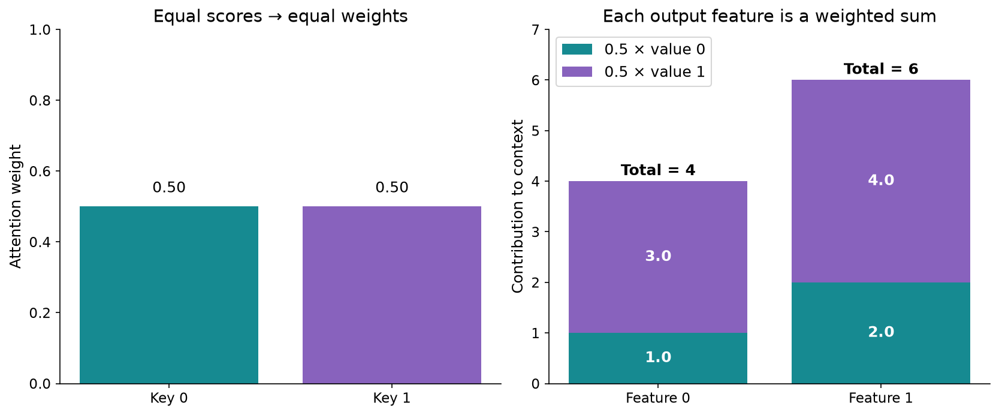

### Separate three roles before introducing the implementation

A **query** describes what one output position is looking for. A **key** provides the coordinates against which that query is compared. A **value** carries the information mixed into the output. The keys and values have corresponding positions: key zero's score determines how much value zero contributes.

Think of these as numerical roles. The familiar search-language interpretation can help us remember them, but it does not prove that a particular coordinate encodes a linguistic concept. The current examples use synthetic vectors and random or hand-set weights.

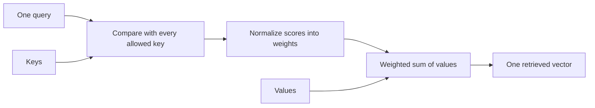

The arrows describe computation. A query-key comparison produces a scalar score for each key. Normalization makes a row of weights. Those weights mix the values. With many queries, we repeat the same logical operation for every query position, using matrix multiplication to do the work together.

### Produce the first result with the real function

After the setup in the next lesson, run this from the project directory. It imports the actual low-level function rather than reimplementing its expected answer:

```python
import torch
from core.attention import scaled_dot_product_attention

q = torch.zeros(1, 1, 2)  # one batch, one query, two coordinates
k = torch.eye(2).unsqueeze(0)  # two keys
v = torch.tensor([[[2., 4.], [6., 8.]]])
context, weights = scaled_dot_product_attention(q, k, v)
print(weights)   # [[[0.5, 0.5]]]
print(context)   # [[[4.0, 6.0]]]
```

Every dot product with the zero query is zero. Exponentiating the two equal scores gives equal positive numbers, and dividing each by their sum gives one half. Lesson 4 develops that normalization in detail. The output has one vector because the input had one query, even though there were two keys and two values.

### What normalized weights guarantee

Before dropout, an ordinary nonempty attention row has nonnegative weights summing to one. Each context coordinate is therefore between the smallest and largest corresponding value coordinate. This is a property of this weighted combination. The complete attention module later applies learned projections and an output projection, so its final output need not lie between the original input coordinates.

An entirely blocked row is a separate case. Our implementation returns zero attention weights and zero context rather than trying to normalize an empty set. The final output projection can still add a bias. We will trace that distinction in lesson 7.

### Predict or explain: If weights change from [0.5,0.5] to [0.75,0.25] for values [2,4] and [6,8], what is retrieved?

<details data-practice-id="weighted-check"><summary>Reveal worked answer and rubric</summary>

The context becomes [3,5]: compute each coordinate with the same position weights. This is a toy retrieved vector, not a token prediction.

**Rubric:** Keep values fixed and show both coordinate sums.

</details>


### Keep the current project boundary visible

The source currently accepts floating-point vectors. There is no implemented text tokenizer, vocabulary lookup or complete encoder/decoder stack. It can demonstrate how representations interact; it cannot turn the sentence “I like tea” into a trained French translation.

The [implementation record](project/implementation.md) records what exists. The [source register](research.md) identifies the actual files and references. Keep the [review questions](practice/explain-attention.md) for later explanation in your own words; reading a worked answer is not an assessed learner result.

Next we will reproduce this component in the locked environment and identify exactly which files run it.


## Reproduce the existing project and read its boundaries

We have a concrete result to reproduce: equal attention over two values gives `[4,6]`. Now we need to know where that function lives, which environment runs it, and which apparent project entry points are still empty. This is a walkthrough of the existing setup, not an instruction to create another project.

### Use the existing ordinary project folder

From workspace home, the folder is `ai_projects/projects/transformer-labs/attention-is-all-you-need/`. It is tracked by the `ai_projects` repository. Continue the existing project. Its implementation is grouped directly below `src/`: `core`, `data`, `training` and `utils`, alongside direct runnable scripts. The former outer project-named namespace has been removed; installation exposes these responsibility packages.

```bash
cd /mnt/projects/ai/ai_projects/projects/transformer-labs/attention-is-all-you-need
uv sync --frozen
uv run --frozen python src/attention.py
uv run --frozen pytest -q
```

The first command selects the project as the working directory. `uv sync --frozen` installs the versions already recorded in `uv.lock` without resolving a new dependency set. It can create or reconcile the ignored `.venv/`; it does not train a model. The next command runs the demo. The last runs the numerical and interface tests available in the environment. The locked Python requirement is 3.12; `.python-version`, `pyproject.toml` and `uv.lock` travel together.

Linux currently uses a CPU PyTorch build. A machine having a GPU does not make this environment a GPU training environment. The checked runtime is PyTorch 2.14.1+cpu. Later training needs an explicit device/environment decision and measurement.

### Keep code grouped by responsibility

The original project-named directory under src was a conventional namespace for installation. This application now uses responsibility packages directly below src, as requested. `core` owns attention/model/configuration; `data` owns tokenizers and dataset handling; `training` owns fitting/recovery; `utils` owns graph/display helpers. Runnable commands live directly under `src/`, with no `cli/` folder. Each group is importable after `uv sync`. The Colab notebook runs the Python entry point and tests in their own locked environment.

```text
src/
  attention.py              Runnable attention demo
  tokenizer.py              Future tokenizer preparation command
  prepare_data.py           Future dataset preparation command
  train.py                  Future training command
  inference.py              Future translation command
  compute_bleu.py           Future BLEU command
  core/                     attention.py, model.py, config.py
  data/                     tokenizer.py, dataset.py
  training/                 trainer.py, checkpoint.py
  utils/                    attention_visuals.py
notebooks/
  attention_colab.ipynb
```

Hatch's source mapping installs these groups without an extra outer project namespace. The console command `uv run --frozen attention-demo` and the file command `uv run --frozen python src/attention.py` call the same demo. Plot helpers keep generated images in the source project's ignored `runs/attention-visuals/` directory; `configure(output_dir=...)` selects an explicit destination for an installed standalone copy.

### Know which file owns which responsibility

| File | What it does now | What to inspect |
| --- | --- | --- |
| `src/attention.py` | Exposes the attention classes and runs the demonstration | `run_demo`, its fixed seed, shape checks and path comparison |
| `src/core/attention.py` | Implements the reusable numerical component | Projections, head packing, masks, attention and output projection |
| `src/utils/attention_visuals.py` | Builds figures and interactive displays | Hand-set numerical examples and plotting helpers |
| `notebooks/attention_colab.ipynb` | Runs the Python project on Google Colab | Source upload/verification, locked setup, demo, tests and downloadable logs |
| `tests/test_attention.py` | Checks values, gradients, masks and interfaces | Independent PyTorch reference and perturbation cases |
| `tests/test_attention_visuals.py` | Checks the matrix examples | Known answers and preservation of random state |
| `src/tokenizer.py`, `src/prepare_data.py`, `src/train.py`, `src/inference.py`, `src/compute_bleu.py` | Comment-only destinations for later videos | No tokenizer, data processing, training, translation or BLEU execution yet |

The modules `src/core/model.py`, `src/core/config.py`, `src/data/dataset.py`, `src/data/tokenizer.py`, `src/training/trainer.py` and `src/training/checkpoint.py` are also placeholders. A successful exit from an empty Python script does not establish that its named function works. Read its source before interpreting a launcher result.

### Read the demo's output as evidence

With seed 7, the demo prints the weighted average, attention on raw inputs, separate/vectorized head outputs, causal weights and cross-attention. Encoder and decoder attention outputs have shape `(3,5,9)`; the cross-attention output is `(3,7,9)`. Its largest reported explicit/SDPA difference in this CPU run is approximately `1.19e-7`.

`PASS` means the selected numerical comparisons and perturbation assertion succeeded. The printed floating-point vectors come from randomly initialized attention parameters. They are not translated tokens or a measured task score. We have a working component demonstration and independent tests, not a fitted language system.

### Run the project on Google Colab

The Colab notebook is an execution runner. Open `notebooks/attention_colab.ipynb` using **File → Upload notebook** in [Google Colab](https://colab.research.google.com/), select CPU, and run the cells in order. At the prompt, upload the matching source ZIP and manifest from workspace `.ai/exports/attention-is-all-you-need/`. The export also contains a standalone copy of the notebook.

Its six code cells verify source hashes and paths, create a fresh extraction, install uv 0.10.10 and the locked Python 3.12.13 environment, record actual versions, launch `src/attention.py`, run all component/matrix checks, and download a result archive. The notebook kernel coordinates subprocesses; it does not import Colab's preinstalled PyTorch as the project runtime. The current lock selects CPU PyTorch. Actual hosted execution is still unverified; local checks exercise the operational cells with a simulated Colab file interface.

The former concept notebook has been removed. Read this tutorial for the worked explanations, maths and original figures. Graph helpers remain under `src/utils/`; there is one numerical implementation under `src/core/`.

For a complete local test run, include the existing visualization dependencies:

```bash
uv sync --frozen --extra notebook
uv run --frozen --extra notebook pytest -q
```

With that extra, all 35 tests should run: 25 attention cases and 10 visualization-maths cases. A run reporting a skipped visualization module has not checked those ten cases. The extra retains local Jupyter tools as well as Matplotlib and ipywidgets, but opening a local notebook is no longer part of the study route.

### Diagnose a setup problem at its source

If `torch` cannot be imported, verify that the command ran through the project's `uv` environment. If the package cannot be imported, check the working directory and installation before adding arbitrary `sys.path` edits. If a matrix shape is rejected, the later lessons explain the accepted tensor contract. Do not resolve a numerical failure by changing expected values until the calculation is understood.

The [reference-run record](project/reference-runs.md) distinguishes commands actually checked from proposed commands. The [setup learning points](project/learning-points/00-setup.md) and [setup comparisons](project/comparisons/00-setup.md) explain environment versus model readiness.

### Predict or explain: The train.py placeholder exits successfully. Has the translation model been trained?

<details data-practice-id="setup-check"><summary>Reveal worked answer and rubric</summary>

No. Its source is comment-only. Process success without model work is not a training result; inspect source and recorded outputs.

**Rubric:** Separate environment readiness, executed component tests and task results.

</details>


Next we will read the tensor axes, because most attention mistakes are understandable once we can say which axis represents queries, keys and features.


## Read attention as rows, columns and batches

The demo runs. Now we need to explain why its matrices have their observed shapes. We will use rows as positions and columns as features, then add batch and head axes without changing the underlying dot product.

### One dot product answers one comparison

For query `q=[1,2]` and key `k=[3,4]`, the dot product is `1×3 + 2×4 = 11`. Matching coordinates multiply and their products add. This requires the query and key to use the same coordinate dimension. The result is a scalar score, not a two-coordinate vector.

For several query rows and key rows, matrix multiplication evaluates every pair. If `Q` has shape `(T,d)` and `K` has shape `(S,d)`, transpose the last two key axes to get `(d,S)`. Then:

$$R=QK^\mathsf{T},\qquad R_{ij}=\sum_{r=0}^{d-1}Q_{ir}K_{jr},\qquad R\in\mathbb{R}^{T\times S}.$$

Here `i` selects a query position, `j` selects a key position and `r` selects a feature coordinate. Each row answers “how does this query compare with each key?” Each column collects comparisons against one key. Softmax will later run across each row's key axis.

### Work an unequal-shape multiplication

```text
left = [[1,2,3],       right = [[ 7, 8],
        [4,5,6]]               [ 9,10],
                               [11,12]]

(2×3) @ (3×2) -> (2×2)
result[0,0] = 1×7 + 2×9 + 3×11 = 58
result[0,1] = 1×8 + 2×10 + 3×12 = 64
result       = [[58,64], [139,154]]
```

The shared inner dimension is consumed; the outer dimensions remain. Unequal shapes make a useful independent check because a wrong transpose cannot hide behind a square example. Our matrix-display tests check these exact numbers.

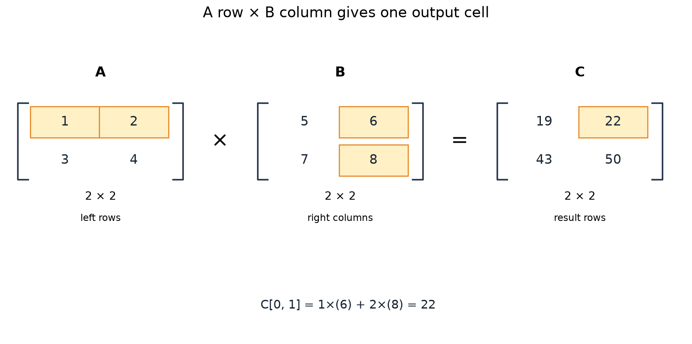

### Mix values using the key axis

Once a query has weights `A` of shape `(T,S)`, each row mixes `S` value vectors. If `V` has shape `(S,d_v)`, then `C=A@V` has shape `(T,d_v)`. It has one output row per query and one output coordinate per value feature.

This explains why query and key lengths can differ. The first contraction compares query/key features. The second contracts key positions with their corresponding values. Queries and keys must agree in feature width; keys and values must agree in position count. The low-level mathematical operation can use a distinct value width. This project's public module projects all three to the same model width before splitting heads.

### Add batches and heads deliberately

The public module receives `src` as `(B,S,D)`: batch count, source positions, model features. For self-attention the queries also have `S` positions. For cross-attention the target provides `(B,T,D)` queries.

| Tensor | After splitting heads | Role |
| --- | --- | --- |
| `q` | `(B,H,T,d)` | One query vector per batch/head/query position |
| `k` | `(B,H,S,d)` | One key vector per batch/head/source position |
| `v` | `(B,H,S,d)` | Values aligned with source keys |
| `q @ k.transpose(-2,-1)` | `(B,H,T,S)` | All query/key scores per head |
| `weights @ v` | `(B,H,T,d)` | Retrieved head contexts |

Here `H` is head count and `d=D/H`. Batch/head axes remain separate. The final two axes participate in each matrix multiplication; PyTorch applies that product across compatible leading axes. For a four-dimensional tensor, `.T` reverses all axes and is not the operation we want. `.transpose(-2,-1)` exchanges only key positions and key features.

### Trace a concrete shape through the demo

For `B=3`, `S=5`, `D=9`, `H=3`, each head has width 3. Queries/keys/values become `(3,3,5,3)`. Scores become `(3,3,5,5)`. Weighted values return `(3,3,5,3)`. Reassembling the three heads restores `(3,5,9)`.

The public interface rejects integer token IDs because it expects floating-point representations. An integer matrix `(B,S)` is not interchangeable with embeddings `(B,S,D)`. Later tokenization and embedding layers will bridge those forms; they have not been implemented here.

### Predict or explain: For B=2, H=3, T=3, S=5 and d=4, what are score and context shapes?

<details data-practice-id="shapes-check"><summary>Reveal worked answer and rubric</summary>

Scores are (2,3,3,5). Context is (2,3,3,4), and merged output width is H*d=12. Keys/values share S; output follows T.

**Rubric:** Name the contracted axes and output ownership.

</details>


At this point the contractions are defined, but raw dot products can be negative, unbounded and hard to compare. The next lesson explains the transformation into usable weights.


## Turn comparisons into normalized attention weights

We can now form every query-key score. The next question is why the implementation scales those scores and uses softmax before multiplying by values. We will first keep Q, K and V equal to the input, so no learned projection hides the arithmetic.

### An input can fill all three roles

Take two input rows `X=[[1,0],[0,1]]`. Their dot-product matrix `X@X.T` is the identity: each row has score 1 against itself and 0 against the other. These numbers encode this chosen geometry; they are not a discovered relationship between words.

The implementation divides scores by the square root of query/key feature width. Width is 2, so the first score row becomes `[1/√2,0]`, approximately `[0.707107,0]`.

Softmax converts a row `s` into weights:

$$a_j=\frac{\exp(s_j)}{\sum_{\ell=0}^{S-1}\exp(s_\ell)}.$$

The exponential is positive. Dividing each positive number by the sum makes weights add to one, provided the row contains at least one finite allowed score. The subscript `j` selects a key; the denominator sums over the keys available to this query. Do not normalize across query rows or across independent batch examples.

### Calculate the whole raw-input example

For the first row, `exp(0.707107)≈2.028115` and `exp(0)=1`. The denominator is about `3.028115`. The weights are approximately `[0.669762,0.330238]`. The second row reverses them.

```text
A ≈ [[0.669762, 0.330238],
     [0.330238, 0.669762]]

C = A @ X = A
```

The last equality is a special property of choosing identity-valued inputs. With different values, the same weights produce a different context. Attention weights and retrieved information are related but distinct objects. The existing known-answer test checks both for this example.

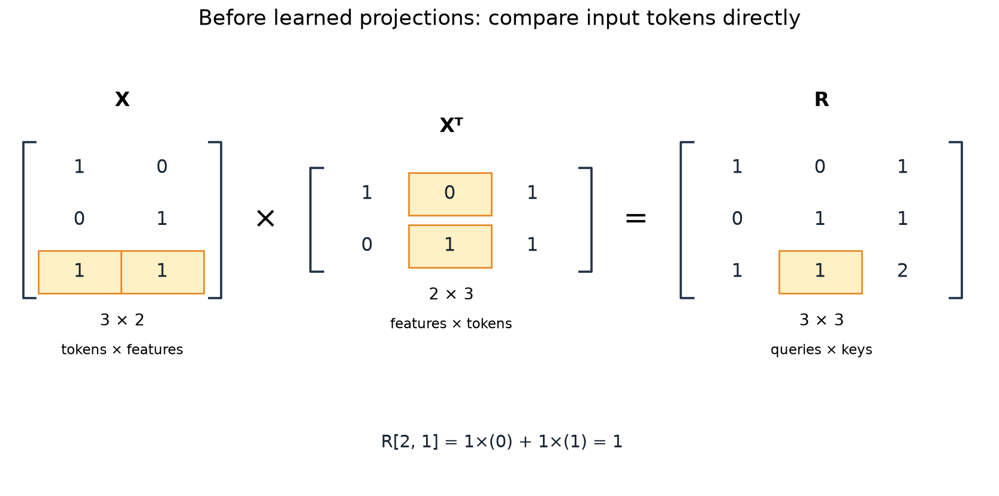

### Why use an exponential rather than the raw scores?

Raw scores might be `[-2,0,2]`; they cannot directly serve as nonnegative normalized weights. Softmax yields approximately `[0.015876,0.117310,0.866813]`. Larger relative scores get more weight while smaller scores retain a contribution. Other weighting rules could be designed; softmax is the rule implemented here.

A score difference has a precise consequence: `a_i/a_j = exp(s_i-s_j)`. Adding the same constant to every score leaves all differences and weights unchanged. Multiplying all scores by a positive factor does change their differences and concentration.

For `[0,0]`, weights are `[0.5,0.5]`. For `[0,ln(3)]`, exponentials are `[1,3]`, so weights are `[0.25,0.75]`. For `[0,2ln(3)]`, the second exponential becomes 9 and weights become `[0.1,0.9]`. There is no threshold that turns these weights into a hard selected token.

### Keep normalization numerically stable

Exponentials of very large floating-point scores can overflow. Subtracting the row maximum before exponentiating gives the same weights because the common factor cancels:

$$\frac{e^{s_j-m}}{\sum_\ell e^{s_\ell-m}}=\frac{e^{s_j}}{\sum_\ell e^{s_\ell}}.$$

For `[1000,1000+ln(3)]`, a naive `exp` calculation can fail, but the maximum-shifted calculation still gives `[0.25,0.75]`. The code uses PyTorch's `softmax`, rather than writing an unstable raw exponential division in the model. This does not make NaN inputs meaningful or normalize an entirely blocked row; those need separate handling.

### Why scale by the head width?

A dot product adds `d` coordinate products. Under the explanatory assumption that coordinates have zero mean, unit variance and suitable independence, each product has variance one and the sum has variance `d`. Dividing by `√d` brings that variance to one. These assumptions motivate the rule; they are not a measurement that learned coordinates remain independent.

Large score differences push softmax toward saturation, where its derivative for a dominant probability approaches zero. Scaling reduces one source of dimension-dependent score growth. It is not cosine normalization: Q and K are not divided by their norms. It also does not guarantee stable training on arbitrary data.

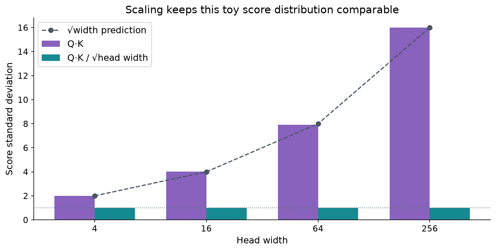

In the source, the scale is `q.shape[-1] ** -0.5`. After splitting heads this last dimension is `d=D/H`, not the whole model width D and not sequence length S. With `D=12,H=3`, the divisor is `√4=2`. Dividing by `√12` would change the weights even if the output shape still looked correct.

### Predict or explain: What changes if [0,ln(3)] becomes [1000,1000+ln(3)]? What if it becomes [0,2ln(3)]?

<details data-practice-id="softmax-check"><summary>Reveal worked answer and rubric</summary>

The common shift preserves [0.25,0.75]. Doubling score differences produces [0.1,0.9]. Subtract a maximum for stable exponentiation.

**Rubric:** Separate additive invariance from multiplicative concentration.

</details>


Next we replace the fixed Q=K=V choice with learned affine projections. That gives the model parameters through which useful comparison and content representations can eventually be learned.


## Learn separate query, key and value representations

Raw input attention forces each input coordinate to do three jobs. The implemented layers instead create Q, K and V using separate learned transformations. We will use the same three-token, two-feature fixture as `projection_example()` in `src/utils/attention_visuals.py`, and follow it through to retrieved values.

### Begin with the input rows and an affine map

Use `X=[[1,0],[0,1],[1,1]]`. Each row is one position with two input features. An affine projection multiplies by a weight matrix and adds a bias vector to every row. For the teaching convention:

$$Q=XW_Q+b_Q,\qquad K=XW_K+b_K,\qquad V=XW_V+b_V.$$

The bias broadcasts across positions; it is not a separately learned number for each sentence position. Q and K determine comparisons; V determines the content mixed by those comparisons. Their parameter sets are distinct, even when their shapes are equal.

The fixture uses the following right-multiplication matrices:

```text
W_Q = [[1,0],     W_K = [[1,1],     W_V = [[2,0],
       [1,1]]            [0,-1]]            [0,3]]
b_Q = [0,0]      b_K = [0,0]        b_V = [0.5,-0.5]
```

### Derive all three projected matrices

The first query row is `[1,0]@W_Q=[1,0]`; the second is `[0,1]@W_Q=[1,1]`; the third adds those rows and becomes `[2,1]`.

```text
Q = [[1,0],      K = [[1, 1],      V = [[2.5,-0.5],
     [1,1],           [0,-1],           [0.5, 2.5],
     [2,1]]           [1, 0]]           [2.5, 2.5]]
```

For V's first row, matrix multiplication produces `[2,0]`; adding `[0.5,-0.5]` gives `[2.5,-0.5]`. The same bias is added to all three rows. A negative value coordinate is valid: probabilities must be nonnegative, but representation coordinates need not be.

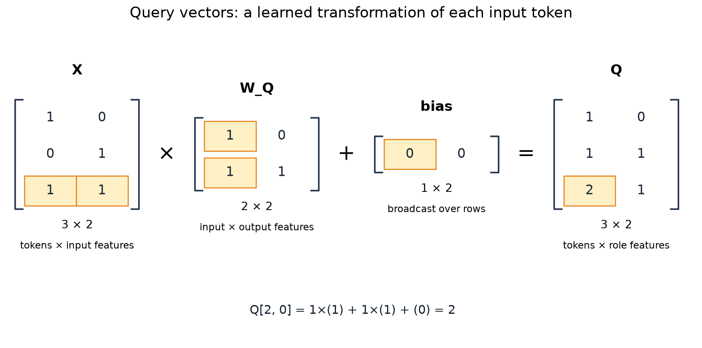

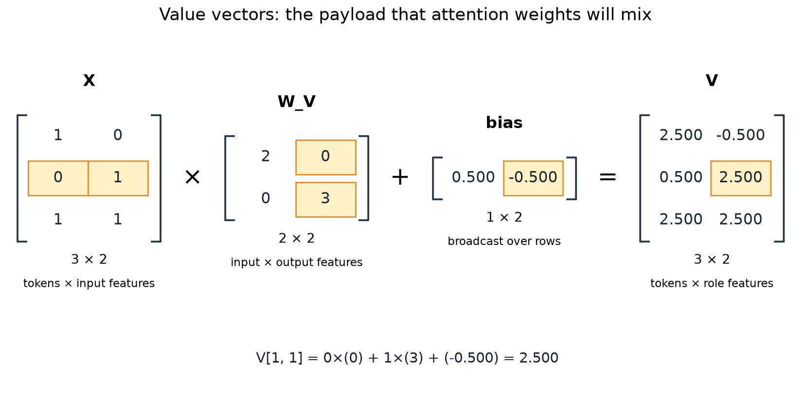

### Connect the written matrix to nn.Linear storage

PyTorch stores `nn.Linear` weights as `(output_features,input_features)`, and evaluates `x @ weight.T + bias`. Our displayed `W_Q` is the transpose of `layer.query.weight`. The fixture deliberately returns `projection.weight.T` for the matrix walkthrough. Confusing storage orientation with the mathematical right-multiplication convention is an easy error when both dimensions are two.

The fixture writes explicit parameters into an instance of the actual `SingleHeadAttention` class, computes the intermediate projections and checks its output against the same low-level attention operation. It constructs the temporary layer inside `torch.random.fork_rng`, so displaying a controlled example does not consume the caller's model-initialization RNG sequence.

### Use those queries and keys to obtain scores

Transpose K into columns, then multiply:

```text
K.T = [[1, 0,1],
       [1,-1,0]]
Q @ K.T = [[1, 0,1],
           [2,-1,1],
           [3,-1,2]]
```

For example, query row `[1,1]` against key row `[0,-1]` gives `1×0 + 1×(-1)=-1`. Divide each score by `√2` and apply row-wise softmax. For the first query, the scaled scores are `[1/√2,0,1/√2]`.

Let `α=exp(1/√2)≈2.028115`. Its first weight row is `[α,1,α]/(2α+1)`, approximately `[0.401112,0.197776,0.401112]`.

### Mix the projected values, not the original inputs

The first context coordinate is `(5α+0.5)/(2α+1)≈2.104448`. Its second coordinate is `(2α+2.5)/(2α+1)≈1.296664`. Work the numerator from the actual V rows:

```text
c_0[0] = a_00×2.5 + a_01×0.5 + a_02×2.5
c_0[1] = a_00×(-0.5) + a_01×2.5 + a_02×2.5
```

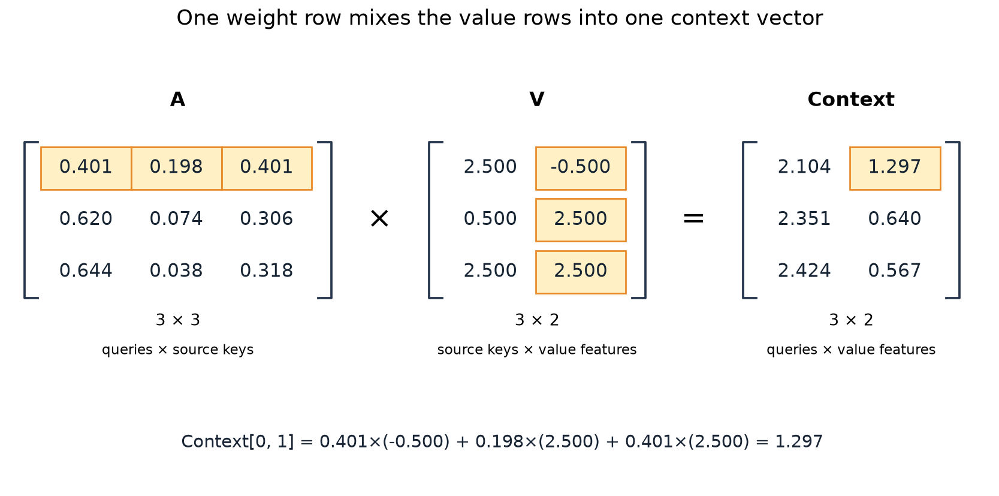

The two high-weight positions do not have the same values, so equal retrieval weight does not mean identical contributions in each coordinate. A contribution is weight times value. The [numerical probes](examples/arithmetic.py) check this arithmetic independently; the project visualization tests verify the fixture's Q, K, V, scores, weights and first context.

### Predict a controlled change

Hold Q and K fixed and add `[1,-2]` to every V row. Each ordinary normalized context row shifts by `[1,-2]`, because its weights sum to one. The attention weights do not change. This isolates comparison from content; changing the original X instead can affect all three projections at once.

Changing a Q/K parameter can redistribute weights and therefore affect many output coordinates. Changing a V parameter alters the available content. All three can receive gradients from a later loss, but they are not learned by this hand-set demonstration.

### Predict or explain: Hold Q/K fixed and add [1,-2] to every value row. What changes in a normalized nonempty row?

<details data-practice-id="projections-check"><summary>Reveal worked answer and rubric</summary>

Weights are unchanged; context shifts by [1,-2] because each weight row sums to one. Output projection may transform that shift.

**Rubric:** State the normalized/pre-dropout/nonempty conditions and distinguish context from final output.

</details>


We now have one complete head. The next lesson shows how multiple heads share the same input positions while producing separate comparisons and contexts.


## Run several heads and reassemble their information

One head uses one learned query/key comparison space and one value transformation. Multiple heads let the layer compute several such retrievals in parallel. This is architectural capacity; it does not guarantee that different heads acquire distinct linguistic specialties.

### Split projected features while keeping all positions

Choose `B=2`, `S=5`, model width `D=12` and `H=3` heads. Each head has `d=4` features. The public layer first projects X to three `(2,5,12)` tensors. `_heads` then performs:

```python
x.reshape(batch, length, num_heads, head_dim).transpose(1, 2)
```

The intermediate shape is `(2,5,3,4)` and the result is `(2,3,5,4)`. We have separated head and feature axes, then moved the head axis before sequence. Every head still receives all five positions. We are not giving tokens 0–1 to head zero and tokens 2–3 to head one.

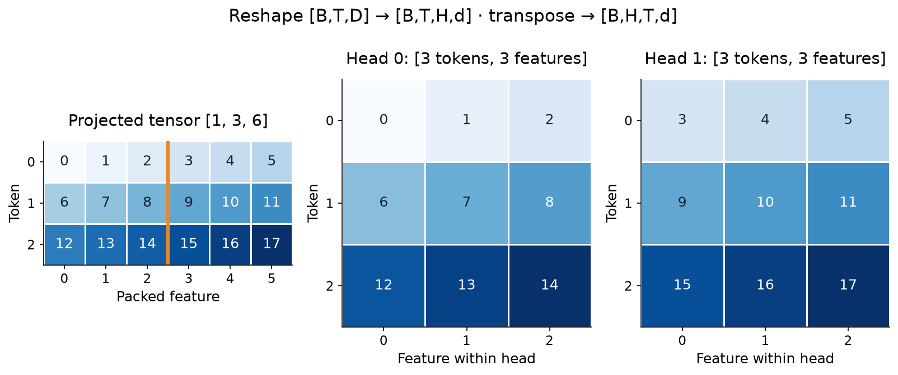

The constructor requires `D` to be positive and divisible by positive `H`. With `D=10,H=3`, equal-width heads do not fit, so this implementation raises `ValueError`. Some alternative architecture could use unequal heads; that is not the contract implemented here.

### Compare the readable loop with vectorized heads

The earlier `MultiHeadAttention` class builds separate Q/K/V linear layers for each head and runs them in a Python loop. Each projection maps the full D-dimensional input to d features. The vectorized version stores all corresponding projection rows in one `nn.Linear(D,D)`, then splits its output.

These are two organizations of compatible calculations. Stacking matching per-head parameter rows into the vectorized layer produces matching outputs and weights; the test `test_loop_heads_equal_vectorized_heads_with_matching_parameters` verifies that comparison. Comparing two separately initialized layers without copying their parameters would test different functions, not the loop/vectorization choice.

### Trace attention inside each head

For each batch/head, Q and K have shape `(5,4)`. Their score matrix has shape `(5,5)`, scaled by `√4`. Multiplying normalized weights by `(5,4)` values yields one `(5,4)` context. All heads together form `(B,H,S,d)=(2,3,5,4)`.

For output query position zero, take its four-coordinate result from head zero, then from head one, then from head two. Concatenating those features produces a 12-coordinate row. Transpose the context back to `(B,S,H,d)` before flattening the final two axes:

```python
merged = context.transpose(1, 2).flatten(2)
output = self.out_proj(merged)
```

Flattening `(B,H,S,d)` directly would combine the wrong logical axes. A shape that eventually reshapes to `(B,S,D)` is not proof that the elements retain their correct token/head ownership.

### Work a small concatenation and output projection

The separate two-head visualization uses two query positions. Head zero returns `[[1,0],[0,1]]`; head one returns `[[2,1],[1,2]]`. Concatenating along features yields:

```text
merged = [[1,0,2,1],
          [0,1,1,2]]
```

The existing display fixture applies this controlled output map, with zero bias:

```text
W_O = [[1,0,1,0],
       [0,1,0,1],
       [1,0,0,1],
       [0,1,1,0]]
merged @ W_O = [[3,1,2,2],
                [1,3,2,2]]
```

For example, the first row's third output is `1×1 + 0×0 + 2×0 + 1×1 = 2`. The operation combines head features at the same query position, rather than attending across positions again. `output_projection_example()` computes this through the actual layer's output projection, and the known-answer test verifies both merged and projected values.

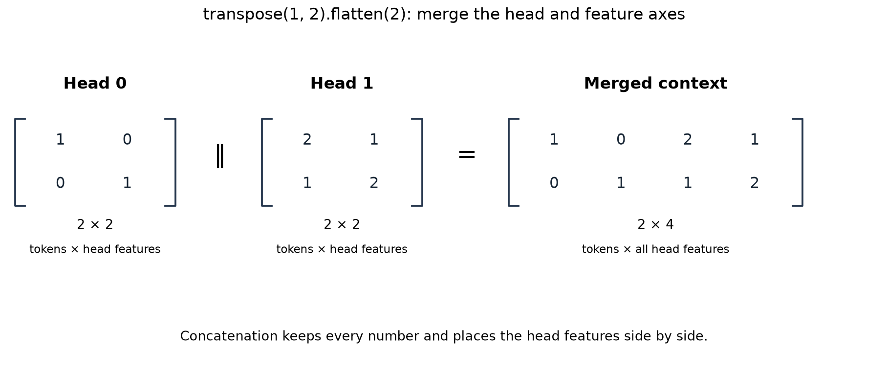

### Count the final layer's parameters

In the final `Attention` class, Q/K/V/output are each biased D-to-D linear maps. Each owns `D²` weights and `D` biases. Total count is `4(D²+D)`. The demo uses D=9, so the count is `4(81+9)=360`. Changing H while preserving D changes how features are partitioned and the scale used per head, but not this parameter count. Attention-score storage still grows with head count and the product of query/key lengths.

### Predict or explain: Can head-major context be flattened directly to recover query-major features?

<details data-practice-id="heads-check"><summary>Reveal worked answer and rubric</summary>

No. Transpose (B,H,T,d) to (B,T,H,d), then flatten H and d. Preserving element count alone does not preserve token ownership.

**Rubric:** Trace one query row across all heads.

</details>


The layer now handles many positions and heads. Before applying it to variable-length batches, we must ensure that added padding positions cannot become useful keys.


## Keep padding out of the retrieved information

Sentences can have different lengths, but a batch tensor needs a rectangular layout. Padding fills the unused positions. Even a zero input can become a nonzero key or value after a biased projection, so padding cannot be made harmless by assuming its numeric entries are zero.

### Give the mask one unambiguous meaning

Our public mask has shape `(B,S)` and uses `True` or `1` for a **valid source key**. For a five-position source with three real tokens, one row is `[True,True,True,False,False]`. The mask names positions, not embedding coordinates.

The builder converts it into `(B,1,1,S)` using `[:,None,None,:]`. Compared with scores `(B,H,T,S)`, the singleton head/query axes broadcast the same key validity across all heads and all queries in that example. Different examples can have different valid source lengths.

```text
source validity:          [1, 1, 1, 0, 0]
allowed key columns:
query 0                  [1, 1, 1, 0, 0]
query 1                  [1, 1, 1, 0, 0]
query 2                  [1, 1, 1, 0, 0]
```

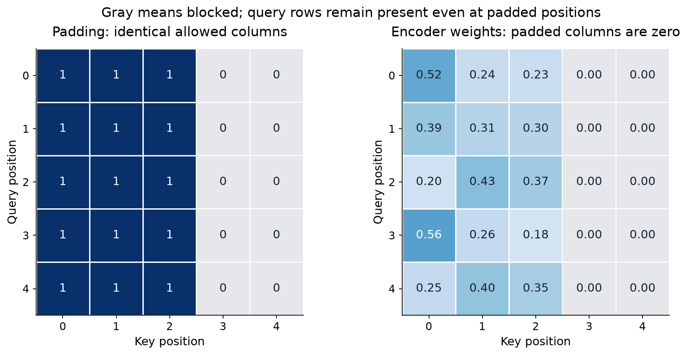

### Block scores before normalization

Suppose a query has unmasked scores `[0,0,10]`, but the third key is padding. If we apply softmax first, the padded position takes almost all the weight. Setting that weight to zero afterwards leaves a tiny sum, not a properly normalized distribution over the valid positions.

Instead replace blocked scores with negative infinity before softmax: `[0,0,-∞]` becomes weights `[0.5,0.5,0]`. In the limit `exp(-∞)=0`, so blocked positions contribute nothing and the remaining valid keys share total mass one.

The explicit code uses `scores.masked_fill(~attention_mask, float('-inf'))`. The inversion matters because `masked_fill` receives positions to replace, whereas our incoming mask marks positions to allow. The comparison with `nn.MultiheadAttention` also inverts masks because its `key_padding_mask` marks blocked keys. Copying the same boolean tensor between these APIs without checking semantics reverses the contract.

### A key mask does not clear padded query rows

For self-attention, padded source positions are also potential query positions. The current key mask stops others from retrieving their keys/values; it does not force their own output vectors to zero. A padded query can still retrieve real keys and pass through the output projection.

That behavior is visible in the source and tests. The padding-isolation test compares real query outputs for self-attention; it does not demand zeros at padded query positions. A later translation loss must ignore padded target labels using its own policy. Key visibility and loss masking solve different problems.

### Define the entirely blocked case explicitly

For a row containing only blocked keys, ordinary softmax would see `[-∞,-∞,…]`, whose normalization is undefined. Our explicit function first detects `has_keys`, substitutes a finite score row for safe arithmetic and then replaces that row's weights with zero. Its context is zero, and the tests require finite outputs and gradients.

There is another operation after context. If the merged context is zero and `out_proj` has bias b, the final output is `0@W_O+b=b`. Therefore “zero context” does not imply “zero module output”. In the all-blocked-row test, the final output equals the output projection's bias. This distinction avoids treating a valid implementation result as a bug.

### Use a perturbation to test the information boundary

Take the same layer and valid inputs twice. In one copy add 100 to every padded input vector. The outputs at real self-attention queries must agree; cross-attention outputs must all agree when its target queries are unchanged. This tests that padded keys/values cannot influence allowed results.

```python
changed = src.clone()
changed[~mask] += 100
first = layer(src, attention_mask=mask)
second = layer(changed, attention_mask=mask)
torch.testing.assert_close(first[mask], second[mask])
```

Use evaluation mode or otherwise control randomness when comparing. With active dropout, two calls can differ even if padding is correctly excluded. Hold parameters, valid data and the query mask interpretation fixed; change only the forbidden information.

### Predict or explain: All keys are blocked. Why can the module return a nonzero vector?

<details data-practice-id="padding-check"><summary>Reveal worked answer and rubric</summary>

The context is zero, but a biased output projection returns its bias. Also, a source key mask does not normally zero padded query outputs.

**Rubric:** Separate visibility, context, output projection and loss masking.

</details>


Next we add a different restriction: a decoder position must not retrieve future target positions, even when those positions contain real tokens.


## Stop a decoder query from reading its future

Padding asks whether a source position contains a real token. Causality asks whether a real position is allowed to influence the current query. The decoder needs both questions answered independently.

### Match the mask to the prediction task

In a future teacher-forced translation batch, a target prefix may be laid out as `[BOS, je, bois]` with labels `[je, bois, EOS]`. The representation at input position zero will predict `je`; it may read BOS but must not read later input positions that reveal the answer. This is an illustrative contract for the later data phase, not an implemented tokenizer or training batch.

For self-attention with equal query/key lengths L, query i can read key j when `j≤i`. With L=4:

```text
             key position
             0 1 2 3
query 0      1 0 0 0
query 1      1 1 0 0
query 2      1 1 1 0
query 3      1 1 1 1
```

The diagonal is allowed: the current input token is part of the available prefix. Whether that token is already a future answer depends on the data shift. A correct triangular attention mask cannot repair incorrectly aligned decoder inputs and labels.

### Combine padding and temporal visibility with AND

If source/key validity is `[1,1,0,0]`, intersect that row with each causal row:

```text
query 0      1 0 0 0
query 1      1 1 0 0
query 2      1 1 0 0
query 3      1 1 0 0
```

Using OR would allow keys that satisfy either condition, including future valid tokens or padded past tokens. The builder uses `allowed & triangle` for exactly this reason. Its causal triangle broadcasts across batch and heads, then intersects with each example's padding constraints.

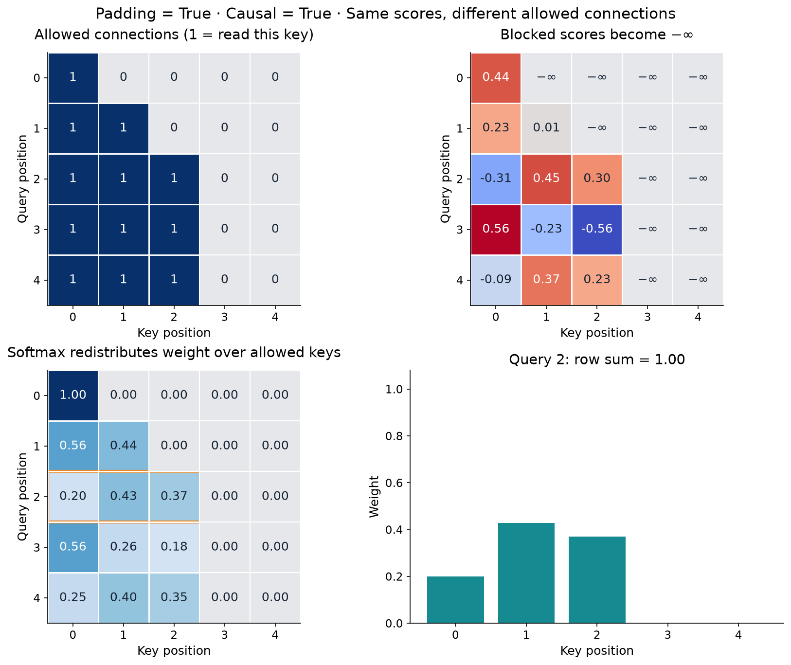

### Follow the source branch

`make_attention_mask` checks equal query/key lengths for this simple causal self-attention contract, creates a lower-triangular boolean tensor and intersects it with any padding mask. The public `Attention.forward` rejects supplying both cross-attention target queries and `causal=True`. It does not silently invent a rectangular prefix-alignment policy.

When the efficient path has no padding mask and weights are not requested, `_context` lets SDPA handle the causal triangle using `is_causal=True`. When padding is supplied, it constructs the combined explicit mask and sets the SDPA causal flag accordingly. These branches must represent the same allowed pairs, which is one reason both outputs and gradients are compared in tests.

### Prove something stronger than a triangular picture

A mask heatmap shows intent. A controlled perturbation tests effect. Keep the first three positions fixed and change positions 3 onward by a large value. With the layer in evaluation mode and identical parameters, outputs at positions 0–2 must remain unchanged under causal self-attention.

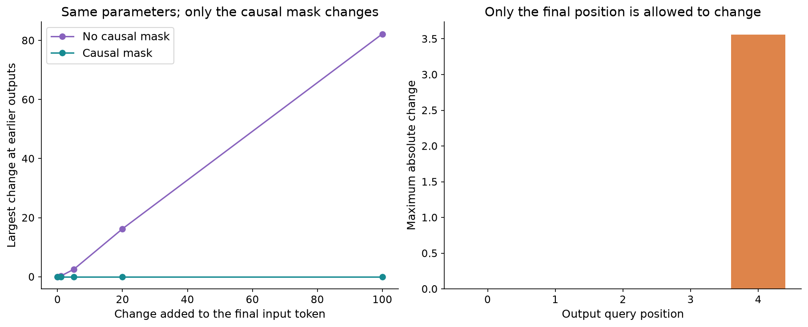

The existing tests run this isolation check for explicit and efficient paths. Without a causal mask, earlier positions are generally free to change because they can retrieve later keys/values. “Generally” is deliberate: a degenerate zero-parameter layer could ignore them even when visibility is allowed. Passing one accidental no-change case would not by itself prove masking.

### Left padding exposes a useful boundary case

A sequence beginning with invalid keys can create causal query rows with no allowed keys. For validity `[0,0,1,1,1]`, the first two causal rows are entirely blocked. The empty-row handling from lesson 7 matters here; merely avoiding an entirely empty sentence is insufficient.

Causality also does not supply positional information. If we permute source tokens in an unpositioned encoder, attention has no independently supplied notion of original order. Later positional embeddings/encodings and full model wiring must define that information. We have implemented the visibility mechanism, not the full target prediction system.

### Predict or explain: A query is position two and valid keys are [1,1,0,1]. Which keys may it read causally?

<details data-practice-id="causal-check"><summary>Reveal worked answer and rubric</summary>

Keys zero and one only: [1,1,0,0]. The current key is padding and key three is future. Intersect validity and j<=i.

**Rubric:** Use AND and identify both reasons for exclusion.

</details>


Next we let a target query retrieve from a different source sequence. Its score matrix becomes rectangular, and the source has a different visibility contract from the target prefix.


## Let target queries retrieve source information

Self-attention takes Q, K and V from one sequence. Translation also needs the developing target representation to retrieve information from the encoded source. The implemented cross-attention path changes where Q comes from while keeping keys and values aligned with source positions.

### Trace the two input arguments by role

In this project's final public interface:

```python
cross_output = layer(src, tgt=tgt, attention_mask=source_mask)
```

`src` supplies keys and values. `tgt` supplies queries. These names can be confusing if we assume “the first argument is always Q”; here it is not. In the final model, `src` for this call will be encoder representations rather than raw integer English IDs. `tgt` will be decoder representations, not labels. Those surrounding blocks have not been implemented.

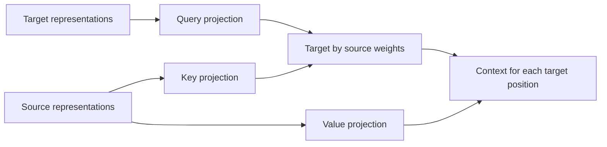

### Calculate the rectangular shapes

Let `B=2`, source length `S=5`, target length `T=3`, model width `D=12`, and `H=3`. After projection/splitting:

```text
Q:       (2,3,3,4)       batch, heads, target queries, width
K and V: (2,3,5,4)       batch, heads, source keys/values, width
scores:  (2,3,3,5)       target rows, source columns
context: (2,3,3,4)
merged:  (2,3,12)
output:  (2,3,12)
```

The public output follows target/query length. Five source positions do not imply five output rows. The mask is `(2,5)`, because it describes source keys; a `(2,3)` target padding mask cannot be substituted for it.

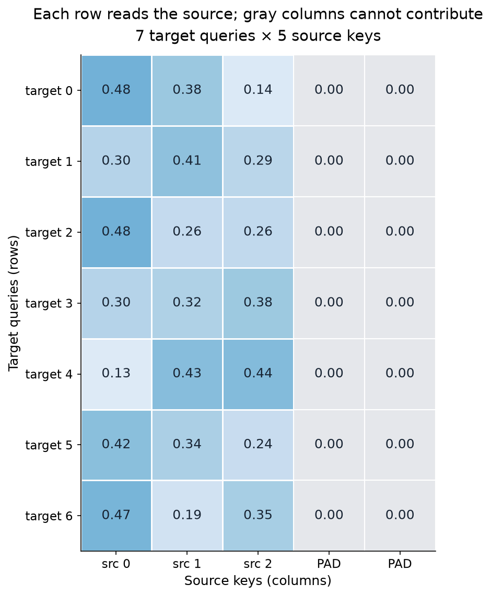

### Work one query independently

Suppose a head's source keys are `[[1,0],[0,1],[1,1]]`, values are `[[2,0],[0,4],[2,4]]`, and its target query is `[1,0]`. Scores are `[1,0,1]/√2`. The first and third keys receive equal high weights; their values contribute differently to the two context coordinates.

If the third source position is padded, scores become `[1/√2,0,-∞]`. Weights become approximately `[0.669762,0.330238,0]`. The context becomes `[1.339523,1.320954]`. That one retrieved vector belongs to the target query. It is not a translated word, and it does not identify a single hard source alignment.

### Why no ordinary causal triangle over source positions?

For the intended completed-sentence translation task, the full English source is available before generating the French target. A target query can therefore retrieve any valid encoded source position. Applying `j≤i` between target and source indices would falsely treat unrelated position numbers as a time-availability relationship.

The target's own self-attention still needs causality. Cross-attention and decoder self-attention sit at different points in a future decoder block and answer different visibility questions. A streaming translator with partial source availability would need a separate, explicit protocol; the current API does not claim to implement one.

### Inspect the checks and rejected calls

The implementation verifies matching batch size, floating dtype, device and embedding width for source and target. Their sequence lengths can differ. Supplying `causal=True` together with `tgt` raises a clear error. A source mask with the wrong length is rejected before a misleading output can be interpreted.

Tests map the same learned projection weights into PyTorch `nn.MultiheadAttention`, then compare both cross-attention outputs and per-head weights. Other tests perturb only padded source rows and require all target outputs to remain unchanged. These establish component behavior for the exercised tensors, not translation quality or trained word alignments.

### Predict or explain: Source length is five and target length three. Which length controls output, and which controls the mask?

<details data-practice-id="cross-check"><summary>Reveal worked answer and rubric</summary>

Output has three query positions. The source key mask has length five. Queries come from tgt, keys/values from src.

**Rubric:** Distinguish representation role from argument order.

</details>


We have now covered every attention mode the final reusable class exposes. The next lesson follows that class from its arguments through the explicit and efficient execution branches.


## Follow the reusable Attention class from call to output

The earlier classes expose the progression from a single head to separate and vectorized heads. The final `Attention` class is the interface intended for the later encoder/decoder. We can now read its methods in execution order and explain every tensor transformation without treating a library call as a black box.

### State the contract before the call

The constructor takes `embedding_dimension`, `num_heads`, `attn_dropout`, and the keyword-only `fused_attn`. It owns four biased projections named `q_proj`, `k_proj`, `v_proj` and `out_proj`. Those names are deliberately retained for the later model code.

`forward(src, tgt=None, attention_mask=None, causal=False, *, need_weights=False)` accepts floating `(B,S,D)` source vectors and optional `(B,T,D)` target/query vectors. The mask is `(B,S)` and True means an allowed key. Without target vectors it performs self-attention. With them it performs cross-attention and rejects `causal=True`.

### Follow the method in six steps

| Step | Actual operation | What to explain |
| --- | --- | --- |
| 1 | `_validate_inputs` | Shape, dtype/device/batch agreement and source-mask length |
| 2 | `query_input = src if tgt is None else tgt` | Which sequence determines output positions |
| 3 | Q/K/V projection, then `_heads` | Full-width affine maps and head feature grouping |
| 4 | `_context` | Visibility, scaling, softmax/value mix and attention dropout |
| 5 | `context.transpose(1,2).flatten(2)` | Restore query-major layout and concatenate head features |
| 6 | `out_proj` | Mix head information at each query position |

The complete frozen module is available as [attention.py](code/src/core/attention.py). The demo is a separate [top-level file](code/src/attention.py), and [the tests](code/tests/test_attention.py) show supported/rejected behavior. These are captured source copies for reading/download; the application remains owned by its project directory.

### Run the three modes with one layer

From the project environment, this is a complete small component example:

```python
import torch
from core.attention import Attention

torch.manual_seed(7)
src = torch.randn(2, 5, 12)
tgt = torch.randn(2, 3, 12)
mask = torch.tensor([[1,1,1,0,0], [1,1,1,1,0]], dtype=torch.bool)
layer = Attention(12, 3).eval()
with torch.inference_mode():
    encoded = layer(src, attention_mask=mask)
    prefix = layer(src, attention_mask=mask, causal=True)
    retrieved = layer(src, tgt=tgt, attention_mask=mask)
    inspected, weights = layer(src, attention_mask=mask, need_weights=True)
print(encoded.shape, prefix.shape)  # both torch.Size([2, 5, 12])
print(retrieved.shape)              # torch.Size([2, 3, 12])
print(weights.shape)                # torch.Size([2, 3, 5, 5])
torch.testing.assert_close(encoded, inspected, atol=1e-6, rtol=1e-5)
```

This intentionally uses one layer only to inspect its API. A complete translation architecture will use separately owned modules in its encoder and decoder; these four calls do not assemble a Transformer.

### Explain what “efficient path” means here

With `fused_attn=True` and no request for weights, `_context` calls `torch.nn.functional.scaled_dot_product_attention`. With `fused_attn=False`, or when `need_weights=True`, it performs the score, mask, softmax and value operations explicitly. Asking for the weights therefore changes which implementation path is used, while preserving the intended numerical function when dropout is disabled.

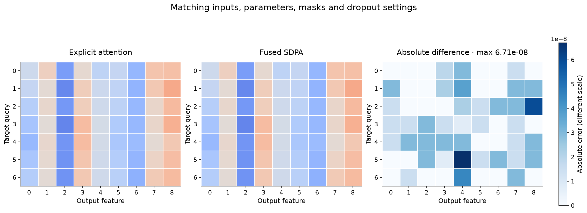

To compare paths, initialize one layer, copy its state into the other and use identical inputs, masks and dtype. The tests compare float64 outputs and gradients with tight tolerances. The demo uses float32 and allows floating-point rounding differences. A maximum difference near `1e-7` is a numerical observation; it is not a speed measurement.

The SDPA backend selects a suitable kernel for the actual device and inputs. The current CPU check does not prove that GPU FlashAttention ran, that it would be faster, or that memory use improved on another device. Keep the implementation-choice claim separate from a measured hardware result. The [PyTorch API reference](https://docs.pytorch.org/docs/2.14/generated/torch.nn.functional.scaled_dot_product_attention.html) records the underlying call's semantics.

### Dropout requires an explicit training-state decision

Attention dropout randomly removes/rescales selected weights used to form context during training. In the explicit helper, the returned inspection weights are the normalized values before dropout. Thus a row of returned weights can sum to one even when the weights actually used for context have a different sum in that sampled call.

The functional SDPA API uses the supplied dropout probability directly. Our wrapper passes `self.attn_dropout` in training mode and `0.0` in evaluation mode. Simply calling `.eval()` would not automatically rewrite an unrelated raw functional call; the wrapper's argument choice is essential.

The tests use dropout probability one to make a diagnostic extreme: training context becomes zero and final output equals the output bias. In evaluation mode the same layer returns deterministic attention results. This is a test fixture, not a recommended training setting.

### Choose the right observation tool

Use the explicit path or `need_weights=True` when explaining scores and distributions. Use the default path when exercising the intended production-facing component interface. Preserve exact source/parameters and record what changed before comparing outputs. The [attention comparisons](project/comparisons/01-attention.md) collect these distinctions.

### Predict or explain: Does fused_attn=True prove that GPU FlashAttention was used? What changes with need_weights=True?

<details data-practice-id="interface-check"><summary>Reveal worked answer and rubric</summary>

No. SDPA selects a backend for actual device/inputs; current evidence is CPU. Requesting weights selects the explicit calculation in this wrapper.

**Rubric:** Separate code path, backend identity and measured performance.

</details>


The forward path is clear. We next ask whether a loss can send meaningful gradients through that retrieval calculation, without pretending that one derivative check is a trained translator.


## Follow an error backward through attention

A component used in training needs more than plausible forward outputs. Its parameters and inputs must receive the derivatives of the chosen loss. We will derive one scalar query example, verify it with autograd and finite differences, then connect that evidence to the existing parameter-gradient tests.

### Define a tiny loss and all of its inputs

Use one scalar query q, keys `[1,-1]` and values `[2,6]`. Head width is one, so the scale is one. The scores are `[q,-q]`. Let a be the weight on the first key; the other weight is `1-a`:

$$a=\frac{e^q}{e^q+e^{-q}},\qquad c=2a+6(1-a)=6-4a.$$

Choose an illustrative desired context `y=5` and half squared error `L=(c-y)^2/2`. This loss is a numerical probe for the attention computation. The eventual translation task will use vocabulary logits and token loss, not an asserted target representation of five.

At q=0, both scores are zero, a=0.5 and c=4. The loss is 0.5. We want the next small step to move the context upward toward five, which means placing more weight on value six and less on value two.

### Derive the query gradient in pieces

For a general softmax row, `∂a_j/∂s_l = a_j(δ_jl-a_l)`, where δ is one when indices match and zero otherwise. This follows by differentiating the exponential numerator and the shared sum denominator. It captures both effects: increasing one score changes its own numerator and every probability's denominator.

Here the two scores depend on q with slopes +1 and -1. Therefore:

$$\frac{da}{dq}=a(1-a)+(-a(1-a))(-1)=2a(1-a).$$

At q=0 this is 0.5. Because `c=6-4a`, `dc/dq=-4×0.5=-2`. The loss slope with respect to context is `dL/dc=c-y=-1`. The chain rule multiplies the local slopes:

$$\frac{dL}{dq}=\frac{dL}{dc}\frac{dc}{dq}=(-1)(-2)=2.$$

A gradient tells us how the loss changes for a small increase in q. It is positive, so gradient descent decreases q. With step size 0.1, `q_new=0-0.1×2=-0.2`. The first weight becomes about 0.401312; context becomes about 4.394751 and loss about 0.183163. Moving the query in this direction raises the weight on the larger value and reduces this chosen loss.

### Verify the derivative using the actual helper

```python
import torch
from core.attention import scaled_dot_product_attention

q = torch.tensor([[[0.]]], dtype=torch.float64, requires_grad=True)
k = torch.tensor([[[1.], [-1.]]], dtype=torch.float64)
v = torch.tensor([[[2.], [6.]]], dtype=torch.float64, requires_grad=True)
context, weights = scaled_dot_product_attention(q, k, v)
loss = 0.5 * (context - 5).square().sum()
loss.backward()
print(context.item(), loss.item())  # 4.0, 0.5
print(q.grad.item())               # 2.0
print(v.grad.flatten().tolist())   # [-0.5, -0.5]
```

The value gradients follow directly: each value contributes to c with coefficient 0.5, so its loss derivative is `(-1)×0.5=-0.5`. Both values could move upward to improve this toy loss. In this particular zero-query fixture, some other gradients can be zero for a legitimate mathematical reason. “All gradients must be nonzero” is not a general correctness criterion.

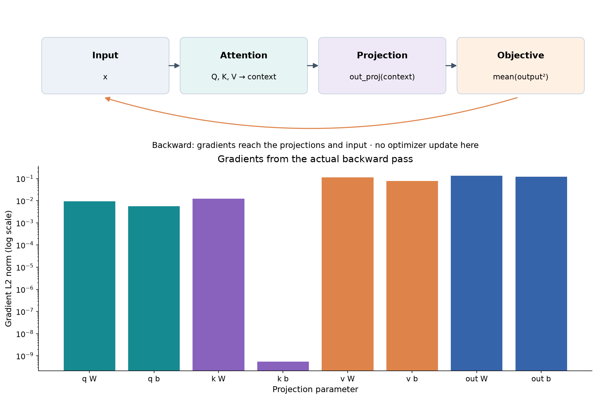

### Check the slope independently of the backward program

For a small ε, estimate the derivative with central differences: `[L(q+ε)-L(q-ε)]/(2ε)`. Using ε=`1e-6` around zero gives approximately 2. This calculation reevaluates forward losses instead of using the graph's backward rule, so it can detect a plausible incorrect gradient implementation.

Too small an ε can amplify floating-point cancellation; too large an ε measures curvature over a wider interval. Use float64 and compare within a declared tolerance. A finite-difference agreement at one point is bounded evidence, so retain other fixtures rather than declaring every shape or dtype correct.

### Connect the probe to learned parameters

In the public module, Q/K/V depend on affine weights. For one row, `q=xW_Q+b_Q` in the displayed convention. The chain rule sends the query gradient through that map to x, W and b; shared parameter contributions from multiple positions/examples accumulate. Output projection, value mixing and the score path each contribute their own derivative routes.

The existing tests create explicit and SDPA layers with identical parameters, calculate the same squared-output objective, call backward, and compare input and parameter gradients. Cross-attention also checks target-query input gradients. Combined with PyTorch's independent forward reference and analytic probes, this is stronger than checking that `.backward()` merely returns without raising an exception.

No optimizer, real translation dataset, training loop or translation-quality experiment is implemented by this tutorial. The q update above is an isolated arithmetic check. It explains why a learnable attention module can receive a useful update; it does not establish that a full model has learned a language.

### Predict or explain: At q=0 with keys [1,-1], values [2,6] and desired context five, which query direction decreases half squared error?

<details data-practice-id="gradient-check"><summary>Reveal worked answer and rubric</summary>

Decrease q: c=4, dL/dq=2, so gradient descent moves q negative and increases weight on value six. A step of 0.1 gives q=-0.2.

**Rubric:** Explain all three slopes and separate this probe from real translation training.

</details>


The final lesson gathers the evidence and states the exact next data-phase handoff, keeping mathematical understanding, source correctness and task performance distinct.


## Explain what works and prepare the next implementation

We can now follow an input through projections, head layout, scores, masks, normalized weights, retrieved values, concatenation and output projection. We can also explain a backward example. This completes the tutorial's current component scope. It does not fill the project's later placeholder files.

### Use each check for the claim it can support

| Evidence | What it checks | What it does not establish |
| --- | --- | --- |
| Hand-calculated weighted average and raw-X example | Known numerical forward results | Learned word meaning |
| Projection and matrix fixtures | Q/K/V orientation, bias, scores, context and head merge | Real-data generalization |
| PyTorch MultiheadAttention comparison | A separate implementation gives matching outputs/weights with mapped parameters | Full encoder/decoder correctness |
| Explicit/SDPA forward and gradient parity | Selected paths agree for exercised cases | GPU speed or universal bitwise equality |
| Padding and future perturbations | Forbidden positions cannot affect protected outputs in those cases | Correct future data splitting or label alignment |
| Entirely blocked and dropout tests | Defined edge behavior, finite gradients and train/eval distinction | Arbitrary malformed-input safety |
| 35 existing tests and runnable demo | Current local component is executable and checked | Trained translation quality or learner mastery |

The code has been reorganized by responsibility; the attention module's numerical implementation and demo outputs are unchanged. Its captured source and [reference-run evidence](project/reference-runs.md) let us distinguish an existing application capability from a new authored explanation. The Colab runner's operational cells are verified locally; actual hosted execution is recorded separately from the attention tests and demo.

### Draw the implemented computation without file-name memorization

Start with `(B,S,D)` floating source vectors and optional `(B,T,D)` target vectors. Identify the query input. Apply separate Q/K/V projections; split D into H heads of width d. Draw score rows as queries and columns as keys, mark allowed pairs, normalize along keys, multiply values, reassemble query-major head features, and apply the output projection.

Then change one condition. If a source pad vector changes, which outputs must remain fixed? If a future target input changes, which causal outputs are protected? If only V changes, should the attention weights move? If all keys are blocked, why can the final output still be the output bias? These changed cases reveal whether the computation is understood more clearly than reciting class names.

The [explanation practice](practice/explain-attention.md), [attention learning points](project/learning-points/01-attention.md) and [comparison record](project/comparisons/01-attention.md) provide worked answers and useful distinctions. No response is recorded as a learner assessment.

### Part 2 will define real text before model expansion

The next implementation works in `src/tokenizer.py`, `src/prepare_data.py` and the package's tokenizer/data modules. Its first contract is one English/French pair transformed into reproducible integer sequences and a batch. Before acquisition, decide the official dataset/subset, license and split authority; pin its revision and record content identities. Fit a newly trained tokenizer only on the allowed training text and save its vocabulary/config identity.

For an illustrative target `[BOS, je, bois, EOS]`, a conventional shifted example uses decoder input `[BOS, je, bois]` and labels `[je, bois, EOS]`. The labels are what each query position should predict. Padding needs both key-validity masks and a separate ignored-label rule. Record special token IDs and truncation/empty-example policy explicitly. These examples define questions for Part 2; they are not acquired token IDs or implemented collation results.

We will compare an actual pair before and after tokenization, print input/label rows beside each other, check masks and show which targets count in the loss. Source/target tokenizers have distinct identities in the planned video-following route. A sentence-length or vocabulary setting in a draft JSON file does not settle the data contract.

### Part 3 will assemble and train a complete model

Only after data and batch contracts are implemented will the later phase add token embeddings, positions, residual paths, normalization, feed-forward blocks, encoder/decoder stacks and a vocabulary prediction head. The attention module becomes one ingredient in that architecture.

Training will need a token-loss denominator, optimizer/schedule, bounded profiles, explicit new/resume modes and persistent full-state checkpoint generations. Inference will need a start token, stopping rule and generation loop; evaluation will need a fixed held-out protocol and clearly configured BLEU. The current config files and Colab instructions describe intended work, not measured training/recovery capability.

### Keep the completion states separate

The [readiness record](project/readiness.md) marks setup and attention software checks as available, with learner review still open. Dataset/tokenizer, full model/training, translation metrics and actual Colab deleted-runtime recovery remain pending. We add those lessons when the corresponding implementation and evidence exist.

This preserves a useful next action: review one complete attention trace now, then begin the data contract when moving to implementation. There is no need to recreate the project or restart a general Python course.

### Predict or explain: Do passing attention tests establish a trained translator or a completed learner review?

<details data-practice-id="handoff-check"><summary>Reveal worked answer and rubric</summary>

No. They establish exercised local component properties. Tokenizer/data, full model/training/evaluation and actual human explanations remain separate evidence.

**Rubric:** Name at least one missing implementation artifact and one missing evidence class.

</details>


### Source and review downloads

The [captured source bundle](code/source-bundle.json) contains exact UTF-8 file contents and hashes for the implementation, tests, notebook, lock and honest later placeholders. Its [file hashes](code/source-manifest.json) identify each captured file. Save that JSON file and the [restoration helper](examples/restore_source.py) into the same folder, then run `python restore_source.py /path/to/a/new-directory` there to restore a runnable project. The helper refuses an existing destination and verifies every hash before writing. Do not restore over a working project. The [drawing module](code/src/utils/attention_visuals.py) is available separately.

Review: [setup learning points](project/learning-points/00-setup.md), [attention learning points](project/learning-points/01-attention.md), [setup comparisons](project/comparisons/00-setup.md), [attention comparisons](project/comparisons/01-attention.md), [implementation](project/implementation.md), [reference runs](project/reference-runs.md), [readiness](project/readiness.md), [practice](practice/explain-attention.md), [source research](research.md), [arithmetic probe](examples/arithmetic.py) and [component probe](examples/verify_component.py).


## Evidence and proof limits

### Claim ledger

| Claim | Status | Proof limit |
| --- | --- | --- |
| The existing attention module implements the taught projection, head, mask and retrieval paths. | verified | Local source and exercised CPU checks; not trained translation, learner understanding or GPU performance. |
| The course covers setup and implemented attention; later translation data/model/training remain pending. | documented | Source audit and explicit user scope; no later placeholder is implemented by this authoring work. |

## Sources

- [Implemented attention module](evidence/attention-source.txt) — captured excerpt SHA256 4a05ee4f13a20f8409df63c426b27ce14a38fac46c7641c7a652aaf640e72618
- [Existing independent attention checks](evidence/attention-tests.txt) — captured excerpt SHA256 ff43f76756f3eea31019082fd26c80e345633fe835655de18a56dd093c833758
- [Original matrix fixtures and drawing code](evidence/visual-source.txt) — captured excerpt SHA256 bf17257e3ef4978248f2ac2783b482527643a6c2aa6c17ed2eefaaf7bdb37af9
- [Known answers for visual examples](evidence/visual-tests.txt) — captured excerpt SHA256 c66b0dabce011a15edea61fac60332315ba9fea952d966adc21e470e87267efb
- [Attention Is All You Need, v7](https://arxiv.org/html/1706.03762v7) — Sections 3.2.1-3.2.3; component mathematics and roles; checked 2026-10-23
- [PyTorch 2.14 SDPA API](https://docs.pytorch.org/docs/2.14/generated/torch.nn.functional.scaled_dot_product_attention.html) — Mask semantics, dropout argument and backend selection; checked 2026-10-23
