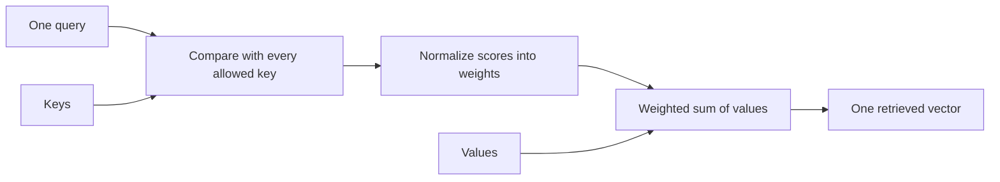

## Begin with the information a query retrieves

The eventual application translates English into French. Before a model can choose French words, it needs a way to combine information from different positions. That is the component already implemented in this project. We will start with its smallest meaningful output, follow the numbers into the Python implementation, and stop before claiming that a translation model exists.

For a first session, work through this calculation and the local setup in lesson 2. You should be able to explain why the result changes when the weights change. Later lessons unpack how the module creates those weights, runs several heads, excludes padding and future positions, and propagates gradients.

### Two pieces of information, one requested result

Suppose two positions carry the value vectors `[2, 4]` and `[6, 8]`. Each vector has two coordinates. These are deliberately chosen numbers, not word embeddings or rental observations. If a query gives each position weight one half, the retrieved vector is:

$$c=0.5[2,4]+0.5[6,8]=[4,6].$$

Work coordinate by coordinate: the first output is `0.5×2 + 0.5×6 = 4`; the second is `0.5×4 + 0.5×8 = 6`. We combine whole vectors with one weight per position. We do not separately choose a different position distribution for each coordinate within this head.

If the weights become `[0.75, 0.25]`, the result becomes `[3,5]`. It moves towards the first value. This is what retrieval means here: construct a new representation from the available value vectors. It is not a database lookup returning an unchanged row, and it is not yet a probability distribution over French words.


### Separate three roles before introducing the implementation

A **query** describes what one output position is looking for. A **key** provides the coordinates against which that query is compared. A **value** carries the information mixed into the output. The keys and values have corresponding positions: key zero's score determines how much value zero contributes.

Think of these as numerical roles. The familiar search-language interpretation can help us remember them, but it does not prove that a particular coordinate encodes a linguistic concept. The current examples use synthetic vectors and random or hand-set weights.



The arrows describe computation. A query-key comparison produces a scalar score for each key. Normalization makes a row of weights. Those weights mix the values. With many queries, we repeat the same logical operation for every query position, using matrix multiplication to do the work together.

### Produce the first result with the real function

After the setup in the next lesson, run this from the project directory. It imports the actual low-level function rather than reimplementing its expected answer:

```python
import torch
from core.attention import scaled_dot_product_attention

q = torch.zeros(1, 1, 2)  # one batch, one query, two coordinates
k = torch.eye(2).unsqueeze(0)  # two keys
v = torch.tensor([[[2., 4.], [6., 8.]]])
context, weights = scaled_dot_product_attention(q, k, v)
print(weights)   # [[[0.5, 0.5]]]
print(context)   # [[[4.0, 6.0]]]
```

Every dot product with the zero query is zero. Exponentiating the two equal scores gives equal positive numbers, and dividing each by their sum gives one half. Lesson 4 develops that normalization in detail. The output has one vector because the input had one query, even though there were two keys and two values.

### What normalized weights guarantee

Before dropout, an ordinary nonempty attention row has nonnegative weights summing to one. Each context coordinate is therefore between the smallest and largest corresponding value coordinate. This is a property of this weighted combination. The complete attention module later applies learned projections and an output projection, so its final output need not lie between the original input coordinates.

An entirely blocked row is a separate case. Our implementation returns zero attention weights and zero context rather than trying to normalize an empty set. The final output projection can still add a bias. We will trace that distinction in lesson 7.

[[practice:weighted-check]]

### Keep the current project boundary visible

The source currently accepts floating-point vectors. There is no implemented text tokenizer, vocabulary lookup or complete encoder/decoder stack. It can demonstrate how representations interact; it cannot turn the sentence “I like tea” into a trained French translation.

The [implementation record](project/implementation.md) records what exists. The [source register](research.md) identifies the actual files and references. Keep the [review questions](practice/explain-attention.md) for later explanation in your own words; reading a worked answer is not an assessed learner result.

Next we will reproduce this component in the locked environment and identify exactly which files run it.
