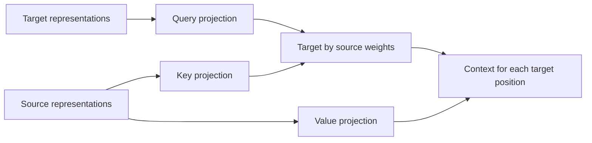

## Let target queries retrieve source information

Self-attention takes Q, K and V from one sequence. Translation also needs the developing target representation to retrieve information from the encoded source. The implemented cross-attention path changes where Q comes from while keeping keys and values aligned with source positions.

### Trace the two input arguments by role

In this project's final public interface:

```python
cross_output = layer(src, tgt=tgt, attention_mask=source_mask)
```

`src` supplies keys and values. `tgt` supplies queries. These names can be confusing if we assume “the first argument is always Q”; here it is not. In the final model, `src` for this call will be encoder representations rather than raw integer English IDs. `tgt` will be decoder representations, not labels. Those surrounding blocks have not been implemented.



### Calculate the rectangular shapes

Let `B=2`, source length `S=5`, target length `T=3`, model width `D=12`, and `H=3`. After projection/splitting:

```text
Q:       (2,3,3,4)       batch, heads, target queries, width
K and V: (2,3,5,4)       batch, heads, source keys/values, width
scores:  (2,3,3,5)       target rows, source columns
context: (2,3,3,4)
merged:  (2,3,12)
output:  (2,3,12)
```

The public output follows target/query length. Five source positions do not imply five output rows. The mask is `(2,5)`, because it describes source keys; a `(2,3)` target padding mask cannot be substituted for it.


### Work one query independently

Suppose a head's source keys are `[[1,0],[0,1],[1,1]]`, values are `[[2,0],[0,4],[2,4]]`, and its target query is `[1,0]`. Scores are `[1,0,1]/√2`. The first and third keys receive equal high weights; their values contribute differently to the two context coordinates.

If the third source position is padded, scores become `[1/√2,0,-∞]`. Weights become approximately `[0.669762,0.330238,0]`. The context becomes `[1.339523,1.320954]`. That one retrieved vector belongs to the target query. It is not a translated word, and it does not identify a single hard source alignment.

### Why no ordinary causal triangle over source positions?

For the intended completed-sentence translation task, the full English source is available before generating the French target. A target query can therefore retrieve any valid encoded source position. Applying `j≤i` between target and source indices would falsely treat unrelated position numbers as a time-availability relationship.

The target's own self-attention still needs causality. Cross-attention and decoder self-attention sit at different points in a future decoder block and answer different visibility questions. A streaming translator with partial source availability would need a separate, explicit protocol; the current API does not claim to implement one.

### Inspect the checks and rejected calls

The implementation verifies matching batch size, floating dtype, device and embedding width for source and target. Their sequence lengths can differ. Supplying `causal=True` together with `tgt` raises a clear error. A source mask with the wrong length is rejected before a misleading output can be interpreted.

Tests map the same learned projection weights into PyTorch `nn.MultiheadAttention`, then compare both cross-attention outputs and per-head weights. Other tests perturb only padded source rows and require all target outputs to remain unchanged. These establish component behavior for the exercised tensors, not translation quality or trained word alignments.

[[practice:cross-check]]

We have now covered every attention mode the final reusable class exposes. The next lesson follows that class from its arguments through the explicit and efficient execution branches.
