# Attention foundations: from fixed summaries to causal retrieval

How do contextual mixtures arise, and what changes when we learn scores, projections and visibility?

Learning material for attention-labs. Model implementation/training and learner mastery are separate states.

**Outcomes:** 1. What information does a token need?; 2. Why one fixed summary can be difficult to use; 3. Build a context that depends on the current query; 4. Change the score while keeping retrieval intact; 5. Give every position a context from its own sequence; 6. Separate comparison features from delivered content; 7. Make the training information match generation.

## 1. What information does a token need?

Consider a translation system reading “Quiet cats nap” and producing “Des chats calmes dorment”. The output is a new sequence, with its own length and word order. A representation of “cats” alone cannot specify which adjective describes these cats, or which action they perform. The system must combine information from several input positions before predicting output tokens.

There are three jobs in that description. First, turn input tokens into numerical representations. Second, let the representation used for a prediction retrieve useful information from other positions. Third, turn the resulting features into scores for possible output tokens. Attention does the second job. It does not tokenize the sentence, create a vocabulary, or by itself constitute a trained translator.

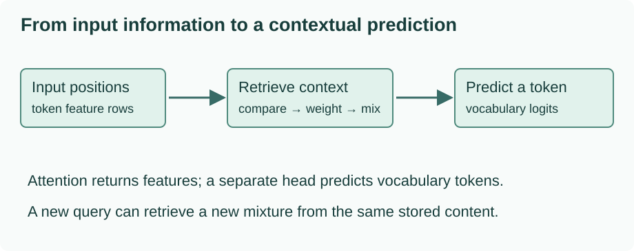

The arrows show information flowing toward a prediction. In later lessons we open the middle box: a numerical request is compared with available source representations, comparisons determine mixing weights, and those weights combine the available content. We will inspect every intermediate number. The sentence gives the task a purpose; the small coordinates used for arithmetic below are hand-chosen examples, not measured meanings of English words.

### The route through this folder

The next lesson first removes attention and shows what happens when a decoder receives one fixed summary. Lesson 3 replaces that fixed handoff with a different mixture for every output step. Lesson 4 studies how to compute the comparisons. Lessons 5 and 6 apply the mechanism within one sequence and give it trainable projections. Lesson 7 restricts the information available during next-token prediction. At that point we have one complete, inspectable attention head.

Multi-head attention has its own `attention-heads` folder. It builds on the single-head result, and will later house GQA and related arrangements. There are no separate basic-type project folders to navigate between. Lecture 9, on positional embeddings, is deliberately excluded from this course.

### Attention names answer different questions

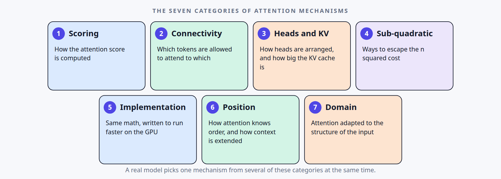

*Original diagram: [Vizuara, Lecture 1, slide 5](https://lecture1-attention-mechanisms.vercel.app/#/5). Captured from the linked presentation website. Open the image for full size.*

Read the boxes as different questions about one model. A causal, multi-head layer can still use scaled dot-product scoring: the choices combine. The first two boxes guide this foundations route; the head/KV box leads to the separate Attention Heads route. Our table below spells out these questions without assuming that every research method fits only one box.

Suppose a layer uses scaled dot-product scores, a causal mask, and multiple heads. Those descriptions can all be true simultaneously: they describe different choices inside the same layer. Treat the following as questions to ask about a design, not a rule that every published method belongs to exactly one box.

| Question | An example answer | What that answer changes |
| --- | --- | --- |
| How is a query compared with a key? | Additive or scaled dot-product scoring | The numerical compatibility function |
| Where do query and memory representations come from? | Self-attention or cross-attention | Which sequences supply the inputs |
| Which query–key pairs are allowed? | Causal or unrestricted visibility | The support of the attention distribution |
| How are query heads and key/value heads arranged? | MHA now; GQA later | Independent projections and memory sharing |
| What calculation and storage are used? | Dense attention or an alternative method | The mathematical operation or its execution cost |
| How does the model represent order? | A positional method | Information supplied about token positions |
| What kind of input is represented? | Text, images, or another domain | The meaning of a position and its features |

For example, cross-attention can be implemented with multiple heads. Causal masking can be used with MHA or GQA. A faster implementation can preserve the same mathematical outputs. Some methods span several of these concerns, and some modern attention alternatives do not use the exact softmax mixture developed here. Naming a method is therefore the start of its explanation, not a complete specification.

### One concrete operation before the symbols

Imagine three available value vectors: `[1,0]`, `[0,1]`, and `[1,1]`. If a query assigns weights `[0.2,0.3,0.5]`, the returned content is

$$
0.2[1,0]+0.3[0,1]+0.5[1,1]=[0.7,0.8].
$$

The coordinates are features, not word probabilities. The three weights form a distribution over **source positions**. Later, a separate prediction layer can turn the two returned features into a different distribution over **vocabulary tokens**. Confusing those two distributions makes attention appear to predict words directly.

If the next output step changes the weights to `[0.6,0.1,0.3]`, the same stored vectors return `[0.9,0.4]`. Attention can change what is retrieved without recomputing the stored content. Our next question is where those source vectors come from, and why selecting them dynamically helps.

### Predict or explain: A layer is causal, uses a dot-product score and has multiple heads. Is that contradictory?

<details data-practice-id="map-check"><summary>Reveal worked answer and rubric</summary>

No. The score defines compatibility, causality defines permitted source positions, and the head arrangement defines separate or shared projections. These choices can coexist. Attention weights are over source positions; vocabulary probabilities belong to a later prediction head.

**Rubric:** Explain the three different questions and keep source positions separate from vocabulary entries.

</details>


For additional changed-condition problems, use the optional [transfer review](practice/transfer-review.md) after the worked route.

### The original lecture and slides

The [caption provenance](project/source-provenance.json) records the English subtitle sources and hashes used in the lecture review.

This lesson corresponds to [Vizuara Lecture 1](https://www.youtube.com/watch?v=QgnOoQsPc0o). The linked presentation gives the series-wide map; this tutorial develops only the eight included lectures, with MHA separated as requested. Our examples, diagrams and prose are independently authored.

```presentation
{"title":"Vizuara · Lecture 1 · Original presentation","url":"https://lecture1-attention-mechanisms.vercel.app/#/1"}
```

For a first session, stop when you can distinguish source-position weights from vocabulary probabilities and locate attention between representation and prediction. The [implementation record](project/implementation.md), [readiness record](project/readiness.md), [source review](research.md), [lecture coverage](project/source-map.md), and [learning points](project/learning-points.md) are available for returning to the course; they are not a second reading route.

The [inline visual source record](project/visual-provenance.json) identifies the original slide and captured diagram for each presentation image used in this route.


## 2. Why one fixed summary can be difficult to use

The previous lesson located attention inside a translation system. To see why it helps, first build a system whose output side can access only one final input summary. This is a useful historical starting point, not a claim that every recurrent model necessarily loses its earliest input.

### Follow the input into recurrent state

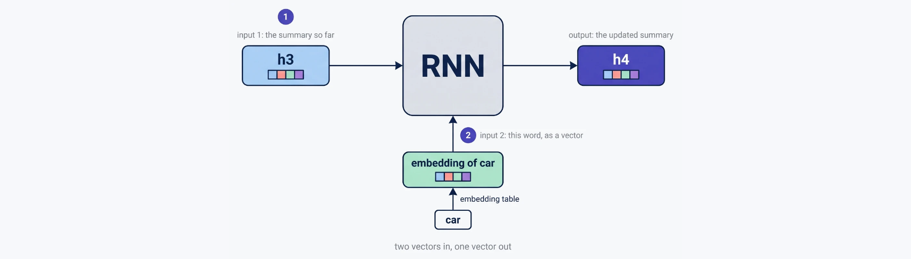

*Original diagram: [Vizuara, Lecture 2, slide 8](https://lecture2-attention-mechanisms.vercel.app/#/8). Captured from the linked presentation website. Open the image for full size.*

Follow the two incoming arrows before the outgoing one: one carries the previous summary and the other carries the current token representation. Reusing this cell creates a chain of computed states. The source picture labels one four-word step; our formula and three-token probe below describe the same dependency with different inputs.

Let the three source tokens have embeddings $x_1,x_2,x_3$. An embedding is a vector selected by token identity. A recurrent encoder updates a state after each token:

$$h_t=\tanh(x_tW_x+h_{t-1}W_h+b_h),\qquad h_0=0.$$

Here rows represent vectors: $x_t$ has width $d_e$, $h_t$ has width $d_h$, $W_x$ has shape $d_e\times d_h$, and $W_h$ has shape $d_h\times d_h$. The two projected rows can be added because they have the same width. The elementwise $\tanh$ supplies a nonlinearity. The matrices are reused at every step; $h_1,h_2,h_3$ are different computed states, not three independently learned parameter sets.

An encoder can use different widths for embeddings and hidden states. The fact that both are vectors does not require equal dimensions or make them interchangeable. After the third update, $h_3$ depends on all three inputs through the recurrence.

The input embedding can be understood as a table lookup. If token ID 4 selects row 4 of an embedding table $E\in\mathbb R^{V\times d_e}$, then $x_t=E[4]$; $V$ is the input vocabulary size. A new model can learn this table jointly with its other parameters, or a system can initialize or freeze it using pretrained vectors. Similar directions can emerge from training, but the token ID itself contains no geometric meaning. Our later binary coordinates are deliberately chosen arithmetic inputs, not entries from a fitted language model.

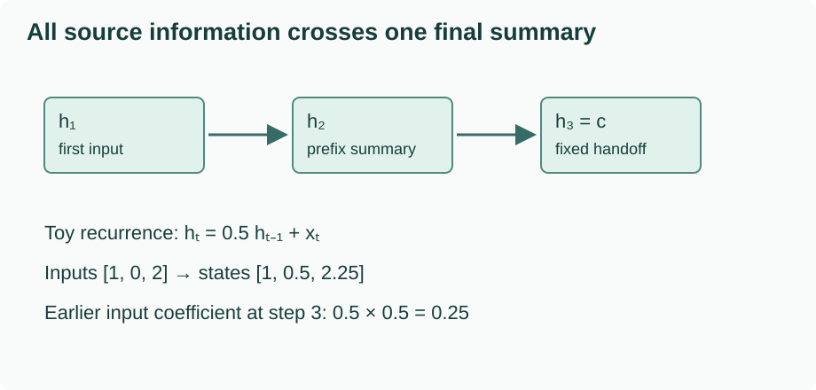

In this baseline, the decoder receives $c=h_3$. A decoder state can be initialized from $c$, or a decoder can also condition on $c$ at each update. Those are implementation choices; our limitation is that the input information reaching the decoder must pass through that same fixed-width representation.

### Quantify one possible fading effect

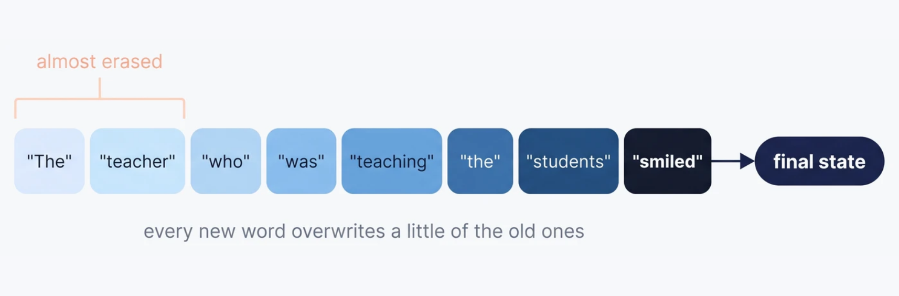

*Original diagram: [Vizuara, Lecture 2, slide 16](https://lecture2-attention-mechanisms.vercel.app/#/16). Captured from the linked presentation website. Open the image for full size.*

The changing color illustrates a possible loss of earlier contributions as the summary is updated. Treat that as motivation for a test, rather than a guarantee that every recurrent model erases its first words. The scalar calculation below specifies one retention factor and measures its exact effect.

Use a scalar recurrence to isolate the effect of repeated state updates:

$$h_t=0.5h_{t-1}+x_t.$$

For inputs `[1,0,2]`, the states are $h_1=1$, $h_2=0.5$, and $h_3=2.25$. Expanding the last state reveals its dependencies:

$$h_3=0.25x_1+0.5x_2+x_3.$$

Increasing only $x_1$ by one raises the final summary by $0.25$. With $T$ tokens, the corresponding coefficient is $0.5^{T-1}$. This toy recurrence demonstrates an attenuating path; it is not a fitted RNN, a universal formula for memory, or an information-theoretic impossibility proof. Learned recurrent matrices and gates can behave differently. Long sequences make learning and preserving useful summaries challenging, but there is no universal twenty-word failure threshold.

<!-- example:02_fixed_summary.py:start -->

Complete file: [02_fixed_summary.py](examples/02_fixed_summary.py).

```python
import json


def encode(inputs, retention=0.5):
    state = 0.0
    states = []
    for value in inputs:
        state = retention * state + value
        states.append(state)
    return states


if __name__ == '__main__':
    original = encode([1.0, 0.0, 2.0])
    changed = encode([2.0, 0.0, 2.0])
    assert original == [1.0, 0.5, 2.25]
    assert changed[-1] - original[-1] == 0.25
    print(json.dumps({'states': original, 'changed_final': changed[-1],
                      'first_input_sensitivity': 0.5 ** 2}))
```

<!-- example:02_fixed_summary.py:end -->

Run from this lesson package, `ai_projects/docs/tutorials/projects/attention-labs/attention-foundations/v1/`:

```bash
python3 examples/02_fixed_summary.py
```

The output records states `[1.0,0.5,2.25]`, a changed final state `2.5`, and sensitivity `0.25`. These are computed properties of the declared recurrence. If the last two values differ by one rather than a quarter, the program is not applying the retention factor at both intervening updates.

### Follow the summary into output tokens

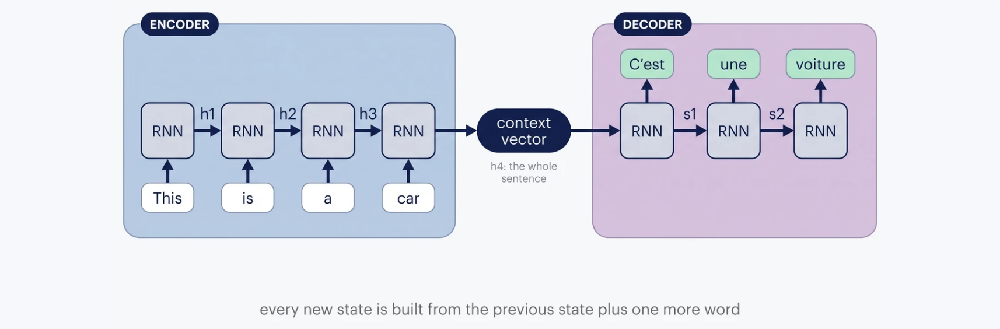

*Original diagram: [Vizuara, Lecture 2, slide 12](https://lecture2-attention-mechanisms.vercel.app/#/12). Captured from the linked presentation website. Open the image for full size.*

Trace the single middle arrow: all source information available to this decoder crosses the same context-vector handoff. The left and right chains can have different numbers of steps, as the English and French examples show. The next-token vocabulary prediction belongs on the decoder side; the context vector is an input representation, not a distribution over words.

The decoder begins with a start token, usually written `<BOS>`. At step $t$, it combines its previous state with the embedding of the previous output token. A conventional output head computes

$$\ell_t=s_tW_o+b_o,\qquad p(y_t\mid y_{<t},c)=\operatorname{softmax}(\ell_t).$$

There is one logit in $\ell_t$ for each vocabulary entry. Selecting the next token from this distribution differs from finding the nearest embedding vector. The chosen token is then supplied to the next decoding step. An `<EOS>` token can end generation, with a maximum-length safeguard for a model that never emits it.

The source length and output length therefore need not match. Encoding three tokens does not require decoding three tokens. During teacher-forced training, the previous **reference** output token is supplied instead of the model's last sampled token; the vocabulary prediction at a position still targets the next reference token.

### Change the interface rather than just enlarging the summary

The encoder has already computed states for intermediate positions. Retaining them makes a different interface possible: give the decoder access to $H=[h_1;h_2;h_3]$, then construct a context vector according to what the current output step needs. Storage now grows with the source length, instead of requiring every retrieval to use only $h_3$.

Attention will still return a finite-width context vector at a step. The change is that it can build **a different context for each step from the retained memory**. It removes this particular fixed handoff, not every limitation of representation, training, or translation.

### Predict or explain: In the scalar encoder, double only the first input. Why does the last state change by 0.25, and must every real RNN behave that way?

<details data-practice-id="summary-check"><summary>Reveal worked answer and rubric</summary>

The effect passes through two multiplications by 0.5, giving 0.25. A real RNN can have different matrices, nonlinearities and gates, so this is an illustrative sensitivity calculation rather than a universal memory law. A decoder still uses a separate vocabulary head and can produce a different number of tokens.

**Rubric:** Trace both intervening updates and state the limitation of the scalar example.

</details>


### The original lecture and slides

[Vizuara Lecture 2](https://www.youtube.com/watch?v=IG2gl6sKj_c) develops the recurrent encoder–decoder motivation. In the original presentation, slides 8–13 show the cell, states and handoff; slides 15–18 discuss the limitations. Our scalar probe makes one of those limitations measurable, while the vocabulary-head explanation makes the prediction interface explicit.

```presentation
{"title":"Vizuara · Lecture 2 · Original presentation","url":"https://lecture2-attention-mechanisms.vercel.app/#/1"}
```


## 3. Build a context that depends on the current query

We now retain every source state instead of handing off only the final one. The decoder's current need must influence which states contribute most. We represent that need by a query $s$, compare it with each available state $h_j$, normalize the comparisons, and use the resulting weights to combine the stored content.

### A context vector for each output step

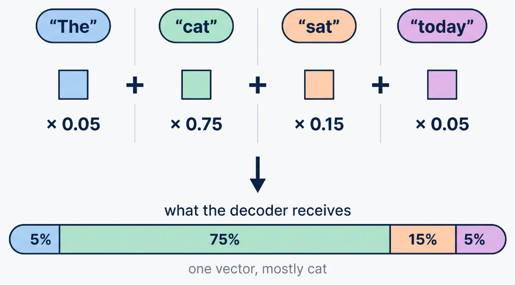

*Original diagram: [Vizuara, Lecture 3, slide 9](https://lecture3-attention-mechanisms.vercel.app/#/9). Captured from the linked presentation website. Open the image for full size.*

Each source state contributes its entire feature vector, multiplied by one scalar weight. The colored proportions describe contributions to one returned context, rather than probabilities that the decoder has already emitted those words. These are the source presentation’s four states; the worked calculation later uses our three retained rows.

For output step $t$ and source position $j$, write a scalar compatibility score as $e_{tj}=a(s_{t-1},h_j)$. The previous decoder state is the query in this convention. Another decoder implementation can order its internal updates differently; what matters here is that the query is available before this retrieval is computed.

Convert the source-position scores into weights and a context:

$$\alpha_{tj}=\frac{\exp(e_{tj})}{\sum_{r=1}^{N}\exp(e_{tr})},\qquad
c_t=\sum_{j=1}^{N}\alpha_{tj}h_j.$$

$N$ is the number of stored source positions. Each row of $\alpha$ belongs to one query and sums to one. The resulting $c_t$ has the same feature width as the stored states. We have not chosen an output word yet: a decoder update and vocabulary head still consume this context.

There is no circular requirement to know the next translated word before computing attention. The already available decoder state and previous output tokens form the query. Its retrieved context helps compute the next state and vocabulary logits; only then does the system choose the next token. During training, a reference next token supplies a target for the loss, rather than an input to this retrieval.

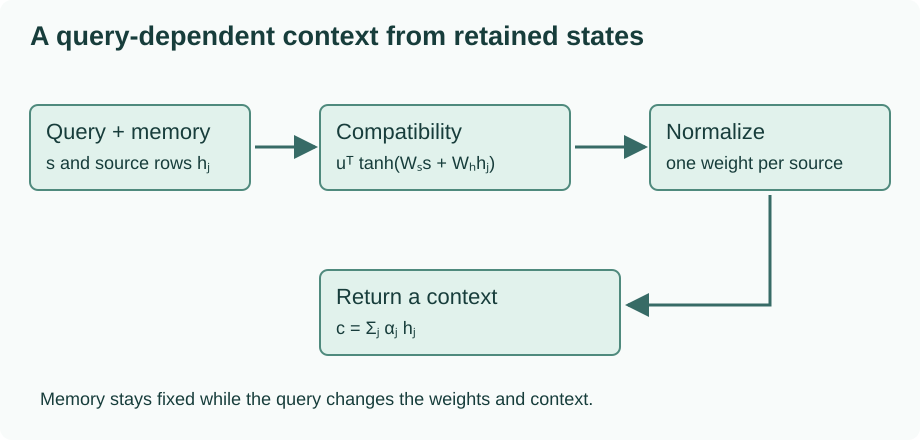

### Why the score is called additive

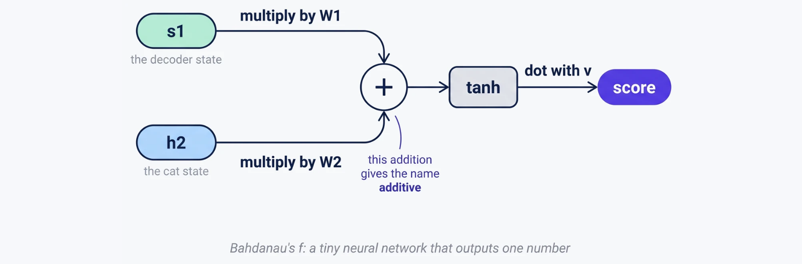

*Original diagram: [Vizuara, Lecture 3, slide 24](https://lecture3-attention-mechanisms.vercel.app/#/24). Captured from the linked presentation website. Open the image for full size.*

The two branches first project the decoder query and one source state to compatible widths. Their addition happens inside the scoring network, before tanh and the final scalar projection. It is separate from the weighted sum of values that happens after normalization.

One possible learned scorer is

$$a(s,h)=u^\top\tanh(W_ss+W_hh+b).$$

For this formula only, the vectors are written as columns. If $s\in\mathbb R^{d_s}$, $h\in\mathbb R^{d_h}$ and the scorer's hidden width is $d_a$, the matrices have shapes $d_a\times d_s$ and $d_a\times d_h$, and $u,b\in\mathbb R^{d_a}$. The projections put query and source in a shared hidden space; they are added before the nonlinearity. That addition gives the scorer its name. Query and source widths need not be equal.

The tanh also matters. If it were removed, $u^\top W_ss$ would be the same scalar added to every source score for a fixed query. Softmax cancels a common additive offset, so that query contribution would not affect the relative weights. Nonlinear interaction prevents this simple cancellation.

The Bahdanau translation paper uses learned alignment and bidirectional encoder annotations. Our arithmetic isolates its scoring-and-retrieval idea; it does not implement that complete model or reproduce its training results. See the [original paper](https://arxiv.org/abs/1409.0473).

### A complete small calculation

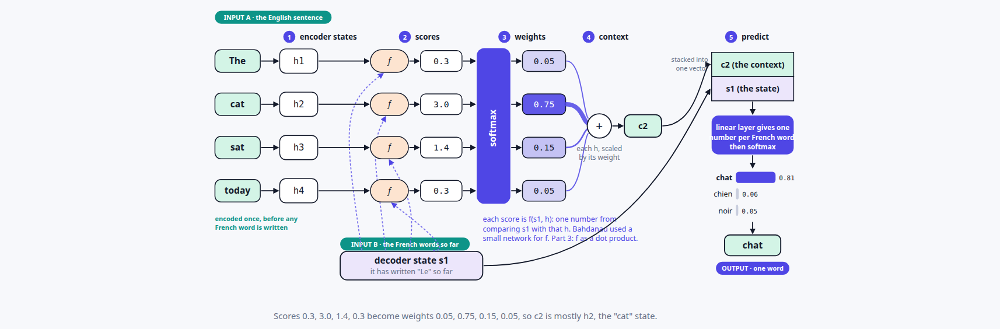

*Original diagram: [Vizuara, Lecture 3, slide 14](https://lecture3-attention-mechanisms.vercel.app/#/14). Captured from the linked presentation website. Open the image for full size.*

Read the middle path first: compare the available query with every state, normalize the scores, and combine those states. Only afterward does the output-side computation use the context to score vocabulary entries. The source uses four English positions and rounded displayed values; our calculation below independently checks three states and keeps source-position weights separate from vocabulary probabilities.

We will reuse the hand-set memory

$$H=\begin{bmatrix}1&0\\0&1\\1&1\end{bmatrix}.$$

The rows will also serve as illustrative token features later. For now they are three available source states. Take scalar query $s=0$, query projection $[s,-s]$, identity source projection, scoring vector $u=[1,-1]$, and zero bias. The three hidden rows and scores are

| Source state | Hidden row before tanh | Score |
| --- | --- | --- |
| `[1,0]` | `[1,0]` | $\tanh(1)-\tanh(0)=0.761594$ |
| `[0,1]` | `[0,1]` | $\tanh(0)-\tanh(1)=-0.761594$ |
| `[1,1]` | `[1,1]` | $\tanh(1)-\tanh(1)=0$ |

Softmax gives approximately `[0.593494,0.129391,0.277115]`. The returned row is

$$c=0.593494[1,0]+0.129391[0,1]+0.277115[1,1]
\approx[0.870609,0.406506].$$

The first coordinate receives contributions from rows 1 and 3; the second receives contributions from rows 2 and 3. A negative score did not create a negative weight. Exponentiation makes all unmasked weights positive.

### Compute softmax without overflowing

For scores `[1000,1000]`, directly evaluating exponentials can overflow even though the answer is simply `[0.5,0.5]`. Subtract the maximum score $m$ before exponentiating:

$$\frac{e^{e_j-m}}{\sum_r e^{e_r-m}}=\frac{e^{-m}e^{e_j}}{e^{-m}\sum_r e^{e_r}}=\alpha_j.$$

The cancellation is exact in real arithmetic and makes numerical evaluation safer. This shared reference module supplies the row operations used from here onward. `dot` multiplies matching coordinates and sums them; `matmul` applies that dot product to every row/column pair. The shared input rows are the same hand-set memory used above; there are no trainable projection parameters in this helper module.

<!-- example:row_math.py:start -->

Complete file: [row_math.py](examples/row_math.py).

```python
"""Row-vector operations and the shared synthetic fixture; standard library only."""
import math


def dot(a, b):
    if len(a) != len(b):
        raise ValueError('Dot product widths must agree')
    return sum(x * y for x, y in zip(a, b))


def transpose(matrix):
    if not matrix or not matrix[0] or any(len(row) != len(matrix[0]) for row in matrix):
        raise ValueError('Expected a nonempty rectangular matrix')
    return [list(column) for column in zip(*matrix)]


def matmul(a, b):
    columns = transpose(b)
    return [[dot(row, column) for column in columns] for row in a]


def softmax(scores, allowed=None):
    if not scores:
        raise ValueError('Need at least one score')
    allowed = [True] * len(scores) if allowed is None else list(allowed)
    if len(allowed) != len(scores) or not any(allowed):
        raise ValueError('Every query needs at least one allowed key')
    if any(not math.isfinite(score) for score, use in zip(scores, allowed) if use):
        raise ValueError('Allowed scores must be finite')
    maximum = max(score for score, use in zip(scores, allowed) if use)
    numerators = [math.exp(score - maximum) if use else 0.0
                  for score, use in zip(scores, allowed)]
    denominator = sum(numerators)
    return [value / denominator for value in numerators]


def rounded(value):
    return [rounded(x) for x in value] if isinstance(value, list) else round(value, 6)


X = [[1.0, 0.0], [0.0, 1.0], [1.0, 1.0]]
```

<!-- example:row_math.py:end -->

The additive example then implements the particular scorer above. All imports refer to the displayed module in the same `examples/` folder.

<!-- example:03_additive.py:start -->

Complete file: [03_additive.py](examples/03_additive.py).

```python
import json
import math
from row_math import X, matmul, rounded, softmax


def additive(query, states):
    # Project a scalar query to [query, -query]; project each key identically.
    # The output scoring vector is [1, -1]. No biases in this fixture.
    scores = [math.tanh(query + h[0]) - math.tanh(-query + h[1]) for h in states]
    weights = softmax(scores)
    context = matmul([weights], states)[0]
    return scores, weights, context


if __name__ == '__main__':
    scores, weights, context = additive(0.0, X)
    other = additive(1.0, X)
    assert abs(sum(weights) - 1.0) < 1e-14
    assert other[1] != weights
    assert softmax([1000.0, 1000.0]) == [0.5, 0.5]
    print(json.dumps({'scores': rounded(scores), 'weights': rounded(weights),
                      'context': rounded(context), 'new_query_weights': rounded(other[1])}))
```

<!-- example:03_additive.py:end -->

Run `python3 examples/03_additive.py` from the package directory. The result includes the scores, weights and context above. It also changes the query to $s=1$, keeping the source states and parameters fixed, and obtains weights `[0.541045,0.206330,0.252626]`. The changed context comes from a new retrieval, not a new memory or a training step.

### Read an alignment matrix correctly

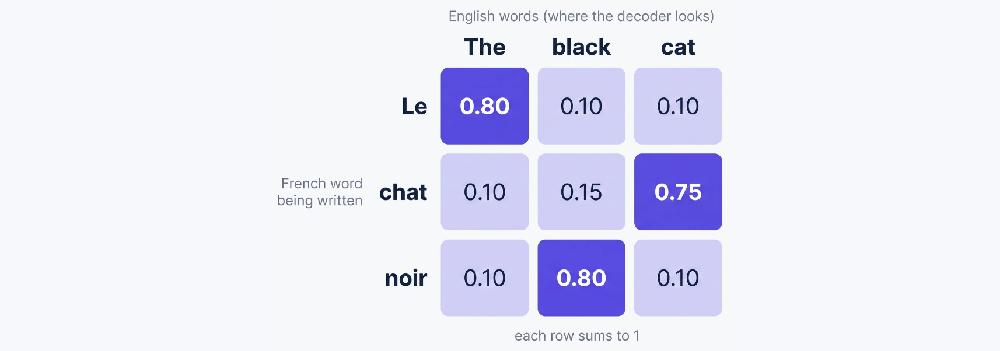

*Original diagram: [Vizuara, Lecture 3, slide 20](https://lecture3-attention-mechanisms.vercel.app/#/20). Captured from the linked presentation website. Open the image for full size.*

Follow a row to see which source positions contribute to that output step; follow successive rows to see the retrieval change. The stronger cells need not form a diagonal when translation changes word order. This is a source illustration of alignment, not a learned result from our project or a requirement that attention always produces one-to-one matches.

Stack the weights for several output steps. Rows are output-step queries; columns are source positions. A bright entry can indicate that one source position contributes strongly to that step's context. It is not necessarily a one-to-one word alignment or a proof of a linguistic relationship. Source and target tokenization can differ, soft mixtures can distribute information, and a trained decoder uses more than this matrix.

The number of rows can differ from the number of columns. Generation still ends according to the decoder's output behavior, not when attention has used every column once. Nothing in row-wise normalization imposes a monotonic alignment or requires each source position to be selected exactly once.

For a concrete rectangular case, stack the two weight rows computed above for $s=0$ and $s=1$. The result is a $2\times3$ matrix: two output-step queries, three source positions. Its rows sum to one, but a column has no such constraint. Multiplying it by the $3\times2$ memory produces two width-two contexts. If a decoder state has width three, concatenating one context with that state produces width five; a $5\times V_{\mathrm{out}}$ matrix can then produce one logit for each output vocabulary token. Attention normalization and vocabulary normalization have different axes even inside the same decoding step.

### Predict or explain: If tanh is removed from uᵀ(Wₛs + Wₕh), can changing only s change the softmax weights?

<details data-practice-id="additive-check"><summary>Reveal worked answer and rubric</summary>

Not in this separable scorer: uᵀWₛs adds the same scalar to every source score for a fixed query. Softmax is invariant to that common offset, so the relative weights do not change. Nonlinear interaction makes the query contribution affect relative comparisons.

**Rubric:** Show the common-offset cancellation; distinguish a new query from updating model parameters.

</details>


### The original lecture and slides

[Vizuara Lecture 3](https://www.youtube.com/watch?v=6yIe4ekER14) supplies the additive-attention motivation and alignment discussion. The 28-slide presentation moves from retained source states to a full decoding step and then opens the scoring network. This lesson uses fresh coordinates and checks their arithmetic independently.

```presentation
{"title":"Vizuara · Lecture 3 · Original presentation","url":"https://lecture3-attention-mechanisms.vercel.app/#/1"}
```


## 4. Change the score while keeping retrieval intact

We can preserve the source-position normalization and value mixture while replacing the additive network with a different compatibility function. A dot product is a particularly convenient choice when queries and keys have the same width: it scores a pair with coordinate multiplications and a sum, and many pairs fit naturally into a matrix product.

### Direction and magnitude both affect a dot product

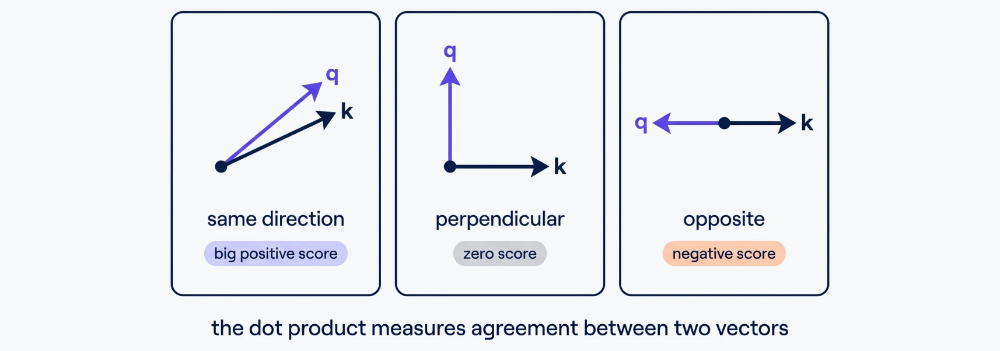

*Original diagram: [Vizuara, Lecture 4, slide 8](https://lecture4-attention-mechanisms.vercel.app/#/8). Captured from the linked presentation website. Open the image for full size.*

The three panels isolate the sign contributed by direction: aligned vectors can give a positive score, perpendicular vectors give zero, and opposite vectors can give a negative score. Length also matters through the product of the norms. Use the same-direction, different-length counterexample below to avoid reading this picture as a cosine-only comparison.

For rows $q,k\in\mathbb R^{d_k}$,

$$q\cdot k=\sum_{r=1}^{d_k}q_rk_r=\lVert q\rVert\lVert k\rVert\cos\theta.$$

The coordinate formula defines the computation. The geometric formula explains why a larger magnitude can increase a score even without changing direction. Query `[1,0]` scores key `[2,0]` as 2 and key `[1,0]` as 1. Both keys point in the same direction. A dot-product ranking is therefore not a cosine-similarity ranking unless magnitudes are controlled.

Using query `[1,1]` with the three rows retained from Lesson 3 gives scores `[1,1,2]`. Plain softmax returns approximately `[0.211942,0.211942,0.576117]`. The third source receives most weight. This follows from our chosen coordinates; it is not evidence that a model has learned which English word matters.

Luong and colleagues studied several alignment score forms, including dot, general/bilinear, and concat forms. Dot-product scoring is a useful case from that work, not its entire contribution. A bilinear score $qMk^\top$ can also bridge unequal query/key widths. See the [original paper](https://aclanthology.org/D15-1166/).

### Why divide by a square root?

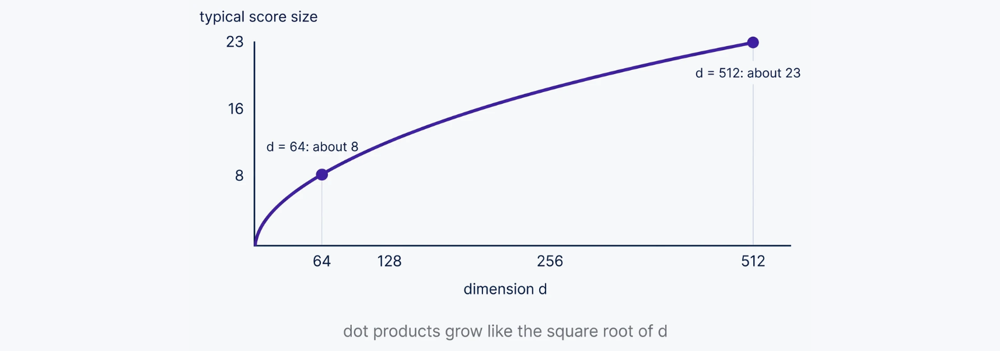

*Original diagram: [Vizuara, Lecture 4, slide 10](https://lecture4-attention-mechanisms.vercel.app/#/10). Captured from the linked presentation website. Open the image for full size.*

The plotted scale is a typical score magnitude, approximately the square root of the width under the stated random-coordinate assumptions. It is not a plot of variance: the variance calculation below gives d before scaling. Learned or correlated coordinates need not follow this sketch.

Assume, for this calculation, independent query and key coordinates with mean zero and variance one, with the coordinate-product terms mutually independent. For $r_i=q_ik_i$,

$$\mathbb E[r_i]=0,\qquad \operatorname{Var}(r_i)=\mathbb E[q_i^2]\mathbb E[k_i^2]=1.$$

There are $d_k$ such terms in the dot product, so

$$\operatorname{Var}(q\cdot k)=d_k,\qquad
\operatorname{Var}\left(\frac{q\cdot k}{\sqrt{d_k}}\right)=1.$$

This explains the conventional scaling factor. Actual learned coordinates can have different variances or correlations, so the division does not guarantee unit variance or a soft distribution in every layer. It is a scale-control choice motivated by those assumptions, not a theorem about all trained activations.

Softmax depends on **differences** between scores, since $a_i/a_j=\exp(e_i-e_j)$. Scores $[1000,1001]$ therefore have the same weights as $[0,1]$: approximately $[0.268941,0.731059]$. A large common offset alone does not make attention nearly one-hot. In contrast, increasing the difference from 1 to 20 does. Scaling divides those differences as well as the individual scores.

This distinction matters when experimenting with random vectors. Independent coordinates drawn uniformly from $[0,1]$ are not mean-zero, unit-variance coordinates: their products have mean $1/4$, so the expected raw dot product is $d_k/4$. That growing common mean is not itself the source of softmax concentration. Variation in score differences is what affects the normalized weights. State the sampling distribution when interpreting a dimension experiment, and compare many draws rather than treating one random sample as a universal trend.

For our width-two query, divide scores `[1,1,2]` by $\sqrt2$ before softmax. The weights become `[0.248255,0.248255,0.503490]`, less concentrated than the unscaled result. The key width is the scaling dimension; it is not the number of source positions or the value width.

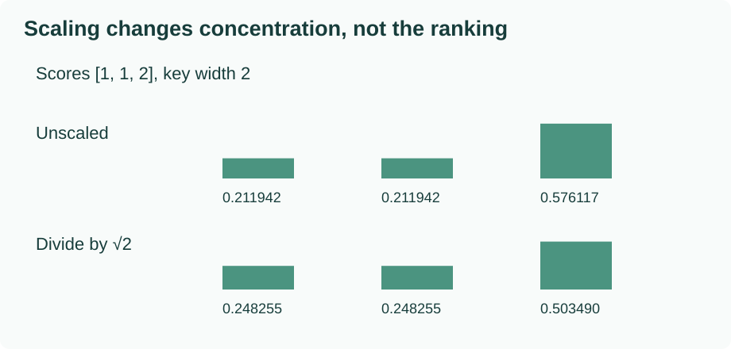

### Softmax derivatives explain the concern more precisely

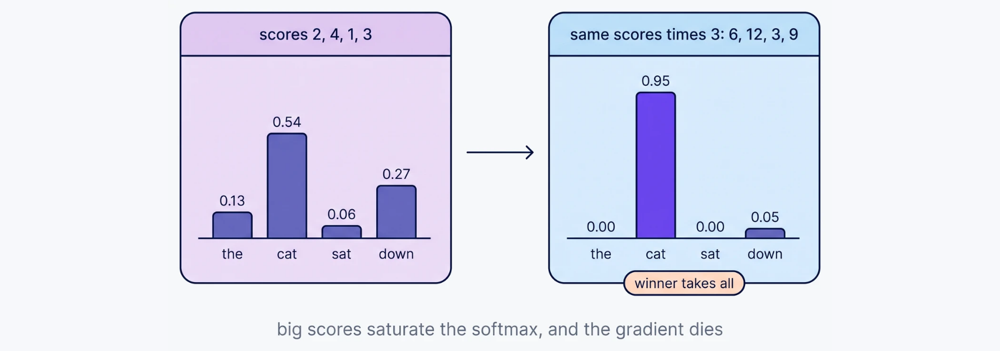

*Original diagram: [Vizuara, Lecture 4, slide 11](https://lecture4-attention-mechanisms.vercel.app/#/11). Captured from the linked presentation website. Open the image for full size.*

The second panel multiplies the scores, enlarging their differences and concentrating the weights. A common offset alone would leave the distribution unchanged. The source caption compresses the gradient consequence: the derivation below concerns the softmax Jacobian, and does not imply that every gradient in a model disappears.

Let $a_i=\operatorname{softmax}(e)_i$. Differentiating gives

$$\frac{\partial a_i}{\partial e_j}=a_i(\delta_{ij}-a_j).$$

Here $\delta_{ij}$ is 1 when the indices match and 0 otherwise. For a two-score vector `[0,2]`, the larger probability is about 0.880797, and its own derivative is about 0.104994. For `[0,20]`, that derivative is about $2.061\times10^{-9}$. Very concentrated softmax weights can make changes in the weights insensitive to small score changes.

This does **not** imply that every gradient in a model vanishes or that learning necessarily stops. For example, softmax followed by cross-entropy has logit gradient $p-y$; a confident wrong prediction can have a large gradient. The effect depends on the surrounding computation and objective.

### Temperature is a related operation, not the same setting

Writing $a=\operatorname{softmax}(e/\tau)$ with $\tau>0$, increasing $\tau$ makes score differences smaller and generally spreads probability more evenly. Decreasing it sharpens the distribution. Attention's $1/\sqrt{d_k}$ scales **query–key scores**; a generation temperature typically scales **vocabulary logits**. The algebra is related, but these are different distributions at different places in the model.

<!-- example:04_scoring.py:start -->

Complete file: [04_scoring.py](examples/04_scoring.py).

```python
import json
import math
from row_math import X, dot, rounded, softmax


if __name__ == '__main__':
    query = [1.0, 1.0]
    scores = [dot(query, key) for key in X]
    ordinary = softmax(scores)
    scaled = softmax([score / math.sqrt(2) for score in scores])
    sharp = softmax([0.0, 20.0])[-1]
    mild = softmax([0.0, 2.0])[-1]
    assert dot([1.0, 0.0], [2.0, 0.0]) > dot([1.0, 0.0], [1.0, 0.0])
    assert abs(sum(scaled) - 1.0) < 1e-14
    print(json.dumps({'scores': scores, 'unscaled': rounded(ordinary),
                      'scaled': rounded(scaled),
                      'mild_diagonal_derivative': round(mild * (1 - mild), 9),
                      'sharp_diagonal_derivative': round(sharp * (1 - sharp), 12)}))
```

<!-- example:04_scoring.py:end -->

Run `python3 examples/04_scoring.py`. It reproduces both weight rows and the two derivatives, and checks the magnitude counterexample. No parameters or embeddings are updated.

### Predict or explain: The number of keys doubles but their width stays two. Should the conventional scale change from √2 to √4?

<details data-practice-id="scale-check"><summary>Reveal worked answer and rubric</summary>

No. The scale uses the number of summed coordinate products in each dot product, d_k=2, rather than the number of keys. More keys changes the number of scores and the normalization denominator, not the coordinate count in a score.

**Rubric:** Identify the key-feature width and separate it from the source-position axis.

</details>


### The original lecture and slides

[Vizuara Lecture 4](https://www.youtube.com/watch?v=DDxMVJnjgps) compares the classical score forms. Its slides 8–13 motivate dot products, dimension-related scale and softmax concentration. Our derivation states the independence assumptions and separates a small softmax Jacobian from an unconditional claim that training stops.

```presentation
{"title":"Vizuara · Lecture 4 · Original presentation","url":"https://lecture4-attention-mechanisms.vercel.app/#/1"}
```


## 5. Give every position a context from its own sequence

So far, we described a decoder query retrieving source information. Now supply queries and memory from the same sequence. Each input position receives its own mixture of the sequence's content. That is the input-origin relationship called self-attention; it does not by itself specify a score formula, a mask, or a number of heads.

### Compute all three queries

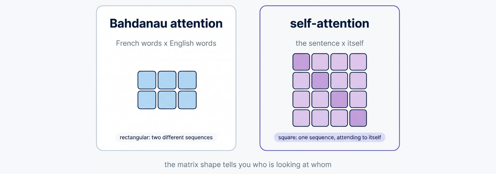

*Original diagram: [Vizuara, Lecture 5, slide 8](https://lecture5-attention-mechanisms.vercel.app/#/8). Captured from the linked presentation website. Open the image for full size.*

The source diagram contrasts output-step queries against input memory with queries and keys drawn from one sequence. The square shape follows from using the same number of query and source positions. It does not mean the normalized matrix must be symmetric, or that its diagonal is the only useful information.

Use the same three hand-set rows,

$$X=\begin{bmatrix}1&0\\0&1\\1&1\end{bmatrix}.$$

Associate them with the positions in “Quiet cats nap” only as an indexing aid. The coordinates are synthetic and have no measured linguistic interpretation. For this first pass, use each row directly for all three roles: query, key, and returned value. Also leave scores unscaled to expose the raw dot-product calculation; scaled scores can be substituted without changing the self-attention relationship.

All pairwise scores fit into

$$S=XX^\top=\begin{bmatrix}1&0&1\\0&1&1\\1&1&2\end{bmatrix}.$$

Row $i$ asks from position $i$; column $j$ identifies the potential source position. The first score is $[1,0]\cdot[1,0]=1$, the second is $[1,0]\cdot[0,1]=0$, and the bottom-right entry is $[1,1]\cdot[1,1]=2$.

Normalize independently across each row and multiply by the value rows:

Dividing raw scores by their sum is not a suitable general replacement for softmax. Scores $[1,-1]$ have a zero sum, while $[-1,2]$ would give a negative mixing weight. Exponentiation followed by normalization gives positive weights for finite unmasked scores and preserves their ranking. It is a particular useful choice of mixture, not the only normalization ever used in attention research.

$$A=\operatorname{softmax}_{\mathrm{keys}}(S),\qquad Z=AX.$$

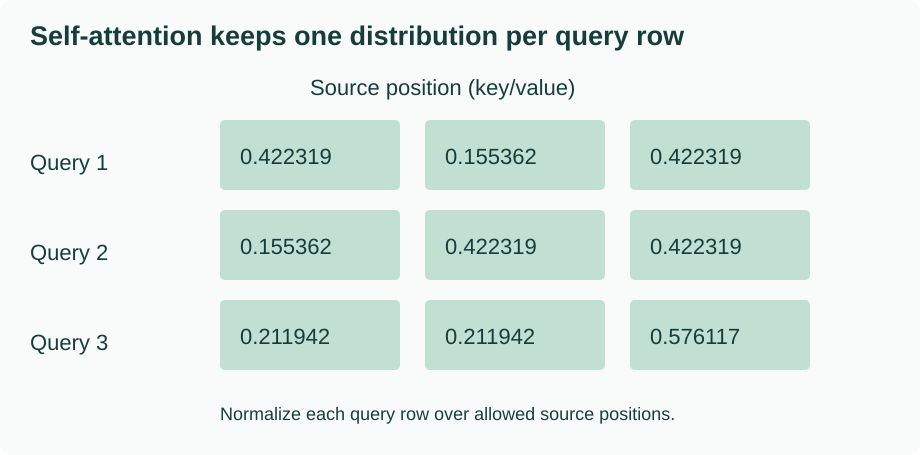

The computed matrices, rounded only for display, are

$$A\approx\begin{bmatrix}
0.422319&0.155362&0.422319\\
0.155362&0.422319&0.422319\\
0.211942&0.211942&0.576117
\end{bmatrix},\qquad
Z\approx\begin{bmatrix}
0.844638&0.577681\\
0.577681&0.844638\\
0.788058&0.788058
\end{bmatrix}.$$

For example, the first output's first coordinate is $0.422319+0.422319$, because source rows 1 and 3 carry a one in that coordinate. Its second coordinate is $0.155362+0.422319$. Every input position gets an output row; there is no single pooled vector for the entire sentence unless another operation explicitly pools these rows.

### Shape and normalization are part of the meaning

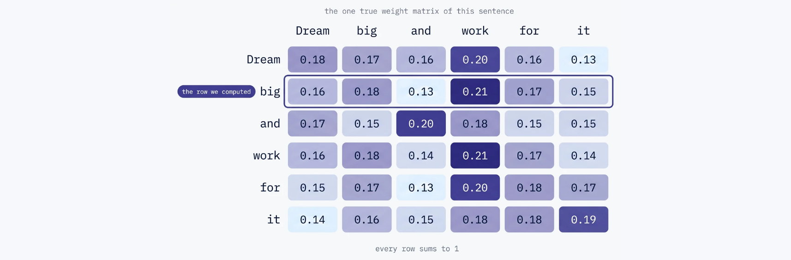

*Original diagram: [Vizuara, Lecture 5, slide 21](https://lecture5-attention-mechanisms.vercel.app/#/21). Captured from the linked presentation website. Open the image for full size.*

Read a row as one query choosing among the source columns. This source picture uses six tokens and rounded weights; our preceding matrix uses three synthetic rows. In both cases, normalization runs across source positions, and each output feature receives its mixture from that same query row.

$X$ is $3\times2$, $X^\top$ is $2\times3$, scores and weights are $3\times3$, and $Z$ is $3\times2$. Normalizing along the feature axis of $X$ would not produce distributions over source positions. Normalizing the columns of $S$ would answer a different question and would not ensure each query's weights sum to one.

Although $S$ is symmetric, $A$ need not be. The first and third score rows have different denominators, so $A_{13}=0.422319$ while $A_{31}=0.211942$. Softmax preserves a row's score ordering; it does not preserve arbitrary matrix symmetries.

### What happens when inputs change?

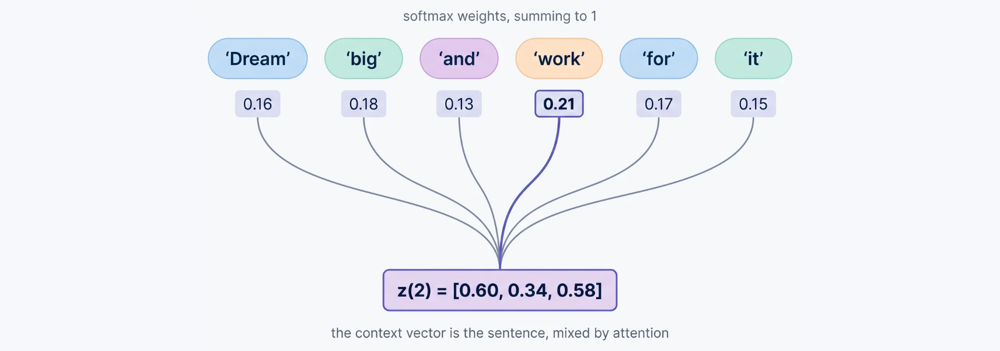

*Original diagram: [Vizuara, Lecture 5, slide 18](https://lecture5-attention-mechanisms.vercel.app/#/18). Captured from the linked presentation website. Open the image for full size.*

Each arrow into the returned vector carries a source vector scaled by its attention weight. A changed input can change both the available content and the weights used to retrieve it. The six-word source illustration gives the structural picture; our numerical outputs above use the explicitly declared three-row fixture.

Change one source row and it can affect its own query, its key in every other query's comparisons, and its value in every mixture. That is why contextualization is a collective computation. It is not a rule that only the modified token's output changes.

For a zero query `[0,0]` and three finite allowed keys, all dot products are zero and the weights are `[1/3,1/3,1/3]`. A genuine zero row is therefore meaningful input in this toy computation. Padding is a storage convention that requires an explicit mask; zeros alone do not declare a row invalid.

If we permute all input rows using the same permutation matrix $P$, then unmasked, position-free self-attention obeys

$$Z(PX)=PZ(X).$$

The score matrix becomes $PSP^\top$, row-wise softmax permutes with it, and multiplication by $PX$ produces the permuted output. This is **permutation equivariance**, not a statement that ordered output arrays are unchanged. A causal mask or positional information changes the conditions. We identify the limitation here without teaching Lecture 9's positional methods.

<!-- example:05_self_attention.py:start -->

Complete file: [05_self_attention.py](examples/05_self_attention.py).

```python
import json
from row_math import X, dot, matmul, rounded, softmax, transpose


def self_attention(inputs):
    scores = matmul(inputs, transpose(inputs))
    weights = [softmax(row) for row in scores]
    return scores, weights, matmul(weights, inputs)


if __name__ == '__main__':
    scores, weights, output = self_attention(X)
    permutation = [2, 0, 1]
    permuted = [X[i] for i in permutation]
    _, _, changed = self_attention(permuted)
    error = max(abs(changed[i][j] - output[old][j])
                for i, old in enumerate(permutation) for j in range(2))
    zero_weights = [softmax([dot([0.0, 0.0], key) for key in X])]
    assert error < 1e-14
    assert zero_weights[0] == [1 / 3] * 3
    assert weights[0][2] != weights[2][0]
    print(json.dumps({'scores': scores, 'weights': rounded(weights),
                      'output': rounded(output), 'permutation_equivariant': error < 1e-14,
                      'zero_query_weights': rounded(zero_weights[0])}))
```

<!-- example:05_self_attention.py:end -->

Run `python3 examples/05_self_attention.py`. It prints the full matrices, tests the zero query and verifies the permutation relation. The equality checks use unrounded values; displayed six-decimal row sums can differ slightly from one due to rounding.

### What this version can learn

With $X$ held fixed, this calculation has no trainable projections, so it cannot change its routing by updating attention parameters. In a larger model, trainable input embeddings could still change $X$. “No trainable parameters in this isolated attention operation” is narrower than “nothing upstream could ever learn”.

The next lesson keeps the same input rows but learns separate transformations for comparing and delivering information. That makes the roles independently adjustable instead of forcing every role to use the raw coordinates.

### Predict or explain: XXᵀ is symmetric. Must its row-softmax also be symmetric? What does a zero query do?

<details data-practice-id="self-check"><summary>Reveal worked answer and rubric</summary>

No: rows can have different normalization denominators. In this fixture A_13≈0.422319 while A_31≈0.211942. A real zero query gives equal finite scores, hence uniform weights over allowed keys; it does not declare padding.

**Rubric:** Use the unequal pair of entries and explain the explicit validity-mask requirement.

</details>


### The original lecture and slides

[Vizuara Lecture 5](https://www.youtube.com/watch?v=vQPCjniSfNU) develops the parameter-free pass and its matrix form. The 27-slide deck includes a different six-token example. Our three-row fixture is intentionally different and remains consistent through the later projections and causal mask.

```presentation
{"title":"Vizuara · Lecture 5 · Original presentation","url":"https://lecture5-attention-mechanisms.vercel.app/#/1"}
```


## 6. Separate comparison features from delivered content

The previous operation used the same row as a query, a key, and a value. That ties two decisions together: how useful a source appears in a comparison, and which information it delivers if selected. Three trainable linear projections let those jobs use different features.

### Name the roles after their jobs

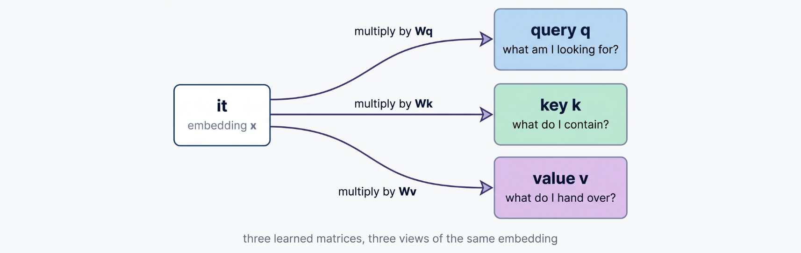

*Original diagram: [Vizuara, Lecture 6, slide 10](https://lecture6-attention-mechanisms.vercel.app/#/10). Captured from the linked presentation website. Open the image for full size.*

Start at one token representation and follow its three branches. The query branch determines how that position asks, the key branch determines how a source can match, and the value branch determines the content delivered after matching. These are learned roles; the labels do not assign fixed linguistic meanings to coordinates.

A query is the feature row used to request information. A key is the feature row it is compared with. A value is the content row included in the weighted mixture. These are learned numerical roles, not literal database records or guaranteed human-readable questions.

For row-vector inputs,

$$Q=XW_Q,\quad K=XW_K,\quad V=XW_V,\qquad
Z=\operatorname{softmax}\left(\frac{QK^\top}{\sqrt{d_k}}\right)V.$$

If $X$ has shape $N\times d_{\mathrm{in}}$, then $W_Q,W_K$ have shape $d_{\mathrm{in}}\times d_k$ and $W_V$ has shape $d_{\mathrm{in}}\times d_v$. Queries and keys must share the comparison width $d_k$; values can have a different width $d_v$. Output shape is $N\times d_v$.

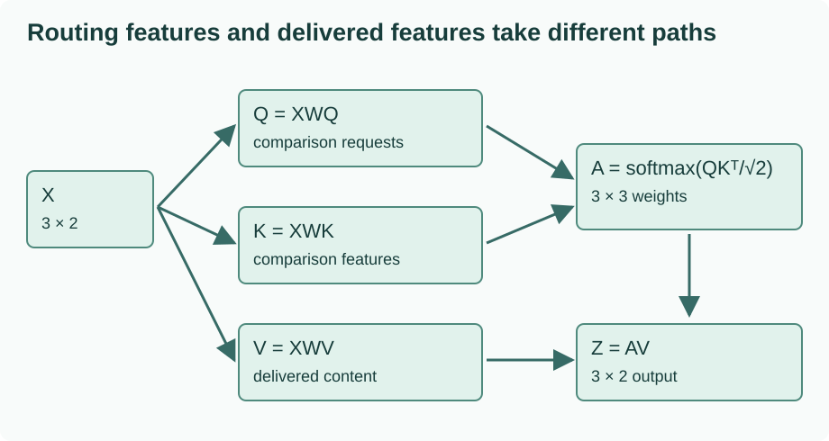

Changing $W_Q$ or $W_K$ can change routing weights. Changing only $W_V$ changes returned content while leaving the weights fixed. During training a task loss can update all of these parameters, but adding them does not automatically make attention sharp, linguistically correct, or different across repeated token identities.

### Project the same three rows

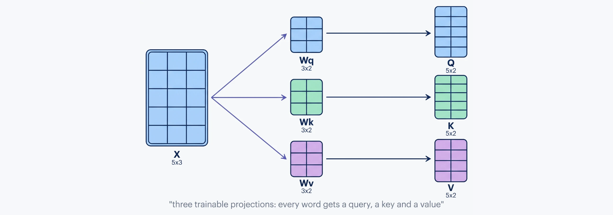

*Original diagram: [Vizuara, Lecture 6, slide 14](https://lecture6-attention-mechanisms.vercel.app/#/14). Captured from the linked presentation website. Open the image for full size.*

The three products create Q, K and V before any query–key score is normalized. The source diagram uses a five-token input with its own parameter values. Below, we apply the same three-branch operation to our three rows and named matrices, so every resulting number can be checked independently.

Take the input from Lesson 5 and the parameter snapshot

$$W_Q=\begin{bmatrix}1&0\\0&1\end{bmatrix},\quad
W_K=\begin{bmatrix}1&1\\0&1\end{bmatrix},\quad
W_V=\begin{bmatrix}2&0\\0&-1\end{bmatrix}.$$

This gives

$$Q=\begin{bmatrix}1&0\\0&1\\1&1\end{bmatrix},\quad
K=\begin{bmatrix}1&1\\0&1\\1&2\end{bmatrix},\quad
V=\begin{bmatrix}2&0\\0&-1\\2&-1\end{bmatrix}.$$

For source row 3, $[1,1]W_K=[1,2]$: its first output coordinate is $1\times1+1\times0$, and its second is $1\times1+1\times1$. The same row's value becomes `[2,-1]`, which shows explicitly that a negative value coordinate is allowed even though attention weights are nonnegative.

### Follow the last query all the way through

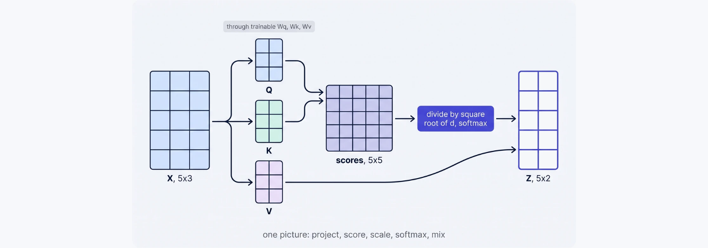

*Original diagram: [Vizuara, Lecture 6, slide 21](https://lecture6-attention-mechanisms.vercel.app/#/21). Captured from the linked presentation website. Open the image for full size.*

Follow Q and K into the score matrix, then follow V around the comparison branch into the final value mixture. This bypass explains why changing a value projection can change delivered features without changing the attention weights. The matrix axes and widths below give the exact contract for our smaller worked example.

The last query `[1,1]` scores the three keys as `[2,1,3]`. Divide by $\sqrt2$ to get approximately `[1.414214,0.707107,2.121320]`. Stable softmax gives

$$a\approx[0.283995,0.140029,0.575975].$$

The output mixes **values**:

$$z_3=a_1[2,0]+a_2[0,-1]+a_3[2,-1]
\approx[1.719942,-0.716005].$$

Mixing $X$ instead of $V$ would return different numbers and discard the delivered-content projection. Using $\sqrt3$ would also be wrong: there are three source rows, but each query/key row has width two.

### One trainable entry, one actual update

Set $W_Q[0,0]=\theta$ and leave all other entries fixed. Because the last input row is `[1,1]`, its query becomes $[\theta,1]$. Use a deliberately small objective on that row alone:

$$L=\frac12(z_{3,1}-2)^2.$$

This target concerns one illustrative output feature, not a vocabulary token or translation score. At $\theta=1$, the loss is approximately `0.039216379`. Let $g_j=(z_{3,1}-2)V_{j,1}$ be the derivative with respect to weight $a_j$. Softmax backpropagates as

$$\frac{\partial L}{\partial e_j}=a_j\left(g_j-\sum_ra_rg_r\right).$$

Here the scaled score derivative is $\partial e_j/\partial\theta=K_{j,1}/\sqrt2$, so

$$\frac{\partial L}{\partial\theta}=\sum_j
a_j\left(g_j-\sum_ra_rg_r\right)\frac{K_{j,1}}{\sqrt2}
\approx-0.047694266.$$

A step with learning rate $\eta=0.2$ sets $\theta\leftarrow\theta-\eta\,\partial L/\partial\theta\approx1.009538853$. Re-evaluating reduces the loss to approximately `0.038763847`. The program checks the analytic derivative against a centered finite difference before applying that step.

The shared retrieval module below uses only the row operations already defined in Lesson 3. It introduces the projected single-head call and the parameter snapshot used in this lesson. Its optional causal path is opened in Lesson 7.

<!-- example:attention_math.py:start -->

Complete file: [attention_math.py](examples/attention_math.py).

```python
"""Projected single-head retrieval, using the earlier row operations."""
import math
from row_math import X, dot, matmul, rounded, softmax


def attention(q, k, v, causal=False, key_valid=None, scaled=True):
    if len(k) != len(v) or not k or not q:
        raise ValueError('Need queries and matching nonempty keys/values')
    if causal and len(q) != len(k):
        raise ValueError('This toy causal path assumes aligned self-attention')
    key_valid = [True] * len(k) if key_valid is None else list(key_valid)
    if len(key_valid) != len(k):
        raise ValueError('Key validity must match the key axis')
    scale = math.sqrt(len(k[0])) if scaled else 1.0
    scores = [[dot(query, key) / scale for key in k] for query in q]
    weights = [softmax(row, [valid and (not causal or j <= i)
                            for j, valid in enumerate(key_valid)])
               for i, row in enumerate(scores)]
    return scores, weights, matmul(weights, v)


WQ = [[1.0, 0.0], [0.0, 1.0]]
WK = [[1.0, 1.0], [0.0, 1.0]]
WV = [[2.0, 0.0], [0.0, -1.0]]
```

<!-- example:attention_math.py:end -->

<!-- example:06_projections.py:start -->

Complete file: [06_projections.py](examples/06_projections.py).

```python
import json
import math
from attention_math import X, WQ, WK, WV, attention, matmul, rounded


def forward(theta):
    wq = [[theta, 0.0], [0.0, 1.0]]
    q, k, v = matmul(X, wq), matmul(X, WK), matmul(X, WV)
    _, weights, output = attention(q, k, v)
    error = output[-1][0] - 2.0
    return error * error / 2, q, k, v, weights, output


if __name__ == '__main__':
    loss, q, k, v, weights, output = forward(1.0)
    a = weights[-1]
    d_output = output[-1][0] - 2.0
    d_weights = [d_output * value[0] for value in v]
    weighted_gradient = sum(p * g for p, g in zip(a, d_weights))
    d_scores = [p * (g - weighted_gradient) for p, g in zip(a, d_weights)]
    analytic = sum(g * key[0] / math.sqrt(2) for g, key in zip(d_scores, k))
    epsilon = 1e-5
    numeric = (forward(1 + epsilon)[0] - forward(1 - epsilon)[0]) / (2 * epsilon)
    assert abs(analytic - numeric) < 1e-9
    new_theta = 1 - 0.2 * analytic
    assert forward(new_theta)[0] < loss
    print(json.dumps({'q': q, 'k': k, 'v': v, 'last_weights': rounded(a),
                      'last_output': rounded(output[-1]), 'loss': round(loss, 9),
                      'gradient': round(analytic, 9), 'gradient_verified': True,
                      'updated_parameter': round(new_theta, 9),
                      'updated_loss': round(forward(new_theta)[0], 9)}))
```

<!-- example:06_projections.py:end -->

Run `python3 examples/06_projections.py`. The output contains every projection, the final weight row, output, loss, derivative and updated result. A finite-difference check tests this local derivative; it does not prove that a complete training system works or that every learning rate reduces every objective.

### A boundary the projections cannot remove

If two positions begin with identical features and have identical allowed memory, position-free shared projections give them identical queries and the same attention output. A learned key matrix can break a tie between **different** key vectors; it cannot manufacture information that is absent from identical inputs. Context from earlier layers or information about position can distinguish positions, but those are additional inputs or mechanisms.

For batch tensors, transpose only the last two axes of the key tensor: `k.transpose(-2,-1)`, not an ambiguous `.T` on a tensor with more than two dimensions. The head-layout course will make those axes explicit.

### Predict or explain: Change W_V while keeping X, W_Q and W_K fixed. What must stay fixed, and what can change?

<details data-practice-id="projection-check"><summary>Reveal worked answer and rubric</summary>

Q, K, scores and attention weights stay fixed. V and the returned contexts can change. With a task loss, downstream gradients can also change because the output being measured changed. Identical position-free queries with the same memory still cannot be distinguished by merely naming the roles differently.

**Rubric:** Separate the routing path from the content path; do not treat attention weights as vocabulary predictions.

</details>


### The original lecture and slides

[Vizuara Lecture 6](https://www.youtube.com/watch?v=wshXBhGItkM) motivates the Q/K/V projections. Its slides 10–18 separate the roles and work through projection, scoring and value mixing. This lesson adds a checked local parameter update and explicitly states what learned projections cannot infer from identical inputs.

```presentation
{"title":"Vizuara · Lecture 6 · Original presentation","url":"https://lecture6-attention-mechanisms.vercel.app/#/1"}
```


## 7. Make the training information match generation

A model predicting the next token must operate with the prefix available at that moment. During training we can process many positions together, but an output at an earlier position must not acquire information from a later input token. A causal mask imposes that restriction without changing the learned projections or the score function.

### Locate the target before drawing the triangle

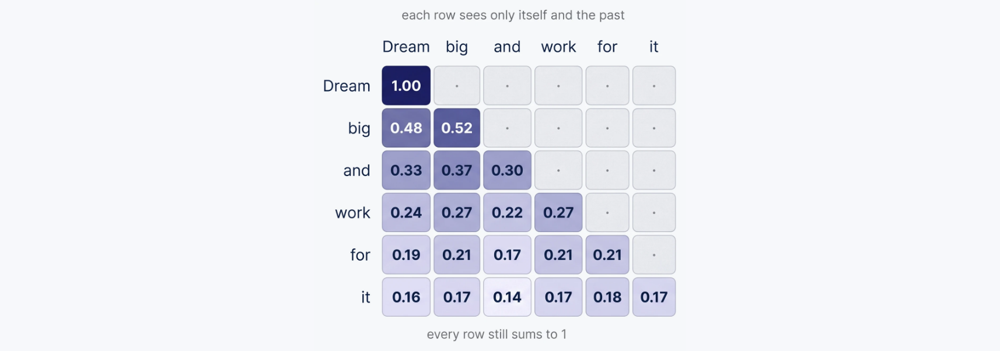

*Original diagram: [Vizuara, Lecture 7, slide 9](https://lecture7-attention-mechanisms.vercel.app/#/9). Captured from the linked presentation website. Open the image for full size.*

Use a row as the position making a prediction and a column as a possible source. The visible prefix grows one position at a time; entries strictly to the right are forbidden. The diagonal is allowed because that row predicts the following token from the current token and its prefix, as the shifted targets below make explicit.

For tokens `[Quiet,cats,nap,<EOS>]`, one shifted training pair is

| Position | Decoder input token | Prediction target | Allowed input positions |
| --- | --- | --- | --- |
| 1 | Quiet | cats | 1 |
| 2 | cats | nap | 1, 2 |
| 3 | nap | `<EOS>` | 1, 2, 3 |

The diagonal is allowed because the current **input** token is known; its target is the next token. At row 1, allowing input position 2 would reveal “cats”, the answer being predicted. A correct triangular mask does not repair incorrectly aligned inputs and labels, and a mask at only one layer does not prevent leakage through another path that has already mixed future information.

### Apply visibility before normalization

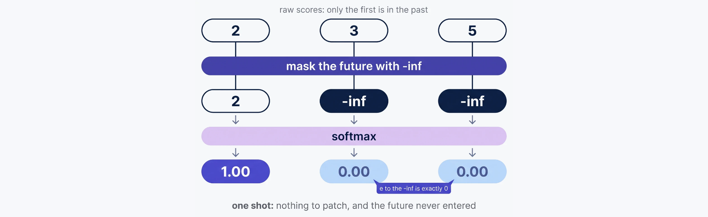

*Original diagram: [Vizuara, Lecture 7, slide 12](https://lecture7-attention-mechanisms.vercel.app/#/12). Captured from the linked presentation website. Open the image for full size.*

The blocked entries contribute zero after exponentiation, so the denominator includes only allowed sources. The order is essential to the direct masked-softmax calculation. A row with no allowed finite score still needs explicit handling; the picture does not define a valid distribution for that case.

With row $i$ as query and column $j$ as source, define

$$M_{ij}=\begin{cases}0&j\leq i,\\-\infty&j>i.\end{cases}\qquad
A=\operatorname{softmax}\left(QK^\top/\sqrt{d_k}+M\right).$$

Exponentials of forbidden entries are zero. Every row must retain at least one finite allowed score. If all entries are masked, subtracting the maximum is not defined in the usual way; do not silently present the result as a valid distribution. Our reference raises an error. A larger application must explicitly choose how to handle padded query positions and exclude them from the objective.

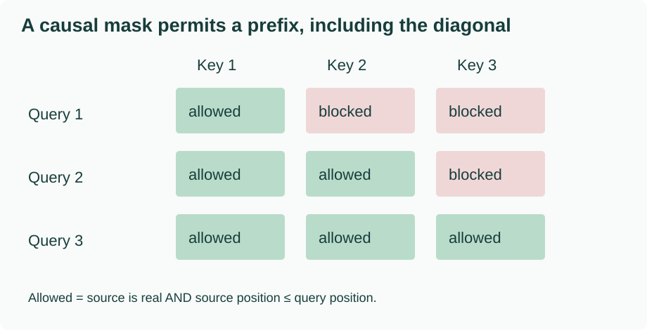

Using Lesson 6's projections gives

$$A\approx\begin{bmatrix}1&0&0\\0.5&0.5&0\\0.283995&0.140029&0.575975\end{bmatrix},\quad
Z\approx\begin{bmatrix}2&0\\1&-0.5\\1.719942&-0.716005\end{bmatrix}.$$

The second query has equal scores for its two allowed keys, so its weights are one half each. The last query can access the complete prefix, which here is the entire sequence, and therefore retains the same output as the unmasked last row.

### Why zeroing after softmax needs care

Simply zeroing forbidden **weights** after ordinary softmax leaves the remaining weights with a sum below one. Renormalizing the remaining weights does recover the masked distribution in exact arithmetic:

$$\frac{e^{s_j}/D}{\sum_{r\in\mathcal A}e^{s_r}/D}
=\frac{e^{s_j}}{\sum_{r\in\mathcal A}e^{s_r}},\qquad j\in\mathcal A.$$

So it is incorrect to say that this renormalized version necessarily leaks future information mathematically. It is nevertheless less convenient and can underflow if a huge forbidden score makes every allowed probability numerically zero before renormalization. Masking before softmax directly normalizes over the permitted set.

The dense matrix product may still compute forbidden raw dot products. Causal masking is a rule about usable information and outputs; it is not a guarantee that a dense kernel never calculates a future pair internally.

### Combine a causal mask with padding validity

A source key is usable only if both conditions hold: it is in the allowed prefix, and it represents a real input token. The reference helper combines them as `valid_key[j] and j <= i`. Replacing a padded embedding with zeros does not impose this rule: a zero key can still receive a nonzero softmax weight and change the denominator.

Masking padded keys also does not automatically eliminate padded **query** outputs or their losses. An application normally tracks query validity separately and excludes those rows from the loss, or explicitly zeroes their outputs according to its contract. This tutorial's examples use three real queries and reject an empty attention support.

### Dropout changes a sample, not the intended mean

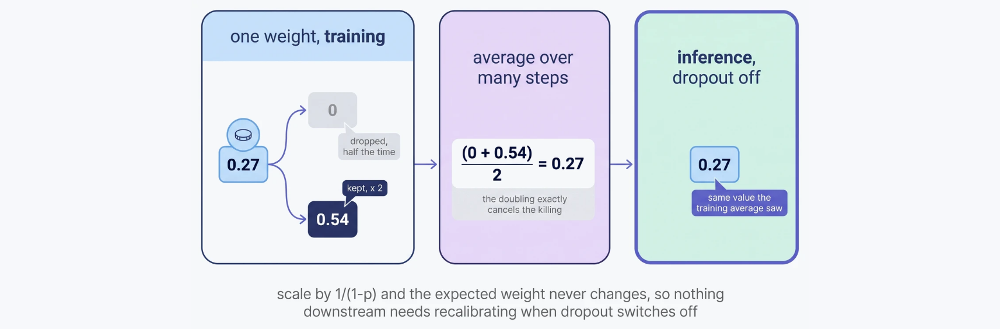

*Original diagram: [Vizuara, Lecture 7, slide 16](https://lecture7-attention-mechanisms.vercel.app/#/16). Captured from the linked presentation website. Open the image for full size.*

The two outcomes illustrate the expectation calculation: a contribution sometimes becomes zero, and the survivors are enlarged by the reciprocal keep probability. Each sampled attention row need not sum to one. Our example below enumerates every keep/drop pattern and checks the immediate weighted mixture rather than claiming equality for a whole nonlinear model.

The training motivation is regularization: randomly removing contributions makes the computation operate with varying subsets of its usual information paths. It can reduce reliance on particular contributions, but whether it improves held-out quality depends on the model, data and dropout probability. No generalization improvement is established by the arithmetic example alone.

During training, attention dropout can replace each normalized weight $a_j$ by

$$\widetilde a_j=\frac{m_j}{1-p}a_j,\qquad m_j\sim\operatorname{Bernoulli}(1-p),\quad0\leq p<1.$$

Taking the expectation gives $\mathbb E[\widetilde a_j]=a_j$. This rescales surviving weights; it does not renormalize each sampled row to sum to one. At $p=0.5$, keeping the first and third entries of our final weight row gives approximately `[0.567991,0,1.151951]`, with sum `1.719942`. A sampled weight can exceed one. In evaluation mode dropout is disabled.

The expectation claim is local to the dropped weights or their immediate linear mixture. It does not say that a whole nonlinear model's average training prediction equals its evaluation prediction. The example enumerates all eight independent keep/drop patterns for three weights, proving the immediate expectation without relying on a lucky random sample.

<!-- example:07_causal.py:start -->

Complete file: [07_causal.py](examples/07_causal.py).

```python
import itertools
import json
from attention_math import X, WQ, WK, WV, attention, matmul, rounded, softmax


def run(inputs):
    q, k, v = matmul(inputs, WQ), matmul(inputs, WK), matmul(inputs, WV)
    return attention(q, k, v, causal=True)


if __name__ == '__main__':
    scores, weights, output = run(X)
    changed = [X[0], X[1], [99.0, -37.0]]
    assert run(changed)[2][:2] == output[:2]
    assert all(weights[i][j] == 0 for i in range(3) for j in range(i + 1, 3))
    # Exact expectation over every independent dropout keep/drop choice, p=1/2.
    draws = [[2 * p * keep for p, keep in zip(weights[-1], mask)]
             for mask in itertools.product([0, 1], repeat=3)]
    average = [sum(row[j] for row in draws) / len(draws) for j in range(3)]
    assert max(abs(x - y) for x, y in zip(average, weights[-1])) < 1e-14
    chosen = [2 * p * keep for p, keep in zip(weights[-1], [1, 0, 1])]
    try:
        softmax([1.0, 2.0], [False, False])
    except ValueError:
        all_masked_rejected = True
    else:
        raise AssertionError('An empty attention support must not silently normalize')
    print(json.dumps({'weights': rounded(weights), 'output': rounded(output),
                      'future_invariant': True, 'dropout_sample': rounded(chosen),
                      'dropout_sample_sum': round(sum(chosen), 6),
                      'dropout_expectation': rounded(average),
                      'all_masked_rejected': all_masked_rejected}))
```

<!-- example:07_causal.py:end -->

Run `python3 examples/07_causal.py`. It checks exact zero future weights, changes the final input to `[99,-37]` and verifies that the first two outputs do not change. That intervention is stronger than checking only that a printed matrix looks triangular. It also tests the empty-support error and dropout expectation.

### The same causal calculation in C++

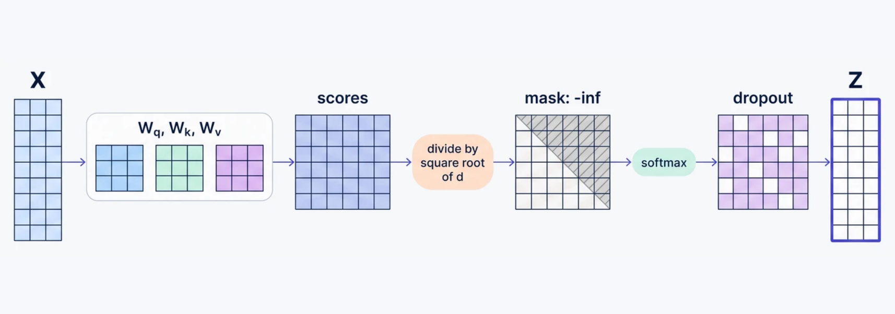

*Original diagram: [Vizuara, Lecture 7, slide 17](https://lecture7-attention-mechanisms.vercel.app/#/17). Captured from the linked presentation website. Open the image for full size.*

Read the stages in order and locate the mask between the scores and softmax. Dropout, when enabled for training, acts on normalized weights before the value mixture. The final arrow abbreviates multiplying the weights by V; the weight matrix itself is not the output Z. The C++ reference below checks the deterministic masked calculation without adding a dropout implementation; the earlier Python reference separately checks the dropout expectation.

The following complete program iterates only through allowed source indices `j <= i`, so it never constructs a forbidden-score array. The reduction and returned context are the same as the Python reference. It deliberately fixes this example's shapes rather than claiming to be a general tensor library.

<!-- example:attention.cpp:start -->

Complete file: [attention.cpp](examples/attention.cpp).

```cpp
#include <algorithm>
#include <array>
#include <cmath>
#include <iomanip>
#include <iostream>

int main() {
    using Row = std::array<double, 2>;
    const std::array<Row, 3> q{{{1, 0}, {0, 1}, {1, 1}}};
    const std::array<Row, 3> k{{{1, 1}, {0, 1}, {1, 2}}};
    const std::array<Row, 3> v{{{2, 0}, {0, -1}, {2, -1}}};
    std::array<Row, 3> output{};
    for (std::size_t i = 0; i < 3; ++i) {
        std::array<double, 3> scores{};
        for (std::size_t j = 0; j <= i; ++j)
            scores[j] = (q[i][0] * k[j][0] + q[i][1] * k[j][1]) / std::sqrt(2.0);
        const double maximum = *std::max_element(scores.begin(), scores.begin() + i + 1);
        std::array<double, 3> weights{};
        double total = 0;
        for (std::size_t j = 0; j <= i; ++j) {
            weights[j] = std::exp(scores[j] - maximum);
            total += weights[j];
        }
        for (std::size_t j = 0; j <= i; ++j)
            for (std::size_t d = 0; d < 2; ++d)
                output[i][d] += (weights[j] / total) * v[j][d];
    }
    std::cout << std::fixed << std::setprecision(6) << "{\"output\":[";
    for (std::size_t i = 0; i < 3; ++i) {
        if (i) std::cout << ',';
        std::cout << '[' << output[i][0] << ',' << output[i][1] << ']';
    }
    std::cout << "]}\n";
}
```

<!-- example:attention.cpp:end -->

From the package directory:

```bash
c++ -std=c++20 -O2 -Wall -Wextra -Werror -pedantic examples/attention.cpp -o /tmp/attention-foundations
/tmp/attention-foundations
```

The output rows are `[2,0]`, `[1,-0.5]`, and `[1.719942,-0.716005]`. Python and C++ comparisons use a tolerance appropriate to the displayed precision; no claim of bitwise agreement across unrelated implementations is needed.

### Predict or explain: A dropout sample has a weight above one. Is it invalid? Also, does zeroing and renormalizing unmasked softmax necessarily leak future scores?

<details data-practice-id="causal-check"><summary>Reveal worked answer and rubric</summary>

A dropout sample need not sum to one, and surviving weights are scaled by 1/(1-p); values above one are possible. The local expectation matches the original weights. Zeroing forbidden weights and renormalizing is mathematically equivalent to masked softmax when the allowed denominator is nonzero, but it is numerically fragile if allowed probabilities have already underflowed. Simply zeroing without renormalizing is a different operation.

**Rubric:** State both the sample-versus-expectation distinction and the exact-arithmetic masking equivalence.

</details>


### The original lecture and slides

[Vizuara Lecture 7](https://www.youtube.com/watch?v=Dv8e0ayAikA) supplies the masking and dropout sequence. Original slides 10–14 discuss the triangle and normalization; slides 16–19 discuss dropout and the causal pipeline. Our explanation distinguishes exact masking equivalence, numerical failure, padding validity and shifted labels.

```presentation
{"title":"Vizuara · Lecture 7 · Original presentation","url":"https://lecture7-attention-mechanisms.vercel.app/#/1"}
```

You now have a checked single-head mechanism. The separate Attention Heads route begins with several independently parameterized copies and then proves their packed implementation equivalent. The [reference-run record](project/reference-runs.md) records author checks; the [readiness record](project/readiness.md) separates them from your own explanation and any full-model work.


## Evidence and proof limits

### Claim ledger

| Claim | Status | Proof limit |
| --- | --- | --- |
| 1. What information does a token need? | illustrative | Original small worked example and stated mathematical assumptions. Source review and executed author checks do not establish a trained model or learner mastery. |
| 2. Why one fixed summary can be difficult to use | illustrative | Original small worked example and stated mathematical assumptions. Source review and executed author checks do not establish a trained model or learner mastery. |
| 3. Build a context that depends on the current query | illustrative | Original small worked example and stated mathematical assumptions. Source review and executed author checks do not establish a trained model or learner mastery. |
| 4. Change the score while keeping retrieval intact | illustrative | Original small worked example and stated mathematical assumptions. Source review and executed author checks do not establish a trained model or learner mastery. |
| 5. Give every position a context from its own sequence | illustrative | Original small worked example and stated mathematical assumptions. Source review and executed author checks do not establish a trained model or learner mastery. |
| 6. Separate comparison features from delivered content | illustrative | Original small worked example and stated mathematical assumptions. Source review and executed author checks do not establish a trained model or learner mastery. |
| 7. Make the training information match generation | illustrative | Original small worked example and stated mathematical assumptions. Source review and executed author checks do not establish a trained model or learner mastery. |

## Sources

- [Vizuara · The Attention Family · Lecture 1 · video](https://www.youtube.com/watch?v=QgnOoQsPc0o) — Video page/description and full English automatic caption text, 00:00:00.920–00:28:48.960; checked 2026-10-30
- [Vizuara · The Attention Family · Lecture 1 · slides](https://lecture1-attention-mechanisms.vercel.app/) — Complete original Slidev presentation, 21 slides; checked 2026-10-30
- [Vizuara · The Attention Family · Lecture 2 · video](https://www.youtube.com/watch?v=IG2gl6sKj_c) — Video page/description and full English automatic caption text, 00:00:00.800–00:26:48.720; checked 2026-10-30
- [Vizuara · The Attention Family · Lecture 2 · slides](https://lecture2-attention-mechanisms.vercel.app/) — Complete original Slidev presentation, 20 slides; checked 2026-10-30
- [Vizuara · The Attention Family · Lecture 3 · video](https://www.youtube.com/watch?v=6yIe4ekER14) — Video page/description and full English automatic caption text, 00:00:01.080–00:36:57.160; checked 2026-10-30
- [Vizuara · The Attention Family · Lecture 3 · slides](https://lecture3-attention-mechanisms.vercel.app/) — Complete original Slidev presentation, 28 slides; checked 2026-10-30
- [Vizuara · The Attention Family · Lecture 4 · video](https://www.youtube.com/watch?v=DDxMVJnjgps) — Video page/description and full English automatic caption text, 00:00:00.960–00:30:28.399; checked 2026-10-30
- [Vizuara · The Attention Family · Lecture 4 · slides](https://lecture4-attention-mechanisms.vercel.app/) — Complete original Slidev presentation, 17 slides; checked 2026-10-30
- [Vizuara · The Attention Family · Lecture 5 · video](https://www.youtube.com/watch?v=vQPCjniSfNU) — Video page/description and full English automatic caption text, 00:00:00.800–00:46:03.680; checked 2026-10-30
- [Vizuara · The Attention Family · Lecture 5 · slides](https://lecture5-attention-mechanisms.vercel.app/) — Complete original Slidev presentation, 27 slides; checked 2026-10-30
- [Vizuara · The Attention Family · Lecture 6 · video](https://www.youtube.com/watch?v=wshXBhGItkM) — Video page/description and full English automatic caption text, 00:00:00.760–00:49:22.200; checked 2026-10-30
- [Vizuara · The Attention Family · Lecture 6 · slides](https://lecture6-attention-mechanisms.vercel.app/) — Complete original Slidev presentation, 25 slides; checked 2026-10-30
- [Vizuara · The Attention Family · Lecture 7 · video](https://www.youtube.com/watch?v=Dv8e0ayAikA) — Video page/description and full English automatic caption text, 00:00:00.880–00:51:23.920; checked 2026-10-30
- [Vizuara · The Attention Family · Lecture 7 · slides](https://lecture7-attention-mechanisms.vercel.app/) — Complete original Slidev presentation, 21 slides; checked 2026-10-30
- [Bahdanau et al. · Neural Machine Translation by Jointly Learning to Align and Translate](https://arxiv.org/abs/1409.0473) — Alignment model and source-memory motivation; checked 2026-10-30
- [Luong et al. · Effective Approaches to Attention-based Neural Machine Translation](https://aclanthology.org/D15-1166/) — Global attention and score alternatives; checked 2026-10-30
- [Vaswani et al. · Attention Is All You Need](https://arxiv.org/html/1706.03762v7) — Sections 3.2.1–3.2.3 and the scaling assumptions; checked 2026-10-30
- [Dive into Deep Learning · Attention Scoring Functions](https://d2l.ai/chapter_attention-mechanisms-and-transformers/attention-scoring-functions.html) — Sections 11.3.2–11.3.4: masked normalization, scaled dot product, additive scoring; checked 2026-10-30
- [Ainslie et al. · GQA, version 3](https://arxiv.org/abs/2305.13245v3) — Abstract: MHA, intermediate grouped KV heads and MQA definitions only; model results not reproduced; checked 2026-10-30
