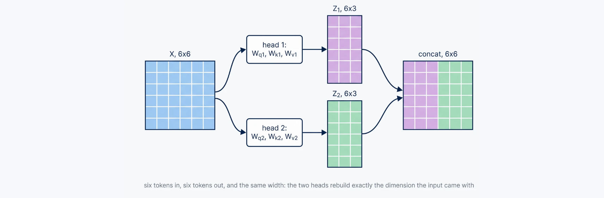
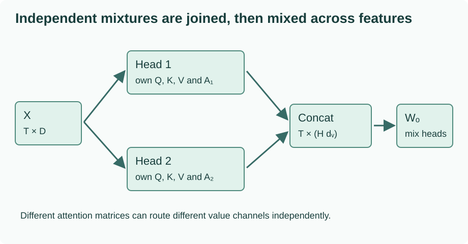
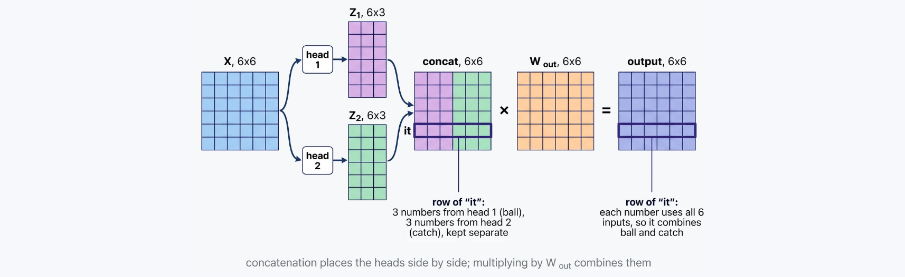
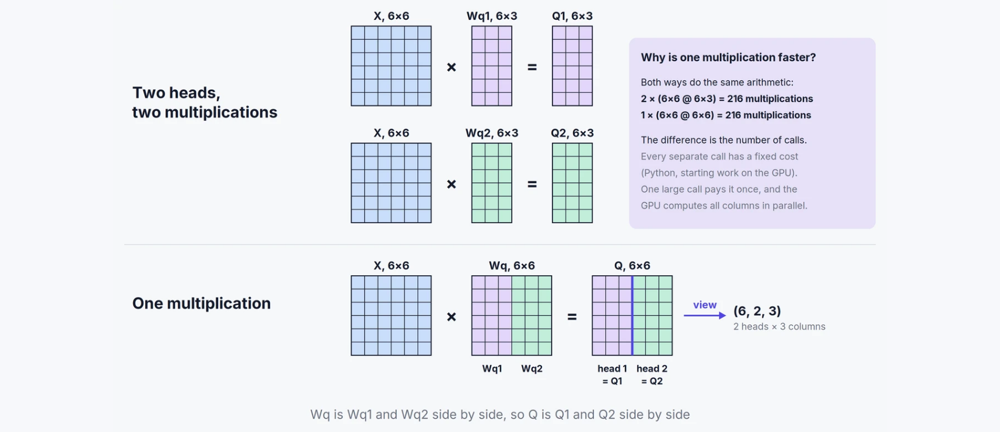
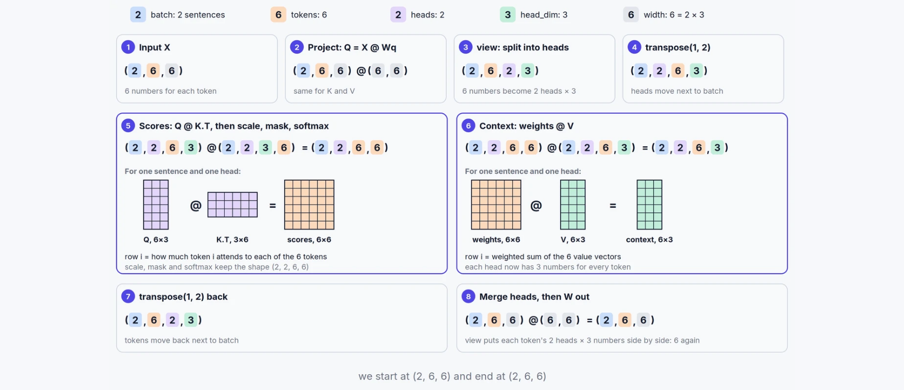
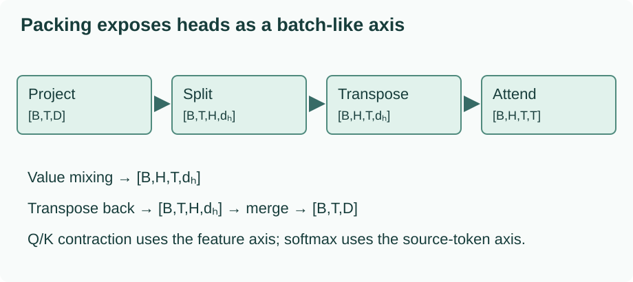
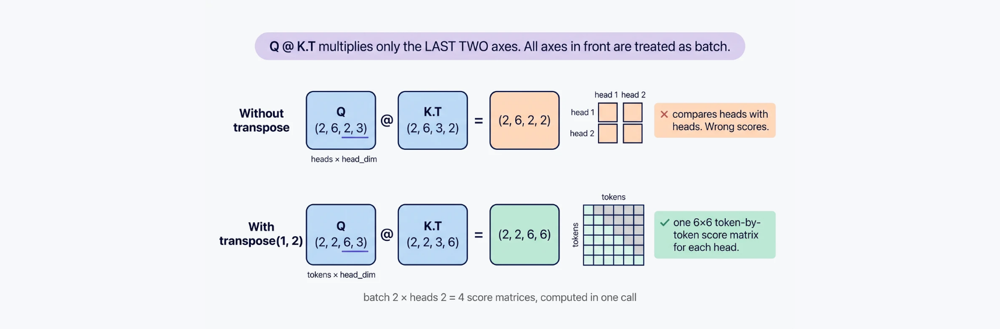
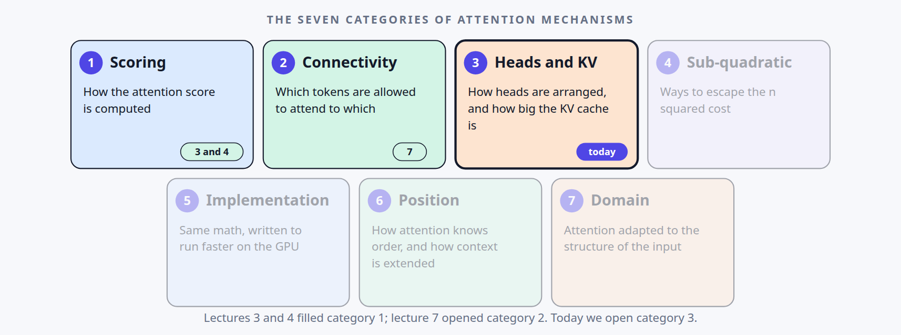

# Attention heads: multi-head attention and tensor layouts

How do independent heads combine, and how can a packed tensor compute the same result?

Learning material for attention-labs. Model implementation/training and learner mastery are separate states.

**Outcomes:** 1. Several independent mixtures, then one output; 2. Pack independent heads without changing the operation; 3. Keep head arrangements separate from other attention choices.

## 1. Several independent mixtures, then one output

The Attention Foundations route ended with one causal attention head: projected queries and keys select a weighted mixture of projected values, with future positions excluded. Here we change the arrangement of those projections. Several heads build separate mixtures, then an output projection combines their results.

This folder owns head and key/value layouts. Multi-head attention is the implemented reference here. GQA, MQA and related arrangements can be added to this same folder later; this course does not implement them in advance.

### What a second head changes



*Original diagram: [Vizuara, Lecture 8, slide 9](https://lecture8-attention-mechanisms.vercel.app/#/9). Captured from the linked presentation website. Open the image for full size.*

Follow the input into both projection branches, then keep the two resulting attention patterns distinct until their outputs are joined. Each general projection can use every input feature; this is not a requirement to divide the raw embedding into disjoint slices. Separate parameters allow different retrievals but do not guarantee linguistic specialization.

For one head, every value-feature column is mixed using the same matrix $A$:

$$Z=AV.$$

A single query row can distribute weight over several source positions. It is therefore too strong to say that one head can attend to only one token or represent only one relationship. Its actual restriction is that one distribution is shared across the value-feature channels of that head.

For heads $r=1,\ldots,H$, use separate parameter matrices:

$$Q_r=XW_{Q,r},\quad K_r=XW_{K,r},\quad V_r=XW_{V,r},$$
$$Z_r=\operatorname{softmax}\left(Q_rK_r^\top/\sqrt{d_k}+M\right)V_r.$$

The different $A_r$ matrices can route information differently. Separate parameters permit this; they do not guarantee interpretable roles or prevent redundant heads. Labels such as “syntax head” require analysis of an actually trained model, not an assumption based on head number.



### A small example with two genuinely different patterns

Keep the three input rows from the foundations route:

$$X=\begin{bmatrix}1&0\\0&1\\1&1\end{bmatrix}.$$

Each of two heads now has comparison width one and value width one. Head 1 selects the first input coordinate for queries and keys, and returns the sum of the two coordinates as its scalar value. Head 2 selects the second coordinate for queries and keys, and returns the first coordinate minus the second as its value.

| Head | $W_Q$ | $W_K$ | $W_V$ |
| --- | --- | --- | --- |
| 1 | `[1,0]` as a column | `[1,0]` as a column | `[1,1]` as a column |
| 2 | `[0,1]` as a column | `[0,1]` as a column | `[1,-1]` as a column |

For the final position, Head 1 has query 1 and keys `[1,0,1]`, so its weight row is approximately `[0.422319,0.155362,0.422319]`. Head 2 has query 1 and keys `[0,1,1]`, yielding `[0.155362,0.422319,0.422319]`. Scaling divides by $\sqrt1$, so it makes no numerical change here.

The value lists are `[1,1,2]` and `[1,-1,0]`. Their final-position context scalars are about `1.422319` and `-0.266956`. Concatenation puts those two outputs next to each other:

$$z_{\mathrm{joined},3}=[1.422319,-0.266956].$$

At the first position only the first key is allowed. Its two head outputs are `[1]` and `[1]`, so concatenation gives `[1,1]`. The head arrangement changes neither the causal permission rule nor the meaning of the sequence axis.

### Concatenation preserves the separate channels; projection mixes them



*Original diagram: [Vizuara, Lecture 8, slide 10](https://lecture8-attention-mechanisms.vercel.app/#/10). Captured from the linked presentation website. Open the image for full size.*

Concatenation preserves the separate head channels; the following matrix can combine those channels into the layer’s output width. The output projection acts within a token row. It does not create a new attention distribution across tokens, and it is not required to mix every feature if the learned parameters preserve some channels.

Use the row-vector output matrix

$$W_O=\begin{bmatrix}1&0.5\\-0.5&1\end{bmatrix},\qquad
Y=\operatorname{Concat}(Z_1,Z_2)W_O.$$

The first position becomes $[1,1]W_O=[0.5,1.5]$. At the final position,

$$Y_3=[1.422319+0.133478,\ 0.711159-0.266956]
\approx[1.555797,0.444203].$$

The output projection acts on feature channels **within each token**. It does not create a new token-to-token attention distribution; the cross-token mixing already happened inside the heads. It can combine, rotate, suppress or preserve head features according to learned parameters.

Concatenation order is a consistent bookkeeping choice, not an automatic priority ranking. If we swap the two joined channels and swap the matching rows of $W_O$, the final output remains the same. The output projection supplies learned combinations of head features; it need not scramble every coordinate, and an identity projection would preserve their separation.

<!-- example:multihead.py:start -->

Complete file: [multihead.py](examples/multihead.py).

```python
"""Two independent scalar heads, with all helpers defined here."""
import json
import math


def dot(a, b):
    if len(a) != len(b):
        raise ValueError('Mismatched widths')
    return sum(x * y for x, y in zip(a, b))


def matmul(a, b):
    return [[dot(row, column) for column in zip(*b)] for row in a]


def head(x, wq, wk, wv):
    q, k, v = matmul(x, wq), matmul(x, wk), matmul(x, wv)
    outputs, patterns = [], []
    for i, query in enumerate(q):
        scores = [dot(query, key) / math.sqrt(len(key)) for key in k[:i + 1]]
        maximum = max(scores)
        numerators = [math.exp(s - maximum) for s in scores]
        weights = [s / sum(numerators) for s in numerators]
        outputs.append(matmul([weights], v[:i + 1])[0])
        patterns.append(weights + [0.0] * (len(x) - i - 1))
    return outputs, patterns


if __name__ == '__main__':
    x = [[1.0, 0.0], [0.0, 1.0], [1.0, 1.0]]
    h1, a1 = head(x, [[1.0], [0.0]], [[1.0], [0.0]], [[1.0], [1.0]])
    h2, a2 = head(x, [[0.0], [1.0]], [[0.0], [1.0]], [[1.0], [-1.0]])
    joined = [first + second for first, second in zip(h1, h2)]
    output = matmul(joined, [[1.0, 0.5], [-0.5, 1.0]])
    def rounded(matrix):
        return [[round(v, 6) for v in row] for row in matrix]
    assert a1[-1] != a2[-1]
    assert output[0] == [0.5, 1.5]
    print(json.dumps({'head1_weights': rounded(a1), 'head2_weights': rounded(a2),
                      'concatenated': rounded(joined), 'output': rounded(output)}))
```

<!-- example:multihead.py:end -->

From `ai_projects/docs/tutorials/projects/attention-labs/attention-heads/v1/`, run:

```bash
python3 examples/multihead.py
```

The script is self-contained and prints both full head-weight matrices, the concatenated outputs and the final outputs. It checks that the last-row distributions differ. The weights are hand-set snapshots, so no claim about learned linguistic specialization follows from these results.

### Dimensions express a design choice

In general, $X$ has width $D$, each head returns width $d_v$, concatenation has width $Hd_v$, and $W_O$ can have shape $Hd_v\times D_{\mathrm{out}}$. A common Transformer choice sets $D_{\mathrm{out}}=D$ and $d_k=d_v=D/H$. That produces the familiar relation $D=H d_k$.

This relation is a convention enforced by our packed implementation, not a universal mathematical requirement for attention. Other implementations can use different projection widths. At fixed $D$ with the conventional split, increasing $H$ makes each head narrower rather than multiplying the total projection width by $H$.

Each general head projection can use **all $D$ input features**. Its $D\times d_k$ query matrix produces a smaller set of comparison features from that entire input row. Our sparse hand-set matrices make the arithmetic small; they are not a rule to cut the raw input into disjoint slices. The packed implementation splits the outputs of learned projections into heads.

### Predict or explain: After concatenating two scalar head outputs, does W_O mix tokens or head features?

<details data-practice-id="heads-check"><summary>Reveal worked answer and rubric</summary>

It mixes head-feature channels separately at each token. Token-to-token mixing already occurred inside each attention head. In our first row, [1,1] multiplied by the declared W_O becomes [0.5,1.5]. Multiple heads allow different distributions but do not guarantee unique linguistic roles.

**Rubric:** Identify the feature contraction and reproduce the small output-projection calculation.

</details>


The optional [transfer review](practice/transfer-review.md) tests feature mixing, equal-size axis mistakes and the difference between packing and sharing.

### The original lecture and slides

The [caption provenance](project/source-provenance.json) records the English subtitle source and hash used in the lecture review.

This route develops [Vizuara Lecture 8](https://www.youtube.com/watch?v=IOmg660SvmM). Slides 8–11 introduce independent projections, concatenation, output mixing and dimensions. The next lesson opens its packed tensor implementation. We retain the original deck here while using new prose, diagrams and numerical parameters throughout our explanation.

```presentation
{"title":"Vizuara · Lecture 8 · Original presentation","url":"https://lecture8-attention-mechanisms.vercel.app/#/1"}
```

The [source map](project/source-map.md), [learning points](project/learning-points.md), [reference runs](project/reference-runs.md), [implementation record](project/implementation.md), [readiness record](project/readiness.md), and [research](research.md) retain the course's scope and return-to-work evidence. You can also download the [complete standalone Python reference](examples/multihead.py).

The [inline visual source record](project/visual-provenance.json) identifies the original slide and captured diagram for each presentation image used in this route.


## 2. Pack independent heads without changing the operation

The previous lesson computed each head separately. A tensor implementation can place the head axis beside the batch axis, allowing a numerical backend to evaluate the heads through batched operations. Packing changes representation and execution; it need not change the parameters, outputs or derivatives.

### Combine the projections first



*Original diagram: [Vizuara, Lecture 8, slide 16](https://lecture8-attention-mechanisms.vercel.app/#/16). Captured from the linked presentation website. Open the image for full size.*

The packed matrix places the independent per-head projection columns together. Splitting its computed output recovers those head features without replacing the parameters with shared weights. This is why the equality below can be checked using one parameter set rather than comparing separately initialized layers.

For two heads with query matrices $W_{Q,1}$ and $W_{Q,2}$, concatenate their columns:

$$W_Q=[W_{Q,1}\ W_{Q,2}],\qquad
XW_Q=[XW_{Q,1}\ XW_{Q,2}].$$

This equality follows directly from matrix multiplication. The same construction applies separately to keys and values. Some implementations combine Q, K and V into one even wider projection; our reference keeps three linear layers so the three roles stay visible.

The packed layer does not share parameters between heads. Each head still selects its own contiguous output slice of the larger matrix. A grouped-query implementation would intentionally share some key/value information; that would be a mathematical change, not just this packing transformation.

### Track the axes through a real example



*Original diagram: [Vizuara, Lecture 8, slide 18](https://lecture8-attention-mechanisms.vercel.app/#/18). Captured from the linked presentation website. Open the image for full size.*

Read the axis names at each transition before trusting the shape alone. The source diagram uses its own dimensions; the table below instantiates the same route with B=2, T=3, H=2 and one feature per head. The intended score axes are query token and source token separately inside every batch and head.

Use batch size $B=2$, sequence length $T=3$, model width $D=2$, head count $H=2$, and head width $d_h=1$. The first sequence is the numerical example from the previous lesson. A second, different sequence verifies that the batch axis remains independent.



| Stage | Shape | Meaning of the last two axes |
| --- | --- | --- |
| Input and full-width Q/K/V projections | `[2,3,2]` | token, combined head features |
| Reshape after projection | `[2,3,2,1]` | head, feature within head |
| Transpose token and head axes | `[2,2,3,1]` | token, feature within head |
| Q times transposed K | `[2,2,3,3]` | query token, source token |
| Weighted values | `[2,2,3,1]` | token, value feature within head |
| Transpose back | `[2,3,2,1]` | head, value feature within head |
| Merge the last two axes | `[2,3,2]` | token, concatenated features |
| Output projection | `[2,3,2]` | token, output features |

A reshape reinterprets a projected width as two axes. The transpose then determines which axes participate in matrix multiplication. Batched matrix multiplication contracts the last dimension of Q with the feature dimension of K and treats the earlier axes as batch-like axes.

After the head split but **before** that transpose, the last two axes are heads and features. Multiplication there produces a head-by-head matrix for each token, which is the wrong relationship. We need token-by-token comparisons separately for each head, so queries and keys must have shape `[B,H,T,d_h]` first.

### Transpose the right axes, then merge deliberately



*Original diagram: [Vizuara, Lecture 8, slide 17](https://lecture8-attention-mechanisms.vercel.app/#/17). Captured from the linked presentation website. Open the image for full size.*

The transpose positions batch and head as the leading batch-like axes, leaving token and feature in the last two axes. Matrix multiplication can then compare tokens within one head. Reversing that transpose before merging is equally necessary: having the right number of elements does not establish the right token/head ordering.

Use `k.transpose(-2,-1)` to change `[B,H,T,d_h]` into `[B,H,d_h,T]`. A plain `.T` on a tensor with more than two axes does not express this intended operation. The causal mask has shape `[T,T]` and broadcasts over batch and heads; future weights are zero in every head.

After value mixing, transpose `[B,H,T,d_h]` to `[B,T,H,d_h]` before merging heads. A tensor transpose often produces a noncontiguous view. Our reference explicitly calls `.contiguous()` and then reshapes, so the flattened feature order matches the concatenation in Lesson 1. A shape that merely has the expected number of elements does not prove that its token/head ordering is correct.

### The complete packed layer and independent loop

The following reference needs PyTorch. The scalar reference in the previous lesson remains dependency-free. This program uses CPU float64, explicit parameter assignment and no data downloads. It contains a packed layer and a separate implementation that loops over slices of the **same** parameters. Comparing independently initialized modules would not test packing equivalence.

PyTorch `nn.Linear` stores weights as `[out_features,in_features]` and applies their transpose to row-vector inputs. For example, the row-vector $W_O$ from Lesson 1 is stored transposed in `model.output.weight`. The assignment below accounts for that convention.

<!-- example:multihead_torch.py:start -->

Complete file: [multihead_torch.py](examples/multihead_torch.py).

```python
"""CPU float64 correctness probe, not a performance benchmark or trained GPT."""
import json
import math
import torch
from torch import nn


class PackedMHA(nn.Module):
    def __init__(self, width=2, heads=2):
        super().__init__()
        if width <= 0 or heads <= 0 or width % heads:
            raise ValueError('Positive width must be divisible by positive head count')
        self.heads = heads
        self.head_dim = width // heads
        self.query = nn.Linear(width, width, bias=False)
        self.key = nn.Linear(width, width, bias=False)
        self.value = nn.Linear(width, width, bias=False)
        self.output = nn.Linear(width, width, bias=False)

    def forward(self, x):
        batch, tokens, width = x.shape
        def split(layer):
            projected = layer(x)
            return projected.reshape(batch, tokens, self.heads, self.head_dim).transpose(1, 2)
        q, k, v = split(self.query), split(self.key), split(self.value)
        scores = q @ k.transpose(-2, -1) / math.sqrt(self.head_dim)
        forbidden = torch.ones(tokens, tokens, dtype=torch.bool, device=x.device).triu(1)
        weights = scores.masked_fill(forbidden, -torch.inf).softmax(dim=-1)
        contexts = weights @ v
        joined = contexts.transpose(1, 2).contiguous().reshape(batch, tokens, width)
        return self.output(joined), weights


def loop_reference(x, model):
    batch, tokens, width = x.shape
    mask = torch.ones(tokens, tokens, dtype=torch.bool, device=x.device).triu(1)
    outputs = []
    for index in range(model.heads):
        start, end = index * model.head_dim, (index + 1) * model.head_dim
        q = x @ model.query.weight[start:end].T
        k = x @ model.key.weight[start:end].T
        v = x @ model.value.weight[start:end].T
        scores = q @ k.transpose(-2, -1) / math.sqrt(model.head_dim)
        weights = scores.masked_fill(mask, -torch.inf).softmax(-1)
        outputs.append(weights @ v)
    return model.output(torch.cat(outputs, dim=-1))


if __name__ == '__main__':
    torch.manual_seed(17)
    model = PackedMHA().double().eval()
    with torch.no_grad():
        model.query.weight.copy_(torch.eye(2, dtype=torch.float64))
        model.key.weight.copy_(torch.eye(2, dtype=torch.float64))
        model.value.weight.copy_(torch.tensor([[1., 1.], [1., -1.]], dtype=torch.float64))
        model.output.weight.copy_(torch.tensor([[1., -0.5], [0.5, 1.]], dtype=torch.float64))
    x = torch.tensor([[[1., 0.], [0., 1.], [1., 1.]],
                      [[2., 0.], [0., 2.], [1., -1.]]], dtype=torch.float64, requires_grad=True)
    result, weights = model(x)
    looped = loop_reference(x, model)
    torch.testing.assert_close(result, looped, atol=1e-12, rtol=1e-12)
    loss = result.square().sum()
    parameter = model.query.weight
    (packed_gradient,) = torch.autograd.grad(loss, parameter, retain_graph=True)
    (looped_gradient,) = torch.autograd.grad(looped.square().sum(), parameter)
    torch.testing.assert_close(packed_gradient, looped_gradient, atol=1e-12, rtol=1e-12)
    changed = x.detach().clone()
    changed[:, -1] = 50.0
    torch.testing.assert_close(model(changed)[0][:, :2], result.detach()[:, :2])
    print(json.dumps({'shape': list(result.shape), 'weight_shape': list(weights.shape),
                      'first_sequence_output': [[round(v, 6) for v in row] for row in result[0].tolist()],
                      'max_output_difference': round((result - looped).abs().max().item(), 12),
                      'gradients_equal': True, 'future_invariant': True,
                      'torch_version': torch.__version__}))
```

<!-- example:multihead_torch.py:end -->

If PyTorch is already installed, run `python examples/multihead_torch.py` from this package. A separate disposable environment can be made without modifying a learner project:

```bash
uv venv --python 3.12 /tmp/attention-heads-env
uv pip install --python /tmp/attention-heads-env/bin/python --index-url https://download.pytorch.org/whl/cpu torch==2.14.1
/tmp/attention-heads-env/bin/python examples/multihead_torch.py
```

The installer command downloads a CPU dependency; it does not train or fetch a model. Author verification used the already-installed `2.14.1+cpu` environment rather than executing this installation. See the [actual run record](project/reference-runs.md). The checked program prints output shape `[2,3,2]`, weight shape `[2,2,3,3]`, zero maximum output difference for this fixture, equal query-projection gradients within tolerance, and a successful future-input intervention.

### Why compare derivatives too?

Forward equality on one small input can miss a detached tensor or an accidental copy that breaks gradient flow. The program differentiates the same squared-output objective through both implementations and compares derivatives with respect to the shared query weights. It then changes the final input token and checks that earlier outputs remain fixed.

Those checks establish the declared small computation on CPU. They do not establish a performance advantage on every device, equality across all possible inputs, or numerical identity between every optimized kernel. The loop's kernel-launch and interpreter overhead can matter in practice, but timings depend on hardware, shapes, synchronization, dtype and implementation. No timing claim is made from the original lecture's demonstration.

### Predict or explain: Why is [B,T,H,d_h] the wrong layout for Q @ K.transpose(-2,-1)?

<details data-practice-id="layout-check"><summary>Reveal worked answer and rubric</summary>

Its last two axes are heads and features. That product compares heads for each token, producing [B,T,H,H]. Transposing to [B,H,T,d_h] makes the contraction produce [B,H,T,T], one token-by-token score matrix per head and sequence. Merging outputs also requires restoring token/head order, not merely matching element counts.

**Rubric:** Name the query-token and source-token axes before multiplication and the feature order after merging.

</details>


### Read the matching part of the original presentation

This is the implementation pass for [Vizuara Lecture 8](https://www.youtube.com/watch?v=IOmg660SvmM). [Original slides 16–19](https://lecture8-attention-mechanisms.vercel.app/#/16) show the packed projection, transpose and merge. The complete deck is included in the previous lesson; the explanation here supplies the axis meanings and equality checks needed to evaluate that transformation independently.


## 3. Keep head arrangements separate from other attention choices

We now have a concrete multi-head implementation and a reference loop that computes the same result. This folder can grow into other arrangements of query heads and key/value heads without scattering the foundational single-head material across new project directories.

### Describe the current implementation exactly



*Original diagram: [Vizuara, Lecture 8, slide 3](https://lecture8-attention-mechanisms.vercel.app/#/3). Captured from the linked presentation website. Open the image for full size.*

The highlighted head/KV area is the concern this folder develops. Scoring, visibility, positional information and execution strategy remain separate questions about the same component. The map motivates the later GQA/MQA route; it is not evidence that those variants or a cache have already been implemented here.

Our MHA reference has two independent query projections, two independent key projections and two independent value projections. It uses scaled dot-product scores, causal visibility, no bias terms and an output projection. It has no attention dropout, padding interface, positional method or KV cache. It implements an attention component rather than a complete GPT: residual paths, normalization, feed-forward blocks, tokenization, vocabulary prediction and training are outside this reference.

Being precise about that boundary makes later changes easier to understand. Adding a key/value cache would change retained state and the inference interface. Adding dropout would change training behavior. Adding positional information would change the inputs to the computation. None of those is implied merely by naming the component MHA.

### A vocabulary for the future GQA work

Let $H_q$ be the number of query heads and $H_{kv}$ the number of key/value heads. The following is a planning vocabulary, not a report of additional implemented models:

The terminology follows [Ainslie and colleagues' GQA paper, version 3](https://arxiv.org/abs/2305.13245v3). We use its head-sharing definitions here; its model quality and speed results are not reproduced by this tutorial.

| Arrangement | Query heads | Key/value heads | Meaning of the relationship |
| --- | --- | --- | --- |
| MHA | $H_q$ | $H_{kv}=H_q$ | Each query head has its own key/value head |
| GQA | $H_q$ | Fewer than $H_q$, typically dividing it | Groups of query heads share key/value heads |
| MQA | $H_q$ | One | All query heads share one key/value head |

For a conventional cache containing one key row and one value row per stored token, per key/value head, a simple storage count is

$$\text{bytes}=B\,T\,L\,H_{kv}(d_k+d_v)\,s,$$

where $B$ is batch size, $T$ stored token count, $L$ layers, and $s$ bytes per stored number. This expression describes the arrays under its stated layout. It excludes allocator overhead, quantization scales, temporary buffers, duplicated cache blocks, and architectures with different retained-state representations.

At fixed $B,T,L,d_k,d_v,s$, reducing $H_{kv}$ reduces those array bytes. It does not imply that the attention score matrix disappears or that quality and speed are unchanged. An eventual GQA lesson must define the query-to-key/value mapping, demonstrate that mapping in code, test caching and masks, and evaluate the claims it actually makes. No GQA, MQA or MLA implementation or benchmark is being reported here.

### Do not infer token order from the head axis

Several heads still need a specification of visibility and order. Unmasked, position-free attention is permutation equivariant even with independent heads and a shared output projection: shuffling input rows shuffles output rows. The causal mask selects an ordered prefix and changes that condition; it is inaccurate to apply the same permutation test while silently keeping a fixed triangular mask.

That is a useful boundary check for this implementation. It does not open the omitted positional-encoding lecture or add its slides to the course. Lecture 9 remains outside the requested material.

### What you can now review

Given a proposed packed implementation, identify the query-token and source-token axes at the score product, check that per-head parameters are preserved, compare output ordering with explicit concatenation, and test the same loss gradient. Given a proposed grouped-query implementation, ask which query heads share which key/value head and which retained state that sharing changes.

### Predict or explain: Does packing query/key/value projections implement GQA or reduce the count of stored KV heads?

<details data-practice-id="boundary-check"><summary>Reveal worked answer and rubric</summary>

No. Our packed MHA preserves separate Q/K/V parameters per head and H_q=H_kv. GQA deliberately shares key/value heads among query heads, which needs an explicit grouping rule and corresponding correctness checks. Neither packing nor grouping automatically removes the sequence-length cost of the score calculation.

**Rubric:** Separate an equivalent tensor layout from a changed head-sharing relationship.

</details>


The [readiness record](project/readiness.md) lists the checks and explanation prompts for this route. Technical verification records the behavior of these examples; learner understanding and full-model results remain separate.


## Evidence and proof limits

### Claim ledger

| Claim | Status | Proof limit |
| --- | --- | --- |
| 1. Several independent mixtures, then one output | illustrative | Original small worked example and stated mathematical assumptions. Source review and executed author checks do not establish a trained model or learner mastery. |
| 2. Pack independent heads without changing the operation | illustrative | Original small worked example and stated mathematical assumptions. Source review and executed author checks do not establish a trained model or learner mastery. |
| 3. Keep head arrangements separate from other attention choices | illustrative | Original small worked example and stated mathematical assumptions. Source review and executed author checks do not establish a trained model or learner mastery. |

## Sources

- [Vizuara · The Attention Family · Lecture 8 · video](https://www.youtube.com/watch?v=IOmg660SvmM) — Video page/description and full English automatic caption text, 00:00:00.880–01:11:30.400; checked 2026-10-30
- [Vizuara · The Attention Family · Lecture 8 · slides](https://lecture8-attention-mechanisms.vercel.app/) — Complete original Slidev presentation, 22 slides; checked 2026-10-30
- [Bahdanau et al. · Neural Machine Translation by Jointly Learning to Align and Translate](https://arxiv.org/abs/1409.0473) — Alignment model and source-memory motivation; checked 2026-10-30
- [Luong et al. · Effective Approaches to Attention-based Neural Machine Translation](https://aclanthology.org/D15-1166/) — Global attention and score alternatives; checked 2026-10-30
- [Vaswani et al. · Attention Is All You Need](https://arxiv.org/html/1706.03762v7) — Sections 3.2.1–3.2.3 and the scaling assumptions; checked 2026-10-30
- [Dive into Deep Learning · Attention Scoring Functions](https://d2l.ai/chapter_attention-mechanisms-and-transformers/attention-scoring-functions.html) — Sections 11.3.2–11.3.4: masked normalization, scaled dot product, additive scoring; checked 2026-10-30
- [Ainslie et al. · GQA, version 3](https://arxiv.org/abs/2305.13245v3) — Abstract: MHA, intermediate grouped KV heads and MQA definitions only; model results not reproduced; checked 2026-10-30
