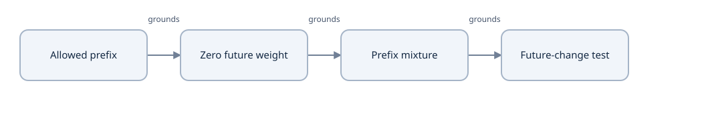
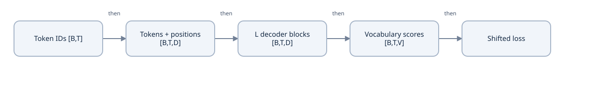
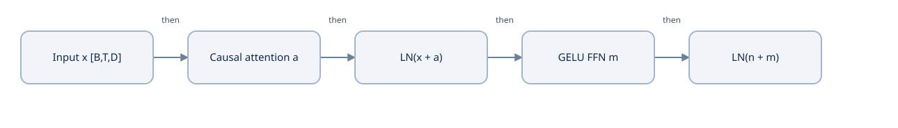
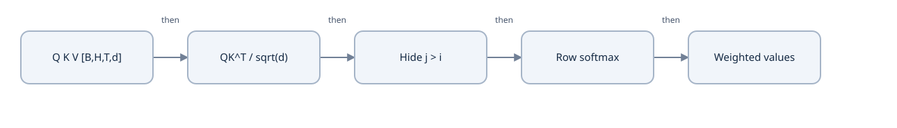
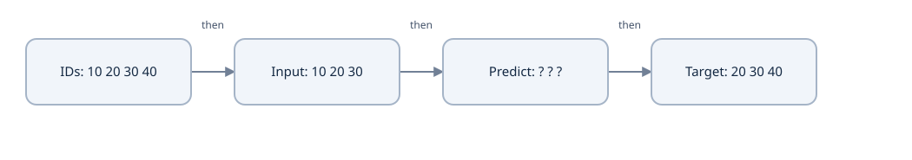
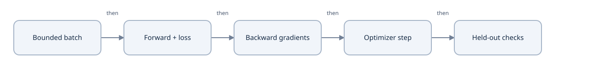
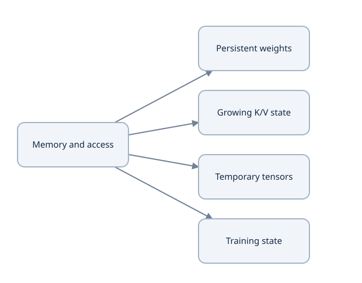

# GPT-1: build the mental model

How do tokens, causal attention, post-norm blocks and next-token targets fit together before we build the tiny model?

Learning material for P01. Model implementation/training and learner mastery are separate states.

**Outcomes:** Draw the decoder and annotate its tensor shapes; Predict causal attention and shifted next-token targets; Explain which state grows with context and what remains unverified.

## Start with a picture you can explain

This is a reference-design study before P01-M1. Draw the boards yourself and predict the small examples before running them. The GPT repository, full decoder and training run are still pending. Reading this lesson does not establish mastery.

### Find a useful starting point

The route below is proposed; no learner answers have been observed. We assume familiarity with C++/Python arrays and indices, but tensor shapes, softmax and target alignment remain unchecked. Try this entry question before reading its answer. If it is easy, continue to the changed-value and zero-score checks; if it is unfamiliar, begin with the three-position trace in the next chapter.

### Predict or explain: For positions 0, 1, 2 under a causal prefix rule, which value positions may contribute to the output at position 1?

<details data-practice-id="visible-prefix"><summary>Reveal worked answer and rubric</summary>

Positions 0 and 1. Position 2 is future information for this row and must contribute zero weight.

**Rubric:** Use the query position as the boundary, include the current position, and distinguish indices from values. Unknown or skipped is unassessed, not a mastery result.

</details>


Our task is to predict a later token from a permitted prefix. That task premise motivates restricting which positions can contribute. We will derive zero future weight, calculate a small prefix mixture, then test whether changing the future can affect an earlier output. The arrows on this board are concept prerequisites, not model execution or proof of learner progress.



Concept prerequisites for this toy task: permitted positions motivate zero future contribution, then a prefix mixture and an invariance check. These are understanding relationships, not tensor execution arrows or observed learner progress.


After the causality trace, align each prediction with its next-token target. Visibility controls what information is available; target alignment specifies the question the model is trained to answer. Finally draw the source-specific GPT-1 block and distinguish growing cache from other storage. You can inspect the architecture boards now and return to them after the trace; a live session can work through one question at a time.

The inspected [original implementation](https://github.com/openai/finetune-transformer-lm/blob/a69b5c43b0452462890bca8ff92fb75dee9290cf/train.py) supplies the normalization order and target alignment. The [paper](https://cdn.openai.com/research-covers/language-unsupervised/language_understanding_paper.pdf) describes the architecture and training setup. Our future tiny model uses byte/special IDs rather than the published tokenizer; that is an educational simplification.



Follow one batch through the full model. The repeated block is expanded on the next board. Shapes are illustrative, not an allocated model.


At each token, add its learned position vector to its token vector. Feed the sequence through repeated causal blocks, then turn each resulting vector into vocabulary scores. Positions supply order; the mask controls visibility.



The residual addition happens before normalization in this reference. Each attention/FFN sublayer returns width D; the FFN hidden width expands.


Follow the two residual branches explicitly. A block keeps the outer batch/time/width shape even though its feed-forward intermediate expands. Do not replace this reference's normalization order with a remembered diagram of another model.

### Predict or explain: Draw one GPT-1 block. Where do residual addition and normalization go?

<details data-practice-id="draw-block"><summary>Reveal worked answer and rubric</summary>

n = LN(x + attention(x)); y = LN(n + FFN(n)). Both additions precede normalization.

**Rubric:** Preserve order, both residual paths and width D.

</details>


## Make the arrays small enough to inspect

Use B=2, T=8, D=64, H=4 and V=260 solely to work out shapes. The project proposes a maximum context of 64; this worked batch only contains eight positions. No tensor allocation or parameter count is claimed here.

### Hand-check these illustrative shapes

| Tensor | Shape | Meaning |
| --- | --- | --- |
| Token IDs | [2,8] | Integer indices |
| Residual stream | [2,8,64] | Batch, time, width |
| Head Q/K/V | [2,4,8,16] | 64 / 4 = 16 per head |
| Attention scores | [2,4,8,8] | Query/key axes; hide upper triangle |
| FFN intermediate | [2,8,256] | 4 times width |
| Vocabulary scores | [2,8,260] | One distribution per position |




Q asks for useful context, K supplies matching addresses and V supplies content. The mask acts before softmax. With every allowed score zero, weights are uniform.


### Derive the restriction from the task

Suppose position 0 is meant to predict the next token using only its permitted prefix. If its output can use a later input value, changing that value can change the prediction before the prefix changes. This would violate our prefix-only task. Therefore the mixture must give forbidden future values zero weight. This is a consequence of the stated task and attention mixture, not a claim that every attention model must be causal.

For a hand calculation, use one scalar value per token, V=[2,4,8], and zero attention scores. A visible row with n keys assigns each weight 1/n. This removes learned projections so we can isolate the mask and weighted sum.

### Three-token causal visibility

| Query row | Visible values | Weights | Output |
| --- | --- | --- | --- |
| 0 | 2 | [1,0,0] | 2 |
| 1 | 2,4 | [1/2,1/2,0] | 3 |
| 2 | 2,4,8 | [1/3,1/3,1/3] | 14/3 |


Before the explanation, test a tempting implementation shortcut:

### Predict or explain: All three scores are zero. If a forbidden future score is also set to zero, does softmax give that key zero weight? Explain or compute its weight.

<details data-practice-id="zero-score-check"><summary>Reveal worked answer and rubric</summary>

No. exp(0)=1 for every key, so each weight is 1/3. In the prefix-only toy the forbidden key needs zero weight, achieved by an idealized negative-infinity score before normalization. The rows in this toy have at least one allowed key.

**Rubric:** Distinguish score from normalized weight; derive the positive mass and identify the intended visibility constraint. State the nonempty allowed-row assumption.

</details>


Softmax turns a finite score s into a positive factor exp(s). Zeroing a forbidden score gives exp(0)=1, so it still receives positive weight after normalization. In this toy, all-zero unmasked scores distribute the mass uniformly across all three keys. A forbidden key needs zero weight; the idealized mask uses negative infinity before normalization. The last row averages 2+4+8; the first row can use only its first value. The causal rows here always have at least one allowed key; an all-masked row would need an explicit policy.

Change the last value from 8 to 98. Assume three positions, zero logits, fixed values and no dropout. Compare the output at position 0.

Illustrative cases, not a model execution.

[[interactive:leakage]]

### Does a future value change a past output?

| Visibility rule | Future value | Outcome | Explanation |
| --- | --- | --- | --- |
| causal | 8 | 2 | Only the first value is visible. |
| causal | 98 | 2 | Changing a future value leaves this prefix output unchanged. |
| unmasked | 8 | 4.666666667 | All three values leak into position 0. |
| unmasked | 98 | 34.666666667 | The earlier output changes; future information is visible. |


### Predict or explain: If the last value changes from 8 to 98, which causal outputs can change?

<details data-practice-id="causal-check"><summary>Reveal worked answer and rubric</summary>

Only the output at the last position. Outputs at positions 0 and 1 remain 2 and 3. The last changes to 104/3.

**Rubric:** Explain visibility, not just the numbers.

</details>




The final token supplies a target without being used as an input in this short worked batch. Targets stay aligned to their prediction positions.


Work out the alignment before a loss function is written. At input position t, our next-token task asks for token t+1. This motivates shifting the target array by one position. A causal mask and correct targets solve different problems: the mask prevents seeing later inputs, while the shift specifies the answer each position must predict. A correct mask cannot repair training against the wrong target.

### Predict or explain: What are the input and target arrays for token IDs 10, 20, 30, 40?

<details data-practice-id="shift-check"><summary>Reveal worked answer and rubric</summary>

Inputs [10,20,30]; targets [20,30,40]. Copying inputs into targets changes the learning problem.

**Rubric:** Align each target with the following token.

</details>


### Run both language examples after predicting

Read the [Python example](examples/causal_trace.py) or [C++ example](examples/causal_trace.cpp). Both print the causal and unmasked averages, changed-prefix behavior and shifted arrays as JSON. They use the standard libraries and no learned parameters. Compare with your hand calculation, then change the values and recompute the expected result.

From workspace home, run:

```bash
./ai learn examples --lesson projects/p01/gpt-1-foundations/v1
```

This checks toy semantics in both languages. It does not verify model projections, autograd, a tokenizer or training.


## Connect correctness to the eventual research goal

First build and train the complete tiny model. Inspect a bounded batch, losses and gradients, then test generation and checkpoint/resume. Use a held-out split and causal checks: a suspiciously low loss can come from a broken problem.



This loop is planned for the model project. A low loss can still hide leakage or target errors; independent checks come before interpretation.


The memory board is a set of questions to investigate during the model project, not a proposed optimization result. Start by measuring weights, retained state, temporary tensors and transfers separately. Prefill processes a sequence; cached decoding adds positions while retaining previous keys and values.



Weights persist across tokens. K/V grows with cached context; attention intermediates and training state have different lifetimes. Offloading also moves bytes and takes time.


For ordinary MHA, each layer's K and V each contain B*T*D elements. Multiplying by two tensors, L layers and the dtype's bytes gives the cache's raw storage. This accounting changes with grouped heads, quantization or compression. Actual process memory also includes allocator overhead and workspace.

### Predict or explain: How many bytes are in a 2-layer, batch-1, T=64, D=64 FP32 MHA K/V cache?

<details data-practice-id="cache-check"><summary>Reveal worked answer and rubric</summary>

2 * 2 * 1 * 64 * 64 * 4 = 65536 bytes, or 64 KiB. This excludes weights and temporary allocations.

**Rubric:** Include K and V, layers, batch, context, width and dtype. State exclusions.

</details>


Putting weights or state on SSD changes where bytes live and how they move. Capacity alone does not establish usable latency or throughput. Study the implementation and measure a declared baseline before making a focused Research claim.

### Prepare to explain, then implement

Use the [whiteboard story](whiteboard/defense.md) and [challenge bank](whiteboard/questions.md). During a requested live defense, answer one question at a time before looking at answers. Save learner mastery only after an actual explanation or implementation exercise.

Next, follow P01-M1: create the independent GPT project, pin sources, declare its tiny configuration and data contracts, and implement one component at a time. This tutorial is the starting material; future chapters should follow actual model code and evidence.


## Evidence and proof limits

### Claim ledger

| Claim | Status | Proof limit |
| --- | --- | --- |
| GPT-1 uses a causal decoder with learned positions, GELU and post-residual normalization. | documented | Architecture is inspected; a full local implementation remains pending. |
| The inspected model aligns each hidden position with the following token and shares embedding weights with the language-model projection. | documented | Code inspection, not local loss/backward verification. |
| Uniform allowed attention over values 2, 4, 8 gives prefix averages 2, 3, 4.666666667. | illustrative | Analytic toy and two language examples; not a trained attention layer. |
| For a standard uncompressed MHA cache, two K/V tensors use 2*layers*batch*context*width*bytes_per_element. | inference | Tensor-storage calculation excludes allocator, temporary workspace and other model state. |
| No GPT-1 training, GPU/SSD benchmark or learner mastery is established by this lesson. | unknown | These require future model work, measurements or learner demonstration. |

## Sources

- [Original GPT-1 implementation at pinned revision](https://github.com/openai/finetune-transformer-lm/blob/a69b5c43b0452462890bca8ff92fb75dee9290cf/train.py) — train.py: attn, block, embed, model and mgpu_train; checked 2026-10-09
- [Improving Language Understanding by Generative Pre-Training](https://cdn.openai.com/research-covers/language-unsupervised/language_understanding_paper.pdf) — Sections 3 and 4.1; model specifications; checked 2026-10-09
